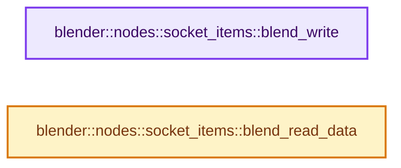
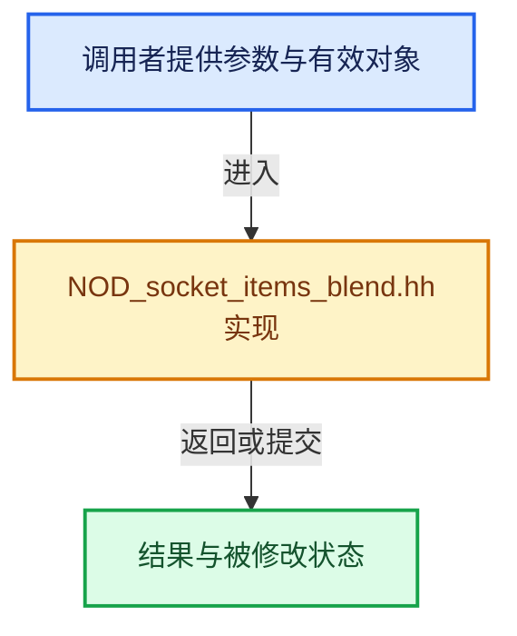

# 实现依赖专题：source/blender/nodes/NOD_socket_items_blend.hh

[实现依赖导航](../README.md) · [符号索引](../../00-课程指南/02-源码与提交索引/符号依赖与实现索引.md)

本专题从正文实际调用进入，集中保存共享实现。函数有稳定锚点，可从调用处直接跳到对应完整函数；递归与互相调用通过回链组织。

## 本文件的实现关系






## 完整成员与函数实现

<a id="f-ae17c9413f15c969"></a>

### `blender::nodes::socket_items::blend_write`

实现位置：[source/blender/nodes/NOD_socket_items_blend.hh](../../../../../../source/blender/nodes/NOD_socket_items_blend.hh) · L17—L26。

接口参数：

- `BlendWriter *writer`
- `const bNode &node`

**教学注释版**

<!-- annotated:7e00ac5828bebe -->

```cpp
template<typename Accessor> inline void blend_write(BlendWriter *writer, const bNode &node)
{
  using ItemT = typename Accessor::ItemT;
  const SocketItemsRef<ItemT> items = Accessor::get_items_from_node(const_cast<bNode &>(node));
  writer->write_struct_array_by_id(
      dna::sdna_struct_id_get<ItemT>(), *items.items_num, *items.items);
  for (const ItemT &item : Span(*items.items, *items.items_num)) {
    Accessor::blend_write_item(writer, item);
  }
}
```

<details>
<summary>核对原始源码：source/blender/nodes/NOD_socket_items_blend.hh · L17—L26</summary>

<!-- original:7e00ac5828bebe:source/blender/nodes/NOD_socket_items_blend.hh:17:26 -->

```cpp
template<typename Accessor> inline void blend_write(BlendWriter *writer, const bNode &node)
{
  using ItemT = typename Accessor::ItemT;
  const SocketItemsRef<ItemT> items = Accessor::get_items_from_node(const_cast<bNode &>(node));
  writer->write_struct_array_by_id(
      dna::sdna_struct_id_get<ItemT>(), *items.items_num, *items.items);
  for (const ItemT &item : Span(*items.items, *items.items_num)) {
    Accessor::blend_write_item(writer, item);
  }
}
```

</details>

**继续追踪实现**

- `Accessor::get_items_from_node` → [blender::nodes::RaycastSampleAttributeItemsAccessor::get_items_from_node · L38](shader/include/NOD_shader_raycast.hh.md#f-3a8b562628078095)；[blender::nodes::GeoViewerItemsAccessor::get_items_from_node · L38](geometry/include/NOD_geo_viewer.hh.md#f-5ab2cbca96314de9)；[blender::nodes::SimulationItemsAccessor::get_items_from_node · L37](geometry/include/NOD_geo_simulation.hh.md#f-898ff47dc220feed)；[blender::nodes::RepeatItemsAccessor::get_items_from_node · L37](geometry/include/NOD_geo_repeat.hh.md#f-bc70898d619a07bc)；[blender::nodes::RasterizePointsItemsAccessor::get_items_from_node · L37](geometry/include/NOD_geo_rasterize_points.hh.md#f-f07b0adeb48df2b5)；[blender::nodes::MenuSwitchItemsAccessor::get_items_from_node · L38](geometry/include/NOD_geo_menu_switch.hh.md#f-ad24d3b15c5b59c3)；[blender::nodes::IndexSwitchItemsAccessor::get_items_from_node · L30](geometry/include/NOD_geo_index_switch.hh.md#f-fe5dfa66cec1ecf2)；[blender::nodes::ForeachGeometryElementInputItemsAccessor::get_items_from_node · L37](geometry/include/NOD_geo_foreach_geometry_element.hh.md#f-614cb876c8c0ad08)；[blender::nodes::ForeachGeometryElementMainItemsAccessor::get_items_from_node · L123](geometry/include/NOD_geo_foreach_geometry_element.hh.md#f-c3463dfe9d86d1c6)；[blender::nodes::ForeachGeometryElementGenerationItemsAccessor::get_items_from_node · L209](geometry/include/NOD_geo_foreach_geometry_element.hh.md#f-9b2b97a4c6e2e2bf)；[blender::nodes::FieldToListItemsAccessor::get_items_from_node · L38](geometry/include/NOD_geo_field_to_list.hh.md#f-b9622adfbf3850be)；[blender::nodes::FieldToGridItemsAccessor::get_items_from_node · L38](geometry/include/NOD_geo_field_to_grid.hh.md#f-869efc4bfe6a0034)；[blender::nodes::CombineListItemsAccessor::get_items_from_node · L30](geometry/include/NOD_geo_combine_list.hh.md#f-4d73951dcbf992a5)；[blender::nodes::ClosureToListItemsAccessor::get_items_from_node · L38](geometry/include/NOD_geo_closure_to_list.hh.md#f-e3c98034ea103873)；[blender::nodes::ClosureInputItemsAccessor::get_items_from_node · L41](geometry/include/NOD_geo_closure.hh.md#f-81cfe82f985d2413)；[blender::nodes::ClosureOutputItemsAccessor::get_items_from_node · L115](geometry/include/NOD_geo_closure.hh.md#f-741633ed0fe86dcc)；[blender::nodes::EvaluateClosureInputItemsAccessor::get_items_from_node · L189](geometry/include/NOD_geo_closure.hh.md#f-63859ce4e73466e4)；[blender::nodes::EvaluateClosureOutputItemsAccessor::get_items_from_node · L264](geometry/include/NOD_geo_closure.hh.md#f-df9ac7fb721bd6cf)；[blender::nodes::CaptureAttributeItemsAccessor::get_items_from_node · L36](geometry/include/NOD_geo_capture_attribute.hh.md#f-7c4ae7b1065e727d)；[blender::nodes::CombineBundleItemsAccessor::get_items_from_node · L41](geometry/include/NOD_geo_bundle.hh.md#f-726d871c58c4a98e)；[blender::nodes::SeparateBundleItemsAccessor::get_items_from_node · L117](geometry/include/NOD_geo_bundle.hh.md#f-361121e6a62ec201)；[blender::nodes::BakeItemsAccessor::get_items_from_node · L52](geometry/include/NOD_geo_bake.hh.md#f-8a32f2915f15b452)；[blender::nodes::FormatStringItemsAccessor::get_items_from_node · L40](function/include/NOD_fn_format_string.hh.md#f-01e4b1bbb0e9a7b0)；[blender::nodes::FileOutputItemsAccessor::get_items_from_node · L45](composite/include/NOD_compositor_file_output.hh.md#f-bdac32a93a61751d)。同名重载需按实参类型选择。
- `writer->write_struct_array_by_id` → [blender::BlendWriter::write_struct_array_by_id · L2252](../08-其他Blender模块/blenloader/intern/writefile.cc.md#f-05789193154f1647)。
- `dna::sdna_struct_id_get<ItemT>` → [调用协议](../../00-课程指南/01-路线与规范/模板宏与动态分派协议.md)：函数指针、局部可调用对象或未展开的宏；必须结合调用者环境。调用位置L22。
- `Span` → [blender::Span](../01-BLI基础库/BLI_span.hh.md#t-8765a8e0c1d5)；[blender::Span](../01-BLI基础库/BLI_index_range.hh.md#t-86091874a1c0)；[blender::Span](../08-其他Blender模块/makesdna/DNA_pointcloud_types.h.md#t-112aa6ed842c)；[blender::Span](../08-其他Blender模块/makesdna/DNA_node_types.h.md#t-49ec6fbb9b69)；[blender::Span](../08-其他Blender模块/makesdna/DNA_mesh_types.h.md#t-184fd48fb638)；[blender::Span](../08-其他Blender模块/makesdna/DNA_anim_types.h.md#t-d841071994c2)；[blender::Span](../08-其他Blender模块/makesrna/RNA_path_fwd.hh.md#t-4dbb08969e41)。
- `Accessor::blend_write_item` → [blender::nodes::RaycastSampleAttributeItemsAccessor::blend_write_item · L277](shader/nodes/node_shader_raycast.cc.md#f-877171f69c6e4ae5)；[blender::nodes::CombineListItemsAccessor::blend_write_item · L269](geometry/nodes/node_geo_combine_list.cc.md#f-bbdcf290024da1bd)；[blender::nodes::CombineBundleItemsAccessor::blend_write_item · L277](geometry/nodes/node_geo_combine_bundle.cc.md#f-a93f75af2d601c3d)；[blender::nodes::ClosureToListItemsAccessor::blend_write_item · L299](geometry/nodes/node_geo_closure_to_list.cc.md#f-5f98790ef2061cf0)；[blender::nodes::ClosureInputItemsAccessor::blend_write_item · L300](geometry/nodes/node_geo_closure.cc.md#f-b10b955cda77505a)；[blender::nodes::ClosureOutputItemsAccessor::blend_write_item · L312](geometry/nodes/node_geo_closure.cc.md#f-2574476f1d7b5cc2)；[blender::nodes::BakeItemsAccessor::blend_write_item · L812](geometry/nodes/node_geo_bake.cc.md#f-fbf8e885dab2bbd5)；[blender::nodes::CaptureAttributeItemsAccessor::blend_write_item · L328](geometry/nodes/node_geo_attribute_capture.cc.md#f-705d6a62fc102031)；[blender::nodes::GeoViewerItemsAccessor::blend_write_item · L554](geometry/nodes/node_geo_viewer.cc.md#f-a3e3bffe0f7f7321)；[blender::nodes::SimulationItemsAccessor::blend_write_item · L820](geometry/nodes/node_geo_simulation.cc.md#f-b67c032317d698af)；[blender::nodes::SeparateBundleItemsAccessor::blend_write_item · L350](geometry/nodes/node_geo_separate_bundle.cc.md#f-23aa2a4565b9d55c)；[blender::nodes::RepeatItemsAccessor::blend_write_item · L348](geometry/nodes/node_geo_repeat.cc.md#f-3f47b2203ef0e71b)；[blender::nodes::RasterizePointsItemsAccessor::blend_write_item · L371](geometry/nodes/node_geo_rasterize_points.cc.md#f-7e0c225ffe20d65a)；[blender::nodes::MenuSwitchItemsAccessor::blend_write_item · L699](../../09-LazyFunction与节点执行架构/11-Switch与MenuSwitch.md#f-ecbda9aef4ea0d7c)；[blender::nodes::IndexSwitchItemsAccessor::blend_write_item · L548](geometry/nodes/node_geo_index_switch.cc.md#f-1089788a183f4017)；[blender::nodes::ForeachGeometryElementInputItemsAccessor::blend_write_item · L495](geometry/nodes/node_geo_foreach_geometry_element.cc.md#f-5ed7f9d65a90852d)；[blender::nodes::ForeachGeometryElementMainItemsAccessor::blend_write_item · L510](geometry/nodes/node_geo_foreach_geometry_element.cc.md#f-2818baf968b1d8fa)；[blender::nodes::ForeachGeometryElementGenerationItemsAccessor::blend_write_item · L525](geometry/nodes/node_geo_foreach_geometry_element.cc.md#f-5bfcd7f0c79b06c5)；[blender::nodes::FieldToListItemsAccessor::blend_write_item · L245](geometry/nodes/node_geo_field_to_list.cc.md#f-c79de77bcdc1ff15)；[blender::nodes::FieldToGridItemsAccessor::blend_write_item · L275](geometry/nodes/node_geo_field_to_grid.cc.md#f-6b2cf69630281c4f)；[blender::nodes::EvaluateClosureInputItemsAccessor::blend_write_item · L575](geometry/nodes/node_geo_evaluate_closure.cc.md#f-6e9ca07e114d3a2d)；[blender::nodes::EvaluateClosureOutputItemsAccessor::blend_write_item · L587](geometry/nodes/node_geo_evaluate_closure.cc.md#f-1606283918e72ff1)；[blender::nodes::FormatStringItemsAccessor::blend_write_item · L836](function/nodes/node_fn_format_string.cc.md#f-c52ae18ee80ce81a)；[blender::nodes::FileOutputItemsAccessor::blend_write_item · L865](composite/nodes/node_composite_file_output.cc.md#f-e0373d6d8bd8e62a)。同名重载需按实参类型选择。

<a id="f-2eff33b148bb4cd4"></a>

### `blender::nodes::socket_items::blend_read_data`

实现位置：[source/blender/nodes/NOD_socket_items_blend.hh](../../../../../../source/blender/nodes/NOD_socket_items_blend.hh) · L28—L36。

接口参数：

- `BlendDataReader *reader`
- `bNode &node`

**教学注释版**

<!-- annotated:60ac0d003283e7 -->

```cpp
template<typename Accessor> inline void blend_read_data(BlendDataReader *reader, bNode &node)
{
  using ItemT = typename Accessor::ItemT;
  const SocketItemsRef<ItemT> items = Accessor::get_items_from_node(node);
  BLO_read_array_and_validate_size(reader, items.items, items.items_num);
  for (ItemT &item : MutableSpan(*items.items, *items.items_num)) {
    Accessor::blend_read_data_item(reader, item);
  }
}
```

<details>
<summary>核对原始源码：source/blender/nodes/NOD_socket_items_blend.hh · L28—L36</summary>

<!-- original:60ac0d003283e7:source/blender/nodes/NOD_socket_items_blend.hh:28:36 -->

```cpp
template<typename Accessor> inline void blend_read_data(BlendDataReader *reader, bNode &node)
{
  using ItemT = typename Accessor::ItemT;
  const SocketItemsRef<ItemT> items = Accessor::get_items_from_node(node);
  BLO_read_array_and_validate_size(reader, items.items, items.items_num);
  for (ItemT &item : MutableSpan(*items.items, *items.items_num)) {
    Accessor::blend_read_data_item(reader, item);
  }
}
```

</details>

**继续追踪实现**

- `Accessor::get_items_from_node` → [blender::nodes::RaycastSampleAttributeItemsAccessor::get_items_from_node · L38](shader/include/NOD_shader_raycast.hh.md#f-3a8b562628078095)；[blender::nodes::GeoViewerItemsAccessor::get_items_from_node · L38](geometry/include/NOD_geo_viewer.hh.md#f-5ab2cbca96314de9)；[blender::nodes::SimulationItemsAccessor::get_items_from_node · L37](geometry/include/NOD_geo_simulation.hh.md#f-898ff47dc220feed)；[blender::nodes::RepeatItemsAccessor::get_items_from_node · L37](geometry/include/NOD_geo_repeat.hh.md#f-bc70898d619a07bc)；[blender::nodes::RasterizePointsItemsAccessor::get_items_from_node · L37](geometry/include/NOD_geo_rasterize_points.hh.md#f-f07b0adeb48df2b5)；[blender::nodes::MenuSwitchItemsAccessor::get_items_from_node · L38](geometry/include/NOD_geo_menu_switch.hh.md#f-ad24d3b15c5b59c3)；[blender::nodes::IndexSwitchItemsAccessor::get_items_from_node · L30](geometry/include/NOD_geo_index_switch.hh.md#f-fe5dfa66cec1ecf2)；[blender::nodes::ForeachGeometryElementInputItemsAccessor::get_items_from_node · L37](geometry/include/NOD_geo_foreach_geometry_element.hh.md#f-614cb876c8c0ad08)；[blender::nodes::ForeachGeometryElementMainItemsAccessor::get_items_from_node · L123](geometry/include/NOD_geo_foreach_geometry_element.hh.md#f-c3463dfe9d86d1c6)；[blender::nodes::ForeachGeometryElementGenerationItemsAccessor::get_items_from_node · L209](geometry/include/NOD_geo_foreach_geometry_element.hh.md#f-9b2b97a4c6e2e2bf)；[blender::nodes::FieldToListItemsAccessor::get_items_from_node · L38](geometry/include/NOD_geo_field_to_list.hh.md#f-b9622adfbf3850be)；[blender::nodes::FieldToGridItemsAccessor::get_items_from_node · L38](geometry/include/NOD_geo_field_to_grid.hh.md#f-869efc4bfe6a0034)；[blender::nodes::CombineListItemsAccessor::get_items_from_node · L30](geometry/include/NOD_geo_combine_list.hh.md#f-4d73951dcbf992a5)；[blender::nodes::ClosureToListItemsAccessor::get_items_from_node · L38](geometry/include/NOD_geo_closure_to_list.hh.md#f-e3c98034ea103873)；[blender::nodes::ClosureInputItemsAccessor::get_items_from_node · L41](geometry/include/NOD_geo_closure.hh.md#f-81cfe82f985d2413)；[blender::nodes::ClosureOutputItemsAccessor::get_items_from_node · L115](geometry/include/NOD_geo_closure.hh.md#f-741633ed0fe86dcc)；[blender::nodes::EvaluateClosureInputItemsAccessor::get_items_from_node · L189](geometry/include/NOD_geo_closure.hh.md#f-63859ce4e73466e4)；[blender::nodes::EvaluateClosureOutputItemsAccessor::get_items_from_node · L264](geometry/include/NOD_geo_closure.hh.md#f-df9ac7fb721bd6cf)；[blender::nodes::CaptureAttributeItemsAccessor::get_items_from_node · L36](geometry/include/NOD_geo_capture_attribute.hh.md#f-7c4ae7b1065e727d)；[blender::nodes::CombineBundleItemsAccessor::get_items_from_node · L41](geometry/include/NOD_geo_bundle.hh.md#f-726d871c58c4a98e)；[blender::nodes::SeparateBundleItemsAccessor::get_items_from_node · L117](geometry/include/NOD_geo_bundle.hh.md#f-361121e6a62ec201)；[blender::nodes::BakeItemsAccessor::get_items_from_node · L52](geometry/include/NOD_geo_bake.hh.md#f-8a32f2915f15b452)；[blender::nodes::FormatStringItemsAccessor::get_items_from_node · L40](function/include/NOD_fn_format_string.hh.md#f-01e4b1bbb0e9a7b0)；[blender::nodes::FileOutputItemsAccessor::get_items_from_node · L45](composite/include/NOD_compositor_file_output.hh.md#f-bdac32a93a61751d)。同名重载需按实参类型选择。
- `BLO_read_array_and_validate_size` → [blender::BLO_read_array_and_validate_size · L571](../08-其他Blender模块/blenloader/BLO_read_write.hh.md#f-645e9600b66d0b15)。
- `MutableSpan` → [blender::MutableSpan::MutableSpan · L462](../../01-基础容器与现代CPP/06-MutableSpan可写视图.md#f-0f07034aaffc3384)；[blender::MutableSpan::MutableSpan · L464](../../01-基础容器与现代CPP/06-MutableSpan可写视图.md#f-39977234ad0ce192)；[blender::MutableSpan::MutableSpan · L466](../../01-基础容器与现代CPP/06-MutableSpan可写视图.md#f-ee249b5042dd38aa)；[blender::MutableSpan::MutableSpan · L468](../../01-基础容器与现代CPP/06-MutableSpan可写视图.md#f-479c5f85921e531f)；[blender::MutableSpan::MutableSpan · L477](../../01-基础容器与现代CPP/06-MutableSpan可写视图.md#f-afcce5325e6f19e0)。同名重载需按实参类型选择。
- `Accessor::blend_read_data_item` → [blender::nodes::RaycastSampleAttributeItemsAccessor::blend_read_data_item · L282](shader/nodes/node_shader_raycast.cc.md#f-705b3505638a9ad1)；[blender::nodes::CombineListItemsAccessor::blend_read_data_item · L273](geometry/nodes/node_geo_combine_list.cc.md#f-ba6d783a92318b51)；[blender::nodes::CombineBundleItemsAccessor::blend_read_data_item · L282](geometry/nodes/node_geo_combine_bundle.cc.md#f-d63df89bb46a89e6)；[blender::nodes::ClosureToListItemsAccessor::blend_read_data_item · L304](geometry/nodes/node_geo_closure_to_list.cc.md#f-7c061fbbffc98c43)；[blender::nodes::ClosureInputItemsAccessor::blend_read_data_item · L305](geometry/nodes/node_geo_closure.cc.md#f-13b148ae1a337001)；[blender::nodes::ClosureOutputItemsAccessor::blend_read_data_item · L317](geometry/nodes/node_geo_closure.cc.md#f-8541015cbade786d)；[blender::nodes::BakeItemsAccessor::blend_read_data_item · L817](geometry/nodes/node_geo_bake.cc.md#f-169e3fcd91afd4d3)；[blender::nodes::CaptureAttributeItemsAccessor::blend_read_data_item · L333](geometry/nodes/node_geo_attribute_capture.cc.md#f-468b1c3c7b8c73bd)；[blender::nodes::GeoViewerItemsAccessor::blend_read_data_item · L560](geometry/nodes/node_geo_viewer.cc.md#f-245b1eccba5ceb44)；[blender::nodes::SimulationItemsAccessor::blend_read_data_item · L825](geometry/nodes/node_geo_simulation.cc.md#f-7ead31088c6740e0)；[blender::nodes::SeparateBundleItemsAccessor::blend_read_data_item · L355](geometry/nodes/node_geo_separate_bundle.cc.md#f-e9c4428a8a041f4f)；[blender::nodes::RepeatItemsAccessor::blend_read_data_item · L353](geometry/nodes/node_geo_repeat.cc.md#f-b14d49b17a97b750)；[blender::nodes::RasterizePointsItemsAccessor::blend_read_data_item · L376](geometry/nodes/node_geo_rasterize_points.cc.md#f-caa20403c3bddb40)；[blender::nodes::MenuSwitchItemsAccessor::blend_read_data_item · L705](../../09-LazyFunction与节点执行架构/11-Switch与MenuSwitch.md#f-a8c55645f14e5d98)；[blender::nodes::IndexSwitchItemsAccessor::blend_read_data_item · L552](geometry/nodes/node_geo_index_switch.cc.md#f-a00fc5088f5a7a13)；[blender::nodes::ForeachGeometryElementInputItemsAccessor::blend_read_data_item · L501](geometry/nodes/node_geo_foreach_geometry_element.cc.md#f-7979e2b1c12ec694)；[blender::nodes::ForeachGeometryElementMainItemsAccessor::blend_read_data_item · L516](geometry/nodes/node_geo_foreach_geometry_element.cc.md#f-17e2c8d7504140ae)；[blender::nodes::ForeachGeometryElementGenerationItemsAccessor::blend_read_data_item · L531](geometry/nodes/node_geo_foreach_geometry_element.cc.md#f-9546687d00bdd53a)；[blender::nodes::FieldToListItemsAccessor::blend_read_data_item · L250](geometry/nodes/node_geo_field_to_list.cc.md#f-b1d5a1f92cd46800)；[blender::nodes::FieldToGridItemsAccessor::blend_read_data_item · L280](geometry/nodes/node_geo_field_to_grid.cc.md#f-c6df4400ec94c0e6)；[blender::nodes::EvaluateClosureInputItemsAccessor::blend_read_data_item · L580](geometry/nodes/node_geo_evaluate_closure.cc.md#f-8afde659ce3e59ea)；[blender::nodes::EvaluateClosureOutputItemsAccessor::blend_read_data_item · L592](geometry/nodes/node_geo_evaluate_closure.cc.md#f-19f28a191ed4b07c)；[blender::nodes::FormatStringItemsAccessor::blend_read_data_item · L841](function/nodes/node_fn_format_string.cc.md#f-4bfcad3fe36c9554)；[blender::nodes::FileOutputItemsAccessor::blend_read_data_item · L871](composite/nodes/node_composite_file_output.cc.md#f-acb146d93a9ed408)。同名重载需按实参类型选择。
