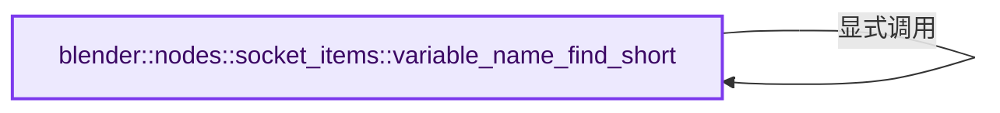
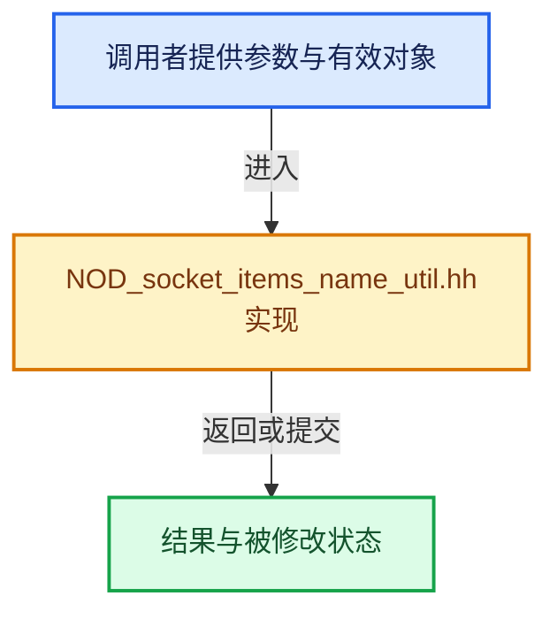

# 实现依赖专题：source/blender/nodes/NOD_socket_items_name_util.hh

[实现依赖导航](../README.md) · [符号索引](../../00-课程指南/02-源码与提交索引/符号依赖与实现索引.md)

本专题从正文实际调用进入，集中保存共享实现。函数有稳定锚点，可从调用处直接跳到对应完整函数；递归与互相调用通过回链组织。

## 本文件的实现关系






## 完整成员与函数实现

<a id="f-c202e7955a1ac661"></a>

### `blender::nodes::socket_items::variable_name_find_short`

实现位置：[source/blender/nodes/NOD_socket_items_name_util.hh](../../../../../../source/blender/nodes/NOD_socket_items_name_util.hh) · L22—L33。

接口参数：

- `const bNode &node`
- `const StringRef src_name`

**教学注释版**

<!-- annotated:9fbec7651b7d71 -->

```cpp
template<typename Accessor>
inline std::string variable_name_find_short(const bNode &node, const StringRef src_name)
{
  using ItemT = typename Accessor::ItemT;
  return socket_items::variable_name_find_short(src_name, [&](const StringRef name) {
    const SocketItemsRef<ItemT> items = Accessor::get_items_from_node(const_cast<bNode &>(node));
    return std::any_of(*items.items, *items.items + *items.items_num, [&](ItemT &item) {
      const StringRef item_name = *Accessor::get_name(item);
      return item_name == name;
    });
  });
}
```

<details>
<summary>核对原始源码：source/blender/nodes/NOD_socket_items_name_util.hh · L22—L33</summary>

<!-- original:9fbec7651b7d71:source/blender/nodes/NOD_socket_items_name_util.hh:22:33 -->

```cpp
template<typename Accessor>
inline std::string variable_name_find_short(const bNode &node, const StringRef src_name)
{
  using ItemT = typename Accessor::ItemT;
  return socket_items::variable_name_find_short(src_name, [&](const StringRef name) {
    const SocketItemsRef<ItemT> items = Accessor::get_items_from_node(const_cast<bNode &>(node));
    return std::any_of(*items.items, *items.items + *items.items_num, [&](ItemT &item) {
      const StringRef item_name = *Accessor::get_name(item);
      return item_name == name;
    });
  });
}
```

</details>

**结果出口**

- `return socket_items::variable_name_find_short(src_name, [&](const StringRef name) {`
- `return std::any_of(*items.items, *items.items + *items.items_num, [&](ItemT &item) {`
- `return item_name == name;`

**继续追踪实现**

- `socket_items::variable_name_find_short` → [blender::nodes::socket_items::variable_name_find_short · L22](NOD_socket_items_name_util.hh.md#f-c202e7955a1ac661)。
- `Accessor::get_items_from_node` → [blender::nodes::RaycastSampleAttributeItemsAccessor::get_items_from_node · L38](shader/include/NOD_shader_raycast.hh.md#f-3a8b562628078095)；[blender::nodes::GeoViewerItemsAccessor::get_items_from_node · L38](geometry/include/NOD_geo_viewer.hh.md#f-5ab2cbca96314de9)；[blender::nodes::SimulationItemsAccessor::get_items_from_node · L37](geometry/include/NOD_geo_simulation.hh.md#f-898ff47dc220feed)；[blender::nodes::RepeatItemsAccessor::get_items_from_node · L37](geometry/include/NOD_geo_repeat.hh.md#f-bc70898d619a07bc)；[blender::nodes::RasterizePointsItemsAccessor::get_items_from_node · L37](geometry/include/NOD_geo_rasterize_points.hh.md#f-f07b0adeb48df2b5)；[blender::nodes::MenuSwitchItemsAccessor::get_items_from_node · L38](geometry/include/NOD_geo_menu_switch.hh.md#f-ad24d3b15c5b59c3)；[blender::nodes::IndexSwitchItemsAccessor::get_items_from_node · L30](geometry/include/NOD_geo_index_switch.hh.md#f-fe5dfa66cec1ecf2)；[blender::nodes::ForeachGeometryElementInputItemsAccessor::get_items_from_node · L37](geometry/include/NOD_geo_foreach_geometry_element.hh.md#f-614cb876c8c0ad08)；[blender::nodes::ForeachGeometryElementMainItemsAccessor::get_items_from_node · L123](geometry/include/NOD_geo_foreach_geometry_element.hh.md#f-c3463dfe9d86d1c6)；[blender::nodes::ForeachGeometryElementGenerationItemsAccessor::get_items_from_node · L209](geometry/include/NOD_geo_foreach_geometry_element.hh.md#f-9b2b97a4c6e2e2bf)；[blender::nodes::FieldToListItemsAccessor::get_items_from_node · L38](geometry/include/NOD_geo_field_to_list.hh.md#f-b9622adfbf3850be)；[blender::nodes::FieldToGridItemsAccessor::get_items_from_node · L38](geometry/include/NOD_geo_field_to_grid.hh.md#f-869efc4bfe6a0034)；[blender::nodes::CombineListItemsAccessor::get_items_from_node · L30](geometry/include/NOD_geo_combine_list.hh.md#f-4d73951dcbf992a5)；[blender::nodes::ClosureToListItemsAccessor::get_items_from_node · L38](geometry/include/NOD_geo_closure_to_list.hh.md#f-e3c98034ea103873)；[blender::nodes::ClosureInputItemsAccessor::get_items_from_node · L41](geometry/include/NOD_geo_closure.hh.md#f-81cfe82f985d2413)；[blender::nodes::ClosureOutputItemsAccessor::get_items_from_node · L115](geometry/include/NOD_geo_closure.hh.md#f-741633ed0fe86dcc)；[blender::nodes::EvaluateClosureInputItemsAccessor::get_items_from_node · L189](geometry/include/NOD_geo_closure.hh.md#f-63859ce4e73466e4)；[blender::nodes::EvaluateClosureOutputItemsAccessor::get_items_from_node · L264](geometry/include/NOD_geo_closure.hh.md#f-df9ac7fb721bd6cf)；[blender::nodes::CaptureAttributeItemsAccessor::get_items_from_node · L36](geometry/include/NOD_geo_capture_attribute.hh.md#f-7c4ae7b1065e727d)；[blender::nodes::CombineBundleItemsAccessor::get_items_from_node · L41](geometry/include/NOD_geo_bundle.hh.md#f-726d871c58c4a98e)；[blender::nodes::SeparateBundleItemsAccessor::get_items_from_node · L117](geometry/include/NOD_geo_bundle.hh.md#f-361121e6a62ec201)；[blender::nodes::BakeItemsAccessor::get_items_from_node · L52](geometry/include/NOD_geo_bake.hh.md#f-8a32f2915f15b452)；[blender::nodes::FormatStringItemsAccessor::get_items_from_node · L40](function/include/NOD_fn_format_string.hh.md#f-01e4b1bbb0e9a7b0)；[blender::nodes::FileOutputItemsAccessor::get_items_from_node · L45](composite/include/NOD_compositor_file_output.hh.md#f-bdac32a93a61751d)。同名重载需按实参类型选择。
- `std::any_of` → [外部契约](https://eel.is/c++draft/)：这个边界按实际表达式及所属类型核对参数、返回值、寿命与失败行为。这里提供接口入口，不声称已解释该第三方版本的内部实现。
- `Accessor::get_name` → [blender::nodes::RaycastSampleAttributeItemsAccessor::get_name · L67](shader/include/NOD_shader_raycast.hh.md#f-3dbabf6482c7400d)；[blender::nodes::GeoViewerItemsAccessor::get_name · L63](geometry/include/NOD_geo_viewer.hh.md#f-e16a909327863a56)；[blender::nodes::SimulationItemsAccessor::get_name · L62](geometry/include/NOD_geo_simulation.hh.md#f-c19e211dd999e593)；[blender::nodes::RepeatItemsAccessor::get_name · L62](geometry/include/NOD_geo_repeat.hh.md#f-f5315ec63ba34b2f)；[blender::nodes::RasterizePointsItemsAccessor::get_name · L59](geometry/include/NOD_geo_rasterize_points.hh.md#f-bb973158098091a1)；[blender::nodes::MenuSwitchItemsAccessor::get_name · L62](geometry/include/NOD_geo_menu_switch.hh.md#f-8172bf3123f81512)；[blender::nodes::ForeachGeometryElementInputItemsAccessor::get_name · L64](geometry/include/NOD_geo_foreach_geometry_element.hh.md#f-82a0abe45b7046fa)；[blender::nodes::ForeachGeometryElementMainItemsAccessor::get_name · L150](geometry/include/NOD_geo_foreach_geometry_element.hh.md#f-9861082db71ecc1f)；[blender::nodes::ForeachGeometryElementGenerationItemsAccessor::get_name · L236](geometry/include/NOD_geo_foreach_geometry_element.hh.md#f-a8c3c5b9674b10ab)；[blender::nodes::FieldToListItemsAccessor::get_name · L68](geometry/include/NOD_geo_field_to_list.hh.md#f-168da21e709ba57c)；[blender::nodes::FieldToGridItemsAccessor::get_name · L68](geometry/include/NOD_geo_field_to_grid.hh.md#f-fcdebe694efc7ae7)；[blender::nodes::ClosureToListItemsAccessor::get_name · L70](geometry/include/NOD_geo_closure_to_list.hh.md#f-3274b764c16018f3)；[blender::nodes::ClosureInputItemsAccessor::get_name · L68](geometry/include/NOD_geo_closure.hh.md#f-6fa2a8e8e258b75d)；[blender::nodes::ClosureOutputItemsAccessor::get_name · L142](geometry/include/NOD_geo_closure.hh.md#f-7dde78906512f31c)；[blender::nodes::EvaluateClosureInputItemsAccessor::get_name · L216](geometry/include/NOD_geo_closure.hh.md#f-79e660f8cf14a06b)；[blender::nodes::EvaluateClosureOutputItemsAccessor::get_name · L291](geometry/include/NOD_geo_closure.hh.md#f-139b8eee19a7b7be)；[blender::nodes::CaptureAttributeItemsAccessor::get_name · L63](geometry/include/NOD_geo_capture_attribute.hh.md#f-2b739a141d618d3c)；[blender::nodes::CombineBundleItemsAccessor::get_name · L66](geometry/include/NOD_geo_bundle.hh.md#f-84bcc75b0ae748d2)；[blender::nodes::SeparateBundleItemsAccessor::get_name · L142](geometry/include/NOD_geo_bundle.hh.md#f-59124b218cada37f)；[blender::nodes::BakeItemsAccessor::get_name · L77](geometry/include/NOD_geo_bake.hh.md#f-de36f339763eaae8)；[blender::nodes::FormatStringItemsAccessor::get_name · L66](function/include/NOD_fn_format_string.hh.md#f-b19d7e09cee79aa0)；[blender::nodes::FileOutputItemsAccessor::get_name · L74](composite/include/NOD_compositor_file_output.hh.md#f-c7d3d5c8215ce84d)。同名重载需按实参类型选择。
