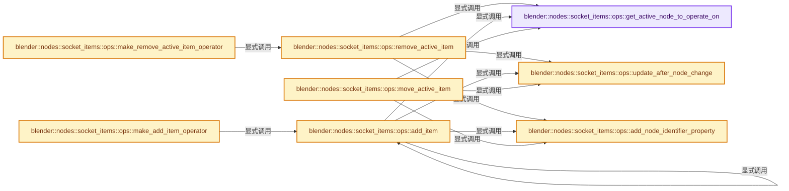
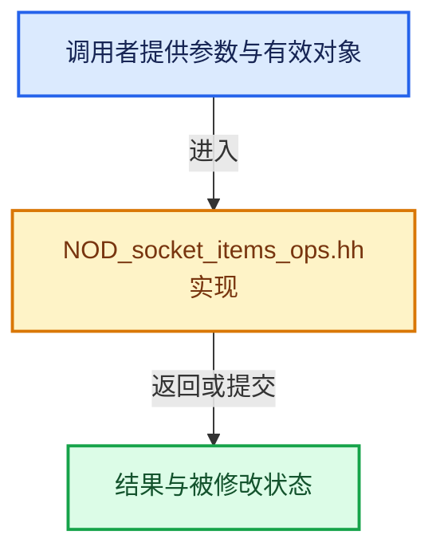

# 实现依赖专题：source/blender/nodes/NOD_socket_items_ops.hh

[实现依赖导航](../README.md) · [符号索引](../../00-课程指南/02-源码与提交索引/符号依赖与实现索引.md)

本专题从正文实际调用进入，集中保存共享实现。函数有稳定锚点，可从调用处直接跳到对应完整函数；递归与互相调用通过回链组织。

## 本文件的实现关系






## 相关类型布局与成员入口

<a id="t-9c92d4317a7b"></a>

### `blender::nodes::socket_items::ops::MoveDirection`

原始声明：[source/blender/nodes/NOD_socket_items_ops.hh](../../../../../../source/blender/nodes/NOD_socket_items_ops.hh) · L340—L343。

以下保留类的数据声明与编译条件，成员函数实现通过后面的精确链接阅读。

<!-- annotated:3952190de6de62 -->

```cpp
enum class MoveDirection {
  Up = 0,
  Down = 1,
};
```

<details>
<summary>核对原始源码：source/blender/nodes/NOD_socket_items_ops.hh · L340—L343</summary>

<!-- original:3952190de6de62:source/blender/nodes/NOD_socket_items_ops.hh:340:343 -->

```cpp
enum class MoveDirection {
  Up = 0,
  Down = 1,
};
```

</details>


## 完整成员与函数实现

<a id="f-dd049384f7c8b7d7"></a>

### `blender::nodes::socket_items::ops::get_active_node_to_operate_on`

实现位置：[source/blender/nodes/NOD_socket_items_ops.hh](../../../../../../source/blender/nodes/NOD_socket_items_ops.hh) · L38—L82。

接口参数：

- `bContext *C`
- `wmOperator *op`
- `const StringRef node_idname`

**教学注释版**

<!-- annotated:ffd1791ddabef0 -->

```cpp
inline PointerRNA get_active_node_to_operate_on(bContext *C,
                                                wmOperator *op,
                                                const StringRef node_idname)
{
  SpaceNode *snode = CTX_wm_space_node(C);
  if (!snode) {
    return {};
  }
  if (!snode->edittree) {
    return {};
  }
  if (!ID_IS_EDITABLE(snode->edittree)) {
    return {};
  }

  bNode *node = nullptr;
  if (RNA_struct_property_is_set(op->ptr, "node_identifier")) {
    const int id = RNA_int_get(op->ptr, "node_identifier");
    node = snode->edittree->node_by_id(id);
  }
  else {
    node = bke::node_get_active(*snode->edittree);
  }
  if (!node) {
    return {};
  }

  if (bke::zone_type_by_node_type(node->type_legacy) != nullptr) {
    const bke::bNodeTreeZones *zones = snode->edittree->zones();
    if (!zones) {
      return {};
    }
    if (const bke::bNodeTreeZone *zone = zones->get_zone_by_node(node->identifier)) {
      if (zone->input_node() == node) {
        /* Assume the data is generally stored on the output and not the input node. */
        node = const_cast<bNode *>(zone->output_node());
      }
    }
  }

  if (node->idname != node_idname) {
    return {};
  }
  return RNA_pointer_create_discrete(&snode->edittree->id, RNA_Node, node);
}
```

<details>
<summary>核对原始源码：source/blender/nodes/NOD_socket_items_ops.hh · L38—L82</summary>

<!-- original:ffd1791ddabef0:source/blender/nodes/NOD_socket_items_ops.hh:38:82 -->

```cpp
inline PointerRNA get_active_node_to_operate_on(bContext *C,
                                                wmOperator *op,
                                                const StringRef node_idname)
{
  SpaceNode *snode = CTX_wm_space_node(C);
  if (!snode) {
    return {};
  }
  if (!snode->edittree) {
    return {};
  }
  if (!ID_IS_EDITABLE(snode->edittree)) {
    return {};
  }

  bNode *node = nullptr;
  if (RNA_struct_property_is_set(op->ptr, "node_identifier")) {
    const int id = RNA_int_get(op->ptr, "node_identifier");
    node = snode->edittree->node_by_id(id);
  }
  else {
    node = bke::node_get_active(*snode->edittree);
  }
  if (!node) {
    return {};
  }

  if (bke::zone_type_by_node_type(node->type_legacy) != nullptr) {
    const bke::bNodeTreeZones *zones = snode->edittree->zones();
    if (!zones) {
      return {};
    }
    if (const bke::bNodeTreeZone *zone = zones->get_zone_by_node(node->identifier)) {
      if (zone->input_node() == node) {
        /* Assume the data is generally stored on the output and not the input node. */
        node = const_cast<bNode *>(zone->output_node());
      }
    }
  }

  if (node->idname != node_idname) {
    return {};
  }
  return RNA_pointer_create_discrete(&snode->edittree->id, RNA_Node, node);
}
```

</details>

**沿实际写入检查状态**

- `node = snode->edittree->node_by_id(id);`
- `node = bke::node_get_active(*snode->edittree);`
- `node = const_cast<bNode *>(zone->output_node());`

**结果出口**

- `return {};`
- `return RNA_pointer_create_discrete(&snode->edittree->id, RNA_Node, node);`

**继续追踪实现**

- `CTX_wm_space_node` → [blender::CTX_wm_space_node · L1094](../02-BKE几何与数据/intern/context.cc.md#f-e31437a7bf017cf6)。
- `ID_IS_EDITABLE` → [ID_IS_EDITABLE · L708](../08-其他Blender模块/makesdna/DNA_ID.h.md#m-57579f93767f)。宏定义由构建条件选择。
- `RNA_struct_property_is_set` → [blender::RNA_struct_property_is_set · L7174](../08-其他Blender模块/makesrna/intern/rna_access.cc.md#f-e575830a5348e7a2)。
- `RNA_int_get` → [blender::RNA_int_get · L6771](../08-其他Blender模块/makesrna/intern/rna_access.cc.md#f-22b00c34f0e656c9)。
- `snode->edittree->node_by_id` → [调用协议](../../00-课程指南/01-路线与规范/模板宏与动态分派协议.md)：接收对象类型依赖auto、返回值或模板实例；不按同名猜测目标。调用位置L56。
- `bke::node_get_active` → [blender::bke::node_get_active · L5445](../02-BKE几何与数据/intern/node.cc.md#f-e88993c437decda9)。
- `bke::zone_type_by_node_type` → [blender::bke::zone_type_by_node_type · L575](../02-BKE几何与数据/intern/node_tree_zones.cc.md#f-e15b3588965609cf)。
- `snode->edittree->zones` → [调用协议](../../00-课程指南/01-路线与规范/模板宏与动态分派协议.md)：接收对象类型依赖auto、返回值或模板实例；不按同名猜测目标。调用位置L66。
- `zones->get_zone_by_node` → [blender::bke::bNodeTreeZones::get_zone_by_node · L437](../02-BKE几何与数据/intern/node_tree_zones.cc.md#f-dcc4746d65b4807a)。
- `zone->input_node` → [blender::bke::bNodeTreeZone::input_node · L585](../02-BKE几何与数据/intern/node_tree_zones.cc.md#f-bbefd398fe5fd5b4)。
- `zone->output_node` → [blender::bke::bNodeTreeZone::output_node · L593](../02-BKE几何与数据/intern/node_tree_zones.cc.md#f-512b761599384e03)。
- `RNA_pointer_create_discrete` → [blender::RNA_pointer_create_discrete · L181](../08-其他Blender模块/makesrna/intern/rna_access.cc.md#f-592a276e869c6d94)。

<a id="f-f16346d2b3f72de8"></a>

### `blender::nodes::socket_items::ops::update_after_node_change`

实现位置：[source/blender/nodes/NOD_socket_items_ops.hh](../../../../../../source/blender/nodes/NOD_socket_items_ops.hh) · L84—L92。

接口参数：

- `bContext *C`
- `const PointerRNA node_ptr`

**教学注释版**

<!-- annotated:0e5dc987eb2ca7 -->

```cpp
inline void update_after_node_change(bContext *C, const PointerRNA node_ptr)
{
  bNode *node = static_cast<bNode *>(node_ptr.data);
  bNodeTree *ntree = reinterpret_cast<bNodeTree *>(node_ptr.owner_id);

  BKE_ntree_update_tag_node_property(ntree, node);
  BKE_main_ensure_invariants(*CTX_data_main(C), ntree->id);
  WM_main_add_notifier(NC_NODE | NA_EDITED, ntree);
}
```

<details>
<summary>核对原始源码：source/blender/nodes/NOD_socket_items_ops.hh · L84—L92</summary>

<!-- original:0e5dc987eb2ca7:source/blender/nodes/NOD_socket_items_ops.hh:84:92 -->

```cpp
inline void update_after_node_change(bContext *C, const PointerRNA node_ptr)
{
  bNode *node = static_cast<bNode *>(node_ptr.data);
  bNodeTree *ntree = reinterpret_cast<bNodeTree *>(node_ptr.owner_id);

  BKE_ntree_update_tag_node_property(ntree, node);
  BKE_main_ensure_invariants(*CTX_data_main(C), ntree->id);
  WM_main_add_notifier(NC_NODE | NA_EDITED, ntree);
}
```

</details>

**继续追踪实现**

- `BKE_ntree_update_tag_node_property` → [blender::BKE_ntree_update_tag_node_property · L2274](../02-BKE几何与数据/intern/node_tree_update.cc.md#f-6a46f1aa3d2f1ddc)。
- `BKE_main_ensure_invariants` → [blender::BKE_main_ensure_invariants · L83](../02-BKE几何与数据/intern/main_invariants.cc.md#f-d000e07611ba6e47)；[blender::BKE_main_ensure_invariants · L88](../02-BKE几何与数据/intern/main_invariants.cc.md#f-72ec2a2d72c96f20)。同名重载需按实参类型选择。
- `CTX_data_main` → [blender::CTX_data_main · L1313](../02-BKE几何与数据/intern/context.cc.md#f-6d4ba24a62a80b94)。
- `WM_main_add_notifier` → [blender::WM_main_add_notifier · L403](../08-其他Blender模块/windowmanager/intern/wm_event_system.cc.md#f-29a090eae8ebe51c)。

<a id="f-026d8cc0160c0329"></a>

### `blender::nodes::socket_items::ops::add_node_identifier_property`

实现位置：[source/blender/nodes/NOD_socket_items_ops.hh](../../../../../../source/blender/nodes/NOD_socket_items_ops.hh) · L109—L120。

接口参数：

- `wmOperatorType *ot`

**教学注释版**

<!-- annotated:42e7507af33ee8 -->

```cpp
inline void add_node_identifier_property(wmOperatorType *ot)
{
  RNA_def_int(ot->srna,
              "node_identifier",
              0,
              0,
              INT32_MAX,
              "Node Identifier",
              "Optional identifier of the node to operate on",
              0,
              INT32_MAX);
}
```

<details>
<summary>核对原始源码：source/blender/nodes/NOD_socket_items_ops.hh · L109—L120</summary>

<!-- original:42e7507af33ee8:source/blender/nodes/NOD_socket_items_ops.hh:109:120 -->

```cpp
inline void add_node_identifier_property(wmOperatorType *ot)
{
  RNA_def_int(ot->srna,
              "node_identifier",
              0,
              0,
              INT32_MAX,
              "Node Identifier",
              "Optional identifier of the node to operate on",
              0,
              INT32_MAX);
}
```

</details>

**继续追踪实现**

- `RNA_def_int` → [blender::RNA_def_int · L4018](../08-其他Blender模块/makesrna/intern/rna_define.cc.md#f-42c934b2eb21dd06)。

<a id="f-be6a3e2c9cf98ff8"></a>

### `blender::nodes::socket_items::ops::remove_active_item`

实现位置：[source/blender/nodes/NOD_socket_items_ops.hh](../../../../../../source/blender/nodes/NOD_socket_items_ops.hh) · L122—L150。

接口参数：

- `wmOperatorType *ot`
- `const char *name`
- `const char *idname`
- `const char *description`

**教学注释版**

<!-- annotated:040a90b4ea215a -->

```cpp
template<typename Accessor>
inline void remove_active_item(wmOperatorType *ot,
                               const char *name,
                               const char *idname,
                               const char *description)
{
  ot->name = name;
  ot->idname = idname;
  ot->description = description;
  ot->poll = editable_node_active_poll<Accessor>;
  ot->flag = OPTYPE_UNDO;

  ot->exec = [](bContext *C, wmOperator *op) -> wmOperatorStatus {
    PointerRNA node_ptr = get_active_node_to_operate_on(C, op, Accessor::node_idname);
    if (!node_ptr) {
      return OPERATOR_CANCELLED;
    }
    bNode &node = *static_cast<bNode *>(node_ptr.data);
    SocketItemsRef ref = Accessor::get_items_from_node(node);
    if (*ref.items_num > 0 && ref.active_index) {
      dna::array::remove_index(
          ref.items, ref.items_num, ref.active_index, *ref.active_index, Accessor::destruct_item);
      update_after_node_change(C, node_ptr);
    }
    return OPERATOR_FINISHED;
  };

  add_node_identifier_property(ot);
}
```

<details>
<summary>核对原始源码：source/blender/nodes/NOD_socket_items_ops.hh · L122—L150</summary>

<!-- original:040a90b4ea215a:source/blender/nodes/NOD_socket_items_ops.hh:122:150 -->

```cpp
template<typename Accessor>
inline void remove_active_item(wmOperatorType *ot,
                               const char *name,
                               const char *idname,
                               const char *description)
{
  ot->name = name;
  ot->idname = idname;
  ot->description = description;
  ot->poll = editable_node_active_poll<Accessor>;
  ot->flag = OPTYPE_UNDO;

  ot->exec = [](bContext *C, wmOperator *op) -> wmOperatorStatus {
    PointerRNA node_ptr = get_active_node_to_operate_on(C, op, Accessor::node_idname);
    if (!node_ptr) {
      return OPERATOR_CANCELLED;
    }
    bNode &node = *static_cast<bNode *>(node_ptr.data);
    SocketItemsRef ref = Accessor::get_items_from_node(node);
    if (*ref.items_num > 0 && ref.active_index) {
      dna::array::remove_index(
          ref.items, ref.items_num, ref.active_index, *ref.active_index, Accessor::destruct_item);
      update_after_node_change(C, node_ptr);
    }
    return OPERATOR_FINISHED;
  };

  add_node_identifier_property(ot);
}
```

</details>

**沿实际写入检查状态**

- `ot->name = name;`
- `ot->idname = idname;`
- `ot->description = description;`
- `ot->poll = editable_node_active_poll<Accessor>;`
- `ot->flag = OPTYPE_UNDO;`
- `ot->exec = [](bContext *C, wmOperator *op) -> wmOperatorStatus {`

**结果出口**

- `return OPERATOR_CANCELLED;`
- `return OPERATOR_FINISHED;`

**继续追踪实现**

- `get_active_node_to_operate_on` → [blender::nodes::socket_items::ops::get_active_node_to_operate_on · L38](NOD_socket_items_ops.hh.md#f-dd049384f7c8b7d7)。
- `Accessor::get_items_from_node` → [blender::nodes::RaycastSampleAttributeItemsAccessor::get_items_from_node · L38](shader/include/NOD_shader_raycast.hh.md#f-3a8b562628078095)；[blender::nodes::GeoViewerItemsAccessor::get_items_from_node · L38](geometry/include/NOD_geo_viewer.hh.md#f-5ab2cbca96314de9)；[blender::nodes::SimulationItemsAccessor::get_items_from_node · L37](geometry/include/NOD_geo_simulation.hh.md#f-898ff47dc220feed)；[blender::nodes::RepeatItemsAccessor::get_items_from_node · L37](geometry/include/NOD_geo_repeat.hh.md#f-bc70898d619a07bc)；[blender::nodes::RasterizePointsItemsAccessor::get_items_from_node · L37](geometry/include/NOD_geo_rasterize_points.hh.md#f-f07b0adeb48df2b5)；[blender::nodes::MenuSwitchItemsAccessor::get_items_from_node · L38](geometry/include/NOD_geo_menu_switch.hh.md#f-ad24d3b15c5b59c3)；[blender::nodes::IndexSwitchItemsAccessor::get_items_from_node · L30](geometry/include/NOD_geo_index_switch.hh.md#f-fe5dfa66cec1ecf2)；[blender::nodes::ForeachGeometryElementInputItemsAccessor::get_items_from_node · L37](geometry/include/NOD_geo_foreach_geometry_element.hh.md#f-614cb876c8c0ad08)；[blender::nodes::ForeachGeometryElementMainItemsAccessor::get_items_from_node · L123](geometry/include/NOD_geo_foreach_geometry_element.hh.md#f-c3463dfe9d86d1c6)；[blender::nodes::ForeachGeometryElementGenerationItemsAccessor::get_items_from_node · L209](geometry/include/NOD_geo_foreach_geometry_element.hh.md#f-9b2b97a4c6e2e2bf)；[blender::nodes::FieldToListItemsAccessor::get_items_from_node · L38](geometry/include/NOD_geo_field_to_list.hh.md#f-b9622adfbf3850be)；[blender::nodes::FieldToGridItemsAccessor::get_items_from_node · L38](geometry/include/NOD_geo_field_to_grid.hh.md#f-869efc4bfe6a0034)；[blender::nodes::CombineListItemsAccessor::get_items_from_node · L30](geometry/include/NOD_geo_combine_list.hh.md#f-4d73951dcbf992a5)；[blender::nodes::ClosureToListItemsAccessor::get_items_from_node · L38](geometry/include/NOD_geo_closure_to_list.hh.md#f-e3c98034ea103873)；[blender::nodes::ClosureInputItemsAccessor::get_items_from_node · L41](geometry/include/NOD_geo_closure.hh.md#f-81cfe82f985d2413)；[blender::nodes::ClosureOutputItemsAccessor::get_items_from_node · L115](geometry/include/NOD_geo_closure.hh.md#f-741633ed0fe86dcc)；[blender::nodes::EvaluateClosureInputItemsAccessor::get_items_from_node · L189](geometry/include/NOD_geo_closure.hh.md#f-63859ce4e73466e4)；[blender::nodes::EvaluateClosureOutputItemsAccessor::get_items_from_node · L264](geometry/include/NOD_geo_closure.hh.md#f-df9ac7fb721bd6cf)；[blender::nodes::CaptureAttributeItemsAccessor::get_items_from_node · L36](geometry/include/NOD_geo_capture_attribute.hh.md#f-7c4ae7b1065e727d)；[blender::nodes::CombineBundleItemsAccessor::get_items_from_node · L41](geometry/include/NOD_geo_bundle.hh.md#f-726d871c58c4a98e)；[blender::nodes::SeparateBundleItemsAccessor::get_items_from_node · L117](geometry/include/NOD_geo_bundle.hh.md#f-361121e6a62ec201)；[blender::nodes::BakeItemsAccessor::get_items_from_node · L52](geometry/include/NOD_geo_bake.hh.md#f-8a32f2915f15b452)；[blender::nodes::FormatStringItemsAccessor::get_items_from_node · L40](function/include/NOD_fn_format_string.hh.md#f-01e4b1bbb0e9a7b0)；[blender::nodes::FileOutputItemsAccessor::get_items_from_node · L45](composite/include/NOD_compositor_file_output.hh.md#f-bdac32a93a61751d)。同名重载需按实参类型选择。
- `dna::array::remove_index` → [blender::dna::array::remove_index · L26](../08-其他Blender模块/makesdna/DNA_array_utils.hh.md#f-edce13296305a40f)。
- `update_after_node_change` → [blender::nodes::socket_items::ops::update_after_node_change · L84](NOD_socket_items_ops.hh.md#f-f16346d2b3f72de8)。
- `add_node_identifier_property` → [blender::nodes::socket_items::ops::add_node_identifier_property · L109](NOD_socket_items_ops.hh.md#f-026d8cc0160c0329)。

<a id="f-85a4757d9d3b634c"></a>

### `blender::nodes::socket_items::ops::add_item`

实现位置：[source/blender/nodes/NOD_socket_items_ops.hh](../../../../../../source/blender/nodes/NOD_socket_items_ops.hh) · L182—L338。

接口参数：

- `wmOperatorType *ot`
- `const char *name`
- `const char *idname`
- `const char *description`

**教学注释版**

<!-- annotated:cc42860543d9db -->

```cpp
template<typename Accessor>
inline void add_item(wmOperatorType *ot,
                     const char *name,
                     const char *idname,
                     const char *description)
{
  ot->name = name;
  ot->idname = idname;
  ot->description = description;
  ot->poll = editable_node_active_poll<Accessor>;
  ot->flag = OPTYPE_REGISTER | OPTYPE_UNDO;

  static const char *socket_type_id = "socket_type";
  static const char *item_name_id = "item_name";

  ot->invoke = [](bContext *C, wmOperator *op, const wmEvent *event) {
    const bool show_dialog = RNA_boolean_get(op->ptr, "show_dialog");
    const bool needs_dialog = Accessor::has_type || Accessor::has_name;
    if (show_dialog && needs_dialog) {
      return WM_operator_props_popup_confirm_ex(C, op, event, IFACE_("Add Item"));
    }
    return op->type->exec(C, op);
  };

  ot->ui = [](bContext * /*C*/, wmOperator *op) {
    ui::Layout &layout = *op->layout;
    if constexpr (Accessor::has_name) {
      PropertyRNA *prop = RNA_struct_find_property(op->ptr, item_name_id);
      ui::Layout &row = layout.row(true);
      row.activate_init_set(true);
      row.prop(op->ptr, prop, RNA_NO_INDEX, 0, UI_ITEM_NONE, "", ICON_NONE, IFACE_("Name"));
    }
    if constexpr (Accessor::has_type) {
      layout.prop(op->ptr, socket_type_id, UI_ITEM_NONE, "", ICON_NONE);
    }
  };

  ot->exec = [](bContext *C, wmOperator *op) -> wmOperatorStatus {
    PointerRNA node_ptr = get_active_node_to_operate_on(C, op, Accessor::node_idname);
    if (!node_ptr) {
      return OPERATOR_CANCELLED;
    }
    bNodeTree *ntree = reinterpret_cast<bNodeTree *>(node_ptr.owner_id);
    bNode &node = *static_cast<bNode *>(node_ptr.data);
    SocketItemsRef ref = Accessor::get_items_from_node(node);
    const typename Accessor::ItemT *active_item = nullptr;
    int dst_index = *ref.items_num;
    if (ref.active_index) {
      const int old_active_index = *ref.active_index;
      if (old_active_index >= 0 && old_active_index < *ref.items_num) {
        active_item = &(*ref.items)[old_active_index];
        dst_index = active_item ? old_active_index + 1 : *ref.items_num;
      }
    }

    /* Determine name if necessary. */
    const bool init_from_active = RNA_boolean_get(op->ptr, "init_from_active");
    std::optional<std::string> name;
    if constexpr (Accessor::has_name) {
      if (!init_from_active) {
        name = RNA_string_get(op->ptr, item_name_id);
      }
      else {
        name = active_item ? active_item->name : "";
        if constexpr (Accessor::has_custom_initial_name) {
          name = Accessor::custom_initial_name(node, *name);
        }
      }
    }

    /* Determine socket type if necessary. */
    std::optional<eNodeSocketDatatype> socket_type;
    if constexpr (Accessor::has_type) {
      if (!init_from_active) {
        socket_type = eNodeSocketDatatype(RNA_enum_get(op->ptr, socket_type_id));
      }
      else if (active_item) {
        socket_type = Accessor::get_socket_type(*active_item);
      }
      else {
        socket_type = Accessor::supports_socket_type(SOCK_GEOMETRY, ntree->type) ? SOCK_GEOMETRY :
                                                                                   SOCK_FLOAT;
      }
    }

    if constexpr (Accessor::has_type && Accessor::has_name) {
      socket_items::add_item_with_socket_type_and_name<Accessor>(
          *ntree, node, *socket_type, name->c_str());
    }
    else if constexpr (!Accessor::has_type && Accessor::has_name) {
      socket_items::add_item_with_name<Accessor>(node, name->c_str());
    }
    else if constexpr (!Accessor::has_type && !Accessor::has_name) {
      socket_items::add_item<Accessor>(node);
    }
    else {
      BLI_assert_unreachable();
    }

    dna::array::move_index(*ref.items, *ref.items_num, *ref.items_num - 1, dst_index);
    if (ref.active_index) {
      *ref.active_index = dst_index;
    }

    update_after_node_change(C, node_ptr);
    return OPERATOR_FINISHED;
  };

  add_node_identifier_property(ot);

  PropertyRNA *prop;
  prop = RNA_def_boolean(ot->srna,
                         "show_dialog",
                         false,
                         "Show Dialog",
                         "Show a dialog to edit the initial properties");
  RNA_def_property_flag(prop, PROP_SKIP_SAVE);

  prop = RNA_def_boolean(
      ot->srna,
      "init_from_active",
      true,
      "Init from Active",
      "Instead of using the provided name or type, copy the state of the active item");
  RNA_def_property_flag(prop, PROP_SKIP_SAVE);

  if constexpr (Accessor::has_type) {
    prop = RNA_def_enum(ot->srna,
                        socket_type_id,
                        rna_enum_node_socket_data_type_items,
                        SOCK_FLOAT,
                        "Socket Type",
                        "Type of the new socket item");
    RNA_def_property_enum_funcs_runtime(
        prop,
        nullptr,
        nullptr,
        [](bContext *C, PointerRNA * /*ptr*/, PropertyRNA * /*prop*/, bool *r_free) {
          if (!C) {
            *r_free = false;
            return rna_enum_node_socket_data_type_items;
          }
          *r_free = true;
          SpaceNode *snode = CTX_wm_space_node(C);
          return enum_items_filter(rna_enum_node_socket_data_type_items,
                                   [&](const EnumPropertyItem &item) -> bool {
                                     return Accessor::supports_socket_type(
                                         eNodeSocketDatatype(item.value), snode->edittree->type);
                                   });
        },
        nullptr,
        nullptr);
  }
  if constexpr (Accessor::has_name) {
    RNA_def_string(ot->srna, item_name_id, nullptr, 0, "Item Name", "Name of the new socket item");
  }
}
```

<details>
<summary>核对原始源码：source/blender/nodes/NOD_socket_items_ops.hh · L182—L338</summary>

<!-- original:cc42860543d9db:source/blender/nodes/NOD_socket_items_ops.hh:182:338 -->

```cpp
template<typename Accessor>
inline void add_item(wmOperatorType *ot,
                     const char *name,
                     const char *idname,
                     const char *description)
{
  ot->name = name;
  ot->idname = idname;
  ot->description = description;
  ot->poll = editable_node_active_poll<Accessor>;
  ot->flag = OPTYPE_REGISTER | OPTYPE_UNDO;

  static const char *socket_type_id = "socket_type";
  static const char *item_name_id = "item_name";

  ot->invoke = [](bContext *C, wmOperator *op, const wmEvent *event) {
    const bool show_dialog = RNA_boolean_get(op->ptr, "show_dialog");
    const bool needs_dialog = Accessor::has_type || Accessor::has_name;
    if (show_dialog && needs_dialog) {
      return WM_operator_props_popup_confirm_ex(C, op, event, IFACE_("Add Item"));
    }
    return op->type->exec(C, op);
  };

  ot->ui = [](bContext * /*C*/, wmOperator *op) {
    ui::Layout &layout = *op->layout;
    if constexpr (Accessor::has_name) {
      PropertyRNA *prop = RNA_struct_find_property(op->ptr, item_name_id);
      ui::Layout &row = layout.row(true);
      row.activate_init_set(true);
      row.prop(op->ptr, prop, RNA_NO_INDEX, 0, UI_ITEM_NONE, "", ICON_NONE, IFACE_("Name"));
    }
    if constexpr (Accessor::has_type) {
      layout.prop(op->ptr, socket_type_id, UI_ITEM_NONE, "", ICON_NONE);
    }
  };

  ot->exec = [](bContext *C, wmOperator *op) -> wmOperatorStatus {
    PointerRNA node_ptr = get_active_node_to_operate_on(C, op, Accessor::node_idname);
    if (!node_ptr) {
      return OPERATOR_CANCELLED;
    }
    bNodeTree *ntree = reinterpret_cast<bNodeTree *>(node_ptr.owner_id);
    bNode &node = *static_cast<bNode *>(node_ptr.data);
    SocketItemsRef ref = Accessor::get_items_from_node(node);
    const typename Accessor::ItemT *active_item = nullptr;
    int dst_index = *ref.items_num;
    if (ref.active_index) {
      const int old_active_index = *ref.active_index;
      if (old_active_index >= 0 && old_active_index < *ref.items_num) {
        active_item = &(*ref.items)[old_active_index];
        dst_index = active_item ? old_active_index + 1 : *ref.items_num;
      }
    }

    /* Determine name if necessary. */
    const bool init_from_active = RNA_boolean_get(op->ptr, "init_from_active");
    std::optional<std::string> name;
    if constexpr (Accessor::has_name) {
      if (!init_from_active) {
        name = RNA_string_get(op->ptr, item_name_id);
      }
      else {
        name = active_item ? active_item->name : "";
        if constexpr (Accessor::has_custom_initial_name) {
          name = Accessor::custom_initial_name(node, *name);
        }
      }
    }

    /* Determine socket type if necessary. */
    std::optional<eNodeSocketDatatype> socket_type;
    if constexpr (Accessor::has_type) {
      if (!init_from_active) {
        socket_type = eNodeSocketDatatype(RNA_enum_get(op->ptr, socket_type_id));
      }
      else if (active_item) {
        socket_type = Accessor::get_socket_type(*active_item);
      }
      else {
        socket_type = Accessor::supports_socket_type(SOCK_GEOMETRY, ntree->type) ? SOCK_GEOMETRY :
                                                                                   SOCK_FLOAT;
      }
    }

    if constexpr (Accessor::has_type && Accessor::has_name) {
      socket_items::add_item_with_socket_type_and_name<Accessor>(
          *ntree, node, *socket_type, name->c_str());
    }
    else if constexpr (!Accessor::has_type && Accessor::has_name) {
      socket_items::add_item_with_name<Accessor>(node, name->c_str());
    }
    else if constexpr (!Accessor::has_type && !Accessor::has_name) {
      socket_items::add_item<Accessor>(node);
    }
    else {
      BLI_assert_unreachable();
    }

    dna::array::move_index(*ref.items, *ref.items_num, *ref.items_num - 1, dst_index);
    if (ref.active_index) {
      *ref.active_index = dst_index;
    }

    update_after_node_change(C, node_ptr);
    return OPERATOR_FINISHED;
  };

  add_node_identifier_property(ot);

  PropertyRNA *prop;
  prop = RNA_def_boolean(ot->srna,
                         "show_dialog",
                         false,
                         "Show Dialog",
                         "Show a dialog to edit the initial properties");
  RNA_def_property_flag(prop, PROP_SKIP_SAVE);

  prop = RNA_def_boolean(
      ot->srna,
      "init_from_active",
      true,
      "Init from Active",
      "Instead of using the provided name or type, copy the state of the active item");
  RNA_def_property_flag(prop, PROP_SKIP_SAVE);

  if constexpr (Accessor::has_type) {
    prop = RNA_def_enum(ot->srna,
                        socket_type_id,
                        rna_enum_node_socket_data_type_items,
                        SOCK_FLOAT,
                        "Socket Type",
                        "Type of the new socket item");
    RNA_def_property_enum_funcs_runtime(
        prop,
        nullptr,
        nullptr,
        [](bContext *C, PointerRNA * /*ptr*/, PropertyRNA * /*prop*/, bool *r_free) {
          if (!C) {
            *r_free = false;
            return rna_enum_node_socket_data_type_items;
          }
          *r_free = true;
          SpaceNode *snode = CTX_wm_space_node(C);
          return enum_items_filter(rna_enum_node_socket_data_type_items,
                                   [&](const EnumPropertyItem &item) -> bool {
                                     return Accessor::supports_socket_type(
                                         eNodeSocketDatatype(item.value), snode->edittree->type);
                                   });
        },
        nullptr,
        nullptr);
  }
  if constexpr (Accessor::has_name) {
    RNA_def_string(ot->srna, item_name_id, nullptr, 0, "Item Name", "Name of the new socket item");
  }
}
```

</details>

**沿实际写入检查状态**

- `ot->name = name;`
- `ot->idname = idname;`
- `ot->description = description;`
- `ot->poll = editable_node_active_poll<Accessor>;`
- `ot->flag = OPTYPE_REGISTER | OPTYPE_UNDO;`
- `ot->invoke = [](bContext *C, wmOperator *op, const wmEvent *event) {`
- `ot->ui = [](bContext * /*C*/, wmOperator *op) {`
- `ot->exec = [](bContext *C, wmOperator *op) -> wmOperatorStatus {`
- `active_item = &(*ref.items)[old_active_index];`
- `dst_index = active_item ? old_active_index + 1 : *ref.items_num;`
- `name = RNA_string_get(op->ptr, item_name_id);`
- `name = active_item ? active_item->name : "";`
- `name = Accessor::custom_initial_name(node, *name);`
- `socket_type = eNodeSocketDatatype(RNA_enum_get(op->ptr, socket_type_id));`
- `socket_type = Accessor::get_socket_type(*active_item);`
- `socket_type = Accessor::supports_socket_type(SOCK_GEOMETRY, ntree->type) ? SOCK_GEOMETRY :`
- `prop = RNA_def_boolean(ot->srna,`
- `prop = RNA_def_boolean(`
- `prop = RNA_def_enum(ot->srna,`

**结果出口**

- `return WM_operator_props_popup_confirm_ex(C, op, event, IFACE_("Add Item"));`
- `return op->type->exec(C, op);`
- `return OPERATOR_CANCELLED;`
- `return OPERATOR_FINISHED;`
- `return rna_enum_node_socket_data_type_items;`
- `return enum_items_filter(rna_enum_node_socket_data_type_items,`
- `return Accessor::supports_socket_type(`

**继续追踪实现**

- `RNA_boolean_get` → [blender::RNA_boolean_get · L6724](../08-其他Blender模块/makesrna/intern/rna_access.cc.md#f-13cc43133c6542de)。
- `WM_operator_props_popup_confirm_ex` → [blender::WM_operator_props_popup_confirm_ex · L1849](../08-其他Blender模块/windowmanager/intern/wm_operators.cc.md#f-018465d5e61aa137)。
- `IFACE_` → [IFACE_ · L49](../08-其他Blender模块/blentranslation/BLT_translation.hh.md#m-378ed115fdc8)。宏定义由构建条件选择。
- `op->type->exec` → [调用协议](../../00-课程指南/01-路线与规范/模板宏与动态分派协议.md)：接收对象类型依赖auto、返回值或模板实例；不按同名猜测目标。调用位置L203。
- `RNA_struct_find_property` → [blender::RNA_struct_find_property · L855](../08-其他Blender模块/makesrna/intern/rna_access.cc.md#f-75b0f3b3cc89dd4c)；[blender::RNA_struct_find_property · L874](../08-其他Blender模块/makesrna/intern/rna_access.cc.md#f-7fb7ab238d64680f)。同名重载需按实参类型选择。
- `layout.row` → [blender::ui::Layout::row · L5106](../08-其他Blender模块/editors/interface/interface_layout.cc.md#f-24ee673b84edc004)；[blender::ui::Layout::row · L5246](../08-其他Blender模块/editors/interface/interface_layout.cc.md#f-6523ad37239727e7)。同名重载需按实参类型选择。
- `row.activate_init_set` → [blender::ui::Layout::activate_init_set · L796](../08-其他Blender模块/editors/include/UI_interface_layout.hh.md#f-c1c0836268fd7e96)。
- `row.prop` → [blender::ui::Layout::prop · L1980](../08-其他Blender模块/editors/interface/interface_layout.cc.md#f-fe037a66d23c597c)；[blender::ui::Layout::prop · L2447](../08-其他Blender模块/editors/interface/interface_layout.cc.md#f-2d185b7c1e4b86bd)。同名重载需按实参类型选择。
- `layout.prop` → [blender::ui::Layout::prop · L1980](../08-其他Blender模块/editors/interface/interface_layout.cc.md#f-fe037a66d23c597c)；[blender::ui::Layout::prop · L2447](../08-其他Blender模块/editors/interface/interface_layout.cc.md#f-2d185b7c1e4b86bd)。同名重载需按实参类型选择。
- `get_active_node_to_operate_on` → [blender::nodes::socket_items::ops::get_active_node_to_operate_on · L38](NOD_socket_items_ops.hh.md#f-dd049384f7c8b7d7)。
- `Accessor::get_items_from_node` → [blender::nodes::RaycastSampleAttributeItemsAccessor::get_items_from_node · L38](shader/include/NOD_shader_raycast.hh.md#f-3a8b562628078095)；[blender::nodes::GeoViewerItemsAccessor::get_items_from_node · L38](geometry/include/NOD_geo_viewer.hh.md#f-5ab2cbca96314de9)；[blender::nodes::SimulationItemsAccessor::get_items_from_node · L37](geometry/include/NOD_geo_simulation.hh.md#f-898ff47dc220feed)；[blender::nodes::RepeatItemsAccessor::get_items_from_node · L37](geometry/include/NOD_geo_repeat.hh.md#f-bc70898d619a07bc)；[blender::nodes::RasterizePointsItemsAccessor::get_items_from_node · L37](geometry/include/NOD_geo_rasterize_points.hh.md#f-f07b0adeb48df2b5)；[blender::nodes::MenuSwitchItemsAccessor::get_items_from_node · L38](geometry/include/NOD_geo_menu_switch.hh.md#f-ad24d3b15c5b59c3)；[blender::nodes::IndexSwitchItemsAccessor::get_items_from_node · L30](geometry/include/NOD_geo_index_switch.hh.md#f-fe5dfa66cec1ecf2)；[blender::nodes::ForeachGeometryElementInputItemsAccessor::get_items_from_node · L37](geometry/include/NOD_geo_foreach_geometry_element.hh.md#f-614cb876c8c0ad08)；[blender::nodes::ForeachGeometryElementMainItemsAccessor::get_items_from_node · L123](geometry/include/NOD_geo_foreach_geometry_element.hh.md#f-c3463dfe9d86d1c6)；[blender::nodes::ForeachGeometryElementGenerationItemsAccessor::get_items_from_node · L209](geometry/include/NOD_geo_foreach_geometry_element.hh.md#f-9b2b97a4c6e2e2bf)；[blender::nodes::FieldToListItemsAccessor::get_items_from_node · L38](geometry/include/NOD_geo_field_to_list.hh.md#f-b9622adfbf3850be)；[blender::nodes::FieldToGridItemsAccessor::get_items_from_node · L38](geometry/include/NOD_geo_field_to_grid.hh.md#f-869efc4bfe6a0034)；[blender::nodes::CombineListItemsAccessor::get_items_from_node · L30](geometry/include/NOD_geo_combine_list.hh.md#f-4d73951dcbf992a5)；[blender::nodes::ClosureToListItemsAccessor::get_items_from_node · L38](geometry/include/NOD_geo_closure_to_list.hh.md#f-e3c98034ea103873)；[blender::nodes::ClosureInputItemsAccessor::get_items_from_node · L41](geometry/include/NOD_geo_closure.hh.md#f-81cfe82f985d2413)；[blender::nodes::ClosureOutputItemsAccessor::get_items_from_node · L115](geometry/include/NOD_geo_closure.hh.md#f-741633ed0fe86dcc)；[blender::nodes::EvaluateClosureInputItemsAccessor::get_items_from_node · L189](geometry/include/NOD_geo_closure.hh.md#f-63859ce4e73466e4)；[blender::nodes::EvaluateClosureOutputItemsAccessor::get_items_from_node · L264](geometry/include/NOD_geo_closure.hh.md#f-df9ac7fb721bd6cf)；[blender::nodes::CaptureAttributeItemsAccessor::get_items_from_node · L36](geometry/include/NOD_geo_capture_attribute.hh.md#f-7c4ae7b1065e727d)；[blender::nodes::CombineBundleItemsAccessor::get_items_from_node · L41](geometry/include/NOD_geo_bundle.hh.md#f-726d871c58c4a98e)；[blender::nodes::SeparateBundleItemsAccessor::get_items_from_node · L117](geometry/include/NOD_geo_bundle.hh.md#f-361121e6a62ec201)；[blender::nodes::BakeItemsAccessor::get_items_from_node · L52](geometry/include/NOD_geo_bake.hh.md#f-8a32f2915f15b452)；[blender::nodes::FormatStringItemsAccessor::get_items_from_node · L40](function/include/NOD_fn_format_string.hh.md#f-01e4b1bbb0e9a7b0)；[blender::nodes::FileOutputItemsAccessor::get_items_from_node · L45](composite/include/NOD_compositor_file_output.hh.md#f-bdac32a93a61751d)。同名重载需按实参类型选择。
- `RNA_string_get` → [blender::RNA_string_get · L6979](../08-其他Blender模块/makesrna/intern/rna_access.cc.md#f-57b87978a2dee00c)；[blender::RNA_string_get · L6989](../08-其他Blender模块/makesrna/intern/rna_access.cc.md#f-538049004840f914)。同名重载需按实参类型选择。
- `Accessor::custom_initial_name` → [blender::nodes::FormatStringItemsAccessor::custom_initial_name · L87](function/include/NOD_fn_format_string.hh.md#f-e78274f8ebcaf157)。
- `eNodeSocketDatatype` → [eNodeSocketDatatype](../08-其他Blender模块/sequencer/intern/compositor.hh.md#t-09b65f729b18)；[blender::eNodeSocketDatatype](../08-其他Blender模块/makesdna/DNA_node_types.h.md#t-fdea02f95b31)。
- `RNA_enum_get` → [blender::RNA_enum_get · L6865](../08-其他Blender模块/makesrna/intern/rna_access.cc.md#f-8c7a6f3b7126ea73)。
- `Accessor::get_socket_type` → [blender::nodes::RaycastSampleAttributeItemsAccessor::get_socket_type · L62](shader/include/NOD_shader_raycast.hh.md#f-1a8feadea10406b0)；[blender::nodes::GeoViewerItemsAccessor::get_socket_type · L58](geometry/include/NOD_geo_viewer.hh.md#f-16be642a7c014d8b)；[blender::nodes::SimulationItemsAccessor::get_socket_type · L57](geometry/include/NOD_geo_simulation.hh.md#f-90b7f463d4a560d5)；[blender::nodes::RepeatItemsAccessor::get_socket_type · L57](geometry/include/NOD_geo_repeat.hh.md#f-e905cb9f5db74c86)；[blender::nodes::ForeachGeometryElementInputItemsAccessor::get_socket_type · L59](geometry/include/NOD_geo_foreach_geometry_element.hh.md#f-2fe15ca76a51f6d5)；[blender::nodes::ForeachGeometryElementMainItemsAccessor::get_socket_type · L145](geometry/include/NOD_geo_foreach_geometry_element.hh.md#f-17ff2793b1f5fdfa)；[blender::nodes::ForeachGeometryElementGenerationItemsAccessor::get_socket_type · L231](geometry/include/NOD_geo_foreach_geometry_element.hh.md#f-abc31d8c62e7a3bf)；[blender::nodes::FieldToListItemsAccessor::get_socket_type · L58](geometry/include/NOD_geo_field_to_list.hh.md#f-89297e7bffdc84b2)；[blender::nodes::FieldToGridItemsAccessor::get_socket_type · L58](geometry/include/NOD_geo_field_to_grid.hh.md#f-3af0619157962d99)；[blender::nodes::ClosureToListItemsAccessor::get_socket_type · L60](geometry/include/NOD_geo_closure_to_list.hh.md#f-67a54d46b6d1558a)；[blender::nodes::ClosureInputItemsAccessor::get_socket_type · L63](geometry/include/NOD_geo_closure.hh.md#f-63d79b046320cdf6)；[blender::nodes::ClosureOutputItemsAccessor::get_socket_type · L137](geometry/include/NOD_geo_closure.hh.md#f-cdcd610233e3547e)；[blender::nodes::EvaluateClosureInputItemsAccessor::get_socket_type · L211](geometry/include/NOD_geo_closure.hh.md#f-0722897c29b1f3e5)；[blender::nodes::EvaluateClosureOutputItemsAccessor::get_socket_type · L286](geometry/include/NOD_geo_closure.hh.md#f-d8032617c76731db)；[blender::nodes::CaptureAttributeItemsAccessor::get_socket_type · L58](geometry/include/NOD_geo_capture_attribute.hh.md#f-8c23a63b6c295201)；[blender::nodes::CombineBundleItemsAccessor::get_socket_type · L61](geometry/include/NOD_geo_bundle.hh.md#f-1ff102e85b1d4051)；[blender::nodes::SeparateBundleItemsAccessor::get_socket_type · L137](geometry/include/NOD_geo_bundle.hh.md#f-2068b45d0ea7406c)；[blender::nodes::BakeItemsAccessor::get_socket_type · L72](geometry/include/NOD_geo_bake.hh.md#f-af4bb90eba6df34e)；[blender::nodes::FormatStringItemsAccessor::get_socket_type · L61](function/include/NOD_fn_format_string.hh.md#f-0e836bb80eb8050c)；[blender::nodes::FileOutputItemsAccessor::get_socket_type · L69](composite/include/NOD_compositor_file_output.hh.md#f-1e4bb21e5318a95c)。同名重载需按实参类型选择。
- `Accessor::supports_socket_type` → [blender::nodes::RaycastSampleAttributeItemsAccessor::supports_socket_type · L72](shader/include/NOD_shader_raycast.hh.md#f-842ff17195a8bf83)；[blender::nodes::GeoViewerItemsAccessor::supports_socket_type · L79](geometry/include/NOD_geo_viewer.hh.md#f-1440310f42a3dc73)；[blender::nodes::SimulationItemsAccessor::supports_socket_type · L67](geometry/include/NOD_geo_simulation.hh.md#f-80790ad15dd8cfc0)；[blender::nodes::RepeatItemsAccessor::supports_socket_type · L67](geometry/include/NOD_geo_repeat.hh.md#f-b7140e4c05b84028)；[blender::nodes::ForeachGeometryElementInputItemsAccessor::supports_socket_type · L69](geometry/include/NOD_geo_foreach_geometry_element.hh.md#f-8cff83aac8eb87ba)；[blender::nodes::ForeachGeometryElementMainItemsAccessor::supports_socket_type · L155](geometry/include/NOD_geo_foreach_geometry_element.hh.md#f-f84ec6d8d1cf3684)；[blender::nodes::ForeachGeometryElementGenerationItemsAccessor::supports_socket_type · L241](geometry/include/NOD_geo_foreach_geometry_element.hh.md#f-a6680a3ab1cf183b)；[blender::nodes::FieldToListItemsAccessor::supports_socket_type · L63](geometry/include/NOD_geo_field_to_list.hh.md#f-e63b47817b1b2608)；[blender::nodes::FieldToGridItemsAccessor::supports_socket_type · L63](geometry/include/NOD_geo_field_to_grid.hh.md#f-748873f2b862415a)；[blender::nodes::ClosureToListItemsAccessor::supports_socket_type · L65](geometry/include/NOD_geo_closure_to_list.hh.md#f-841ca18b8aa0276e)；[blender::nodes::ClosureInputItemsAccessor::supports_socket_type · L73](geometry/include/NOD_geo_closure.hh.md#f-dbf19153a71dede0)；[blender::nodes::ClosureOutputItemsAccessor::supports_socket_type · L147](geometry/include/NOD_geo_closure.hh.md#f-ccf693a552f5d795)；[blender::nodes::EvaluateClosureInputItemsAccessor::supports_socket_type · L221](geometry/include/NOD_geo_closure.hh.md#f-bb82f0c28e62a7bf)；[blender::nodes::EvaluateClosureOutputItemsAccessor::supports_socket_type · L296](geometry/include/NOD_geo_closure.hh.md#f-7c0a6ed1338e257b)；[blender::nodes::CaptureAttributeItemsAccessor::supports_socket_type · L68](geometry/include/NOD_geo_capture_attribute.hh.md#f-a1210f5177335669)；[blender::nodes::CombineBundleItemsAccessor::supports_socket_type · L71](geometry/include/NOD_geo_bundle.hh.md#f-f05031fc6ef927d7)；[blender::nodes::SeparateBundleItemsAccessor::supports_socket_type · L147](geometry/include/NOD_geo_bundle.hh.md#f-51d6b30700359fd8)；[blender::nodes::BakeItemsAccessor::supports_socket_type · L82](geometry/include/NOD_geo_bake.hh.md#f-f22052a9aaca785e)；[blender::nodes::FormatStringItemsAccessor::supports_socket_type · L71](function/include/NOD_fn_format_string.hh.md#f-ce637487d36d5939)；[blender::nodes::FileOutputItemsAccessor::supports_socket_type · L79](composite/include/NOD_compositor_file_output.hh.md#f-462679ae66fc9773)。同名重载需按实参类型选择。
- `socket_items::add_item_with_socket_type_and_name<Accessor>` → [blender::nodes::socket_items::add_item_with_socket_type_and_name · L224](NOD_socket_items.hh.md#f-19042f7444349b97)。
- `name->c_str` → [调用协议](../../00-课程指南/01-路线与规范/模板宏与动态分派协议.md)：由接收对象具体类型或运行时策略提供实现。调用位置L269。
- `socket_items::add_item_with_name<Accessor>` → [blender::nodes::socket_items::add_item_with_name · L250](NOD_socket_items.hh.md#f-cceb0353ca12d966)。
- `socket_items::add_item<Accessor>` → [blender::nodes::socket_items::ops::add_item · L182](NOD_socket_items_ops.hh.md#f-85a4757d9d3b634c)。
- `BLI_assert_unreachable` → [BLI_assert_unreachable · L77](../01-BLI基础库/BLI_assert.hh.md#m-7a2d91a67d8e)。宏定义由构建条件选择。
- `dna::array::move_index` → [blender::dna::array::move_index · L99](../08-其他Blender模块/makesdna/DNA_array_utils.hh.md#f-df5f0d61d8df196c)。
- `update_after_node_change` → [blender::nodes::socket_items::ops::update_after_node_change · L84](NOD_socket_items_ops.hh.md#f-f16346d2b3f72de8)。
- `add_node_identifier_property` → [blender::nodes::socket_items::ops::add_node_identifier_property · L109](NOD_socket_items_ops.hh.md#f-026d8cc0160c0329)。
- `RNA_def_boolean` → [blender::RNA_def_boolean · L3914](../08-其他Blender模块/makesrna/intern/rna_define.cc.md#f-405e176adda90717)。
- `RNA_def_property_flag` → [blender::RNA_def_property_flag · L1407](../08-其他Blender模块/makesrna/intern/rna_define.cc.md#f-5cf166a170a67318)。
- `RNA_def_enum` → [blender::RNA_def_enum · L4204](../08-其他Blender模块/makesrna/intern/rna_define.cc.md#f-aa166640685fcd32)。
- `RNA_def_property_enum_funcs_runtime` → [blender::RNA_def_property_enum_funcs_runtime · L3461](../08-其他Blender模块/makesrna/intern/rna_define.cc.md#f-ca0801ff1a3e2576)。
- `CTX_wm_space_node` → [blender::CTX_wm_space_node · L1094](../02-BKE几何与数据/intern/context.cc.md#f-e31437a7bf017cf6)。
- `enum_items_filter` → [blender::nodes::enum_items_filter · L13](intern/node_rna_define.cc.md#f-a364b9e5c0cb6ff4)。
- `RNA_def_string` → [blender::RNA_def_string · L4108](../08-其他Blender模块/makesrna/intern/rna_define.cc.md#f-285afd3ce13c7f38)。

<a id="f-e6df0659837ecd01"></a>

### `blender::nodes::socket_items::ops::move_active_item`

实现位置：[source/blender/nodes/NOD_socket_items_ops.hh](../../../../../../source/blender/nodes/NOD_socket_items_ops.hh) · L345—L388。

接口参数：

- `wmOperatorType *ot`
- `const char *name`
- `const char *idname`
- `const char *description`

**教学注释版**

<!-- annotated:f1126e30e60229 -->

```cpp
template<typename Accessor>
inline void move_active_item(wmOperatorType *ot,
                             const char *name,
                             const char *idname,
                             const char *description)
{
  ot->name = name;
  ot->idname = idname;
  ot->description = description;
  ot->poll = editable_node_active_poll<Accessor>;
  ot->flag = OPTYPE_UNDO;

  ot->exec = [](bContext *C, wmOperator *op) -> wmOperatorStatus {
    PointerRNA node_ptr = get_active_node_to_operate_on(C, op, Accessor::node_idname);
    if (!node_ptr) {
      return OPERATOR_CANCELLED;
    }
    bNode &node = *static_cast<bNode *>(node_ptr.data);
    const MoveDirection direction = MoveDirection(RNA_enum_get(op->ptr, "direction"));

    SocketItemsRef ref = Accessor::get_items_from_node(node);
    const int old_active_index = *ref.active_index;
    if (direction == MoveDirection::Up && old_active_index > 0) {
      dna::array::move_index(*ref.items, *ref.items_num, old_active_index, old_active_index - 1);
      *ref.active_index -= 1;
    }
    else if (direction == MoveDirection::Down && old_active_index < *ref.items_num - 1) {
      dna::array::move_index(*ref.items, *ref.items_num, old_active_index, old_active_index + 1);
      *ref.active_index += 1;
    }

    update_after_node_change(C, node_ptr);
    return OPERATOR_FINISHED;
  };

  static const EnumPropertyItem direction_items[] = {
      {int(MoveDirection::Up), "UP", 0, "Up", ""},
      {int(MoveDirection::Down), "DOWN", 0, "Down", ""},
      {0, nullptr, 0, nullptr, nullptr},
  };

  RNA_def_enum(ot->srna, "direction", direction_items, 0, "Direction", "Move direction");
  add_node_identifier_property(ot);
}
```

<details>
<summary>核对原始源码：source/blender/nodes/NOD_socket_items_ops.hh · L345—L388</summary>

<!-- original:f1126e30e60229:source/blender/nodes/NOD_socket_items_ops.hh:345:388 -->

```cpp
template<typename Accessor>
inline void move_active_item(wmOperatorType *ot,
                             const char *name,
                             const char *idname,
                             const char *description)
{
  ot->name = name;
  ot->idname = idname;
  ot->description = description;
  ot->poll = editable_node_active_poll<Accessor>;
  ot->flag = OPTYPE_UNDO;

  ot->exec = [](bContext *C, wmOperator *op) -> wmOperatorStatus {
    PointerRNA node_ptr = get_active_node_to_operate_on(C, op, Accessor::node_idname);
    if (!node_ptr) {
      return OPERATOR_CANCELLED;
    }
    bNode &node = *static_cast<bNode *>(node_ptr.data);
    const MoveDirection direction = MoveDirection(RNA_enum_get(op->ptr, "direction"));

    SocketItemsRef ref = Accessor::get_items_from_node(node);
    const int old_active_index = *ref.active_index;
    if (direction == MoveDirection::Up && old_active_index > 0) {
      dna::array::move_index(*ref.items, *ref.items_num, old_active_index, old_active_index - 1);
      *ref.active_index -= 1;
    }
    else if (direction == MoveDirection::Down && old_active_index < *ref.items_num - 1) {
      dna::array::move_index(*ref.items, *ref.items_num, old_active_index, old_active_index + 1);
      *ref.active_index += 1;
    }

    update_after_node_change(C, node_ptr);
    return OPERATOR_FINISHED;
  };

  static const EnumPropertyItem direction_items[] = {
      {int(MoveDirection::Up), "UP", 0, "Up", ""},
      {int(MoveDirection::Down), "DOWN", 0, "Down", ""},
      {0, nullptr, 0, nullptr, nullptr},
  };

  RNA_def_enum(ot->srna, "direction", direction_items, 0, "Direction", "Move direction");
  add_node_identifier_property(ot);
}
```

</details>

**沿实际写入检查状态**

- `ot->name = name;`
- `ot->idname = idname;`
- `ot->description = description;`
- `ot->poll = editable_node_active_poll<Accessor>;`
- `ot->flag = OPTYPE_UNDO;`
- `ot->exec = [](bContext *C, wmOperator *op) -> wmOperatorStatus {`

**结果出口**

- `return OPERATOR_CANCELLED;`
- `return OPERATOR_FINISHED;`

**继续追踪实现**

- `get_active_node_to_operate_on` → [blender::nodes::socket_items::ops::get_active_node_to_operate_on · L38](NOD_socket_items_ops.hh.md#f-dd049384f7c8b7d7)。
- `MoveDirection` → [blender::nodes::socket_items::ops::MoveDirection](NOD_socket_items_ops.hh.md#t-9c92d4317a7b)。
- `RNA_enum_get` → [blender::RNA_enum_get · L6865](../08-其他Blender模块/makesrna/intern/rna_access.cc.md#f-8c7a6f3b7126ea73)。
- `Accessor::get_items_from_node` → [blender::nodes::RaycastSampleAttributeItemsAccessor::get_items_from_node · L38](shader/include/NOD_shader_raycast.hh.md#f-3a8b562628078095)；[blender::nodes::GeoViewerItemsAccessor::get_items_from_node · L38](geometry/include/NOD_geo_viewer.hh.md#f-5ab2cbca96314de9)；[blender::nodes::SimulationItemsAccessor::get_items_from_node · L37](geometry/include/NOD_geo_simulation.hh.md#f-898ff47dc220feed)；[blender::nodes::RepeatItemsAccessor::get_items_from_node · L37](geometry/include/NOD_geo_repeat.hh.md#f-bc70898d619a07bc)；[blender::nodes::RasterizePointsItemsAccessor::get_items_from_node · L37](geometry/include/NOD_geo_rasterize_points.hh.md#f-f07b0adeb48df2b5)；[blender::nodes::MenuSwitchItemsAccessor::get_items_from_node · L38](geometry/include/NOD_geo_menu_switch.hh.md#f-ad24d3b15c5b59c3)；[blender::nodes::IndexSwitchItemsAccessor::get_items_from_node · L30](geometry/include/NOD_geo_index_switch.hh.md#f-fe5dfa66cec1ecf2)；[blender::nodes::ForeachGeometryElementInputItemsAccessor::get_items_from_node · L37](geometry/include/NOD_geo_foreach_geometry_element.hh.md#f-614cb876c8c0ad08)；[blender::nodes::ForeachGeometryElementMainItemsAccessor::get_items_from_node · L123](geometry/include/NOD_geo_foreach_geometry_element.hh.md#f-c3463dfe9d86d1c6)；[blender::nodes::ForeachGeometryElementGenerationItemsAccessor::get_items_from_node · L209](geometry/include/NOD_geo_foreach_geometry_element.hh.md#f-9b2b97a4c6e2e2bf)；[blender::nodes::FieldToListItemsAccessor::get_items_from_node · L38](geometry/include/NOD_geo_field_to_list.hh.md#f-b9622adfbf3850be)；[blender::nodes::FieldToGridItemsAccessor::get_items_from_node · L38](geometry/include/NOD_geo_field_to_grid.hh.md#f-869efc4bfe6a0034)；[blender::nodes::CombineListItemsAccessor::get_items_from_node · L30](geometry/include/NOD_geo_combine_list.hh.md#f-4d73951dcbf992a5)；[blender::nodes::ClosureToListItemsAccessor::get_items_from_node · L38](geometry/include/NOD_geo_closure_to_list.hh.md#f-e3c98034ea103873)；[blender::nodes::ClosureInputItemsAccessor::get_items_from_node · L41](geometry/include/NOD_geo_closure.hh.md#f-81cfe82f985d2413)；[blender::nodes::ClosureOutputItemsAccessor::get_items_from_node · L115](geometry/include/NOD_geo_closure.hh.md#f-741633ed0fe86dcc)；[blender::nodes::EvaluateClosureInputItemsAccessor::get_items_from_node · L189](geometry/include/NOD_geo_closure.hh.md#f-63859ce4e73466e4)；[blender::nodes::EvaluateClosureOutputItemsAccessor::get_items_from_node · L264](geometry/include/NOD_geo_closure.hh.md#f-df9ac7fb721bd6cf)；[blender::nodes::CaptureAttributeItemsAccessor::get_items_from_node · L36](geometry/include/NOD_geo_capture_attribute.hh.md#f-7c4ae7b1065e727d)；[blender::nodes::CombineBundleItemsAccessor::get_items_from_node · L41](geometry/include/NOD_geo_bundle.hh.md#f-726d871c58c4a98e)；[blender::nodes::SeparateBundleItemsAccessor::get_items_from_node · L117](geometry/include/NOD_geo_bundle.hh.md#f-361121e6a62ec201)；[blender::nodes::BakeItemsAccessor::get_items_from_node · L52](geometry/include/NOD_geo_bake.hh.md#f-8a32f2915f15b452)；[blender::nodes::FormatStringItemsAccessor::get_items_from_node · L40](function/include/NOD_fn_format_string.hh.md#f-01e4b1bbb0e9a7b0)；[blender::nodes::FileOutputItemsAccessor::get_items_from_node · L45](composite/include/NOD_compositor_file_output.hh.md#f-bdac32a93a61751d)。同名重载需按实参类型选择。
- `dna::array::move_index` → [blender::dna::array::move_index · L99](../08-其他Blender模块/makesdna/DNA_array_utils.hh.md#f-df5f0d61d8df196c)。
- `update_after_node_change` → [blender::nodes::socket_items::ops::update_after_node_change · L84](NOD_socket_items_ops.hh.md#f-f16346d2b3f72de8)。
- `RNA_def_enum` → [blender::RNA_def_enum · L4204](../08-其他Blender模块/makesrna/intern/rna_define.cc.md#f-aa166640685fcd32)。
- `add_node_identifier_property` → [blender::nodes::socket_items::ops::add_node_identifier_property · L109](NOD_socket_items_ops.hh.md#f-026d8cc0160c0329)。

<a id="f-6610abfbf24f7656"></a>

### `blender::nodes::socket_items::ops::make_add_item_operator`

实现位置：[source/blender/nodes/NOD_socket_items_ops.hh](../../../../../../source/blender/nodes/NOD_socket_items_ops.hh) · L395—L403。

**教学注释版**

<!-- annotated:479e291debbcd6 -->

```cpp
template<typename Accessor> inline void make_add_item_operator()
{
  WM_operatortype_append([](wmOperatorType *ot) {
    socket_items::ops::add_item<Accessor>(ot,
                                          "Add Item",
                                          Accessor::operator_idnames::add_item.c_str(),
                                          "Add item below active item");
  });
}
```

<details>
<summary>核对原始源码：source/blender/nodes/NOD_socket_items_ops.hh · L395—L403</summary>

<!-- original:479e291debbcd6:source/blender/nodes/NOD_socket_items_ops.hh:395:403 -->

```cpp
template<typename Accessor> inline void make_add_item_operator()
{
  WM_operatortype_append([](wmOperatorType *ot) {
    socket_items::ops::add_item<Accessor>(ot,
                                          "Add Item",
                                          Accessor::operator_idnames::add_item.c_str(),
                                          "Add item below active item");
  });
}
```

</details>

**继续追踪实现**

- `WM_operatortype_append` → [blender::WM_operatortype_append · L151](../08-其他Blender模块/windowmanager/intern/wm_operator_type.cc.md#f-a579a0f27ca25b75)。
- `socket_items::ops::add_item<Accessor>` → [blender::nodes::socket_items::ops::add_item · L182](NOD_socket_items_ops.hh.md#f-85a4757d9d3b634c)。
- `Accessor::operator_idnames::add_item.c_str` → [调用协议](../../00-课程指南/01-路线与规范/模板宏与动态分派协议.md)：接收对象类型依赖auto、返回值或模板实例；不按同名猜测目标。调用位置L400。

<a id="f-b49b2f2ac8a4c7a8"></a>

### `blender::nodes::socket_items::ops::make_remove_active_item_operator`

实现位置：[source/blender/nodes/NOD_socket_items_ops.hh](../../../../../../source/blender/nodes/NOD_socket_items_ops.hh) · L410—L416。

**教学注释版**

<!-- annotated:0d1307de964cdd -->

```cpp
template<typename Accessor> inline void make_remove_active_item_operator()
{
  WM_operatortype_append([](wmOperatorType *ot) {
    socket_items::ops::remove_active_item<Accessor>(
        ot, "Remove Item", Accessor::operator_idnames::remove_item.c_str(), "Remove active item");
  });
}
```

<details>
<summary>核对原始源码：source/blender/nodes/NOD_socket_items_ops.hh · L410—L416</summary>

<!-- original:0d1307de964cdd:source/blender/nodes/NOD_socket_items_ops.hh:410:416 -->

```cpp
template<typename Accessor> inline void make_remove_active_item_operator()
{
  WM_operatortype_append([](wmOperatorType *ot) {
    socket_items::ops::remove_active_item<Accessor>(
        ot, "Remove Item", Accessor::operator_idnames::remove_item.c_str(), "Remove active item");
  });
}
```

</details>

**继续追踪实现**

- `WM_operatortype_append` → [blender::WM_operatortype_append · L151](../08-其他Blender模块/windowmanager/intern/wm_operator_type.cc.md#f-a579a0f27ca25b75)。
- `socket_items::ops::remove_active_item<Accessor>` → [blender::nodes::socket_items::ops::remove_active_item · L122](NOD_socket_items_ops.hh.md#f-be6a3e2c9cf98ff8)。
- `Accessor::operator_idnames::remove_item.c_str` → [调用协议](../../00-课程指南/01-路线与规范/模板宏与动态分派协议.md)：接收对象类型依赖auto、返回值或模板实例；不按同名猜测目标。调用位置L414。

<a id="f-d39575a01c245e95"></a>

### `blender::nodes::socket_items::ops::make_move_item_operator`

实现位置：[source/blender/nodes/NOD_socket_items_ops.hh](../../../../../../source/blender/nodes/NOD_socket_items_ops.hh) · L436—L442。

**教学注释版**

<!-- annotated:9b73ebd27b6091 -->

```cpp
template<typename Accessor> inline void make_move_item_operator()
{
  WM_operatortype_append([](wmOperatorType *ot) {
    socket_items::ops::move_active_item<Accessor>(
        ot, "Move Item", Accessor::operator_idnames::move_item.c_str(), "Move active item");
  });
}
```

<details>
<summary>核对原始源码：source/blender/nodes/NOD_socket_items_ops.hh · L436—L442</summary>

<!-- original:9b73ebd27b6091:source/blender/nodes/NOD_socket_items_ops.hh:436:442 -->

```cpp
template<typename Accessor> inline void make_move_item_operator()
{
  WM_operatortype_append([](wmOperatorType *ot) {
    socket_items::ops::move_active_item<Accessor>(
        ot, "Move Item", Accessor::operator_idnames::move_item.c_str(), "Move active item");
  });
}
```

</details>

**继续追踪实现**

- `WM_operatortype_append` → [blender::WM_operatortype_append · L151](../08-其他Blender模块/windowmanager/intern/wm_operator_type.cc.md#f-a579a0f27ca25b75)。
- `socket_items::ops::move_active_item<Accessor>` → [blender::nodes::socket_items::ops::move_active_item · L345](NOD_socket_items_ops.hh.md#f-e6df0659837ecd01)。
- `Accessor::operator_idnames::move_item.c_str` → [调用协议](../../00-课程指南/01-路线与规范/模板宏与动态分派协议.md)：接收对象类型依赖auto、返回值或模板实例；不按同名猜测目标。调用位置L440。

<a id="f-6159519f24e7554b"></a>

### `blender::nodes::socket_items::ops::make_common_operators`

实现位置：[source/blender/nodes/NOD_socket_items_ops.hh](../../../../../../source/blender/nodes/NOD_socket_items_ops.hh) · L449—L454。

**教学注释版**

<!-- annotated:c4344505fd1513 -->

```cpp
template<typename Accessor> inline void make_common_operators()
{
  make_add_item_operator<Accessor>();
  make_remove_active_item_operator<Accessor>();
  make_move_item_operator<Accessor>();
}
```

<details>
<summary>核对原始源码：source/blender/nodes/NOD_socket_items_ops.hh · L449—L454</summary>

<!-- original:c4344505fd1513:source/blender/nodes/NOD_socket_items_ops.hh:449:454 -->

```cpp
template<typename Accessor> inline void make_common_operators()
{
  make_add_item_operator<Accessor>();
  make_remove_active_item_operator<Accessor>();
  make_move_item_operator<Accessor>();
}
```

</details>

**继续追踪实现**

- `make_add_item_operator<Accessor>` → [blender::nodes::socket_items::ops::make_add_item_operator · L395](NOD_socket_items_ops.hh.md#f-6610abfbf24f7656)。
- `make_remove_active_item_operator<Accessor>` → [blender::nodes::socket_items::ops::make_remove_active_item_operator · L410](NOD_socket_items_ops.hh.md#f-b49b2f2ac8a4c7a8)。
- `make_move_item_operator<Accessor>` → [blender::nodes::socket_items::ops::make_move_item_operator · L436](NOD_socket_items_ops.hh.md#f-d39575a01c245e95)。
