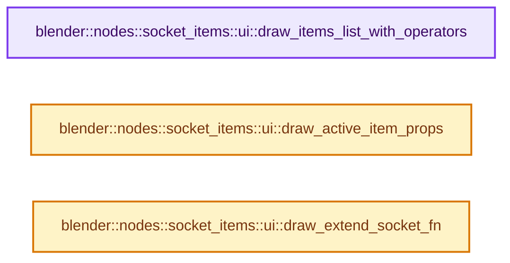
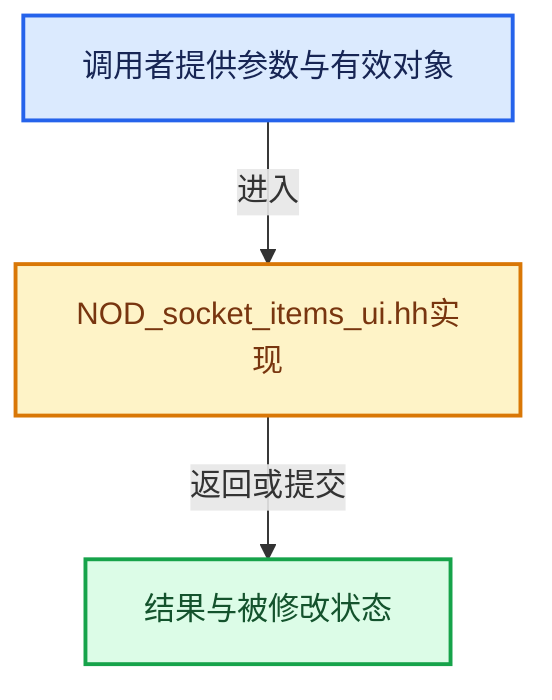

# 实现依赖专题：source/blender/nodes/NOD_socket_items_ui.hh

[实现依赖导航](../README.md) · [符号索引](../../00-课程指南/02-源码与提交索引/符号依赖与实现索引.md)

本专题从正文实际调用进入，集中保存共享实现。函数有稳定锚点，可从调用处直接跳到对应完整函数；递归与互相调用通过回链组织。

## 本文件的实现关系






## 完整成员与函数实现

<a id="f-db5b39b48f392cc8"></a>

### `blender::nodes::socket_items::ui::draw_items_list_with_operators`

实现位置：[source/blender/nodes/NOD_socket_items_ui.hh](../../../../../../source/blender/nodes/NOD_socket_items_ui.hh) · L57—L103。

接口参数：

- `const bContext *C`
- `blender::ui::Layout *layout`
- `const bNodeTree &tree`
- `const bNode &node`

**教学注释版**

<!-- annotated:f62a4802df1f45 -->

```cpp
template<typename Accessor>
static void draw_items_list_with_operators(const bContext *C,
                                           blender::ui::Layout *layout,
                                           const bNodeTree &tree,
                                           const bNode &node)
{
  BLI_assert(Accessor::node_idname == node.idname);
  PointerRNA node_ptr = RNA_pointer_create_discrete(
      const_cast<ID *>(&tree.id), RNA_Node, const_cast<bNode *>(&node));

  static const uiListType *items_list = []() {
    uiListType *list = MEM_new_zeroed<uiListType>(Accessor::ui_idnames::list.c_str());
    STRNCPY_UTF8(list->idname, Accessor::ui_idnames::list.c_str());
    list->draw_item = draw_item_in_list<Accessor>;
    WM_uilisttype_add(list);
    return list;
  }();

  blender::ui::Layout *row = &layout->row(false);
  template_uilist(row,
                  C,
                  items_list->idname,
                  "",
                  &node_ptr,
                  Accessor::rna_names::items,
                  &node_ptr,
                  Accessor::rna_names::active_index.c_str(),
                  nullptr,
                  3,
                  5,
                  UILST_LAYOUT_DEFAULT,
                  blender::ui::TEMPLATE_LIST_FLAG_NONE);

  blender::ui::Layout *ops_col = &row->column(false);
  {
    blender::ui::Layout *add_remove_col = &ops_col->column(true);
    add_remove_col->op(Accessor::operator_idnames::add_item, "", ICON_ADD);
    add_remove_col->op(Accessor::operator_idnames::remove_item, "", ICON_REMOVE);
  }
  {
    blender::ui::Layout *up_down_col = &ops_col->column(true);
    PointerRNA op_ptr = up_down_col->op(Accessor::operator_idnames::move_item, "", ICON_TRIA_UP);
    RNA_enum_set(&op_ptr, "direction", 0);
    op_ptr = up_down_col->op(Accessor::operator_idnames::move_item, "", ICON_TRIA_DOWN);
    RNA_enum_set(&op_ptr, "direction", 1);
  }
}
```

<details>
<summary>核对原始源码：source/blender/nodes/NOD_socket_items_ui.hh · L57—L103</summary>

<!-- original:f62a4802df1f45:source/blender/nodes/NOD_socket_items_ui.hh:57:103 -->

```cpp
template<typename Accessor>
static void draw_items_list_with_operators(const bContext *C,
                                           blender::ui::Layout *layout,
                                           const bNodeTree &tree,
                                           const bNode &node)
{
  BLI_assert(Accessor::node_idname == node.idname);
  PointerRNA node_ptr = RNA_pointer_create_discrete(
      const_cast<ID *>(&tree.id), RNA_Node, const_cast<bNode *>(&node));

  static const uiListType *items_list = []() {
    uiListType *list = MEM_new_zeroed<uiListType>(Accessor::ui_idnames::list.c_str());
    STRNCPY_UTF8(list->idname, Accessor::ui_idnames::list.c_str());
    list->draw_item = draw_item_in_list<Accessor>;
    WM_uilisttype_add(list);
    return list;
  }();

  blender::ui::Layout *row = &layout->row(false);
  template_uilist(row,
                  C,
                  items_list->idname,
                  "",
                  &node_ptr,
                  Accessor::rna_names::items,
                  &node_ptr,
                  Accessor::rna_names::active_index.c_str(),
                  nullptr,
                  3,
                  5,
                  UILST_LAYOUT_DEFAULT,
                  blender::ui::TEMPLATE_LIST_FLAG_NONE);

  blender::ui::Layout *ops_col = &row->column(false);
  {
    blender::ui::Layout *add_remove_col = &ops_col->column(true);
    add_remove_col->op(Accessor::operator_idnames::add_item, "", ICON_ADD);
    add_remove_col->op(Accessor::operator_idnames::remove_item, "", ICON_REMOVE);
  }
  {
    blender::ui::Layout *up_down_col = &ops_col->column(true);
    PointerRNA op_ptr = up_down_col->op(Accessor::operator_idnames::move_item, "", ICON_TRIA_UP);
    RNA_enum_set(&op_ptr, "direction", 0);
    op_ptr = up_down_col->op(Accessor::operator_idnames::move_item, "", ICON_TRIA_DOWN);
    RNA_enum_set(&op_ptr, "direction", 1);
  }
}
```

</details>

**沿实际写入检查状态**

- `list->draw_item = draw_item_in_list<Accessor>;`
- `op_ptr = up_down_col->op(Accessor::operator_idnames::move_item, "", ICON_TRIA_DOWN);`

**结果出口**

- `return list;`

**继续追踪实现**

- `BLI_assert` → [BLI_assert · L48](../01-BLI基础库/BLI_assert.hh.md#m-57a88495704d)；[BLI_assert · L63](../01-BLI基础库/BLI_assert.hh.md#m-d07050020cb5)。宏定义由构建条件选择。
- `RNA_pointer_create_discrete` → [blender::RNA_pointer_create_discrete · L181](../08-其他Blender模块/makesrna/intern/rna_access.cc.md#f-592a276e869c6d94)。
- `[]() { uiListType *list = MEM_new_zeroed<uiListType>(Accessor::ui_idnames::list.c_str()); STRNCPY_UTF8(list->idname, Accessor::ui_idnames::list.c_str()); list->draw_item = draw_item_in_list<Accessor>; WM_uilisttype_add(list); return list; }` → [调用协议](../../00-课程指南/01-路线与规范/模板宏与动态分派协议.md)：函数指针、局部可调用对象或未展开的宏；必须结合调用者环境。调用位置L67。
- `MEM_new_zeroed<uiListType>` → [MEM_new_zeroed · L550](../07-Intern运行时与平台/guardedalloc/MEM_guardedalloc.h.md#f-eeb1e2a7f57dd231)；[MEM_new_zeroed · L114](../07-Intern运行时与平台/guardedalloc/intern/mallocn.cc.md#f-e04cf01c64c8b180)。同名重载需按实参类型选择。
- `Accessor::ui_idnames::list.c_str` → [调用协议](../../00-课程指南/01-路线与规范/模板宏与动态分派协议.md)：接收对象类型依赖auto、返回值或模板实例；不按同名猜测目标。调用位置L68。
- `STRNCPY_UTF8` → [STRNCPY_UTF8 · L335](../01-BLI基础库/BLI_string_utf8.hh.md#m-222967f0ab6a)。宏定义由构建条件选择。
- `WM_uilisttype_add` → [blender::WM_uilisttype_add · L62](../08-其他Blender模块/windowmanager/intern/wm_uilist_type.cc.md#f-5b2d99da0b0a736e)。
- `layout->row` → [blender::ui::Layout::row · L5106](../08-其他Blender模块/editors/interface/interface_layout.cc.md#f-24ee673b84edc004)；[blender::ui::Layout::row · L5246](../08-其他Blender模块/editors/interface/interface_layout.cc.md#f-6523ad37239727e7)。同名重载需按实参类型选择。
- `template_uilist` → [blender::ui::template_uilist · L975](../08-其他Blender模块/editors/interface/templates/interface_template_list.cc.md#f-f66c3ec309909a2d)。
- `Accessor::rna_names::active_index.c_str` → [调用协议](../../00-课程指南/01-路线与规范/模板宏与动态分派协议.md)：接收对象类型依赖auto、返回值或模板实例；不按同名猜测目标。调用位置L83。
- `row->column` → [blender::ui::Layout::column · L5253](../08-其他Blender模块/editors/interface/interface_layout.cc.md#f-140bcf7b423ed61b)；[blender::ui::Layout::column · L5265](../08-其他Blender模块/editors/interface/interface_layout.cc.md#f-6f6ab854f102e925)。同名重载需按实参类型选择。
- `ops_col->column` → [blender::ui::Layout::column · L5253](../08-其他Blender模块/editors/interface/interface_layout.cc.md#f-140bcf7b423ed61b)；[blender::ui::Layout::column · L5265](../08-其他Blender模块/editors/interface/interface_layout.cc.md#f-6f6ab854f102e925)。同名重载需按实参类型选择。
- `add_remove_col->op` → [blender::ui::Layout::op · L1531](../08-其他Blender模块/editors/interface/interface_layout.cc.md#f-d5f7af90ad130b93)；[blender::ui::Layout::op · L1555](../08-其他Blender模块/editors/interface/interface_layout.cc.md#f-e59b70ac0ec010e2)；[blender::ui::Layout::op · L1789](../08-其他Blender模块/editors/interface/interface_layout.cc.md#f-7bb13b495cd02f34)；[blender::ui::Layout::op · L1794](../08-其他Blender模块/editors/interface/interface_layout.cc.md#f-e5cb7ed4af2acaed)。同名重载需按实参类型选择。
- `up_down_col->op` → [blender::ui::Layout::op · L1531](../08-其他Blender模块/editors/interface/interface_layout.cc.md#f-d5f7af90ad130b93)；[blender::ui::Layout::op · L1555](../08-其他Blender模块/editors/interface/interface_layout.cc.md#f-e59b70ac0ec010e2)；[blender::ui::Layout::op · L1789](../08-其他Blender模块/editors/interface/interface_layout.cc.md#f-7bb13b495cd02f34)；[blender::ui::Layout::op · L1794](../08-其他Blender模块/editors/interface/interface_layout.cc.md#f-e5cb7ed4af2acaed)。同名重载需按实参类型选择。
- `RNA_enum_set` → [blender::RNA_enum_set · L6876](../08-其他Blender模块/makesrna/intern/rna_access.cc.md#f-7fcc63c9f557ff0b)。

<a id="f-1882f1aae96d5c1f"></a>

### `blender::nodes::socket_items::ui::draw_active_item_props`

实现位置：[source/blender/nodes/NOD_socket_items_ui.hh](../../../../../../source/blender/nodes/NOD_socket_items_ui.hh) · L106—L126。

接口参数：

- `const bNodeTree &tree`
- `const bNode &node`
- `const FunctionRef<void(PointerRNA *item_ptr)> draw_item`
- `PointerRNA *item_ptr`

**教学注释版**

<!-- annotated:8ef04abc463053 -->

```cpp
template<typename Accessor>
static void draw_active_item_props(const bNodeTree &tree,
                                   const bNode &node,
                                   const FunctionRef<void(PointerRNA *item_ptr)> draw_item)
{
  using ItemT = typename Accessor::ItemT;
  BLI_assert(Accessor::node_idname == node.idname);

  SocketItemsRef<ItemT> ref = Accessor::get_items_from_node(const_cast<bNode &>(node));
  if (*ref.active_index < 0) {
    return;
  }
  if (*ref.active_index >= *ref.items_num) {
    return;
  }

  ItemT &item = (*ref.items)[*ref.active_index];
  PointerRNA item_ptr = RNA_pointer_create_discrete(
      const_cast<ID *>(&tree.id), *Accessor::item_srna, &item);
  draw_item(&item_ptr);
}
```

<details>
<summary>核对原始源码：source/blender/nodes/NOD_socket_items_ui.hh · L106—L126</summary>

<!-- original:8ef04abc463053:source/blender/nodes/NOD_socket_items_ui.hh:106:126 -->

```cpp
template<typename Accessor>
static void draw_active_item_props(const bNodeTree &tree,
                                   const bNode &node,
                                   const FunctionRef<void(PointerRNA *item_ptr)> draw_item)
{
  using ItemT = typename Accessor::ItemT;
  BLI_assert(Accessor::node_idname == node.idname);

  SocketItemsRef<ItemT> ref = Accessor::get_items_from_node(const_cast<bNode &>(node));
  if (*ref.active_index < 0) {
    return;
  }
  if (*ref.active_index >= *ref.items_num) {
    return;
  }

  ItemT &item = (*ref.items)[*ref.active_index];
  PointerRNA item_ptr = RNA_pointer_create_discrete(
      const_cast<ID *>(&tree.id), *Accessor::item_srna, &item);
  draw_item(&item_ptr);
}
```

</details>

**继续追踪实现**

- `BLI_assert` → [BLI_assert · L48](../01-BLI基础库/BLI_assert.hh.md#m-57a88495704d)；[BLI_assert · L63](../01-BLI基础库/BLI_assert.hh.md#m-d07050020cb5)。宏定义由构建条件选择。
- `Accessor::get_items_from_node` → [blender::nodes::RaycastSampleAttributeItemsAccessor::get_items_from_node · L38](shader/include/NOD_shader_raycast.hh.md#f-3a8b562628078095)；[blender::nodes::GeoViewerItemsAccessor::get_items_from_node · L38](geometry/include/NOD_geo_viewer.hh.md#f-5ab2cbca96314de9)；[blender::nodes::SimulationItemsAccessor::get_items_from_node · L37](geometry/include/NOD_geo_simulation.hh.md#f-898ff47dc220feed)；[blender::nodes::RepeatItemsAccessor::get_items_from_node · L37](geometry/include/NOD_geo_repeat.hh.md#f-bc70898d619a07bc)；[blender::nodes::RasterizePointsItemsAccessor::get_items_from_node · L37](geometry/include/NOD_geo_rasterize_points.hh.md#f-f07b0adeb48df2b5)；[blender::nodes::MenuSwitchItemsAccessor::get_items_from_node · L38](geometry/include/NOD_geo_menu_switch.hh.md#f-ad24d3b15c5b59c3)；[blender::nodes::IndexSwitchItemsAccessor::get_items_from_node · L30](geometry/include/NOD_geo_index_switch.hh.md#f-fe5dfa66cec1ecf2)；[blender::nodes::ForeachGeometryElementInputItemsAccessor::get_items_from_node · L37](geometry/include/NOD_geo_foreach_geometry_element.hh.md#f-614cb876c8c0ad08)；[blender::nodes::ForeachGeometryElementMainItemsAccessor::get_items_from_node · L123](geometry/include/NOD_geo_foreach_geometry_element.hh.md#f-c3463dfe9d86d1c6)；[blender::nodes::ForeachGeometryElementGenerationItemsAccessor::get_items_from_node · L209](geometry/include/NOD_geo_foreach_geometry_element.hh.md#f-9b2b97a4c6e2e2bf)；[blender::nodes::FieldToListItemsAccessor::get_items_from_node · L38](geometry/include/NOD_geo_field_to_list.hh.md#f-b9622adfbf3850be)；[blender::nodes::FieldToGridItemsAccessor::get_items_from_node · L38](geometry/include/NOD_geo_field_to_grid.hh.md#f-869efc4bfe6a0034)；[blender::nodes::CombineListItemsAccessor::get_items_from_node · L30](geometry/include/NOD_geo_combine_list.hh.md#f-4d73951dcbf992a5)；[blender::nodes::ClosureToListItemsAccessor::get_items_from_node · L38](geometry/include/NOD_geo_closure_to_list.hh.md#f-e3c98034ea103873)；[blender::nodes::ClosureInputItemsAccessor::get_items_from_node · L41](geometry/include/NOD_geo_closure.hh.md#f-81cfe82f985d2413)；[blender::nodes::ClosureOutputItemsAccessor::get_items_from_node · L115](geometry/include/NOD_geo_closure.hh.md#f-741633ed0fe86dcc)；[blender::nodes::EvaluateClosureInputItemsAccessor::get_items_from_node · L189](geometry/include/NOD_geo_closure.hh.md#f-63859ce4e73466e4)；[blender::nodes::EvaluateClosureOutputItemsAccessor::get_items_from_node · L264](geometry/include/NOD_geo_closure.hh.md#f-df9ac7fb721bd6cf)；[blender::nodes::CaptureAttributeItemsAccessor::get_items_from_node · L36](geometry/include/NOD_geo_capture_attribute.hh.md#f-7c4ae7b1065e727d)；[blender::nodes::CombineBundleItemsAccessor::get_items_from_node · L41](geometry/include/NOD_geo_bundle.hh.md#f-726d871c58c4a98e)；[blender::nodes::SeparateBundleItemsAccessor::get_items_from_node · L117](geometry/include/NOD_geo_bundle.hh.md#f-361121e6a62ec201)；[blender::nodes::BakeItemsAccessor::get_items_from_node · L52](geometry/include/NOD_geo_bake.hh.md#f-8a32f2915f15b452)；[blender::nodes::FormatStringItemsAccessor::get_items_from_node · L40](function/include/NOD_fn_format_string.hh.md#f-01e4b1bbb0e9a7b0)；[blender::nodes::FileOutputItemsAccessor::get_items_from_node · L45](composite/include/NOD_compositor_file_output.hh.md#f-bdac32a93a61751d)。同名重载需按实参类型选择。
- `RNA_pointer_create_discrete` → [blender::RNA_pointer_create_discrete · L181](../08-其他Blender模块/makesrna/intern/rna_access.cc.md#f-592a276e869c6d94)。
- `draw_item` → [调用协议](../../00-课程指南/01-路线与规范/模板宏与动态分派协议.md)：局部可调用对象，须结合其初始化与捕获环境。调用位置L125。

<a id="f-78b09f9b74014bee"></a>

### `blender::nodes::socket_items::ui::draw_extend_socket_fn`

实现位置：[source/blender/nodes/NOD_socket_items_ui.hh](../../../../../../source/blender/nodes/NOD_socket_items_ui.hh) · L128—L138。

**教学注释版**

<!-- annotated:c1e4d8ded1c576 -->

```cpp
template<typename Accessor> static auto draw_extend_socket_fn()
{
  return [](CustomSocketDrawParams &params) {
    ::blender::ui::Layout &layout = params.layout;
    layout.emboss_set(::blender::ui::EmbossType::None);
    PointerRNA op_ptr = layout.op(Accessor::operator_idnames::add_item, "", ICON_ADD);
    RNA_int_set(&op_ptr, "node_identifier", params.node.identifier);
    RNA_boolean_set(&op_ptr, "show_dialog", true);
    RNA_boolean_set(&op_ptr, "init_from_active", false);
  };
}
```

<details>
<summary>核对原始源码：source/blender/nodes/NOD_socket_items_ui.hh · L128—L138</summary>

<!-- original:c1e4d8ded1c576:source/blender/nodes/NOD_socket_items_ui.hh:128:138 -->

```cpp
template<typename Accessor> static auto draw_extend_socket_fn()
{
  return [](CustomSocketDrawParams &params) {
    ::blender::ui::Layout &layout = params.layout;
    layout.emboss_set(::blender::ui::EmbossType::None);
    PointerRNA op_ptr = layout.op(Accessor::operator_idnames::add_item, "", ICON_ADD);
    RNA_int_set(&op_ptr, "node_identifier", params.node.identifier);
    RNA_boolean_set(&op_ptr, "show_dialog", true);
    RNA_boolean_set(&op_ptr, "init_from_active", false);
  };
}
```

</details>

**结果出口**

- `return [](CustomSocketDrawParams &params) {`

**继续追踪实现**

- `layout.emboss_set` → [blender::ui::Layout::emboss_set · L5411](../08-其他Blender模块/editors/interface/interface_layout.cc.md#f-194605fc28178cca)。
- `layout.op` → [blender::ui::Layout::op · L1531](../08-其他Blender模块/editors/interface/interface_layout.cc.md#f-d5f7af90ad130b93)；[blender::ui::Layout::op · L1555](../08-其他Blender模块/editors/interface/interface_layout.cc.md#f-e59b70ac0ec010e2)；[blender::ui::Layout::op · L1789](../08-其他Blender模块/editors/interface/interface_layout.cc.md#f-7bb13b495cd02f34)；[blender::ui::Layout::op · L1794](../08-其他Blender模块/editors/interface/interface_layout.cc.md#f-e5cb7ed4af2acaed)。同名重载需按实参类型选择。
- `RNA_int_set` → [blender::RNA_int_set · L6782](../08-其他Blender模块/makesrna/intern/rna_access.cc.md#f-eba0f10da1cbcf8d)。
- `RNA_boolean_set` → [blender::RNA_boolean_set · L6735](../08-其他Blender模块/makesrna/intern/rna_access.cc.md#f-e639630273970e77)。
