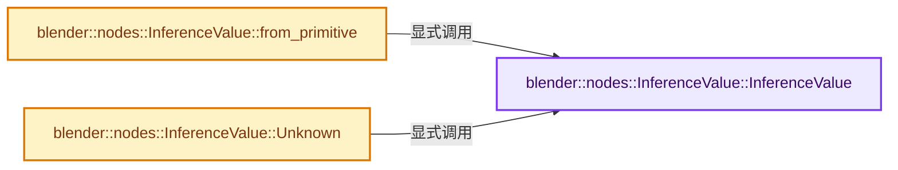
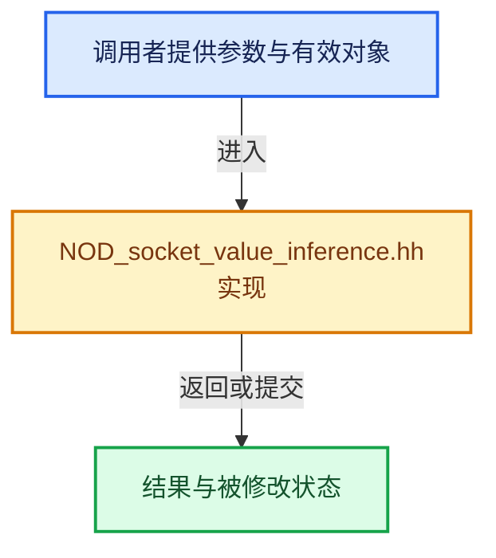

# 实现依赖专题：source/blender/nodes/NOD_socket_value_inference.hh

[实现依赖导航](../README.md) · [符号索引](../../00-课程指南/02-源码与提交索引/符号依赖与实现索引.md)

本专题从正文实际调用进入，集中保存共享实现。函数有稳定锚点，可从调用处直接跳到对应完整函数；递归与互相调用通过回链组织。

## 本文件的实现关系






## 完整成员与函数实现

<a id="f-a1b4d4a747382d06"></a>

### `blender::nodes::InferenceValue::InferenceValue`

实现位置：[source/blender/nodes/NOD_socket_value_inference.hh](../../../../../../source/blender/nodes/NOD_socket_value_inference.hh) · L39—L39。

接口参数：

- `const void *value`

**教学注释版**

<!-- annotated:db0bca2c8972cc -->

```cpp
  InferenceValue(const void *value) : value_(value) {}
```

<details>
<summary>核对原始源码：source/blender/nodes/NOD_socket_value_inference.hh · L39—L39</summary>

<!-- original:db0bca2c8972cc:source/blender/nodes/NOD_socket_value_inference.hh:39:39 -->

```cpp
  InferenceValue(const void *value) : value_(value) {}
```

</details>

**继续追踪实现**

本实现没有需要继续展开的显式调用；检查返回表达式、对象转换和调用者前置条件。

<a id="f-0b033bc2516e8618"></a>

### `blender::nodes::InferenceValue::from_primitive`

实现位置：[source/blender/nodes/NOD_socket_value_inference.hh](../../../../../../source/blender/nodes/NOD_socket_value_inference.hh) · L42—L46。

接口参数：

- `const void *value`

**教学注释版**

<!-- annotated:28698585bb6bcf -->

```cpp
  static InferenceValue from_primitive(const void *value)
  {
    BLI_assert(value != nullptr);
    return InferenceValue(value);
  }
```

<details>
<summary>核对原始源码：source/blender/nodes/NOD_socket_value_inference.hh · L42—L46</summary>

<!-- original:28698585bb6bcf:source/blender/nodes/NOD_socket_value_inference.hh:42:46 -->

```cpp
  static InferenceValue from_primitive(const void *value)
  {
    BLI_assert(value != nullptr);
    return InferenceValue(value);
  }
```

</details>

**结果出口**

- `return InferenceValue(value);`

**继续追踪实现**

- `BLI_assert` → [BLI_assert · L48](../01-BLI基础库/BLI_assert.hh.md#m-57a88495704d)；[BLI_assert · L63](../01-BLI基础库/BLI_assert.hh.md#m-d07050020cb5)。宏定义由构建条件选择。
- `InferenceValue` → [blender::nodes::InferenceValue::InferenceValue · L39](NOD_socket_value_inference.hh.md#f-a1b4d4a747382d06)。

<a id="f-9e237401e6a655e9"></a>

### `blender::nodes::InferenceValue::Unknown`

实现位置：[source/blender/nodes/NOD_socket_value_inference.hh](../../../../../../source/blender/nodes/NOD_socket_value_inference.hh) · L48—L51。

**教学注释版**

<!-- annotated:4952c7ee167275 -->

```cpp
  static InferenceValue Unknown()
  {
    return InferenceValue(nullptr);
  }
```

<details>
<summary>核对原始源码：source/blender/nodes/NOD_socket_value_inference.hh · L48—L51</summary>

<!-- original:4952c7ee167275:source/blender/nodes/NOD_socket_value_inference.hh:48:51 -->

```cpp
  static InferenceValue Unknown()
  {
    return InferenceValue(nullptr);
  }
```

</details>

**结果出口**

- `return InferenceValue(nullptr);`

**继续追踪实现**

- `InferenceValue` → [blender::nodes::InferenceValue::InferenceValue · L39](NOD_socket_value_inference.hh.md#f-a1b4d4a747382d06)。
