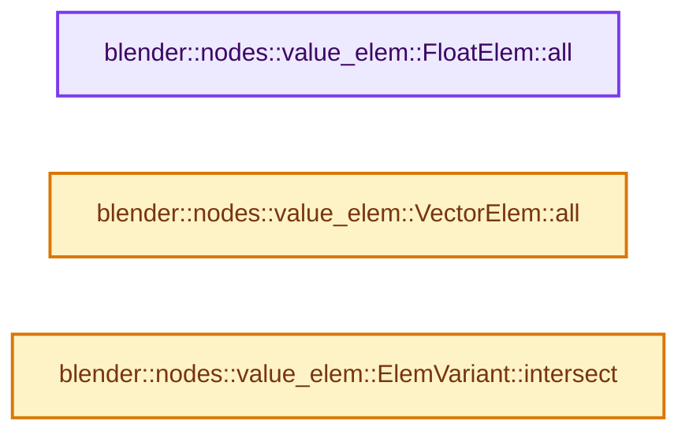

# 实现依赖专题：source/blender/nodes/NOD_value_elem.hh

[实现依赖导航](../README.md) · [符号索引](../../00-课程指南/02-源码与提交索引/符号依赖与实现索引.md)

本专题从正文实际调用进入，集中保存共享实现。函数有稳定锚点，可从调用处直接跳到对应完整函数；递归与互相调用通过回链组织。

## 本文件的实现关系




## 相关类型布局与成员入口

<a id="t-dfc63819a270"></a>

### `blender::nodes::value_elem::BoolElem`

原始声明：[source/blender/nodes/NOD_value_elem.hh](../../../../../../source/blender/nodes/NOD_value_elem.hh) · L61—L66。

以下保留类的数据声明与编译条件，成员函数实现通过后面的精确链接阅读。

<!-- annotated:a304a107b902e3 -->

```cpp
struct BoolElem : public PrimitiveValueElem {
```

<details>
<summary>核对原始源码：source/blender/nodes/NOD_value_elem.hh · L61—L61</summary>

<!-- original:a304a107b902e3:source/blender/nodes/NOD_value_elem.hh:61:61 -->

```cpp
struct BoolElem : public PrimitiveValueElem {
```

</details>

<!-- annotated:ac537169370826 -->

```cpp
};
```

<details>
<summary>核对原始源码：source/blender/nodes/NOD_value_elem.hh · L66—L66</summary>

<!-- original:ac537169370826:source/blender/nodes/NOD_value_elem.hh:66:66 -->

```cpp
};
```

</details>


<a id="t-7ef85108de88"></a>

### `blender::nodes::value_elem::FloatElem`

原始声明：[source/blender/nodes/NOD_value_elem.hh](../../../../../../source/blender/nodes/NOD_value_elem.hh) · L68—L73。

以下保留类的数据声明与编译条件，成员函数实现通过后面的精确链接阅读。

<!-- annotated:5bb4d7c8cf18dd -->

```cpp
struct FloatElem : public PrimitiveValueElem {
```

<details>
<summary>核对原始源码：source/blender/nodes/NOD_value_elem.hh · L68—L68</summary>

<!-- original:5bb4d7c8cf18dd:source/blender/nodes/NOD_value_elem.hh:68:68 -->

```cpp
struct FloatElem : public PrimitiveValueElem {
```

</details>

<!-- annotated:40e805ed5fad3d -->

```cpp
};
```

<details>
<summary>核对原始源码：source/blender/nodes/NOD_value_elem.hh · L73—L73</summary>

<!-- original:40e805ed5fad3d:source/blender/nodes/NOD_value_elem.hh:73:73 -->

```cpp
};
```

</details>

- [all](NOD_value_elem.hh.md#f-f17de3ae3c883c3f)

<a id="t-a07a994b80d8"></a>

### `blender::nodes::value_elem::IntElem`

原始声明：[source/blender/nodes/NOD_value_elem.hh](../../../../../../source/blender/nodes/NOD_value_elem.hh) · L75—L80。

以下保留类的数据声明与编译条件，成员函数实现通过后面的精确链接阅读。

<!-- annotated:ab173b8c4427b0 -->

```cpp
struct IntElem : public PrimitiveValueElem {
```

<details>
<summary>核对原始源码：source/blender/nodes/NOD_value_elem.hh · L75—L75</summary>

<!-- original:ab173b8c4427b0:source/blender/nodes/NOD_value_elem.hh:75:75 -->

```cpp
struct IntElem : public PrimitiveValueElem {
```

</details>

<!-- annotated:2778c9b8dc598a -->

```cpp
};
```

<details>
<summary>核对原始源码：source/blender/nodes/NOD_value_elem.hh · L80—L80</summary>

<!-- original:2778c9b8dc598a:source/blender/nodes/NOD_value_elem.hh:80:80 -->

```cpp
};
```

</details>


<a id="t-eac1ea383810"></a>

### `blender::nodes::value_elem::VectorElem`

原始声明：[source/blender/nodes/NOD_value_elem.hh](../../../../../../source/blender/nodes/NOD_value_elem.hh) · L82—L118。

成员布局：

- `FloatElem x`
- `FloatElem y`
- `FloatElem z`

以下保留类的数据声明与编译条件，成员函数实现通过后面的精确链接阅读。

<!-- annotated:81ff3f74f4de7a -->

```cpp
struct VectorElem {
  /** Members indicate which components of the vector are affected. */
  FloatElem x;
  FloatElem y;
  FloatElem z;

```

<details>
<summary>核对原始源码：source/blender/nodes/NOD_value_elem.hh · L82—L87</summary>

<!-- original:81ff3f74f4de7a:source/blender/nodes/NOD_value_elem.hh:82:87 -->

```cpp
struct VectorElem {
  /** Members indicate which components of the vector are affected. */
  FloatElem x;
  FloatElem y;
  FloatElem z;

```

</details>

<!-- annotated:f1299be76badb4 -->

```cpp

  friend bool operator==(const VectorElem &a, const VectorElem &b) = default;

```

<details>
<summary>核对原始源码：source/blender/nodes/NOD_value_elem.hh · L92—L94</summary>

<!-- original:f1299be76badb4:source/blender/nodes/NOD_value_elem.hh:92:94 -->

```cpp

  friend bool operator==(const VectorElem &a, const VectorElem &b) = default;

```

</details>

<!-- annotated:a1b9582ada6ccc -->

```cpp

```

<details>
<summary>核对原始源码：source/blender/nodes/NOD_value_elem.hh · L99—L99</summary>

<!-- original:a1b9582ada6ccc:source/blender/nodes/NOD_value_elem.hh:99:99 -->

```cpp

```

</details>

<!-- annotated:f2ffd61bfcb751 -->

```cpp

```

<details>
<summary>核对原始源码：source/blender/nodes/NOD_value_elem.hh · L106—L106</summary>

<!-- original:f2ffd61bfcb751:source/blender/nodes/NOD_value_elem.hh:106:106 -->

```cpp

```

</details>

<!-- annotated:0d76cd595b9436 -->

```cpp

```

<details>
<summary>核对原始源码：source/blender/nodes/NOD_value_elem.hh · L113—L113</summary>

<!-- original:0d76cd595b9436:source/blender/nodes/NOD_value_elem.hh:113:113 -->

```cpp

```

</details>

<!-- annotated:0a86f42934e308 -->

```cpp
};
```

<details>
<summary>核对原始源码：source/blender/nodes/NOD_value_elem.hh · L118—L118</summary>

<!-- original:0a86f42934e308:source/blender/nodes/NOD_value_elem.hh:118:118 -->

```cpp
};
```

</details>

- [all](NOD_value_elem.hh.md#f-0b2d2ea0ba378db2)

<a id="t-848681f80f64"></a>

### `blender::nodes::value_elem::RotationElem`

原始声明：[source/blender/nodes/NOD_value_elem.hh](../../../../../../source/blender/nodes/NOD_value_elem.hh) · L120—L160。

成员布局：

- `VectorElem euler`
- `VectorElem axis`
- `FloatElem angle`

以下保留类的数据声明与编译条件，成员函数实现通过后面的精确链接阅读。

<!-- annotated:ada2e342db8392 -->

```cpp
struct RotationElem {
  /**
   * The euler and axis-angle components have overlap. All components that can be affected need to
   * be tagged. For example if a node affects the euler angles, it indirectly also affects the
   * axis-angle.
   */
  VectorElem euler;
  VectorElem axis;
  FloatElem angle;

```

<details>
<summary>核对原始源码：source/blender/nodes/NOD_value_elem.hh · L120—L129</summary>

<!-- original:ada2e342db8392:source/blender/nodes/NOD_value_elem.hh:120:129 -->

```cpp
struct RotationElem {
  /**
   * The euler and axis-angle components have overlap. All components that can be affected need to
   * be tagged. For example if a node affects the euler angles, it indirectly also affects the
   * axis-angle.
   */
  VectorElem euler;
  VectorElem axis;
  FloatElem angle;

```

</details>

<!-- annotated:2c6726c70c86b1 -->

```cpp

  friend bool operator==(const RotationElem &a, const RotationElem &b) = default;

```

<details>
<summary>核对原始源码：source/blender/nodes/NOD_value_elem.hh · L134—L136</summary>

<!-- original:2c6726c70c86b1:source/blender/nodes/NOD_value_elem.hh:134:136 -->

```cpp

  friend bool operator==(const RotationElem &a, const RotationElem &b) = default;

```

</details>

<!-- annotated:7bf70997c35733 -->

```cpp

```

<details>
<summary>核对原始源码：source/blender/nodes/NOD_value_elem.hh · L141—L141</summary>

<!-- original:7bf70997c35733:source/blender/nodes/NOD_value_elem.hh:141:141 -->

```cpp

```

</details>

<!-- annotated:df6f2ab9c26f7a -->

```cpp

```

<details>
<summary>核对原始源码：source/blender/nodes/NOD_value_elem.hh · L148—L148</summary>

<!-- original:df6f2ab9c26f7a:source/blender/nodes/NOD_value_elem.hh:148:148 -->

```cpp

```

</details>

<!-- annotated:363227383d7264 -->

```cpp

```

<details>
<summary>核对原始源码：source/blender/nodes/NOD_value_elem.hh · L155—L155</summary>

<!-- original:363227383d7264:source/blender/nodes/NOD_value_elem.hh:155:155 -->

```cpp

```

</details>

<!-- annotated:cdfa7a99450546 -->

```cpp
};
```

<details>
<summary>核对原始源码：source/blender/nodes/NOD_value_elem.hh · L160—L160</summary>

<!-- original:cdfa7a99450546:source/blender/nodes/NOD_value_elem.hh:160:160 -->

```cpp
};
```

</details>


<a id="t-0faeda7ad4a2"></a>

### `blender::nodes::value_elem::MatrixElem`

原始声明：[source/blender/nodes/NOD_value_elem.hh](../../../../../../source/blender/nodes/NOD_value_elem.hh) · L162—L202。

成员布局：

- `VectorElem translation`
- `RotationElem rotation`
- `VectorElem scale`
- `FloatElem any_non_transform`

以下保留类的数据声明与编译条件，成员函数实现通过后面的精确链接阅读。

<!-- annotated:187c0ee9a2eb3b -->

```cpp
struct MatrixElem {
  VectorElem translation;
  RotationElem rotation;
  VectorElem scale;
  /** For 4x4 matrices this describes whether any entry of the last row is affected. */
  FloatElem any_non_transform;

```

<details>
<summary>核对原始源码：source/blender/nodes/NOD_value_elem.hh · L162—L168</summary>

<!-- original:187c0ee9a2eb3b:source/blender/nodes/NOD_value_elem.hh:162:168 -->

```cpp
struct MatrixElem {
  VectorElem translation;
  RotationElem rotation;
  VectorElem scale;
  /** For 4x4 matrices this describes whether any entry of the last row is affected. */
  FloatElem any_non_transform;

```

</details>

<!-- annotated:71817b01be247f -->

```cpp

  friend bool operator==(const MatrixElem &a, const MatrixElem &b) = default;

```

<details>
<summary>核对原始源码：source/blender/nodes/NOD_value_elem.hh · L173—L175</summary>

<!-- original:71817b01be247f:source/blender/nodes/NOD_value_elem.hh:173:175 -->

```cpp

  friend bool operator==(const MatrixElem &a, const MatrixElem &b) = default;

```

</details>

<!-- annotated:730a1fcd2db4d8 -->

```cpp

```

<details>
<summary>核对原始源码：source/blender/nodes/NOD_value_elem.hh · L181—L181</summary>

<!-- original:730a1fcd2db4d8:source/blender/nodes/NOD_value_elem.hh:181:181 -->

```cpp

```

</details>

<!-- annotated:0a609a7b5084ad -->

```cpp

```

<details>
<summary>核对原始源码：source/blender/nodes/NOD_value_elem.hh · L189—L189</summary>

<!-- original:0a609a7b5084ad:source/blender/nodes/NOD_value_elem.hh:189:189 -->

```cpp

```

</details>

<!-- annotated:1096b273546311 -->

```cpp

```

<details>
<summary>核对原始源码：source/blender/nodes/NOD_value_elem.hh · L197—L197</summary>

<!-- original:1096b273546311:source/blender/nodes/NOD_value_elem.hh:197:197 -->

```cpp

```

</details>

<!-- annotated:7e5fb36bb3208c -->

```cpp
};
```

<details>
<summary>核对原始源码：source/blender/nodes/NOD_value_elem.hh · L202—L202</summary>

<!-- original:7e5fb36bb3208c:source/blender/nodes/NOD_value_elem.hh:202:202 -->

```cpp
};
```

</details>


## 完整成员与函数实现

<a id="f-f17de3ae3c883c3f"></a>

### `blender::nodes::value_elem::FloatElem::all`

实现位置：[source/blender/nodes/NOD_value_elem.hh](../../../../../../source/blender/nodes/NOD_value_elem.hh) · L69—L72。

**教学注释版**

<!-- annotated:26a210a7d36b2a -->

```cpp
  static FloatElem all()
  {
    return {true};
  }
```

<details>
<summary>核对原始源码：source/blender/nodes/NOD_value_elem.hh · L69—L72</summary>

<!-- original:26a210a7d36b2a:source/blender/nodes/NOD_value_elem.hh:69:72 -->

```cpp
  static FloatElem all()
  {
    return {true};
  }
```

</details>

**结果出口**

- `return {true};`

**继续追踪实现**

本实现没有需要继续展开的显式调用；检查返回表达式、对象转换和调用者前置条件。

<a id="f-0b2d2ea0ba378db2"></a>

### `blender::nodes::value_elem::VectorElem::all`

实现位置：[source/blender/nodes/NOD_value_elem.hh](../../../../../../source/blender/nodes/NOD_value_elem.hh) · L114—L117。

**教学注释版**

<!-- annotated:129d9e3fe08885 -->

```cpp
  static VectorElem all()
  {
    return {{true}, {true}, {true}};
  }
```

<details>
<summary>核对原始源码：source/blender/nodes/NOD_value_elem.hh · L114—L117</summary>

<!-- original:129d9e3fe08885:source/blender/nodes/NOD_value_elem.hh:114:117 -->

```cpp
  static VectorElem all()
  {
    return {{true}, {true}, {true}};
  }
```

</details>

**结果出口**

- `return {{true}, {true}, {true}};`

**继续追踪实现**

本实现没有需要继续展开的显式调用；检查返回表达式、对象转换和调用者前置条件。

<a id="f-e15f423ee0a561e5"></a>

### `blender::nodes::value_elem::ElemVariant::intersect`

实现位置：[source/blender/nodes/NOD_value_elem.hh](../../../../../../source/blender/nodes/NOD_value_elem.hh) · L232—L241。

接口参数：

- `const ElemVariant &other`

**教学注释版**

<!-- annotated:71d98914cbd557 -->

```cpp
  void intersect(const ElemVariant &other)
  {
    BLI_assert(this->elem.index() == other.elem.index());
    // [讲解] std::visit：按variant当前活动分支调用访客；所有候选分支的类型要求需满足，不能读取非活动分支的对象表示。
    std::visit(
        [&](auto &value) {
          using T = std::decay_t<decltype(value)>;
          value.intersect(std::get<T>(other.elem));
        },
        this->elem);
  }
```

<details>
<summary>核对原始源码：source/blender/nodes/NOD_value_elem.hh · L232—L241</summary>

<!-- original:71d98914cbd557:source/blender/nodes/NOD_value_elem.hh:232:241 -->

```cpp
  void intersect(const ElemVariant &other)
  {
    BLI_assert(this->elem.index() == other.elem.index());
    std::visit(
        [&](auto &value) {
          using T = std::decay_t<decltype(value)>;
          value.intersect(std::get<T>(other.elem));
        },
        this->elem);
  }
```

</details>

**继续追踪实现**

- `BLI_assert` → [BLI_assert · L48](../01-BLI基础库/BLI_assert.hh.md#m-57a88495704d)；[BLI_assert · L63](../01-BLI基础库/BLI_assert.hh.md#m-d07050020cb5)。宏定义由构建条件选择。
- `this->elem.index` → [调用协议](../../00-课程指南/01-路线与规范/模板宏与动态分派协议.md)：接收对象类型依赖auto、返回值或模板实例；不按同名猜测目标。调用位置L234。
- `other.elem.index` → [调用协议](../../00-课程指南/01-路线与规范/模板宏与动态分派协议.md)：接收对象类型依赖auto、返回值或模板实例；不按同名猜测目标。调用位置L234。
- `std::visit` → [外部契约](https://eel.is/c++draft/variant.visit)：按variant当前活动分支调用访客；所有候选分支的类型要求需满足，不能读取非活动分支的对象表示。
- `value.intersect` → [调用协议](../../00-课程指南/01-路线与规范/模板宏与动态分派协议.md)：接收对象类型依赖auto、返回值或模板实例；不按同名猜测目标。调用位置L238。
- `std::get<T>` → [外部契约](https://eel.is/c++draft/)：这个边界按实际表达式及所属类型核对参数、返回值、寿命与失败行为。这里提供接口入口，不声称已解释该第三方版本的内部实现。
