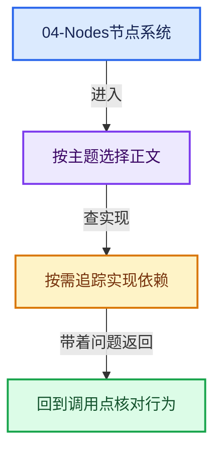
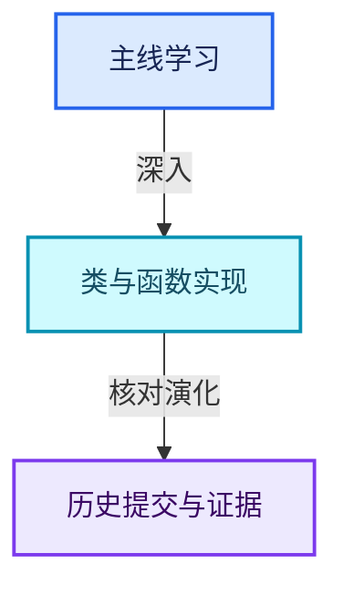

# 04-Nodes节点系统

[实现依赖总导航](../README.md)

## 模块公共接口

- [NOD_bundle_type.hh](NOD_bundle_type.hh.md)
- [NOD_geometry_exec.hh](NOD_geometry_exec.hh.md)
- [NOD_geometry_nodes_bundle.hh](NOD_geometry_nodes_bundle.hh.md)
- [NOD_geometry_nodes_list.hh](NOD_geometry_nodes_list.hh.md)
- [NOD_geometry_nodes_srna.hh](NOD_geometry_nodes_srna.hh.md)
- [NOD_geometry_nodes_values.hh](NOD_geometry_nodes_values.hh.md)
- [NOD_menu_value.hh](NOD_menu_value.hh.md)
- [NOD_multi_function.hh](NOD_multi_function.hh.md)
- [NOD_node_declaration.hh](NOD_node_declaration.hh.md)
- [NOD_node_in_compute_context.hh](NOD_node_in_compute_context.hh.md)
- [NOD_socket_declarations.hh](NOD_socket_declarations.hh.md)
- [NOD_socket_items.hh](NOD_socket_items.hh.md)
- [NOD_socket_items_blend.hh](NOD_socket_items_blend.hh.md)
- [NOD_socket_items_name_util.hh](NOD_socket_items_name_util.hh.md)
- [NOD_socket_items_ops.hh](NOD_socket_items_ops.hh.md)
- [NOD_socket_items_ui.hh](NOD_socket_items_ui.hh.md)
- [NOD_socket_value_inference.hh](NOD_socket_value_inference.hh.md)
- [NOD_texture.h](NOD_texture.h.md)
- [NOD_value_elem.hh](NOD_value_elem.hh.md)

## composite

- [node_composite_tree.cc](composite/node_composite_tree.cc.md)

## composite/include

- [NOD_compositor_file_output.hh](composite/include/NOD_compositor_file_output.hh.md)

## composite/nodes

- [node_composite_file_output.cc](composite/nodes/node_composite_file_output.cc.md)

## function/include

- [NOD_fn_format_string.hh](function/include/NOD_fn_format_string.hh.md)

## function/nodes

- [node_fn_format_string.cc](function/nodes/node_fn_format_string.cc.md)

## geometry

- [node_geometry_util.cc](geometry/node_geometry_util.cc.md)

## geometry/include

- [NOD_geo_bake.hh](geometry/include/NOD_geo_bake.hh.md)
- [NOD_geo_bundle.hh](geometry/include/NOD_geo_bundle.hh.md)
- [NOD_geo_capture_attribute.hh](geometry/include/NOD_geo_capture_attribute.hh.md)
- [NOD_geo_closure.hh](geometry/include/NOD_geo_closure.hh.md)
- [NOD_geo_closure_to_list.hh](geometry/include/NOD_geo_closure_to_list.hh.md)
- [NOD_geo_combine_list.hh](geometry/include/NOD_geo_combine_list.hh.md)
- [NOD_geo_field_to_grid.hh](geometry/include/NOD_geo_field_to_grid.hh.md)
- [NOD_geo_field_to_list.hh](geometry/include/NOD_geo_field_to_list.hh.md)
- [NOD_geo_foreach_geometry_element.hh](geometry/include/NOD_geo_foreach_geometry_element.hh.md)
- [NOD_geo_index_switch.hh](geometry/include/NOD_geo_index_switch.hh.md)
- [NOD_geo_menu_switch.hh](geometry/include/NOD_geo_menu_switch.hh.md)
- [NOD_geo_rasterize_points.hh](geometry/include/NOD_geo_rasterize_points.hh.md)
- [NOD_geo_repeat.hh](geometry/include/NOD_geo_repeat.hh.md)
- [NOD_geo_simulation.hh](geometry/include/NOD_geo_simulation.hh.md)
- [NOD_geo_viewer.hh](geometry/include/NOD_geo_viewer.hh.md)

## geometry/nodes

- [node_geo_attribute_capture.cc](geometry/nodes/node_geo_attribute_capture.cc.md)
- [node_geo_bake.cc](geometry/nodes/node_geo_bake.cc.md)
- [node_geo_closure.cc](geometry/nodes/node_geo_closure.cc.md)
- [node_geo_closure_to_list.cc](geometry/nodes/node_geo_closure_to_list.cc.md)
- [node_geo_combine_bundle.cc](geometry/nodes/node_geo_combine_bundle.cc.md)
- [node_geo_combine_list.cc](geometry/nodes/node_geo_combine_list.cc.md)
- [node_geo_enable_output.cc](geometry/nodes/node_geo_enable_output.cc.md)
- [node_geo_evaluate_closure.cc](geometry/nodes/node_geo_evaluate_closure.cc.md)
- [node_geo_field_to_grid.cc](geometry/nodes/node_geo_field_to_grid.cc.md)
- [node_geo_field_to_list.cc](geometry/nodes/node_geo_field_to_list.cc.md)
- [node_geo_foreach_geometry_element.cc](geometry/nodes/node_geo_foreach_geometry_element.cc.md)
- [node_geo_index_switch.cc](geometry/nodes/node_geo_index_switch.cc.md)
- [node_geo_rasterize_points.cc](geometry/nodes/node_geo_rasterize_points.cc.md)
- [node_geo_repeat.cc](geometry/nodes/node_geo_repeat.cc.md)
- [node_geo_separate_bundle.cc](geometry/nodes/node_geo_separate_bundle.cc.md)
- [node_geo_simulation.cc](geometry/nodes/node_geo_simulation.cc.md)
- [node_geo_viewer.cc](geometry/nodes/node_geo_viewer.cc.md)
- [node_geo_warning.cc](geometry/nodes/node_geo_warning.cc.md)

## intern

- [bundle_type.cc](intern/bundle_type.cc.md)
- [compositor_nodes_srna.cc](intern/compositor_nodes_srna.cc.md)
- [dependencies.cc](intern/dependencies.cc.md)
- [eval_log.cc](intern/eval_log.cc.md)
- [geometry_nodes_caller_ui.cc](intern/geometry_nodes_caller_ui.cc.md)
- [geometry_nodes_execute.cc](intern/geometry_nodes_execute.cc.md)
- [geometry_nodes_foreach_geometry_element_zone.cc](intern/geometry_nodes_foreach_geometry_element_zone.cc.md)
- [geometry_nodes_gizmos.cc](intern/geometry_nodes_gizmos.cc.md)
- [geometry_nodes_list.cc](intern/geometry_nodes_list.cc.md)
- [geometry_nodes_repeat_zone.cc](intern/geometry_nodes_repeat_zone.cc.md)
- [geometry_nodes_srna.cc](intern/geometry_nodes_srna.cc.md)
- [inverse_eval.cc](intern/inverse_eval.cc.md)
- [list_function_eval.cc](intern/list_function_eval.cc.md)
- [node_common.cc](intern/node_common.cc.md)
- [node_declaration.cc](intern/node_declaration.cc.md)
- [node_exec.cc](intern/node_exec.cc.md)
- [node_geometry_exec.cc](intern/node_geometry_exec.cc.md)
- [node_rna_define.cc](intern/node_rna_define.cc.md)
- [node_socket.cc](intern/node_socket.cc.md)
- [node_socket_declarations.cc](intern/node_socket_declarations.cc.md)
- [node_tree_defaults.cc](intern/node_tree_defaults.cc.md)
- [node_util.cc](intern/node_util.cc.md)
- [partial_eval.cc](intern/partial_eval.cc.md)
- [scene_compositor_effect_inputs_srna.cc](intern/scene_compositor_effect_inputs_srna.cc.md)
- [socket_items_name_util.cc](intern/socket_items_name_util.cc.md)
- [socket_search_link.cc](intern/socket_search_link.cc.md)
- [socket_usage_inference.cc](intern/socket_usage_inference.cc.md)
- [sync_sockets.cc](intern/sync_sockets.cc.md)
- [trace_values.cc](intern/trace_values.cc.md)
- [value_elem.cc](intern/value_elem.cc.md)
- [volume_grid_function_eval.cc](intern/volume_grid_function_eval.cc.md)

## shader

- [node_shader_tree.cc](shader/node_shader_tree.cc.md)
- [node_shader_util.cc](shader/node_shader_util.cc.md)

## shader/include

- [NOD_shader_raycast.hh](shader/include/NOD_shader_raycast.hh.md)

## shader/materialx

- [node_graph.cc](shader/materialx/node_graph.cc.md)
- [node_item.cc](shader/materialx/node_item.cc.md)
- [node_item.h](shader/materialx/node_item.h.md)
- [node_parser.cc](shader/materialx/node_parser.cc.md)

## shader/nodes

- [node_shader_raycast.cc](shader/nodes/node_shader_raycast.cc.md)

## texture

- [node_texture_tree.cc](texture/node_texture_tree.cc.md)
- [node_texture_util.cc](texture/node_texture_util.cc.md)

## texture/nodes

- [node_texture_at.cc](texture/nodes/node_texture_at.cc.md)
- [node_texture_bricks.cc](texture/nodes/node_texture_bricks.cc.md)
- [node_texture_checker.cc](texture/nodes/node_texture_checker.cc.md)
- [node_texture_combine_color.cc](texture/nodes/node_texture_combine_color.cc.md)
- [node_texture_coord.cc](texture/nodes/node_texture_coord.cc.md)
- [node_texture_distance.cc](texture/nodes/node_texture_distance.cc.md)
- [node_texture_hueSatVal.cc](texture/nodes/node_texture_hueSatVal.cc.md)
- [node_texture_image.cc](texture/nodes/node_texture_image.cc.md)
- [node_texture_invert.cc](texture/nodes/node_texture_invert.cc.md)
- [node_texture_math.cc](texture/nodes/node_texture_math.cc.md)
- [node_texture_mixRgb.cc](texture/nodes/node_texture_mixRgb.cc.md)
- [node_texture_output.cc](texture/nodes/node_texture_output.cc.md)
- [node_texture_proc.cc](texture/nodes/node_texture_proc.cc.md)
- [node_texture_rotate.cc](texture/nodes/node_texture_rotate.cc.md)
- [node_texture_scale.cc](texture/nodes/node_texture_scale.cc.md)
- [node_texture_separate_color.cc](texture/nodes/node_texture_separate_color.cc.md)
- [node_texture_texture.cc](texture/nodes/node_texture_texture.cc.md)
- [node_texture_translate.cc](texture/nodes/node_texture_translate.cc.md)
- [node_texture_valToNor.cc](texture/nodes/node_texture_valToNor.cc.md)
- [node_texture_viewer.cc](texture/nodes/node_texture_viewer.cc.md)

