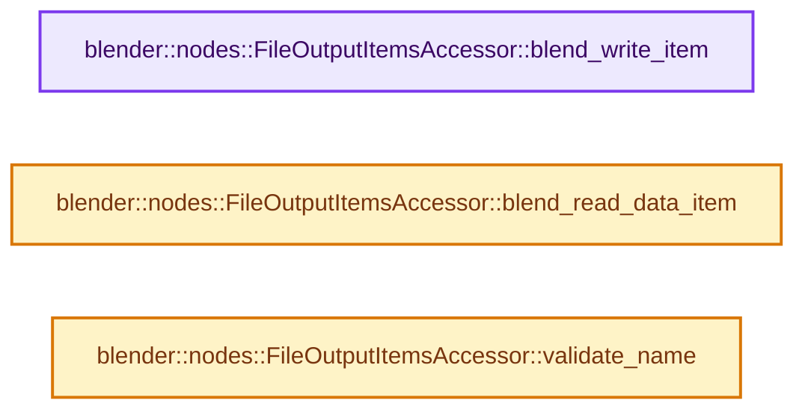
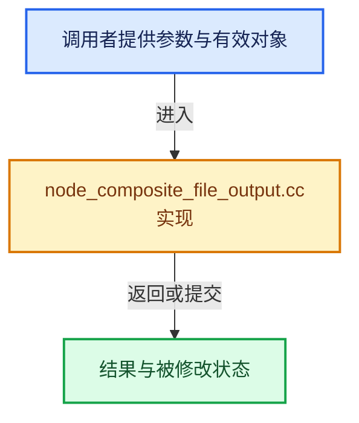

# 实现依赖专题：source/blender/nodes/composite/nodes/node_composite_file_output.cc

[实现依赖导航](../../../README.md) · [符号索引](../../../../00-课程指南/02-源码与提交索引/符号依赖与实现索引.md)

本专题从正文实际调用进入，集中保存共享实现。函数有稳定锚点，可从调用处直接跳到对应完整函数；递归与互相调用通过回链组织。

## 本文件的实现关系






## 完整成员与函数实现

<a id="f-e0373d6d8bd8e62a"></a>

### `blender::nodes::FileOutputItemsAccessor::blend_write_item`

实现位置：[source/blender/nodes/composite/nodes/node_composite_file_output.cc](../../../../../../../../source/blender/nodes/composite/nodes/node_composite_file_output.cc) · L865—L869。

接口参数：

- `BlendWriter *writer`
- `const ItemT &item`

**教学注释版**

<!-- annotated:9220b363bd91c3 -->

```cpp
void FileOutputItemsAccessor::blend_write_item(BlendWriter *writer, const ItemT &item)
{
  writer->write_string(item.name);
  BKE_image_format_blend_write(writer, const_cast<ImageFormatData *>(&item.format));
}
```

<details>
<summary>核对原始源码：source/blender/nodes/composite/nodes/node_composite_file_output.cc · L865—L869</summary>

<!-- original:9220b363bd91c3:source/blender/nodes/composite/nodes/node_composite_file_output.cc:865:869 -->

```cpp
void FileOutputItemsAccessor::blend_write_item(BlendWriter *writer, const ItemT &item)
{
  writer->write_string(item.name);
  BKE_image_format_blend_write(writer, const_cast<ImageFormatData *>(&item.format));
}
```

</details>

**继续追踪实现**

- `writer->write_string` → [blender::BlendWriter::write_string · L2357](../../../08-其他Blender模块/blenloader/intern/writefile.cc.md#f-3fd83db72afbdcbe)。
- `BKE_image_format_blend_write` → [blender::BKE_image_format_blend_write · L87](../../../02-BKE几何与数据/intern/image_format.cc.md#f-2e03c9c3368fd838)。

<a id="f-acb146d93a9ed408"></a>

### `blender::nodes::FileOutputItemsAccessor::blend_read_data_item`

实现位置：[source/blender/nodes/composite/nodes/node_composite_file_output.cc](../../../../../../../../source/blender/nodes/composite/nodes/node_composite_file_output.cc) · L871—L875。

接口参数：

- `BlendDataReader *reader`
- `ItemT &item`

**教学注释版**

<!-- annotated:cc3af2e954206e -->

```cpp
void FileOutputItemsAccessor::blend_read_data_item(BlendDataReader *reader, ItemT &item)
{
  BLO_read_string(reader, &item.name);
  BKE_image_format_blend_read_data(reader, &item.format);
}
```

<details>
<summary>核对原始源码：source/blender/nodes/composite/nodes/node_composite_file_output.cc · L871—L875</summary>

<!-- original:cc3af2e954206e:source/blender/nodes/composite/nodes/node_composite_file_output.cc:871:875 -->

```cpp
void FileOutputItemsAccessor::blend_read_data_item(BlendDataReader *reader, ItemT &item)
{
  BLO_read_string(reader, &item.name);
  BKE_image_format_blend_read_data(reader, &item.format);
}
```

</details>

**继续追踪实现**

- `BLO_read_string` → [BLO_read_string · L6348](../../../08-其他Blender模块/blenloader/intern/readfile.cc.md#f-b9cb42e390941235)；[BLO_read_string · L6370](../../../08-其他Blender模块/blenloader/intern/readfile.cc.md#f-1bb75b8661d718d2)；[BLO_read_string · L6375](../../../08-其他Blender模块/blenloader/intern/readfile.cc.md#f-5714da923b3ad83d)。同名重载需按实参类型选择。
- `BKE_image_format_blend_read_data` → [blender::BKE_image_format_blend_read_data · L82](../../../02-BKE几何与数据/intern/image_format.cc.md#f-59b357861775e62e)。

<a id="f-4cc77c4b091b517a"></a>

### `blender::nodes::FileOutputItemsAccessor::validate_name`

实现位置：[source/blender/nodes/composite/nodes/node_composite_file_output.cc](../../../../../../../../source/blender/nodes/composite/nodes/node_composite_file_output.cc) · L877—L883。

接口参数：

- `const StringRef name`

**教学注释版**

<!-- annotated:87093a2979a680 -->

```cpp
std::string FileOutputItemsAccessor::validate_name(const StringRef name)
{
  char file_name[FILE_MAX] = "";
  STRNCPY(file_name, name.data());
  BLI_path_make_safe(file_name);
  return file_name;
}
```

<details>
<summary>核对原始源码：source/blender/nodes/composite/nodes/node_composite_file_output.cc · L877—L883</summary>

<!-- original:87093a2979a680:source/blender/nodes/composite/nodes/node_composite_file_output.cc:877:883 -->

```cpp
std::string FileOutputItemsAccessor::validate_name(const StringRef name)
{
  char file_name[FILE_MAX] = "";
  STRNCPY(file_name, name.data());
  BLI_path_make_safe(file_name);
  return file_name;
}
```

</details>

**结果出口**

- `return file_name;`

**继续追踪实现**

- `STRNCPY` → [blender::STRNCPY · L690](../../../01-BLI基础库/BLI_string.hh.md#f-6b2d861724026be6)。
- `name.data` → [blender::nodes::GList::data · L208](../../NOD_geometry_nodes_list.hh.md#f-79596d2a726abf7a)；[blender::nodes::GList::data · L213](../../NOD_geometry_nodes_list.hh.md#f-a1564e477ed8318a)；[blender::nodes::List<T>::data · L249](../../NOD_geometry_nodes_list.hh.md#f-f05d4d7a5007c920)；[blender::nodes::List<T>::data · L254](../../NOD_geometry_nodes_list.hh.md#f-9685f4b6239433b9)。同名重载需按实参类型选择。
- `BLI_path_make_safe` → [BLI_path_make_safe · L502](../../../01-BLI基础库/intern/path_utils.cc.md#f-6597e6a058dce57c)。
