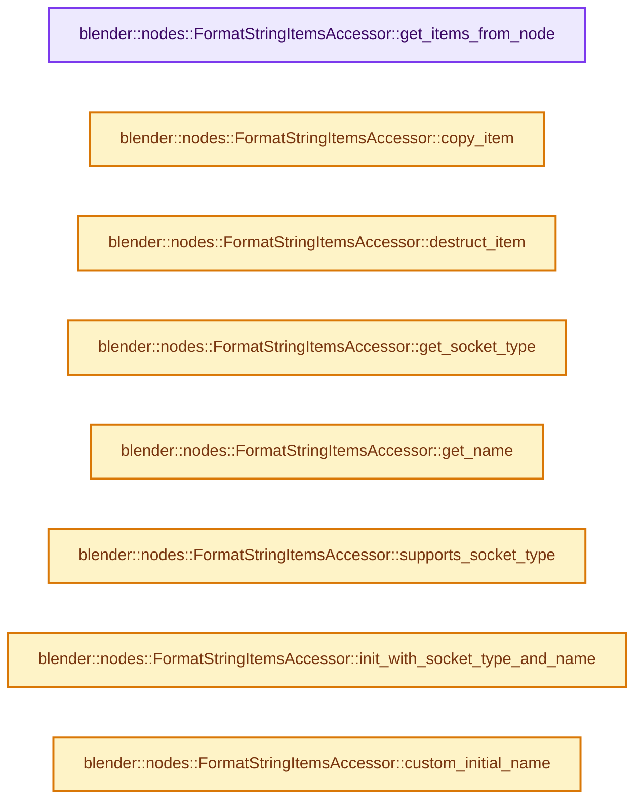
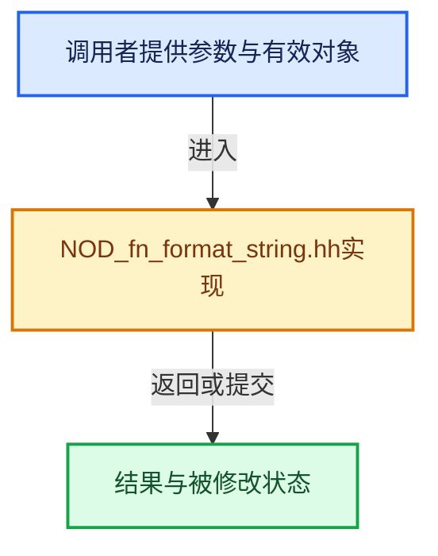

# 实现依赖专题：source/blender/nodes/function/include/NOD_fn_format_string.hh

[实现依赖导航](../../../README.md) · [符号索引](../../../../00-课程指南/02-源码与提交索引/符号依赖与实现索引.md)

本专题从正文实际调用进入，集中保存共享实现。函数有稳定锚点，可从调用处直接跳到对应完整函数；递归与互相调用通过回链组织。

## 本文件的实现关系






## 完整成员与函数实现

<a id="f-01e4b1bbb0e9a7b0"></a>

### `blender::nodes::FormatStringItemsAccessor::get_items_from_node`

实现位置：[source/blender/nodes/function/include/NOD_fn_format_string.hh](../../../../../../../../source/blender/nodes/function/include/NOD_fn_format_string.hh) · L40—L45。

接口参数：

- `bNode &node`

**教学注释版**

<!-- annotated:933876643f1be0 -->

```cpp
  static socket_items::SocketItemsRef<NodeFunctionFormatStringItem> get_items_from_node(
      bNode &node)
  {
    auto *storage = static_cast<NodeFunctionFormatString *>(node.storage);
    return {&storage->items, &storage->items_num, &storage->active_index};
  }
```

<details>
<summary>核对原始源码：source/blender/nodes/function/include/NOD_fn_format_string.hh · L40—L45</summary>

<!-- original:933876643f1be0:source/blender/nodes/function/include/NOD_fn_format_string.hh:40:45 -->

```cpp
  static socket_items::SocketItemsRef<NodeFunctionFormatStringItem> get_items_from_node(
      bNode &node)
  {
    auto *storage = static_cast<NodeFunctionFormatString *>(node.storage);
    return {&storage->items, &storage->items_num, &storage->active_index};
  }
```

</details>

**结果出口**

- `return {&storage->items, &storage->items_num, &storage->active_index};`

**继续追踪实现**

本实现没有需要继续展开的显式调用；检查返回表达式、对象转换和调用者前置条件。

<a id="f-d1f5a17114a07041"></a>

### `blender::nodes::FormatStringItemsAccessor::copy_item`

实现位置：[source/blender/nodes/function/include/NOD_fn_format_string.hh](../../../../../../../../source/blender/nodes/function/include/NOD_fn_format_string.hh) · L47—L51。

接口参数：

- `const NodeFunctionFormatStringItem &src`
- `NodeFunctionFormatStringItem &dst`

**教学注释版**

<!-- annotated:a8329847cb28b8 -->

```cpp
  static void copy_item(const NodeFunctionFormatStringItem &src, NodeFunctionFormatStringItem &dst)
  {
    dst = src;
    dst.name = BLI_strdup_null(dst.name);
  }
```

<details>
<summary>核对原始源码：source/blender/nodes/function/include/NOD_fn_format_string.hh · L47—L51</summary>

<!-- original:a8329847cb28b8:source/blender/nodes/function/include/NOD_fn_format_string.hh:47:51 -->

```cpp
  static void copy_item(const NodeFunctionFormatStringItem &src, NodeFunctionFormatStringItem &dst)
  {
    dst = src;
    dst.name = BLI_strdup_null(dst.name);
  }
```

</details>

**沿实际写入检查状态**

- `dst = src;`
- `dst.name = BLI_strdup_null(dst.name);`

**继续追踪实现**

- `BLI_strdup_null` → [blender::BLI_strdup_null · L48](../../../01-BLI基础库/intern/string.cc.md#f-c1cd7c6336fe3fe0)。

<a id="f-30f07b7377a42424"></a>

### `blender::nodes::FormatStringItemsAccessor::destruct_item`

实现位置：[source/blender/nodes/function/include/NOD_fn_format_string.hh](../../../../../../../../source/blender/nodes/function/include/NOD_fn_format_string.hh) · L53—L56。

接口参数：

- `NodeFunctionFormatStringItem *item`

**教学注释版**

<!-- annotated:345e5a33a92b60 -->

```cpp
  static void destruct_item(NodeFunctionFormatStringItem *item)
  {
    MEM_SAFE_DELETE(item->name);
  }
```

<details>
<summary>核对原始源码：source/blender/nodes/function/include/NOD_fn_format_string.hh · L53—L56</summary>

<!-- original:345e5a33a92b60:source/blender/nodes/function/include/NOD_fn_format_string.hh:53:56 -->

```cpp
  static void destruct_item(NodeFunctionFormatStringItem *item)
  {
    MEM_SAFE_DELETE(item->name);
  }
```

</details>

**继续追踪实现**

- `MEM_SAFE_DELETE` → [MEM_SAFE_DELETE · L436](../../../07-Intern运行时与平台/guardedalloc/MEM_guardedalloc.h.md#m-eadb3bc5b902)。宏定义由构建条件选择。

<a id="f-0e836bb80eb8050c"></a>

### `blender::nodes::FormatStringItemsAccessor::get_socket_type`

实现位置：[source/blender/nodes/function/include/NOD_fn_format_string.hh](../../../../../../../../source/blender/nodes/function/include/NOD_fn_format_string.hh) · L61—L64。

接口参数：

- `const NodeFunctionFormatStringItem &item`

**教学注释版**

<!-- annotated:c3538d6f9eec69 -->

```cpp
  static eNodeSocketDatatype get_socket_type(const NodeFunctionFormatStringItem &item)
  {
    return item.socket_type;
  }
```

<details>
<summary>核对原始源码：source/blender/nodes/function/include/NOD_fn_format_string.hh · L61—L64</summary>

<!-- original:c3538d6f9eec69:source/blender/nodes/function/include/NOD_fn_format_string.hh:61:64 -->

```cpp
  static eNodeSocketDatatype get_socket_type(const NodeFunctionFormatStringItem &item)
  {
    return item.socket_type;
  }
```

</details>

**结果出口**

- `return item.socket_type;`

**继续追踪实现**

本实现没有需要继续展开的显式调用；检查返回表达式、对象转换和调用者前置条件。

<a id="f-b19d7e09cee79aa0"></a>

### `blender::nodes::FormatStringItemsAccessor::get_name`

实现位置：[source/blender/nodes/function/include/NOD_fn_format_string.hh](../../../../../../../../source/blender/nodes/function/include/NOD_fn_format_string.hh) · L66—L69。

接口参数：

- `NodeFunctionFormatStringItem &item`

**教学注释版**

<!-- annotated:ed1df3f164e693 -->

```cpp
  static char **get_name(NodeFunctionFormatStringItem &item)
  {
    return &item.name;
  }
```

<details>
<summary>核对原始源码：source/blender/nodes/function/include/NOD_fn_format_string.hh · L66—L69</summary>

<!-- original:ed1df3f164e693:source/blender/nodes/function/include/NOD_fn_format_string.hh:66:69 -->

```cpp
  static char **get_name(NodeFunctionFormatStringItem &item)
  {
    return &item.name;
  }
```

</details>

**结果出口**

- `return &item.name;`

**继续追踪实现**

本实现没有需要继续展开的显式调用；检查返回表达式、对象转换和调用者前置条件。

<a id="f-ce637487d36d5939"></a>

### `blender::nodes::FormatStringItemsAccessor::supports_socket_type`

实现位置：[source/blender/nodes/function/include/NOD_fn_format_string.hh](../../../../../../../../source/blender/nodes/function/include/NOD_fn_format_string.hh) · L71—L74。

接口参数：

- `const eNodeSocketDatatype socket_type`
- `const int`

**教学注释版**

<!-- annotated:c43a485fb1c825 -->

```cpp
  static bool supports_socket_type(const eNodeSocketDatatype socket_type, const int /*ntree_type*/)
  {
    return ELEM(socket_type, SOCK_INT, SOCK_FLOAT, SOCK_STRING);
  }
```

<details>
<summary>核对原始源码：source/blender/nodes/function/include/NOD_fn_format_string.hh · L71—L74</summary>

<!-- original:c43a485fb1c825:source/blender/nodes/function/include/NOD_fn_format_string.hh:71:74 -->

```cpp
  static bool supports_socket_type(const eNodeSocketDatatype socket_type, const int /*ntree_type*/)
  {
    return ELEM(socket_type, SOCK_INT, SOCK_FLOAT, SOCK_STRING);
  }
```

</details>

**结果出口**

- `return ELEM(socket_type, SOCK_INT, SOCK_FLOAT, SOCK_STRING);`

**继续追踪实现**

- `ELEM` → [ELEM · L88](../../../07-Intern运行时与平台/ghost/intern/GHOST_utildefines.hh.md#m-d28724a15928)；[ELEM · L135](../../../01-BLI基础库/BLI_utildefines.hh.md#m-d6572de7cae0)。宏定义由构建条件选择。

<a id="f-f7a54821f91c5e83"></a>

### `blender::nodes::FormatStringItemsAccessor::init_with_socket_type_and_name`

实现位置：[source/blender/nodes/function/include/NOD_fn_format_string.hh](../../../../../../../../source/blender/nodes/function/include/NOD_fn_format_string.hh) · L76—L85。

接口参数：

- `bNode &node`
- `NodeFunctionFormatStringItem &item`
- `const eNodeSocketDatatype socket_type`
- `const char *name`

**教学注释版**

<!-- annotated:87e839f2a9e549 -->

```cpp
  static void init_with_socket_type_and_name(bNode &node,
                                             NodeFunctionFormatStringItem &item,
                                             const eNodeSocketDatatype socket_type,
                                             const char *name)
  {
    auto *storage = static_cast<NodeFunctionFormatString *>(node.storage);
    item.socket_type = socket_type;
    item.identifier = storage->next_identifier++;
    socket_items::set_item_name_and_make_unique<FormatStringItemsAccessor>(node, item, name);
  }
```

<details>
<summary>核对原始源码：source/blender/nodes/function/include/NOD_fn_format_string.hh · L76—L85</summary>

<!-- original:87e839f2a9e549:source/blender/nodes/function/include/NOD_fn_format_string.hh:76:85 -->

```cpp
  static void init_with_socket_type_and_name(bNode &node,
                                             NodeFunctionFormatStringItem &item,
                                             const eNodeSocketDatatype socket_type,
                                             const char *name)
  {
    auto *storage = static_cast<NodeFunctionFormatString *>(node.storage);
    item.socket_type = socket_type;
    item.identifier = storage->next_identifier++;
    socket_items::set_item_name_and_make_unique<FormatStringItemsAccessor>(node, item, name);
  }
```

</details>

**沿实际写入检查状态**

- `item.socket_type = socket_type;`
- `item.identifier = storage->next_identifier++;`

**继续追踪实现**

- `socket_items::set_item_name_and_make_unique<FormatStringItemsAccessor>` → [blender::nodes::socket_items::set_item_name_and_make_unique · L148](../../NOD_socket_items.hh.md#f-7e7af1c01522f9dc)。

<a id="f-e78274f8ebcaf157"></a>

### `blender::nodes::FormatStringItemsAccessor::custom_initial_name`

实现位置：[source/blender/nodes/function/include/NOD_fn_format_string.hh](../../../../../../../../source/blender/nodes/function/include/NOD_fn_format_string.hh) · L87—L90。

接口参数：

- `const bNode &node`
- `StringRef src_name`

**教学注释版**

<!-- annotated:d241133e19cf8c -->

```cpp
  static std::string custom_initial_name(const bNode &node, StringRef src_name)
  {
    return socket_items::variable_name_find_short<FormatStringItemsAccessor>(node, src_name);
  }
```

<details>
<summary>核对原始源码：source/blender/nodes/function/include/NOD_fn_format_string.hh · L87—L90</summary>

<!-- original:d241133e19cf8c:source/blender/nodes/function/include/NOD_fn_format_string.hh:87:90 -->

```cpp
  static std::string custom_initial_name(const bNode &node, StringRef src_name)
  {
    return socket_items::variable_name_find_short<FormatStringItemsAccessor>(node, src_name);
  }
```

</details>

**结果出口**

- `return socket_items::variable_name_find_short<FormatStringItemsAccessor>(node, src_name);`

**继续追踪实现**

- `socket_items::variable_name_find_short<FormatStringItemsAccessor>` → [blender::nodes::socket_items::variable_name_find_short · L22](../../NOD_socket_items_name_util.hh.md#f-c202e7955a1ac661)；[blender::nodes::socket_items::variable_name_find_short · L13](../../intern/socket_items_name_util.cc.md#f-8955b0b79436ea99)。同名重载需按实参类型选择。

<a id="f-ea3904e7b5889821"></a>

### `blender::nodes::FormatStringItemsAccessor::validate_name`

实现位置：[source/blender/nodes/function/include/NOD_fn_format_string.hh](../../../../../../../../source/blender/nodes/function/include/NOD_fn_format_string.hh) · L92—L95。

接口参数：

- `const StringRef name`

**教学注释版**

<!-- annotated:d224f313318c60 -->

```cpp
  static std::string validate_name(const StringRef name)
  {
    return socket_items::variable_name_validate(name);
  }
```

<details>
<summary>核对原始源码：source/blender/nodes/function/include/NOD_fn_format_string.hh · L92—L95</summary>

<!-- original:d224f313318c60:source/blender/nodes/function/include/NOD_fn_format_string.hh:92:95 -->

```cpp
  static std::string validate_name(const StringRef name)
  {
    return socket_items::variable_name_validate(name);
  }
```

</details>

**结果出口**

- `return socket_items::variable_name_validate(name);`

**继续追踪实现**

- `socket_items::variable_name_validate` → [blender::nodes::socket_items::variable_name_validate · L42](../../intern/socket_items_name_util.cc.md#f-7b6ad9c2876d2848)。

<a id="f-1b0f570724eff439"></a>

### `blender::nodes::FormatStringItemsAccessor::socket_identifier_for_item`

实现位置：[source/blender/nodes/function/include/NOD_fn_format_string.hh](../../../../../../../../source/blender/nodes/function/include/NOD_fn_format_string.hh) · L97—L100。

接口参数：

- `const NodeFunctionFormatStringItem &item`

**教学注释版**

<!-- annotated:3973a69a0f600f -->

```cpp
  static std::string socket_identifier_for_item(const NodeFunctionFormatStringItem &item)
  {
    return "Item_" + std::to_string(item.identifier);
  }
```

<details>
<summary>核对原始源码：source/blender/nodes/function/include/NOD_fn_format_string.hh · L97—L100</summary>

<!-- original:3973a69a0f600f:source/blender/nodes/function/include/NOD_fn_format_string.hh:97:100 -->

```cpp
  static std::string socket_identifier_for_item(const NodeFunctionFormatStringItem &item)
  {
    return "Item_" + std::to_string(item.identifier);
  }
```

</details>

**结果出口**

- `return "Item_" + std::to_string(item.identifier);`

**继续追踪实现**

- `std::to_string` → [外部契约](https://eel.is/c++draft/)：这个边界按实际表达式及所属类型核对参数、返回值、寿命与失败行为。这里提供接口入口，不声称已解释该第三方版本的内部实现。
