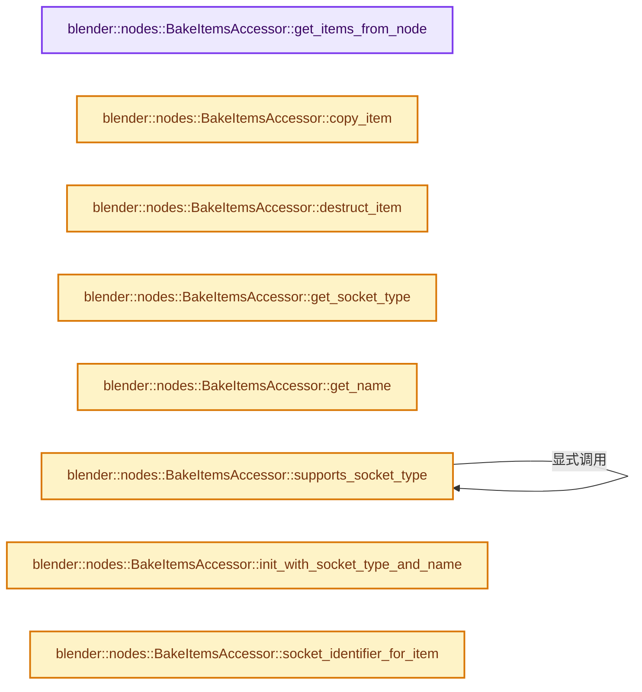

# 实现依赖专题：source/blender/nodes/geometry/include/NOD_geo_bake.hh

[实现依赖导航](../../../README.md) · [符号索引](../../../../00-课程指南/02-源码与提交索引/符号依赖与实现索引.md)

本专题从正文实际调用进入，集中保存共享实现。函数有稳定锚点，可从调用处直接跳到对应完整函数；递归与互相调用通过回链组织。

## 本文件的实现关系




## 完整成员与函数实现

<a id="f-8a32f2915f15b452"></a>

### `blender::nodes::BakeItemsAccessor::get_items_from_node`

实现位置：[source/blender/nodes/geometry/include/NOD_geo_bake.hh](../../../../../../../../source/blender/nodes/geometry/include/NOD_geo_bake.hh) · L52—L56。

接口参数：

- `bNode &node`

**教学注释版**

<!-- annotated:ad4422fc8214d6 -->

```cpp
  static socket_items::SocketItemsRef<NodeGeometryBakeItem> get_items_from_node(bNode &node)
  {
    auto *storage = static_cast<NodeGeometryBake *>(node.storage);
    return {&storage->items, &storage->items_num, &storage->active_index};
  }
```

<details>
<summary>核对原始源码：source/blender/nodes/geometry/include/NOD_geo_bake.hh · L52—L56</summary>

<!-- original:ad4422fc8214d6:source/blender/nodes/geometry/include/NOD_geo_bake.hh:52:56 -->

```cpp
  static socket_items::SocketItemsRef<NodeGeometryBakeItem> get_items_from_node(bNode &node)
  {
    auto *storage = static_cast<NodeGeometryBake *>(node.storage);
    return {&storage->items, &storage->items_num, &storage->active_index};
  }
```

</details>

**结果出口**

- `return {&storage->items, &storage->items_num, &storage->active_index};`

**继续追踪实现**

本实现没有需要继续展开的显式调用；检查返回表达式、对象转换和调用者前置条件。

<a id="f-31be6ad4acc5847c"></a>

### `blender::nodes::BakeItemsAccessor::copy_item`

实现位置：[source/blender/nodes/geometry/include/NOD_geo_bake.hh](../../../../../../../../source/blender/nodes/geometry/include/NOD_geo_bake.hh) · L58—L62。

接口参数：

- `const NodeGeometryBakeItem &src`
- `NodeGeometryBakeItem &dst`

**教学注释版**

<!-- annotated:8d6a547a4d799e -->

```cpp
  static void copy_item(const NodeGeometryBakeItem &src, NodeGeometryBakeItem &dst)
  {
    dst = src;
    dst.name = BLI_strdup_null(dst.name);
  }
```

<details>
<summary>核对原始源码：source/blender/nodes/geometry/include/NOD_geo_bake.hh · L58—L62</summary>

<!-- original:8d6a547a4d799e:source/blender/nodes/geometry/include/NOD_geo_bake.hh:58:62 -->

```cpp
  static void copy_item(const NodeGeometryBakeItem &src, NodeGeometryBakeItem &dst)
  {
    dst = src;
    dst.name = BLI_strdup_null(dst.name);
  }
```

</details>

**沿实际写入检查状态**

- `dst = src;`
- `dst.name = BLI_strdup_null(dst.name);`

**继续追踪实现**

- `BLI_strdup_null` → [blender::BLI_strdup_null · L48](../../../01-BLI基础库/intern/string.cc.md#f-c1cd7c6336fe3fe0)。

<a id="f-19b9fd4c272674e5"></a>

### `blender::nodes::BakeItemsAccessor::destruct_item`

实现位置：[source/blender/nodes/geometry/include/NOD_geo_bake.hh](../../../../../../../../source/blender/nodes/geometry/include/NOD_geo_bake.hh) · L64—L67。

接口参数：

- `NodeGeometryBakeItem *item`

**教学注释版**

<!-- annotated:68f4237c3e4984 -->

```cpp
  static void destruct_item(NodeGeometryBakeItem *item)
  {
    MEM_SAFE_DELETE(item->name);
  }
```

<details>
<summary>核对原始源码：source/blender/nodes/geometry/include/NOD_geo_bake.hh · L64—L67</summary>

<!-- original:68f4237c3e4984:source/blender/nodes/geometry/include/NOD_geo_bake.hh:64:67 -->

```cpp
  static void destruct_item(NodeGeometryBakeItem *item)
  {
    MEM_SAFE_DELETE(item->name);
  }
```

</details>

**继续追踪实现**

- `MEM_SAFE_DELETE` → [MEM_SAFE_DELETE · L436](../../../07-Intern运行时与平台/guardedalloc/MEM_guardedalloc.h.md#m-eadb3bc5b902)。宏定义由构建条件选择。

<a id="f-af4bb90eba6df34e"></a>

### `blender::nodes::BakeItemsAccessor::get_socket_type`

实现位置：[source/blender/nodes/geometry/include/NOD_geo_bake.hh](../../../../../../../../source/blender/nodes/geometry/include/NOD_geo_bake.hh) · L72—L75。

接口参数：

- `const NodeGeometryBakeItem &item`

**教学注释版**

<!-- annotated:3403283ae12ac0 -->

```cpp
  static eNodeSocketDatatype get_socket_type(const NodeGeometryBakeItem &item)
  {
    return item.socket_type;
  }
```

<details>
<summary>核对原始源码：source/blender/nodes/geometry/include/NOD_geo_bake.hh · L72—L75</summary>

<!-- original:3403283ae12ac0:source/blender/nodes/geometry/include/NOD_geo_bake.hh:72:75 -->

```cpp
  static eNodeSocketDatatype get_socket_type(const NodeGeometryBakeItem &item)
  {
    return item.socket_type;
  }
```

</details>

**结果出口**

- `return item.socket_type;`

**继续追踪实现**

本实现没有需要继续展开的显式调用；检查返回表达式、对象转换和调用者前置条件。

<a id="f-de36f339763eaae8"></a>

### `blender::nodes::BakeItemsAccessor::get_name`

实现位置：[source/blender/nodes/geometry/include/NOD_geo_bake.hh](../../../../../../../../source/blender/nodes/geometry/include/NOD_geo_bake.hh) · L77—L80。

接口参数：

- `NodeGeometryBakeItem &item`

**教学注释版**

<!-- annotated:5356b8ff2eb5f6 -->

```cpp
  static char **get_name(NodeGeometryBakeItem &item)
  {
    return &item.name;
  }
```

<details>
<summary>核对原始源码：source/blender/nodes/geometry/include/NOD_geo_bake.hh · L77—L80</summary>

<!-- original:5356b8ff2eb5f6:source/blender/nodes/geometry/include/NOD_geo_bake.hh:77:80 -->

```cpp
  static char **get_name(NodeGeometryBakeItem &item)
  {
    return &item.name;
  }
```

</details>

**结果出口**

- `return &item.name;`

**继续追踪实现**

本实现没有需要继续展开的显式调用；检查返回表达式、对象转换和调用者前置条件。

<a id="f-f22052a9aaca785e"></a>

### `blender::nodes::BakeItemsAccessor::supports_socket_type`

实现位置：[source/blender/nodes/geometry/include/NOD_geo_bake.hh](../../../../../../../../source/blender/nodes/geometry/include/NOD_geo_bake.hh) · L82—L85。

接口参数：

- `const eNodeSocketDatatype socket_type`
- `const int ntree_type`

**教学注释版**

<!-- annotated:e60af3195dc061 -->

```cpp
  static bool supports_socket_type(const eNodeSocketDatatype socket_type, const int ntree_type)
  {
    return SimulationItemsAccessor::supports_socket_type(socket_type, ntree_type);
  }
```

<details>
<summary>核对原始源码：source/blender/nodes/geometry/include/NOD_geo_bake.hh · L82—L85</summary>

<!-- original:e60af3195dc061:source/blender/nodes/geometry/include/NOD_geo_bake.hh:82:85 -->

```cpp
  static bool supports_socket_type(const eNodeSocketDatatype socket_type, const int ntree_type)
  {
    return SimulationItemsAccessor::supports_socket_type(socket_type, ntree_type);
  }
```

</details>

**结果出口**

- `return SimulationItemsAccessor::supports_socket_type(socket_type, ntree_type);`

**继续追踪实现**

- `SimulationItemsAccessor::supports_socket_type` → [blender::nodes::BakeItemsAccessor::supports_socket_type · L82](NOD_geo_bake.hh.md#f-f22052a9aaca785e)。

<a id="f-fe19e380a4550054"></a>

### `blender::nodes::BakeItemsAccessor::init_with_socket_type_and_name`

实现位置：[source/blender/nodes/geometry/include/NOD_geo_bake.hh](../../../../../../../../source/blender/nodes/geometry/include/NOD_geo_bake.hh) · L87—L96。

接口参数：

- `bNode &node`
- `NodeGeometryBakeItem &item`
- `const eNodeSocketDatatype socket_type`
- `const char *name`

**教学注释版**

<!-- annotated:a38749c019894e -->

```cpp
  static void init_with_socket_type_and_name(bNode &node,
                                             NodeGeometryBakeItem &item,
                                             const eNodeSocketDatatype socket_type,
                                             const char *name)
  {
    auto *storage = static_cast<NodeGeometryBake *>(node.storage);
    item.socket_type = socket_type;
    item.identifier = storage->next_identifier++;
    socket_items::set_item_name_and_make_unique<BakeItemsAccessor>(node, item, name);
  }
```

<details>
<summary>核对原始源码：source/blender/nodes/geometry/include/NOD_geo_bake.hh · L87—L96</summary>

<!-- original:a38749c019894e:source/blender/nodes/geometry/include/NOD_geo_bake.hh:87:96 -->

```cpp
  static void init_with_socket_type_and_name(bNode &node,
                                             NodeGeometryBakeItem &item,
                                             const eNodeSocketDatatype socket_type,
                                             const char *name)
  {
    auto *storage = static_cast<NodeGeometryBake *>(node.storage);
    item.socket_type = socket_type;
    item.identifier = storage->next_identifier++;
    socket_items::set_item_name_and_make_unique<BakeItemsAccessor>(node, item, name);
  }
```

</details>

**沿实际写入检查状态**

- `item.socket_type = socket_type;`
- `item.identifier = storage->next_identifier++;`

**继续追踪实现**

- `socket_items::set_item_name_and_make_unique<BakeItemsAccessor>` → [blender::nodes::socket_items::set_item_name_and_make_unique · L148](../../NOD_socket_items.hh.md#f-7e7af1c01522f9dc)。

<a id="f-a355c6c327a8efdf"></a>

### `blender::nodes::BakeItemsAccessor::socket_identifier_for_item`

实现位置：[source/blender/nodes/geometry/include/NOD_geo_bake.hh](../../../../../../../../source/blender/nodes/geometry/include/NOD_geo_bake.hh) · L98—L101。

接口参数：

- `const NodeGeometryBakeItem &item`

**教学注释版**

<!-- annotated:bbf42cca28f106 -->

```cpp
  static std::string socket_identifier_for_item(const NodeGeometryBakeItem &item)
  {
    return "Item_" + std::to_string(item.identifier);
  }
```

<details>
<summary>核对原始源码：source/blender/nodes/geometry/include/NOD_geo_bake.hh · L98—L101</summary>

<!-- original:bbf42cca28f106:source/blender/nodes/geometry/include/NOD_geo_bake.hh:98:101 -->

```cpp
  static std::string socket_identifier_for_item(const NodeGeometryBakeItem &item)
  {
    return "Item_" + std::to_string(item.identifier);
  }
```

</details>

**结果出口**

- `return "Item_" + std::to_string(item.identifier);`

**继续追踪实现**

- `std::to_string` → [外部契约](https://eel.is/c++draft/)：这个边界按实际表达式及所属类型核对参数、返回值、寿命与失败行为。这里提供接口入口，不声称已解释该第三方版本的内部实现。
