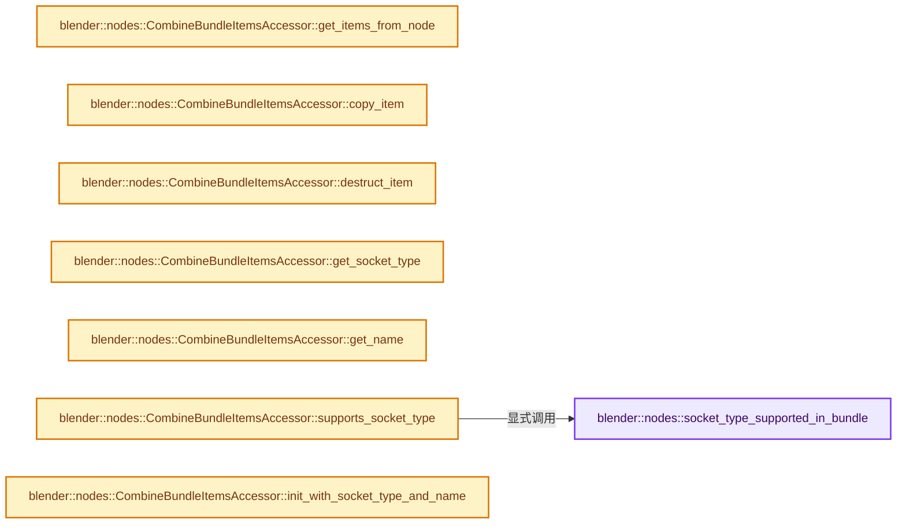

# 实现依赖专题：source/blender/nodes/geometry/include/NOD_geo_bundle.hh

[实现依赖导航](../../../README.md) · [符号索引](../../../../00-课程指南/02-源码与提交索引/符号依赖与实现索引.md)

本专题从正文实际调用进入，集中保存共享实现。函数有稳定锚点，可从调用处直接跳到对应完整函数；递归与互相调用通过回链组织。

## 本文件的实现关系




## 完整成员与函数实现

<a id="f-6fdc8981c239b25c"></a>

### `blender::nodes::socket_type_supported_in_bundle`

实现位置：[source/blender/nodes/geometry/include/NOD_geo_bundle.hh](../../../../../../../../source/blender/nodes/geometry/include/NOD_geo_bundle.hh) · L13—L17。

接口参数：

- `const eNodeSocketDatatype socket_type`
- `const int ntree_type`

**教学注释版**

<!-- annotated:d429e6455c0f9f -->

```cpp
inline bool socket_type_supported_in_bundle(const eNodeSocketDatatype socket_type,
                                            const int ntree_type)
{
  return bke::node_tree_type_supports_socket_type_static(ntree_type, socket_type);
}
```

<details>
<summary>核对原始源码：source/blender/nodes/geometry/include/NOD_geo_bundle.hh · L13—L17</summary>

<!-- original:d429e6455c0f9f:source/blender/nodes/geometry/include/NOD_geo_bundle.hh:13:17 -->

```cpp
inline bool socket_type_supported_in_bundle(const eNodeSocketDatatype socket_type,
                                            const int ntree_type)
{
  return bke::node_tree_type_supports_socket_type_static(ntree_type, socket_type);
}
```

</details>

**结果出口**

- `return bke::node_tree_type_supports_socket_type_static(ntree_type, socket_type);`

**继续追踪实现**

- `bke::node_tree_type_supports_socket_type_static` → [blender::bke::node_tree_type_supports_socket_type_static · L6295](../../../02-BKE几何与数据/intern/node.cc.md#f-f2bd64dc6bed02ca)。

<a id="f-726d871c58c4a98e"></a>

### `blender::nodes::CombineBundleItemsAccessor::get_items_from_node`

实现位置：[source/blender/nodes/geometry/include/NOD_geo_bundle.hh](../../../../../../../../source/blender/nodes/geometry/include/NOD_geo_bundle.hh) · L41—L45。

接口参数：

- `bNode &node`

**教学注释版**

<!-- annotated:3497eaf90eeaab -->

```cpp
  static socket_items::SocketItemsRef<ItemT> get_items_from_node(bNode &node)
  {
    auto *storage = static_cast<NodeCombineBundle *>(node.storage);
    return {&storage->items, &storage->items_num, &storage->active_index};
  }
```

<details>
<summary>核对原始源码：source/blender/nodes/geometry/include/NOD_geo_bundle.hh · L41—L45</summary>

<!-- original:3497eaf90eeaab:source/blender/nodes/geometry/include/NOD_geo_bundle.hh:41:45 -->

```cpp
  static socket_items::SocketItemsRef<ItemT> get_items_from_node(bNode &node)
  {
    auto *storage = static_cast<NodeCombineBundle *>(node.storage);
    return {&storage->items, &storage->items_num, &storage->active_index};
  }
```

</details>

**结果出口**

- `return {&storage->items, &storage->items_num, &storage->active_index};`

**继续追踪实现**

本实现没有需要继续展开的显式调用；检查返回表达式、对象转换和调用者前置条件。

<a id="f-0c4ebb38bd3e8691"></a>

### `blender::nodes::CombineBundleItemsAccessor::copy_item`

实现位置：[source/blender/nodes/geometry/include/NOD_geo_bundle.hh](../../../../../../../../source/blender/nodes/geometry/include/NOD_geo_bundle.hh) · L47—L51。

接口参数：

- `const ItemT &src`
- `ItemT &dst`

**教学注释版**

<!-- annotated:9c884c2e643400 -->

```cpp
  static void copy_item(const ItemT &src, ItemT &dst)
  {
    dst = src;
    dst.name = BLI_strdup_null(dst.name);
  }
```

<details>
<summary>核对原始源码：source/blender/nodes/geometry/include/NOD_geo_bundle.hh · L47—L51</summary>

<!-- original:9c884c2e643400:source/blender/nodes/geometry/include/NOD_geo_bundle.hh:47:51 -->

```cpp
  static void copy_item(const ItemT &src, ItemT &dst)
  {
    dst = src;
    dst.name = BLI_strdup_null(dst.name);
  }
```

</details>

**沿实际写入检查状态**

- `dst = src;`
- `dst.name = BLI_strdup_null(dst.name);`

**继续追踪实现**

- `BLI_strdup_null` → [blender::BLI_strdup_null · L48](../../../01-BLI基础库/intern/string.cc.md#f-c1cd7c6336fe3fe0)。

<a id="f-2f5b5453f6c53086"></a>

### `blender::nodes::CombineBundleItemsAccessor::destruct_item`

实现位置：[source/blender/nodes/geometry/include/NOD_geo_bundle.hh](../../../../../../../../source/blender/nodes/geometry/include/NOD_geo_bundle.hh) · L53—L56。

接口参数：

- `ItemT *item`

**教学注释版**

<!-- annotated:11bd593800805a -->

```cpp
  static void destruct_item(ItemT *item)
  {
    MEM_SAFE_DELETE(item->name);
  }
```

<details>
<summary>核对原始源码：source/blender/nodes/geometry/include/NOD_geo_bundle.hh · L53—L56</summary>

<!-- original:11bd593800805a:source/blender/nodes/geometry/include/NOD_geo_bundle.hh:53:56 -->

```cpp
  static void destruct_item(ItemT *item)
  {
    MEM_SAFE_DELETE(item->name);
  }
```

</details>

**继续追踪实现**

- `MEM_SAFE_DELETE` → [MEM_SAFE_DELETE · L436](../../../07-Intern运行时与平台/guardedalloc/MEM_guardedalloc.h.md#m-eadb3bc5b902)。宏定义由构建条件选择。

<a id="f-1ff102e85b1d4051"></a>

### `blender::nodes::CombineBundleItemsAccessor::get_socket_type`

实现位置：[source/blender/nodes/geometry/include/NOD_geo_bundle.hh](../../../../../../../../source/blender/nodes/geometry/include/NOD_geo_bundle.hh) · L61—L64。

接口参数：

- `const ItemT &item`

**教学注释版**

<!-- annotated:a5d9c64303f545 -->

```cpp
  static eNodeSocketDatatype get_socket_type(const ItemT &item)
  {
    return item.socket_type;
  }
```

<details>
<summary>核对原始源码：source/blender/nodes/geometry/include/NOD_geo_bundle.hh · L61—L64</summary>

<!-- original:a5d9c64303f545:source/blender/nodes/geometry/include/NOD_geo_bundle.hh:61:64 -->

```cpp
  static eNodeSocketDatatype get_socket_type(const ItemT &item)
  {
    return item.socket_type;
  }
```

</details>

**结果出口**

- `return item.socket_type;`

**继续追踪实现**

本实现没有需要继续展开的显式调用；检查返回表达式、对象转换和调用者前置条件。

<a id="f-84bcc75b0ae748d2"></a>

### `blender::nodes::CombineBundleItemsAccessor::get_name`

实现位置：[source/blender/nodes/geometry/include/NOD_geo_bundle.hh](../../../../../../../../source/blender/nodes/geometry/include/NOD_geo_bundle.hh) · L66—L69。

接口参数：

- `ItemT &item`

**教学注释版**

<!-- annotated:5565c2dc94aba6 -->

```cpp
  static char **get_name(ItemT &item)
  {
    return &item.name;
  }
```

<details>
<summary>核对原始源码：source/blender/nodes/geometry/include/NOD_geo_bundle.hh · L66—L69</summary>

<!-- original:5565c2dc94aba6:source/blender/nodes/geometry/include/NOD_geo_bundle.hh:66:69 -->

```cpp
  static char **get_name(ItemT &item)
  {
    return &item.name;
  }
```

</details>

**结果出口**

- `return &item.name;`

**继续追踪实现**

本实现没有需要继续展开的显式调用；检查返回表达式、对象转换和调用者前置条件。

<a id="f-f05031fc6ef927d7"></a>

### `blender::nodes::CombineBundleItemsAccessor::supports_socket_type`

实现位置：[source/blender/nodes/geometry/include/NOD_geo_bundle.hh](../../../../../../../../source/blender/nodes/geometry/include/NOD_geo_bundle.hh) · L71—L74。

接口参数：

- `const eNodeSocketDatatype socket_type`
- `const int ntree_type`

**教学注释版**

<!-- annotated:3dcf38118070f6 -->

```cpp
  static bool supports_socket_type(const eNodeSocketDatatype socket_type, const int ntree_type)
  {
    return socket_type_supported_in_bundle(socket_type, ntree_type);
  }
```

<details>
<summary>核对原始源码：source/blender/nodes/geometry/include/NOD_geo_bundle.hh · L71—L74</summary>

<!-- original:3dcf38118070f6:source/blender/nodes/geometry/include/NOD_geo_bundle.hh:71:74 -->

```cpp
  static bool supports_socket_type(const eNodeSocketDatatype socket_type, const int ntree_type)
  {
    return socket_type_supported_in_bundle(socket_type, ntree_type);
  }
```

</details>

**结果出口**

- `return socket_type_supported_in_bundle(socket_type, ntree_type);`

**继续追踪实现**

- `socket_type_supported_in_bundle` → [blender::nodes::socket_type_supported_in_bundle · L13](NOD_geo_bundle.hh.md#f-6fdc8981c239b25c)。

<a id="f-eee805ea30ae84e3"></a>

### `blender::nodes::CombineBundleItemsAccessor::init_with_socket_type_and_name`

实现位置：[source/blender/nodes/geometry/include/NOD_geo_bundle.hh](../../../../../../../../source/blender/nodes/geometry/include/NOD_geo_bundle.hh) · L76—L85。

接口参数：

- `bNode &node`
- `ItemT &item`
- `const eNodeSocketDatatype socket_type`
- `const char *name`

**教学注释版**

<!-- annotated:d2aad8e819cb76 -->

```cpp
  static void init_with_socket_type_and_name(bNode &node,
                                             ItemT &item,
                                             const eNodeSocketDatatype socket_type,
                                             const char *name)
  {
    auto *storage = static_cast<NodeCombineBundle *>(node.storage);
    item.socket_type = socket_type;
    item.identifier = storage->next_identifier++;
    socket_items::set_item_name_and_make_unique<CombineBundleItemsAccessor>(node, item, name);
  }
```

<details>
<summary>核对原始源码：source/blender/nodes/geometry/include/NOD_geo_bundle.hh · L76—L85</summary>

<!-- original:d2aad8e819cb76:source/blender/nodes/geometry/include/NOD_geo_bundle.hh:76:85 -->

```cpp
  static void init_with_socket_type_and_name(bNode &node,
                                             ItemT &item,
                                             const eNodeSocketDatatype socket_type,
                                             const char *name)
  {
    auto *storage = static_cast<NodeCombineBundle *>(node.storage);
    item.socket_type = socket_type;
    item.identifier = storage->next_identifier++;
    socket_items::set_item_name_and_make_unique<CombineBundleItemsAccessor>(node, item, name);
  }
```

</details>

**沿实际写入检查状态**

- `item.socket_type = socket_type;`
- `item.identifier = storage->next_identifier++;`

**继续追踪实现**

- `socket_items::set_item_name_and_make_unique<CombineBundleItemsAccessor>` → [blender::nodes::socket_items::set_item_name_and_make_unique · L148](../../NOD_socket_items.hh.md#f-7e7af1c01522f9dc)。

<a id="f-6ea76518f3348d16"></a>

### `blender::nodes::CombineBundleItemsAccessor::socket_identifier_for_item`

实现位置：[source/blender/nodes/geometry/include/NOD_geo_bundle.hh](../../../../../../../../source/blender/nodes/geometry/include/NOD_geo_bundle.hh) · L87—L90。

接口参数：

- `const ItemT &item`

**教学注释版**

<!-- annotated:e40724a806a810 -->

```cpp
  static std::string socket_identifier_for_item(const ItemT &item)
  {
    return "Item_" + std::to_string(item.identifier);
  }
```

<details>
<summary>核对原始源码：source/blender/nodes/geometry/include/NOD_geo_bundle.hh · L87—L90</summary>

<!-- original:e40724a806a810:source/blender/nodes/geometry/include/NOD_geo_bundle.hh:87:90 -->

```cpp
  static std::string socket_identifier_for_item(const ItemT &item)
  {
    return "Item_" + std::to_string(item.identifier);
  }
```

</details>

**结果出口**

- `return "Item_" + std::to_string(item.identifier);`

**继续追踪实现**

- `std::to_string` → [外部契约](https://eel.is/c++draft/)：这个边界按实际表达式及所属类型核对参数、返回值、寿命与失败行为。这里提供接口入口，不声称已解释该第三方版本的内部实现。

<a id="f-361121e6a62ec201"></a>

### `blender::nodes::SeparateBundleItemsAccessor::get_items_from_node`

实现位置：[source/blender/nodes/geometry/include/NOD_geo_bundle.hh](../../../../../../../../source/blender/nodes/geometry/include/NOD_geo_bundle.hh) · L117—L121。

接口参数：

- `bNode &node`

**教学注释版**

<!-- annotated:2fccb536df521d -->

```cpp
  static socket_items::SocketItemsRef<ItemT> get_items_from_node(bNode &node)
  {
    auto *storage = static_cast<NodeSeparateBundle *>(node.storage);
    return {&storage->items, &storage->items_num, &storage->active_index};
  }
```

<details>
<summary>核对原始源码：source/blender/nodes/geometry/include/NOD_geo_bundle.hh · L117—L121</summary>

<!-- original:2fccb536df521d:source/blender/nodes/geometry/include/NOD_geo_bundle.hh:117:121 -->

```cpp
  static socket_items::SocketItemsRef<ItemT> get_items_from_node(bNode &node)
  {
    auto *storage = static_cast<NodeSeparateBundle *>(node.storage);
    return {&storage->items, &storage->items_num, &storage->active_index};
  }
```

</details>

**结果出口**

- `return {&storage->items, &storage->items_num, &storage->active_index};`

**继续追踪实现**

本实现没有需要继续展开的显式调用；检查返回表达式、对象转换和调用者前置条件。

<a id="f-4a461ddef9818ca0"></a>

### `blender::nodes::SeparateBundleItemsAccessor::copy_item`

实现位置：[source/blender/nodes/geometry/include/NOD_geo_bundle.hh](../../../../../../../../source/blender/nodes/geometry/include/NOD_geo_bundle.hh) · L123—L127。

接口参数：

- `const ItemT &src`
- `ItemT &dst`

**教学注释版**

<!-- annotated:e3a9596b58709c -->

```cpp
  static void copy_item(const ItemT &src, ItemT &dst)
  {
    dst = src;
    dst.name = BLI_strdup_null(dst.name);
  }
```

<details>
<summary>核对原始源码：source/blender/nodes/geometry/include/NOD_geo_bundle.hh · L123—L127</summary>

<!-- original:e3a9596b58709c:source/blender/nodes/geometry/include/NOD_geo_bundle.hh:123:127 -->

```cpp
  static void copy_item(const ItemT &src, ItemT &dst)
  {
    dst = src;
    dst.name = BLI_strdup_null(dst.name);
  }
```

</details>

**沿实际写入检查状态**

- `dst = src;`
- `dst.name = BLI_strdup_null(dst.name);`

**继续追踪实现**

- `BLI_strdup_null` → [blender::BLI_strdup_null · L48](../../../01-BLI基础库/intern/string.cc.md#f-c1cd7c6336fe3fe0)。

<a id="f-e19de5b44819877e"></a>

### `blender::nodes::SeparateBundleItemsAccessor::destruct_item`

实现位置：[source/blender/nodes/geometry/include/NOD_geo_bundle.hh](../../../../../../../../source/blender/nodes/geometry/include/NOD_geo_bundle.hh) · L129—L132。

接口参数：

- `ItemT *item`

**教学注释版**

<!-- annotated:277b4aedb38bea -->

```cpp
  static void destruct_item(ItemT *item)
  {
    MEM_SAFE_DELETE(item->name);
  }
```

<details>
<summary>核对原始源码：source/blender/nodes/geometry/include/NOD_geo_bundle.hh · L129—L132</summary>

<!-- original:277b4aedb38bea:source/blender/nodes/geometry/include/NOD_geo_bundle.hh:129:132 -->

```cpp
  static void destruct_item(ItemT *item)
  {
    MEM_SAFE_DELETE(item->name);
  }
```

</details>

**继续追踪实现**

- `MEM_SAFE_DELETE` → [MEM_SAFE_DELETE · L436](../../../07-Intern运行时与平台/guardedalloc/MEM_guardedalloc.h.md#m-eadb3bc5b902)。宏定义由构建条件选择。

<a id="f-2068b45d0ea7406c"></a>

### `blender::nodes::SeparateBundleItemsAccessor::get_socket_type`

实现位置：[source/blender/nodes/geometry/include/NOD_geo_bundle.hh](../../../../../../../../source/blender/nodes/geometry/include/NOD_geo_bundle.hh) · L137—L140。

接口参数：

- `const ItemT &item`

**教学注释版**

<!-- annotated:ba86e940bc01dc -->

```cpp
  static eNodeSocketDatatype get_socket_type(const ItemT &item)
  {
    return item.socket_type;
  }
```

<details>
<summary>核对原始源码：source/blender/nodes/geometry/include/NOD_geo_bundle.hh · L137—L140</summary>

<!-- original:ba86e940bc01dc:source/blender/nodes/geometry/include/NOD_geo_bundle.hh:137:140 -->

```cpp
  static eNodeSocketDatatype get_socket_type(const ItemT &item)
  {
    return item.socket_type;
  }
```

</details>

**结果出口**

- `return item.socket_type;`

**继续追踪实现**

本实现没有需要继续展开的显式调用；检查返回表达式、对象转换和调用者前置条件。

<a id="f-59124b218cada37f"></a>

### `blender::nodes::SeparateBundleItemsAccessor::get_name`

实现位置：[source/blender/nodes/geometry/include/NOD_geo_bundle.hh](../../../../../../../../source/blender/nodes/geometry/include/NOD_geo_bundle.hh) · L142—L145。

接口参数：

- `ItemT &item`

**教学注释版**

<!-- annotated:1e899017167a81 -->

```cpp
  static char **get_name(ItemT &item)
  {
    return &item.name;
  }
```

<details>
<summary>核对原始源码：source/blender/nodes/geometry/include/NOD_geo_bundle.hh · L142—L145</summary>

<!-- original:1e899017167a81:source/blender/nodes/geometry/include/NOD_geo_bundle.hh:142:145 -->

```cpp
  static char **get_name(ItemT &item)
  {
    return &item.name;
  }
```

</details>

**结果出口**

- `return &item.name;`

**继续追踪实现**

本实现没有需要继续展开的显式调用；检查返回表达式、对象转换和调用者前置条件。

<a id="f-51d6b30700359fd8"></a>

### `blender::nodes::SeparateBundleItemsAccessor::supports_socket_type`

实现位置：[source/blender/nodes/geometry/include/NOD_geo_bundle.hh](../../../../../../../../source/blender/nodes/geometry/include/NOD_geo_bundle.hh) · L147—L150。

接口参数：

- `const eNodeSocketDatatype socket_type`
- `const int ntree_type`

**教学注释版**

<!-- annotated:efc108fb0106c9 -->

```cpp
  static bool supports_socket_type(const eNodeSocketDatatype socket_type, const int ntree_type)
  {
    return socket_type_supported_in_bundle(socket_type, ntree_type);
  }
```

<details>
<summary>核对原始源码：source/blender/nodes/geometry/include/NOD_geo_bundle.hh · L147—L150</summary>

<!-- original:efc108fb0106c9:source/blender/nodes/geometry/include/NOD_geo_bundle.hh:147:150 -->

```cpp
  static bool supports_socket_type(const eNodeSocketDatatype socket_type, const int ntree_type)
  {
    return socket_type_supported_in_bundle(socket_type, ntree_type);
  }
```

</details>

**结果出口**

- `return socket_type_supported_in_bundle(socket_type, ntree_type);`

**继续追踪实现**

- `socket_type_supported_in_bundle` → [blender::nodes::socket_type_supported_in_bundle · L13](NOD_geo_bundle.hh.md#f-6fdc8981c239b25c)。

<a id="f-03b94b1df93165cf"></a>

### `blender::nodes::SeparateBundleItemsAccessor::init_with_socket_type_and_name`

实现位置：[source/blender/nodes/geometry/include/NOD_geo_bundle.hh](../../../../../../../../source/blender/nodes/geometry/include/NOD_geo_bundle.hh) · L152—L161。

接口参数：

- `bNode &node`
- `ItemT &item`
- `const eNodeSocketDatatype socket_type`
- `const char *name`

**教学注释版**

<!-- annotated:c75f59ab48b05c -->

```cpp
  static void init_with_socket_type_and_name(bNode &node,
                                             ItemT &item,
                                             const eNodeSocketDatatype socket_type,
                                             const char *name)
  {
    auto *storage = static_cast<NodeSeparateBundle *>(node.storage);
    item.socket_type = socket_type;
    item.identifier = storage->next_identifier++;
    socket_items::set_item_name_and_make_unique<SeparateBundleItemsAccessor>(node, item, name);
  }
```

<details>
<summary>核对原始源码：source/blender/nodes/geometry/include/NOD_geo_bundle.hh · L152—L161</summary>

<!-- original:c75f59ab48b05c:source/blender/nodes/geometry/include/NOD_geo_bundle.hh:152:161 -->

```cpp
  static void init_with_socket_type_and_name(bNode &node,
                                             ItemT &item,
                                             const eNodeSocketDatatype socket_type,
                                             const char *name)
  {
    auto *storage = static_cast<NodeSeparateBundle *>(node.storage);
    item.socket_type = socket_type;
    item.identifier = storage->next_identifier++;
    socket_items::set_item_name_and_make_unique<SeparateBundleItemsAccessor>(node, item, name);
  }
```

</details>

**沿实际写入检查状态**

- `item.socket_type = socket_type;`
- `item.identifier = storage->next_identifier++;`

**继续追踪实现**

- `socket_items::set_item_name_and_make_unique<SeparateBundleItemsAccessor>` → [blender::nodes::socket_items::set_item_name_and_make_unique · L148](../../NOD_socket_items.hh.md#f-7e7af1c01522f9dc)。

<a id="f-e3e8594cf3048e7b"></a>

### `blender::nodes::SeparateBundleItemsAccessor::socket_identifier_for_item`

实现位置：[source/blender/nodes/geometry/include/NOD_geo_bundle.hh](../../../../../../../../source/blender/nodes/geometry/include/NOD_geo_bundle.hh) · L163—L166。

接口参数：

- `const ItemT &item`

**教学注释版**

<!-- annotated:6f4b000084b885 -->

```cpp
  static std::string socket_identifier_for_item(const ItemT &item)
  {
    return "Item_" + std::to_string(item.identifier);
  }
```

<details>
<summary>核对原始源码：source/blender/nodes/geometry/include/NOD_geo_bundle.hh · L163—L166</summary>

<!-- original:6f4b000084b885:source/blender/nodes/geometry/include/NOD_geo_bundle.hh:163:166 -->

```cpp
  static std::string socket_identifier_for_item(const ItemT &item)
  {
    return "Item_" + std::to_string(item.identifier);
  }
```

</details>

**结果出口**

- `return "Item_" + std::to_string(item.identifier);`

**继续追踪实现**

- `std::to_string` → [外部契约](https://eel.is/c++draft/)：这个边界按实际表达式及所属类型核对参数、返回值、寿命与失败行为。这里提供接口入口，不声称已解释该第三方版本的内部实现。

<a id="f-8ac9da4f856400e5"></a>

### `blender::nodes::SeparateBundleItemsAccessor::validate_name`

实现位置：[source/blender/nodes/geometry/include/NOD_geo_bundle.hh](../../../../../../../../source/blender/nodes/geometry/include/NOD_geo_bundle.hh) · L168—L171。

接口参数：

- `const StringRef name`

**教学注释版**

<!-- annotated:98be117aedf8a6 -->

```cpp
  static std::string validate_name(const StringRef name)
  {
    return CombineBundleItemsAccessor::validate_name(name);
  }
```

<details>
<summary>核对原始源码：source/blender/nodes/geometry/include/NOD_geo_bundle.hh · L168—L171</summary>

<!-- original:98be117aedf8a6:source/blender/nodes/geometry/include/NOD_geo_bundle.hh:168:171 -->

```cpp
  static std::string validate_name(const StringRef name)
  {
    return CombineBundleItemsAccessor::validate_name(name);
  }
```

</details>

**结果出口**

- `return CombineBundleItemsAccessor::validate_name(name);`

**继续追踪实现**

- `CombineBundleItemsAccessor::validate_name` → [blender::nodes::SeparateBundleItemsAccessor::validate_name · L168](NOD_geo_bundle.hh.md#f-8ac9da4f856400e5)。
