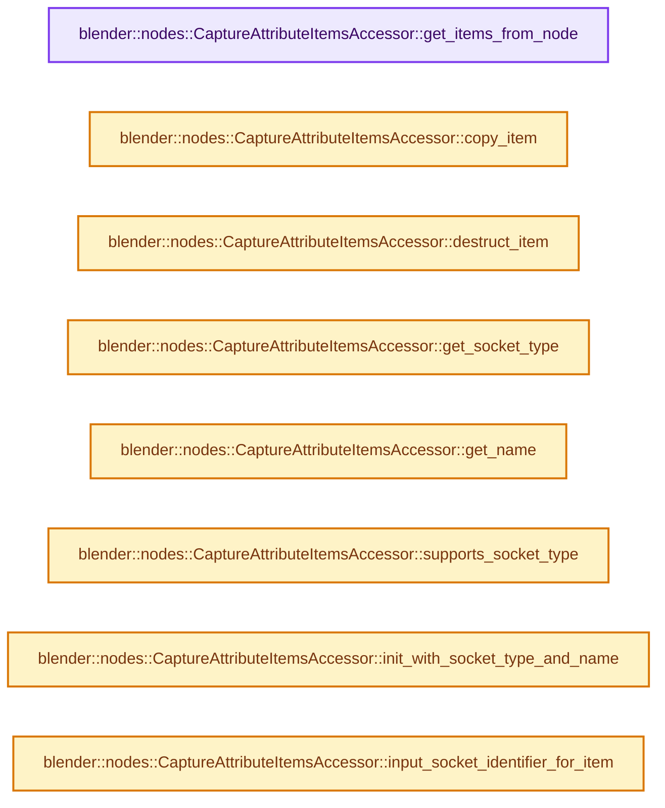
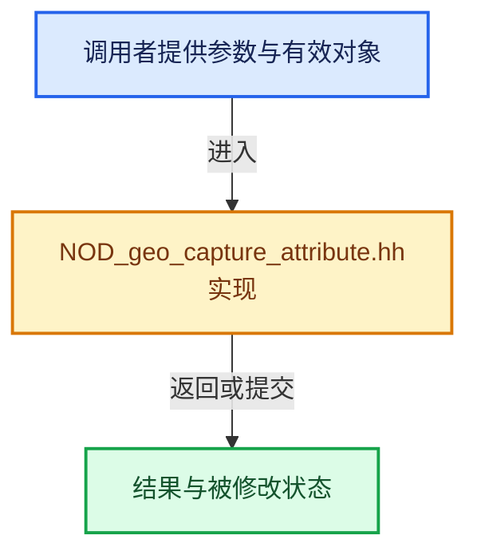

# 实现依赖专题：source/blender/nodes/geometry/include/NOD_geo_capture_attribute.hh

[实现依赖导航](../../../README.md) · [符号索引](../../../../00-课程指南/02-源码与提交索引/符号依赖与实现索引.md)

本专题从正文实际调用进入，集中保存共享实现。函数有稳定锚点，可从调用处直接跳到对应完整函数；递归与互相调用通过回链组织。

## 本文件的实现关系






## 完整成员与函数实现

<a id="f-7c4ae7b1065e727d"></a>

### `blender::nodes::CaptureAttributeItemsAccessor::get_items_from_node`

实现位置：[source/blender/nodes/geometry/include/NOD_geo_capture_attribute.hh](../../../../../../../../source/blender/nodes/geometry/include/NOD_geo_capture_attribute.hh) · L36—L41。

接口参数：

- `bNode &node`

**教学注释版**

<!-- annotated:258610ce9ab095 -->

```cpp
  static socket_items::SocketItemsRef<NodeGeometryAttributeCaptureItem> get_items_from_node(
      bNode &node)
  {
    auto *storage = static_cast<NodeGeometryAttributeCapture *>(node.storage);
    return {&storage->capture_items, &storage->capture_items_num, &storage->active_index};
  }
```

<details>
<summary>核对原始源码：source/blender/nodes/geometry/include/NOD_geo_capture_attribute.hh · L36—L41</summary>

<!-- original:258610ce9ab095:source/blender/nodes/geometry/include/NOD_geo_capture_attribute.hh:36:41 -->

```cpp
  static socket_items::SocketItemsRef<NodeGeometryAttributeCaptureItem> get_items_from_node(
      bNode &node)
  {
    auto *storage = static_cast<NodeGeometryAttributeCapture *>(node.storage);
    return {&storage->capture_items, &storage->capture_items_num, &storage->active_index};
  }
```

</details>

**结果出口**

- `return {&storage->capture_items, &storage->capture_items_num, &storage->active_index};`

**继续追踪实现**

本实现没有需要继续展开的显式调用；检查返回表达式、对象转换和调用者前置条件。

<a id="f-1719962ca67b9d9d"></a>

### `blender::nodes::CaptureAttributeItemsAccessor::copy_item`

实现位置：[source/blender/nodes/geometry/include/NOD_geo_capture_attribute.hh](../../../../../../../../source/blender/nodes/geometry/include/NOD_geo_capture_attribute.hh) · L43—L48。

接口参数：

- `const NodeGeometryAttributeCaptureItem &src`
- `NodeGeometryAttributeCaptureItem &dst`

**教学注释版**

<!-- annotated:c786f865731014 -->

```cpp
  static void copy_item(const NodeGeometryAttributeCaptureItem &src,
                        NodeGeometryAttributeCaptureItem &dst)
  {
    dst = src;
    dst.name = BLI_strdup_null(dst.name);
  }
```

<details>
<summary>核对原始源码：source/blender/nodes/geometry/include/NOD_geo_capture_attribute.hh · L43—L48</summary>

<!-- original:c786f865731014:source/blender/nodes/geometry/include/NOD_geo_capture_attribute.hh:43:48 -->

```cpp
  static void copy_item(const NodeGeometryAttributeCaptureItem &src,
                        NodeGeometryAttributeCaptureItem &dst)
  {
    dst = src;
    dst.name = BLI_strdup_null(dst.name);
  }
```

</details>

**沿实际写入检查状态**

- `dst = src;`
- `dst.name = BLI_strdup_null(dst.name);`

**继续追踪实现**

- `BLI_strdup_null` → [blender::BLI_strdup_null · L48](../../../01-BLI基础库/intern/string.cc.md#f-c1cd7c6336fe3fe0)。

<a id="f-f4931ae929886fce"></a>

### `blender::nodes::CaptureAttributeItemsAccessor::destruct_item`

实现位置：[source/blender/nodes/geometry/include/NOD_geo_capture_attribute.hh](../../../../../../../../source/blender/nodes/geometry/include/NOD_geo_capture_attribute.hh) · L50—L53。

接口参数：

- `NodeGeometryAttributeCaptureItem *item`

**教学注释版**

<!-- annotated:390719acf845eb -->

```cpp
  static void destruct_item(NodeGeometryAttributeCaptureItem *item)
  {
    MEM_SAFE_DELETE(item->name);
  }
```

<details>
<summary>核对原始源码：source/blender/nodes/geometry/include/NOD_geo_capture_attribute.hh · L50—L53</summary>

<!-- original:390719acf845eb:source/blender/nodes/geometry/include/NOD_geo_capture_attribute.hh:50:53 -->

```cpp
  static void destruct_item(NodeGeometryAttributeCaptureItem *item)
  {
    MEM_SAFE_DELETE(item->name);
  }
```

</details>

**继续追踪实现**

- `MEM_SAFE_DELETE` → [MEM_SAFE_DELETE · L436](../../../07-Intern运行时与平台/guardedalloc/MEM_guardedalloc.h.md#m-eadb3bc5b902)。宏定义由构建条件选择。

<a id="f-8c23a63b6c295201"></a>

### `blender::nodes::CaptureAttributeItemsAccessor::get_socket_type`

实现位置：[source/blender/nodes/geometry/include/NOD_geo_capture_attribute.hh](../../../../../../../../source/blender/nodes/geometry/include/NOD_geo_capture_attribute.hh) · L58—L61。

接口参数：

- `const NodeGeometryAttributeCaptureItem &item`

**教学注释版**

<!-- annotated:018732200e3977 -->

```cpp
  static eNodeSocketDatatype get_socket_type(const NodeGeometryAttributeCaptureItem &item)
  {
    return *bke::custom_data_type_to_socket_type(eCustomDataType(item.data_type));
  }
```

<details>
<summary>核对原始源码：source/blender/nodes/geometry/include/NOD_geo_capture_attribute.hh · L58—L61</summary>

<!-- original:018732200e3977:source/blender/nodes/geometry/include/NOD_geo_capture_attribute.hh:58:61 -->

```cpp
  static eNodeSocketDatatype get_socket_type(const NodeGeometryAttributeCaptureItem &item)
  {
    return *bke::custom_data_type_to_socket_type(eCustomDataType(item.data_type));
  }
```

</details>

**结果出口**

- `return *bke::custom_data_type_to_socket_type(eCustomDataType(item.data_type));`

**继续追踪实现**

- `bke::custom_data_type_to_socket_type` → [blender::bke::custom_data_type_to_socket_type · L5935](../../../02-BKE几何与数据/intern/node.cc.md#f-3ed3c094d6db6ba1)。
- `eCustomDataType` → [blender::eCustomDataType](../../../08-其他Blender模块/makesdna/DNA_customdata_types.h.md#t-dfbf4a4ce0e1)。

<a id="f-2b739a141d618d3c"></a>

### `blender::nodes::CaptureAttributeItemsAccessor::get_name`

实现位置：[source/blender/nodes/geometry/include/NOD_geo_capture_attribute.hh](../../../../../../../../source/blender/nodes/geometry/include/NOD_geo_capture_attribute.hh) · L63—L66。

接口参数：

- `NodeGeometryAttributeCaptureItem &item`

**教学注释版**

<!-- annotated:b673bb2c3fdf7b -->

```cpp
  static char **get_name(NodeGeometryAttributeCaptureItem &item)
  {
    return &item.name;
  }
```

<details>
<summary>核对原始源码：source/blender/nodes/geometry/include/NOD_geo_capture_attribute.hh · L63—L66</summary>

<!-- original:b673bb2c3fdf7b:source/blender/nodes/geometry/include/NOD_geo_capture_attribute.hh:63:66 -->

```cpp
  static char **get_name(NodeGeometryAttributeCaptureItem &item)
  {
    return &item.name;
  }
```

</details>

**结果出口**

- `return &item.name;`

**继续追踪实现**

本实现没有需要继续展开的显式调用；检查返回表达式、对象转换和调用者前置条件。

<a id="f-a1210f5177335669"></a>

### `blender::nodes::CaptureAttributeItemsAccessor::supports_socket_type`

实现位置：[source/blender/nodes/geometry/include/NOD_geo_capture_attribute.hh](../../../../../../../../source/blender/nodes/geometry/include/NOD_geo_capture_attribute.hh) · L68—L72。

接口参数：

- `const eNodeSocketDatatype socket_type`
- `const int`

**教学注释版**

<!-- annotated:288454bd2e670a -->

```cpp
  static bool supports_socket_type(const eNodeSocketDatatype socket_type, const int /*ntree_type*/)
  {
    return bke::socket_type_to_custom_data_type(socket_type).has_value() &&
           socket_type != SOCK_STRING;
  }
```

<details>
<summary>核对原始源码：source/blender/nodes/geometry/include/NOD_geo_capture_attribute.hh · L68—L72</summary>

<!-- original:288454bd2e670a:source/blender/nodes/geometry/include/NOD_geo_capture_attribute.hh:68:72 -->

```cpp
  static bool supports_socket_type(const eNodeSocketDatatype socket_type, const int /*ntree_type*/)
  {
    return bke::socket_type_to_custom_data_type(socket_type).has_value() &&
           socket_type != SOCK_STRING;
  }
```

</details>

**结果出口**

- `return bke::socket_type_to_custom_data_type(socket_type).has_value() &&`

**继续追踪实现**

- `bke::socket_type_to_custom_data_type(socket_type).has_value` → [调用协议](../../../../00-课程指南/01-路线与规范/模板宏与动态分派协议.md)：接收对象类型依赖auto、返回值或模板实例；不按同名猜测目标。调用位置L70。
- `bke::socket_type_to_custom_data_type` → [blender::bke::socket_type_to_custom_data_type · L5911](../../../02-BKE几何与数据/intern/node.cc.md#f-6039cfe576196271)。

<a id="f-cd9ca765a1e8896f"></a>

### `blender::nodes::CaptureAttributeItemsAccessor::init_with_socket_type_and_name`

实现位置：[source/blender/nodes/geometry/include/NOD_geo_capture_attribute.hh](../../../../../../../../source/blender/nodes/geometry/include/NOD_geo_capture_attribute.hh) · L74—L83。

接口参数：

- `bNode &node`
- `NodeGeometryAttributeCaptureItem &item`
- `const eNodeSocketDatatype socket_type`
- `const char *name`

**教学注释版**

<!-- annotated:10e93c63263e05 -->

```cpp
  static void init_with_socket_type_and_name(bNode &node,
                                             NodeGeometryAttributeCaptureItem &item,
                                             const eNodeSocketDatatype socket_type,
                                             const char *name)
  {
    auto *storage = static_cast<NodeGeometryAttributeCapture *>(node.storage);
    item.data_type = *bke::socket_type_to_custom_data_type(socket_type);
    item.identifier = storage->next_identifier++;
    socket_items::set_item_name_and_make_unique<CaptureAttributeItemsAccessor>(node, item, name);
  }
```

<details>
<summary>核对原始源码：source/blender/nodes/geometry/include/NOD_geo_capture_attribute.hh · L74—L83</summary>

<!-- original:10e93c63263e05:source/blender/nodes/geometry/include/NOD_geo_capture_attribute.hh:74:83 -->

```cpp
  static void init_with_socket_type_and_name(bNode &node,
                                             NodeGeometryAttributeCaptureItem &item,
                                             const eNodeSocketDatatype socket_type,
                                             const char *name)
  {
    auto *storage = static_cast<NodeGeometryAttributeCapture *>(node.storage);
    item.data_type = *bke::socket_type_to_custom_data_type(socket_type);
    item.identifier = storage->next_identifier++;
    socket_items::set_item_name_and_make_unique<CaptureAttributeItemsAccessor>(node, item, name);
  }
```

</details>

**沿实际写入检查状态**

- `item.data_type = *bke::socket_type_to_custom_data_type(socket_type);`
- `item.identifier = storage->next_identifier++;`

**继续追踪实现**

- `bke::socket_type_to_custom_data_type` → [blender::bke::socket_type_to_custom_data_type · L5911](../../../02-BKE几何与数据/intern/node.cc.md#f-6039cfe576196271)。
- `socket_items::set_item_name_and_make_unique<CaptureAttributeItemsAccessor>` → [blender::nodes::socket_items::set_item_name_and_make_unique · L148](../../NOD_socket_items.hh.md#f-7e7af1c01522f9dc)。

<a id="f-eb1b1941000a8a9f"></a>

### `blender::nodes::CaptureAttributeItemsAccessor::input_socket_identifier_for_item`

实现位置：[source/blender/nodes/geometry/include/NOD_geo_capture_attribute.hh](../../../../../../../../source/blender/nodes/geometry/include/NOD_geo_capture_attribute.hh) · L85—L92。

接口参数：

- `const NodeGeometryAttributeCaptureItem &item`

**教学注释版**

<!-- annotated:bdfa6c1cd89324 -->

```cpp
  static std::string input_socket_identifier_for_item(const NodeGeometryAttributeCaptureItem &item)
  {
    if (item.identifier == 0) {
      /* This special case exists for compatibility. */
      return "Value";
    }
    return "Value_" + std::to_string(item.identifier);
  }
```

<details>
<summary>核对原始源码：source/blender/nodes/geometry/include/NOD_geo_capture_attribute.hh · L85—L92</summary>

<!-- original:bdfa6c1cd89324:source/blender/nodes/geometry/include/NOD_geo_capture_attribute.hh:85:92 -->

```cpp
  static std::string input_socket_identifier_for_item(const NodeGeometryAttributeCaptureItem &item)
  {
    if (item.identifier == 0) {
      /* This special case exists for compatibility. */
      return "Value";
    }
    return "Value_" + std::to_string(item.identifier);
  }
```

</details>

**结果出口**

- `return "Value";`
- `return "Value_" + std::to_string(item.identifier);`

**继续追踪实现**

- `std::to_string` → [外部契约](https://eel.is/c++draft/)：这个边界按实际表达式及所属类型核对参数、返回值、寿命与失败行为。这里提供接口入口，不声称已解释该第三方版本的内部实现。

<a id="f-6d2dc353668dfd98"></a>

### `blender::nodes::CaptureAttributeItemsAccessor::output_socket_identifier_for_item`

实现位置：[source/blender/nodes/geometry/include/NOD_geo_capture_attribute.hh](../../../../../../../../source/blender/nodes/geometry/include/NOD_geo_capture_attribute.hh) · L94—L102。

接口参数：

- `const NodeGeometryAttributeCaptureItem &item`

**教学注释版**

<!-- annotated:03600abbdca5b4 -->

```cpp
  static std::string output_socket_identifier_for_item(
      const NodeGeometryAttributeCaptureItem &item)
  {
    if (item.identifier == 0) {
      /* This special case exists for compatibility. */
      return "Attribute";
    }
    return "Attribute_" + std::to_string(item.identifier);
  }
```

<details>
<summary>核对原始源码：source/blender/nodes/geometry/include/NOD_geo_capture_attribute.hh · L94—L102</summary>

<!-- original:03600abbdca5b4:source/blender/nodes/geometry/include/NOD_geo_capture_attribute.hh:94:102 -->

```cpp
  static std::string output_socket_identifier_for_item(
      const NodeGeometryAttributeCaptureItem &item)
  {
    if (item.identifier == 0) {
      /* This special case exists for compatibility. */
      return "Attribute";
    }
    return "Attribute_" + std::to_string(item.identifier);
  }
```

</details>

**结果出口**

- `return "Attribute";`
- `return "Attribute_" + std::to_string(item.identifier);`

**继续追踪实现**

- `std::to_string` → [外部契约](https://eel.is/c++draft/)：这个边界按实际表达式及所属类型核对参数、返回值、寿命与失败行为。这里提供接口入口，不声称已解释该第三方版本的内部实现。
