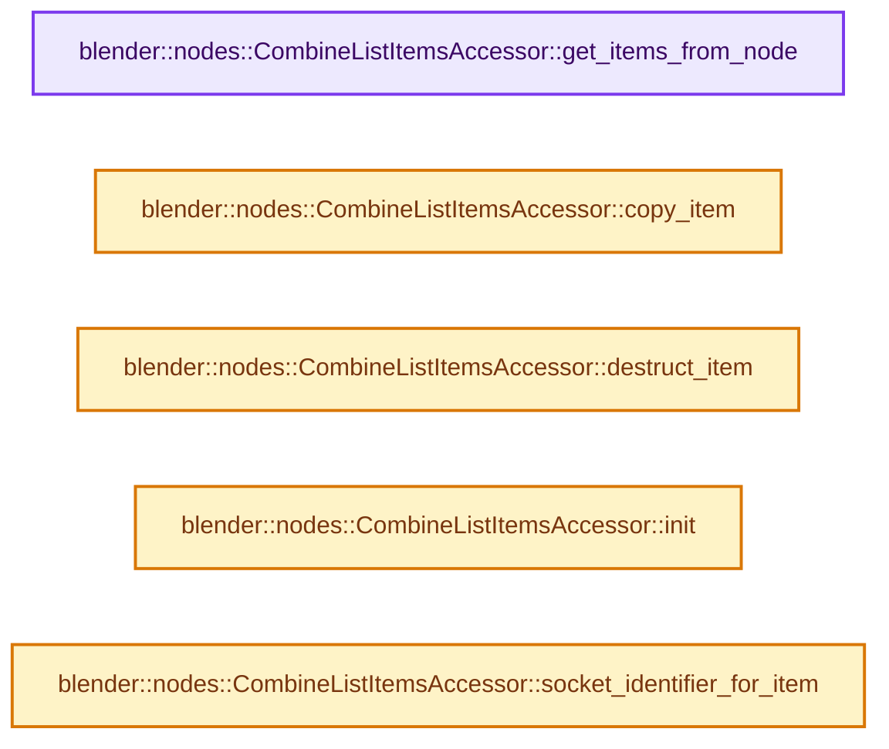
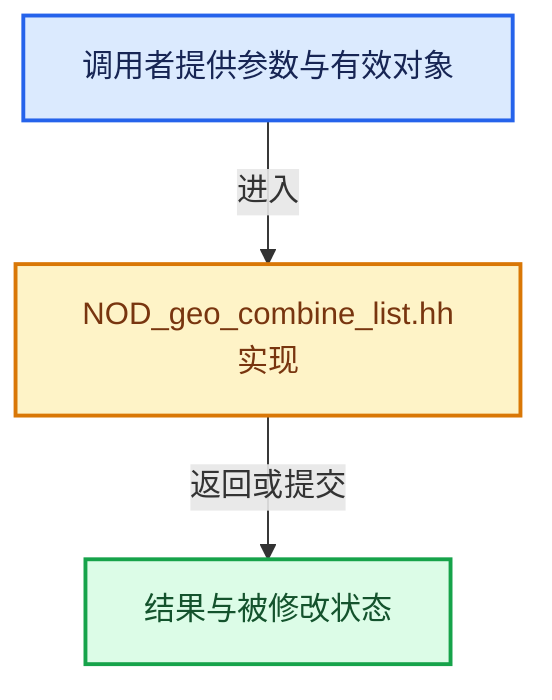

# 实现依赖专题：source/blender/nodes/geometry/include/NOD_geo_combine_list.hh

[实现依赖导航](../../../README.md) · [符号索引](../../../../00-课程指南/02-源码与提交索引/符号依赖与实现索引.md)

本专题从正文实际调用进入，集中保存共享实现。函数有稳定锚点，可从调用处直接跳到对应完整函数；递归与互相调用通过回链组织。

## 本文件的实现关系






## 完整成员与函数实现

<a id="f-4d73951dcbf992a5"></a>

### `blender::nodes::CombineListItemsAccessor::get_items_from_node`

实现位置：[source/blender/nodes/geometry/include/NOD_geo_combine_list.hh](../../../../../../../../source/blender/nodes/geometry/include/NOD_geo_combine_list.hh) · L30—L34。

接口参数：

- `bNode &node`

**教学注释版**

<!-- annotated:7a4e8531cbeb7e -->

```cpp
  static socket_items::SocketItemsRef<CombineListItem> get_items_from_node(bNode &node)
  {
    auto &storage = *static_cast<NodeCombineList *>(node.storage);
    return {&storage.items, &storage.items_num, nullptr};
  }
```

<details>
<summary>核对原始源码：source/blender/nodes/geometry/include/NOD_geo_combine_list.hh · L30—L34</summary>

<!-- original:7a4e8531cbeb7e:source/blender/nodes/geometry/include/NOD_geo_combine_list.hh:30:34 -->

```cpp
  static socket_items::SocketItemsRef<CombineListItem> get_items_from_node(bNode &node)
  {
    auto &storage = *static_cast<NodeCombineList *>(node.storage);
    return {&storage.items, &storage.items_num, nullptr};
  }
```

</details>

**结果出口**

- `return {&storage.items, &storage.items_num, nullptr};`

**继续追踪实现**

本实现没有需要继续展开的显式调用；检查返回表达式、对象转换和调用者前置条件。

<a id="f-e38cc090aaae6afa"></a>

### `blender::nodes::CombineListItemsAccessor::copy_item`

实现位置：[source/blender/nodes/geometry/include/NOD_geo_combine_list.hh](../../../../../../../../source/blender/nodes/geometry/include/NOD_geo_combine_list.hh) · L36—L39。

接口参数：

- `const CombineListItem &src`
- `CombineListItem &dst`

**教学注释版**

<!-- annotated:45407e4ebe7ef0 -->

```cpp
  static void copy_item(const CombineListItem &src, CombineListItem &dst)
  {
    dst = src;
  }
```

<details>
<summary>核对原始源码：source/blender/nodes/geometry/include/NOD_geo_combine_list.hh · L36—L39</summary>

<!-- original:45407e4ebe7ef0:source/blender/nodes/geometry/include/NOD_geo_combine_list.hh:36:39 -->

```cpp
  static void copy_item(const CombineListItem &src, CombineListItem &dst)
  {
    dst = src;
  }
```

</details>

**沿实际写入检查状态**

- `dst = src;`

**继续追踪实现**

本实现没有需要继续展开的显式调用；检查返回表达式、对象转换和调用者前置条件。

<a id="f-4e5bf9d6ceacb004"></a>

### `blender::nodes::CombineListItemsAccessor::destruct_item`

实现位置：[source/blender/nodes/geometry/include/NOD_geo_combine_list.hh](../../../../../../../../source/blender/nodes/geometry/include/NOD_geo_combine_list.hh) · L41—L41。

接口参数：

- `CombineListItem *`

**教学注释版**

<!-- annotated:57453c76b3d5b2 -->

```cpp
  static void destruct_item(CombineListItem * /*item*/) {}
```

<details>
<summary>核对原始源码：source/blender/nodes/geometry/include/NOD_geo_combine_list.hh · L41—L41</summary>

<!-- original:57453c76b3d5b2:source/blender/nodes/geometry/include/NOD_geo_combine_list.hh:41:41 -->

```cpp
  static void destruct_item(CombineListItem * /*item*/) {}
```

</details>

**继续追踪实现**

本实现没有需要继续展开的显式调用；检查返回表达式、对象转换和调用者前置条件。

<a id="f-7173fe887d64b602"></a>

### `blender::nodes::CombineListItemsAccessor::init`

实现位置：[source/blender/nodes/geometry/include/NOD_geo_combine_list.hh](../../../../../../../../source/blender/nodes/geometry/include/NOD_geo_combine_list.hh) · L46—L50。

接口参数：

- `bNode &node`
- `CombineListItem &item`

**教学注释版**

<!-- annotated:06e8a2e5722daf -->

```cpp
  static void init(bNode &node, CombineListItem &item)
  {
    auto &storage = *static_cast<NodeCombineList *>(node.storage);
    item.identifier = storage.next_identifier++;
  }
```

<details>
<summary>核对原始源码：source/blender/nodes/geometry/include/NOD_geo_combine_list.hh · L46—L50</summary>

<!-- original:06e8a2e5722daf:source/blender/nodes/geometry/include/NOD_geo_combine_list.hh:46:50 -->

```cpp
  static void init(bNode &node, CombineListItem &item)
  {
    auto &storage = *static_cast<NodeCombineList *>(node.storage);
    item.identifier = storage.next_identifier++;
  }
```

</details>

**沿实际写入检查状态**

- `item.identifier = storage.next_identifier++;`

**继续追踪实现**

本实现没有需要继续展开的显式调用；检查返回表达式、对象转换和调用者前置条件。

<a id="f-a34c6c671c32dcb4"></a>

### `blender::nodes::CombineListItemsAccessor::socket_identifier_for_item`

实现位置：[source/blender/nodes/geometry/include/NOD_geo_combine_list.hh](../../../../../../../../source/blender/nodes/geometry/include/NOD_geo_combine_list.hh) · L52—L55。

接口参数：

- `const CombineListItem &item`

**教学注释版**

<!-- annotated:16710c2d660183 -->

```cpp
  static std::string socket_identifier_for_item(const CombineListItem &item)
  {
    return "Item_" + std::to_string(item.identifier);
  }
```

<details>
<summary>核对原始源码：source/blender/nodes/geometry/include/NOD_geo_combine_list.hh · L52—L55</summary>

<!-- original:16710c2d660183:source/blender/nodes/geometry/include/NOD_geo_combine_list.hh:52:55 -->

```cpp
  static std::string socket_identifier_for_item(const CombineListItem &item)
  {
    return "Item_" + std::to_string(item.identifier);
  }
```

</details>

**结果出口**

- `return "Item_" + std::to_string(item.identifier);`

**继续追踪实现**

- `std::to_string` → [外部契约](https://eel.is/c++draft/)：这个边界按实际表达式及所属类型核对参数、返回值、寿命与失败行为。这里提供接口入口，不声称已解释该第三方版本的内部实现。
