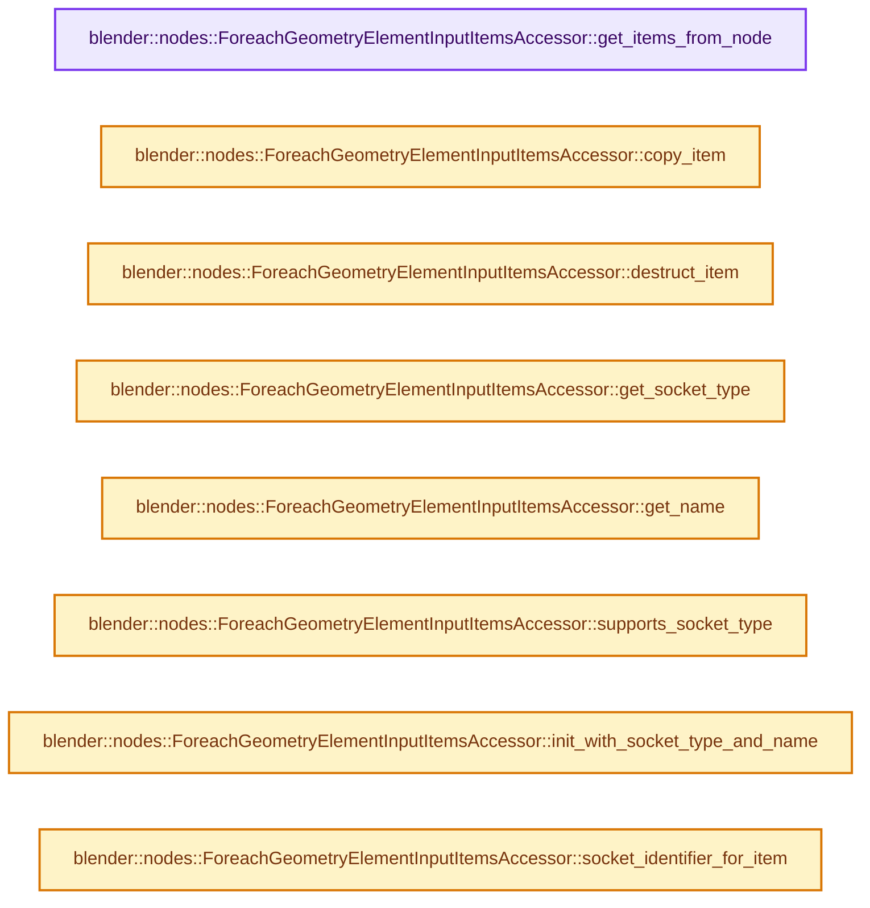
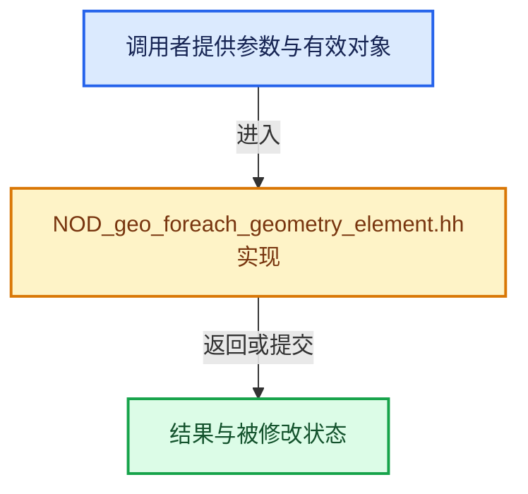

# 实现依赖专题：source/blender/nodes/geometry/include/NOD_geo_foreach_geometry_element.hh

[实现依赖导航](../../../README.md) · [符号索引](../../../../00-课程指南/02-源码与提交索引/符号依赖与实现索引.md)

本专题从正文实际调用进入，集中保存共享实现。函数有稳定锚点，可从调用处直接跳到对应完整函数；递归与互相调用通过回链组织。

## 本文件的实现关系






## 完整成员与函数实现

<a id="f-614cb876c8c0ad08"></a>

### `blender::nodes::ForeachGeometryElementInputItemsAccessor::get_items_from_node`

实现位置：[source/blender/nodes/geometry/include/NOD_geo_foreach_geometry_element.hh](../../../../../../../../source/blender/nodes/geometry/include/NOD_geo_foreach_geometry_element.hh) · L37—L43。

接口参数：

- `bNode &node`

**教学注释版**

<!-- annotated:cd515b4e9df398 -->

```cpp
  static socket_items::SocketItemsRef<ItemT> get_items_from_node(bNode &node)
  {
    auto *storage = static_cast<NodeGeometryForeachGeometryElementOutput *>(node.storage);
    return {&storage->input_items.items,
            &storage->input_items.items_num,
            &storage->input_items.active_index};
  }
```

<details>
<summary>核对原始源码：source/blender/nodes/geometry/include/NOD_geo_foreach_geometry_element.hh · L37—L43</summary>

<!-- original:cd515b4e9df398:source/blender/nodes/geometry/include/NOD_geo_foreach_geometry_element.hh:37:43 -->

```cpp
  static socket_items::SocketItemsRef<ItemT> get_items_from_node(bNode &node)
  {
    auto *storage = static_cast<NodeGeometryForeachGeometryElementOutput *>(node.storage);
    return {&storage->input_items.items,
            &storage->input_items.items_num,
            &storage->input_items.active_index};
  }
```

</details>

**结果出口**

- `return {&storage->input_items.items,`

**继续追踪实现**

本实现没有需要继续展开的显式调用；检查返回表达式、对象转换和调用者前置条件。

<a id="f-d6201aa81bc38eff"></a>

### `blender::nodes::ForeachGeometryElementInputItemsAccessor::copy_item`

实现位置：[source/blender/nodes/geometry/include/NOD_geo_foreach_geometry_element.hh](../../../../../../../../source/blender/nodes/geometry/include/NOD_geo_foreach_geometry_element.hh) · L45—L49。

接口参数：

- `const ItemT &src`
- `ItemT &dst`

**教学注释版**

<!-- annotated:d5dbe945548752 -->

```cpp
  static void copy_item(const ItemT &src, ItemT &dst)
  {
    dst = src;
    dst.name = BLI_strdup_null(dst.name);
  }
```

<details>
<summary>核对原始源码：source/blender/nodes/geometry/include/NOD_geo_foreach_geometry_element.hh · L45—L49</summary>

<!-- original:d5dbe945548752:source/blender/nodes/geometry/include/NOD_geo_foreach_geometry_element.hh:45:49 -->

```cpp
  static void copy_item(const ItemT &src, ItemT &dst)
  {
    dst = src;
    dst.name = BLI_strdup_null(dst.name);
  }
```

</details>

**沿实际写入检查状态**

- `dst = src;`
- `dst.name = BLI_strdup_null(dst.name);`

**继续追踪实现**

- `BLI_strdup_null` → [blender::BLI_strdup_null · L48](../../../01-BLI基础库/intern/string.cc.md#f-c1cd7c6336fe3fe0)。

<a id="f-36545536b9c9f03e"></a>

### `blender::nodes::ForeachGeometryElementInputItemsAccessor::destruct_item`

实现位置：[source/blender/nodes/geometry/include/NOD_geo_foreach_geometry_element.hh](../../../../../../../../source/blender/nodes/geometry/include/NOD_geo_foreach_geometry_element.hh) · L51—L54。

接口参数：

- `ItemT *item`

**教学注释版**

<!-- annotated:0b06eccc49f747 -->

```cpp
  static void destruct_item(ItemT *item)
  {
    MEM_SAFE_DELETE(item->name);
  }
```

<details>
<summary>核对原始源码：source/blender/nodes/geometry/include/NOD_geo_foreach_geometry_element.hh · L51—L54</summary>

<!-- original:0b06eccc49f747:source/blender/nodes/geometry/include/NOD_geo_foreach_geometry_element.hh:51:54 -->

```cpp
  static void destruct_item(ItemT *item)
  {
    MEM_SAFE_DELETE(item->name);
  }
```

</details>

**继续追踪实现**

- `MEM_SAFE_DELETE` → [MEM_SAFE_DELETE · L436](../../../07-Intern运行时与平台/guardedalloc/MEM_guardedalloc.h.md#m-eadb3bc5b902)。宏定义由构建条件选择。

<a id="f-2fe15ca76a51f6d5"></a>

### `blender::nodes::ForeachGeometryElementInputItemsAccessor::get_socket_type`

实现位置：[source/blender/nodes/geometry/include/NOD_geo_foreach_geometry_element.hh](../../../../../../../../source/blender/nodes/geometry/include/NOD_geo_foreach_geometry_element.hh) · L59—L62。

接口参数：

- `const ItemT &item`

**教学注释版**

<!-- annotated:0caa78e06a3b8e -->

```cpp
  static eNodeSocketDatatype get_socket_type(const ItemT &item)
  {
    return item.socket_type;
  }
```

<details>
<summary>核对原始源码：source/blender/nodes/geometry/include/NOD_geo_foreach_geometry_element.hh · L59—L62</summary>

<!-- original:0caa78e06a3b8e:source/blender/nodes/geometry/include/NOD_geo_foreach_geometry_element.hh:59:62 -->

```cpp
  static eNodeSocketDatatype get_socket_type(const ItemT &item)
  {
    return item.socket_type;
  }
```

</details>

**结果出口**

- `return item.socket_type;`

**继续追踪实现**

本实现没有需要继续展开的显式调用；检查返回表达式、对象转换和调用者前置条件。

<a id="f-82a0abe45b7046fa"></a>

### `blender::nodes::ForeachGeometryElementInputItemsAccessor::get_name`

实现位置：[source/blender/nodes/geometry/include/NOD_geo_foreach_geometry_element.hh](../../../../../../../../source/blender/nodes/geometry/include/NOD_geo_foreach_geometry_element.hh) · L64—L67。

接口参数：

- `ItemT &item`

**教学注释版**

<!-- annotated:8a152a3ab2b037 -->

```cpp
  static char **get_name(ItemT &item)
  {
    return &item.name;
  }
```

<details>
<summary>核对原始源码：source/blender/nodes/geometry/include/NOD_geo_foreach_geometry_element.hh · L64—L67</summary>

<!-- original:8a152a3ab2b037:source/blender/nodes/geometry/include/NOD_geo_foreach_geometry_element.hh:64:67 -->

```cpp
  static char **get_name(ItemT &item)
  {
    return &item.name;
  }
```

</details>

**结果出口**

- `return &item.name;`

**继续追踪实现**

本实现没有需要继续展开的显式调用；检查返回表达式、对象转换和调用者前置条件。

<a id="f-8cff83aac8eb87ba"></a>

### `blender::nodes::ForeachGeometryElementInputItemsAccessor::supports_socket_type`

实现位置：[source/blender/nodes/geometry/include/NOD_geo_foreach_geometry_element.hh](../../../../../../../../source/blender/nodes/geometry/include/NOD_geo_foreach_geometry_element.hh) · L69—L80。

接口参数：

- `const eNodeSocketDatatype socket_type`
- `const int`

**教学注释版**

<!-- annotated:a80781d8df800b -->

```cpp
  static bool supports_socket_type(const eNodeSocketDatatype socket_type, const int /*ntree_type*/)
  {
    return ELEM(socket_type,
                SOCK_FLOAT,
                SOCK_VECTOR,
                SOCK_RGBA,
                SOCK_BOOLEAN,
                SOCK_ROTATION,
                SOCK_MATRIX,
                SOCK_INT,
                SOCK_MENU);
  }
```

<details>
<summary>核对原始源码：source/blender/nodes/geometry/include/NOD_geo_foreach_geometry_element.hh · L69—L80</summary>

<!-- original:a80781d8df800b:source/blender/nodes/geometry/include/NOD_geo_foreach_geometry_element.hh:69:80 -->

```cpp
  static bool supports_socket_type(const eNodeSocketDatatype socket_type, const int /*ntree_type*/)
  {
    return ELEM(socket_type,
                SOCK_FLOAT,
                SOCK_VECTOR,
                SOCK_RGBA,
                SOCK_BOOLEAN,
                SOCK_ROTATION,
                SOCK_MATRIX,
                SOCK_INT,
                SOCK_MENU);
  }
```

</details>

**结果出口**

- `return ELEM(socket_type,`

**继续追踪实现**

- `ELEM` → [ELEM · L88](../../../07-Intern运行时与平台/ghost/intern/GHOST_utildefines.hh.md#m-d28724a15928)；[ELEM · L135](../../../01-BLI基础库/BLI_utildefines.hh.md#m-d6572de7cae0)。宏定义由构建条件选择。

<a id="f-3f91c2d1518a8cdd"></a>

### `blender::nodes::ForeachGeometryElementInputItemsAccessor::init_with_socket_type_and_name`

实现位置：[source/blender/nodes/geometry/include/NOD_geo_foreach_geometry_element.hh](../../../../../../../../source/blender/nodes/geometry/include/NOD_geo_foreach_geometry_element.hh) · L82—L92。

接口参数：

- `bNode &node`
- `ItemT &item`
- `const eNodeSocketDatatype socket_type`
- `const char *name`

**教学注释版**

<!-- annotated:083e81f121f8ca -->

```cpp
  static void init_with_socket_type_and_name(bNode &node,
                                             ItemT &item,
                                             const eNodeSocketDatatype socket_type,
                                             const char *name)
  {
    auto *storage = static_cast<NodeGeometryForeachGeometryElementOutput *>(node.storage);
    item.socket_type = socket_type;
    item.identifier = storage->generation_items.next_identifier++;
    socket_items::set_item_name_and_make_unique<ForeachGeometryElementInputItemsAccessor>(
        node, item, name);
  }
```

<details>
<summary>核对原始源码：source/blender/nodes/geometry/include/NOD_geo_foreach_geometry_element.hh · L82—L92</summary>

<!-- original:083e81f121f8ca:source/blender/nodes/geometry/include/NOD_geo_foreach_geometry_element.hh:82:92 -->

```cpp
  static void init_with_socket_type_and_name(bNode &node,
                                             ItemT &item,
                                             const eNodeSocketDatatype socket_type,
                                             const char *name)
  {
    auto *storage = static_cast<NodeGeometryForeachGeometryElementOutput *>(node.storage);
    item.socket_type = socket_type;
    item.identifier = storage->generation_items.next_identifier++;
    socket_items::set_item_name_and_make_unique<ForeachGeometryElementInputItemsAccessor>(
        node, item, name);
  }
```

</details>

**沿实际写入检查状态**

- `item.socket_type = socket_type;`
- `item.identifier = storage->generation_items.next_identifier++;`

**继续追踪实现**

- `socket_items::set_item_name_and_make_unique<ForeachGeometryElementInputItemsAccessor>` → [blender::nodes::socket_items::set_item_name_and_make_unique · L148](../../NOD_socket_items.hh.md#f-7e7af1c01522f9dc)。

<a id="f-be938b74256a3922"></a>

### `blender::nodes::ForeachGeometryElementInputItemsAccessor::socket_identifier_for_item`

实现位置：[source/blender/nodes/geometry/include/NOD_geo_foreach_geometry_element.hh](../../../../../../../../source/blender/nodes/geometry/include/NOD_geo_foreach_geometry_element.hh) · L94—L97。

接口参数：

- `const ItemT &item`

**教学注释版**

<!-- annotated:1a29bc4c572db2 -->

```cpp
  static std::string socket_identifier_for_item(const ItemT &item)
  {
    return "Input_" + std::to_string(item.identifier);
  }
```

<details>
<summary>核对原始源码：source/blender/nodes/geometry/include/NOD_geo_foreach_geometry_element.hh · L94—L97</summary>

<!-- original:1a29bc4c572db2:source/blender/nodes/geometry/include/NOD_geo_foreach_geometry_element.hh:94:97 -->

```cpp
  static std::string socket_identifier_for_item(const ItemT &item)
  {
    return "Input_" + std::to_string(item.identifier);
  }
```

</details>

**结果出口**

- `return "Input_" + std::to_string(item.identifier);`

**继续追踪实现**

- `std::to_string` → [外部契约](https://eel.is/c++draft/)：这个边界按实际表达式及所属类型核对参数、返回值、寿命与失败行为。这里提供接口入口，不声称已解释该第三方版本的内部实现。

<a id="f-c3463dfe9d86d1c6"></a>

### `blender::nodes::ForeachGeometryElementMainItemsAccessor::get_items_from_node`

实现位置：[source/blender/nodes/geometry/include/NOD_geo_foreach_geometry_element.hh](../../../../../../../../source/blender/nodes/geometry/include/NOD_geo_foreach_geometry_element.hh) · L123—L129。

接口参数：

- `bNode &node`

**教学注释版**

<!-- annotated:30c2f7df6d6d53 -->

```cpp
  static socket_items::SocketItemsRef<ItemT> get_items_from_node(bNode &node)
  {
    auto *storage = static_cast<NodeGeometryForeachGeometryElementOutput *>(node.storage);
    return {&storage->main_items.items,
            &storage->main_items.items_num,
            &storage->main_items.active_index};
  }
```

<details>
<summary>核对原始源码：source/blender/nodes/geometry/include/NOD_geo_foreach_geometry_element.hh · L123—L129</summary>

<!-- original:30c2f7df6d6d53:source/blender/nodes/geometry/include/NOD_geo_foreach_geometry_element.hh:123:129 -->

```cpp
  static socket_items::SocketItemsRef<ItemT> get_items_from_node(bNode &node)
  {
    auto *storage = static_cast<NodeGeometryForeachGeometryElementOutput *>(node.storage);
    return {&storage->main_items.items,
            &storage->main_items.items_num,
            &storage->main_items.active_index};
  }
```

</details>

**结果出口**

- `return {&storage->main_items.items,`

**继续追踪实现**

本实现没有需要继续展开的显式调用；检查返回表达式、对象转换和调用者前置条件。

<a id="f-3abbc66da358ac4c"></a>

### `blender::nodes::ForeachGeometryElementMainItemsAccessor::copy_item`

实现位置：[source/blender/nodes/geometry/include/NOD_geo_foreach_geometry_element.hh](../../../../../../../../source/blender/nodes/geometry/include/NOD_geo_foreach_geometry_element.hh) · L131—L135。

接口参数：

- `const ItemT &src`
- `ItemT &dst`

**教学注释版**

<!-- annotated:6901244d3aa7fa -->

```cpp
  static void copy_item(const ItemT &src, ItemT &dst)
  {
    dst = src;
    dst.name = BLI_strdup_null(dst.name);
  }
```

<details>
<summary>核对原始源码：source/blender/nodes/geometry/include/NOD_geo_foreach_geometry_element.hh · L131—L135</summary>

<!-- original:6901244d3aa7fa:source/blender/nodes/geometry/include/NOD_geo_foreach_geometry_element.hh:131:135 -->

```cpp
  static void copy_item(const ItemT &src, ItemT &dst)
  {
    dst = src;
    dst.name = BLI_strdup_null(dst.name);
  }
```

</details>

**沿实际写入检查状态**

- `dst = src;`
- `dst.name = BLI_strdup_null(dst.name);`

**继续追踪实现**

- `BLI_strdup_null` → [blender::BLI_strdup_null · L48](../../../01-BLI基础库/intern/string.cc.md#f-c1cd7c6336fe3fe0)。

<a id="f-db8272b1b7959a2a"></a>

### `blender::nodes::ForeachGeometryElementMainItemsAccessor::destruct_item`

实现位置：[source/blender/nodes/geometry/include/NOD_geo_foreach_geometry_element.hh](../../../../../../../../source/blender/nodes/geometry/include/NOD_geo_foreach_geometry_element.hh) · L137—L140。

接口参数：

- `ItemT *item`

**教学注释版**

<!-- annotated:ef43e1a185ca07 -->

```cpp
  static void destruct_item(ItemT *item)
  {
    MEM_SAFE_DELETE(item->name);
  }
```

<details>
<summary>核对原始源码：source/blender/nodes/geometry/include/NOD_geo_foreach_geometry_element.hh · L137—L140</summary>

<!-- original:ef43e1a185ca07:source/blender/nodes/geometry/include/NOD_geo_foreach_geometry_element.hh:137:140 -->

```cpp
  static void destruct_item(ItemT *item)
  {
    MEM_SAFE_DELETE(item->name);
  }
```

</details>

**继续追踪实现**

- `MEM_SAFE_DELETE` → [MEM_SAFE_DELETE · L436](../../../07-Intern运行时与平台/guardedalloc/MEM_guardedalloc.h.md#m-eadb3bc5b902)。宏定义由构建条件选择。

<a id="f-17ff2793b1f5fdfa"></a>

### `blender::nodes::ForeachGeometryElementMainItemsAccessor::get_socket_type`

实现位置：[source/blender/nodes/geometry/include/NOD_geo_foreach_geometry_element.hh](../../../../../../../../source/blender/nodes/geometry/include/NOD_geo_foreach_geometry_element.hh) · L145—L148。

接口参数：

- `const ItemT &item`

**教学注释版**

<!-- annotated:d8c204f3443243 -->

```cpp
  static eNodeSocketDatatype get_socket_type(const ItemT &item)
  {
    return item.socket_type;
  }
```

<details>
<summary>核对原始源码：source/blender/nodes/geometry/include/NOD_geo_foreach_geometry_element.hh · L145—L148</summary>

<!-- original:d8c204f3443243:source/blender/nodes/geometry/include/NOD_geo_foreach_geometry_element.hh:145:148 -->

```cpp
  static eNodeSocketDatatype get_socket_type(const ItemT &item)
  {
    return item.socket_type;
  }
```

</details>

**结果出口**

- `return item.socket_type;`

**继续追踪实现**

本实现没有需要继续展开的显式调用；检查返回表达式、对象转换和调用者前置条件。

<a id="f-9861082db71ecc1f"></a>

### `blender::nodes::ForeachGeometryElementMainItemsAccessor::get_name`

实现位置：[source/blender/nodes/geometry/include/NOD_geo_foreach_geometry_element.hh](../../../../../../../../source/blender/nodes/geometry/include/NOD_geo_foreach_geometry_element.hh) · L150—L153。

接口参数：

- `ItemT &item`

**教学注释版**

<!-- annotated:b0a42901e026c4 -->

```cpp
  static char **get_name(ItemT &item)
  {
    return &item.name;
  }
```

<details>
<summary>核对原始源码：source/blender/nodes/geometry/include/NOD_geo_foreach_geometry_element.hh · L150—L153</summary>

<!-- original:b0a42901e026c4:source/blender/nodes/geometry/include/NOD_geo_foreach_geometry_element.hh:150:153 -->

```cpp
  static char **get_name(ItemT &item)
  {
    return &item.name;
  }
```

</details>

**结果出口**

- `return &item.name;`

**继续追踪实现**

本实现没有需要继续展开的显式调用；检查返回表达式、对象转换和调用者前置条件。

<a id="f-f84ec6d8d1cf3684"></a>

### `blender::nodes::ForeachGeometryElementMainItemsAccessor::supports_socket_type`

实现位置：[source/blender/nodes/geometry/include/NOD_geo_foreach_geometry_element.hh](../../../../../../../../source/blender/nodes/geometry/include/NOD_geo_foreach_geometry_element.hh) · L155—L165。

接口参数：

- `const eNodeSocketDatatype socket_type`
- `const int`

**教学注释版**

<!-- annotated:2fb6e784164502 -->

```cpp
  static bool supports_socket_type(const eNodeSocketDatatype socket_type, const int /*ntree_type*/)
  {
    return ELEM(socket_type,
                SOCK_FLOAT,
                SOCK_VECTOR,
                SOCK_RGBA,
                SOCK_BOOLEAN,
                SOCK_ROTATION,
                SOCK_MATRIX,
                SOCK_INT);
  }
```

<details>
<summary>核对原始源码：source/blender/nodes/geometry/include/NOD_geo_foreach_geometry_element.hh · L155—L165</summary>

<!-- original:2fb6e784164502:source/blender/nodes/geometry/include/NOD_geo_foreach_geometry_element.hh:155:165 -->

```cpp
  static bool supports_socket_type(const eNodeSocketDatatype socket_type, const int /*ntree_type*/)
  {
    return ELEM(socket_type,
                SOCK_FLOAT,
                SOCK_VECTOR,
                SOCK_RGBA,
                SOCK_BOOLEAN,
                SOCK_ROTATION,
                SOCK_MATRIX,
                SOCK_INT);
  }
```

</details>

**结果出口**

- `return ELEM(socket_type,`

**继续追踪实现**

- `ELEM` → [ELEM · L88](../../../07-Intern运行时与平台/ghost/intern/GHOST_utildefines.hh.md#m-d28724a15928)；[ELEM · L135](../../../01-BLI基础库/BLI_utildefines.hh.md#m-d6572de7cae0)。宏定义由构建条件选择。

<a id="f-a08c675b4fac4a5a"></a>

### `blender::nodes::ForeachGeometryElementMainItemsAccessor::init_with_socket_type_and_name`

实现位置：[source/blender/nodes/geometry/include/NOD_geo_foreach_geometry_element.hh](../../../../../../../../source/blender/nodes/geometry/include/NOD_geo_foreach_geometry_element.hh) · L167—L177。

接口参数：

- `bNode &node`
- `ItemT &item`
- `const eNodeSocketDatatype socket_type`
- `const char *name`

**教学注释版**

<!-- annotated:33d9b7670a990f -->

```cpp
  static void init_with_socket_type_and_name(bNode &node,
                                             ItemT &item,
                                             const eNodeSocketDatatype socket_type,
                                             const char *name)
  {
    auto *storage = static_cast<NodeGeometryForeachGeometryElementOutput *>(node.storage);
    item.socket_type = socket_type;
    item.identifier = storage->generation_items.next_identifier++;
    socket_items::set_item_name_and_make_unique<ForeachGeometryElementMainItemsAccessor>(
        node, item, name);
  }
```

<details>
<summary>核对原始源码：source/blender/nodes/geometry/include/NOD_geo_foreach_geometry_element.hh · L167—L177</summary>

<!-- original:33d9b7670a990f:source/blender/nodes/geometry/include/NOD_geo_foreach_geometry_element.hh:167:177 -->

```cpp
  static void init_with_socket_type_and_name(bNode &node,
                                             ItemT &item,
                                             const eNodeSocketDatatype socket_type,
                                             const char *name)
  {
    auto *storage = static_cast<NodeGeometryForeachGeometryElementOutput *>(node.storage);
    item.socket_type = socket_type;
    item.identifier = storage->generation_items.next_identifier++;
    socket_items::set_item_name_and_make_unique<ForeachGeometryElementMainItemsAccessor>(
        node, item, name);
  }
```

</details>

**沿实际写入检查状态**

- `item.socket_type = socket_type;`
- `item.identifier = storage->generation_items.next_identifier++;`

**继续追踪实现**

- `socket_items::set_item_name_and_make_unique<ForeachGeometryElementMainItemsAccessor>` → [blender::nodes::socket_items::set_item_name_and_make_unique · L148](../../NOD_socket_items.hh.md#f-7e7af1c01522f9dc)。

<a id="f-8d92c1cc92d43321"></a>

### `blender::nodes::ForeachGeometryElementMainItemsAccessor::socket_identifier_for_item`

实现位置：[source/blender/nodes/geometry/include/NOD_geo_foreach_geometry_element.hh](../../../../../../../../source/blender/nodes/geometry/include/NOD_geo_foreach_geometry_element.hh) · L179—L182。

接口参数：

- `const ItemT &item`

**教学注释版**

<!-- annotated:eaf834e74d71e5 -->

```cpp
  static std::string socket_identifier_for_item(const ItemT &item)
  {
    return "Main_" + std::to_string(item.identifier);
  }
```

<details>
<summary>核对原始源码：source/blender/nodes/geometry/include/NOD_geo_foreach_geometry_element.hh · L179—L182</summary>

<!-- original:eaf834e74d71e5:source/blender/nodes/geometry/include/NOD_geo_foreach_geometry_element.hh:179:182 -->

```cpp
  static std::string socket_identifier_for_item(const ItemT &item)
  {
    return "Main_" + std::to_string(item.identifier);
  }
```

</details>

**结果出口**

- `return "Main_" + std::to_string(item.identifier);`

**继续追踪实现**

- `std::to_string` → [外部契约](https://eel.is/c++draft/)：这个边界按实际表达式及所属类型核对参数、返回值、寿命与失败行为。这里提供接口入口，不声称已解释该第三方版本的内部实现。

<a id="f-9b2b97a4c6e2e2bf"></a>

### `blender::nodes::ForeachGeometryElementGenerationItemsAccessor::get_items_from_node`

实现位置：[source/blender/nodes/geometry/include/NOD_geo_foreach_geometry_element.hh](../../../../../../../../source/blender/nodes/geometry/include/NOD_geo_foreach_geometry_element.hh) · L209—L215。

接口参数：

- `bNode &node`

**教学注释版**

<!-- annotated:7d344140a6591e -->

```cpp
  static socket_items::SocketItemsRef<ItemT> get_items_from_node(bNode &node)
  {
    auto *storage = static_cast<NodeGeometryForeachGeometryElementOutput *>(node.storage);
    return {&storage->generation_items.items,
            &storage->generation_items.items_num,
            &storage->generation_items.active_index};
  }
```

<details>
<summary>核对原始源码：source/blender/nodes/geometry/include/NOD_geo_foreach_geometry_element.hh · L209—L215</summary>

<!-- original:7d344140a6591e:source/blender/nodes/geometry/include/NOD_geo_foreach_geometry_element.hh:209:215 -->

```cpp
  static socket_items::SocketItemsRef<ItemT> get_items_from_node(bNode &node)
  {
    auto *storage = static_cast<NodeGeometryForeachGeometryElementOutput *>(node.storage);
    return {&storage->generation_items.items,
            &storage->generation_items.items_num,
            &storage->generation_items.active_index};
  }
```

</details>

**结果出口**

- `return {&storage->generation_items.items,`

**继续追踪实现**

本实现没有需要继续展开的显式调用；检查返回表达式、对象转换和调用者前置条件。

<a id="f-3059e8c4093d78fa"></a>

### `blender::nodes::ForeachGeometryElementGenerationItemsAccessor::copy_item`

实现位置：[source/blender/nodes/geometry/include/NOD_geo_foreach_geometry_element.hh](../../../../../../../../source/blender/nodes/geometry/include/NOD_geo_foreach_geometry_element.hh) · L217—L221。

接口参数：

- `const ItemT &src`
- `ItemT &dst`

**教学注释版**

<!-- annotated:43d59bd97874ad -->

```cpp
  static void copy_item(const ItemT &src, ItemT &dst)
  {
    dst = src;
    dst.name = BLI_strdup_null(dst.name);
  }
```

<details>
<summary>核对原始源码：source/blender/nodes/geometry/include/NOD_geo_foreach_geometry_element.hh · L217—L221</summary>

<!-- original:43d59bd97874ad:source/blender/nodes/geometry/include/NOD_geo_foreach_geometry_element.hh:217:221 -->

```cpp
  static void copy_item(const ItemT &src, ItemT &dst)
  {
    dst = src;
    dst.name = BLI_strdup_null(dst.name);
  }
```

</details>

**沿实际写入检查状态**

- `dst = src;`
- `dst.name = BLI_strdup_null(dst.name);`

**继续追踪实现**

- `BLI_strdup_null` → [blender::BLI_strdup_null · L48](../../../01-BLI基础库/intern/string.cc.md#f-c1cd7c6336fe3fe0)。

<a id="f-5910e58c6f27cb07"></a>

### `blender::nodes::ForeachGeometryElementGenerationItemsAccessor::destruct_item`

实现位置：[source/blender/nodes/geometry/include/NOD_geo_foreach_geometry_element.hh](../../../../../../../../source/blender/nodes/geometry/include/NOD_geo_foreach_geometry_element.hh) · L223—L226。

接口参数：

- `ItemT *item`

**教学注释版**

<!-- annotated:da4c0c5529936c -->

```cpp
  static void destruct_item(ItemT *item)
  {
    MEM_SAFE_DELETE(item->name);
  }
```

<details>
<summary>核对原始源码：source/blender/nodes/geometry/include/NOD_geo_foreach_geometry_element.hh · L223—L226</summary>

<!-- original:da4c0c5529936c:source/blender/nodes/geometry/include/NOD_geo_foreach_geometry_element.hh:223:226 -->

```cpp
  static void destruct_item(ItemT *item)
  {
    MEM_SAFE_DELETE(item->name);
  }
```

</details>

**继续追踪实现**

- `MEM_SAFE_DELETE` → [MEM_SAFE_DELETE · L436](../../../07-Intern运行时与平台/guardedalloc/MEM_guardedalloc.h.md#m-eadb3bc5b902)。宏定义由构建条件选择。

<a id="f-abc31d8c62e7a3bf"></a>

### `blender::nodes::ForeachGeometryElementGenerationItemsAccessor::get_socket_type`

实现位置：[source/blender/nodes/geometry/include/NOD_geo_foreach_geometry_element.hh](../../../../../../../../source/blender/nodes/geometry/include/NOD_geo_foreach_geometry_element.hh) · L231—L234。

接口参数：

- `const ItemT &item`

**教学注释版**

<!-- annotated:570ee4a32b8b9b -->

```cpp
  static eNodeSocketDatatype get_socket_type(const ItemT &item)
  {
    return item.socket_type;
  }
```

<details>
<summary>核对原始源码：source/blender/nodes/geometry/include/NOD_geo_foreach_geometry_element.hh · L231—L234</summary>

<!-- original:570ee4a32b8b9b:source/blender/nodes/geometry/include/NOD_geo_foreach_geometry_element.hh:231:234 -->

```cpp
  static eNodeSocketDatatype get_socket_type(const ItemT &item)
  {
    return item.socket_type;
  }
```

</details>

**结果出口**

- `return item.socket_type;`

**继续追踪实现**

本实现没有需要继续展开的显式调用；检查返回表达式、对象转换和调用者前置条件。

<a id="f-a8c3c5b9674b10ab"></a>

### `blender::nodes::ForeachGeometryElementGenerationItemsAccessor::get_name`

实现位置：[source/blender/nodes/geometry/include/NOD_geo_foreach_geometry_element.hh](../../../../../../../../source/blender/nodes/geometry/include/NOD_geo_foreach_geometry_element.hh) · L236—L239。

接口参数：

- `ItemT &item`

**教学注释版**

<!-- annotated:1a7f70b0e10fc1 -->

```cpp
  static char **get_name(ItemT &item)
  {
    return &item.name;
  }
```

<details>
<summary>核对原始源码：source/blender/nodes/geometry/include/NOD_geo_foreach_geometry_element.hh · L236—L239</summary>

<!-- original:1a7f70b0e10fc1:source/blender/nodes/geometry/include/NOD_geo_foreach_geometry_element.hh:236:239 -->

```cpp
  static char **get_name(ItemT &item)
  {
    return &item.name;
  }
```

</details>

**结果出口**

- `return &item.name;`

**继续追踪实现**

本实现没有需要继续展开的显式调用；检查返回表达式、对象转换和调用者前置条件。

<a id="f-a6680a3ab1cf183b"></a>

### `blender::nodes::ForeachGeometryElementGenerationItemsAccessor::supports_socket_type`

实现位置：[source/blender/nodes/geometry/include/NOD_geo_foreach_geometry_element.hh](../../../../../../../../source/blender/nodes/geometry/include/NOD_geo_foreach_geometry_element.hh) · L241—L252。

接口参数：

- `const eNodeSocketDatatype socket_type`
- `const int`

**教学注释版**

<!-- annotated:5e3cc85b319e71 -->

```cpp
  static bool supports_socket_type(const eNodeSocketDatatype socket_type, const int /*ntree_type*/)
  {
    return ELEM(socket_type,
                SOCK_FLOAT,
                SOCK_VECTOR,
                SOCK_RGBA,
                SOCK_BOOLEAN,
                SOCK_ROTATION,
                SOCK_MATRIX,
                SOCK_INT,
                SOCK_GEOMETRY);
  }
```

<details>
<summary>核对原始源码：source/blender/nodes/geometry/include/NOD_geo_foreach_geometry_element.hh · L241—L252</summary>

<!-- original:5e3cc85b319e71:source/blender/nodes/geometry/include/NOD_geo_foreach_geometry_element.hh:241:252 -->

```cpp
  static bool supports_socket_type(const eNodeSocketDatatype socket_type, const int /*ntree_type*/)
  {
    return ELEM(socket_type,
                SOCK_FLOAT,
                SOCK_VECTOR,
                SOCK_RGBA,
                SOCK_BOOLEAN,
                SOCK_ROTATION,
                SOCK_MATRIX,
                SOCK_INT,
                SOCK_GEOMETRY);
  }
```

</details>

**结果出口**

- `return ELEM(socket_type,`

**继续追踪实现**

- `ELEM` → [ELEM · L88](../../../07-Intern运行时与平台/ghost/intern/GHOST_utildefines.hh.md#m-d28724a15928)；[ELEM · L135](../../../01-BLI基础库/BLI_utildefines.hh.md#m-d6572de7cae0)。宏定义由构建条件选择。

<a id="f-bd42d910ff6faa75"></a>

### `blender::nodes::ForeachGeometryElementGenerationItemsAccessor::init_with_socket_type_and_name`

实现位置：[source/blender/nodes/geometry/include/NOD_geo_foreach_geometry_element.hh](../../../../../../../../source/blender/nodes/geometry/include/NOD_geo_foreach_geometry_element.hh) · L254—L264。

接口参数：

- `bNode &node`
- `ItemT &item`
- `const eNodeSocketDatatype socket_type`
- `const char *name`

**教学注释版**

<!-- annotated:e5e8ba56e72912 -->

```cpp
  static void init_with_socket_type_and_name(bNode &node,
                                             ItemT &item,
                                             const eNodeSocketDatatype socket_type,
                                             const char *name)
  {
    auto *storage = static_cast<NodeGeometryForeachGeometryElementOutput *>(node.storage);
    item.socket_type = socket_type;
    item.identifier = storage->generation_items.next_identifier++;
    socket_items::set_item_name_and_make_unique<ForeachGeometryElementGenerationItemsAccessor>(
        node, item, name);
  }
```

<details>
<summary>核对原始源码：source/blender/nodes/geometry/include/NOD_geo_foreach_geometry_element.hh · L254—L264</summary>

<!-- original:e5e8ba56e72912:source/blender/nodes/geometry/include/NOD_geo_foreach_geometry_element.hh:254:264 -->

```cpp
  static void init_with_socket_type_and_name(bNode &node,
                                             ItemT &item,
                                             const eNodeSocketDatatype socket_type,
                                             const char *name)
  {
    auto *storage = static_cast<NodeGeometryForeachGeometryElementOutput *>(node.storage);
    item.socket_type = socket_type;
    item.identifier = storage->generation_items.next_identifier++;
    socket_items::set_item_name_and_make_unique<ForeachGeometryElementGenerationItemsAccessor>(
        node, item, name);
  }
```

</details>

**沿实际写入检查状态**

- `item.socket_type = socket_type;`
- `item.identifier = storage->generation_items.next_identifier++;`

**继续追踪实现**

- `socket_items::set_item_name_and_make_unique<ForeachGeometryElementGenerationItemsAccessor>` → [blender::nodes::socket_items::set_item_name_and_make_unique · L148](../../NOD_socket_items.hh.md#f-7e7af1c01522f9dc)。

<a id="f-799da70f5c0dad55"></a>

### `blender::nodes::ForeachGeometryElementGenerationItemsAccessor::socket_identifier_for_item`

实现位置：[source/blender/nodes/geometry/include/NOD_geo_foreach_geometry_element.hh](../../../../../../../../source/blender/nodes/geometry/include/NOD_geo_foreach_geometry_element.hh) · L266—L269。

接口参数：

- `const ItemT &item`

**教学注释版**

<!-- annotated:4c212bbc5e6099 -->

```cpp
  static std::string socket_identifier_for_item(const ItemT &item)
  {
    return "Generation_" + std::to_string(item.identifier);
  }
```

<details>
<summary>核对原始源码：source/blender/nodes/geometry/include/NOD_geo_foreach_geometry_element.hh · L266—L269</summary>

<!-- original:4c212bbc5e6099:source/blender/nodes/geometry/include/NOD_geo_foreach_geometry_element.hh:266:269 -->

```cpp
  static std::string socket_identifier_for_item(const ItemT &item)
  {
    return "Generation_" + std::to_string(item.identifier);
  }
```

</details>

**结果出口**

- `return "Generation_" + std::to_string(item.identifier);`

**继续追踪实现**

- `std::to_string` → [外部契约](https://eel.is/c++draft/)：这个边界按实际表达式及所属类型核对参数、返回值、寿命与失败行为。这里提供接口入口，不声称已解释该第三方版本的内部实现。
