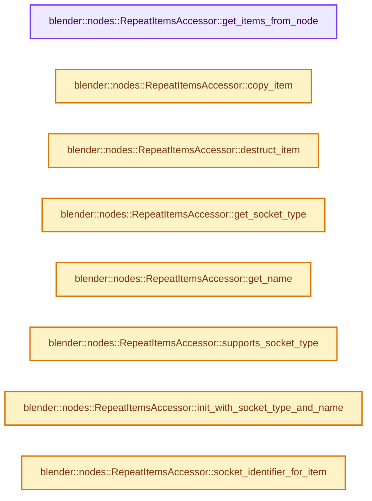

# 实现依赖专题：source/blender/nodes/geometry/include/NOD_geo_repeat.hh

[实现依赖导航](../../../README.md) · [符号索引](../../../../00-课程指南/02-源码与提交索引/符号依赖与实现索引.md)

本专题从正文实际调用进入，集中保存共享实现。函数有稳定锚点，可从调用处直接跳到对应完整函数；递归与互相调用通过回链组织。

## 本文件的实现关系




## 完整成员与函数实现

<a id="f-bc70898d619a07bc"></a>

### `blender::nodes::RepeatItemsAccessor::get_items_from_node`

实现位置：[source/blender/nodes/geometry/include/NOD_geo_repeat.hh](../../../../../../../../source/blender/nodes/geometry/include/NOD_geo_repeat.hh) · L37—L41。

接口参数：

- `bNode &node`

**教学注释版**

<!-- annotated:815b4d0064bf21 -->

```cpp
  static socket_items::SocketItemsRef<NodeRepeatItem> get_items_from_node(bNode &node)
  {
    auto *storage = static_cast<NodeGeometryRepeatOutput *>(node.storage);
    return {&storage->items, &storage->items_num, &storage->active_index};
  }
```

<details>
<summary>核对原始源码：source/blender/nodes/geometry/include/NOD_geo_repeat.hh · L37—L41</summary>

<!-- original:815b4d0064bf21:source/blender/nodes/geometry/include/NOD_geo_repeat.hh:37:41 -->

```cpp
  static socket_items::SocketItemsRef<NodeRepeatItem> get_items_from_node(bNode &node)
  {
    auto *storage = static_cast<NodeGeometryRepeatOutput *>(node.storage);
    return {&storage->items, &storage->items_num, &storage->active_index};
  }
```

</details>

**结果出口**

- `return {&storage->items, &storage->items_num, &storage->active_index};`

**继续追踪实现**

本实现没有需要继续展开的显式调用；检查返回表达式、对象转换和调用者前置条件。

<a id="f-6376397949080401"></a>

### `blender::nodes::RepeatItemsAccessor::copy_item`

实现位置：[source/blender/nodes/geometry/include/NOD_geo_repeat.hh](../../../../../../../../source/blender/nodes/geometry/include/NOD_geo_repeat.hh) · L43—L47。

接口参数：

- `const NodeRepeatItem &src`
- `NodeRepeatItem &dst`

**教学注释版**

<!-- annotated:9db7f0116a46a9 -->

```cpp
  static void copy_item(const NodeRepeatItem &src, NodeRepeatItem &dst)
  {
    dst = src;
    dst.name = BLI_strdup_null(dst.name);
  }
```

<details>
<summary>核对原始源码：source/blender/nodes/geometry/include/NOD_geo_repeat.hh · L43—L47</summary>

<!-- original:9db7f0116a46a9:source/blender/nodes/geometry/include/NOD_geo_repeat.hh:43:47 -->

```cpp
  static void copy_item(const NodeRepeatItem &src, NodeRepeatItem &dst)
  {
    dst = src;
    dst.name = BLI_strdup_null(dst.name);
  }
```

</details>

**沿实际写入检查状态**

- `dst = src;`
- `dst.name = BLI_strdup_null(dst.name);`

**继续追踪实现**

- `BLI_strdup_null` → [blender::BLI_strdup_null · L48](../../../01-BLI基础库/intern/string.cc.md#f-c1cd7c6336fe3fe0)。

<a id="f-79c20a94a8f053f7"></a>

### `blender::nodes::RepeatItemsAccessor::destruct_item`

实现位置：[source/blender/nodes/geometry/include/NOD_geo_repeat.hh](../../../../../../../../source/blender/nodes/geometry/include/NOD_geo_repeat.hh) · L49—L52。

接口参数：

- `NodeRepeatItem *item`

**教学注释版**

<!-- annotated:a5d7245f7e9f4d -->

```cpp
  static void destruct_item(NodeRepeatItem *item)
  {
    MEM_SAFE_DELETE(item->name);
  }
```

<details>
<summary>核对原始源码：source/blender/nodes/geometry/include/NOD_geo_repeat.hh · L49—L52</summary>

<!-- original:a5d7245f7e9f4d:source/blender/nodes/geometry/include/NOD_geo_repeat.hh:49:52 -->

```cpp
  static void destruct_item(NodeRepeatItem *item)
  {
    MEM_SAFE_DELETE(item->name);
  }
```

</details>

**继续追踪实现**

- `MEM_SAFE_DELETE` → [MEM_SAFE_DELETE · L436](../../../07-Intern运行时与平台/guardedalloc/MEM_guardedalloc.h.md#m-eadb3bc5b902)。宏定义由构建条件选择。

<a id="f-e905cb9f5db74c86"></a>

### `blender::nodes::RepeatItemsAccessor::get_socket_type`

实现位置：[source/blender/nodes/geometry/include/NOD_geo_repeat.hh](../../../../../../../../source/blender/nodes/geometry/include/NOD_geo_repeat.hh) · L57—L60。

接口参数：

- `const NodeRepeatItem &item`

**教学注释版**

<!-- annotated:2ac09d16c65879 -->

```cpp
  static eNodeSocketDatatype get_socket_type(const NodeRepeatItem &item)
  {
    return item.socket_type;
  }
```

<details>
<summary>核对原始源码：source/blender/nodes/geometry/include/NOD_geo_repeat.hh · L57—L60</summary>

<!-- original:2ac09d16c65879:source/blender/nodes/geometry/include/NOD_geo_repeat.hh:57:60 -->

```cpp
  static eNodeSocketDatatype get_socket_type(const NodeRepeatItem &item)
  {
    return item.socket_type;
  }
```

</details>

**结果出口**

- `return item.socket_type;`

**继续追踪实现**

本实现没有需要继续展开的显式调用；检查返回表达式、对象转换和调用者前置条件。

<a id="f-f5315ec63ba34b2f"></a>

### `blender::nodes::RepeatItemsAccessor::get_name`

实现位置：[source/blender/nodes/geometry/include/NOD_geo_repeat.hh](../../../../../../../../source/blender/nodes/geometry/include/NOD_geo_repeat.hh) · L62—L65。

接口参数：

- `NodeRepeatItem &item`

**教学注释版**

<!-- annotated:5548eada895537 -->

```cpp
  static char **get_name(NodeRepeatItem &item)
  {
    return &item.name;
  }
```

<details>
<summary>核对原始源码：source/blender/nodes/geometry/include/NOD_geo_repeat.hh · L62—L65</summary>

<!-- original:5548eada895537:source/blender/nodes/geometry/include/NOD_geo_repeat.hh:62:65 -->

```cpp
  static char **get_name(NodeRepeatItem &item)
  {
    return &item.name;
  }
```

</details>

**结果出口**

- `return &item.name;`

**继续追踪实现**

本实现没有需要继续展开的显式调用；检查返回表达式、对象转换和调用者前置条件。

<a id="f-b7140e4c05b84028"></a>

### `blender::nodes::RepeatItemsAccessor::supports_socket_type`

实现位置：[source/blender/nodes/geometry/include/NOD_geo_repeat.hh](../../../../../../../../source/blender/nodes/geometry/include/NOD_geo_repeat.hh) · L67—L70。

接口参数：

- `const eNodeSocketDatatype socket_type`
- `const int ntree_type`

**教学注释版**

<!-- annotated:51b3784fa47717 -->

```cpp
  static bool supports_socket_type(const eNodeSocketDatatype socket_type, const int ntree_type)
  {
    return bke::node_tree_type_supports_socket_type_static(ntree_type, socket_type);
  }
```

<details>
<summary>核对原始源码：source/blender/nodes/geometry/include/NOD_geo_repeat.hh · L67—L70</summary>

<!-- original:51b3784fa47717:source/blender/nodes/geometry/include/NOD_geo_repeat.hh:67:70 -->

```cpp
  static bool supports_socket_type(const eNodeSocketDatatype socket_type, const int ntree_type)
  {
    return bke::node_tree_type_supports_socket_type_static(ntree_type, socket_type);
  }
```

</details>

**结果出口**

- `return bke::node_tree_type_supports_socket_type_static(ntree_type, socket_type);`

**继续追踪实现**

- `bke::node_tree_type_supports_socket_type_static` → [blender::bke::node_tree_type_supports_socket_type_static · L6295](../../../02-BKE几何与数据/intern/node.cc.md#f-f2bd64dc6bed02ca)。

<a id="f-ea09f54298dfb58a"></a>

### `blender::nodes::RepeatItemsAccessor::init_with_socket_type_and_name`

实现位置：[source/blender/nodes/geometry/include/NOD_geo_repeat.hh](../../../../../../../../source/blender/nodes/geometry/include/NOD_geo_repeat.hh) · L72—L81。

接口参数：

- `bNode &node`
- `NodeRepeatItem &item`
- `const eNodeSocketDatatype socket_type`
- `const char *name`

**教学注释版**

<!-- annotated:8e34aca28473e3 -->

```cpp
  static void init_with_socket_type_and_name(bNode &node,
                                             NodeRepeatItem &item,
                                             const eNodeSocketDatatype socket_type,
                                             const char *name)
  {
    auto *storage = static_cast<NodeGeometryRepeatOutput *>(node.storage);
    item.socket_type = socket_type;
    item.identifier = storage->next_identifier++;
    socket_items::set_item_name_and_make_unique<RepeatItemsAccessor>(node, item, name);
  }
```

<details>
<summary>核对原始源码：source/blender/nodes/geometry/include/NOD_geo_repeat.hh · L72—L81</summary>

<!-- original:8e34aca28473e3:source/blender/nodes/geometry/include/NOD_geo_repeat.hh:72:81 -->

```cpp
  static void init_with_socket_type_and_name(bNode &node,
                                             NodeRepeatItem &item,
                                             const eNodeSocketDatatype socket_type,
                                             const char *name)
  {
    auto *storage = static_cast<NodeGeometryRepeatOutput *>(node.storage);
    item.socket_type = socket_type;
    item.identifier = storage->next_identifier++;
    socket_items::set_item_name_and_make_unique<RepeatItemsAccessor>(node, item, name);
  }
```

</details>

**沿实际写入检查状态**

- `item.socket_type = socket_type;`
- `item.identifier = storage->next_identifier++;`

**继续追踪实现**

- `socket_items::set_item_name_and_make_unique<RepeatItemsAccessor>` → [blender::nodes::socket_items::set_item_name_and_make_unique · L148](../../NOD_socket_items.hh.md#f-7e7af1c01522f9dc)。

<a id="f-5217a06a6be53149"></a>

### `blender::nodes::RepeatItemsAccessor::socket_identifier_for_item`

实现位置：[source/blender/nodes/geometry/include/NOD_geo_repeat.hh](../../../../../../../../source/blender/nodes/geometry/include/NOD_geo_repeat.hh) · L83—L86。

接口参数：

- `const NodeRepeatItem &item`

**教学注释版**

<!-- annotated:998338e5edf6cd -->

```cpp
  static std::string socket_identifier_for_item(const NodeRepeatItem &item)
  {
    return "Item_" + std::to_string(item.identifier);
  }
```

<details>
<summary>核对原始源码：source/blender/nodes/geometry/include/NOD_geo_repeat.hh · L83—L86</summary>

<!-- original:998338e5edf6cd:source/blender/nodes/geometry/include/NOD_geo_repeat.hh:83:86 -->

```cpp
  static std::string socket_identifier_for_item(const NodeRepeatItem &item)
  {
    return "Item_" + std::to_string(item.identifier);
  }
```

</details>

**结果出口**

- `return "Item_" + std::to_string(item.identifier);`

**继续追踪实现**

- `std::to_string` → [外部契约](https://eel.is/c++draft/)：这个边界按实际表达式及所属类型核对参数、返回值、寿命与失败行为。这里提供接口入口，不声称已解释该第三方版本的内部实现。
