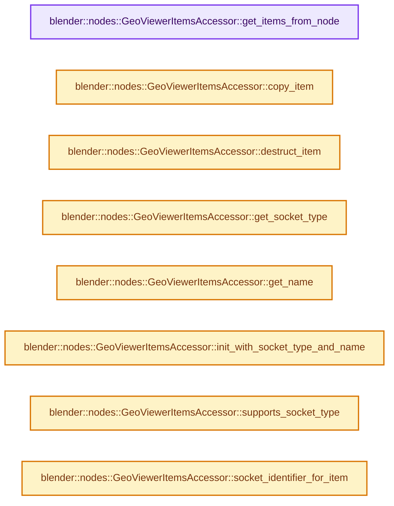
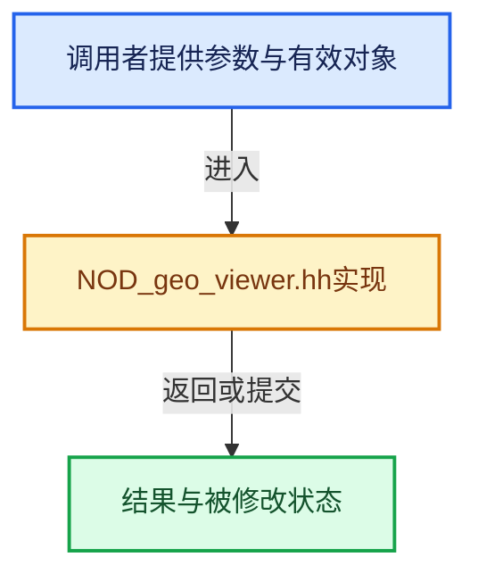

# 实现依赖专题：source/blender/nodes/geometry/include/NOD_geo_viewer.hh

[实现依赖导航](../../../README.md) · [符号索引](../../../../00-课程指南/02-源码与提交索引/符号依赖与实现索引.md)

本专题从正文实际调用进入，集中保存共享实现。函数有稳定锚点，可从调用处直接跳到对应完整函数；递归与互相调用通过回链组织。

## 本文件的实现关系






## 完整成员与函数实现

<a id="f-5ab2cbca96314de9"></a>

### `blender::nodes::GeoViewerItemsAccessor::get_items_from_node`

实现位置：[source/blender/nodes/geometry/include/NOD_geo_viewer.hh](../../../../../../../../source/blender/nodes/geometry/include/NOD_geo_viewer.hh) · L38—L42。

接口参数：

- `bNode &node`

**教学注释版**

<!-- annotated:b6acb0d88c8510 -->

```cpp
  static socket_items::SocketItemsRef<NodeGeometryViewerItem> get_items_from_node(bNode &node)
  {
    auto *storage = static_cast<NodeGeometryViewer *>(node.storage);
    return {&storage->items, &storage->items_num, &storage->active_index};
  }
```

<details>
<summary>核对原始源码：source/blender/nodes/geometry/include/NOD_geo_viewer.hh · L38—L42</summary>

<!-- original:b6acb0d88c8510:source/blender/nodes/geometry/include/NOD_geo_viewer.hh:38:42 -->

```cpp
  static socket_items::SocketItemsRef<NodeGeometryViewerItem> get_items_from_node(bNode &node)
  {
    auto *storage = static_cast<NodeGeometryViewer *>(node.storage);
    return {&storage->items, &storage->items_num, &storage->active_index};
  }
```

</details>

**结果出口**

- `return {&storage->items, &storage->items_num, &storage->active_index};`

**继续追踪实现**

本实现没有需要继续展开的显式调用；检查返回表达式、对象转换和调用者前置条件。

<a id="f-5e3b889c78887213"></a>

### `blender::nodes::GeoViewerItemsAccessor::copy_item`

实现位置：[source/blender/nodes/geometry/include/NOD_geo_viewer.hh](../../../../../../../../source/blender/nodes/geometry/include/NOD_geo_viewer.hh) · L44—L48。

接口参数：

- `const NodeGeometryViewerItem &src`
- `NodeGeometryViewerItem &dst`

**教学注释版**

<!-- annotated:8cbbbe7b71e371 -->

```cpp
  static void copy_item(const NodeGeometryViewerItem &src, NodeGeometryViewerItem &dst)
  {
    dst = src;
    dst.name = BLI_strdup_null(dst.name);
  }
```

<details>
<summary>核对原始源码：source/blender/nodes/geometry/include/NOD_geo_viewer.hh · L44—L48</summary>

<!-- original:8cbbbe7b71e371:source/blender/nodes/geometry/include/NOD_geo_viewer.hh:44:48 -->

```cpp
  static void copy_item(const NodeGeometryViewerItem &src, NodeGeometryViewerItem &dst)
  {
    dst = src;
    dst.name = BLI_strdup_null(dst.name);
  }
```

</details>

**沿实际写入检查状态**

- `dst = src;`
- `dst.name = BLI_strdup_null(dst.name);`

**继续追踪实现**

- `BLI_strdup_null` → [blender::BLI_strdup_null · L48](../../../01-BLI基础库/intern/string.cc.md#f-c1cd7c6336fe3fe0)。

<a id="f-81441270d108b4c6"></a>

### `blender::nodes::GeoViewerItemsAccessor::destruct_item`

实现位置：[source/blender/nodes/geometry/include/NOD_geo_viewer.hh](../../../../../../../../source/blender/nodes/geometry/include/NOD_geo_viewer.hh) · L50—L53。

接口参数：

- `NodeGeometryViewerItem *item`

**教学注释版**

<!-- annotated:2dec37a19db1de -->

```cpp
  static void destruct_item(NodeGeometryViewerItem *item)
  {
    MEM_SAFE_DELETE(item->name);
  }
```

<details>
<summary>核对原始源码：source/blender/nodes/geometry/include/NOD_geo_viewer.hh · L50—L53</summary>

<!-- original:2dec37a19db1de:source/blender/nodes/geometry/include/NOD_geo_viewer.hh:50:53 -->

```cpp
  static void destruct_item(NodeGeometryViewerItem *item)
  {
    MEM_SAFE_DELETE(item->name);
  }
```

</details>

**继续追踪实现**

- `MEM_SAFE_DELETE` → [MEM_SAFE_DELETE · L436](../../../07-Intern运行时与平台/guardedalloc/MEM_guardedalloc.h.md#m-eadb3bc5b902)。宏定义由构建条件选择。

<a id="f-16be642a7c014d8b"></a>

### `blender::nodes::GeoViewerItemsAccessor::get_socket_type`

实现位置：[source/blender/nodes/geometry/include/NOD_geo_viewer.hh](../../../../../../../../source/blender/nodes/geometry/include/NOD_geo_viewer.hh) · L58—L61。

接口参数：

- `const NodeGeometryViewerItem &item`

**教学注释版**

<!-- annotated:a230e31f50fab7 -->

```cpp
  static eNodeSocketDatatype get_socket_type(const NodeGeometryViewerItem &item)
  {
    return item.socket_type;
  }
```

<details>
<summary>核对原始源码：source/blender/nodes/geometry/include/NOD_geo_viewer.hh · L58—L61</summary>

<!-- original:a230e31f50fab7:source/blender/nodes/geometry/include/NOD_geo_viewer.hh:58:61 -->

```cpp
  static eNodeSocketDatatype get_socket_type(const NodeGeometryViewerItem &item)
  {
    return item.socket_type;
  }
```

</details>

**结果出口**

- `return item.socket_type;`

**继续追踪实现**

本实现没有需要继续展开的显式调用；检查返回表达式、对象转换和调用者前置条件。

<a id="f-e16a909327863a56"></a>

### `blender::nodes::GeoViewerItemsAccessor::get_name`

实现位置：[source/blender/nodes/geometry/include/NOD_geo_viewer.hh](../../../../../../../../source/blender/nodes/geometry/include/NOD_geo_viewer.hh) · L63—L66。

接口参数：

- `NodeGeometryViewerItem &item`

**教学注释版**

<!-- annotated:f7e158c6a153f6 -->

```cpp
  static char **get_name(NodeGeometryViewerItem &item)
  {
    return &item.name;
  }
```

<details>
<summary>核对原始源码：source/blender/nodes/geometry/include/NOD_geo_viewer.hh · L63—L66</summary>

<!-- original:f7e158c6a153f6:source/blender/nodes/geometry/include/NOD_geo_viewer.hh:63:66 -->

```cpp
  static char **get_name(NodeGeometryViewerItem &item)
  {
    return &item.name;
  }
```

</details>

**结果出口**

- `return &item.name;`

**继续追踪实现**

本实现没有需要继续展开的显式调用；检查返回表达式、对象转换和调用者前置条件。

<a id="f-d8d4524cd2bd709b"></a>

### `blender::nodes::GeoViewerItemsAccessor::init_with_socket_type_and_name`

实现位置：[source/blender/nodes/geometry/include/NOD_geo_viewer.hh](../../../../../../../../source/blender/nodes/geometry/include/NOD_geo_viewer.hh) · L68—L77。

接口参数：

- `bNode &node`
- `NodeGeometryViewerItem &item`
- `const eNodeSocketDatatype socket_type`
- `const char *name`

**教学注释版**

<!-- annotated:3c5a7bd0f7dc28 -->

```cpp
  static void init_with_socket_type_and_name(bNode &node,
                                             NodeGeometryViewerItem &item,
                                             const eNodeSocketDatatype socket_type,
                                             const char *name)
  {
    auto *storage = static_cast<NodeGeometryViewer *>(node.storage);
    item.socket_type = socket_type;
    item.identifier = storage->next_identifier++;
    socket_items::set_item_name_and_make_unique<GeoViewerItemsAccessor>(node, item, name);
  }
```

<details>
<summary>核对原始源码：source/blender/nodes/geometry/include/NOD_geo_viewer.hh · L68—L77</summary>

<!-- original:3c5a7bd0f7dc28:source/blender/nodes/geometry/include/NOD_geo_viewer.hh:68:77 -->

```cpp
  static void init_with_socket_type_and_name(bNode &node,
                                             NodeGeometryViewerItem &item,
                                             const eNodeSocketDatatype socket_type,
                                             const char *name)
  {
    auto *storage = static_cast<NodeGeometryViewer *>(node.storage);
    item.socket_type = socket_type;
    item.identifier = storage->next_identifier++;
    socket_items::set_item_name_and_make_unique<GeoViewerItemsAccessor>(node, item, name);
  }
```

</details>

**沿实际写入检查状态**

- `item.socket_type = socket_type;`
- `item.identifier = storage->next_identifier++;`

**继续追踪实现**

- `socket_items::set_item_name_and_make_unique<GeoViewerItemsAccessor>` → [blender::nodes::socket_items::set_item_name_and_make_unique · L148](../../NOD_socket_items.hh.md#f-7e7af1c01522f9dc)。

<a id="f-1440310f42a3dc73"></a>

### `blender::nodes::GeoViewerItemsAccessor::supports_socket_type`

实现位置：[source/blender/nodes/geometry/include/NOD_geo_viewer.hh](../../../../../../../../source/blender/nodes/geometry/include/NOD_geo_viewer.hh) · L79—L82。

接口参数：

- `const eNodeSocketDatatype socket_type`
- `const int ntree_type`

**教学注释版**

<!-- annotated:f6cd278f0e05ef -->

```cpp
  static bool supports_socket_type(const eNodeSocketDatatype socket_type, const int ntree_type)
  {
    return bke::node_tree_type_supports_socket_type_static(ntree_type, socket_type);
  }
```

<details>
<summary>核对原始源码：source/blender/nodes/geometry/include/NOD_geo_viewer.hh · L79—L82</summary>

<!-- original:f6cd278f0e05ef:source/blender/nodes/geometry/include/NOD_geo_viewer.hh:79:82 -->

```cpp
  static bool supports_socket_type(const eNodeSocketDatatype socket_type, const int ntree_type)
  {
    return bke::node_tree_type_supports_socket_type_static(ntree_type, socket_type);
  }
```

</details>

**结果出口**

- `return bke::node_tree_type_supports_socket_type_static(ntree_type, socket_type);`

**继续追踪实现**

- `bke::node_tree_type_supports_socket_type_static` → [blender::bke::node_tree_type_supports_socket_type_static · L6295](../../../02-BKE几何与数据/intern/node.cc.md#f-f2bd64dc6bed02ca)。

<a id="f-220faab9b23b7100"></a>

### `blender::nodes::GeoViewerItemsAccessor::socket_identifier_for_item`

实现位置：[source/blender/nodes/geometry/include/NOD_geo_viewer.hh](../../../../../../../../source/blender/nodes/geometry/include/NOD_geo_viewer.hh) · L84—L95。

接口参数：

- `const NodeGeometryViewerItem &item`

**教学注释版**

<!-- annotated:f2f0e2e3b78b4c -->

```cpp
  static std::string socket_identifier_for_item(const NodeGeometryViewerItem &item)
  {
    /* These special cases exist for compatibility with older Blender versions when the viewer did
     * not have a dynamic number of inputs yet. */
    if (item.identifier == 0 && item.socket_type == SOCK_GEOMETRY) {
      return "Geometry";
    }
    if (item.identifier == 1 && item.socket_type != SOCK_GEOMETRY) {
      return "Value";
    }
    return "Item_" + std::to_string(item.identifier);
  }
```

<details>
<summary>核对原始源码：source/blender/nodes/geometry/include/NOD_geo_viewer.hh · L84—L95</summary>

<!-- original:f2f0e2e3b78b4c:source/blender/nodes/geometry/include/NOD_geo_viewer.hh:84:95 -->

```cpp
  static std::string socket_identifier_for_item(const NodeGeometryViewerItem &item)
  {
    /* These special cases exist for compatibility with older Blender versions when the viewer did
     * not have a dynamic number of inputs yet. */
    if (item.identifier == 0 && item.socket_type == SOCK_GEOMETRY) {
      return "Geometry";
    }
    if (item.identifier == 1 && item.socket_type != SOCK_GEOMETRY) {
      return "Value";
    }
    return "Item_" + std::to_string(item.identifier);
  }
```

</details>

**结果出口**

- `return "Geometry";`
- `return "Value";`
- `return "Item_" + std::to_string(item.identifier);`

**继续追踪实现**

- `std::to_string` → [外部契约](https://eel.is/c++draft/)：这个边界按实际表达式及所属类型核对参数、返回值、寿命与失败行为。这里提供接口入口，不声称已解释该第三方版本的内部实现。
