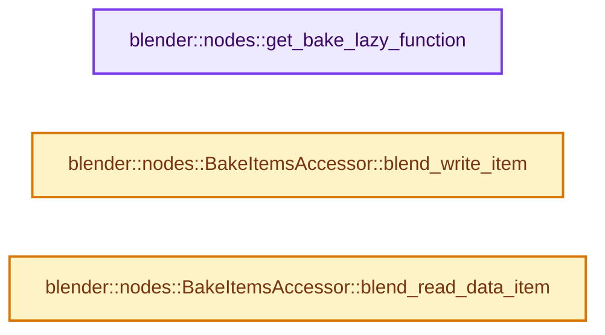

# 实现依赖专题：source/blender/nodes/geometry/nodes/node_geo_bake.cc

[实现依赖导航](../../../README.md) · [符号索引](../../../../00-课程指南/02-源码与提交索引/符号依赖与实现索引.md)

本专题从正文实际调用进入，集中保存共享实现。函数有稳定锚点，可从调用处直接跳到对应完整函数；递归与互相调用通过回链组织。

## 本文件的实现关系




## 完整成员与函数实现

<a id="f-1b00548aa251d83c"></a>

### `blender::nodes::get_bake_lazy_function`

实现位置：[source/blender/nodes/geometry/nodes/node_geo_bake.cc](../../../../../../../../source/blender/nodes/geometry/nodes/node_geo_bake.cc) · L802—L808。

接口参数：

- `const bNode &node`
- `GeometryNodesLazyFunctionGraphInfo &lf_graph_info`

**教学注释版**

<!-- annotated:9256047486bbb4 -->

```cpp
std::unique_ptr<LazyFunction> get_bake_lazy_function(
    const bNode &node, GeometryNodesLazyFunctionGraphInfo &lf_graph_info)
{
  namespace file_ns = nodes::node_geo_bake_cc;
  BLI_assert(node.type_legacy == GEO_NODE_BAKE);
  // [讲解] std::make_unique<file_ns::LazyFunctionForBakeNode>：创建独占拥有的对象，拥有关系可移动，get返回的借用指针不自动延长寿命。
  return std::make_unique<file_ns::LazyFunctionForBakeNode>(node, lf_graph_info);
}
```

<details>
<summary>核对原始源码：source/blender/nodes/geometry/nodes/node_geo_bake.cc · L802—L808</summary>

<!-- original:9256047486bbb4:source/blender/nodes/geometry/nodes/node_geo_bake.cc:802:808 -->

```cpp
std::unique_ptr<LazyFunction> get_bake_lazy_function(
    const bNode &node, GeometryNodesLazyFunctionGraphInfo &lf_graph_info)
{
  namespace file_ns = nodes::node_geo_bake_cc;
  BLI_assert(node.type_legacy == GEO_NODE_BAKE);
  return std::make_unique<file_ns::LazyFunctionForBakeNode>(node, lf_graph_info);
}
```

</details>

**结果出口**

- `return std::make_unique<file_ns::LazyFunctionForBakeNode>(node, lf_graph_info);`

**继续追踪实现**

- `BLI_assert` → [BLI_assert · L48](../../../01-BLI基础库/BLI_assert.hh.md#m-57a88495704d)；[BLI_assert · L63](../../../01-BLI基础库/BLI_assert.hh.md#m-d07050020cb5)。宏定义由构建条件选择。
- `std::make_unique<file_ns::LazyFunctionForBakeNode>` → [外部契约](https://eel.is/c++draft/unique.ptr.create)：创建独占拥有的对象，拥有关系可移动，get返回的借用指针不自动延长寿命。

<a id="f-fbf8e885dab2bbd5"></a>

### `blender::nodes::BakeItemsAccessor::blend_write_item`

实现位置：[source/blender/nodes/geometry/nodes/node_geo_bake.cc](../../../../../../../../source/blender/nodes/geometry/nodes/node_geo_bake.cc) · L812—L815。

接口参数：

- `BlendWriter *writer`
- `const ItemT &item`

**教学注释版**

<!-- annotated:22bfaa8a41d0eb -->

```cpp
void BakeItemsAccessor::blend_write_item(BlendWriter *writer, const ItemT &item)
{
  writer->write_string(item.name);
}
```

<details>
<summary>核对原始源码：source/blender/nodes/geometry/nodes/node_geo_bake.cc · L812—L815</summary>

<!-- original:22bfaa8a41d0eb:source/blender/nodes/geometry/nodes/node_geo_bake.cc:812:815 -->

```cpp
void BakeItemsAccessor::blend_write_item(BlendWriter *writer, const ItemT &item)
{
  writer->write_string(item.name);
}
```

</details>

**继续追踪实现**

- `writer->write_string` → [blender::BlendWriter::write_string · L2357](../../../08-其他Blender模块/blenloader/intern/writefile.cc.md#f-3fd83db72afbdcbe)。

<a id="f-169e3fcd91afd4d3"></a>

### `blender::nodes::BakeItemsAccessor::blend_read_data_item`

实现位置：[source/blender/nodes/geometry/nodes/node_geo_bake.cc](../../../../../../../../source/blender/nodes/geometry/nodes/node_geo_bake.cc) · L817—L820。

接口参数：

- `BlendDataReader *reader`
- `ItemT &item`

**教学注释版**

<!-- annotated:5f98a1a4525a61 -->

```cpp
void BakeItemsAccessor::blend_read_data_item(BlendDataReader *reader, ItemT &item)
{
  BLO_read_string(reader, &item.name);
}
```

<details>
<summary>核对原始源码：source/blender/nodes/geometry/nodes/node_geo_bake.cc · L817—L820</summary>

<!-- original:5f98a1a4525a61:source/blender/nodes/geometry/nodes/node_geo_bake.cc:817:820 -->

```cpp
void BakeItemsAccessor::blend_read_data_item(BlendDataReader *reader, ItemT &item)
{
  BLO_read_string(reader, &item.name);
}
```

</details>

**继续追踪实现**

- `BLO_read_string` → [BLO_read_string · L6348](../../../08-其他Blender模块/blenloader/intern/readfile.cc.md#f-b9cb42e390941235)；[BLO_read_string · L6370](../../../08-其他Blender模块/blenloader/intern/readfile.cc.md#f-1bb75b8661d718d2)；[BLO_read_string · L6375](../../../08-其他Blender模块/blenloader/intern/readfile.cc.md#f-5714da923b3ad83d)。同名重载需按实参类型选择。
