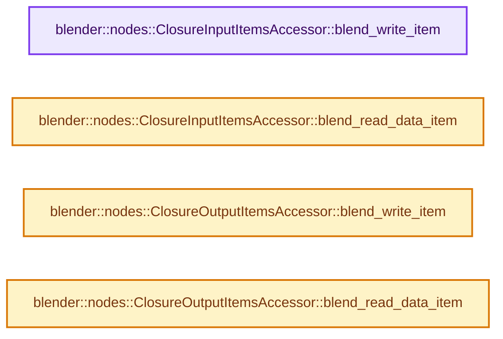

# 实现依赖专题：source/blender/nodes/geometry/nodes/node_geo_closure.cc

[实现依赖导航](../../../README.md) · [符号索引](../../../../00-课程指南/02-源码与提交索引/符号依赖与实现索引.md)

本专题从正文实际调用进入，集中保存共享实现。函数有稳定锚点，可从调用处直接跳到对应完整函数；递归与互相调用通过回链组织。

## 本文件的实现关系




## 完整成员与函数实现

<a id="f-b10b955cda77505a"></a>

### `blender::nodes::ClosureInputItemsAccessor::blend_write_item`

实现位置：[source/blender/nodes/geometry/nodes/node_geo_closure.cc](../../../../../../../../source/blender/nodes/geometry/nodes/node_geo_closure.cc) · L300—L303。

接口参数：

- `BlendWriter *writer`
- `const ItemT &item`

**教学注释版**

<!-- annotated:a3d4aaff6f03f5 -->

```cpp
void ClosureInputItemsAccessor::blend_write_item(BlendWriter *writer, const ItemT &item)
{
  writer->write_string(item.name);
}
```

<details>
<summary>核对原始源码：source/blender/nodes/geometry/nodes/node_geo_closure.cc · L300—L303</summary>

<!-- original:a3d4aaff6f03f5:source/blender/nodes/geometry/nodes/node_geo_closure.cc:300:303 -->

```cpp
void ClosureInputItemsAccessor::blend_write_item(BlendWriter *writer, const ItemT &item)
{
  writer->write_string(item.name);
}
```

</details>

**继续追踪实现**

- `writer->write_string` → [blender::BlendWriter::write_string · L2357](../../../08-其他Blender模块/blenloader/intern/writefile.cc.md#f-3fd83db72afbdcbe)。

<a id="f-13b148ae1a337001"></a>

### `blender::nodes::ClosureInputItemsAccessor::blend_read_data_item`

实现位置：[source/blender/nodes/geometry/nodes/node_geo_closure.cc](../../../../../../../../source/blender/nodes/geometry/nodes/node_geo_closure.cc) · L305—L308。

接口参数：

- `BlendDataReader *reader`
- `ItemT &item`

**教学注释版**

<!-- annotated:aff6d29e59d438 -->

```cpp
void ClosureInputItemsAccessor::blend_read_data_item(BlendDataReader *reader, ItemT &item)
{
  BLO_read_string(reader, &item.name);
}
```

<details>
<summary>核对原始源码：source/blender/nodes/geometry/nodes/node_geo_closure.cc · L305—L308</summary>

<!-- original:aff6d29e59d438:source/blender/nodes/geometry/nodes/node_geo_closure.cc:305:308 -->

```cpp
void ClosureInputItemsAccessor::blend_read_data_item(BlendDataReader *reader, ItemT &item)
{
  BLO_read_string(reader, &item.name);
}
```

</details>

**继续追踪实现**

- `BLO_read_string` → [BLO_read_string · L6348](../../../08-其他Blender模块/blenloader/intern/readfile.cc.md#f-b9cb42e390941235)；[BLO_read_string · L6370](../../../08-其他Blender模块/blenloader/intern/readfile.cc.md#f-1bb75b8661d718d2)；[BLO_read_string · L6375](../../../08-其他Blender模块/blenloader/intern/readfile.cc.md#f-5714da923b3ad83d)。同名重载需按实参类型选择。

<a id="f-2574476f1d7b5cc2"></a>

### `blender::nodes::ClosureOutputItemsAccessor::blend_write_item`

实现位置：[source/blender/nodes/geometry/nodes/node_geo_closure.cc](../../../../../../../../source/blender/nodes/geometry/nodes/node_geo_closure.cc) · L312—L315。

接口参数：

- `BlendWriter *writer`
- `const ItemT &item`

**教学注释版**

<!-- annotated:67c46c707edbbd -->

```cpp
void ClosureOutputItemsAccessor::blend_write_item(BlendWriter *writer, const ItemT &item)
{
  writer->write_string(item.name);
}
```

<details>
<summary>核对原始源码：source/blender/nodes/geometry/nodes/node_geo_closure.cc · L312—L315</summary>

<!-- original:67c46c707edbbd:source/blender/nodes/geometry/nodes/node_geo_closure.cc:312:315 -->

```cpp
void ClosureOutputItemsAccessor::blend_write_item(BlendWriter *writer, const ItemT &item)
{
  writer->write_string(item.name);
}
```

</details>

**继续追踪实现**

- `writer->write_string` → [blender::BlendWriter::write_string · L2357](../../../08-其他Blender模块/blenloader/intern/writefile.cc.md#f-3fd83db72afbdcbe)。

<a id="f-8541015cbade786d"></a>

### `blender::nodes::ClosureOutputItemsAccessor::blend_read_data_item`

实现位置：[source/blender/nodes/geometry/nodes/node_geo_closure.cc](../../../../../../../../source/blender/nodes/geometry/nodes/node_geo_closure.cc) · L317—L320。

接口参数：

- `BlendDataReader *reader`
- `ItemT &item`

**教学注释版**

<!-- annotated:f6dad303270063 -->

```cpp
void ClosureOutputItemsAccessor::blend_read_data_item(BlendDataReader *reader, ItemT &item)
{
  BLO_read_string(reader, &item.name);
}
```

<details>
<summary>核对原始源码：source/blender/nodes/geometry/nodes/node_geo_closure.cc · L317—L320</summary>

<!-- original:f6dad303270063:source/blender/nodes/geometry/nodes/node_geo_closure.cc:317:320 -->

```cpp
void ClosureOutputItemsAccessor::blend_read_data_item(BlendDataReader *reader, ItemT &item)
{
  BLO_read_string(reader, &item.name);
}
```

</details>

**继续追踪实现**

- `BLO_read_string` → [BLO_read_string · L6348](../../../08-其他Blender模块/blenloader/intern/readfile.cc.md#f-b9cb42e390941235)；[BLO_read_string · L6370](../../../08-其他Blender模块/blenloader/intern/readfile.cc.md#f-1bb75b8661d718d2)；[BLO_read_string · L6375](../../../08-其他Blender模块/blenloader/intern/readfile.cc.md#f-5714da923b3ad83d)。同名重载需按实参类型选择。
