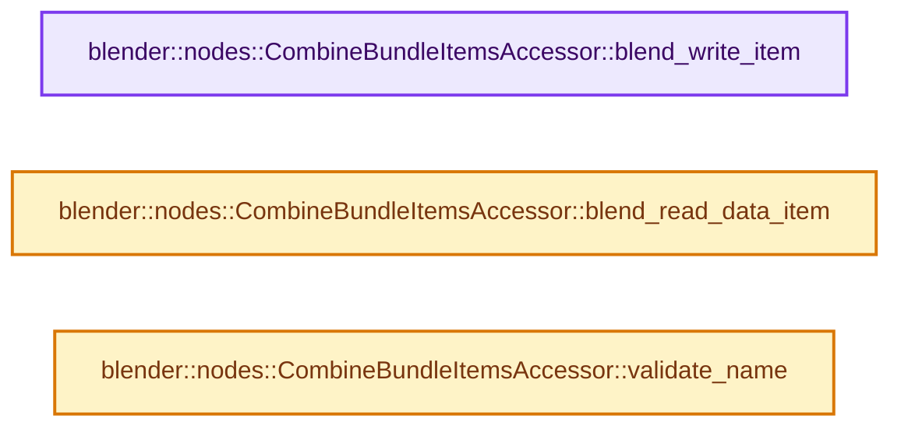
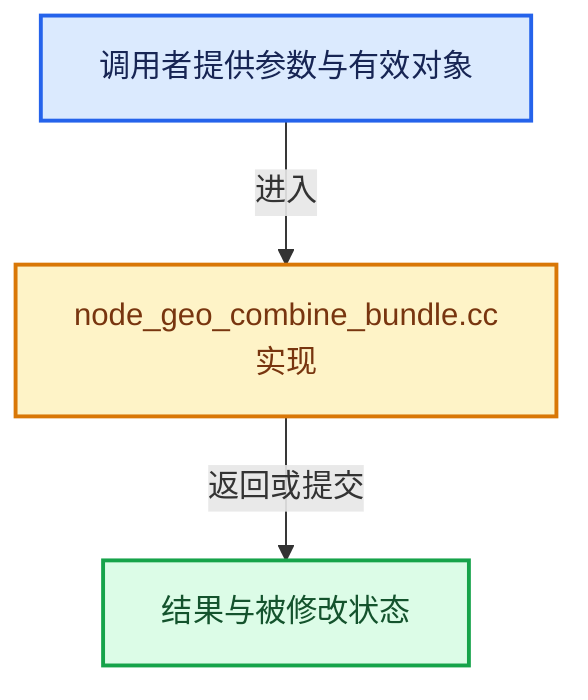

# 实现依赖专题：source/blender/nodes/geometry/nodes/node_geo_combine_bundle.cc

[实现依赖导航](../../../README.md) · [符号索引](../../../../00-课程指南/02-源码与提交索引/符号依赖与实现索引.md)

本专题从正文实际调用进入，集中保存共享实现。函数有稳定锚点，可从调用处直接跳到对应完整函数；递归与互相调用通过回链组织。

## 本文件的实现关系






## 完整成员与函数实现

<a id="f-a93f75af2d601c3d"></a>

### `blender::nodes::CombineBundleItemsAccessor::blend_write_item`

实现位置：[source/blender/nodes/geometry/nodes/node_geo_combine_bundle.cc](../../../../../../../../source/blender/nodes/geometry/nodes/node_geo_combine_bundle.cc) · L277—L280。

接口参数：

- `BlendWriter *writer`
- `const ItemT &item`

**教学注释版**

<!-- annotated:f66035c2027e9e -->

```cpp
void CombineBundleItemsAccessor::blend_write_item(BlendWriter *writer, const ItemT &item)
{
  writer->write_string(item.name);
}
```

<details>
<summary>核对原始源码：source/blender/nodes/geometry/nodes/node_geo_combine_bundle.cc · L277—L280</summary>

<!-- original:f66035c2027e9e:source/blender/nodes/geometry/nodes/node_geo_combine_bundle.cc:277:280 -->

```cpp
void CombineBundleItemsAccessor::blend_write_item(BlendWriter *writer, const ItemT &item)
{
  writer->write_string(item.name);
}
```

</details>

**继续追踪实现**

- `writer->write_string` → [blender::BlendWriter::write_string · L2357](../../../08-其他Blender模块/blenloader/intern/writefile.cc.md#f-3fd83db72afbdcbe)。

<a id="f-d63df89bb46a89e6"></a>

### `blender::nodes::CombineBundleItemsAccessor::blend_read_data_item`

实现位置：[source/blender/nodes/geometry/nodes/node_geo_combine_bundle.cc](../../../../../../../../source/blender/nodes/geometry/nodes/node_geo_combine_bundle.cc) · L282—L285。

接口参数：

- `BlendDataReader *reader`
- `ItemT &item`

**教学注释版**

<!-- annotated:35ac2322a361a7 -->

```cpp
void CombineBundleItemsAccessor::blend_read_data_item(BlendDataReader *reader, ItemT &item)
{
  BLO_read_string(reader, &item.name);
}
```

<details>
<summary>核对原始源码：source/blender/nodes/geometry/nodes/node_geo_combine_bundle.cc · L282—L285</summary>

<!-- original:35ac2322a361a7:source/blender/nodes/geometry/nodes/node_geo_combine_bundle.cc:282:285 -->

```cpp
void CombineBundleItemsAccessor::blend_read_data_item(BlendDataReader *reader, ItemT &item)
{
  BLO_read_string(reader, &item.name);
}
```

</details>

**继续追踪实现**

- `BLO_read_string` → [BLO_read_string · L6348](../../../08-其他Blender模块/blenloader/intern/readfile.cc.md#f-b9cb42e390941235)；[BLO_read_string · L6370](../../../08-其他Blender模块/blenloader/intern/readfile.cc.md#f-1bb75b8661d718d2)；[BLO_read_string · L6375](../../../08-其他Blender模块/blenloader/intern/readfile.cc.md#f-5714da923b3ad83d)。同名重载需按实参类型选择。

<a id="f-63e86fc1caca5c92"></a>

### `blender::nodes::CombineBundleItemsAccessor::validate_name`

实现位置：[source/blender/nodes/geometry/nodes/node_geo_combine_bundle.cc](../../../../../../../../source/blender/nodes/geometry/nodes/node_geo_combine_bundle.cc) · L287—L315。

接口参数：

- `const StringRef name`

**教学注释版**

<!-- annotated:9da3ddf549548c -->

```cpp
std::string CombineBundleItemsAccessor::validate_name(const StringRef name)
{
  std::string result;
  if (name.is_empty()) {
    return result;
  }
  const Span<char> forbidden_chars = BundleKey::forbidden_key_chars;
  for (const char c : name) {
    if (forbidden_chars.contains(c)) {
      result += '_';
    }
    else {
      result += c;
    }
  }
  if (!result.empty()) {
    /* Disallow leading spaces. */
    if (std::isspace(result[0])) {
      result[0] = '_';
    }
    /* Disallow trailing spaces. */
    const int last_index = result.size() - 1;
    if (std::isspace(result[last_index])) {
      result[last_index] = '_';
    }
  }
  BLI_assert(BundleKey::is_valid_key(result));
  return result;
}
```

<details>
<summary>核对原始源码：source/blender/nodes/geometry/nodes/node_geo_combine_bundle.cc · L287—L315</summary>

<!-- original:9da3ddf549548c:source/blender/nodes/geometry/nodes/node_geo_combine_bundle.cc:287:315 -->

```cpp
std::string CombineBundleItemsAccessor::validate_name(const StringRef name)
{
  std::string result;
  if (name.is_empty()) {
    return result;
  }
  const Span<char> forbidden_chars = BundleKey::forbidden_key_chars;
  for (const char c : name) {
    if (forbidden_chars.contains(c)) {
      result += '_';
    }
    else {
      result += c;
    }
  }
  if (!result.empty()) {
    /* Disallow leading spaces. */
    if (std::isspace(result[0])) {
      result[0] = '_';
    }
    /* Disallow trailing spaces. */
    const int last_index = result.size() - 1;
    if (std::isspace(result[last_index])) {
      result[last_index] = '_';
    }
  }
  BLI_assert(BundleKey::is_valid_key(result));
  return result;
}
```

</details>

**沿实际写入检查状态**

- `result += '_';`
- `result += c;`
- `result[0] = '_';`
- `result[last_index] = '_';`

**结果出口**

- `return result;`

**继续追踪实现**

- `name.is_empty` → [blender::nodes::Bundle::is_empty · L483](../../NOD_geometry_nodes_bundle.hh.md#f-a112ec28493ab618)。
- `forbidden_chars.contains` → [blender::Span::contains · L281](../../../../01-基础容器与现代CPP/05-Span只读连续视图.md#f-7caee498c984f2c0)。
- `result.empty` → [外部契约](https://eel.is/c++draft/)：这个边界按实际表达式及所属类型核对参数、返回值、寿命与失败行为。这里提供接口入口，不声称已解释该第三方版本的内部实现。
- `std::isspace` → [外部契约](https://eel.is/c++draft/)：这个边界按实际表达式及所属类型核对参数、返回值、寿命与失败行为。这里提供接口入口，不声称已解释该第三方版本的内部实现。
- `result.size` → [外部契约](https://eel.is/c++draft/)：这个边界按实际表达式及所属类型核对参数、返回值、寿命与失败行为。这里提供接口入口，不声称已解释该第三方版本的内部实现。
- `BLI_assert` → [BLI_assert · L48](../../../01-BLI基础库/BLI_assert.hh.md#m-57a88495704d)；[BLI_assert · L63](../../../01-BLI基础库/BLI_assert.hh.md#m-d07050020cb5)。宏定义由构建条件选择。
- `BundleKey::is_valid_key` → [blender::nodes::BundleKey::is_valid_key · L39](../../../../10-引用生命周期与Closure/05-Bundle值组合.md#f-1727e83d6c1766e1)。
