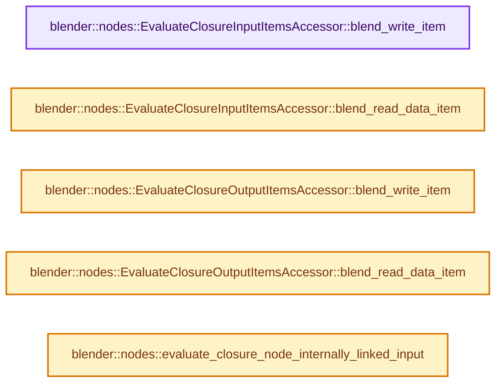
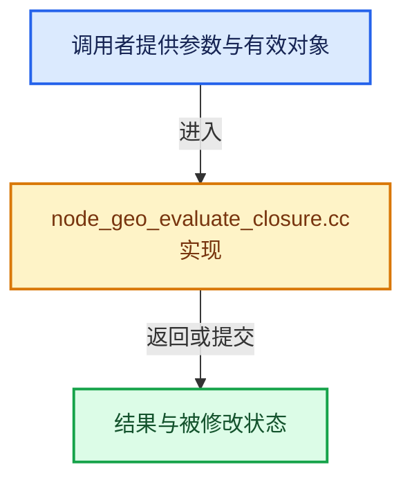

# 实现依赖专题：source/blender/nodes/geometry/nodes/node_geo_evaluate_closure.cc

[实现依赖导航](../../../README.md) · [符号索引](../../../../00-课程指南/02-源码与提交索引/符号依赖与实现索引.md)

本专题从正文实际调用进入，集中保存共享实现。函数有稳定锚点，可从调用处直接跳到对应完整函数；递归与互相调用通过回链组织。

## 本文件的实现关系






## 完整成员与函数实现

<a id="f-6e9ca07e114d3a2d"></a>

### `blender::nodes::EvaluateClosureInputItemsAccessor::blend_write_item`

实现位置：[source/blender/nodes/geometry/nodes/node_geo_evaluate_closure.cc](../../../../../../../../source/blender/nodes/geometry/nodes/node_geo_evaluate_closure.cc) · L575—L578。

接口参数：

- `BlendWriter *writer`
- `const ItemT &item`

**教学注释版**

<!-- annotated:e0f73cc3a5ddb4 -->

```cpp
void EvaluateClosureInputItemsAccessor::blend_write_item(BlendWriter *writer, const ItemT &item)
{
  writer->write_string(item.name);
}
```

<details>
<summary>核对原始源码：source/blender/nodes/geometry/nodes/node_geo_evaluate_closure.cc · L575—L578</summary>

<!-- original:e0f73cc3a5ddb4:source/blender/nodes/geometry/nodes/node_geo_evaluate_closure.cc:575:578 -->

```cpp
void EvaluateClosureInputItemsAccessor::blend_write_item(BlendWriter *writer, const ItemT &item)
{
  writer->write_string(item.name);
}
```

</details>

**继续追踪实现**

- `writer->write_string` → [blender::BlendWriter::write_string · L2357](../../../08-其他Blender模块/blenloader/intern/writefile.cc.md#f-3fd83db72afbdcbe)。

<a id="f-8afde659ce3e59ea"></a>

### `blender::nodes::EvaluateClosureInputItemsAccessor::blend_read_data_item`

实现位置：[source/blender/nodes/geometry/nodes/node_geo_evaluate_closure.cc](../../../../../../../../source/blender/nodes/geometry/nodes/node_geo_evaluate_closure.cc) · L580—L583。

接口参数：

- `BlendDataReader *reader`
- `ItemT &item`

**教学注释版**

<!-- annotated:b67508d3067e13 -->

```cpp
void EvaluateClosureInputItemsAccessor::blend_read_data_item(BlendDataReader *reader, ItemT &item)
{
  BLO_read_string(reader, &item.name);
}
```

<details>
<summary>核对原始源码：source/blender/nodes/geometry/nodes/node_geo_evaluate_closure.cc · L580—L583</summary>

<!-- original:b67508d3067e13:source/blender/nodes/geometry/nodes/node_geo_evaluate_closure.cc:580:583 -->

```cpp
void EvaluateClosureInputItemsAccessor::blend_read_data_item(BlendDataReader *reader, ItemT &item)
{
  BLO_read_string(reader, &item.name);
}
```

</details>

**继续追踪实现**

- `BLO_read_string` → [BLO_read_string · L6348](../../../08-其他Blender模块/blenloader/intern/readfile.cc.md#f-b9cb42e390941235)；[BLO_read_string · L6370](../../../08-其他Blender模块/blenloader/intern/readfile.cc.md#f-1bb75b8661d718d2)；[BLO_read_string · L6375](../../../08-其他Blender模块/blenloader/intern/readfile.cc.md#f-5714da923b3ad83d)。同名重载需按实参类型选择。

<a id="f-1606283918e72ff1"></a>

### `blender::nodes::EvaluateClosureOutputItemsAccessor::blend_write_item`

实现位置：[source/blender/nodes/geometry/nodes/node_geo_evaluate_closure.cc](../../../../../../../../source/blender/nodes/geometry/nodes/node_geo_evaluate_closure.cc) · L587—L590。

接口参数：

- `BlendWriter *writer`
- `const ItemT &item`

**教学注释版**

<!-- annotated:a0ed4b0c2d2eb3 -->

```cpp
void EvaluateClosureOutputItemsAccessor::blend_write_item(BlendWriter *writer, const ItemT &item)
{
  writer->write_string(item.name);
}
```

<details>
<summary>核对原始源码：source/blender/nodes/geometry/nodes/node_geo_evaluate_closure.cc · L587—L590</summary>

<!-- original:a0ed4b0c2d2eb3:source/blender/nodes/geometry/nodes/node_geo_evaluate_closure.cc:587:590 -->

```cpp
void EvaluateClosureOutputItemsAccessor::blend_write_item(BlendWriter *writer, const ItemT &item)
{
  writer->write_string(item.name);
}
```

</details>

**继续追踪实现**

- `writer->write_string` → [blender::BlendWriter::write_string · L2357](../../../08-其他Blender模块/blenloader/intern/writefile.cc.md#f-3fd83db72afbdcbe)。

<a id="f-19f28a191ed4b07c"></a>

### `blender::nodes::EvaluateClosureOutputItemsAccessor::blend_read_data_item`

实现位置：[source/blender/nodes/geometry/nodes/node_geo_evaluate_closure.cc](../../../../../../../../source/blender/nodes/geometry/nodes/node_geo_evaluate_closure.cc) · L592—L595。

接口参数：

- `BlendDataReader *reader`
- `ItemT &item`

**教学注释版**

<!-- annotated:bfac62c89ba8f2 -->

```cpp
void EvaluateClosureOutputItemsAccessor::blend_read_data_item(BlendDataReader *reader, ItemT &item)
{
  BLO_read_string(reader, &item.name);
}
```

<details>
<summary>核对原始源码：source/blender/nodes/geometry/nodes/node_geo_evaluate_closure.cc · L592—L595</summary>

<!-- original:bfac62c89ba8f2:source/blender/nodes/geometry/nodes/node_geo_evaluate_closure.cc:592:595 -->

```cpp
void EvaluateClosureOutputItemsAccessor::blend_read_data_item(BlendDataReader *reader, ItemT &item)
{
  BLO_read_string(reader, &item.name);
}
```

</details>

**继续追踪实现**

- `BLO_read_string` → [BLO_read_string · L6348](../../../08-其他Blender模块/blenloader/intern/readfile.cc.md#f-b9cb42e390941235)；[BLO_read_string · L6370](../../../08-其他Blender模块/blenloader/intern/readfile.cc.md#f-1bb75b8661d718d2)；[BLO_read_string · L6375](../../../08-其他Blender模块/blenloader/intern/readfile.cc.md#f-5714da923b3ad83d)。同名重载需按实参类型选择。

<a id="f-6554f26c20daaedd"></a>

### `blender::nodes::evaluate_closure_node_internally_linked_input`

实现位置：[source/blender/nodes/geometry/nodes/node_geo_evaluate_closure.cc](../../../../../../../../source/blender/nodes/geometry/nodes/node_geo_evaluate_closure.cc) · L597—L621。

接口参数：

- `const bNodeSocket &output_socket`

**教学注释版**

<!-- annotated:b9581df42818b4 -->

```cpp
const bNodeSocket *evaluate_closure_node_internally_linked_input(const bNodeSocket &output_socket)
{
  const bNode &node = output_socket.owner_node();
  const bNodeTree &tree = node.owner_tree();
  BLI_assert(node.is_type("NodeEvaluateClosure"_ustr));
  const auto &storage = *static_cast<const NodeEvaluateClosure *>(node.storage);
  if (output_socket.index() >= storage.output_items.items_num) {
    return nullptr;
  }
  const NodeEvaluateClosureOutputItem &output_item =
      storage.output_items.items[output_socket.index()];
  const StringRef output_key = output_item.name;
  for (const int i : IndexRange(storage.input_items.items_num)) {
    const NodeEvaluateClosureInputItem &input_item = storage.input_items.items[i];
    const StringRef input_key = input_item.name;
    if (output_key == input_key) {
      if (!tree.typeinfo->validate_link ||
          tree.typeinfo->validate_link(input_item.socket_type, output_item.socket_type))
      {
        return &node.input_socket(i + 1);
      }
    }
  }
  return nullptr;
}
```

<details>
<summary>核对原始源码：source/blender/nodes/geometry/nodes/node_geo_evaluate_closure.cc · L597—L621</summary>

<!-- original:b9581df42818b4:source/blender/nodes/geometry/nodes/node_geo_evaluate_closure.cc:597:621 -->

```cpp
const bNodeSocket *evaluate_closure_node_internally_linked_input(const bNodeSocket &output_socket)
{
  const bNode &node = output_socket.owner_node();
  const bNodeTree &tree = node.owner_tree();
  BLI_assert(node.is_type("NodeEvaluateClosure"_ustr));
  const auto &storage = *static_cast<const NodeEvaluateClosure *>(node.storage);
  if (output_socket.index() >= storage.output_items.items_num) {
    return nullptr;
  }
  const NodeEvaluateClosureOutputItem &output_item =
      storage.output_items.items[output_socket.index()];
  const StringRef output_key = output_item.name;
  for (const int i : IndexRange(storage.input_items.items_num)) {
    const NodeEvaluateClosureInputItem &input_item = storage.input_items.items[i];
    const StringRef input_key = input_item.name;
    if (output_key == input_key) {
      if (!tree.typeinfo->validate_link ||
          tree.typeinfo->validate_link(input_item.socket_type, output_item.socket_type))
      {
        return &node.input_socket(i + 1);
      }
    }
  }
  return nullptr;
}
```

</details>

**结果出口**

- `return nullptr;`
- `return &node.input_socket(i + 1);`

**继续追踪实现**

- `output_socket.owner_node` → [blender::bNodeSocket::owner_node · L1069](../../../02-BKE几何与数据/BKE_node_runtime.hh.md#f-e92f9934c26a08ec)；[blender::bNodeSocket::owner_node · L1159](../../../02-BKE几何与数据/BKE_node_runtime.hh.md#f-88477f32cb5dce90)。同名重载需按实参类型选择。
- `node.owner_tree` → [blender::bNode::owner_tree · L866](../../../02-BKE几何与数据/BKE_node_runtime.hh.md#f-7e471005a1325135)；[blender::bNode::owner_tree · L872](../../../02-BKE几何与数据/BKE_node_runtime.hh.md#f-641a1000c92d9a52)。同名重载需按实参类型选择。
- `BLI_assert` → [BLI_assert · L48](../../../01-BLI基础库/BLI_assert.hh.md#m-57a88495704d)；[BLI_assert · L63](../../../01-BLI基础库/BLI_assert.hh.md#m-d07050020cb5)。宏定义由构建条件选择。
- `node.is_type` → [blender::bNode::is_type · L931](../../../02-BKE几何与数据/BKE_node_runtime.hh.md#f-828d5e91e96da197)。
- `output_socket.index` → [blender::bNodeSocket::index · L996](../../../02-BKE几何与数据/BKE_node_runtime.hh.md#f-9ca591f4923e916a)。
- `IndexRange` → [blender::IndexRange](../../../01-BLI基础库/BLI_index_range.hh.md#t-caa3466d6776)；[blender::gpu::shader::parser::IndexRange](../../../08-其他Blender模块/gpu/shader_tool/utils.hh.md#t-82d2bd4ea71c)；[blender::IndexRange](../../../08-其他Blender模块/makesdna/DNA_node_types.h.md#t-0448cc889d39)。
- `tree.typeinfo->validate_link` → [调用协议](../../../../00-课程指南/01-路线与规范/模板宏与动态分派协议.md)：接收对象类型依赖auto、返回值或模板实例；不按同名猜测目标。调用位置L614。
- `node.input_socket` → [blender::bNode::input_socket · L818](../../../02-BKE几何与数据/BKE_node_runtime.hh.md#f-00274c021929d3dc)；[blender::bNode::input_socket · L830](../../../02-BKE几何与数据/BKE_node_runtime.hh.md#f-e9c8cccac4999eb8)。同名重载需按实参类型选择。
