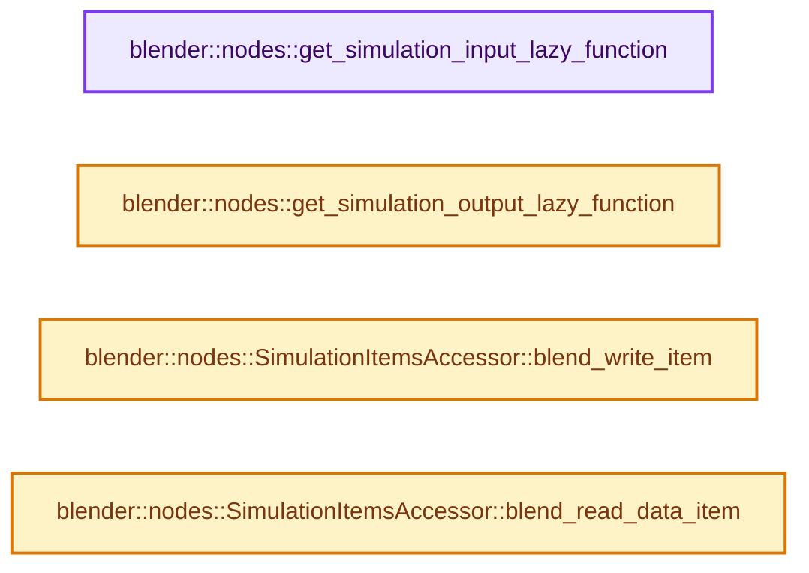
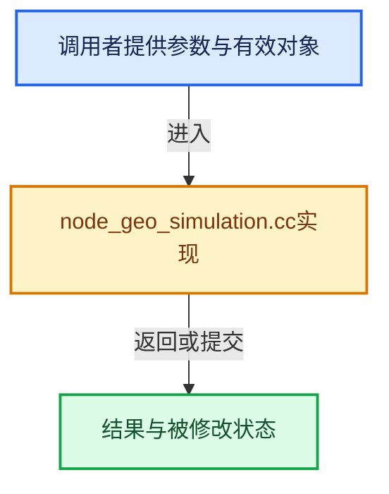

# 实现依赖专题：source/blender/nodes/geometry/nodes/node_geo_simulation.cc

[实现依赖导航](../../../README.md) · [符号索引](../../../../00-课程指南/02-源码与提交索引/符号依赖与实现索引.md)

本专题从正文实际调用进入，集中保存共享实现。函数有稳定锚点，可从调用处直接跳到对应完整函数；递归与互相调用通过回链组织。

## 本文件的实现关系






## 完整成员与函数实现

<a id="f-926f5235bacd0621"></a>

### `blender::nodes::get_simulation_input_lazy_function`

实现位置：[source/blender/nodes/geometry/nodes/node_geo_simulation.cc](../../../../../../../../source/blender/nodes/geometry/nodes/node_geo_simulation.cc) · L798—L807。

接口参数：

- `const bNodeTree &node_tree`
- `const bNode &node`
- `GeometryNodesLazyFunctionGraphInfo &own_lf_graph_info`

**教学注释版**

<!-- annotated:8f89fc43ada407 -->

```cpp
std::unique_ptr<LazyFunction> get_simulation_input_lazy_function(
    const bNodeTree &node_tree,
    const bNode &node,
    GeometryNodesLazyFunctionGraphInfo &own_lf_graph_info)
{
  BLI_assert(node.type_legacy == GEO_NODE_SIMULATION_INPUT);
  return std::make_unique<
      node_geo_simulation_cc::sim_input_node::LazyFunctionForSimulationInputNode>(
      node_tree, node, own_lf_graph_info);
}
```

<details>
<summary>核对原始源码：source/blender/nodes/geometry/nodes/node_geo_simulation.cc · L798—L807</summary>

<!-- original:8f89fc43ada407:source/blender/nodes/geometry/nodes/node_geo_simulation.cc:798:807 -->

```cpp
std::unique_ptr<LazyFunction> get_simulation_input_lazy_function(
    const bNodeTree &node_tree,
    const bNode &node,
    GeometryNodesLazyFunctionGraphInfo &own_lf_graph_info)
{
  BLI_assert(node.type_legacy == GEO_NODE_SIMULATION_INPUT);
  return std::make_unique<
      node_geo_simulation_cc::sim_input_node::LazyFunctionForSimulationInputNode>(
      node_tree, node, own_lf_graph_info);
}
```

</details>

**结果出口**

- `return std::make_unique<`

**继续追踪实现**

- `BLI_assert` → [BLI_assert · L48](../../../01-BLI基础库/BLI_assert.hh.md#m-57a88495704d)；[BLI_assert · L63](../../../01-BLI基础库/BLI_assert.hh.md#m-d07050020cb5)。宏定义由构建条件选择。
- `std::make_unique< node_geo_simulation_cc::sim_input_node::LazyFunctionForSimulationInputNode>` → [外部契约](https://eel.is/c++draft/)：这个边界按实际表达式及所属类型核对参数、返回值、寿命与失败行为。这里提供接口入口，不声称已解释该第三方版本的内部实现。

<a id="f-90b7371916184169"></a>

### `blender::nodes::get_simulation_output_lazy_function`

实现位置：[source/blender/nodes/geometry/nodes/node_geo_simulation.cc](../../../../../../../../source/blender/nodes/geometry/nodes/node_geo_simulation.cc) · L809—L816。

接口参数：

- `const bNode &node`
- `GeometryNodesLazyFunctionGraphInfo &own_lf_graph_info`

**教学注释版**

<!-- annotated:837aa04252c066 -->

```cpp
std::unique_ptr<LazyFunction> get_simulation_output_lazy_function(
    const bNode &node, GeometryNodesLazyFunctionGraphInfo &own_lf_graph_info)
{
  BLI_assert(node.type_legacy == GEO_NODE_SIMULATION_OUTPUT);
  return std::make_unique<
      node_geo_simulation_cc::sim_output_node::LazyFunctionForSimulationOutputNode>(
      node, own_lf_graph_info);
}
```

<details>
<summary>核对原始源码：source/blender/nodes/geometry/nodes/node_geo_simulation.cc · L809—L816</summary>

<!-- original:837aa04252c066:source/blender/nodes/geometry/nodes/node_geo_simulation.cc:809:816 -->

```cpp
std::unique_ptr<LazyFunction> get_simulation_output_lazy_function(
    const bNode &node, GeometryNodesLazyFunctionGraphInfo &own_lf_graph_info)
{
  BLI_assert(node.type_legacy == GEO_NODE_SIMULATION_OUTPUT);
  return std::make_unique<
      node_geo_simulation_cc::sim_output_node::LazyFunctionForSimulationOutputNode>(
      node, own_lf_graph_info);
}
```

</details>

**结果出口**

- `return std::make_unique<`

**继续追踪实现**

- `BLI_assert` → [BLI_assert · L48](../../../01-BLI基础库/BLI_assert.hh.md#m-57a88495704d)；[BLI_assert · L63](../../../01-BLI基础库/BLI_assert.hh.md#m-d07050020cb5)。宏定义由构建条件选择。
- `std::make_unique< node_geo_simulation_cc::sim_output_node::LazyFunctionForSimulationOutputNode>` → [外部契约](https://eel.is/c++draft/)：这个边界按实际表达式及所属类型核对参数、返回值、寿命与失败行为。这里提供接口入口，不声称已解释该第三方版本的内部实现。

<a id="f-b67c032317d698af"></a>

### `blender::nodes::SimulationItemsAccessor::blend_write_item`

实现位置：[source/blender/nodes/geometry/nodes/node_geo_simulation.cc](../../../../../../../../source/blender/nodes/geometry/nodes/node_geo_simulation.cc) · L820—L823。

接口参数：

- `BlendWriter *writer`
- `const ItemT &item`

**教学注释版**

<!-- annotated:190606945f357e -->

```cpp
void SimulationItemsAccessor::blend_write_item(BlendWriter *writer, const ItemT &item)
{
  writer->write_string(item.name);
}
```

<details>
<summary>核对原始源码：source/blender/nodes/geometry/nodes/node_geo_simulation.cc · L820—L823</summary>

<!-- original:190606945f357e:source/blender/nodes/geometry/nodes/node_geo_simulation.cc:820:823 -->

```cpp
void SimulationItemsAccessor::blend_write_item(BlendWriter *writer, const ItemT &item)
{
  writer->write_string(item.name);
}
```

</details>

**继续追踪实现**

- `writer->write_string` → [blender::BlendWriter::write_string · L2357](../../../08-其他Blender模块/blenloader/intern/writefile.cc.md#f-3fd83db72afbdcbe)。

<a id="f-7ead31088c6740e0"></a>

### `blender::nodes::SimulationItemsAccessor::blend_read_data_item`

实现位置：[source/blender/nodes/geometry/nodes/node_geo_simulation.cc](../../../../../../../../source/blender/nodes/geometry/nodes/node_geo_simulation.cc) · L825—L828。

接口参数：

- `BlendDataReader *reader`
- `ItemT &item`

**教学注释版**

<!-- annotated:cafcce835d436f -->

```cpp
void SimulationItemsAccessor::blend_read_data_item(BlendDataReader *reader, ItemT &item)
{
  BLO_read_string(reader, &item.name);
}
```

<details>
<summary>核对原始源码：source/blender/nodes/geometry/nodes/node_geo_simulation.cc · L825—L828</summary>

<!-- original:cafcce835d436f:source/blender/nodes/geometry/nodes/node_geo_simulation.cc:825:828 -->

```cpp
void SimulationItemsAccessor::blend_read_data_item(BlendDataReader *reader, ItemT &item)
{
  BLO_read_string(reader, &item.name);
}
```

</details>

**继续追踪实现**

- `BLO_read_string` → [BLO_read_string · L6348](../../../08-其他Blender模块/blenloader/intern/readfile.cc.md#f-b9cb42e390941235)；[BLO_read_string · L6370](../../../08-其他Blender模块/blenloader/intern/readfile.cc.md#f-1bb75b8661d718d2)；[BLO_read_string · L6375](../../../08-其他Blender模块/blenloader/intern/readfile.cc.md#f-5714da923b3ad83d)。同名重载需按实参类型选择。
