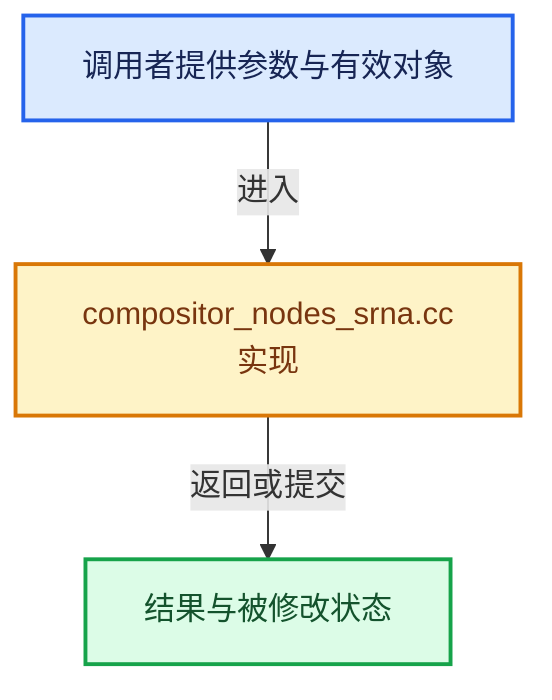

# 实现依赖专题：source/blender/nodes/intern/compositor_nodes_srna.cc

[实现依赖导航](../../README.md) · [符号索引](../../../00-课程指南/02-源码与提交索引/符号依赖与实现索引.md)

本专题从正文实际调用进入，集中保存共享实现。函数有稳定锚点，可从调用处直接跳到对应完整函数；递归与互相调用通过回链组织。

## 本文件的实现关系

```mermaid
flowchart LR
  F0["blender::nodes::get_input_socket_struct_rna"]:::abstraction
  F1["blender::nodes::create_inputs_srna"]:::compute
  F2["blender::nodes::create_panels_srna"]:::compute
  F3["blender::nodes::create_compositor_nodes_rna"]:::compute
  F4["blender::nodes::create_compositor_nodes_rna_for_strip_modifier"]:::compute
  F5["blender::nodes::create_compositor_nodes_rna_for_effect"]:::compute
  F1 -->|"显式调用"| F0
  F3 -->|"显式调用"| F1
  F3 -->|"显式调用"| F2
  F4 -->|"显式调用"| F3
  F5 -->|"显式调用"| F3
  classDef input fill:#DBEAFE,stroke:#2563EB,color:#172554,stroke-width:2px;
  classDef data fill:#CFFAFE,stroke:#0891B2,color:#164E63,stroke-width:2px;
  classDef abstraction fill:#EDE9FE,stroke:#7C3AED,color:#3B0764,stroke-width:2px;
  classDef compute fill:#FEF3C7,stroke:#D97706,color:#78350F,stroke-width:2px;
  classDef result fill:#DCFCE7,stroke:#16A34A,color:#14532D,stroke-width:2px;
  classDef error fill:#FEE2E2,stroke:#DC2626,color:#7F1D1D,stroke-width:2px;
```






## 完整成员与函数实现

<a id="f-9d9cafeb3c910141"></a>

### `blender::nodes::get_input_socket_struct_rna`

实现位置：[source/blender/nodes/intern/compositor_nodes_srna.cc](../../../../../../../source/blender/nodes/intern/compositor_nodes_srna.cc) · L133—L153。

接口参数：

- `const bNodeTree &tree`
- `const bNodeTreeInterfaceSocket &socket`
- `const CompositorNodesSrnaContext &context`
- `GeneratedTreeSrnaData &r_generated`

**教学注释版**

<!-- annotated:f50abf47a02ee3 -->

```cpp
static StructRNA *get_input_socket_struct_rna(const bNodeTree &tree,
                                              const bNodeTreeInterfaceSocket &socket,
                                              const CompositorNodesSrnaContext &context,
                                              GeneratedTreeSrnaData &r_generated)
{
  const bke::bNodeSocketType *stype = socket.socket_typeinfo();
  if (!stype) {
    return nullptr;
  }
  const StringRefNull srna_identifier = r_generated.scope.allocator().copy_string(
      socket.identifier);

  StructRNA *srna = RNA_def_struct_ptr(
      r_generated.generated_rna, srna_identifier.c_str(), RNA_PropertyGroup);
  RNA_def_struct_path_func_runtime(srna, context.path_func);
  if (stype->make_compositor_nodes_input_srna) {
    stype->make_compositor_nodes_input_srna(tree, *srna, socket, r_generated);
  }

  return srna;
}
```

<details>
<summary>核对原始源码：source/blender/nodes/intern/compositor_nodes_srna.cc · L133—L153</summary>

<!-- original:f50abf47a02ee3:source/blender/nodes/intern/compositor_nodes_srna.cc:133:153 -->

```cpp
static StructRNA *get_input_socket_struct_rna(const bNodeTree &tree,
                                              const bNodeTreeInterfaceSocket &socket,
                                              const CompositorNodesSrnaContext &context,
                                              GeneratedTreeSrnaData &r_generated)
{
  const bke::bNodeSocketType *stype = socket.socket_typeinfo();
  if (!stype) {
    return nullptr;
  }
  const StringRefNull srna_identifier = r_generated.scope.allocator().copy_string(
      socket.identifier);

  StructRNA *srna = RNA_def_struct_ptr(
      r_generated.generated_rna, srna_identifier.c_str(), RNA_PropertyGroup);
  RNA_def_struct_path_func_runtime(srna, context.path_func);
  if (stype->make_compositor_nodes_input_srna) {
    stype->make_compositor_nodes_input_srna(tree, *srna, socket, r_generated);
  }

  return srna;
}
```

</details>

**结果出口**

- `return nullptr;`
- `return srna;`

**继续追踪实现**

- `socket.socket_typeinfo` → [blender::bNodeTreeInterfaceSocket::socket_typeinfo · L770](../../02-BKE几何与数据/intern/node_tree_interface.cc.md#f-f6d586e3bc159207)。
- `r_generated.scope.allocator().copy_string` → [调用协议](../../../00-课程指南/01-路线与规范/模板宏与动态分派协议.md)：接收对象类型依赖auto、返回值或模板实例；不按同名猜测目标。调用位置L142。
- `r_generated.scope.allocator` → [调用协议](../../../00-课程指南/01-路线与规范/模板宏与动态分派协议.md)：接收对象类型依赖auto、返回值或模板实例；不按同名猜测目标。调用位置L142。
- `RNA_def_struct_ptr` → [blender::RNA_def_struct_ptr · L805](../../08-其他Blender模块/makesrna/intern/rna_define.cc.md#f-37cc235892d0094b)。
- `srna_identifier.c_str` → [blender::StringRefNull::c_str · L544](../../../01-基础容器与现代CPP/15-StringRef字符串视图.md#f-4a8bbfe1e6d00757)。
- `RNA_def_struct_path_func_runtime` → [blender::RNA_def_struct_path_func_runtime · L1129](../../08-其他Blender模块/makesrna/intern/rna_define.cc.md#f-e8faada524c15119)。
- `stype->make_compositor_nodes_input_srna` → [调用协议](../../../00-课程指南/01-路线与规范/模板宏与动态分派协议.md)：由接收对象具体类型或运行时策略提供实现。调用位置L149。

<a id="f-7da402cd37bda9a0"></a>

### `blender::nodes::create_inputs_srna`

实现位置：[source/blender/nodes/intern/compositor_nodes_srna.cc](../../../../../../../source/blender/nodes/intern/compositor_nodes_srna.cc) · L155—L172。

接口参数：

- `const bNodeTree &tree`
- `const CompositorNodesSrnaContext &context`
- `GeneratedTreeSrnaData &r_generated`

**教学注释版**

<!-- annotated:0e3794627d8c67 -->

```cpp
static StructRNA *create_inputs_srna(const bNodeTree &tree,
                                     const CompositorNodesSrnaContext &context,
                                     GeneratedTreeSrnaData &r_generated)
{
  StructRNA *srna = RNA_def_struct_ptr(
      r_generated.generated_rna, "CompositorNodesInterfaceInputs", RNA_PropertyGroup);

  for (const bNodeTreeInterfaceSocket *socket : tree.interface_inputs()) {
    StructRNA *socket_srna = get_input_socket_struct_rna(tree, *socket, context, r_generated);
    if (!socket_srna) {
      continue;
    }
    const StringRefNull identifier = r_generated.scope.allocator().copy_string(socket->identifier);
    RNA_def_pointer_runtime(srna, identifier.c_str(), socket_srna, socket->name().c_str(), "");
  }

  return srna;
}
```

<details>
<summary>核对原始源码：source/blender/nodes/intern/compositor_nodes_srna.cc · L155—L172</summary>

<!-- original:0e3794627d8c67:source/blender/nodes/intern/compositor_nodes_srna.cc:155:172 -->

```cpp
static StructRNA *create_inputs_srna(const bNodeTree &tree,
                                     const CompositorNodesSrnaContext &context,
                                     GeneratedTreeSrnaData &r_generated)
{
  StructRNA *srna = RNA_def_struct_ptr(
      r_generated.generated_rna, "CompositorNodesInterfaceInputs", RNA_PropertyGroup);

  for (const bNodeTreeInterfaceSocket *socket : tree.interface_inputs()) {
    StructRNA *socket_srna = get_input_socket_struct_rna(tree, *socket, context, r_generated);
    if (!socket_srna) {
      continue;
    }
    const StringRefNull identifier = r_generated.scope.allocator().copy_string(socket->identifier);
    RNA_def_pointer_runtime(srna, identifier.c_str(), socket_srna, socket->name().c_str(), "");
  }

  return srna;
}
```

</details>

**结果出口**

- `return srna;`

**继续追踪实现**

- `RNA_def_struct_ptr` → [blender::RNA_def_struct_ptr · L805](../../08-其他Blender模块/makesrna/intern/rna_define.cc.md#f-37cc235892d0094b)。
- `tree.interface_inputs` → [blender::bNodeTree::interface_inputs · L675](../../02-BKE几何与数据/BKE_node_runtime.hh.md#f-b5decde7a09fbf57)；[blender::bNodeTree::interface_inputs · L681](../../02-BKE几何与数据/BKE_node_runtime.hh.md#f-f999995c05009884)。同名重载需按实参类型选择。
- `get_input_socket_struct_rna` → [blender::nodes::get_input_socket_struct_rna · L133](compositor_nodes_srna.cc.md#f-9d9cafeb3c910141)。
- `r_generated.scope.allocator().copy_string` → [调用协议](../../../00-课程指南/01-路线与规范/模板宏与动态分派协议.md)：接收对象类型依赖auto、返回值或模板实例；不按同名猜测目标。调用位置L167。
- `r_generated.scope.allocator` → [调用协议](../../../00-课程指南/01-路线与规范/模板宏与动态分派协议.md)：接收对象类型依赖auto、返回值或模板实例；不按同名猜测目标。调用位置L167。
- `RNA_def_pointer_runtime` → [blender::RNA_def_pointer_runtime · L4608](../../08-其他Blender模块/makesrna/intern/rna_define.cc.md#f-69b55a92fad49c1b)。
- `identifier.c_str` → [blender::StringRefNull::c_str · L544](../../../01-基础容器与现代CPP/15-StringRef字符串视图.md#f-4a8bbfe1e6d00757)。
- `socket->name().c_str` → [调用协议](../../../00-课程指南/01-路线与规范/模板宏与动态分派协议.md)：接收对象类型依赖auto、返回值或模板实例；不按同名猜测目标。调用位置L168。
- `socket->name` → [调用协议](../../../00-课程指南/01-路线与规范/模板宏与动态分派协议.md)：接收对象类型依赖auto、返回值或模板实例；不按同名猜测目标。调用位置L168。

<a id="f-c9a7da9d13f3dcc1"></a>

### `blender::nodes::create_panels_srna`

实现位置：[source/blender/nodes/intern/compositor_nodes_srna.cc](../../../../../../../source/blender/nodes/intern/compositor_nodes_srna.cc) · L174—L198。

接口参数：

- `const bNodeTree &tree`
- `GeneratedTreeSrnaData &r_generated`

**教学注释版**

<!-- annotated:63fb9d40e1f0ae -->

```cpp
static StructRNA *create_panels_srna(const bNodeTree &tree, GeneratedTreeSrnaData &r_generated)
{
  StructRNA *srna = RNA_def_struct_ptr(
      r_generated.generated_rna, "CompositorNodesInterfacePanels", RNA_PropertyGroup);

  LinearAllocator<> &allocator = r_generated.scope.allocator();

  tree.ensure_interface_cache();
  for (const bNodeTreeInterfaceItem *item : tree.interface_items()) {
    if (item->item_type != NodeTreeInterfaceItemType::Panel) {
      continue;
    }
    const auto &panel = *reinterpret_cast<const bNodeTreeInterfacePanel *>(item);
    const StringRefNull identifier = allocator.copy_string(
        fmt::format("open_{}", panel.identifier));
    PropertyRNA *prop = RNA_def_boolean(srna,
                                        identifier.c_str(),
                                        !(panel.flag & NODE_INTERFACE_PANEL_DEFAULT_CLOSED),
                                        "Is Open",
                                        "");
    RNA_def_property_flag(prop, PROP_NO_DEG_UPDATE);
  }

  return srna;
}
```

<details>
<summary>核对原始源码：source/blender/nodes/intern/compositor_nodes_srna.cc · L174—L198</summary>

<!-- original:63fb9d40e1f0ae:source/blender/nodes/intern/compositor_nodes_srna.cc:174:198 -->

```cpp
static StructRNA *create_panels_srna(const bNodeTree &tree, GeneratedTreeSrnaData &r_generated)
{
  StructRNA *srna = RNA_def_struct_ptr(
      r_generated.generated_rna, "CompositorNodesInterfacePanels", RNA_PropertyGroup);

  LinearAllocator<> &allocator = r_generated.scope.allocator();

  tree.ensure_interface_cache();
  for (const bNodeTreeInterfaceItem *item : tree.interface_items()) {
    if (item->item_type != NodeTreeInterfaceItemType::Panel) {
      continue;
    }
    const auto &panel = *reinterpret_cast<const bNodeTreeInterfacePanel *>(item);
    const StringRefNull identifier = allocator.copy_string(
        fmt::format("open_{}", panel.identifier));
    PropertyRNA *prop = RNA_def_boolean(srna,
                                        identifier.c_str(),
                                        !(panel.flag & NODE_INTERFACE_PANEL_DEFAULT_CLOSED),
                                        "Is Open",
                                        "");
    RNA_def_property_flag(prop, PROP_NO_DEG_UPDATE);
  }

  return srna;
}
```

</details>

**结果出口**

- `return srna;`

**继续追踪实现**

- `RNA_def_struct_ptr` → [blender::RNA_def_struct_ptr · L805](../../08-其他Blender模块/makesrna/intern/rna_define.cc.md#f-37cc235892d0094b)。
- `r_generated.scope.allocator` → [调用协议](../../../00-课程指南/01-路线与规范/模板宏与动态分派协议.md)：接收对象类型依赖auto、返回值或模板实例；不按同名猜测目标。调用位置L179。
- `tree.ensure_interface_cache` → [blender::bNodeTree::ensure_interface_cache · L670](../../02-BKE几何与数据/BKE_node_runtime.hh.md#f-73fea7b58035b1f9)。
- `tree.interface_items` → [blender::bNodeTree::interface_items · L699](../../02-BKE几何与数据/BKE_node_runtime.hh.md#f-a4378b71bb958204)；[blender::bNodeTree::interface_items · L705](../../02-BKE几何与数据/BKE_node_runtime.hh.md#f-12f77272cc5b4792)。同名重载需按实参类型选择。
- `allocator.copy_string` → [blender::LinearAllocator::copy_string · L174](../../../03-内存分配与运行时类型/03-LinearAllocator分配与扩展.md#f-78f19108ed967ade)。
- `fmt::format` → [外部契约](https://fmt.dev/latest/api/)：按fmt接口的格式字符串与参数类型契约使用，格式化不改变被格式化对象的拥有关系。
- `RNA_def_boolean` → [blender::RNA_def_boolean · L3914](../../08-其他Blender模块/makesrna/intern/rna_define.cc.md#f-405e176adda90717)。
- `identifier.c_str` → [blender::StringRefNull::c_str · L544](../../../01-基础容器与现代CPP/15-StringRef字符串视图.md#f-4a8bbfe1e6d00757)。
- `RNA_def_property_flag` → [blender::RNA_def_property_flag · L1407](../../08-其他Blender模块/makesrna/intern/rna_define.cc.md#f-5cf166a170a67318)。

<a id="f-4e78f1cb9357e906"></a>

### `blender::nodes::create_compositor_nodes_rna`

实现位置：[source/blender/nodes/intern/compositor_nodes_srna.cc](../../../../../../../source/blender/nodes/intern/compositor_nodes_srna.cc) · L200—L222。

接口参数：

- `const bNodeTree &tree`
- `const CompositorNodesSrnaContext &context`

**教学注释版**

<!-- annotated:7e2200d705d870 -->

```cpp
static std::shared_ptr<GeneratedTreeSrnaData> create_compositor_nodes_rna(
    const bNodeTree &tree, const CompositorNodesSrnaContext &context)
{
  // [讲解] std::make_unique<GeneratedTreeSrnaData>：创建独占拥有的对象，拥有关系可移动，get返回的借用指针不自动延长寿命。
  auto generated = std::make_unique<GeneratedTreeSrnaData>();
  tree.ensure_interface_cache();

  StructRNA *srna = RNA_def_struct_ptr(
      generated->generated_rna, "CompositorNodesInterface", context.properties_struct);
  generated->properties_struct = srna;

  StructRNA *inputs_srna = create_inputs_srna(tree, context, *generated);
  /* Note: We don't generate any srna for the outputs because they are unused by the compositor. */
  StructRNA *panels_srna = create_panels_srna(tree, *generated);

  PropertyRNA *prop;
  prop = RNA_def_pointer_runtime(
      srna, "inputs", inputs_srna, "Inputs", "Settings for input sockets");
  RNA_def_property_override_flag(prop, PROPOVERRIDE_OVERRIDABLE_LIBRARY);
  prop = RNA_def_pointer_runtime(srna, "panels", panels_srna, "Panels", "Settings for panels");
  RNA_def_property_override_flag(prop, PROPOVERRIDE_OVERRIDABLE_LIBRARY);

  return generated;
}
```

<details>
<summary>核对原始源码：source/blender/nodes/intern/compositor_nodes_srna.cc · L200—L222</summary>

<!-- original:7e2200d705d870:source/blender/nodes/intern/compositor_nodes_srna.cc:200:222 -->

```cpp
static std::shared_ptr<GeneratedTreeSrnaData> create_compositor_nodes_rna(
    const bNodeTree &tree, const CompositorNodesSrnaContext &context)
{
  auto generated = std::make_unique<GeneratedTreeSrnaData>();
  tree.ensure_interface_cache();

  StructRNA *srna = RNA_def_struct_ptr(
      generated->generated_rna, "CompositorNodesInterface", context.properties_struct);
  generated->properties_struct = srna;

  StructRNA *inputs_srna = create_inputs_srna(tree, context, *generated);
  /* Note: We don't generate any srna for the outputs because they are unused by the compositor. */
  StructRNA *panels_srna = create_panels_srna(tree, *generated);

  PropertyRNA *prop;
  prop = RNA_def_pointer_runtime(
      srna, "inputs", inputs_srna, "Inputs", "Settings for input sockets");
  RNA_def_property_override_flag(prop, PROPOVERRIDE_OVERRIDABLE_LIBRARY);
  prop = RNA_def_pointer_runtime(srna, "panels", panels_srna, "Panels", "Settings for panels");
  RNA_def_property_override_flag(prop, PROPOVERRIDE_OVERRIDABLE_LIBRARY);

  return generated;
}
```

</details>

**沿实际写入检查状态**

- `generated->properties_struct = srna;`
- `prop = RNA_def_pointer_runtime(`
- `prop = RNA_def_pointer_runtime(srna, "panels", panels_srna, "Panels", "Settings for panels");`

**结果出口**

- `return generated;`

**继续追踪实现**

- `std::make_unique<GeneratedTreeSrnaData>` → [外部契约](https://eel.is/c++draft/unique.ptr.create)：创建独占拥有的对象，拥有关系可移动，get返回的借用指针不自动延长寿命。
- `tree.ensure_interface_cache` → [blender::bNodeTree::ensure_interface_cache · L670](../../02-BKE几何与数据/BKE_node_runtime.hh.md#f-73fea7b58035b1f9)。
- `RNA_def_struct_ptr` → [blender::RNA_def_struct_ptr · L805](../../08-其他Blender模块/makesrna/intern/rna_define.cc.md#f-37cc235892d0094b)。
- `create_inputs_srna` → [blender::nodes::create_inputs_srna · L155](compositor_nodes_srna.cc.md#f-7da402cd37bda9a0)。
- `create_panels_srna` → [blender::nodes::create_panels_srna · L174](compositor_nodes_srna.cc.md#f-c9a7da9d13f3dcc1)。
- `RNA_def_pointer_runtime` → [blender::RNA_def_pointer_runtime · L4608](../../08-其他Blender模块/makesrna/intern/rna_define.cc.md#f-69b55a92fad49c1b)。
- `RNA_def_property_override_flag` → [blender::RNA_def_property_override_flag · L1452](../../08-其他Blender模块/makesrna/intern/rna_define.cc.md#f-50543b30d1114f2f)。

<a id="f-d12492d18afbfed4"></a>

### `blender::nodes::create_compositor_nodes_rna_for_strip_modifier`

实现位置：[source/blender/nodes/intern/compositor_nodes_srna.cc](../../../../../../../source/blender/nodes/intern/compositor_nodes_srna.cc) · L224—L230。

接口参数：

- `const bNodeTree &tree`

**教学注释版**

<!-- annotated:ae6ed3e9695cc5 -->

```cpp
std::shared_ptr<GeneratedTreeSrnaData> create_compositor_nodes_rna_for_strip_modifier(
    const bNodeTree &tree)
{
  const CompositorNodesSrnaContext context{RNA_SequencerCompositorModifierProperties,
                                           rna_CompositorNodesModifierPropertyInput_path};
  return create_compositor_nodes_rna(tree, context);
}
```

<details>
<summary>核对原始源码：source/blender/nodes/intern/compositor_nodes_srna.cc · L224—L230</summary>

<!-- original:ae6ed3e9695cc5:source/blender/nodes/intern/compositor_nodes_srna.cc:224:230 -->

```cpp
std::shared_ptr<GeneratedTreeSrnaData> create_compositor_nodes_rna_for_strip_modifier(
    const bNodeTree &tree)
{
  const CompositorNodesSrnaContext context{RNA_SequencerCompositorModifierProperties,
                                           rna_CompositorNodesModifierPropertyInput_path};
  return create_compositor_nodes_rna(tree, context);
}
```

</details>

**结果出口**

- `return create_compositor_nodes_rna(tree, context);`

**继续追踪实现**

- `create_compositor_nodes_rna` → [blender::nodes::create_compositor_nodes_rna · L200](compositor_nodes_srna.cc.md#f-4e78f1cb9357e906)。

<a id="f-feb7b757311672e9"></a>

### `blender::nodes::create_compositor_nodes_rna_for_effect`

实现位置：[source/blender/nodes/intern/compositor_nodes_srna.cc](../../../../../../../source/blender/nodes/intern/compositor_nodes_srna.cc) · L232—L238。

接口参数：

- `const bNodeTree &tree`

**教学注释版**

<!-- annotated:97124ef64d38a7 -->

```cpp
std::shared_ptr<GeneratedTreeSrnaData> create_compositor_nodes_rna_for_effect(
    const bNodeTree &tree)
{
  const CompositorNodesSrnaContext context{RNA_SequencerCompositorEffectProperties,
                                           rna_CompositorNodesEffectPropertyInput_path};
  return create_compositor_nodes_rna(tree, context);
}
```

<details>
<summary>核对原始源码：source/blender/nodes/intern/compositor_nodes_srna.cc · L232—L238</summary>

<!-- original:97124ef64d38a7:source/blender/nodes/intern/compositor_nodes_srna.cc:232:238 -->

```cpp
std::shared_ptr<GeneratedTreeSrnaData> create_compositor_nodes_rna_for_effect(
    const bNodeTree &tree)
{
  const CompositorNodesSrnaContext context{RNA_SequencerCompositorEffectProperties,
                                           rna_CompositorNodesEffectPropertyInput_path};
  return create_compositor_nodes_rna(tree, context);
}
```

</details>

**结果出口**

- `return create_compositor_nodes_rna(tree, context);`

**继续追踪实现**

- `create_compositor_nodes_rna` → [blender::nodes::create_compositor_nodes_rna · L200](compositor_nodes_srna.cc.md#f-4e78f1cb9357e906)。
