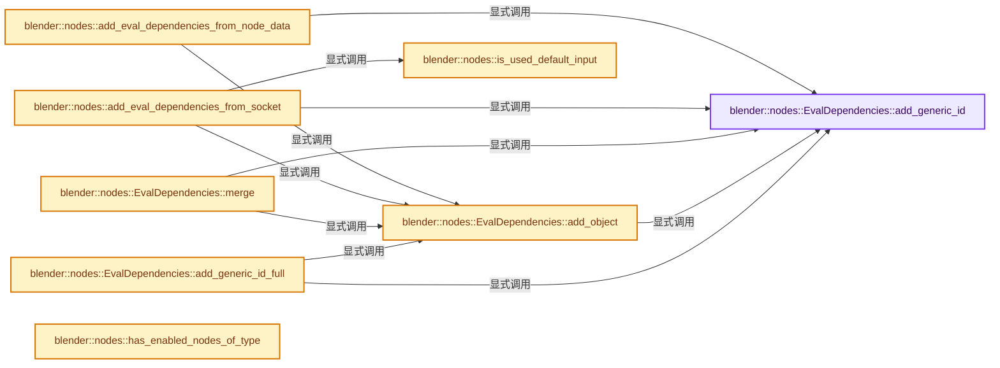
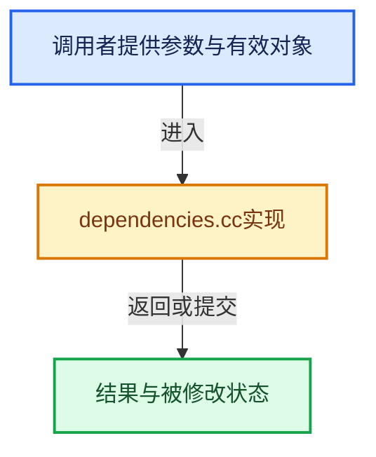

# 实现依赖专题：source/blender/nodes/intern/dependencies.cc

[实现依赖导航](../../README.md) · [符号索引](../../../00-课程指南/02-源码与提交索引/符号依赖与实现索引.md)

本专题从正文实际调用进入，集中保存共享实现。函数有稳定锚点，可从调用处直接跳到对应完整函数；递归与互相调用通过回链组织。

## 本文件的实现关系






## 完整成员与函数实现

<a id="f-9b75d5bd09dce667"></a>

### `blender::nodes::EvalDependencies::add_generic_id`

实现位置：[source/blender/nodes/intern/dependencies.cc](../../../../../../../source/blender/nodes/intern/dependencies.cc) · L24—L30。

接口参数：

- `ID *id`

**教学注释版**

<!-- annotated:ca4c4c344b1af0 -->

```cpp
void EvalDependencies::add_generic_id(ID *id)
{
  if (!id) {
    return;
  }
  this->ids.add(id->session_uid, id);
}
```

<details>
<summary>核对原始源码：source/blender/nodes/intern/dependencies.cc · L24—L30</summary>

<!-- original:ca4c4c344b1af0:source/blender/nodes/intern/dependencies.cc:24:30 -->

```cpp
void EvalDependencies::add_generic_id(ID *id)
{
  if (!id) {
    return;
  }
  this->ids.add(id->session_uid, id);
}
```

</details>

**继续追踪实现**

- `this->ids.add` → [调用协议](../../../00-课程指南/01-路线与规范/模板宏与动态分派协议.md)：接收对象类型依赖auto、返回值或模板实例；不按同名猜测目标。调用位置L29。

<a id="f-7491c4b7fe0af39c"></a>

### `blender::nodes::EvalDependencies::add_generic_id_full`

实现位置：[source/blender/nodes/intern/dependencies.cc](../../../../../../../source/blender/nodes/intern/dependencies.cc) · L32—L43。

接口参数：

- `ID *id`

**教学注释版**

<!-- annotated:1330cf1fa90444 -->

```cpp
void EvalDependencies::add_generic_id_full(ID *id)
{
  if (!id) {
    return;
  }
  if (GS(id->name) == ID_OB) {
    this->add_object(reinterpret_cast<Object *>(id));
  }
  else {
    this->add_generic_id(id);
  }
}
```

<details>
<summary>核对原始源码：source/blender/nodes/intern/dependencies.cc · L32—L43</summary>

<!-- original:1330cf1fa90444:source/blender/nodes/intern/dependencies.cc:32:43 -->

```cpp
void EvalDependencies::add_generic_id_full(ID *id)
{
  if (!id) {
    return;
  }
  if (GS(id->name) == ID_OB) {
    this->add_object(reinterpret_cast<Object *>(id));
  }
  else {
    this->add_generic_id(id);
  }
}
```

</details>

**继续追踪实现**

- `GS` → [blender::GS · L410](../../08-其他Blender模块/makesdna/DNA_ID.h.md#f-c3ff509f79f21b05)。
- `this->add_object` → [blender::nodes::EvalDependencies::add_object · L45](dependencies.cc.md#f-4a90eb3f516af4b3)。
- `this->add_generic_id` → [blender::nodes::EvalDependencies::add_generic_id · L24](dependencies.cc.md#f-9b75d5bd09dce667)。

<a id="f-4a90eb3f516af4b3"></a>

### `blender::nodes::EvalDependencies::add_object`

实现位置：[source/blender/nodes/intern/dependencies.cc](../../../../../../../source/blender/nodes/intern/dependencies.cc) · L45—L57。

接口参数：

- `Object *object`
- `const ObjectDependencyInfo &object_deps`

**教学注释版**

<!-- annotated:1ef3d8ce7fe1c1 -->

```cpp
void EvalDependencies::add_object(Object *object, const ObjectDependencyInfo &object_deps)
{
  if (!object) {
    return;
  }
  this->add_generic_id(&object->id);
  ObjectDependencyInfo &deps = this->objects_info.lookup_or_add(object->id.session_uid,
                                                                object_deps);
  deps.geometry |= object_deps.geometry;
  deps.transform |= object_deps.transform;
  deps.camera_parameters |= object_deps.camera_parameters;
  deps.pose |= object_deps.pose;
}
```

<details>
<summary>核对原始源码：source/blender/nodes/intern/dependencies.cc · L45—L57</summary>

<!-- original:1ef3d8ce7fe1c1:source/blender/nodes/intern/dependencies.cc:45:57 -->

```cpp
void EvalDependencies::add_object(Object *object, const ObjectDependencyInfo &object_deps)
{
  if (!object) {
    return;
  }
  this->add_generic_id(&object->id);
  ObjectDependencyInfo &deps = this->objects_info.lookup_or_add(object->id.session_uid,
                                                                object_deps);
  deps.geometry |= object_deps.geometry;
  deps.transform |= object_deps.transform;
  deps.camera_parameters |= object_deps.camera_parameters;
  deps.pose |= object_deps.pose;
}
```

</details>

**沿实际写入检查状态**

- `deps.geometry |= object_deps.geometry;`
- `deps.transform |= object_deps.transform;`
- `deps.camera_parameters |= object_deps.camera_parameters;`
- `deps.pose |= object_deps.pose;`

**继续追踪实现**

- `this->add_generic_id` → [blender::nodes::EvalDependencies::add_generic_id · L24](dependencies.cc.md#f-9b75d5bd09dce667)。
- `this->objects_info.lookup_or_add` → [调用协议](../../../00-课程指南/01-路线与规范/模板宏与动态分派协议.md)：接收对象类型依赖auto、返回值或模板实例；不按同名猜测目标。调用位置L51。

<a id="f-7ce65e283290abd7"></a>

### `blender::nodes::EvalDependencies::merge`

实现位置：[source/blender/nodes/intern/dependencies.cc](../../../../../../../source/blender/nodes/intern/dependencies.cc) · L59—L73。

接口参数：

- `const EvalDependencies &other`

**教学注释版**

<!-- annotated:68e014b8759711 -->

```cpp
void EvalDependencies::merge(const EvalDependencies &other)
{
  for (ID *id : other.ids.values()) {
    this->add_generic_id(id);
  }
  for (const auto &&item : other.objects_info.items()) {
    ID *id = other.ids.lookup(item.key);
    BLI_assert(GS(id->name) == ID_OB);
    this->add_object(reinterpret_cast<Object *>(id), item.value);
  }
  this->needs_own_transform |= other.needs_own_transform;
  this->needs_active_camera |= other.needs_active_camera;
  this->needs_scene_render_params |= other.needs_scene_render_params;
  this->time_dependent |= other.time_dependent;
}
```

<details>
<summary>核对原始源码：source/blender/nodes/intern/dependencies.cc · L59—L73</summary>

<!-- original:68e014b8759711:source/blender/nodes/intern/dependencies.cc:59:73 -->

```cpp
void EvalDependencies::merge(const EvalDependencies &other)
{
  for (ID *id : other.ids.values()) {
    this->add_generic_id(id);
  }
  for (const auto &&item : other.objects_info.items()) {
    ID *id = other.ids.lookup(item.key);
    BLI_assert(GS(id->name) == ID_OB);
    this->add_object(reinterpret_cast<Object *>(id), item.value);
  }
  this->needs_own_transform |= other.needs_own_transform;
  this->needs_active_camera |= other.needs_active_camera;
  this->needs_scene_render_params |= other.needs_scene_render_params;
  this->time_dependent |= other.time_dependent;
}
```

</details>

**沿实际写入检查状态**

- `this->needs_own_transform |= other.needs_own_transform;`
- `this->needs_active_camera |= other.needs_active_camera;`
- `this->needs_scene_render_params |= other.needs_scene_render_params;`
- `this->time_dependent |= other.time_dependent;`

**继续追踪实现**

- `other.ids.values` → [调用协议](../../../00-课程指南/01-路线与规范/模板宏与动态分派协议.md)：接收对象类型依赖auto、返回值或模板实例；不按同名猜测目标。调用位置L61。
- `this->add_generic_id` → [blender::nodes::EvalDependencies::add_generic_id · L24](dependencies.cc.md#f-9b75d5bd09dce667)。
- `other.objects_info.items` → [调用协议](../../../00-课程指南/01-路线与规范/模板宏与动态分派协议.md)：接收对象类型依赖auto、返回值或模板实例；不按同名猜测目标。调用位置L64。
- `other.ids.lookup` → [调用协议](../../../00-课程指南/01-路线与规范/模板宏与动态分派协议.md)：接收对象类型依赖auto、返回值或模板实例；不按同名猜测目标。调用位置L65。
- `BLI_assert` → [BLI_assert · L48](../../01-BLI基础库/BLI_assert.hh.md#m-57a88495704d)；[BLI_assert · L63](../../01-BLI基础库/BLI_assert.hh.md#m-d07050020cb5)。宏定义由构建条件选择。
- `GS` → [blender::GS · L410](../../08-其他Blender模块/makesdna/DNA_ID.h.md#f-c3ff509f79f21b05)。
- `this->add_object` → [blender::nodes::EvalDependencies::add_object · L45](dependencies.cc.md#f-4a90eb3f516af4b3)。

<a id="f-a4dfde123dc73abc"></a>

### `blender::nodes::is_used_default_input`

实现位置：[source/blender/nodes/intern/dependencies.cc](../../../../../../../source/blender/nodes/intern/dependencies.cc) · L75—L87。

接口参数：

- `const bNodeSocket &socket`
- `const NodeDefaultInputType type`

**教学注释版**

<!-- annotated:6649474aed77d8 -->

```cpp
static bool is_used_default_input(const bNodeSocket &socket, const NodeDefaultInputType type)
{
  if (!socket.is_input()) {
    return false;
  }
  if (socket.is_logically_linked()) {
    return false;
  }
  if (!socket.runtime->declaration) {
    return false;
  }
  return socket.runtime->declaration->default_input_type == type;
}
```

<details>
<summary>核对原始源码：source/blender/nodes/intern/dependencies.cc · L75—L87</summary>

<!-- original:6649474aed77d8:source/blender/nodes/intern/dependencies.cc:75:87 -->

```cpp
static bool is_used_default_input(const bNodeSocket &socket, const NodeDefaultInputType type)
{
  if (!socket.is_input()) {
    return false;
  }
  if (socket.is_logically_linked()) {
    return false;
  }
  if (!socket.runtime->declaration) {
    return false;
  }
  return socket.runtime->declaration->default_input_type == type;
}
```

</details>

**结果出口**

- `return false;`
- `return socket.runtime->declaration->default_input_type == type;`

**继续追踪实现**

- `socket.is_input` → [blender::bNodeSocket::is_input · L1144](../../02-BKE几何与数据/BKE_node_runtime.hh.md#f-708c56203502bb29)。
- `socket.is_logically_linked` → [blender::bNodeSocket::is_logically_linked · L1122](../../02-BKE几何与数据/BKE_node_runtime.hh.md#f-e3b1d6d30d453709)。

<a id="f-0862fd82cfbc34a3"></a>

### `blender::nodes::add_eval_dependencies_from_socket`

实现位置：[source/blender/nodes/intern/dependencies.cc](../../../../../../../source/blender/nodes/intern/dependencies.cc) · L89—L176。

接口参数：

- `const bNodeSocket &socket`
- `EvalDependencies &deps`

**教学注释版**

<!-- annotated:ac2299b52a8d18 -->

```cpp
static void add_eval_dependencies_from_socket(const bNodeSocket &socket, EvalDependencies &deps)
{
  if (socket.is_input()) {
    if (socket.is_logically_linked()) {
      /* The input value is unused. */
      return;
    }
  }
  switch (socket.type) {
    case SOCK_OBJECT: {
      if (is_used_default_input(socket, NODE_DEFAULT_INPUT_SELF_OBJECT)) {
        deps.needs_own_transform |= true;
      }
      else if (Object *object = static_cast<bNodeSocketValueObject *>(socket.default_value)->value)
      {
        deps.add_object(object);
      }
      break;
    }
    case SOCK_COLLECTION: {
      if (Collection *collection =
              static_cast<bNodeSocketValueCollection *>(socket.default_value)->value)
      {
        deps.add_generic_id(reinterpret_cast<ID *>(collection));
      }
      break;
    }
    case SOCK_MATERIAL: {
      if (Material *material =
              static_cast<bNodeSocketValueMaterial *>(socket.default_value)->value)
      {
        deps.add_generic_id(reinterpret_cast<ID *>(material));
      }
      break;
    }
    case SOCK_TEXTURE: {
      if (Tex *texture = static_cast<bNodeSocketValueTexture *>(socket.default_value)->value) {
        deps.add_generic_id(reinterpret_cast<ID *>(texture));
      }
      break;
    }
    case SOCK_IMAGE: {
      if (Image *image = static_cast<bNodeSocketValueImage *>(socket.default_value)->value) {
        deps.add_generic_id(reinterpret_cast<ID *>(image));
      }
      break;
    }
    case SOCK_FONT: {
      if (VFont *font = static_cast<bNodeSocketValueFont *>(socket.default_value)->value) {
        deps.add_generic_id(reinterpret_cast<ID *>(font));
      }
      break;
    }
    case SOCK_SCENE: {
      if (Scene *scene = static_cast<bNodeSocketValueScene *>(socket.default_value)->value) {
        deps.add_generic_id(reinterpret_cast<ID *>(scene));
      }
      break;
    }
    case SOCK_TEXT_ID: {
      if (Text *text = static_cast<bNodeSocketValueText *>(socket.default_value)->value) {
        deps.add_generic_id(reinterpret_cast<ID *>(text));
      }
      break;
    }
    case SOCK_MASK: {
      if (Mask *mask = static_cast<bNodeSocketValueMask *>(socket.default_value)->value) {
        deps.add_generic_id(reinterpret_cast<ID *>(mask));
      }
      break;
    }
    case SOCK_SOUND: {
      if (bSound *sound = static_cast<bNodeSocketValueSound *>(socket.default_value)->value) {
        deps.add_generic_id(reinterpret_cast<ID *>(sound));
      }
      break;
    }
    case SOCK_INT:
    case SOCK_FLOAT: {
      if (is_used_default_input(socket, NODE_DEFAULT_INPUT_SCENE_FRAME)) {
        deps.time_dependent = true;
      }
      break;
    }
    default:
      break;
  }
}
```

<details>
<summary>核对原始源码：source/blender/nodes/intern/dependencies.cc · L89—L176</summary>

<!-- original:ac2299b52a8d18:source/blender/nodes/intern/dependencies.cc:89:176 -->

```cpp
static void add_eval_dependencies_from_socket(const bNodeSocket &socket, EvalDependencies &deps)
{
  if (socket.is_input()) {
    if (socket.is_logically_linked()) {
      /* The input value is unused. */
      return;
    }
  }
  switch (socket.type) {
    case SOCK_OBJECT: {
      if (is_used_default_input(socket, NODE_DEFAULT_INPUT_SELF_OBJECT)) {
        deps.needs_own_transform |= true;
      }
      else if (Object *object = static_cast<bNodeSocketValueObject *>(socket.default_value)->value)
      {
        deps.add_object(object);
      }
      break;
    }
    case SOCK_COLLECTION: {
      if (Collection *collection =
              static_cast<bNodeSocketValueCollection *>(socket.default_value)->value)
      {
        deps.add_generic_id(reinterpret_cast<ID *>(collection));
      }
      break;
    }
    case SOCK_MATERIAL: {
      if (Material *material =
              static_cast<bNodeSocketValueMaterial *>(socket.default_value)->value)
      {
        deps.add_generic_id(reinterpret_cast<ID *>(material));
      }
      break;
    }
    case SOCK_TEXTURE: {
      if (Tex *texture = static_cast<bNodeSocketValueTexture *>(socket.default_value)->value) {
        deps.add_generic_id(reinterpret_cast<ID *>(texture));
      }
      break;
    }
    case SOCK_IMAGE: {
      if (Image *image = static_cast<bNodeSocketValueImage *>(socket.default_value)->value) {
        deps.add_generic_id(reinterpret_cast<ID *>(image));
      }
      break;
    }
    case SOCK_FONT: {
      if (VFont *font = static_cast<bNodeSocketValueFont *>(socket.default_value)->value) {
        deps.add_generic_id(reinterpret_cast<ID *>(font));
      }
      break;
    }
    case SOCK_SCENE: {
      if (Scene *scene = static_cast<bNodeSocketValueScene *>(socket.default_value)->value) {
        deps.add_generic_id(reinterpret_cast<ID *>(scene));
      }
      break;
    }
    case SOCK_TEXT_ID: {
      if (Text *text = static_cast<bNodeSocketValueText *>(socket.default_value)->value) {
        deps.add_generic_id(reinterpret_cast<ID *>(text));
      }
      break;
    }
    case SOCK_MASK: {
      if (Mask *mask = static_cast<bNodeSocketValueMask *>(socket.default_value)->value) {
        deps.add_generic_id(reinterpret_cast<ID *>(mask));
      }
      break;
    }
    case SOCK_SOUND: {
      if (bSound *sound = static_cast<bNodeSocketValueSound *>(socket.default_value)->value) {
        deps.add_generic_id(reinterpret_cast<ID *>(sound));
      }
      break;
    }
    case SOCK_INT:
    case SOCK_FLOAT: {
      if (is_used_default_input(socket, NODE_DEFAULT_INPUT_SCENE_FRAME)) {
        deps.time_dependent = true;
      }
      break;
    }
    default:
      break;
  }
}
```

</details>

**沿实际写入检查状态**

- `deps.needs_own_transform |= true;`
- `deps.time_dependent = true;`

**继续追踪实现**

- `socket.is_input` → [blender::bNodeSocket::is_input · L1144](../../02-BKE几何与数据/BKE_node_runtime.hh.md#f-708c56203502bb29)。
- `socket.is_logically_linked` → [blender::bNodeSocket::is_logically_linked · L1122](../../02-BKE几何与数据/BKE_node_runtime.hh.md#f-e3b1d6d30d453709)。
- `is_used_default_input` → [blender::nodes::is_used_default_input · L75](dependencies.cc.md#f-a4dfde123dc73abc)。
- `deps.add_object` → [blender::nodes::EvalDependencies::add_object · L45](dependencies.cc.md#f-4a90eb3f516af4b3)。
- `deps.add_generic_id` → [blender::nodes::EvalDependencies::add_generic_id · L24](dependencies.cc.md#f-9b75d5bd09dce667)。

<a id="f-357a7ab50dc1a862"></a>

### `blender::nodes::add_eval_dependencies_from_node_data`

实现位置：[source/blender/nodes/intern/dependencies.cc](../../../../../../../source/blender/nodes/intern/dependencies.cc) · L178—L208。

接口参数：

- `const bNodeTree &tree`
- `EvalDependencies &deps`

**教学注释版**

<!-- annotated:8be00e6fb903f5 -->

```cpp
static void add_eval_dependencies_from_node_data(const bNodeTree &tree, EvalDependencies &deps)
{
  for (const bNode *node : tree.all_nodes()) {
    if (node->is_muted()) {
      continue;
    }

    /* Group nodes are handles separately. */
    if (node->is_group()) {
      continue;
    }

    if (node->id == nullptr) {
      continue;
    }

    ID_Type id_type = GS(node->id->name);
    if (id_type == ID_OB) {
      deps.add_object(reinterpret_cast<Object *>(node->id));
    }
    else if (id_type == ID_IM) {
      if (BKE_image_is_animated(reinterpret_cast<Image *>(node->id))) {
        deps.time_dependent = true;
      }
      deps.add_generic_id(node->id);
    }
    else {
      deps.add_generic_id(node->id);
    }
  }
}
```

<details>
<summary>核对原始源码：source/blender/nodes/intern/dependencies.cc · L178—L208</summary>

<!-- original:8be00e6fb903f5:source/blender/nodes/intern/dependencies.cc:178:208 -->

```cpp
static void add_eval_dependencies_from_node_data(const bNodeTree &tree, EvalDependencies &deps)
{
  for (const bNode *node : tree.all_nodes()) {
    if (node->is_muted()) {
      continue;
    }

    /* Group nodes are handles separately. */
    if (node->is_group()) {
      continue;
    }

    if (node->id == nullptr) {
      continue;
    }

    ID_Type id_type = GS(node->id->name);
    if (id_type == ID_OB) {
      deps.add_object(reinterpret_cast<Object *>(node->id));
    }
    else if (id_type == ID_IM) {
      if (BKE_image_is_animated(reinterpret_cast<Image *>(node->id))) {
        deps.time_dependent = true;
      }
      deps.add_generic_id(node->id);
    }
    else {
      deps.add_generic_id(node->id);
    }
  }
}
```

</details>

**沿实际写入检查状态**

- `deps.time_dependent = true;`

**继续追踪实现**

- `tree.all_nodes` → [blender::bNodeTree::all_nodes · L500](../../02-BKE几何与数据/BKE_node_runtime.hh.md#f-cda455cbcc6c7f36)；[blender::bNodeTree::all_nodes · L505](../../02-BKE几何与数据/BKE_node_runtime.hh.md#f-358b65e5678f8a32)。同名重载需按实参类型选择。
- `node->is_muted` → [调用协议](../../../00-课程指南/01-路线与规范/模板宏与动态分派协议.md)：接收对象类型依赖auto、返回值或模板实例；不按同名猜测目标。调用位置L181。
- `node->is_group` → [调用协议](../../../00-课程指南/01-路线与规范/模板宏与动态分派协议.md)：接收对象类型依赖auto、返回值或模板实例；不按同名猜测目标。调用位置L186。
- `GS` → [blender::GS · L410](../../08-其他Blender模块/makesdna/DNA_ID.h.md#f-c3ff509f79f21b05)。
- `deps.add_object` → [blender::nodes::EvalDependencies::add_object · L45](dependencies.cc.md#f-4a90eb3f516af4b3)。
- `BKE_image_is_animated` → [blender::BKE_image_is_animated · L5671](../../02-BKE几何与数据/intern/image.cc.md#f-18fa289262d42bc0)。
- `deps.add_generic_id` → [blender::nodes::EvalDependencies::add_generic_id · L24](dependencies.cc.md#f-9b75d5bd09dce667)。

<a id="f-299658048bb9d622"></a>

### `blender::nodes::has_enabled_nodes_of_type`

实现位置：[source/blender/nodes/intern/dependencies.cc](../../../../../../../source/blender/nodes/intern/dependencies.cc) · L210—L218。

接口参数：

- `const bNodeTree &tree`
- `const UString type_idname`

**教学注释版**

<!-- annotated:fa9d92aaede082 -->

```cpp
static bool has_enabled_nodes_of_type(const bNodeTree &tree, const UString type_idname)
{
  for (const bNode *node : tree.nodes_by_type(type_idname)) {
    if (!node->is_muted()) {
      return true;
    }
  }
  return false;
}
```

<details>
<summary>核对原始源码：source/blender/nodes/intern/dependencies.cc · L210—L218</summary>

<!-- original:fa9d92aaede082:source/blender/nodes/intern/dependencies.cc:210:218 -->

```cpp
static bool has_enabled_nodes_of_type(const bNodeTree &tree, const UString type_idname)
{
  for (const bNode *node : tree.nodes_by_type(type_idname)) {
    if (!node->is_muted()) {
      return true;
    }
  }
  return false;
}
```

</details>

**结果出口**

- `return true;`
- `return false;`

**继续追踪实现**

- `tree.nodes_by_type` → [blender::bNodeTree::nodes_by_type · L524](../../02-BKE几何与数据/BKE_node_runtime.hh.md#f-dbf5b02db7697f8c)；[blender::bNodeTree::nodes_by_type · L530](../../02-BKE几何与数据/BKE_node_runtime.hh.md#f-1316cfee8b291699)。同名重载需按实参类型选择。
- `node->is_muted` → [调用协议](../../../00-课程指南/01-路线与规范/模板宏与动态分派协议.md)：接收对象类型依赖auto、返回值或模板实例；不按同名猜测目标。调用位置L213。

<a id="f-41e5f097c2a4286c"></a>

### `blender::nodes::add_own_transform_dependencies`

实现位置：[source/blender/nodes/intern/dependencies.cc](../../../../../../../source/blender/nodes/intern/dependencies.cc) · L220—L246。

接口参数：

- `const bNodeTree &tree`
- `EvalDependencies &deps`

**教学注释版**

<!-- annotated:e01026005bd219 -->

```cpp
static void add_own_transform_dependencies(const bNodeTree &tree, EvalDependencies &deps)
{
  bool needs_own_transform = false;

  needs_own_transform |= has_enabled_nodes_of_type(tree, "GeometryNodeSelfObject"_ustr);
  needs_own_transform |= has_enabled_nodes_of_type(tree, "GeometryNodeDeformCurvesOnSurface"_ustr);

  for (const bNode *node : tree.nodes_by_type("GeometryNodeCollectionInfo"_ustr)) {
    if (node->is_muted()) {
      continue;
    }
    const NodeGeometryCollectionInfo &storage = *static_cast<const NodeGeometryCollectionInfo *>(
        node->storage);
    needs_own_transform |= storage.transform_space == GEO_NODE_TRANSFORM_SPACE_RELATIVE;
  }

  for (const bNode *node : tree.nodes_by_type("GeometryNodeObjectInfo"_ustr)) {
    if (node->is_muted()) {
      continue;
    }
    const NodeGeometryObjectInfo &storage = *static_cast<const NodeGeometryObjectInfo *>(
        node->storage);
    needs_own_transform |= storage.transform_space == GEO_NODE_TRANSFORM_SPACE_RELATIVE;
  }

  deps.needs_own_transform |= needs_own_transform;
}
```

<details>
<summary>核对原始源码：source/blender/nodes/intern/dependencies.cc · L220—L246</summary>

<!-- original:e01026005bd219:source/blender/nodes/intern/dependencies.cc:220:246 -->

```cpp
static void add_own_transform_dependencies(const bNodeTree &tree, EvalDependencies &deps)
{
  bool needs_own_transform = false;

  needs_own_transform |= has_enabled_nodes_of_type(tree, "GeometryNodeSelfObject"_ustr);
  needs_own_transform |= has_enabled_nodes_of_type(tree, "GeometryNodeDeformCurvesOnSurface"_ustr);

  for (const bNode *node : tree.nodes_by_type("GeometryNodeCollectionInfo"_ustr)) {
    if (node->is_muted()) {
      continue;
    }
    const NodeGeometryCollectionInfo &storage = *static_cast<const NodeGeometryCollectionInfo *>(
        node->storage);
    needs_own_transform |= storage.transform_space == GEO_NODE_TRANSFORM_SPACE_RELATIVE;
  }

  for (const bNode *node : tree.nodes_by_type("GeometryNodeObjectInfo"_ustr)) {
    if (node->is_muted()) {
      continue;
    }
    const NodeGeometryObjectInfo &storage = *static_cast<const NodeGeometryObjectInfo *>(
        node->storage);
    needs_own_transform |= storage.transform_space == GEO_NODE_TRANSFORM_SPACE_RELATIVE;
  }

  deps.needs_own_transform |= needs_own_transform;
}
```

</details>

**沿实际写入检查状态**

- `needs_own_transform |= has_enabled_nodes_of_type(tree, "GeometryNodeSelfObject"_ustr);`
- `needs_own_transform |= has_enabled_nodes_of_type(tree, "GeometryNodeDeformCurvesOnSurface"_ustr);`
- `needs_own_transform |= storage.transform_space == GEO_NODE_TRANSFORM_SPACE_RELATIVE;`
- `deps.needs_own_transform |= needs_own_transform;`

**继续追踪实现**

- `has_enabled_nodes_of_type` → [blender::nodes::has_enabled_nodes_of_type · L210](dependencies.cc.md#f-299658048bb9d622)。
- `tree.nodes_by_type` → [blender::bNodeTree::nodes_by_type · L524](../../02-BKE几何与数据/BKE_node_runtime.hh.md#f-dbf5b02db7697f8c)；[blender::bNodeTree::nodes_by_type · L530](../../02-BKE几何与数据/BKE_node_runtime.hh.md#f-1316cfee8b291699)。同名重载需按实参类型选择。
- `node->is_muted` → [调用协议](../../../00-课程指南/01-路线与规范/模板宏与动态分派协议.md)：接收对象类型依赖auto、返回值或模板实例；不按同名猜测目标。调用位置L228。

<a id="f-cb6a549616964bc3"></a>

### `blender::nodes::needs_scene_render_params`

实现位置：[source/blender/nodes/intern/dependencies.cc](../../../../../../../source/blender/nodes/intern/dependencies.cc) · L248—L261。

接口参数：

- `const bNodeTree &ntree`

**教学注释版**

<!-- annotated:9f890999c651a7 -->

```cpp
static bool needs_scene_render_params(const bNodeTree &ntree)
{
  for (const bNode *node : ntree.nodes_by_type("GeometryNodeCameraInfo"_ustr)) {
    if (node->is_muted()) {
      continue;
    }
    const bNodeSocket &projection_matrix_socket = *node->output_by_identifier(
        "Projection Matrix"_ustr);
    if (projection_matrix_socket.is_logically_linked()) {
      return true;
    }
  }
  return false;
}
```

<details>
<summary>核对原始源码：source/blender/nodes/intern/dependencies.cc · L248—L261</summary>

<!-- original:9f890999c651a7:source/blender/nodes/intern/dependencies.cc:248:261 -->

```cpp
static bool needs_scene_render_params(const bNodeTree &ntree)
{
  for (const bNode *node : ntree.nodes_by_type("GeometryNodeCameraInfo"_ustr)) {
    if (node->is_muted()) {
      continue;
    }
    const bNodeSocket &projection_matrix_socket = *node->output_by_identifier(
        "Projection Matrix"_ustr);
    if (projection_matrix_socket.is_logically_linked()) {
      return true;
    }
  }
  return false;
}
```

</details>

**结果出口**

- `return true;`
- `return false;`

**继续追踪实现**

- `ntree.nodes_by_type` → [blender::bNodeTree::nodes_by_type · L524](../../02-BKE几何与数据/BKE_node_runtime.hh.md#f-dbf5b02db7697f8c)；[blender::bNodeTree::nodes_by_type · L530](../../02-BKE几何与数据/BKE_node_runtime.hh.md#f-1316cfee8b291699)。同名重载需按实参类型选择。
- `node->is_muted` → [调用协议](../../../00-课程指南/01-路线与规范/模板宏与动态分派协议.md)：接收对象类型依赖auto、返回值或模板实例；不按同名猜测目标。调用位置L251。
- `node->output_by_identifier` → [调用协议](../../../00-课程指南/01-路线与规范/模板宏与动态分派协议.md)：接收对象类型依赖auto、返回值或模板实例；不按同名猜测目标。调用位置L254。
- `projection_matrix_socket.is_logically_linked` → [blender::bNodeSocket::is_logically_linked · L1122](../../02-BKE几何与数据/BKE_node_runtime.hh.md#f-e3b1d6d30d453709)。

<a id="f-f1acd18e8998d0c4"></a>

### `blender::nodes::gather_geometry_nodes_eval_dependencies`

实现位置：[source/blender/nodes/intern/dependencies.cc](../../../../../../../source/blender/nodes/intern/dependencies.cc) · L263—L299。

接口参数：

- `const bNodeTree &ntree`
- `EvalDependencies &deps`
- `FunctionRef<const EvalDependencies *(const bNodeTree &group)> get_group_deps`
- `const bNodeTree &group`

**教学注释版**

<!-- annotated:698385a42e0455 -->

```cpp
static void gather_geometry_nodes_eval_dependencies(
    const bNodeTree &ntree,
    EvalDependencies &deps,
    FunctionRef<const EvalDependencies *(const bNodeTree &group)> get_group_deps)
{
  ntree.ensure_topology_cache();
  for (const bNodeSocket *socket : ntree.all_sockets()) {
    add_eval_dependencies_from_socket(*socket, deps);
  }
  deps.needs_active_camera |= has_enabled_nodes_of_type(ntree,
                                                        "GeometryNodeInputActiveCamera"_ustr);
  deps.needs_scene_render_params |= needs_scene_render_params(ntree);
  deps.time_dependent |= BKE_animdata_id_is_animated(&ntree.id) ||
                         has_enabled_nodes_of_type(ntree, "GeometryNodeSimulationInput"_ustr) ||
                         has_enabled_nodes_of_type(ntree, "GeometryNodeInputSceneTime"_ustr) ||
                         has_enabled_nodes_of_type(ntree, "CompositorNodeSceneTime"_ustr) ||
                         has_enabled_nodes_of_type(ntree, "CompositorNodeTime"_ustr) ||
                         has_enabled_nodes_of_type(ntree, "CompositorNodeTrackPos"_ustr) ||
                         has_enabled_nodes_of_type(ntree, "CompositorNodeStabilize"_ustr) ||
                         has_enabled_nodes_of_type(ntree, "CompositorNodePlaneTrackDeform"_ustr) ||
                         has_enabled_nodes_of_type(ntree, "CompositorNodeMovieDistortion"_ustr) ||
                         has_enabled_nodes_of_type(ntree, "CompositorNodeMovieClip"_ustr) ||
                         has_enabled_nodes_of_type(ntree, "CompositorNodeKeyingScreen"_ustr);

  add_eval_dependencies_from_node_data(ntree, deps);
  add_own_transform_dependencies(ntree, deps);

  for (const bNode *node : ntree.group_nodes()) {
    if (!node->id) {
      continue;
    }
    const bNodeTree &group = *reinterpret_cast<const bNodeTree *>(node->id);
    if (const EvalDependencies *group_deps = get_group_deps(group)) {
      deps.merge(*group_deps);
    }
  }
}
```

<details>
<summary>核对原始源码：source/blender/nodes/intern/dependencies.cc · L263—L299</summary>

<!-- original:698385a42e0455:source/blender/nodes/intern/dependencies.cc:263:299 -->

```cpp
static void gather_geometry_nodes_eval_dependencies(
    const bNodeTree &ntree,
    EvalDependencies &deps,
    FunctionRef<const EvalDependencies *(const bNodeTree &group)> get_group_deps)
{
  ntree.ensure_topology_cache();
  for (const bNodeSocket *socket : ntree.all_sockets()) {
    add_eval_dependencies_from_socket(*socket, deps);
  }
  deps.needs_active_camera |= has_enabled_nodes_of_type(ntree,
                                                        "GeometryNodeInputActiveCamera"_ustr);
  deps.needs_scene_render_params |= needs_scene_render_params(ntree);
  deps.time_dependent |= BKE_animdata_id_is_animated(&ntree.id) ||
                         has_enabled_nodes_of_type(ntree, "GeometryNodeSimulationInput"_ustr) ||
                         has_enabled_nodes_of_type(ntree, "GeometryNodeInputSceneTime"_ustr) ||
                         has_enabled_nodes_of_type(ntree, "CompositorNodeSceneTime"_ustr) ||
                         has_enabled_nodes_of_type(ntree, "CompositorNodeTime"_ustr) ||
                         has_enabled_nodes_of_type(ntree, "CompositorNodeTrackPos"_ustr) ||
                         has_enabled_nodes_of_type(ntree, "CompositorNodeStabilize"_ustr) ||
                         has_enabled_nodes_of_type(ntree, "CompositorNodePlaneTrackDeform"_ustr) ||
                         has_enabled_nodes_of_type(ntree, "CompositorNodeMovieDistortion"_ustr) ||
                         has_enabled_nodes_of_type(ntree, "CompositorNodeMovieClip"_ustr) ||
                         has_enabled_nodes_of_type(ntree, "CompositorNodeKeyingScreen"_ustr);

  add_eval_dependencies_from_node_data(ntree, deps);
  add_own_transform_dependencies(ntree, deps);

  for (const bNode *node : ntree.group_nodes()) {
    if (!node->id) {
      continue;
    }
    const bNodeTree &group = *reinterpret_cast<const bNodeTree *>(node->id);
    if (const EvalDependencies *group_deps = get_group_deps(group)) {
      deps.merge(*group_deps);
    }
  }
}
```

</details>

**沿实际写入检查状态**

- `deps.needs_active_camera |= has_enabled_nodes_of_type(ntree,`
- `deps.needs_scene_render_params |= needs_scene_render_params(ntree);`
- `deps.time_dependent |= BKE_animdata_id_is_animated(&ntree.id) ||`

**继续追踪实现**

- `ntree.ensure_topology_cache` → [blender::bNodeTree::ensure_topology_cache · L621](../../02-BKE几何与数据/intern/node_runtime.cc.md#f-566e97bdf0367424)。
- `ntree.all_sockets` → [blender::bNodeTree::all_sockets · L630](../../02-BKE几何与数据/BKE_node_runtime.hh.md#f-ba7946d064c035f9)；[blender::bNodeTree::all_sockets · L636](../../02-BKE几何与数据/BKE_node_runtime.hh.md#f-e6c5064300cb4f69)。同名重载需按实参类型选择。
- `add_eval_dependencies_from_socket` → [blender::nodes::add_eval_dependencies_from_socket · L89](dependencies.cc.md#f-0862fd82cfbc34a3)。
- `has_enabled_nodes_of_type` → [blender::nodes::has_enabled_nodes_of_type · L210](dependencies.cc.md#f-299658048bb9d622)。
- `needs_scene_render_params` → [blender::nodes::needs_scene_render_params · L248](dependencies.cc.md#f-cb6a549616964bc3)。
- `BKE_animdata_id_is_animated` → [blender::BKE_animdata_id_is_animated · L224](../../02-BKE几何与数据/intern/anim_data.cc.md#f-45ca839356150d4f)。
- `add_eval_dependencies_from_node_data` → [blender::nodes::add_eval_dependencies_from_node_data · L178](dependencies.cc.md#f-357a7ab50dc1a862)。
- `add_own_transform_dependencies` → [blender::nodes::add_own_transform_dependencies · L220](dependencies.cc.md#f-41e5f097c2a4286c)。
- `ntree.group_nodes` → [blender::bNodeTree::group_nodes · L560](../../02-BKE几何与数据/BKE_node_runtime.hh.md#f-63ff240a4f6eb180)；[blender::bNodeTree::group_nodes · L566](../../02-BKE几何与数据/BKE_node_runtime.hh.md#f-aa4b0e32732fba68)。同名重载需按实参类型选择。
- `get_group_deps` → [调用协议](../../../00-课程指南/01-路线与规范/模板宏与动态分派协议.md)：局部可调用对象，须结合其初始化与捕获环境。调用位置L295。
- `deps.merge` → [blender::nodes::EvalDependencies::merge · L59](dependencies.cc.md#f-7ce65e283290abd7)。

<a id="f-b854ad26941388ac"></a>

### `blender::nodes::gather_eval_dependencies_with_cache`

实现位置：[source/blender/nodes/intern/dependencies.cc](../../../../../../../source/blender/nodes/intern/dependencies.cc) · L301—L307。

接口参数：

- `const bNodeTree &ntree`

**教学注释版**

<!-- annotated:d6ea1c00ebef93 -->

```cpp
EvalDependencies gather_eval_dependencies_with_cache(const bNodeTree &ntree)
{
  EvalDependencies deps;
  gather_geometry_nodes_eval_dependencies(
      ntree, deps, [](const bNodeTree &group) { return group.runtime->eval_dependencies.get(); });
  return deps;
}
```

<details>
<summary>核对原始源码：source/blender/nodes/intern/dependencies.cc · L301—L307</summary>

<!-- original:d6ea1c00ebef93:source/blender/nodes/intern/dependencies.cc:301:307 -->

```cpp
EvalDependencies gather_eval_dependencies_with_cache(const bNodeTree &ntree)
{
  EvalDependencies deps;
  gather_geometry_nodes_eval_dependencies(
      ntree, deps, [](const bNodeTree &group) { return group.runtime->eval_dependencies.get(); });
  return deps;
}
```

</details>

**结果出口**

- `return deps;`

**继续追踪实现**

- `gather_geometry_nodes_eval_dependencies` → [blender::nodes::gather_geometry_nodes_eval_dependencies · L263](dependencies.cc.md#f-f1acd18e8998d0c4)。
- `group.runtime->eval_dependencies.get` → [调用协议](../../../00-课程指南/01-路线与规范/模板宏与动态分派协议.md)：接收对象类型依赖auto、返回值或模板实例；不按同名猜测目标。调用位置L305。

<a id="f-93e56b4717aa62c2"></a>

### `blender::nodes::gather_geometry_nodes_eval_dependencies_recursive_impl`

实现位置：[source/blender/nodes/intern/dependencies.cc](../../../../../../../source/blender/nodes/intern/dependencies.cc) · L309—L321。

接口参数：

- `const bNodeTree &ntree`
- `Map<const bNodeTree *, EvalDependencies> &deps_by_tree`

**教学注释版**

<!-- annotated:20bbf24174e204 -->

```cpp
static void gather_geometry_nodes_eval_dependencies_recursive_impl(
    const bNodeTree &ntree, Map<const bNodeTree *, EvalDependencies> &deps_by_tree)
{
  // [讲解] deps_by_tree.contains：查询活项数量或键是否存在。
  if (deps_by_tree.contains(&ntree)) {
    return;
  }
  EvalDependencies new_deps;
  gather_geometry_nodes_eval_dependencies(ntree, new_deps, [&](const bNodeTree &group) {
    gather_geometry_nodes_eval_dependencies_recursive_impl(group, deps_by_tree);
    // [讲解] deps_by_tree.lookup：按键查找对应项。
    return &deps_by_tree.lookup(&group);
  });
  // [讲解] deps_by_tree.add：按哈希与相等关系加入键或键值。
  deps_by_tree.add(&ntree, std::move(new_deps));
}
```

<details>
<summary>核对原始源码：source/blender/nodes/intern/dependencies.cc · L309—L321</summary>

<!-- original:20bbf24174e204:source/blender/nodes/intern/dependencies.cc:309:321 -->

```cpp
static void gather_geometry_nodes_eval_dependencies_recursive_impl(
    const bNodeTree &ntree, Map<const bNodeTree *, EvalDependencies> &deps_by_tree)
{
  if (deps_by_tree.contains(&ntree)) {
    return;
  }
  EvalDependencies new_deps;
  gather_geometry_nodes_eval_dependencies(ntree, new_deps, [&](const bNodeTree &group) {
    gather_geometry_nodes_eval_dependencies_recursive_impl(group, deps_by_tree);
    return &deps_by_tree.lookup(&group);
  });
  deps_by_tree.add(&ntree, std::move(new_deps));
}
```

</details>

**结果出口**

- `return &deps_by_tree.lookup(&group);`

**继续追踪实现**

- `deps_by_tree.contains` → [blender::Map::contains · L353](../../../02-哈希表与关联数据结构/04-Map查找与键访问.md#f-70237c86261ee04d)。
- `gather_geometry_nodes_eval_dependencies` → [blender::nodes::gather_geometry_nodes_eval_dependencies · L263](dependencies.cc.md#f-f1acd18e8998d0c4)。
- `gather_geometry_nodes_eval_dependencies_recursive_impl` → [blender::nodes::gather_geometry_nodes_eval_dependencies_recursive_impl · L309](dependencies.cc.md#f-93e56b4717aa62c2)。
- `deps_by_tree.lookup` → [blender::Map::lookup · L545](../../../02-哈希表与关联数据结构/04-Map查找与键访问.md#f-f25ef95f1454656d)；[blender::Map::lookup · L549](../../../02-哈希表与关联数据结构/04-Map查找与键访问.md#f-742f9454fa7ea4b9)。同名重载需按实参类型选择。
- `deps_by_tree.add` → [blender::Map::add · L295](../../../02-哈希表与关联数据结构/04-Map查找与键访问.md#f-8d38101abf162f88)；[blender::Map::add · L299](../../../02-哈希表与关联数据结构/04-Map查找与键访问.md#f-1f59510cdfbd9f87)；[blender::Map::add · L303](../../../02-哈希表与关联数据结构/04-Map查找与键访问.md#f-645e0522347aa018)；[blender::Map::add · L307](../../../02-哈希表与关联数据结构/04-Map查找与键访问.md#f-03405db0730cedc0)。同名重载需按实参类型选择。
- `std::move` → [外部契约](https://eel.is/c++draft/utility.forward)：把表达式转换成可供移动重载选择的值类别；不保证真的移动，不结束源对象寿命，对const值可能选择复制。

<a id="f-927e31fd411adb01"></a>

### `blender::nodes::gather_eval_dependencies_recursive`

实现位置：[source/blender/nodes/intern/dependencies.cc](../../../../../../../source/blender/nodes/intern/dependencies.cc) · L323—L328。

接口参数：

- `const bNodeTree &ntree`

**教学注释版**

<!-- annotated:49d3b260024fd8 -->

```cpp
EvalDependencies gather_eval_dependencies_recursive(const bNodeTree &ntree)
{
  Map<const bNodeTree *, EvalDependencies> deps_by_tree;
  gather_geometry_nodes_eval_dependencies_recursive_impl(ntree, deps_by_tree);
  // [讲解] deps_by_tree.lookup：按键查找对应项。
  return deps_by_tree.lookup(&ntree);
}
```

<details>
<summary>核对原始源码：source/blender/nodes/intern/dependencies.cc · L323—L328</summary>

<!-- original:49d3b260024fd8:source/blender/nodes/intern/dependencies.cc:323:328 -->

```cpp
EvalDependencies gather_eval_dependencies_recursive(const bNodeTree &ntree)
{
  Map<const bNodeTree *, EvalDependencies> deps_by_tree;
  gather_geometry_nodes_eval_dependencies_recursive_impl(ntree, deps_by_tree);
  return deps_by_tree.lookup(&ntree);
}
```

</details>

**结果出口**

- `return deps_by_tree.lookup(&ntree);`

**继续追踪实现**

- `gather_geometry_nodes_eval_dependencies_recursive_impl` → [blender::nodes::gather_geometry_nodes_eval_dependencies_recursive_impl · L309](dependencies.cc.md#f-93e56b4717aa62c2)。
- `deps_by_tree.lookup` → [blender::Map::lookup · L545](../../../02-哈希表与关联数据结构/04-Map查找与键访问.md#f-f25ef95f1454656d)；[blender::Map::lookup · L549](../../../02-哈希表与关联数据结构/04-Map查找与键访问.md#f-742f9454fa7ea4b9)。同名重载需按实参类型选择。
