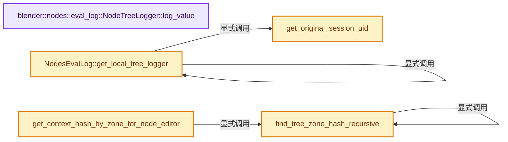
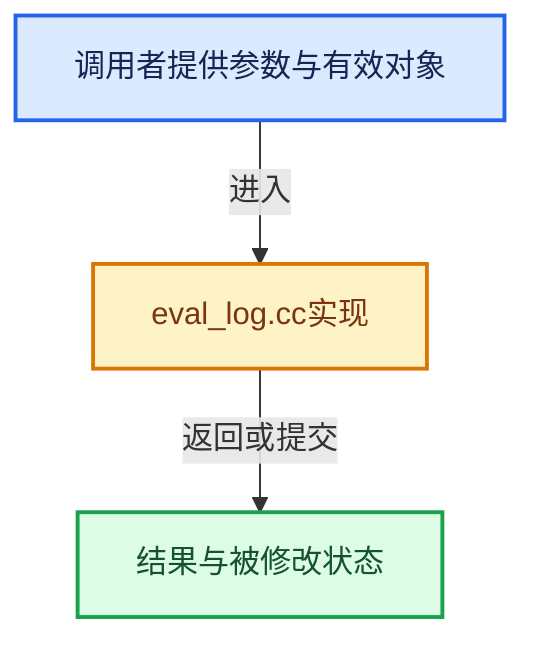

# 实现依赖专题：source/blender/nodes/intern/eval_log.cc

[实现依赖导航](../../README.md) · [符号索引](../../../00-课程指南/02-源码与提交索引/符号依赖与实现索引.md)

本专题从正文实际调用进入，集中保存共享实现。函数有稳定锚点，可从调用处直接跳到对应完整函数；递归与互相调用通过回链组织。

## 本文件的实现关系






## 完整成员与函数实现

<a id="f-90b0f9fcc1258675"></a>

### `blender::nodes::eval_log::NodeTreeLogger::log_value`

实现位置：[source/blender/nodes/intern/eval_log.cc](../../../../../../../source/blender/nodes/intern/eval_log.cc) · L319—L403。

接口参数：

- `const bNode &node`
- `const bNodeSocket &socket`
- `const GPointer value`

**教学注释版**

<!-- annotated:d9d11713cc3faf -->

```cpp
void NodeTreeLogger::log_value(const bNode &node, const bNodeSocket &socket, const GPointer value)
{
  const CPPType &type = *value.type();

  auto store_logged_value = [&](destruct_ptr<ValueLog> value_log) {
    auto &socket_values = socket.in_out == SOCK_IN ? this->input_socket_values :
                                                     this->output_socket_values;
    socket_values.append(*this->allocator,
                         // [讲解] std::move：把表达式转换成可供移动重载选择的值类别；不保证真的移动，不结束源对象寿命，对const值可能选择复制。
                         {node.identifier, socket.index(), std::move(value_log)});
  };

  auto log_generic_value = [&](const CPPType &type, const void *value) {
    void *buffer = this->allocator->allocate(type);
    type.copy_construct(value, buffer);
    store_logged_value(this->allocator->construct<GenericValueLog>(GMutablePointer{type, buffer}));
  };

  if (type.is<bke::SocketValueVariant>()) {
    bke::SocketValueVariant value_variant = *value.get<bke::SocketValueVariant>();
    if (value_variant.get().is_type<bke::GeometrySet>()) {
      const bke::GeometrySet &geometry = *value_variant.get_if<bke::GeometrySet>();
      store_logged_value(this->allocator->construct<GeometryInfoLog>(geometry));
    }
    else if (value_variant.is_context_dependent_field()) {
      const GField field = value_variant.extract<GField>();
      store_logged_value(this->allocator->construct<FieldInfoLog>(field));
    }
#ifdef WITH_OPENVDB
    else if (value_variant.is_volume_grid()) {
      const bke::GVolumeGrid grid = value_variant.extract<bke::GVolumeGrid>();
      store_logged_value(this->allocator->construct<GridInfoLog>(grid));
    }
#endif
    else if (value_variant.is_list()) {
      const auto list = value_variant.extract<GListPtr>();
      store_logged_value(this->allocator->construct<ListInfoLog>(list));
    }
    else if (value_variant.get().is_type<BundlePtr>()) {
      Vector<BundleValueLog::Item> items;
      if (const BundlePtr bundle = value_variant.extract<BundlePtr>()) {
        for (const auto &item : bundle->items()) {
          if (const BundleItemSocketValue *socket_value = std::get_if<BundleItemSocketValue>(
                  &item.value.value))
          {
            // [讲解] items.append：在尾部建立新元素，必要时先扩大存储。
            items.append({item.key.ustr(), {socket_value->type}});
          }
          if (const BundleItemInternalValue *internal_value = std::get_if<BundleItemInternalValue>(
                  &item.value.value))
          {
            items.append({item.key.ustr(), {internal_value->value->type_name()}});
          }
        }
      }
      store_logged_value(this->allocator->construct<BundleValueLog>(std::move(items)));
    }
    else if (value_variant.get().is_type<ClosurePtr>()) {
      Vector<ClosureValueLog::Item> inputs;
      Vector<ClosureValueLog::Item> outputs;
      std::optional<ClosureSourceLocation> source_location;
      std::shared_ptr<ClosureEvalLog> eval_log;
      if (const ClosurePtr closure = value_variant.extract<ClosurePtr>()) {
        const ClosureSignature &signature = closure->signature();
        for (const ClosureSignature::Item &item : signature.inputs) {
          inputs.append({item.key, item.type});
        }
        for (const ClosureSignature::Item &item : signature.outputs) {
          outputs.append({item.key, item.type});
        }
        source_location = closure->source_location();
        eval_log = closure->eval_log_ptr();
      }
      store_logged_value(this->allocator->construct<ClosureValueLog>(
          std::move(inputs), std::move(outputs), source_location, eval_log));
    }
    else {
      const GPointer value = value_variant.get();
      if (value.type()->is<std::string>()) {
        const std::string &string = *value.get<std::string>();
        store_logged_value(this->allocator->construct<StringLog>(string, *this->allocator));
      }
      else {
        log_generic_value(*value.type(), value.get());
      }
    }
  }
```

<details>
<summary>核对原始源码：source/blender/nodes/intern/eval_log.cc · L319—L403</summary>

<!-- original:d9d11713cc3faf:source/blender/nodes/intern/eval_log.cc:319:403 -->

```cpp
void NodeTreeLogger::log_value(const bNode &node, const bNodeSocket &socket, const GPointer value)
{
  const CPPType &type = *value.type();

  auto store_logged_value = [&](destruct_ptr<ValueLog> value_log) {
    auto &socket_values = socket.in_out == SOCK_IN ? this->input_socket_values :
                                                     this->output_socket_values;
    socket_values.append(*this->allocator,
                         {node.identifier, socket.index(), std::move(value_log)});
  };

  auto log_generic_value = [&](const CPPType &type, const void *value) {
    void *buffer = this->allocator->allocate(type);
    type.copy_construct(value, buffer);
    store_logged_value(this->allocator->construct<GenericValueLog>(GMutablePointer{type, buffer}));
  };

  if (type.is<bke::SocketValueVariant>()) {
    bke::SocketValueVariant value_variant = *value.get<bke::SocketValueVariant>();
    if (value_variant.get().is_type<bke::GeometrySet>()) {
      const bke::GeometrySet &geometry = *value_variant.get_if<bke::GeometrySet>();
      store_logged_value(this->allocator->construct<GeometryInfoLog>(geometry));
    }
    else if (value_variant.is_context_dependent_field()) {
      const GField field = value_variant.extract<GField>();
      store_logged_value(this->allocator->construct<FieldInfoLog>(field));
    }
#ifdef WITH_OPENVDB
    else if (value_variant.is_volume_grid()) {
      const bke::GVolumeGrid grid = value_variant.extract<bke::GVolumeGrid>();
      store_logged_value(this->allocator->construct<GridInfoLog>(grid));
    }
#endif
    else if (value_variant.is_list()) {
      const auto list = value_variant.extract<GListPtr>();
      store_logged_value(this->allocator->construct<ListInfoLog>(list));
    }
    else if (value_variant.get().is_type<BundlePtr>()) {
      Vector<BundleValueLog::Item> items;
      if (const BundlePtr bundle = value_variant.extract<BundlePtr>()) {
        for (const auto &item : bundle->items()) {
          if (const BundleItemSocketValue *socket_value = std::get_if<BundleItemSocketValue>(
                  &item.value.value))
          {
            items.append({item.key.ustr(), {socket_value->type}});
          }
          if (const BundleItemInternalValue *internal_value = std::get_if<BundleItemInternalValue>(
                  &item.value.value))
          {
            items.append({item.key.ustr(), {internal_value->value->type_name()}});
          }
        }
      }
      store_logged_value(this->allocator->construct<BundleValueLog>(std::move(items)));
    }
    else if (value_variant.get().is_type<ClosurePtr>()) {
      Vector<ClosureValueLog::Item> inputs;
      Vector<ClosureValueLog::Item> outputs;
      std::optional<ClosureSourceLocation> source_location;
      std::shared_ptr<ClosureEvalLog> eval_log;
      if (const ClosurePtr closure = value_variant.extract<ClosurePtr>()) {
        const ClosureSignature &signature = closure->signature();
        for (const ClosureSignature::Item &item : signature.inputs) {
          inputs.append({item.key, item.type});
        }
        for (const ClosureSignature::Item &item : signature.outputs) {
          outputs.append({item.key, item.type});
        }
        source_location = closure->source_location();
        eval_log = closure->eval_log_ptr();
      }
      store_logged_value(this->allocator->construct<ClosureValueLog>(
          std::move(inputs), std::move(outputs), source_location, eval_log));
    }
    else {
      const GPointer value = value_variant.get();
      if (value.type()->is<std::string>()) {
        const std::string &string = *value.get<std::string>();
        store_logged_value(this->allocator->construct<StringLog>(string, *this->allocator));
      }
      else {
        log_generic_value(*value.type(), value.get());
      }
    }
  }
```

</details>

**沿实际写入检查状态**

- `source_location = closure->source_location();`
- `eval_log = closure->eval_log_ptr();`

**继续追踪实现**

- `value.type` → [blender::GPointer::type · L122](../../../03-内存分配与运行时类型/12-异构值存储实战.md#f-fab893bd990213d9)。
- `socket_values.append` → [调用协议](../../../00-课程指南/01-路线与规范/模板宏与动态分派协议.md)：接收对象类型依赖auto、返回值或模板实例；不按同名猜测目标。调用位置L326。
- `socket.index` → [blender::bNodeSocket::index · L996](../../02-BKE几何与数据/BKE_node_runtime.hh.md#f-9ca591f4923e916a)。
- `std::move` → [外部契约](https://eel.is/c++draft/utility.forward)：把表达式转换成可供移动重载选择的值类别；不保证真的移动，不结束源对象寿命，对const值可能选择复制。
- `this->allocator->allocate` → [调用协议](../../../00-课程指南/01-路线与规范/模板宏与动态分派协议.md)：接收对象类型依赖auto、返回值或模板实例；不按同名猜测目标。调用位置L331。
- `type.copy_construct` → [blender::CPPType::copy_construct · L594](../../../03-内存分配与运行时类型/09-CPPType复制移动重定位.md#f-cfda413a9784073e)。
- `store_logged_value` → [调用协议](../../../00-课程指南/01-路线与规范/模板宏与动态分派协议.md)：局部可调用对象，须结合其初始化与捕获环境。调用位置L333。
- `this->allocator->construct<GenericValueLog>` → [调用协议](../../../00-课程指南/01-路线与规范/模板宏与动态分派协议.md)：接收对象类型依赖auto、返回值或模板实例；不按同名猜测目标。调用位置L333。
- `type.is<bke::SocketValueVariant>` → [blender::CPPType::is · L758](../../../03-内存分配与运行时类型/09-CPPType复制移动重定位.md#f-2e2c3ee7602530a4)。
- `value.get<bke::SocketValueVariant>` → [blender::GPointer::get · L117](../../../03-内存分配与运行时类型/12-异构值存储实战.md#f-d98a4f1af4104afe)；[blender::GPointer::get · L127](../../../03-内存分配与运行时类型/12-异构值存储实战.md#f-5cf9e563400cde6b)。同名重载需按实参类型选择。
- `value_variant.get().is_type<bke::GeometrySet>` → [调用协议](../../../00-课程指南/01-路线与规范/模板宏与动态分派协议.md)：接收对象类型依赖auto、返回值或模板实例；不按同名猜测目标。调用位置L338。
- `value_variant.get` → [blender::bke::SocketValueVariant::get · L340](../../02-BKE几何与数据/BKE_node_socket_value.hh.md#f-44fd803c51c13447)；[blender::bke::SocketValueVariant::get · L349](../../02-BKE几何与数据/BKE_node_socket_value.hh.md#f-c63e6331bfae49c4)。同名重载需按实参类型选择。
- `value_variant.get_if<bke::GeometrySet>` → [blender::bke::SocketValueVariant::get_if · L293](../../02-BKE几何与数据/BKE_node_socket_value.hh.md#f-5744f0088e078efb)；[blender::bke::SocketValueVariant::get_if · L315](../../02-BKE几何与数据/BKE_node_socket_value.hh.md#f-0ee4db24be0746a2)；[blender::bke::SocketValueVariant::get_if · L320](../../02-BKE几何与数据/BKE_node_socket_value.hh.md#f-1e9674022bd220af)；[blender::bke::SocketValueVariant::get_if · L335](../../02-BKE几何与数据/BKE_node_socket_value.hh.md#f-95510bddaf248ec5)。同名重载需按实参类型选择。
- `this->allocator->construct<GeometryInfoLog>` → [调用协议](../../../00-课程指南/01-路线与规范/模板宏与动态分派协议.md)：接收对象类型依赖auto、返回值或模板实例；不按同名猜测目标。调用位置L340。
- `value_variant.is_context_dependent_field` → [SocketValueVariant::is_context_dependent_field · L534](../../02-BKE几何与数据/intern/node_socket_value.cc.md#f-55e5e1818d077c80)。
- `value_variant.extract<GField>` → [blender::bke::SocketValueVariant::extract · L368](../../02-BKE几何与数据/BKE_node_socket_value.hh.md#f-a81e32a03fee5871)。
- `this->allocator->construct<FieldInfoLog>` → [调用协议](../../../00-课程指南/01-路线与规范/模板宏与动态分派协议.md)：接收对象类型依赖auto、返回值或模板实例；不按同名猜测目标。调用位置L344。
- `value_variant.is_volume_grid` → [SocketValueVariant::is_volume_grid · L525](../../02-BKE几何与数据/intern/node_socket_value.cc.md#f-e53b8ae8600b40db)。
- `value_variant.extract<bke::GVolumeGrid>` → [blender::bke::SocketValueVariant::extract · L368](../../02-BKE几何与数据/BKE_node_socket_value.hh.md#f-a81e32a03fee5871)。
- `this->allocator->construct<GridInfoLog>` → [调用协议](../../../00-课程指南/01-路线与规范/模板宏与动态分派协议.md)：接收对象类型依赖auto、返回值或模板实例；不按同名猜测目标。调用位置L349。
- `value_variant.is_list` → [SocketValueVariant::is_list · L521](../../02-BKE几何与数据/intern/node_socket_value.cc.md#f-8ca466804cfc0dfe)。
- `value_variant.extract<GListPtr>` → [blender::bke::SocketValueVariant::extract · L368](../../02-BKE几何与数据/BKE_node_socket_value.hh.md#f-a81e32a03fee5871)。
- `this->allocator->construct<ListInfoLog>` → [调用协议](../../../00-课程指南/01-路线与规范/模板宏与动态分派协议.md)：接收对象类型依赖auto、返回值或模板实例；不按同名猜测目标。调用位置L354。
- `value_variant.get().is_type<BundlePtr>` → [调用协议](../../../00-课程指南/01-路线与规范/模板宏与动态分派协议.md)：接收对象类型依赖auto、返回值或模板实例；不按同名猜测目标。调用位置L356。
- `value_variant.extract<BundlePtr>` → [blender::bke::SocketValueVariant::extract · L368](../../02-BKE几何与数据/BKE_node_socket_value.hh.md#f-a81e32a03fee5871)。
- `bundle->items` → [调用协议](../../../00-课程指南/01-路线与规范/模板宏与动态分派协议.md)：由接收对象具体类型或运行时策略提供实现。调用位置L359。
- `std::get_if<BundleItemSocketValue>` → [外部契约](https://eel.is/c++draft/)：这个边界按实际表达式及所属类型核对参数、返回值、寿命与失败行为。这里提供接口入口，不声称已解释该第三方版本的内部实现。
- `items.append` → [blender::Vector::append · L498](../../../01-基础容器与现代CPP/11-Vector插入删除与重排.md#f-5bde268a69e443ec)；[blender::Vector::append · L502](../../../01-基础容器与现代CPP/11-Vector插入删除与重排.md#f-591e0b15e6308532)。同名重载需按实参类型选择。
- `item.key.ustr` → [调用协议](../../../00-课程指南/01-路线与规范/模板宏与动态分派协议.md)：接收对象类型依赖auto、返回值或模板实例；不按同名猜测目标。调用位置L363。
- `std::get_if<BundleItemInternalValue>` → [外部契约](https://eel.is/c++draft/)：这个边界按实际表达式及所属类型核对参数、返回值、寿命与失败行为。这里提供接口入口，不声称已解释该第三方版本的内部实现。
- `internal_value->value->type_name` → [调用协议](../../../00-课程指南/01-路线与规范/模板宏与动态分派协议.md)：接收对象类型依赖auto、返回值或模板实例；不按同名猜测目标。调用位置L368。
- `this->allocator->construct<BundleValueLog>` → [调用协议](../../../00-课程指南/01-路线与规范/模板宏与动态分派协议.md)：接收对象类型依赖auto、返回值或模板实例；不按同名猜测目标。调用位置L372。
- `value_variant.get().is_type<ClosurePtr>` → [调用协议](../../../00-课程指南/01-路线与规范/模板宏与动态分派协议.md)：接收对象类型依赖auto、返回值或模板实例；不按同名猜测目标。调用位置L374。
- `value_variant.extract<ClosurePtr>` → [blender::bke::SocketValueVariant::extract · L368](../../02-BKE几何与数据/BKE_node_socket_value.hh.md#f-a81e32a03fee5871)。
- `closure->signature` → [调用协议](../../../00-课程指南/01-路线与规范/模板宏与动态分派协议.md)：由接收对象具体类型或运行时策略提供实现。调用位置L380。
- `inputs.append` → [blender::Vector::append · L498](../../../01-基础容器与现代CPP/11-Vector插入删除与重排.md#f-5bde268a69e443ec)；[blender::Vector::append · L502](../../../01-基础容器与现代CPP/11-Vector插入删除与重排.md#f-591e0b15e6308532)。同名重载需按实参类型选择。
- `outputs.append` → [blender::Vector::append · L498](../../../01-基础容器与现代CPP/11-Vector插入删除与重排.md#f-5bde268a69e443ec)；[blender::Vector::append · L502](../../../01-基础容器与现代CPP/11-Vector插入删除与重排.md#f-591e0b15e6308532)。同名重载需按实参类型选择。
- `closure->source_location` → [blender::nodes::Closure::source_location · L107](../../../10-引用生命周期与Closure/06-Closure表示与捕获.md#f-10e3b4b9756058ca)。
- `closure->eval_log_ptr` → [blender::nodes::Closure::eval_log_ptr · L112](../../../10-引用生命周期与Closure/06-Closure表示与捕获.md#f-3775e1185fb79a00)。
- `this->allocator->construct<ClosureValueLog>` → [调用协议](../../../00-课程指南/01-路线与规范/模板宏与动态分派协议.md)：接收对象类型依赖auto、返回值或模板实例；不按同名猜测目标。调用位置L390。
- `value.type()->is<std::string>` → [调用协议](../../../00-课程指南/01-路线与规范/模板宏与动态分派协议.md)：接收对象类型依赖auto、返回值或模板实例；不按同名猜测目标。调用位置L395。
- `value.get<std::string>` → [blender::GPointer::get · L117](../../../03-内存分配与运行时类型/12-异构值存储实战.md#f-d98a4f1af4104afe)；[blender::GPointer::get · L127](../../../03-内存分配与运行时类型/12-异构值存储实战.md#f-5cf9e563400cde6b)。同名重载需按实参类型选择。
- `this->allocator->construct<StringLog>` → [调用协议](../../../00-课程指南/01-路线与规范/模板宏与动态分派协议.md)：接收对象类型依赖auto、返回值或模板实例；不按同名猜测目标。调用位置L397。
- `log_generic_value` → [调用协议](../../../00-课程指南/01-路线与规范/模板宏与动态分派协议.md)：局部可调用对象，须结合其初始化与捕获环境。调用位置L400。
- `value.get` → [blender::GPointer::get · L117](../../../03-内存分配与运行时类型/12-异构值存储实战.md#f-d98a4f1af4104afe)；[blender::GPointer::get · L127](../../../03-内存分配与运行时类型/12-异构值存储实战.md#f-5cf9e563400cde6b)。同名重载需按实参类型选择。

<a id="f-37e41b6e97c9e97c"></a>

### `get_original_session_uid`

实现位置：[source/blender/nodes/intern/eval_log.cc](../../../../../../../source/blender/nodes/intern/eval_log.cc) · L837—L849。

接口参数：

- `const ID *id`

**教学注释版**

<!-- annotated:5e53b64521c621 -->

```cpp
static std::optional<uint32_t> get_original_session_uid(const ID *id)
{
  if (!id) {
    return {};
  }
  if (DEG_is_original(id)) {
    return id->session_uid;
  }
  if (const ID *id_orig = DEG_get_original(id)) {
    return id_orig->session_uid;
  }
  return {};
}
```

<details>
<summary>核对原始源码：source/blender/nodes/intern/eval_log.cc · L837—L849</summary>

<!-- original:5e53b64521c621:source/blender/nodes/intern/eval_log.cc:837:849 -->

```cpp
static std::optional<uint32_t> get_original_session_uid(const ID *id)
{
  if (!id) {
    return {};
  }
  if (DEG_is_original(id)) {
    return id->session_uid;
  }
  if (const ID *id_orig = DEG_get_original(id)) {
    return id_orig->session_uid;
  }
  return {};
}
```

</details>

**结果出口**

- `return {};`
- `return id->session_uid;`
- `return id_orig->session_uid;`

**继续追踪实现**

- `DEG_is_original` → [blender::DEG_is_original · L158](../../06-Depsgraph依赖图/DEG_depsgraph_query.hh.md#f-729ea058ec76a2a8)。
- `DEG_get_original` → [blender::DEG_get_original · L128](../../06-Depsgraph依赖图/DEG_depsgraph_query.hh.md#f-79782eab82a92d86)；[blender::DEG_get_original · L134](../../06-Depsgraph依赖图/DEG_depsgraph_query.hh.md#f-c032f06e9ef8f0cb)。同名重载需按实参类型选择。

<a id="f-e105f854cfb00893"></a>

### `NodesEvalLog::get_local_tree_logger`

实现位置：[source/blender/nodes/intern/eval_log.cc](../../../../../../../source/blender/nodes/intern/eval_log.cc) · L851—L937。

接口参数：

- `const ComputeContext &compute_context`

**教学注释版**

<!-- annotated:43ea130b87ee77 -->

```cpp
NodeTreeLogger &NodesEvalLog::get_local_tree_logger(const ComputeContext &compute_context)
{
  LocalData &local_data = data_per_thread_.local();
  Map<ComputeContextHash, destruct_ptr<NodeTreeLogger>> &local_tree_loggers =
      local_data.tree_logger_by_context;
  destruct_ptr<NodeTreeLogger> &tree_logger_ptr = local_tree_loggers.lookup_or_add_default(
      compute_context.hash());
  if (tree_logger_ptr) {
    return *tree_logger_ptr;
  }
  tree_logger_ptr = local_data.allocator.construct<NodeTreeLogger>();
  NodeTreeLogger &tree_logger = *tree_logger_ptr;
  tree_logger.allocator = &local_data.allocator;
  const ComputeContext *parent_compute_context = compute_context.parent();
  std::optional<uint32_t> parent_tree_session_uid;
  if (parent_compute_context != nullptr) {
    tree_logger.parent_hash = parent_compute_context->hash();
    NodeTreeLogger &parent_logger = this->get_local_tree_logger(*parent_compute_context);
    parent_logger.children_hashes.append(compute_context.hash());
    parent_tree_session_uid = parent_logger.tree_orig_session_uid;
  }
  if (const auto *context = dynamic_cast<const bke::GroupNodeComputeContext *>(&compute_context)) {
    tree_logger.parent_node_id.emplace(context->node_id());
    if (const bNode *caller_node = context->node()) {
      tree_logger.tree_orig_session_uid = get_original_session_uid(caller_node->id);
    }
  }
  else if (const auto *context = dynamic_cast<const bke::RepeatZoneComputeContext *>(
               &compute_context))
  {
    tree_logger.parent_node_id.emplace(context->output_node_id());
    tree_logger.tree_orig_session_uid = parent_tree_session_uid;
  }
  else if (const auto *context =
               dynamic_cast<const bke::ForeachGeometryElementZoneComputeContext *>(
                   &compute_context))
  {
    tree_logger.parent_node_id.emplace(context->output_node_id());
    tree_logger.tree_orig_session_uid = parent_tree_session_uid;
  }
  else if (const auto *context = dynamic_cast<const bke::SimulationZoneComputeContext *>(
               &compute_context))
  {
    tree_logger.parent_node_id.emplace(context->output_node_id());
    tree_logger.tree_orig_session_uid = parent_tree_session_uid;
  }
  else if (const auto *context = dynamic_cast<const bke::EvaluateClosureComputeContext *>(
               &compute_context))
  {
    tree_logger.parent_node_id.emplace(context->node_id());
    const std::optional<nodes::ClosureSourceLocation> &location =
        context->closure_source_location();
    if (location.has_value()) {
      if (location->tree->runtime->self_geometry_nodes_lazy_function_graph_info) {
        tree_logger.tree_orig_session_uid =
            location->tree->runtime->self_geometry_nodes_lazy_function_graph_info
                ->original_tree_session_uid;
      }
      else {
        tree_logger.tree_orig_session_uid = get_original_session_uid(
            id_cast<const ID *>(location->tree));
      }
    }
  }
  else if (const auto *context = dynamic_cast<const bke::GeometryNodesModifierComputeContext *>(
               &compute_context))
  {
    if (const NodesModifierData *nmd = context->nmd()) {
      tree_logger.tree_orig_session_uid = get_original_session_uid(
          reinterpret_cast<const ID *>(nmd->node_group));
    }
  }
  else if (const auto *context = dynamic_cast<const bke::SceneCompositorEffectComputeContext *>(
               &compute_context))
  {
    tree_logger.tree_orig_session_uid = get_original_session_uid(
        reinterpret_cast<const ID *>(context->effect().node_group));
  }
  else if (const auto *context = dynamic_cast<const bke::OperatorComputeContext *>(
               &compute_context))
  {
    if (const bNodeTree *tree = context->tree()) {
      tree_logger.tree_orig_session_uid = tree->id.session_uid;
    }
  }
  return tree_logger;
}
```

<details>
<summary>核对原始源码：source/blender/nodes/intern/eval_log.cc · L851—L937</summary>

<!-- original:43ea130b87ee77:source/blender/nodes/intern/eval_log.cc:851:937 -->

```cpp
NodeTreeLogger &NodesEvalLog::get_local_tree_logger(const ComputeContext &compute_context)
{
  LocalData &local_data = data_per_thread_.local();
  Map<ComputeContextHash, destruct_ptr<NodeTreeLogger>> &local_tree_loggers =
      local_data.tree_logger_by_context;
  destruct_ptr<NodeTreeLogger> &tree_logger_ptr = local_tree_loggers.lookup_or_add_default(
      compute_context.hash());
  if (tree_logger_ptr) {
    return *tree_logger_ptr;
  }
  tree_logger_ptr = local_data.allocator.construct<NodeTreeLogger>();
  NodeTreeLogger &tree_logger = *tree_logger_ptr;
  tree_logger.allocator = &local_data.allocator;
  const ComputeContext *parent_compute_context = compute_context.parent();
  std::optional<uint32_t> parent_tree_session_uid;
  if (parent_compute_context != nullptr) {
    tree_logger.parent_hash = parent_compute_context->hash();
    NodeTreeLogger &parent_logger = this->get_local_tree_logger(*parent_compute_context);
    parent_logger.children_hashes.append(compute_context.hash());
    parent_tree_session_uid = parent_logger.tree_orig_session_uid;
  }
  if (const auto *context = dynamic_cast<const bke::GroupNodeComputeContext *>(&compute_context)) {
    tree_logger.parent_node_id.emplace(context->node_id());
    if (const bNode *caller_node = context->node()) {
      tree_logger.tree_orig_session_uid = get_original_session_uid(caller_node->id);
    }
  }
  else if (const auto *context = dynamic_cast<const bke::RepeatZoneComputeContext *>(
               &compute_context))
  {
    tree_logger.parent_node_id.emplace(context->output_node_id());
    tree_logger.tree_orig_session_uid = parent_tree_session_uid;
  }
  else if (const auto *context =
               dynamic_cast<const bke::ForeachGeometryElementZoneComputeContext *>(
                   &compute_context))
  {
    tree_logger.parent_node_id.emplace(context->output_node_id());
    tree_logger.tree_orig_session_uid = parent_tree_session_uid;
  }
  else if (const auto *context = dynamic_cast<const bke::SimulationZoneComputeContext *>(
               &compute_context))
  {
    tree_logger.parent_node_id.emplace(context->output_node_id());
    tree_logger.tree_orig_session_uid = parent_tree_session_uid;
  }
  else if (const auto *context = dynamic_cast<const bke::EvaluateClosureComputeContext *>(
               &compute_context))
  {
    tree_logger.parent_node_id.emplace(context->node_id());
    const std::optional<nodes::ClosureSourceLocation> &location =
        context->closure_source_location();
    if (location.has_value()) {
      if (location->tree->runtime->self_geometry_nodes_lazy_function_graph_info) {
        tree_logger.tree_orig_session_uid =
            location->tree->runtime->self_geometry_nodes_lazy_function_graph_info
                ->original_tree_session_uid;
      }
      else {
        tree_logger.tree_orig_session_uid = get_original_session_uid(
            id_cast<const ID *>(location->tree));
      }
    }
  }
  else if (const auto *context = dynamic_cast<const bke::GeometryNodesModifierComputeContext *>(
               &compute_context))
  {
    if (const NodesModifierData *nmd = context->nmd()) {
      tree_logger.tree_orig_session_uid = get_original_session_uid(
          reinterpret_cast<const ID *>(nmd->node_group));
    }
  }
  else if (const auto *context = dynamic_cast<const bke::SceneCompositorEffectComputeContext *>(
               &compute_context))
  {
    tree_logger.tree_orig_session_uid = get_original_session_uid(
        reinterpret_cast<const ID *>(context->effect().node_group));
  }
  else if (const auto *context = dynamic_cast<const bke::OperatorComputeContext *>(
               &compute_context))
  {
    if (const bNodeTree *tree = context->tree()) {
      tree_logger.tree_orig_session_uid = tree->id.session_uid;
    }
  }
  return tree_logger;
}
```

</details>

**沿实际写入检查状态**

- `tree_logger_ptr = local_data.allocator.construct<NodeTreeLogger>();`
- `tree_logger.allocator = &local_data.allocator;`
- `tree_logger.parent_hash = parent_compute_context->hash();`
- `parent_tree_session_uid = parent_logger.tree_orig_session_uid;`
- `tree_logger.tree_orig_session_uid = get_original_session_uid(caller_node->id);`
- `tree_logger.tree_orig_session_uid = parent_tree_session_uid;`
- `tree_logger.tree_orig_session_uid =`
- `tree_logger.tree_orig_session_uid = get_original_session_uid(`
- `tree_logger.tree_orig_session_uid = tree->id.session_uid;`

**结果出口**

- `return *tree_logger_ptr;`
- `return tree_logger;`

**继续追踪实现**

- `data_per_thread_.local` → [调用协议](../../../00-课程指南/01-路线与规范/模板宏与动态分派协议.md)：接收对象类型依赖auto、返回值或模板实例；不按同名猜测目标。调用位置L853。
- `local_tree_loggers.lookup_or_add_default` → [blender::Map::lookup_or_add_default · L639](../../../02-哈希表与关联数据结构/05-Map插入与回调.md#f-e8d33f0bfe1f3153)；[blender::Map::lookup_or_add_default · L643](../../../02-哈希表与关联数据结构/05-Map插入与回调.md#f-d67ab6e12fd0a267)。同名重载需按实参类型选择。
- `compute_context.hash` → [blender::ComputeContext::hash · L111](../../01-BLI基础库/BLI_compute_context.hh.md#f-12bb4fe289dd6f55)。
- `local_data.allocator.construct<NodeTreeLogger>` → [调用协议](../../../00-课程指南/01-路线与规范/模板宏与动态分派协议.md)：接收对象类型依赖auto、返回值或模板实例；不按同名猜测目标。调用位置L861。
- `compute_context.parent` → [blender::ComputeContext::parent · L117](../../01-BLI基础库/BLI_compute_context.hh.md#f-6c97ea64470f3be0)。
- `parent_compute_context->hash` → [blender::ComputeContext::hash · L111](../../01-BLI基础库/BLI_compute_context.hh.md#f-12bb4fe289dd6f55)。
- `this->get_local_tree_logger` → [NodesEvalLog::get_local_tree_logger · L851](eval_log.cc.md#f-e105f854cfb00893)。
- `parent_logger.children_hashes.append` → [调用协议](../../../00-课程指南/01-路线与规范/模板宏与动态分派协议.md)：接收对象类型依赖auto、返回值或模板实例；不按同名猜测目标。调用位置L869。
- `tree_logger.parent_node_id.emplace` → [调用协议](../../../00-课程指南/01-路线与规范/模板宏与动态分派协议.md)：接收对象类型依赖auto、返回值或模板实例；不按同名猜测目标。调用位置L873。
- `context->node_id` → [调用协议](../../../00-课程指南/01-路线与规范/模板宏与动态分派协议.md)：接收对象类型依赖auto、返回值或模板实例；不按同名猜测目标。调用位置L873。
- `context->node` → [调用协议](../../../00-课程指南/01-路线与规范/模板宏与动态分派协议.md)：接收对象类型依赖auto、返回值或模板实例；不按同名猜测目标。调用位置L874。
- `get_original_session_uid` → [get_original_session_uid · L837](eval_log.cc.md#f-37e41b6e97c9e97c)。
- `context->output_node_id` → [调用协议](../../../00-课程指南/01-路线与规范/模板宏与动态分派协议.md)：接收对象类型依赖auto、返回值或模板实例；不按同名猜测目标。调用位置L881。
- `context->closure_source_location` → [调用协议](../../../00-课程指南/01-路线与规范/模板宏与动态分派协议.md)：接收对象类型依赖auto、返回值或模板实例；不按同名猜测目标。调用位置L902。
- `location.has_value` → [外部契约](https://eel.is/c++draft/)：这个边界按实际表达式及所属类型核对参数、返回值、寿命与失败行为。这里提供接口入口，不声称已解释该第三方版本的内部实现。
- `id_cast<const ID *>` → [blender::id_cast · L1417](../../08-其他Blender模块/makesdna/DNA_ID.h.md#f-6c8ac6412850ac5a)。
- `context->nmd` → [调用协议](../../../00-课程指南/01-路线与规范/模板宏与动态分派协议.md)：接收对象类型依赖auto、返回值或模板实例；不按同名猜测目标。调用位置L918。
- `context->effect` → [调用协议](../../../00-课程指南/01-路线与规范/模板宏与动态分派协议.md)：接收对象类型依赖auto、返回值或模板实例；不按同名猜测目标。调用位置L927。
- `context->tree` → [调用协议](../../../00-课程指南/01-路线与规范/模板宏与动态分派协议.md)：接收对象类型依赖auto、返回值或模板实例；不按同名猜测目标。调用位置L932。

<a id="f-05f6ec8baf3d7aff"></a>

### `find_tree_zone_hash_recursive`

实现位置：[source/blender/nodes/intern/eval_log.cc](../../../../../../../source/blender/nodes/intern/eval_log.cc) · L955—L969。

接口参数：

- `const bNodeTreeZone &zone`
- `bke::ComputeContextCache &compute_context_cache`
- `const ComputeContext *current`
- `Map<const bNodeTreeZone *, ComputeContextHash> &r_hash_by_zone`

**教学注释版**

<!-- annotated:acb937f3800e53 -->

```cpp
static void find_tree_zone_hash_recursive(
    const bNodeTreeZone &zone,
    bke::ComputeContextCache &compute_context_cache,
    const ComputeContext *current,
    Map<const bNodeTreeZone *, ComputeContextHash> &r_hash_by_zone)
{
  current = ed::space_node::compute_context_for_zone(zone, compute_context_cache, current);
  if (!current) {
    return;
  }
  // [讲解] r_hash_by_zone.add_new：按哈希与相等关系加入键或键值。
  r_hash_by_zone.add_new(&zone, current->hash());
  for (const bNodeTreeZone *child_zone : zone.child_zones) {
    find_tree_zone_hash_recursive(*child_zone, compute_context_cache, current, r_hash_by_zone);
  }
}
```

<details>
<summary>核对原始源码：source/blender/nodes/intern/eval_log.cc · L955—L969</summary>

<!-- original:acb937f3800e53:source/blender/nodes/intern/eval_log.cc:955:969 -->

```cpp
static void find_tree_zone_hash_recursive(
    const bNodeTreeZone &zone,
    bke::ComputeContextCache &compute_context_cache,
    const ComputeContext *current,
    Map<const bNodeTreeZone *, ComputeContextHash> &r_hash_by_zone)
{
  current = ed::space_node::compute_context_for_zone(zone, compute_context_cache, current);
  if (!current) {
    return;
  }
  r_hash_by_zone.add_new(&zone, current->hash());
  for (const bNodeTreeZone *child_zone : zone.child_zones) {
    find_tree_zone_hash_recursive(*child_zone, compute_context_cache, current, r_hash_by_zone);
  }
}
```

</details>

**沿实际写入检查状态**

- `current = ed::space_node::compute_context_for_zone(zone, compute_context_cache, current);`

**继续追踪实现**

- `ed::space_node::compute_context_for_zone` → [blender::ed::space_node::compute_context_for_zone · L475](../../08-其他Blender模块/editors/space_node/space_node.cc.md#f-d80a6d8aed0ef7a7)。
- `r_hash_by_zone.add_new` → [blender::Map::add_new · L265](../../../02-哈希表与关联数据结构/02-Map总体布局.md#f-521ff0865e8229d0)；[blender::Map::add_new · L269](../../../02-哈希表与关联数据结构/02-Map总体布局.md#f-d89cee0e3d2848a0)；[blender::Map::add_new · L273](../../../02-哈希表与关联数据结构/02-Map总体布局.md#f-c13142c32e703ebd)；[blender::Map::add_new · L277](../../../02-哈希表与关联数据结构/04-Map查找与键访问.md#f-da1e537f229db040)。同名重载需按实参类型选择。
- `current->hash` → [blender::ComputeContext::hash · L111](../../01-BLI基础库/BLI_compute_context.hh.md#f-12bb4fe289dd6f55)。
- `find_tree_zone_hash_recursive` → [find_tree_zone_hash_recursive · L955](eval_log.cc.md#f-05f6ec8baf3d7aff)。

<a id="f-ec1c1bba7d33933d"></a>

### `get_context_hash_by_zone_for_node_editor`

实现位置：[source/blender/nodes/intern/eval_log.cc](../../../../../../../source/blender/nodes/intern/eval_log.cc) · L971—L991。

接口参数：

- `const SpaceNode &snode`
- `bke::ComputeContextCache &compute_context_cache`

**教学注释版**

<!-- annotated:f6117ccdac5b68 -->

```cpp
Map<const bNodeTreeZone *, ComputeContextHash> NodesEvalLog::
    get_context_hash_by_zone_for_node_editor(const SpaceNode &snode,
                                             bke::ComputeContextCache &compute_context_cache)
{
  const ComputeContext *current = ed::space_node::compute_context_for_edittree(
      snode, compute_context_cache);
  if (!current) {
    return {};
  }

  const bNodeTreeZones *tree_zones = snode.edittree->zones();
  if (tree_zones == nullptr) {
    return {};
  }
  Map<const bNodeTreeZone *, ComputeContextHash> hash_by_zone;
  // [讲解] hash_by_zone.add_new：按哈希与相等关系加入键或键值。
  hash_by_zone.add_new(nullptr, current->hash());
  for (const bNodeTreeZone *zone : tree_zones->root_zones) {
    find_tree_zone_hash_recursive(*zone, compute_context_cache, current, hash_by_zone);
  }
  return hash_by_zone;
}
```

<details>
<summary>核对原始源码：source/blender/nodes/intern/eval_log.cc · L971—L991</summary>

<!-- original:f6117ccdac5b68:source/blender/nodes/intern/eval_log.cc:971:991 -->

```cpp
Map<const bNodeTreeZone *, ComputeContextHash> NodesEvalLog::
    get_context_hash_by_zone_for_node_editor(const SpaceNode &snode,
                                             bke::ComputeContextCache &compute_context_cache)
{
  const ComputeContext *current = ed::space_node::compute_context_for_edittree(
      snode, compute_context_cache);
  if (!current) {
    return {};
  }

  const bNodeTreeZones *tree_zones = snode.edittree->zones();
  if (tree_zones == nullptr) {
    return {};
  }
  Map<const bNodeTreeZone *, ComputeContextHash> hash_by_zone;
  hash_by_zone.add_new(nullptr, current->hash());
  for (const bNodeTreeZone *zone : tree_zones->root_zones) {
    find_tree_zone_hash_recursive(*zone, compute_context_cache, current, hash_by_zone);
  }
  return hash_by_zone;
}
```

</details>

**结果出口**

- `return {};`
- `return hash_by_zone;`

**继续追踪实现**

- `ed::space_node::compute_context_for_edittree` → [blender::ed::space_node::compute_context_for_edittree · L614](../../08-其他Blender模块/editors/space_node/space_node.cc.md#f-73c6cdf3228e826c)。
- `snode.edittree->zones` → [调用协议](../../../00-课程指南/01-路线与规范/模板宏与动态分派协议.md)：接收对象类型依赖auto、返回值或模板实例；不按同名猜测目标。调用位置L981。
- `hash_by_zone.add_new` → [blender::Map::add_new · L265](../../../02-哈希表与关联数据结构/02-Map总体布局.md#f-521ff0865e8229d0)；[blender::Map::add_new · L269](../../../02-哈希表与关联数据结构/02-Map总体布局.md#f-d89cee0e3d2848a0)；[blender::Map::add_new · L273](../../../02-哈希表与关联数据结构/02-Map总体布局.md#f-c13142c32e703ebd)；[blender::Map::add_new · L277](../../../02-哈希表与关联数据结构/04-Map查找与键访问.md#f-da1e537f229db040)。同名重载需按实参类型选择。
- `current->hash` → [blender::ComputeContext::hash · L111](../../01-BLI基础库/BLI_compute_context.hh.md#f-12bb4fe289dd6f55)。
- `find_tree_zone_hash_recursive` → [find_tree_zone_hash_recursive · L955](eval_log.cc.md#f-05f6ec8baf3d7aff)。
