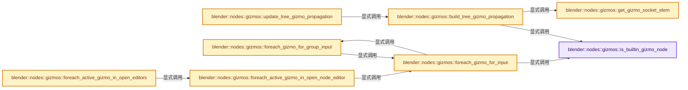
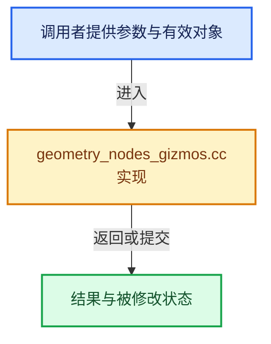

# 实现依赖专题：source/blender/nodes/intern/geometry_nodes_gizmos.cc

[实现依赖导航](../../README.md) · [符号索引](../../../00-课程指南/02-源码与提交索引/符号依赖与实现索引.md)

本专题从正文实际调用进入，集中保存共享实现。函数有稳定锚点，可从调用处直接跳到对应完整函数；递归与互相调用通过回链组织。

## 本文件的实现关系






## 完整成员与函数实现

<a id="f-8b149d7950da4d02"></a>

### `blender::nodes::gizmos::is_builtin_gizmo_node`

实现位置：[source/blender/nodes/intern/geometry_nodes_gizmos.cc](../../../../../../../source/blender/nodes/intern/geometry_nodes_gizmos.cc) · L38—L42。

接口参数：

- `const bNode &node`

**教学注释版**

<!-- annotated:5c9c1905620af7 -->

```cpp
bool is_builtin_gizmo_node(const bNode &node)
{
  return ELEM(
      node.type_legacy, GEO_NODE_GIZMO_LINEAR, GEO_NODE_GIZMO_DIAL, GEO_NODE_GIZMO_TRANSFORM);
}
```

<details>
<summary>核对原始源码：source/blender/nodes/intern/geometry_nodes_gizmos.cc · L38—L42</summary>

<!-- original:5c9c1905620af7:source/blender/nodes/intern/geometry_nodes_gizmos.cc:38:42 -->

```cpp
bool is_builtin_gizmo_node(const bNode &node)
{
  return ELEM(
      node.type_legacy, GEO_NODE_GIZMO_LINEAR, GEO_NODE_GIZMO_DIAL, GEO_NODE_GIZMO_TRANSFORM);
}
```

</details>

**结果出口**

- `return ELEM(`

**继续追踪实现**

- `ELEM` → [ELEM · L88](../../07-Intern运行时与平台/ghost/intern/GHOST_utildefines.hh.md#m-d28724a15928)；[ELEM · L135](../../01-BLI基础库/BLI_utildefines.hh.md#m-d6572de7cae0)。宏定义由构建条件选择。

<a id="f-0021fd38ad3fe4ab"></a>

### `blender::nodes::gizmos::get_gizmo_socket_elem`

实现位置：[source/blender/nodes/intern/geometry_nodes_gizmos.cc](../../../../../../../source/blender/nodes/intern/geometry_nodes_gizmos.cc) · L47—L78。

接口参数：

- `const bNode &node`
- `const bNodeSocket &socket`

**教学注释版**

<!-- annotated:792ea05c264d30 -->

```cpp
static ie::ElemVariant get_gizmo_socket_elem(const bNode &node, const bNodeSocket &socket)
{
  switch (node.type_legacy) {
    case GEO_NODE_GIZMO_LINEAR: {
      return {ie::FloatElem::all()};
    }
    case GEO_NODE_GIZMO_DIAL: {
      return {ie::FloatElem::all()};
    }
    case GEO_NODE_GIZMO_TRANSFORM: {
      const auto &storage = *static_cast<const NodeGeometryTransformGizmo *>(node.storage);
      ie::MatrixElem elem;
      if (storage.flag & GEO_NODE_TRANSFORM_GIZMO_USE_TRANSLATION_ALL) {
        elem.translation = ie::VectorElem::all();
      }
      if (storage.flag &
          (GEO_NODE_TRANSFORM_GIZMO_USE_ROTATION_ALL | GEO_NODE_TRANSFORM_GIZMO_USE_SCALE_ALL))
      {
        elem.rotation = ie::RotationElem::all();
        elem.scale = ie::VectorElem::all();
      }
      return {elem};
    }
  }
  const eNodeSocketDatatype socket_type = socket.type;
  if (std::optional<ie::ElemVariant> elem = ie::get_elem_variant_for_socket_type(socket_type)) {
    elem->set_all();
    return *elem;
  }
  BLI_assert_unreachable();
  return {};
}
```

<details>
<summary>核对原始源码：source/blender/nodes/intern/geometry_nodes_gizmos.cc · L47—L78</summary>

<!-- original:792ea05c264d30:source/blender/nodes/intern/geometry_nodes_gizmos.cc:47:78 -->

```cpp
static ie::ElemVariant get_gizmo_socket_elem(const bNode &node, const bNodeSocket &socket)
{
  switch (node.type_legacy) {
    case GEO_NODE_GIZMO_LINEAR: {
      return {ie::FloatElem::all()};
    }
    case GEO_NODE_GIZMO_DIAL: {
      return {ie::FloatElem::all()};
    }
    case GEO_NODE_GIZMO_TRANSFORM: {
      const auto &storage = *static_cast<const NodeGeometryTransformGizmo *>(node.storage);
      ie::MatrixElem elem;
      if (storage.flag & GEO_NODE_TRANSFORM_GIZMO_USE_TRANSLATION_ALL) {
        elem.translation = ie::VectorElem::all();
      }
      if (storage.flag &
          (GEO_NODE_TRANSFORM_GIZMO_USE_ROTATION_ALL | GEO_NODE_TRANSFORM_GIZMO_USE_SCALE_ALL))
      {
        elem.rotation = ie::RotationElem::all();
        elem.scale = ie::VectorElem::all();
      }
      return {elem};
    }
  }
  const eNodeSocketDatatype socket_type = socket.type;
  if (std::optional<ie::ElemVariant> elem = ie::get_elem_variant_for_socket_type(socket_type)) {
    elem->set_all();
    return *elem;
  }
  BLI_assert_unreachable();
  return {};
}
```

</details>

**沿实际写入检查状态**

- `elem.translation = ie::VectorElem::all();`
- `elem.rotation = ie::RotationElem::all();`
- `elem.scale = ie::VectorElem::all();`

**结果出口**

- `return {ie::FloatElem::all()};`
- `return {elem};`
- `return *elem;`
- `return {};`

**继续追踪实现**

- `ie::FloatElem::all` → [调用协议](../../../00-课程指南/01-路线与规范/模板宏与动态分派协议.md)：函数指针、局部可调用对象或未展开的宏；必须结合调用者环境。调用位置L51。
- `ie::VectorElem::all` → [调用协议](../../../00-课程指南/01-路线与规范/模板宏与动态分派协议.md)：函数指针、局部可调用对象或未展开的宏；必须结合调用者环境。调用位置L60。
- `ie::RotationElem::all` → [调用协议](../../../00-课程指南/01-路线与规范/模板宏与动态分派协议.md)：函数指针、局部可调用对象或未展开的宏；必须结合调用者环境。调用位置L65。
- `ie::get_elem_variant_for_socket_type` → [blender::nodes::value_elem::get_elem_variant_for_socket_type · L13](value_elem.cc.md#f-2e1a93c9efead9c0)。
- `elem->set_all` → [外部契约](https://eel.is/c++draft/)：这个边界按实际表达式及所属类型核对参数、返回值、寿命与失败行为。这里提供接口入口，不声称已解释该第三方版本的内部实现。
- `BLI_assert_unreachable` → [BLI_assert_unreachable · L77](../../01-BLI基础库/BLI_assert.hh.md#m-7a2d91a67d8e)。宏定义由构建条件选择。

<a id="f-8dc0126d1b35236e"></a>

### `blender::nodes::gizmos::build_tree_gizmo_propagation`

实现位置：[source/blender/nodes/intern/geometry_nodes_gizmos.cc](../../../../../../../source/blender/nodes/intern/geometry_nodes_gizmos.cc) · L80—L166。

接口参数：

- `bNodeTree &tree`

**教学注释版**

<!-- annotated:591d43abdd33d9 -->

```cpp
static TreeGizmoPropagation build_tree_gizmo_propagation(bNodeTree &tree)
{
  BLI_assert(!tree.has_available_link_cycle());

  TreeGizmoPropagation gizmo_propagation;

  struct GizmoInput {
    const bNodeSocket *gizmo_socket;
    /* For multi-input sockets we start propagation at the origin socket. */
    const bNodeSocket *propagation_start_socket;
    ie::ElemVariant elem;
  };

  /* Gather all gizmo inputs so that we can find their inverse evaluation targets afterwards. */
  Vector<GizmoInput> all_gizmo_inputs;
  for (const bNode *node : tree.all_nodes()) {
    if (node->is_muted()) {
      continue;
    }
    if (node->is_group()) {
      if (!node->id) {
        continue;
      }
      const bNodeTree &group = *reinterpret_cast<const bNodeTree *>(node->id);
      if (!group.runtime->gizmo_propagation) {
        continue;
      }
      const TreeGizmoPropagation &group_gizmo_propagation = *group.runtime->gizmo_propagation;
      for (const ie::GroupInputElem &group_input_elem :
           group_gizmo_propagation.gizmo_inputs_by_group_inputs.keys())
      {
        const bNodeSocket &input_socket = node->input_socket(group_input_elem.group_input_index);
        // [讲解] all_gizmo_inputs.append：在尾部建立新元素，必要时先扩大存储。
        all_gizmo_inputs.append({&input_socket, &input_socket, group_input_elem.elem});
      }
    }
    if (is_builtin_gizmo_node(*node)) {
      gizmo_propagation.gizmo_nodes.append(node);
      const bNodeSocket &gizmo_input_socket = node->input_socket(0);
      gizmo_propagation.gizmo_endpoint_sockets.add(&gizmo_input_socket);
      const ie::ElemVariant elem = get_gizmo_socket_elem(*node, gizmo_input_socket);
      for (const bNodeLink *link : gizmo_input_socket.directly_linked_links()) {
        if (!link->is_used()) {
          continue;
        }
        all_gizmo_inputs.append({&gizmo_input_socket, link->fromsock, elem});
      }
    }
  }

  /* Find the local gizmo targets for all gizmo inputs. */
  for (const GizmoInput &gizmo_input : all_gizmo_inputs) {
    gizmo_propagation.gizmo_endpoint_sockets.add(gizmo_input.gizmo_socket);
    const ie::SocketElem gizmo_input_socket_elem{gizmo_input.gizmo_socket, gizmo_input.elem};
    /* The conversion is necessary when e.g. connecting a Rotation directly to the matrix input of
     * the Transform Gizmo node. */
    const std::optional<ie::ElemVariant> converted_elem = ie::convert_socket_elem(
        *gizmo_input.gizmo_socket, *gizmo_input.propagation_start_socket, gizmo_input.elem);
    if (!converted_elem) {
      continue;
    }
    const ie::LocalInverseEvalTargets targets = ie::find_local_inverse_eval_targets(
        tree, {gizmo_input.propagation_start_socket, *converted_elem});
    const bool has_target = !targets.input_sockets.is_empty() ||
                            !targets.group_inputs.is_empty() || !targets.value_nodes.is_empty();
    if (!has_target) {
      continue;
    }
    /* Remember all the gizmo targets for quick lookup later on. */
    for (const ie::SocketElem &input_socket : targets.input_sockets) {
      gizmo_propagation.gizmo_inputs_by_node_inputs.add(input_socket, gizmo_input_socket_elem);
      gizmo_propagation.gizmo_endpoint_sockets.add(input_socket.socket);
    }
    for (const ie::ValueNodeElem &value_node : targets.value_nodes) {
      gizmo_propagation.gizmo_inputs_by_value_nodes.add(value_node, gizmo_input_socket_elem);
      gizmo_propagation.gizmo_endpoint_sockets.add(&value_node.node->output_socket(0));
    }
    for (const ie::GroupInputElem &group_input : targets.group_inputs) {
      gizmo_propagation.gizmo_inputs_by_group_inputs.add(group_input, gizmo_input_socket_elem);
      for (const bNode *group_input_node : tree.group_input_nodes()) {
        gizmo_propagation.gizmo_endpoint_sockets.add(
            &group_input_node->output_socket(group_input.group_input_index));
      }
    }
  }

  return gizmo_propagation;
}
```

<details>
<summary>核对原始源码：source/blender/nodes/intern/geometry_nodes_gizmos.cc · L80—L166</summary>

<!-- original:591d43abdd33d9:source/blender/nodes/intern/geometry_nodes_gizmos.cc:80:166 -->

```cpp
static TreeGizmoPropagation build_tree_gizmo_propagation(bNodeTree &tree)
{
  BLI_assert(!tree.has_available_link_cycle());

  TreeGizmoPropagation gizmo_propagation;

  struct GizmoInput {
    const bNodeSocket *gizmo_socket;
    /* For multi-input sockets we start propagation at the origin socket. */
    const bNodeSocket *propagation_start_socket;
    ie::ElemVariant elem;
  };

  /* Gather all gizmo inputs so that we can find their inverse evaluation targets afterwards. */
  Vector<GizmoInput> all_gizmo_inputs;
  for (const bNode *node : tree.all_nodes()) {
    if (node->is_muted()) {
      continue;
    }
    if (node->is_group()) {
      if (!node->id) {
        continue;
      }
      const bNodeTree &group = *reinterpret_cast<const bNodeTree *>(node->id);
      if (!group.runtime->gizmo_propagation) {
        continue;
      }
      const TreeGizmoPropagation &group_gizmo_propagation = *group.runtime->gizmo_propagation;
      for (const ie::GroupInputElem &group_input_elem :
           group_gizmo_propagation.gizmo_inputs_by_group_inputs.keys())
      {
        const bNodeSocket &input_socket = node->input_socket(group_input_elem.group_input_index);
        all_gizmo_inputs.append({&input_socket, &input_socket, group_input_elem.elem});
      }
    }
    if (is_builtin_gizmo_node(*node)) {
      gizmo_propagation.gizmo_nodes.append(node);
      const bNodeSocket &gizmo_input_socket = node->input_socket(0);
      gizmo_propagation.gizmo_endpoint_sockets.add(&gizmo_input_socket);
      const ie::ElemVariant elem = get_gizmo_socket_elem(*node, gizmo_input_socket);
      for (const bNodeLink *link : gizmo_input_socket.directly_linked_links()) {
        if (!link->is_used()) {
          continue;
        }
        all_gizmo_inputs.append({&gizmo_input_socket, link->fromsock, elem});
      }
    }
  }

  /* Find the local gizmo targets for all gizmo inputs. */
  for (const GizmoInput &gizmo_input : all_gizmo_inputs) {
    gizmo_propagation.gizmo_endpoint_sockets.add(gizmo_input.gizmo_socket);
    const ie::SocketElem gizmo_input_socket_elem{gizmo_input.gizmo_socket, gizmo_input.elem};
    /* The conversion is necessary when e.g. connecting a Rotation directly to the matrix input of
     * the Transform Gizmo node. */
    const std::optional<ie::ElemVariant> converted_elem = ie::convert_socket_elem(
        *gizmo_input.gizmo_socket, *gizmo_input.propagation_start_socket, gizmo_input.elem);
    if (!converted_elem) {
      continue;
    }
    const ie::LocalInverseEvalTargets targets = ie::find_local_inverse_eval_targets(
        tree, {gizmo_input.propagation_start_socket, *converted_elem});
    const bool has_target = !targets.input_sockets.is_empty() ||
                            !targets.group_inputs.is_empty() || !targets.value_nodes.is_empty();
    if (!has_target) {
      continue;
    }
    /* Remember all the gizmo targets for quick lookup later on. */
    for (const ie::SocketElem &input_socket : targets.input_sockets) {
      gizmo_propagation.gizmo_inputs_by_node_inputs.add(input_socket, gizmo_input_socket_elem);
      gizmo_propagation.gizmo_endpoint_sockets.add(input_socket.socket);
    }
    for (const ie::ValueNodeElem &value_node : targets.value_nodes) {
      gizmo_propagation.gizmo_inputs_by_value_nodes.add(value_node, gizmo_input_socket_elem);
      gizmo_propagation.gizmo_endpoint_sockets.add(&value_node.node->output_socket(0));
    }
    for (const ie::GroupInputElem &group_input : targets.group_inputs) {
      gizmo_propagation.gizmo_inputs_by_group_inputs.add(group_input, gizmo_input_socket_elem);
      for (const bNode *group_input_node : tree.group_input_nodes()) {
        gizmo_propagation.gizmo_endpoint_sockets.add(
            &group_input_node->output_socket(group_input.group_input_index));
      }
    }
  }

  return gizmo_propagation;
}
```

</details>

**结果出口**

- `return gizmo_propagation;`

**继续追踪实现**

- `BLI_assert` → [BLI_assert · L48](../../01-BLI基础库/BLI_assert.hh.md#m-57a88495704d)；[BLI_assert · L63](../../01-BLI基础库/BLI_assert.hh.md#m-d07050020cb5)。宏定义由构建条件选择。
- `tree.has_available_link_cycle` → [blender::bNodeTree::has_available_link_cycle · L572](../../02-BKE几何与数据/BKE_node_runtime.hh.md#f-7bdcb85482e6bf35)。
- `tree.all_nodes` → [blender::bNodeTree::all_nodes · L500](../../02-BKE几何与数据/BKE_node_runtime.hh.md#f-cda455cbcc6c7f36)；[blender::bNodeTree::all_nodes · L505](../../02-BKE几何与数据/BKE_node_runtime.hh.md#f-358b65e5678f8a32)。同名重载需按实参类型选择。
- `node->is_muted` → [调用协议](../../../00-课程指南/01-路线与规范/模板宏与动态分派协议.md)：接收对象类型依赖auto、返回值或模板实例；不按同名猜测目标。调用位置L96。
- `node->is_group` → [调用协议](../../../00-课程指南/01-路线与规范/模板宏与动态分派协议.md)：接收对象类型依赖auto、返回值或模板实例；不按同名猜测目标。调用位置L99。
- `group_gizmo_propagation.gizmo_inputs_by_group_inputs.keys` → [调用协议](../../../00-课程指南/01-路线与规范/模板宏与动态分派协议.md)：接收对象类型依赖auto、返回值或模板实例；不按同名猜测目标。调用位置L109。
- `node->input_socket` → [调用协议](../../../00-课程指南/01-路线与规范/模板宏与动态分派协议.md)：接收对象类型依赖auto、返回值或模板实例；不按同名猜测目标。调用位置L111。
- `all_gizmo_inputs.append` → [blender::Vector::append · L498](../../../01-基础容器与现代CPP/11-Vector插入删除与重排.md#f-5bde268a69e443ec)；[blender::Vector::append · L502](../../../01-基础容器与现代CPP/11-Vector插入删除与重排.md#f-591e0b15e6308532)。同名重载需按实参类型选择。
- `is_builtin_gizmo_node` → [blender::nodes::gizmos::is_builtin_gizmo_node · L38](geometry_nodes_gizmos.cc.md#f-8b149d7950da4d02)。
- `gizmo_propagation.gizmo_nodes.append` → [调用协议](../../../00-课程指南/01-路线与规范/模板宏与动态分派协议.md)：接收对象类型依赖auto、返回值或模板实例；不按同名猜测目标。调用位置L116。
- `gizmo_propagation.gizmo_endpoint_sockets.add` → [调用协议](../../../00-课程指南/01-路线与规范/模板宏与动态分派协议.md)：接收对象类型依赖auto、返回值或模板实例；不按同名猜测目标。调用位置L118。
- `get_gizmo_socket_elem` → [blender::nodes::gizmos::get_gizmo_socket_elem · L47](geometry_nodes_gizmos.cc.md#f-0021fd38ad3fe4ab)。
- `gizmo_input_socket.directly_linked_links` → [blender::bNodeSocket::directly_linked_links · L1093](../../02-BKE几何与数据/BKE_node_runtime.hh.md#f-d4c09496836a84b5)；[blender::bNodeSocket::directly_linked_links · L1099](../../02-BKE几何与数据/BKE_node_runtime.hh.md#f-d56c6693569c33fe)。同名重载需按实参类型选择。
- `link->is_used` → [调用协议](../../../00-课程指南/01-路线与规范/模板宏与动态分派协议.md)：接收对象类型依赖auto、返回值或模板实例；不按同名猜测目标。调用位置L121。
- `ie::convert_socket_elem` → [blender::nodes::value_elem::convert_socket_elem · L33](value_elem.cc.md#f-1398f6d895df2961)。
- `ie::find_local_inverse_eval_targets` → [blender::nodes::inverse_eval::find_local_inverse_eval_targets · L135](inverse_eval.cc.md#f-75b3f12e4aab7775)。
- `targets.input_sockets.is_empty` → [调用协议](../../../00-课程指南/01-路线与规范/模板宏与动态分派协议.md)：接收对象类型依赖auto、返回值或模板实例；不按同名猜测目标。调用位置L142。
- `targets.group_inputs.is_empty` → [调用协议](../../../00-课程指南/01-路线与规范/模板宏与动态分派协议.md)：接收对象类型依赖auto、返回值或模板实例；不按同名猜测目标。调用位置L143。
- `targets.value_nodes.is_empty` → [调用协议](../../../00-课程指南/01-路线与规范/模板宏与动态分派协议.md)：接收对象类型依赖auto、返回值或模板实例；不按同名猜测目标。调用位置L143。
- `gizmo_propagation.gizmo_inputs_by_node_inputs.add` → [调用协议](../../../00-课程指南/01-路线与规范/模板宏与动态分派协议.md)：接收对象类型依赖auto、返回值或模板实例；不按同名猜测目标。调用位置L149。
- `gizmo_propagation.gizmo_inputs_by_value_nodes.add` → [调用协议](../../../00-课程指南/01-路线与规范/模板宏与动态分派协议.md)：接收对象类型依赖auto、返回值或模板实例；不按同名猜测目标。调用位置L153。
- `value_node.node->output_socket` → [调用协议](../../../00-课程指南/01-路线与规范/模板宏与动态分派协议.md)：接收对象类型依赖auto、返回值或模板实例；不按同名猜测目标。调用位置L154。
- `gizmo_propagation.gizmo_inputs_by_group_inputs.add` → [调用协议](../../../00-课程指南/01-路线与规范/模板宏与动态分派协议.md)：接收对象类型依赖auto、返回值或模板实例；不按同名猜测目标。调用位置L157。
- `tree.group_input_nodes` → [blender::bNodeTree::group_input_nodes · L596](../../02-BKE几何与数据/BKE_node_runtime.hh.md#f-f4d5daa939963761)；[blender::bNodeTree::group_input_nodes · L601](../../02-BKE几何与数据/BKE_node_runtime.hh.md#f-b54e41a48ba6ce7a)。同名重载需按实参类型选择。
- `group_input_node->output_socket` → [调用协议](../../../00-课程指南/01-路线与规范/模板宏与动态分派协议.md)：接收对象类型依赖auto、返回值或模板实例；不按同名猜测目标。调用位置L160。

<a id="f-9f840f870837b723"></a>

### `blender::nodes::gizmos::update_tree_gizmo_propagation`

实现位置：[source/blender/nodes/intern/geometry_nodes_gizmos.cc](../../../../../../../source/blender/nodes/intern/geometry_nodes_gizmos.cc) · L168—L185。

接口参数：

- `bNodeTree &tree`

**教学注释版**

<!-- annotated:eeea8ddc796f5b -->

```cpp
bool update_tree_gizmo_propagation(bNodeTree &tree)
{
  tree.ensure_topology_cache();

  if (tree.has_available_link_cycle()) {
    const bool changed = tree.runtime->gizmo_propagation != nullptr;
    tree.runtime->gizmo_propagation.reset();
    return changed;
  }

  TreeGizmoPropagation new_gizmo_propagation = build_tree_gizmo_propagation(tree);
  const bool changed = tree.runtime->gizmo_propagation ?
                           *tree.runtime->gizmo_propagation != new_gizmo_propagation :
                           true;
  // [讲解] std::make_unique<TreeGizmoPropagation>：创建独占拥有的对象，拥有关系可移动，get返回的借用指针不自动延长寿命。
  tree.runtime->gizmo_propagation = std::make_unique<TreeGizmoPropagation>(
      // [讲解] std::move：把表达式转换成可供移动重载选择的值类别；不保证真的移动，不结束源对象寿命，对const值可能选择复制。
      std::move(new_gizmo_propagation));
  return changed;
}
```

<details>
<summary>核对原始源码：source/blender/nodes/intern/geometry_nodes_gizmos.cc · L168—L185</summary>

<!-- original:eeea8ddc796f5b:source/blender/nodes/intern/geometry_nodes_gizmos.cc:168:185 -->

```cpp
bool update_tree_gizmo_propagation(bNodeTree &tree)
{
  tree.ensure_topology_cache();

  if (tree.has_available_link_cycle()) {
    const bool changed = tree.runtime->gizmo_propagation != nullptr;
    tree.runtime->gizmo_propagation.reset();
    return changed;
  }

  TreeGizmoPropagation new_gizmo_propagation = build_tree_gizmo_propagation(tree);
  const bool changed = tree.runtime->gizmo_propagation ?
                           *tree.runtime->gizmo_propagation != new_gizmo_propagation :
                           true;
  tree.runtime->gizmo_propagation = std::make_unique<TreeGizmoPropagation>(
      std::move(new_gizmo_propagation));
  return changed;
}
```

</details>

**沿实际写入检查状态**

- `tree.runtime->gizmo_propagation = std::make_unique<TreeGizmoPropagation>(`

**结果出口**

- `return changed;`

**继续追踪实现**

- `tree.ensure_topology_cache` → [blender::bNodeTree::ensure_topology_cache · L621](../../02-BKE几何与数据/intern/node_runtime.cc.md#f-566e97bdf0367424)。
- `tree.has_available_link_cycle` → [blender::bNodeTree::has_available_link_cycle · L572](../../02-BKE几何与数据/BKE_node_runtime.hh.md#f-7bdcb85482e6bf35)。
- `tree.runtime->gizmo_propagation.reset` → [调用协议](../../../00-课程指南/01-路线与规范/模板宏与动态分派协议.md)：接收对象类型依赖auto、返回值或模板实例；不按同名猜测目标。调用位置L174。
- `build_tree_gizmo_propagation` → [blender::nodes::gizmos::build_tree_gizmo_propagation · L80](geometry_nodes_gizmos.cc.md#f-8dc0126d1b35236e)。
- `std::make_unique<TreeGizmoPropagation>` → [外部契约](https://eel.is/c++draft/unique.ptr.create)：创建独占拥有的对象，拥有关系可移动，get返回的借用指针不自动延长寿命。
- `std::move` → [外部契约](https://eel.is/c++draft/utility.forward)：把表达式转换成可供移动重载选择的值类别；不保证真的移动，不结束源对象寿命，对const值可能选择复制。

<a id="f-a950118dbfb45a4e"></a>

### `blender::nodes::gizmos::foreach_gizmo_for_group_input`

实现位置：[source/blender/nodes/intern/geometry_nodes_gizmos.cc](../../../../../../../source/blender/nodes/intern/geometry_nodes_gizmos.cc) · L193—L205。

接口参数：

- `const bNodeTree &tree`
- `const ie::GroupInputElem &group_input`
- `bke::ComputeContextCache &compute_context_cache`
- `const ComputeContext *compute_context`
- `const ForeachGizmoInModifierFn fn`

**教学注释版**

<!-- annotated:588c58860800a4 -->

```cpp
static void foreach_gizmo_for_group_input(const bNodeTree &tree,
                                          const ie::GroupInputElem &group_input,
                                          bke::ComputeContextCache &compute_context_cache,
                                          const ComputeContext *compute_context,
                                          const ForeachGizmoInModifierFn fn)
{
  const TreeGizmoPropagation &gizmo_propagation = *tree.runtime->gizmo_propagation;
  for (const ie::SocketElem &gizmo_input :
       gizmo_propagation.gizmo_inputs_by_group_inputs.lookup(group_input))
  {
    foreach_gizmo_for_input(gizmo_input, compute_context_cache, compute_context, tree, fn);
  }
}
```

<details>
<summary>核对原始源码：source/blender/nodes/intern/geometry_nodes_gizmos.cc · L193—L205</summary>

<!-- original:588c58860800a4:source/blender/nodes/intern/geometry_nodes_gizmos.cc:193:205 -->

```cpp
static void foreach_gizmo_for_group_input(const bNodeTree &tree,
                                          const ie::GroupInputElem &group_input,
                                          bke::ComputeContextCache &compute_context_cache,
                                          const ComputeContext *compute_context,
                                          const ForeachGizmoInModifierFn fn)
{
  const TreeGizmoPropagation &gizmo_propagation = *tree.runtime->gizmo_propagation;
  for (const ie::SocketElem &gizmo_input :
       gizmo_propagation.gizmo_inputs_by_group_inputs.lookup(group_input))
  {
    foreach_gizmo_for_input(gizmo_input, compute_context_cache, compute_context, tree, fn);
  }
}
```

</details>

**继续追踪实现**

- `gizmo_propagation.gizmo_inputs_by_group_inputs.lookup` → [调用协议](../../../00-课程指南/01-路线与规范/模板宏与动态分派协议.md)：接收对象类型依赖auto、返回值或模板实例；不按同名猜测目标。调用位置L201。
- `foreach_gizmo_for_input` → [blender::nodes::gizmos::foreach_gizmo_for_input · L207](geometry_nodes_gizmos.cc.md#f-627078fcce7981ac)。

<a id="f-627078fcce7981ac"></a>

### `blender::nodes::gizmos::foreach_gizmo_for_input`

实现位置：[source/blender/nodes/intern/geometry_nodes_gizmos.cc](../../../../../../../source/blender/nodes/intern/geometry_nodes_gizmos.cc) · L207—L243。

接口参数：

- `const ie::SocketElem &input_socket`
- `bke::ComputeContextCache &compute_context_cache`
- `const ComputeContext *compute_context`
- `const bNodeTree &tree`
- `const ForeachGizmoInModifierFn fn`

**教学注释版**

<!-- annotated:f5b2211ef0dc6f -->

```cpp
static void foreach_gizmo_for_input(const ie::SocketElem &input_socket,
                                    bke::ComputeContextCache &compute_context_cache,
                                    const ComputeContext *compute_context,
                                    const bNodeTree &tree,
                                    const ForeachGizmoInModifierFn fn)
{
  const bke::bNodeTreeZones *zones = tree.zones();
  if (!zones) {
    /* There are invalid zones. */
    return;
  }
  const bNode &node = input_socket.socket->owner_node();
  if (zones->get_zone_by_node(node.identifier) != nullptr) {
    /* Gizmos in zones are not supported yet. */
    return;
  }
  if (is_builtin_gizmo_node(node)) {
    if (node.is_muted()) {
      return;
    }
    /* Found an actual built-in gizmo node. */
    fn(*compute_context, node, *input_socket.socket);
    return;
  }
  if (node.is_group()) {
    const bNodeTree &group = *reinterpret_cast<const bNodeTree *>(node.id);
    group.ensure_topology_cache();
    const ComputeContext &group_compute_context = compute_context_cache.for_group_node(
        compute_context, node.identifier, &tree);
    foreach_gizmo_for_group_input(
        group,
        ie::GroupInputElem{input_socket.socket->index(), input_socket.elem},
        compute_context_cache,
        &group_compute_context,
        fn);
  }
}
```

<details>
<summary>核对原始源码：source/blender/nodes/intern/geometry_nodes_gizmos.cc · L207—L243</summary>

<!-- original:f5b2211ef0dc6f:source/blender/nodes/intern/geometry_nodes_gizmos.cc:207:243 -->

```cpp
static void foreach_gizmo_for_input(const ie::SocketElem &input_socket,
                                    bke::ComputeContextCache &compute_context_cache,
                                    const ComputeContext *compute_context,
                                    const bNodeTree &tree,
                                    const ForeachGizmoInModifierFn fn)
{
  const bke::bNodeTreeZones *zones = tree.zones();
  if (!zones) {
    /* There are invalid zones. */
    return;
  }
  const bNode &node = input_socket.socket->owner_node();
  if (zones->get_zone_by_node(node.identifier) != nullptr) {
    /* Gizmos in zones are not supported yet. */
    return;
  }
  if (is_builtin_gizmo_node(node)) {
    if (node.is_muted()) {
      return;
    }
    /* Found an actual built-in gizmo node. */
    fn(*compute_context, node, *input_socket.socket);
    return;
  }
  if (node.is_group()) {
    const bNodeTree &group = *reinterpret_cast<const bNodeTree *>(node.id);
    group.ensure_topology_cache();
    const ComputeContext &group_compute_context = compute_context_cache.for_group_node(
        compute_context, node.identifier, &tree);
    foreach_gizmo_for_group_input(
        group,
        ie::GroupInputElem{input_socket.socket->index(), input_socket.elem},
        compute_context_cache,
        &group_compute_context,
        fn);
  }
}
```

</details>

**继续追踪实现**

- `tree.zones` → [blender::bNodeTree::zones · L117](../../02-BKE几何与数据/BKE_node_tree_zones.hh.md#f-892779c41416b689)。
- `input_socket.socket->owner_node` → [调用协议](../../../00-课程指南/01-路线与规范/模板宏与动态分派协议.md)：接收对象类型依赖auto、返回值或模板实例；不按同名猜测目标。调用位置L218。
- `zones->get_zone_by_node` → [blender::bke::bNodeTreeZones::get_zone_by_node · L437](../../02-BKE几何与数据/intern/node_tree_zones.cc.md#f-dcc4746d65b4807a)。
- `is_builtin_gizmo_node` → [blender::nodes::gizmos::is_builtin_gizmo_node · L38](geometry_nodes_gizmos.cc.md#f-8b149d7950da4d02)。
- `node.is_muted` → [blender::bNode::is_muted · L886](../../02-BKE几何与数据/BKE_node_runtime.hh.md#f-4d91efc4cc87d00d)。
- `fn` → [调用协议](../../../00-课程指南/01-路线与规范/模板宏与动态分派协议.md)：局部可调用对象，须结合其初始化与捕获环境。调用位置L228。
- `node.is_group` → [blender::bNode::is_group · L906](../../02-BKE几何与数据/BKE_node_runtime.hh.md#f-0685281392963ec9)。
- `group.ensure_topology_cache` → [blender::bNodeTree::ensure_topology_cache · L621](../../02-BKE几何与数据/intern/node_runtime.cc.md#f-566e97bdf0367424)。
- `compute_context_cache.for_group_node` → [blender::bke::ComputeContextCache::for_group_node · L360](../../02-BKE几何与数据/intern/compute_contexts.cc.md#f-e682e12ad78f58a0)。
- `foreach_gizmo_for_group_input` → [blender::nodes::gizmos::foreach_gizmo_for_group_input · L193](geometry_nodes_gizmos.cc.md#f-a950118dbfb45a4e)。
- `input_socket.socket->index` → [调用协议](../../../00-课程指南/01-路线与规范/模板宏与动态分派协议.md)：接收对象类型依赖auto、返回值或模板实例；不按同名猜测目标。调用位置L238。

<a id="f-8cf550a6addfddcb"></a>

### `blender::nodes::gizmos::foreach_active_gizmo_in_open_node_editor`

实现位置：[source/blender/nodes/intern/geometry_nodes_gizmos.cc](../../../../../../../source/blender/nodes/intern/geometry_nodes_gizmos.cc) · L245—L345。

接口参数：

- `const SpaceNode &snode`
- `const Object *object_filter`
- `const NodesModifierData *nmd_filter`
- `bke::ComputeContextCache &compute_context_cache`
- `const ForeachGizmoFn fn`

**教学注释版**

<!-- annotated:267844dc9f2a10 -->

```cpp
static void foreach_active_gizmo_in_open_node_editor(
    const SpaceNode &snode,
    const Object *object_filter,
    const NodesModifierData *nmd_filter,
    bke::ComputeContextCache &compute_context_cache,
    const ForeachGizmoFn fn)
{
  if (snode.nodetree == nullptr) {
    return;
  }
  if (snode.edittree == nullptr || !snode.edittree->runtime->gizmo_propagation) {
    return;
  }
  const std::optional<ed::space_node::ObjectAndModifier> object_and_modifier =
      ed::space_node::get_geometry_nodes_modifier_for_node_editor(snode);
  if (!object_and_modifier) {
    return;
  }
  if (object_filter) {
    if (object_and_modifier->object != object_filter) {
      return;
    }
  }
  if (nmd_filter) {
    if (object_and_modifier->nmd != nmd_filter) {
      return;
    }
  }

  const Object &object = *object_and_modifier->object;
  const NodesModifierData &nmd = *object_and_modifier->nmd;

  if (!(nmd.modifier.mode & eModifierMode_Realtime)) {
    /* Disabled modifiers can't have gizmos currently. */
    return;
  }

  const ComputeContext *current_compute_context = ed::space_node::compute_context_for_edittree(
      snode, compute_context_cache);
  if (!current_compute_context) {
    return;
  }

  snode.edittree->ensure_topology_cache();
  const TreeGizmoPropagation &gizmo_propagation = *snode.edittree->runtime->gizmo_propagation;
  Set<ie::SocketElem> used_gizmo_inputs;

  /* Check gizmos on value nodes. */
  for (auto &&item : gizmo_propagation.gizmo_inputs_by_value_nodes.items()) {
    const bNode &node = *item.key.node;
    const bNodeSocket &output_socket = node.output_socket(0);
    if (node.is_selected() || (output_socket.flag & SOCK_GIZMO_PIN)) {
      used_gizmo_inputs.add_multiple(item.value);
      continue;
    }
    for (const ie::SocketElem &socket_elem : item.value) {
      if (socket_elem.socket->owner_node().is_selected()) {
        // [讲解] used_gizmo_inputs.add：按哈希与相等关系加入键或键值。
        used_gizmo_inputs.add(socket_elem);
      }
    }
  }
  /* Check gizmos on input sockets. */
  for (auto &&item : gizmo_propagation.gizmo_inputs_by_node_inputs.items()) {
    const bNodeSocket &socket = *item.key.socket;
    if (socket.is_inactive()) {
      continue;
    }
    const bNode &node = socket.owner_node();
    if (node.is_selected() || (socket.flag & SOCK_GIZMO_PIN)) {
      used_gizmo_inputs.add_multiple(item.value);
      continue;
    }
    for (const ie::SocketElem &socket_elem : item.value) {
      if (socket_elem.socket->owner_node().is_selected()) {
        used_gizmo_inputs.add(socket_elem);
      }
    }
  }
  /* Check built-in gizmo nodes. */
  for (const bNode *gizmo_node : gizmo_propagation.gizmo_nodes) {
    if (gizmo_node->is_muted()) {
      continue;
    }
    const bNodeSocket &gizmo_input_socket = gizmo_node->input_socket(0);
    if (gizmo_node->is_selected() || (gizmo_input_socket.flag & SOCK_GIZMO_PIN)) {
      used_gizmo_inputs.add(
          {&gizmo_input_socket, *ie::get_elem_variant_for_socket_type(gizmo_input_socket.type)});
    }
  }
  for (const ie::SocketElem &gizmo_input : used_gizmo_inputs) {
    foreach_gizmo_for_input(gizmo_input,
                            compute_context_cache,
                            current_compute_context,
                            *snode.edittree,
                            [&](const ComputeContext &compute_context,
                                const bNode &gizmo_node,
                                const bNodeSocket &gizmo_socket) {
                              fn(object, nmd, compute_context, gizmo_node, gizmo_socket);
                            });
  }
}
```

<details>
<summary>核对原始源码：source/blender/nodes/intern/geometry_nodes_gizmos.cc · L245—L345</summary>

<!-- original:267844dc9f2a10:source/blender/nodes/intern/geometry_nodes_gizmos.cc:245:345 -->

```cpp
static void foreach_active_gizmo_in_open_node_editor(
    const SpaceNode &snode,
    const Object *object_filter,
    const NodesModifierData *nmd_filter,
    bke::ComputeContextCache &compute_context_cache,
    const ForeachGizmoFn fn)
{
  if (snode.nodetree == nullptr) {
    return;
  }
  if (snode.edittree == nullptr || !snode.edittree->runtime->gizmo_propagation) {
    return;
  }
  const std::optional<ed::space_node::ObjectAndModifier> object_and_modifier =
      ed::space_node::get_geometry_nodes_modifier_for_node_editor(snode);
  if (!object_and_modifier) {
    return;
  }
  if (object_filter) {
    if (object_and_modifier->object != object_filter) {
      return;
    }
  }
  if (nmd_filter) {
    if (object_and_modifier->nmd != nmd_filter) {
      return;
    }
  }

  const Object &object = *object_and_modifier->object;
  const NodesModifierData &nmd = *object_and_modifier->nmd;

  if (!(nmd.modifier.mode & eModifierMode_Realtime)) {
    /* Disabled modifiers can't have gizmos currently. */
    return;
  }

  const ComputeContext *current_compute_context = ed::space_node::compute_context_for_edittree(
      snode, compute_context_cache);
  if (!current_compute_context) {
    return;
  }

  snode.edittree->ensure_topology_cache();
  const TreeGizmoPropagation &gizmo_propagation = *snode.edittree->runtime->gizmo_propagation;
  Set<ie::SocketElem> used_gizmo_inputs;

  /* Check gizmos on value nodes. */
  for (auto &&item : gizmo_propagation.gizmo_inputs_by_value_nodes.items()) {
    const bNode &node = *item.key.node;
    const bNodeSocket &output_socket = node.output_socket(0);
    if (node.is_selected() || (output_socket.flag & SOCK_GIZMO_PIN)) {
      used_gizmo_inputs.add_multiple(item.value);
      continue;
    }
    for (const ie::SocketElem &socket_elem : item.value) {
      if (socket_elem.socket->owner_node().is_selected()) {
        used_gizmo_inputs.add(socket_elem);
      }
    }
  }
  /* Check gizmos on input sockets. */
  for (auto &&item : gizmo_propagation.gizmo_inputs_by_node_inputs.items()) {
    const bNodeSocket &socket = *item.key.socket;
    if (socket.is_inactive()) {
      continue;
    }
    const bNode &node = socket.owner_node();
    if (node.is_selected() || (socket.flag & SOCK_GIZMO_PIN)) {
      used_gizmo_inputs.add_multiple(item.value);
      continue;
    }
    for (const ie::SocketElem &socket_elem : item.value) {
      if (socket_elem.socket->owner_node().is_selected()) {
        used_gizmo_inputs.add(socket_elem);
      }
    }
  }
  /* Check built-in gizmo nodes. */
  for (const bNode *gizmo_node : gizmo_propagation.gizmo_nodes) {
    if (gizmo_node->is_muted()) {
      continue;
    }
    const bNodeSocket &gizmo_input_socket = gizmo_node->input_socket(0);
    if (gizmo_node->is_selected() || (gizmo_input_socket.flag & SOCK_GIZMO_PIN)) {
      used_gizmo_inputs.add(
          {&gizmo_input_socket, *ie::get_elem_variant_for_socket_type(gizmo_input_socket.type)});
    }
  }
  for (const ie::SocketElem &gizmo_input : used_gizmo_inputs) {
    foreach_gizmo_for_input(gizmo_input,
                            compute_context_cache,
                            current_compute_context,
                            *snode.edittree,
                            [&](const ComputeContext &compute_context,
                                const bNode &gizmo_node,
                                const bNodeSocket &gizmo_socket) {
                              fn(object, nmd, compute_context, gizmo_node, gizmo_socket);
                            });
  }
}
```

</details>

**继续追踪实现**

- `ed::space_node::get_geometry_nodes_modifier_for_node_editor` → [blender::ed::space_node::get_geometry_nodes_modifier_for_node_editor · L377](../../08-其他Blender模块/editors/space_node/space_node.cc.md#f-dfd32d7212fc51c5)。
- `ed::space_node::compute_context_for_edittree` → [blender::ed::space_node::compute_context_for_edittree · L614](../../08-其他Blender模块/editors/space_node/space_node.cc.md#f-73c6cdf3228e826c)。
- `snode.edittree->ensure_topology_cache` → [调用协议](../../../00-课程指南/01-路线与规范/模板宏与动态分派协议.md)：接收对象类型依赖auto、返回值或模板实例；不按同名猜测目标。调用位置L288。
- `gizmo_propagation.gizmo_inputs_by_value_nodes.items` → [调用协议](../../../00-课程指南/01-路线与规范/模板宏与动态分派协议.md)：接收对象类型依赖auto、返回值或模板实例；不按同名猜测目标。调用位置L293。
- `node.output_socket` → [blender::bNode::output_socket · L824](../../02-BKE几何与数据/BKE_node_runtime.hh.md#f-9e46f3a437215eb5)；[blender::bNode::output_socket · L836](../../02-BKE几何与数据/BKE_node_runtime.hh.md#f-39021ff32ee7c409)。同名重载需按实参类型选择。
- `node.is_selected` → [blender::bNode::is_selected · L891](../../02-BKE几何与数据/BKE_node_runtime.hh.md#f-6d61eef1a15aafb3)。
- `used_gizmo_inputs.add_multiple` → [blender::Set::add_multiple · L287](../../../02-哈希表与关联数据结构/08-Set与集合语义.md#f-18a099a39b0fcf37)。
- `socket_elem.socket->owner_node().is_selected` → [调用协议](../../../00-课程指南/01-路线与规范/模板宏与动态分派协议.md)：接收对象类型依赖auto、返回值或模板实例；不按同名猜测目标。调用位置L301。
- `socket_elem.socket->owner_node` → [调用协议](../../../00-课程指南/01-路线与规范/模板宏与动态分派协议.md)：接收对象类型依赖auto、返回值或模板实例；不按同名猜测目标。调用位置L301。
- `used_gizmo_inputs.add` → [blender::Set::add · L248](../../../02-哈希表与关联数据结构/08-Set与集合语义.md#f-c7498809c2327fba)；[blender::Set::add · L252](../../../02-哈希表与关联数据结构/08-Set与集合语义.md#f-e3ac8d1c52c03c2b)。同名重载需按实参类型选择。
- `gizmo_propagation.gizmo_inputs_by_node_inputs.items` → [调用协议](../../../00-课程指南/01-路线与规范/模板宏与动态分派协议.md)：接收对象类型依赖auto、返回值或模板实例；不按同名猜测目标。调用位置L307。
- `socket.is_inactive` → [blender::bNodeSocket::is_inactive · L1032](../../02-BKE几何与数据/BKE_node_runtime.hh.md#f-3fc68909a23928e0)。
- `socket.owner_node` → [blender::bNodeSocket::owner_node · L1069](../../02-BKE几何与数据/BKE_node_runtime.hh.md#f-e92f9934c26a08ec)；[blender::bNodeSocket::owner_node · L1159](../../02-BKE几何与数据/BKE_node_runtime.hh.md#f-88477f32cb5dce90)。同名重载需按实参类型选择。
- `gizmo_node->is_muted` → [blender::bNode::is_muted · L886](../../02-BKE几何与数据/BKE_node_runtime.hh.md#f-4d91efc4cc87d00d)。
- `gizmo_node->input_socket` → [blender::bNode::input_socket · L818](../../02-BKE几何与数据/BKE_node_runtime.hh.md#f-00274c021929d3dc)；[blender::bNode::input_socket · L830](../../02-BKE几何与数据/BKE_node_runtime.hh.md#f-e9c8cccac4999eb8)。同名重载需按实参类型选择。
- `gizmo_node->is_selected` → [blender::bNode::is_selected · L891](../../02-BKE几何与数据/BKE_node_runtime.hh.md#f-6d61eef1a15aafb3)。
- `ie::get_elem_variant_for_socket_type` → [blender::nodes::value_elem::get_elem_variant_for_socket_type · L13](value_elem.cc.md#f-2e1a93c9efead9c0)。
- `foreach_gizmo_for_input` → [blender::nodes::gizmos::foreach_gizmo_for_input · L207](geometry_nodes_gizmos.cc.md#f-627078fcce7981ac)。
- `fn` → [调用协议](../../../00-课程指南/01-路线与规范/模板宏与动态分派协议.md)：局部可调用对象，须结合其初始化与捕获环境。调用位置L342。

<a id="f-70af18da5c6066fd"></a>

### `blender::nodes::gizmos::foreach_active_gizmo_in_open_editors`

实现位置：[source/blender/nodes/intern/geometry_nodes_gizmos.cc](../../../../../../../source/blender/nodes/intern/geometry_nodes_gizmos.cc) · L347—L375。

接口参数：

- `const wmWindowManager &wm`
- `const Object *object_filter`
- `const NodesModifierData *nmd_filter`
- `bke::ComputeContextCache &compute_context_cache`
- `const ForeachGizmoFn fn`

**教学注释版**

<!-- annotated:4794fce0636e9f -->

```cpp
static void foreach_active_gizmo_in_open_editors(const wmWindowManager &wm,
                                                 const Object *object_filter,
                                                 const NodesModifierData *nmd_filter,
                                                 bke::ComputeContextCache &compute_context_cache,
                                                 const ForeachGizmoFn fn)
{
  for (const wmWindow &window : wm.windows) {
    const bScreen *active_screen = BKE_workspace_active_screen_get(window.workspace_hook);
    Vector<const bScreen *> screens = {active_screen};
    if (ELEM(active_screen->state, SCREENMAXIMIZED, SCREENFULL)) {
      const ScrArea *area = active_screen->areabase.first();
      // [讲解] screens.append：在尾部建立新元素，必要时先扩大存储。
      screens.append(area->full);
    }
    for (const bScreen *screen : screens) {
      for (const ScrArea &area : screen->areabase) {
        const SpaceLink *sl = area.spacedata.first_as<SpaceLink>();
        if (sl == nullptr) {
          continue;
        }
        if (sl->spacetype != SPACE_NODE) {
          continue;
        }
        const SpaceNode &snode = *reinterpret_cast<const SpaceNode *>(sl);
        foreach_active_gizmo_in_open_node_editor(
            snode, object_filter, nmd_filter, compute_context_cache, fn);
      }
    }
  }
}
```

<details>
<summary>核对原始源码：source/blender/nodes/intern/geometry_nodes_gizmos.cc · L347—L375</summary>

<!-- original:4794fce0636e9f:source/blender/nodes/intern/geometry_nodes_gizmos.cc:347:375 -->

```cpp
static void foreach_active_gizmo_in_open_editors(const wmWindowManager &wm,
                                                 const Object *object_filter,
                                                 const NodesModifierData *nmd_filter,
                                                 bke::ComputeContextCache &compute_context_cache,
                                                 const ForeachGizmoFn fn)
{
  for (const wmWindow &window : wm.windows) {
    const bScreen *active_screen = BKE_workspace_active_screen_get(window.workspace_hook);
    Vector<const bScreen *> screens = {active_screen};
    if (ELEM(active_screen->state, SCREENMAXIMIZED, SCREENFULL)) {
      const ScrArea *area = active_screen->areabase.first();
      screens.append(area->full);
    }
    for (const bScreen *screen : screens) {
      for (const ScrArea &area : screen->areabase) {
        const SpaceLink *sl = area.spacedata.first_as<SpaceLink>();
        if (sl == nullptr) {
          continue;
        }
        if (sl->spacetype != SPACE_NODE) {
          continue;
        }
        const SpaceNode &snode = *reinterpret_cast<const SpaceNode *>(sl);
        foreach_active_gizmo_in_open_node_editor(
            snode, object_filter, nmd_filter, compute_context_cache, fn);
      }
    }
  }
}
```

</details>

**继续追踪实现**

- `BKE_workspace_active_screen_get` → [blender::BKE_workspace_active_screen_get · L684](../../02-BKE几何与数据/intern/workspace.cc.md#f-514f5bcbd6245e5d)。
- `ELEM` → [ELEM · L88](../../07-Intern运行时与平台/ghost/intern/GHOST_utildefines.hh.md#m-d28724a15928)；[ELEM · L135](../../01-BLI基础库/BLI_utildefines.hh.md#m-d6572de7cae0)。宏定义由构建条件选择。
- `active_screen->areabase.first` → [调用协议](../../../00-课程指南/01-路线与规范/模板宏与动态分派协议.md)：接收对象类型依赖auto、返回值或模板实例；不按同名猜测目标。调用位置L357。
- `screens.append` → [blender::Vector::append · L498](../../../01-基础容器与现代CPP/11-Vector插入删除与重排.md#f-5bde268a69e443ec)；[blender::Vector::append · L502](../../../01-基础容器与现代CPP/11-Vector插入删除与重排.md#f-591e0b15e6308532)。同名重载需按实参类型选择。
- `area.spacedata.first_as<SpaceLink>` → [调用协议](../../../00-课程指南/01-路线与规范/模板宏与动态分派协议.md)：接收对象类型依赖auto、返回值或模板实例；不按同名猜测目标。调用位置L362。
- `foreach_active_gizmo_in_open_node_editor` → [blender::nodes::gizmos::foreach_active_gizmo_in_open_node_editor · L245](geometry_nodes_gizmos.cc.md#f-8cf550a6addfddcb)。

<a id="f-ad8979eab31d9fd5"></a>

### `blender::nodes::gizmos::foreach_active_gizmo_exposed_to_modifier`

实现位置：[source/blender/nodes/intern/geometry_nodes_gizmos.cc](../../../../../../../source/blender/nodes/intern/geometry_nodes_gizmos.cc) · L377—L423。

接口参数：

- `const Object &object`
- `const NodesModifierData &nmd`
- `bke::ComputeContextCache &compute_context_cache`
- `const ForeachGizmoInModifierFn fn`

**教学注释版**

<!-- annotated:66579f0b1f54e6 -->

```cpp
static void foreach_active_gizmo_exposed_to_modifier(
    const Object &object,
    const NodesModifierData &nmd,
    bke::ComputeContextCache &compute_context_cache,
    const ForeachGizmoInModifierFn fn)
{
  if (!nmd.node_group || ID_MISSING(nmd.node_group)) {
    return;
  }
  const bNodeTree &tree = *nmd.node_group;
  if (!tree.runtime->gizmo_propagation) {
    return;
  }

  tree.ensure_interface_cache();
  PointerRNA nmd_ptr = RNA_pointer_create_discrete(
      const_cast<ID *>(&object.id), RNA_NodesModifier, const_cast<NodesModifierData *>(&nmd));
  PointerRNA properties_ptr = RNA_pointer_get(&nmd_ptr, "properties");

  ResourceScope scope;
  const Vector<InferenceValue> input_values = get_geometry_nodes_input_inference_values(
      *nmd.node_group, properties_ptr, scope);

  const auto get_input_value = [&](const int group_input_i) {
    return input_values[group_input_i];
  };
  SocketValueInferencer value_inferencer{
      *nmd.node_group, scope, compute_context_cache, get_input_value};
  socket_usage_inference::SocketUsageInferencer usage_inferencer(
      *nmd.node_group, scope, value_inferencer, compute_context_cache);

  const ComputeContext &object_context = compute_context_cache.for_data_block(nullptr, object.id);
  const ComputeContext &root_compute_context = compute_context_cache.for_geometry_nodes_modifier(
      &object_context, nmd);
  for (auto &&item : tree.runtime->gizmo_propagation->gizmo_inputs_by_group_inputs.items()) {
    const ie::GroupInputElem &group_input_elem = item.key;
    if (item.value.is_empty()) {
      continue;
    }
    if (!usage_inferencer.is_group_input_used(group_input_elem.group_input_index)) {
      continue;
    }
    for (const ie::SocketElem &socket_elem : item.value) {
      foreach_gizmo_for_input(socket_elem, compute_context_cache, &root_compute_context, tree, fn);
    }
  }
}
```

<details>
<summary>核对原始源码：source/blender/nodes/intern/geometry_nodes_gizmos.cc · L377—L423</summary>

<!-- original:66579f0b1f54e6:source/blender/nodes/intern/geometry_nodes_gizmos.cc:377:423 -->

```cpp
static void foreach_active_gizmo_exposed_to_modifier(
    const Object &object,
    const NodesModifierData &nmd,
    bke::ComputeContextCache &compute_context_cache,
    const ForeachGizmoInModifierFn fn)
{
  if (!nmd.node_group || ID_MISSING(nmd.node_group)) {
    return;
  }
  const bNodeTree &tree = *nmd.node_group;
  if (!tree.runtime->gizmo_propagation) {
    return;
  }

  tree.ensure_interface_cache();
  PointerRNA nmd_ptr = RNA_pointer_create_discrete(
      const_cast<ID *>(&object.id), RNA_NodesModifier, const_cast<NodesModifierData *>(&nmd));
  PointerRNA properties_ptr = RNA_pointer_get(&nmd_ptr, "properties");

  ResourceScope scope;
  const Vector<InferenceValue> input_values = get_geometry_nodes_input_inference_values(
      *nmd.node_group, properties_ptr, scope);

  const auto get_input_value = [&](const int group_input_i) {
    return input_values[group_input_i];
  };
  SocketValueInferencer value_inferencer{
      *nmd.node_group, scope, compute_context_cache, get_input_value};
  socket_usage_inference::SocketUsageInferencer usage_inferencer(
      *nmd.node_group, scope, value_inferencer, compute_context_cache);

  const ComputeContext &object_context = compute_context_cache.for_data_block(nullptr, object.id);
  const ComputeContext &root_compute_context = compute_context_cache.for_geometry_nodes_modifier(
      &object_context, nmd);
  for (auto &&item : tree.runtime->gizmo_propagation->gizmo_inputs_by_group_inputs.items()) {
    const ie::GroupInputElem &group_input_elem = item.key;
    if (item.value.is_empty()) {
      continue;
    }
    if (!usage_inferencer.is_group_input_used(group_input_elem.group_input_index)) {
      continue;
    }
    for (const ie::SocketElem &socket_elem : item.value) {
      foreach_gizmo_for_input(socket_elem, compute_context_cache, &root_compute_context, tree, fn);
    }
  }
}
```

</details>

**结果出口**

- `return input_values[group_input_i];`

**继续追踪实现**

- `ID_MISSING` → [ID_MISSING · L695](../../08-其他Blender模块/makesdna/DNA_ID.h.md#m-ab9a2a270fb3)。宏定义由构建条件选择。
- `tree.ensure_interface_cache` → [blender::bNodeTree::ensure_interface_cache · L670](../../02-BKE几何与数据/BKE_node_runtime.hh.md#f-73fea7b58035b1f9)。
- `RNA_pointer_create_discrete` → [blender::RNA_pointer_create_discrete · L181](../../08-其他Blender模块/makesrna/intern/rna_access.cc.md#f-592a276e869c6d94)。
- `RNA_pointer_get` → [blender::RNA_pointer_get · L7040](../../08-其他Blender模块/makesrna/intern/rna_access.cc.md#f-3ccd96658ac85256)。
- `get_geometry_nodes_input_inference_values` → [blender::nodes::get_geometry_nodes_input_inference_values · L675](geometry_nodes_execute.cc.md#f-6ce8e0e903122375)。
- `compute_context_cache.for_data_block` → [blender::bke::ComputeContextCache::for_data_block · L292](../../02-BKE几何与数据/intern/compute_contexts.cc.md#f-e018edb6791310c0)；[blender::bke::ComputeContextCache::for_data_block · L301](../../02-BKE几何与数据/intern/compute_contexts.cc.md#f-f443c09ac8446ed0)。同名重载需按实参类型选择。
- `compute_context_cache.for_geometry_nodes_modifier` → [blender::bke::ComputeContextCache::for_geometry_nodes_modifier · L314](../../02-BKE几何与数据/intern/compute_contexts.cc.md#f-0611ac92ae7cd3e8)；[blender::bke::ComputeContextCache::for_geometry_nodes_modifier · L322](../../02-BKE几何与数据/intern/compute_contexts.cc.md#f-9a6e3ad85b57e5b9)。同名重载需按实参类型选择。
- `tree.runtime->gizmo_propagation->gizmo_inputs_by_group_inputs.items` → [调用协议](../../../00-课程指南/01-路线与规范/模板宏与动态分派协议.md)：接收对象类型依赖auto、返回值或模板实例；不按同名猜测目标。调用位置L411。
- `item.value.is_empty` → [调用协议](../../../00-课程指南/01-路线与规范/模板宏与动态分派协议.md)：接收对象类型依赖auto、返回值或模板实例；不按同名猜测目标。调用位置L413。
- `usage_inferencer.is_group_input_used` → [blender::nodes::socket_usage_inference::SocketUsageInferencer::is_group_input_used · L1174](socket_usage_inference.cc.md#f-6503ee86f2f2093c)。
- `foreach_gizmo_for_input` → [blender::nodes::gizmos::foreach_gizmo_for_input · L207](geometry_nodes_gizmos.cc.md#f-627078fcce7981ac)。

<a id="f-00597830b8df05cd"></a>

### `blender::nodes::gizmos::foreach_active_gizmo_in_modifier`

实现位置：[source/blender/nodes/intern/geometry_nodes_gizmos.cc](../../../../../../../source/blender/nodes/intern/geometry_nodes_gizmos.cc) · L425—L451。

接口参数：

- `const Object &object`
- `const NodesModifierData &nmd`
- `const wmWindowManager &wm`
- `bke::ComputeContextCache &compute_context_cache`
- `const ForeachGizmoInModifierFn fn`

**教学注释版**

<!-- annotated:46616d5c8f944d -->

```cpp
void foreach_active_gizmo_in_modifier(const Object &object,
                                      const NodesModifierData &nmd,
                                      const wmWindowManager &wm,
                                      bke::ComputeContextCache &compute_context_cache,
                                      const ForeachGizmoInModifierFn fn)
{
  if (!nmd.node_group || ID_MISSING(nmd.node_group)) {
    return;
  }

  foreach_active_gizmo_in_open_editors(wm,
                                       &object,
                                       &nmd,
                                       compute_context_cache,
                                       [&](const Object &object_with_gizmo,
                                           const NodesModifierData &nmd_with_gizmo,
                                           const ComputeContext &compute_context,
                                           const bNode &gizmo_node,
                                           const bNodeSocket &gizmo_socket) {
                                         BLI_assert(&object == &object_with_gizmo);
                                         BLI_assert(&nmd == &nmd_with_gizmo);
                                         UNUSED_VARS_NDEBUG(object_with_gizmo, nmd_with_gizmo);
                                         fn(compute_context, gizmo_node, gizmo_socket);
                                       });

  foreach_active_gizmo_exposed_to_modifier(object, nmd, compute_context_cache, fn);
}
```

<details>
<summary>核对原始源码：source/blender/nodes/intern/geometry_nodes_gizmos.cc · L425—L451</summary>

<!-- original:46616d5c8f944d:source/blender/nodes/intern/geometry_nodes_gizmos.cc:425:451 -->

```cpp
void foreach_active_gizmo_in_modifier(const Object &object,
                                      const NodesModifierData &nmd,
                                      const wmWindowManager &wm,
                                      bke::ComputeContextCache &compute_context_cache,
                                      const ForeachGizmoInModifierFn fn)
{
  if (!nmd.node_group || ID_MISSING(nmd.node_group)) {
    return;
  }

  foreach_active_gizmo_in_open_editors(wm,
                                       &object,
                                       &nmd,
                                       compute_context_cache,
                                       [&](const Object &object_with_gizmo,
                                           const NodesModifierData &nmd_with_gizmo,
                                           const ComputeContext &compute_context,
                                           const bNode &gizmo_node,
                                           const bNodeSocket &gizmo_socket) {
                                         BLI_assert(&object == &object_with_gizmo);
                                         BLI_assert(&nmd == &nmd_with_gizmo);
                                         UNUSED_VARS_NDEBUG(object_with_gizmo, nmd_with_gizmo);
                                         fn(compute_context, gizmo_node, gizmo_socket);
                                       });

  foreach_active_gizmo_exposed_to_modifier(object, nmd, compute_context_cache, fn);
}
```

</details>

**继续追踪实现**

- `ID_MISSING` → [ID_MISSING · L695](../../08-其他Blender模块/makesdna/DNA_ID.h.md#m-ab9a2a270fb3)。宏定义由构建条件选择。
- `foreach_active_gizmo_in_open_editors` → [blender::nodes::gizmos::foreach_active_gizmo_in_open_editors · L347](geometry_nodes_gizmos.cc.md#f-70af18da5c6066fd)。
- `BLI_assert` → [BLI_assert · L48](../../01-BLI基础库/BLI_assert.hh.md#m-57a88495704d)；[BLI_assert · L63](../../01-BLI基础库/BLI_assert.hh.md#m-d07050020cb5)。宏定义由构建条件选择。
- `UNUSED_VARS_NDEBUG` → [UNUSED_VARS_NDEBUG · L526](../../01-BLI基础库/BLI_utildefines.hh.md#m-fea439f7d366)；[UNUSED_VARS_NDEBUG · L528](../../01-BLI基础库/BLI_utildefines.hh.md#m-a8f8cfac06c0)。宏定义由构建条件选择。
- `fn` → [调用协议](../../../00-课程指南/01-路线与规范/模板宏与动态分派协议.md)：局部可调用对象，须结合其初始化与捕获环境。调用位置L447。
- `foreach_active_gizmo_exposed_to_modifier` → [blender::nodes::gizmos::foreach_active_gizmo_exposed_to_modifier · L377](geometry_nodes_gizmos.cc.md#f-ad8979eab31d9fd5)。

<a id="f-cf2f7c1b7389bfe9"></a>

### `blender::nodes::gizmos::foreach_compute_context_on_gizmo_path`

实现位置：[source/blender/nodes/intern/geometry_nodes_gizmos.cc](../../../../../../../source/blender/nodes/intern/geometry_nodes_gizmos.cc) · L489—L496。

接口参数：

- `const ComputeContext &gizmo_context`
- `const bNode &gizmo_node`
- `const bNodeSocket &gizmo_socket`
- `FunctionRef<void(const ComputeContext &context)> fn`
- `const ComputeContext &context`

**教学注释版**

<!-- annotated:eded73c137053f -->

```cpp
void foreach_compute_context_on_gizmo_path(const ComputeContext &gizmo_context,
                                           const bNode &gizmo_node,
                                           const bNodeSocket &gizmo_socket,
                                           FunctionRef<void(const ComputeContext &context)> fn)
{
  ie::foreach_element_on_inverse_eval_path(
      gizmo_context, {&gizmo_socket, get_gizmo_socket_elem(gizmo_node, gizmo_socket)}, fn, {});
}
```

<details>
<summary>核对原始源码：source/blender/nodes/intern/geometry_nodes_gizmos.cc · L489—L496</summary>

<!-- original:eded73c137053f:source/blender/nodes/intern/geometry_nodes_gizmos.cc:489:496 -->

```cpp
void foreach_compute_context_on_gizmo_path(const ComputeContext &gizmo_context,
                                           const bNode &gizmo_node,
                                           const bNodeSocket &gizmo_socket,
                                           FunctionRef<void(const ComputeContext &context)> fn)
{
  ie::foreach_element_on_inverse_eval_path(
      gizmo_context, {&gizmo_socket, get_gizmo_socket_elem(gizmo_node, gizmo_socket)}, fn, {});
}
```

</details>

**继续追踪实现**

- `ie::foreach_element_on_inverse_eval_path` → [blender::nodes::inverse_eval::foreach_element_on_inverse_eval_path · L281](inverse_eval.cc.md#f-33f119dffc2c863a)。
- `get_gizmo_socket_elem` → [blender::nodes::gizmos::get_gizmo_socket_elem · L47](geometry_nodes_gizmos.cc.md#f-0021fd38ad3fe4ab)。
