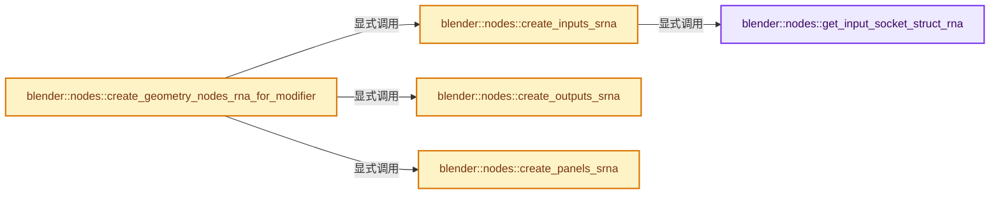
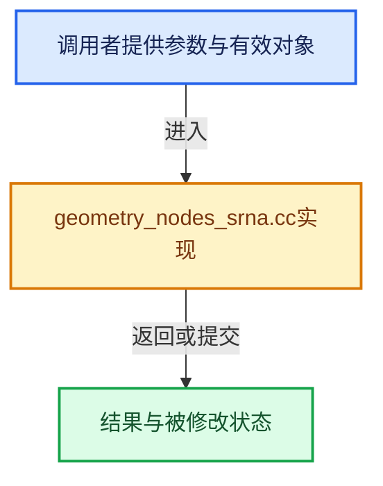

# 实现依赖专题：source/blender/nodes/intern/geometry_nodes_srna.cc

[实现依赖导航](../../README.md) · [符号索引](../../../00-课程指南/02-源码与提交索引/符号依赖与实现索引.md)

本专题从正文实际调用进入，集中保存共享实现。函数有稳定锚点，可从调用处直接跳到对应完整函数；递归与互相调用通过回链组织。

## 本文件的实现关系






## 完整成员与函数实现

<a id="f-1b682ff0c2d3f7f3"></a>

### `blender::nodes::get_input_socket_struct_rna`

实现位置：[source/blender/nodes/intern/geometry_nodes_srna.cc](../../../../../../../source/blender/nodes/intern/geometry_nodes_srna.cc) · L94—L114。

接口参数：

- `const bNodeTree &tree`
- `const bNodeTreeInterfaceSocket &socket`
- `GeneratedTreeSrnaData &r_generated`

**教学注释版**

<!-- annotated:1b95eb32357bd8 -->

```cpp
static StructRNA *get_input_socket_struct_rna(const bNodeTree &tree,
                                              const bNodeTreeInterfaceSocket &socket,
                                              GeneratedTreeSrnaData &r_generated)
{
  const bke::bNodeSocketType *stype = socket.socket_typeinfo();
  if (!stype) {
    return nullptr;
  }
  // TODO: Does this actually need to copy the string?
  const StringRefNull srna_identifier = r_generated.scope.allocator().copy_string(
      socket.identifier);

  StructRNA *srna = RNA_def_struct_ptr(
      r_generated.generated_rna, srna_identifier.c_str(), RNA_PropertyGroup);
  RNA_def_struct_path_func_runtime(srna, rna_NodesModifierPropertyInput_path);
  if (stype->make_geometry_nodes_input_srna) {
    stype->make_geometry_nodes_input_srna(tree, *srna, socket, r_generated);
  }

  return srna;
}
```

<details>
<summary>核对原始源码：source/blender/nodes/intern/geometry_nodes_srna.cc · L94—L114</summary>

<!-- original:1b95eb32357bd8:source/blender/nodes/intern/geometry_nodes_srna.cc:94:114 -->

```cpp
static StructRNA *get_input_socket_struct_rna(const bNodeTree &tree,
                                              const bNodeTreeInterfaceSocket &socket,
                                              GeneratedTreeSrnaData &r_generated)
{
  const bke::bNodeSocketType *stype = socket.socket_typeinfo();
  if (!stype) {
    return nullptr;
  }
  // TODO: Does this actually need to copy the string?
  const StringRefNull srna_identifier = r_generated.scope.allocator().copy_string(
      socket.identifier);

  StructRNA *srna = RNA_def_struct_ptr(
      r_generated.generated_rna, srna_identifier.c_str(), RNA_PropertyGroup);
  RNA_def_struct_path_func_runtime(srna, rna_NodesModifierPropertyInput_path);
  if (stype->make_geometry_nodes_input_srna) {
    stype->make_geometry_nodes_input_srna(tree, *srna, socket, r_generated);
  }

  return srna;
}
```

</details>

**结果出口**

- `return nullptr;`
- `return srna;`

**继续追踪实现**

- `socket.socket_typeinfo` → [blender::bNodeTreeInterfaceSocket::socket_typeinfo · L770](../../02-BKE几何与数据/intern/node_tree_interface.cc.md#f-f6d586e3bc159207)。
- `r_generated.scope.allocator().copy_string` → [调用协议](../../../00-课程指南/01-路线与规范/模板宏与动态分派协议.md)：接收对象类型依赖auto、返回值或模板实例；不按同名猜测目标。调用位置L103。
- `r_generated.scope.allocator` → [调用协议](../../../00-课程指南/01-路线与规范/模板宏与动态分派协议.md)：接收对象类型依赖auto、返回值或模板实例；不按同名猜测目标。调用位置L103。
- `RNA_def_struct_ptr` → [blender::RNA_def_struct_ptr · L805](../../08-其他Blender模块/makesrna/intern/rna_define.cc.md#f-37cc235892d0094b)。
- `srna_identifier.c_str` → [blender::StringRefNull::c_str · L544](../../../01-基础容器与现代CPP/15-StringRef字符串视图.md#f-4a8bbfe1e6d00757)。
- `RNA_def_struct_path_func_runtime` → [blender::RNA_def_struct_path_func_runtime · L1129](../../08-其他Blender模块/makesrna/intern/rna_define.cc.md#f-e8faada524c15119)。
- `stype->make_geometry_nodes_input_srna` → [调用协议](../../../00-课程指南/01-路线与规范/模板宏与动态分派协议.md)：由接收对象具体类型或运行时策略提供实现。调用位置L110。

<a id="f-e6cf32e28136adb0"></a>

### `blender::nodes::create_inputs_srna`

实现位置：[source/blender/nodes/intern/geometry_nodes_srna.cc](../../../../../../../source/blender/nodes/intern/geometry_nodes_srna.cc) · L116—L133。

接口参数：

- `const bNodeTree &tree`
- `GeneratedTreeSrnaData &r_generated`

**教学注释版**

<!-- annotated:22a0e0c6881251 -->

```cpp
static StructRNA *create_inputs_srna(const bNodeTree &tree, GeneratedTreeSrnaData &r_generated)
{
  StructRNA *srna = RNA_def_struct_ptr(
      r_generated.generated_rna, "GeometryNodesInterfaceInputs", RNA_PropertyGroup);

  for (const bNodeTreeInterfaceSocket *socket : tree.interface_inputs()) {
    StructRNA *socket_srna = get_input_socket_struct_rna(tree, *socket, r_generated);
    if (!socket_srna) {
      continue;
    }
    const StringRefNull identifier = r_generated.scope.allocator().copy_string(socket->identifier);
    PropertyRNA *prop = RNA_def_pointer_runtime(
        srna, identifier.c_str(), socket_srna, socket->name().c_str(), "");
    RNA_def_property_override_flag(prop, PROPOVERRIDE_OVERRIDABLE_LIBRARY);
  }

  return srna;
}
```

<details>
<summary>核对原始源码：source/blender/nodes/intern/geometry_nodes_srna.cc · L116—L133</summary>

<!-- original:22a0e0c6881251:source/blender/nodes/intern/geometry_nodes_srna.cc:116:133 -->

```cpp
static StructRNA *create_inputs_srna(const bNodeTree &tree, GeneratedTreeSrnaData &r_generated)
{
  StructRNA *srna = RNA_def_struct_ptr(
      r_generated.generated_rna, "GeometryNodesInterfaceInputs", RNA_PropertyGroup);

  for (const bNodeTreeInterfaceSocket *socket : tree.interface_inputs()) {
    StructRNA *socket_srna = get_input_socket_struct_rna(tree, *socket, r_generated);
    if (!socket_srna) {
      continue;
    }
    const StringRefNull identifier = r_generated.scope.allocator().copy_string(socket->identifier);
    PropertyRNA *prop = RNA_def_pointer_runtime(
        srna, identifier.c_str(), socket_srna, socket->name().c_str(), "");
    RNA_def_property_override_flag(prop, PROPOVERRIDE_OVERRIDABLE_LIBRARY);
  }

  return srna;
}
```

</details>

**结果出口**

- `return srna;`

**继续追踪实现**

- `RNA_def_struct_ptr` → [blender::RNA_def_struct_ptr · L805](../../08-其他Blender模块/makesrna/intern/rna_define.cc.md#f-37cc235892d0094b)。
- `tree.interface_inputs` → [blender::bNodeTree::interface_inputs · L675](../../02-BKE几何与数据/BKE_node_runtime.hh.md#f-b5decde7a09fbf57)；[blender::bNodeTree::interface_inputs · L681](../../02-BKE几何与数据/BKE_node_runtime.hh.md#f-f999995c05009884)。同名重载需按实参类型选择。
- `get_input_socket_struct_rna` → [blender::nodes::get_input_socket_struct_rna · L94](geometry_nodes_srna.cc.md#f-1b682ff0c2d3f7f3)。
- `r_generated.scope.allocator().copy_string` → [调用协议](../../../00-课程指南/01-路线与规范/模板宏与动态分派协议.md)：接收对象类型依赖auto、返回值或模板实例；不按同名猜测目标。调用位置L126。
- `r_generated.scope.allocator` → [调用协议](../../../00-课程指南/01-路线与规范/模板宏与动态分派协议.md)：接收对象类型依赖auto、返回值或模板实例；不按同名猜测目标。调用位置L126。
- `RNA_def_pointer_runtime` → [blender::RNA_def_pointer_runtime · L4608](../../08-其他Blender模块/makesrna/intern/rna_define.cc.md#f-69b55a92fad49c1b)。
- `identifier.c_str` → [blender::StringRefNull::c_str · L544](../../../01-基础容器与现代CPP/15-StringRef字符串视图.md#f-4a8bbfe1e6d00757)。
- `socket->name().c_str` → [调用协议](../../../00-课程指南/01-路线与规范/模板宏与动态分派协议.md)：接收对象类型依赖auto、返回值或模板实例；不按同名猜测目标。调用位置L128。
- `socket->name` → [调用协议](../../../00-课程指南/01-路线与规范/模板宏与动态分派协议.md)：接收对象类型依赖auto、返回值或模板实例；不按同名猜测目标。调用位置L128。
- `RNA_def_property_override_flag` → [blender::RNA_def_property_override_flag · L1452](../../08-其他Blender模块/makesrna/intern/rna_define.cc.md#f-50543b30d1114f2f)。

<a id="f-d71eea4b2394c97d"></a>

### `blender::nodes::create_outputs_srna`

实现位置：[source/blender/nodes/intern/geometry_nodes_srna.cc](../../../../../../../source/blender/nodes/intern/geometry_nodes_srna.cc) · L144—L178。

接口参数：

- `const bNodeTree &tree`
- `GeneratedTreeSrnaData &r_generated`

**教学注释版**

<!-- annotated:06397495f85475 -->

```cpp
static StructRNA *create_outputs_srna(const bNodeTree &tree, GeneratedTreeSrnaData &r_generated)
{
  StructRNA *srna = RNA_def_struct_ptr(
      r_generated.generated_rna, "GeometryNodesInterfaceOutputs", RNA_PropertyGroup);

  LinearAllocator<> &allocator = r_generated.scope.allocator();

  for (const bNodeTreeInterfaceSocket *output : tree.interface_outputs()) {
    const bke::bNodeSocketType *socket_type = bke::node_socket_type_find(output->socket_type);
    if (!nodes::socket_type_supports_attributes(socket_type->type)) {
      continue;
    }

    const StringRefNull identifier = allocator.copy_string(output->identifier);
    const StringRefNull name = allocator.copy_string(output->name());
    const StringRefNull description = allocator.copy_string(output->description());
    const StringRefNull default_value = allocator.copy_string(output->default_attribute_name);

    StructRNA *output_srna = RNA_def_struct_ptr(
        r_generated.generated_rna, identifier.c_str(), RNA_PropertyGroup);
    RNA_def_struct_path_func_runtime(output_srna, rna_NodesModifierPropertyOutput_path);
    PropertyRNA *prop = RNA_def_string(output_srna,
                                       "attribute_name",
                                       default_value.is_empty() ? nullptr : default_value.c_str(),
                                       0,
                                       name.c_str(),
                                       description.c_str());
    RNA_def_property_flag(prop, PROP_FORCE_GEOMETRY_EVAL);
    RNA_def_property_override_flag(prop, PROPOVERRIDE_OVERRIDABLE_LIBRARY);
    prop = RNA_def_pointer_runtime(srna, identifier.c_str(), output_srna, name.c_str(), "");
    RNA_def_property_override_flag(prop, PROPOVERRIDE_OVERRIDABLE_LIBRARY);
  }

  return srna;
}
```

<details>
<summary>核对原始源码：source/blender/nodes/intern/geometry_nodes_srna.cc · L144—L178</summary>

<!-- original:06397495f85475:source/blender/nodes/intern/geometry_nodes_srna.cc:144:178 -->

```cpp
static StructRNA *create_outputs_srna(const bNodeTree &tree, GeneratedTreeSrnaData &r_generated)
{
  StructRNA *srna = RNA_def_struct_ptr(
      r_generated.generated_rna, "GeometryNodesInterfaceOutputs", RNA_PropertyGroup);

  LinearAllocator<> &allocator = r_generated.scope.allocator();

  for (const bNodeTreeInterfaceSocket *output : tree.interface_outputs()) {
    const bke::bNodeSocketType *socket_type = bke::node_socket_type_find(output->socket_type);
    if (!nodes::socket_type_supports_attributes(socket_type->type)) {
      continue;
    }

    const StringRefNull identifier = allocator.copy_string(output->identifier);
    const StringRefNull name = allocator.copy_string(output->name());
    const StringRefNull description = allocator.copy_string(output->description());
    const StringRefNull default_value = allocator.copy_string(output->default_attribute_name);

    StructRNA *output_srna = RNA_def_struct_ptr(
        r_generated.generated_rna, identifier.c_str(), RNA_PropertyGroup);
    RNA_def_struct_path_func_runtime(output_srna, rna_NodesModifierPropertyOutput_path);
    PropertyRNA *prop = RNA_def_string(output_srna,
                                       "attribute_name",
                                       default_value.is_empty() ? nullptr : default_value.c_str(),
                                       0,
                                       name.c_str(),
                                       description.c_str());
    RNA_def_property_flag(prop, PROP_FORCE_GEOMETRY_EVAL);
    RNA_def_property_override_flag(prop, PROPOVERRIDE_OVERRIDABLE_LIBRARY);
    prop = RNA_def_pointer_runtime(srna, identifier.c_str(), output_srna, name.c_str(), "");
    RNA_def_property_override_flag(prop, PROPOVERRIDE_OVERRIDABLE_LIBRARY);
  }

  return srna;
}
```

</details>

**沿实际写入检查状态**

- `prop = RNA_def_pointer_runtime(srna, identifier.c_str(), output_srna, name.c_str(), "");`

**结果出口**

- `return srna;`

**继续追踪实现**

- `RNA_def_struct_ptr` → [blender::RNA_def_struct_ptr · L805](../../08-其他Blender模块/makesrna/intern/rna_define.cc.md#f-37cc235892d0094b)。
- `r_generated.scope.allocator` → [调用协议](../../../00-课程指南/01-路线与规范/模板宏与动态分派协议.md)：接收对象类型依赖auto、返回值或模板实例；不按同名猜测目标。调用位置L149。
- `tree.interface_outputs` → [blender::bNodeTree::interface_outputs · L687](../../02-BKE几何与数据/BKE_node_runtime.hh.md#f-6ce8b655d24a2365)；[blender::bNodeTree::interface_outputs · L693](../../02-BKE几何与数据/BKE_node_runtime.hh.md#f-64e16fb2a089e741)。同名重载需按实参类型选择。
- `bke::node_socket_type_find` → [blender::bke::node_socket_type_find · L2966](../../02-BKE几何与数据/intern/node.cc.md#f-69979d36f9912943)。
- `nodes::socket_type_supports_attributes` → [blender::nodes::socket_type_supports_attributes · L677](node_socket.cc.md#f-ebab61bf582595c6)。
- `allocator.copy_string` → [blender::LinearAllocator::copy_string · L174](../../../03-内存分配与运行时类型/03-LinearAllocator分配与扩展.md#f-78f19108ed967ade)。
- `output->name` → [调用协议](../../../00-课程指南/01-路线与规范/模板宏与动态分派协议.md)：接收对象类型依赖auto、返回值或模板实例；不按同名猜测目标。调用位置L158。
- `output->description` → [调用协议](../../../00-课程指南/01-路线与规范/模板宏与动态分派协议.md)：接收对象类型依赖auto、返回值或模板实例；不按同名猜测目标。调用位置L159。
- `identifier.c_str` → [blender::StringRefNull::c_str · L544](../../../01-基础容器与现代CPP/15-StringRef字符串视图.md#f-4a8bbfe1e6d00757)。
- `RNA_def_struct_path_func_runtime` → [blender::RNA_def_struct_path_func_runtime · L1129](../../08-其他Blender模块/makesrna/intern/rna_define.cc.md#f-e8faada524c15119)。
- `RNA_def_string` → [blender::RNA_def_string · L4108](../../08-其他Blender模块/makesrna/intern/rna_define.cc.md#f-285afd3ce13c7f38)。
- `default_value.is_empty` → [blender::nodes::Bundle::is_empty · L483](../NOD_geometry_nodes_bundle.hh.md#f-a112ec28493ab618)。
- `default_value.c_str` → [blender::StringRefNull::c_str · L544](../../../01-基础容器与现代CPP/15-StringRef字符串视图.md#f-4a8bbfe1e6d00757)。
- `name.c_str` → [blender::StringRefNull::c_str · L544](../../../01-基础容器与现代CPP/15-StringRef字符串视图.md#f-4a8bbfe1e6d00757)。
- `description.c_str` → [blender::StringRefNull::c_str · L544](../../../01-基础容器与现代CPP/15-StringRef字符串视图.md#f-4a8bbfe1e6d00757)。
- `RNA_def_property_flag` → [blender::RNA_def_property_flag · L1407](../../08-其他Blender模块/makesrna/intern/rna_define.cc.md#f-5cf166a170a67318)。
- `RNA_def_property_override_flag` → [blender::RNA_def_property_override_flag · L1452](../../08-其他Blender模块/makesrna/intern/rna_define.cc.md#f-50543b30d1114f2f)。
- `RNA_def_pointer_runtime` → [blender::RNA_def_pointer_runtime · L4608](../../08-其他Blender模块/makesrna/intern/rna_define.cc.md#f-69b55a92fad49c1b)。

<a id="f-065672fb9aaf9378"></a>

### `blender::nodes::create_panels_srna`

实现位置：[source/blender/nodes/intern/geometry_nodes_srna.cc](../../../../../../../source/blender/nodes/intern/geometry_nodes_srna.cc) · L180—L204。

接口参数：

- `const bNodeTree &tree`
- `GeneratedTreeSrnaData &r_generated`

**教学注释版**

<!-- annotated:f3d810f2131230 -->

```cpp
static StructRNA *create_panels_srna(const bNodeTree &tree, GeneratedTreeSrnaData &r_generated)
{
  StructRNA *srna = RNA_def_struct_ptr(
      r_generated.generated_rna, "GeometryNodesInterfacePanels", RNA_PropertyGroup);

  LinearAllocator<> &allocator = r_generated.scope.allocator();

  tree.ensure_interface_cache();
  for (const bNodeTreeInterfaceItem *item : tree.interface_items()) {
    if (item->item_type != NodeTreeInterfaceItemType::Panel) {
      continue;
    }
    const auto &panel = *reinterpret_cast<const bNodeTreeInterfacePanel *>(item);
    const StringRefNull identifier = allocator.copy_string(
        fmt::format("open_{}", panel.identifier));
    PropertyRNA *prop = RNA_def_boolean(srna,
                                        identifier.c_str(),
                                        !(panel.flag & NODE_INTERFACE_PANEL_DEFAULT_CLOSED),
                                        "Is Open",
                                        "");
    RNA_def_property_flag(prop, PROP_NO_DEG_UPDATE);
  }

  return srna;
}
```

<details>
<summary>核对原始源码：source/blender/nodes/intern/geometry_nodes_srna.cc · L180—L204</summary>

<!-- original:f3d810f2131230:source/blender/nodes/intern/geometry_nodes_srna.cc:180:204 -->

```cpp
static StructRNA *create_panels_srna(const bNodeTree &tree, GeneratedTreeSrnaData &r_generated)
{
  StructRNA *srna = RNA_def_struct_ptr(
      r_generated.generated_rna, "GeometryNodesInterfacePanels", RNA_PropertyGroup);

  LinearAllocator<> &allocator = r_generated.scope.allocator();

  tree.ensure_interface_cache();
  for (const bNodeTreeInterfaceItem *item : tree.interface_items()) {
    if (item->item_type != NodeTreeInterfaceItemType::Panel) {
      continue;
    }
    const auto &panel = *reinterpret_cast<const bNodeTreeInterfacePanel *>(item);
    const StringRefNull identifier = allocator.copy_string(
        fmt::format("open_{}", panel.identifier));
    PropertyRNA *prop = RNA_def_boolean(srna,
                                        identifier.c_str(),
                                        !(panel.flag & NODE_INTERFACE_PANEL_DEFAULT_CLOSED),
                                        "Is Open",
                                        "");
    RNA_def_property_flag(prop, PROP_NO_DEG_UPDATE);
  }

  return srna;
}
```

</details>

**结果出口**

- `return srna;`

**继续追踪实现**

- `RNA_def_struct_ptr` → [blender::RNA_def_struct_ptr · L805](../../08-其他Blender模块/makesrna/intern/rna_define.cc.md#f-37cc235892d0094b)。
- `r_generated.scope.allocator` → [调用协议](../../../00-课程指南/01-路线与规范/模板宏与动态分派协议.md)：接收对象类型依赖auto、返回值或模板实例；不按同名猜测目标。调用位置L185。
- `tree.ensure_interface_cache` → [blender::bNodeTree::ensure_interface_cache · L670](../../02-BKE几何与数据/BKE_node_runtime.hh.md#f-73fea7b58035b1f9)。
- `tree.interface_items` → [blender::bNodeTree::interface_items · L699](../../02-BKE几何与数据/BKE_node_runtime.hh.md#f-a4378b71bb958204)；[blender::bNodeTree::interface_items · L705](../../02-BKE几何与数据/BKE_node_runtime.hh.md#f-12f77272cc5b4792)。同名重载需按实参类型选择。
- `allocator.copy_string` → [blender::LinearAllocator::copy_string · L174](../../../03-内存分配与运行时类型/03-LinearAllocator分配与扩展.md#f-78f19108ed967ade)。
- `fmt::format` → [外部契约](https://fmt.dev/latest/api/)：按fmt接口的格式字符串与参数类型契约使用，格式化不改变被格式化对象的拥有关系。
- `RNA_def_boolean` → [blender::RNA_def_boolean · L3914](../../08-其他Blender模块/makesrna/intern/rna_define.cc.md#f-405e176adda90717)。
- `identifier.c_str` → [blender::StringRefNull::c_str · L544](../../../01-基础容器与现代CPP/15-StringRef字符串视图.md#f-4a8bbfe1e6d00757)。
- `RNA_def_property_flag` → [blender::RNA_def_property_flag · L1407](../../08-其他Blender模块/makesrna/intern/rna_define.cc.md#f-5cf166a170a67318)。

<a id="f-d532eb78bfafd966"></a>

### `blender::nodes::create_geometry_nodes_rna_for_modifier`

实现位置：[source/blender/nodes/intern/geometry_nodes_srna.cc](../../../../../../../source/blender/nodes/intern/geometry_nodes_srna.cc) · L206—L232。

接口参数：

- `const bNodeTree &tree`

**教学注释版**

<!-- annotated:ec344bde022326 -->

```cpp
std::shared_ptr<GeneratedTreeSrnaData> create_geometry_nodes_rna_for_modifier(
    const bNodeTree &tree)
{
  PRF_scope(ProfileCategory::Core);
  // [讲解] std::make_unique<GeneratedTreeSrnaData>：创建独占拥有的对象，拥有关系可移动，get返回的借用指针不自动延长寿命。
  auto generated = std::make_unique<GeneratedTreeSrnaData>();
  tree.ensure_interface_cache();

  StructRNA *srna = RNA_def_struct_ptr(
      generated->generated_rna, "GeometryNodesModifierInterface", RNA_NodesModifierProperties);
  generated->properties_struct = srna;

  StructRNA *inputs_srna = create_inputs_srna(tree, *generated);
  StructRNA *outputs_srna = create_outputs_srna(tree, *generated);
  StructRNA *panels_srna = create_panels_srna(tree, *generated);

  PropertyRNA *prop;
  prop = RNA_def_pointer_runtime(
      srna, "inputs", inputs_srna, "Inputs", "Settings for input sockets");
  RNA_def_property_override_flag(prop, PROPOVERRIDE_OVERRIDABLE_LIBRARY);
  prop = RNA_def_pointer_runtime(
      srna, "outputs", outputs_srna, "Outputs", "Settings for output sockets");
  RNA_def_property_override_flag(prop, PROPOVERRIDE_OVERRIDABLE_LIBRARY);
  prop = RNA_def_pointer_runtime(srna, "panels", panels_srna, "Panels", "Settings for panels");
  RNA_def_property_override_flag(prop, PROPOVERRIDE_OVERRIDABLE_LIBRARY);

  return generated;
}
```

<details>
<summary>核对原始源码：source/blender/nodes/intern/geometry_nodes_srna.cc · L206—L232</summary>

<!-- original:ec344bde022326:source/blender/nodes/intern/geometry_nodes_srna.cc:206:232 -->

```cpp
std::shared_ptr<GeneratedTreeSrnaData> create_geometry_nodes_rna_for_modifier(
    const bNodeTree &tree)
{
  PRF_scope(ProfileCategory::Core);
  auto generated = std::make_unique<GeneratedTreeSrnaData>();
  tree.ensure_interface_cache();

  StructRNA *srna = RNA_def_struct_ptr(
      generated->generated_rna, "GeometryNodesModifierInterface", RNA_NodesModifierProperties);
  generated->properties_struct = srna;

  StructRNA *inputs_srna = create_inputs_srna(tree, *generated);
  StructRNA *outputs_srna = create_outputs_srna(tree, *generated);
  StructRNA *panels_srna = create_panels_srna(tree, *generated);

  PropertyRNA *prop;
  prop = RNA_def_pointer_runtime(
      srna, "inputs", inputs_srna, "Inputs", "Settings for input sockets");
  RNA_def_property_override_flag(prop, PROPOVERRIDE_OVERRIDABLE_LIBRARY);
  prop = RNA_def_pointer_runtime(
      srna, "outputs", outputs_srna, "Outputs", "Settings for output sockets");
  RNA_def_property_override_flag(prop, PROPOVERRIDE_OVERRIDABLE_LIBRARY);
  prop = RNA_def_pointer_runtime(srna, "panels", panels_srna, "Panels", "Settings for panels");
  RNA_def_property_override_flag(prop, PROPOVERRIDE_OVERRIDABLE_LIBRARY);

  return generated;
}
```

</details>

**沿实际写入检查状态**

- `generated->properties_struct = srna;`
- `prop = RNA_def_pointer_runtime(`
- `prop = RNA_def_pointer_runtime(srna, "panels", panels_srna, "Panels", "Settings for panels");`

**结果出口**

- `return generated;`

**继续追踪实现**

- `PRF_scope` → [PRF_scope · L51](../../07-Intern运行时与平台/profile/PRF_profile.hh.md#m-9f5e4ea0487b)；[PRF_scope · L90](../../07-Intern运行时与平台/profile/PRF_profile.hh.md#m-8fc74ae4419e)。宏定义由构建条件选择。
- `std::make_unique<GeneratedTreeSrnaData>` → [外部契约](https://eel.is/c++draft/unique.ptr.create)：创建独占拥有的对象，拥有关系可移动，get返回的借用指针不自动延长寿命。
- `tree.ensure_interface_cache` → [blender::bNodeTree::ensure_interface_cache · L670](../../02-BKE几何与数据/BKE_node_runtime.hh.md#f-73fea7b58035b1f9)。
- `RNA_def_struct_ptr` → [blender::RNA_def_struct_ptr · L805](../../08-其他Blender模块/makesrna/intern/rna_define.cc.md#f-37cc235892d0094b)。
- `create_inputs_srna` → [blender::nodes::create_inputs_srna · L116](geometry_nodes_srna.cc.md#f-e6cf32e28136adb0)。
- `create_outputs_srna` → [blender::nodes::create_outputs_srna · L144](geometry_nodes_srna.cc.md#f-d71eea4b2394c97d)。
- `create_panels_srna` → [blender::nodes::create_panels_srna · L180](geometry_nodes_srna.cc.md#f-065672fb9aaf9378)。
- `RNA_def_pointer_runtime` → [blender::RNA_def_pointer_runtime · L4608](../../08-其他Blender模块/makesrna/intern/rna_define.cc.md#f-69b55a92fad49c1b)。
- `RNA_def_property_override_flag` → [blender::RNA_def_property_override_flag · L1452](../../08-其他Blender模块/makesrna/intern/rna_define.cc.md#f-50543b30d1114f2f)。
