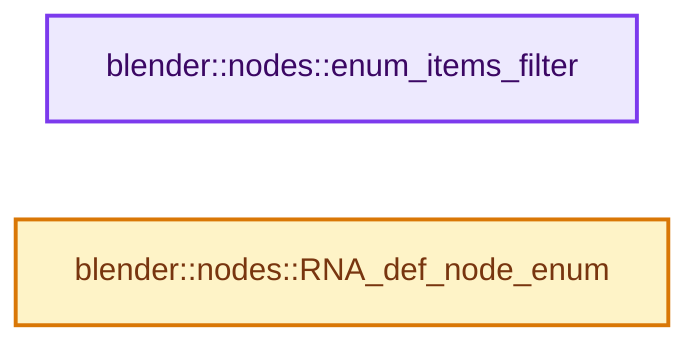

# 实现依赖专题：source/blender/nodes/intern/node_rna_define.cc

[实现依赖导航](../../README.md) · [符号索引](../../../00-课程指南/02-源码与提交索引/符号依赖与实现索引.md)

本专题从正文实际调用进入，集中保存共享实现。函数有稳定锚点，可从调用处直接跳到对应完整函数；递归与互相调用通过回链组织。

## 本文件的实现关系




## 完整成员与函数实现

<a id="f-a364b9e5c0cb6ff4"></a>

### `blender::nodes::enum_items_filter`

实现位置：[source/blender/nodes/intern/node_rna_define.cc](../../../../../../../source/blender/nodes/intern/node_rna_define.cc) · L13—L27。

接口参数：

- `const EnumPropertyItem *original_item_array`
- `FunctionRef<bool(const EnumPropertyItem &item)> fn`
- `const EnumPropertyItem &item`

**教学注释版**

<!-- annotated:736850a97af219 -->

```cpp
const EnumPropertyItem *enum_items_filter(const EnumPropertyItem *original_item_array,
                                          FunctionRef<bool(const EnumPropertyItem &item)> fn)
{
  EnumPropertyItem *item_array = nullptr;
  int items_len = 0;

  for (const EnumPropertyItem *item = original_item_array; item->identifier != nullptr; item++) {
    if (fn(*item)) {
      RNA_enum_item_add(&item_array, &items_len, item);
    }
  }

  RNA_enum_item_end(&item_array, &items_len);
  return item_array;
}
```

<details>
<summary>核对原始源码：source/blender/nodes/intern/node_rna_define.cc · L13—L27</summary>

<!-- original:736850a97af219:source/blender/nodes/intern/node_rna_define.cc:13:27 -->

```cpp
const EnumPropertyItem *enum_items_filter(const EnumPropertyItem *original_item_array,
                                          FunctionRef<bool(const EnumPropertyItem &item)> fn)
{
  EnumPropertyItem *item_array = nullptr;
  int items_len = 0;

  for (const EnumPropertyItem *item = original_item_array; item->identifier != nullptr; item++) {
    if (fn(*item)) {
      RNA_enum_item_add(&item_array, &items_len, item);
    }
  }

  RNA_enum_item_end(&item_array, &items_len);
  return item_array;
}
```

</details>

**结果出口**

- `return item_array;`

**继续追踪实现**

- `fn` → [调用协议](../../../00-课程指南/01-路线与规范/模板宏与动态分派协议.md)：局部可调用对象，须结合其初始化与捕获环境。调用位置L20。
- `RNA_enum_item_add` → [blender::RNA_enum_item_add · L4862](../../08-其他Blender模块/makesrna/intern/rna_define.cc.md#f-7ef8ef19be1b44b0)。
- `RNA_enum_item_end` → [blender::RNA_enum_item_end · L4914](../../08-其他Blender模块/makesrna/intern/rna_define.cc.md#f-a100854d723a014b)。

<a id="f-d3c04fc562565860"></a>

### `blender::nodes::RNA_def_node_enum`

实现位置：[source/blender/nodes/intern/node_rna_define.cc](../../../../../../../source/blender/nodes/intern/node_rna_define.cc) · L29—L56。

接口参数：

- `StructRNA *srna`
- `const char *identifier`
- `const char *ui_name`
- `const char *ui_description`
- `const EnumPropertyItem *static_items`
- `const EnumRNAAccessors accessors`
- `std::optional<int> default_value`
- `const EnumPropertyItemFunc item_func`
- `const bool allow_animation`

**教学注释版**

<!-- annotated:6188106cd26114 -->

```cpp
PropertyRNA *RNA_def_node_enum(StructRNA *srna,
                               const char *identifier,
                               const char *ui_name,
                               const char *ui_description,
                               const EnumPropertyItem *static_items,
                               const EnumRNAAccessors accessors,
                               std::optional<int> default_value,
                               const EnumPropertyItemFunc item_func,
                               const bool allow_animation)
{
  PropertyRNA *prop = RNA_def_property(srna, identifier, PROP_ENUM, PROP_NONE);
  RNA_def_property_enum_funcs_runtime(
      prop, accessors.getter, accessors.setter, item_func, nullptr, nullptr);
  RNA_def_property_enum_items(prop, static_items);
  if (default_value.has_value()) {
    RNA_def_property_enum_default(prop, *default_value);
  }
  RNA_def_property_ui_text(prop, ui_name, ui_description);
  if (allow_animation) {
    RNA_def_property_update_runtime(prop, rna_Node_update);
  }
  else {
    RNA_def_property_clear_flag(prop, PROP_ANIMATABLE);
    RNA_def_property_update_runtime(prop, rna_Node_socket_update);
  }
  RNA_def_property_update_notifier(prop, NC_NODE | NA_EDITED);
  return prop;
}
```

<details>
<summary>核对原始源码：source/blender/nodes/intern/node_rna_define.cc · L29—L56</summary>

<!-- original:6188106cd26114:source/blender/nodes/intern/node_rna_define.cc:29:56 -->

```cpp
PropertyRNA *RNA_def_node_enum(StructRNA *srna,
                               const char *identifier,
                               const char *ui_name,
                               const char *ui_description,
                               const EnumPropertyItem *static_items,
                               const EnumRNAAccessors accessors,
                               std::optional<int> default_value,
                               const EnumPropertyItemFunc item_func,
                               const bool allow_animation)
{
  PropertyRNA *prop = RNA_def_property(srna, identifier, PROP_ENUM, PROP_NONE);
  RNA_def_property_enum_funcs_runtime(
      prop, accessors.getter, accessors.setter, item_func, nullptr, nullptr);
  RNA_def_property_enum_items(prop, static_items);
  if (default_value.has_value()) {
    RNA_def_property_enum_default(prop, *default_value);
  }
  RNA_def_property_ui_text(prop, ui_name, ui_description);
  if (allow_animation) {
    RNA_def_property_update_runtime(prop, rna_Node_update);
  }
  else {
    RNA_def_property_clear_flag(prop, PROP_ANIMATABLE);
    RNA_def_property_update_runtime(prop, rna_Node_socket_update);
  }
  RNA_def_property_update_notifier(prop, NC_NODE | NA_EDITED);
  return prop;
}
```

</details>

**结果出口**

- `return prop;`

**继续追踪实现**

- `RNA_def_property` → [blender::RNA_def_property · L1176](../../08-其他Blender模块/makesrna/intern/rna_define.cc.md#f-91e73ed6728edac6)。
- `RNA_def_property_enum_funcs_runtime` → [blender::RNA_def_property_enum_funcs_runtime · L3461](../../08-其他Blender模块/makesrna/intern/rna_define.cc.md#f-ca0801ff1a3e2576)。
- `RNA_def_property_enum_items` → [blender::RNA_def_property_enum_items · L1897](../../08-其他Blender模块/makesrna/intern/rna_define.cc.md#f-085323a02a3ce626)。
- `default_value.has_value` → [外部契约](https://eel.is/c++draft/)：这个边界按实际表达式及所属类型核对参数、返回值、寿命与失败行为。这里提供接口入口，不声称已解释该第三方版本的内部实现。
- `RNA_def_property_enum_default` → [blender::RNA_def_property_enum_default · L2251](../../08-其他Blender模块/makesrna/intern/rna_define.cc.md#f-804874f9251d9dd3)。
- `RNA_def_property_ui_text` → [blender::RNA_def_property_ui_text · L1620](../../08-其他Blender模块/makesrna/intern/rna_define.cc.md#f-d30766910207a8d5)。
- `RNA_def_property_update_runtime` → [blender::RNA_def_property_update_runtime · L3104](../../08-其他Blender模块/makesrna/intern/rna_define.cc.md#f-ab4ee2b535e22bc9)。
- `RNA_def_property_clear_flag` → [blender::RNA_def_property_clear_flag · L1441](../../08-其他Blender模块/makesrna/intern/rna_define.cc.md#f-e8d5b4f5e5ff2472)。
- `RNA_def_property_update_notifier` → [blender::RNA_def_property_update_notifier · L3116](../../08-其他Blender模块/makesrna/intern/rna_define.cc.md#f-2edd3828db34faf0)。
