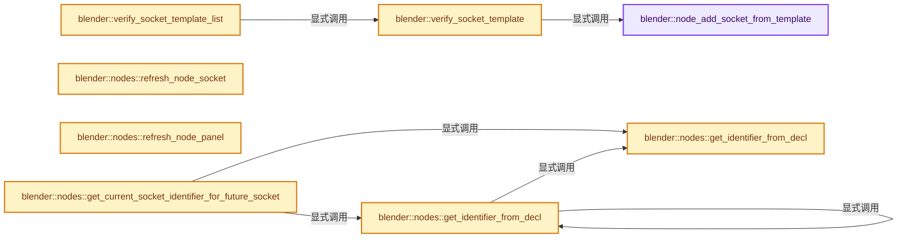
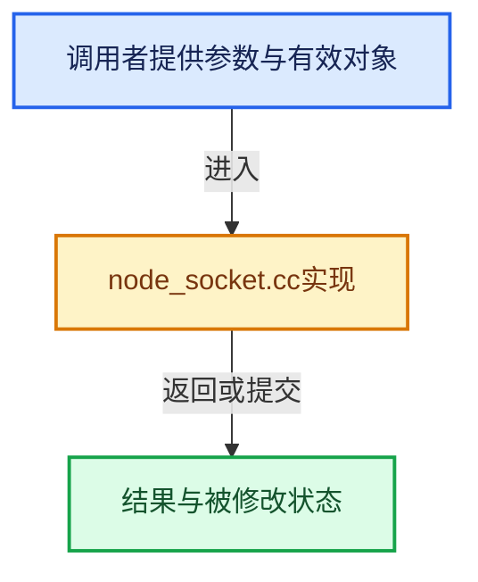

# 实现依赖专题：source/blender/nodes/intern/node_socket.cc

[实现依赖导航](../../README.md) · [符号索引](../../../00-课程指南/02-源码与提交索引/符号依赖与实现索引.md)

本专题从正文实际调用进入，集中保存共享实现。函数有稳定锚点，可从调用处直接跳到对应完整函数；递归与互相调用通过回链组织。

## 本文件的实现关系






## 完整成员与函数实现

<a id="f-68d1e5b182706aee"></a>

### `blender::node_add_socket_from_template`

实现位置：[source/blender/nodes/intern/node_socket.cc](../../../../../../../source/blender/nodes/intern/node_socket.cc) · L82—L134。

接口参数：

- `bNodeTree *ntree`
- `bNode *node`
- `bke::bNodeSocketTemplate *stemp`
- `eNodeSocketInOut in_out`

**教学注释版**

<!-- annotated:32d0e0efe3dbd2 -->

```cpp
bNodeSocket *node_add_socket_from_template(bNodeTree *ntree,
                                           bNode *node,
                                           bke::bNodeSocketTemplate *stemp,
                                           eNodeSocketInOut in_out)
{
  bNodeSocket *sock = bke::node_add_static_socket(
      *ntree, *node, in_out, stemp->type, stemp->subtype, stemp->identifier, stemp->name);

  sock->flag |= stemp->flag;

  /* initialize default_value */
  switch (stemp->type) {
    case SOCK_FLOAT: {
      bNodeSocketValueFloat *dval = static_cast<bNodeSocketValueFloat *>(sock->default_value);
      dval->value = stemp->val1;
      dval->min = stemp->min;
      dval->max = stemp->max;
      break;
    }
    case SOCK_INT: {
      bNodeSocketValueInt *dval = static_cast<bNodeSocketValueInt *>(sock->default_value);
      dval->value = int(stemp->val1);
      dval->min = int(stemp->min);
      dval->max = int(stemp->max);
      break;
    }
    case SOCK_BOOLEAN: {
      bNodeSocketValueBoolean *dval = static_cast<bNodeSocketValueBoolean *>(sock->default_value);
      dval->value = int(stemp->val1);
      break;
    }
    case SOCK_VECTOR: {
      bNodeSocketValueVector *dval = static_cast<bNodeSocketValueVector *>(sock->default_value);
      dval->value[0] = stemp->val1;
      dval->value[1] = stemp->val2;
      dval->value[2] = stemp->val3;
      dval->dimensions = 3;
      dval->min = stemp->min;
      dval->max = stemp->max;
      break;
    }
    case SOCK_RGBA: {
      bNodeSocketValueRGBA *dval = static_cast<bNodeSocketValueRGBA *>(sock->default_value);
      dval->value[0] = stemp->val1;
      dval->value[1] = stemp->val2;
      dval->value[2] = stemp->val3;
      dval->value[3] = stemp->val4;
      break;
    }
  }

  return sock;
}
```

<details>
<summary>核对原始源码：source/blender/nodes/intern/node_socket.cc · L82—L134</summary>

<!-- original:32d0e0efe3dbd2:source/blender/nodes/intern/node_socket.cc:82:134 -->

```cpp
bNodeSocket *node_add_socket_from_template(bNodeTree *ntree,
                                           bNode *node,
                                           bke::bNodeSocketTemplate *stemp,
                                           eNodeSocketInOut in_out)
{
  bNodeSocket *sock = bke::node_add_static_socket(
      *ntree, *node, in_out, stemp->type, stemp->subtype, stemp->identifier, stemp->name);

  sock->flag |= stemp->flag;

  /* initialize default_value */
  switch (stemp->type) {
    case SOCK_FLOAT: {
      bNodeSocketValueFloat *dval = static_cast<bNodeSocketValueFloat *>(sock->default_value);
      dval->value = stemp->val1;
      dval->min = stemp->min;
      dval->max = stemp->max;
      break;
    }
    case SOCK_INT: {
      bNodeSocketValueInt *dval = static_cast<bNodeSocketValueInt *>(sock->default_value);
      dval->value = int(stemp->val1);
      dval->min = int(stemp->min);
      dval->max = int(stemp->max);
      break;
    }
    case SOCK_BOOLEAN: {
      bNodeSocketValueBoolean *dval = static_cast<bNodeSocketValueBoolean *>(sock->default_value);
      dval->value = int(stemp->val1);
      break;
    }
    case SOCK_VECTOR: {
      bNodeSocketValueVector *dval = static_cast<bNodeSocketValueVector *>(sock->default_value);
      dval->value[0] = stemp->val1;
      dval->value[1] = stemp->val2;
      dval->value[2] = stemp->val3;
      dval->dimensions = 3;
      dval->min = stemp->min;
      dval->max = stemp->max;
      break;
    }
    case SOCK_RGBA: {
      bNodeSocketValueRGBA *dval = static_cast<bNodeSocketValueRGBA *>(sock->default_value);
      dval->value[0] = stemp->val1;
      dval->value[1] = stemp->val2;
      dval->value[2] = stemp->val3;
      dval->value[3] = stemp->val4;
      break;
    }
  }

  return sock;
}
```

</details>

**沿实际写入检查状态**

- `sock->flag |= stemp->flag;`
- `dval->value = stemp->val1;`
- `dval->min = stemp->min;`
- `dval->max = stemp->max;`
- `dval->value = int(stemp->val1);`
- `dval->min = int(stemp->min);`
- `dval->max = int(stemp->max);`
- `dval->value[0] = stemp->val1;`
- `dval->value[1] = stemp->val2;`
- `dval->value[2] = stemp->val3;`
- `dval->dimensions = 3;`
- `dval->value[3] = stemp->val4;`

**结果出口**

- `return sock;`

**继续追踪实现**

- `bke::node_add_static_socket` → [blender::bke::node_add_static_socket · L3980](../../02-BKE几何与数据/intern/node.cc.md#f-d6d2fde9e1919837)。

<a id="f-3025e8133e544097"></a>

### `blender::verify_socket_template`

实现位置：[source/blender/nodes/intern/node_socket.cc](../../../../../../../source/blender/nodes/intern/node_socket.cc) · L136—L165。

接口参数：

- `bNodeTree *ntree`
- `bNode *node`
- `eNodeSocketInOut in_out`
- `ListBaseT<bNodeSocket> *socklist`
- `bke::bNodeSocketTemplate *stemp`

**教学注释版**

<!-- annotated:60a3c4c08197c0 -->

```cpp
static bNodeSocket *verify_socket_template(bNodeTree *ntree,
                                           bNode *node,
                                           eNodeSocketInOut in_out,
                                           ListBaseT<bNodeSocket> *socklist,
                                           bke::bNodeSocketTemplate *stemp)
{
  bNodeSocket *sock;

  for (sock = socklist->first(); sock; sock = sock->next) {
    if (STREQLEN(sock->name, stemp->name, NODE_MAXSTR)) {
      break;
    }
  }
  if (sock) {
    if (sock->type != stemp->type) {
      bke::node_modify_socket_type_static(ntree, node, sock, stemp->type, stemp->subtype);
    }
    sock->flag |= stemp->flag;
  }
  else {
    /* no socket for this template found, make a new one */
    sock = node_add_socket_from_template(ntree, node, stemp, in_out);
  }

  /* remove the new socket from the node socket list first,
   * will be added back after verification. */
  BLI_remlink(socklist, sock);

  return sock;
}
```

<details>
<summary>核对原始源码：source/blender/nodes/intern/node_socket.cc · L136—L165</summary>

<!-- original:60a3c4c08197c0:source/blender/nodes/intern/node_socket.cc:136:165 -->

```cpp
static bNodeSocket *verify_socket_template(bNodeTree *ntree,
                                           bNode *node,
                                           eNodeSocketInOut in_out,
                                           ListBaseT<bNodeSocket> *socklist,
                                           bke::bNodeSocketTemplate *stemp)
{
  bNodeSocket *sock;

  for (sock = socklist->first(); sock; sock = sock->next) {
    if (STREQLEN(sock->name, stemp->name, NODE_MAXSTR)) {
      break;
    }
  }
  if (sock) {
    if (sock->type != stemp->type) {
      bke::node_modify_socket_type_static(ntree, node, sock, stemp->type, stemp->subtype);
    }
    sock->flag |= stemp->flag;
  }
  else {
    /* no socket for this template found, make a new one */
    sock = node_add_socket_from_template(ntree, node, stemp, in_out);
  }

  /* remove the new socket from the node socket list first,
   * will be added back after verification. */
  BLI_remlink(socklist, sock);

  return sock;
}
```

</details>

**沿实际写入检查状态**

- `sock->flag |= stemp->flag;`
- `sock = node_add_socket_from_template(ntree, node, stemp, in_out);`

**结果出口**

- `return sock;`

**继续追踪实现**

- `socklist->first` → [blender::ListBaseT::first · L102](../../08-其他Blender模块/makesdna/DNA_listBase.h.md#f-3d12ff35da057c9e)；[blender::ListBaseT::first · L106](../../08-其他Blender模块/makesdna/DNA_listBase.h.md#f-0df87c3480e059f9)。同名重载需按实参类型选择。
- `STREQLEN` → [STREQLEN · L114](../../07-Intern运行时与平台/ghost/intern/GHOST_utildefines.hh.md#m-4c9fb75cc1d1)；[STREQLEN · L453](../../01-BLI基础库/BLI_utildefines.hh.md#m-c74c1422ab62)；[STREQLEN · L56](../../07-Intern运行时与平台/clog/clog.cc.md#m-c4a18b1393b9)。宏定义由构建条件选择。
- `bke::node_modify_socket_type_static` → [blender::bke::node_modify_socket_type_static · L3448](../../02-BKE几何与数据/intern/node.cc.md#f-0e078a59542639a3)。
- `node_add_socket_from_template` → [blender::node_add_socket_from_template · L82](node_socket.cc.md#f-68d1e5b182706aee)。
- `BLI_remlink` → [blender::BLI_remlink · L138](../../01-BLI基础库/intern/listbase.cc.md#f-120d80f281ca4cb7)。

<a id="f-8fbc817a8282ce53"></a>

### `blender::verify_socket_template_list`

实现位置：[source/blender/nodes/intern/node_socket.cc](../../../../../../../source/blender/nodes/intern/node_socket.cc) · L167—L215。

接口参数：

- `bNodeTree *ntree`
- `bNode *node`
- `eNodeSocketInOut in_out`
- `ListBaseT<bNodeSocket> *socklist`
- `bke::bNodeSocketTemplate *stemp_first`

**教学注释版**

<!-- annotated:9eee94a736d43f -->

```cpp
static void verify_socket_template_list(bNodeTree *ntree,
                                        bNode *node,
                                        eNodeSocketInOut in_out,
                                        ListBaseT<bNodeSocket> *socklist,
                                        bke::bNodeSocketTemplate *stemp_first)
{
  bNodeSocket *sock, *nextsock;
  bke::bNodeSocketTemplate *stemp;

  /* no inputs anymore? */
  if (stemp_first == nullptr) {
    for (sock = socklist->first(); sock; sock = nextsock) {
      nextsock = sock->next;
      bke::node_remove_socket(*ntree, *node, *sock);
    }
  }
  else {
    /* step by step compare */
    stemp = stemp_first;
    while (stemp->type != -1) {
      stemp->sock = verify_socket_template(ntree, node, in_out, socklist, stemp);
      stemp++;
    }
    /* leftovers are removed */
    for (sock = socklist->first(); sock; sock = nextsock) {
      nextsock = sock->next;
      bke::node_remove_socket(*ntree, *node, *sock);
    }

    /* and we put back the verified sockets */
    stemp = stemp_first;
    if (socklist->first_) {
      /* Some dynamic sockets left, store the list start
       * so we can add static sockets in front of it. */
      sock = socklist->first();
      while (stemp->type != -1) {
        /* Put static sockets in front of dynamic. */
        BLI_insertlinkbefore(socklist, sock, stemp->sock);
        stemp++;
      }
    }
    else {
      while (stemp->type != -1) {
        BLI_addtail(socklist, stemp->sock);
        stemp++;
      }
    }
  }
}
```

<details>
<summary>核对原始源码：source/blender/nodes/intern/node_socket.cc · L167—L215</summary>

<!-- original:9eee94a736d43f:source/blender/nodes/intern/node_socket.cc:167:215 -->

```cpp
static void verify_socket_template_list(bNodeTree *ntree,
                                        bNode *node,
                                        eNodeSocketInOut in_out,
                                        ListBaseT<bNodeSocket> *socklist,
                                        bke::bNodeSocketTemplate *stemp_first)
{
  bNodeSocket *sock, *nextsock;
  bke::bNodeSocketTemplate *stemp;

  /* no inputs anymore? */
  if (stemp_first == nullptr) {
    for (sock = socklist->first(); sock; sock = nextsock) {
      nextsock = sock->next;
      bke::node_remove_socket(*ntree, *node, *sock);
    }
  }
  else {
    /* step by step compare */
    stemp = stemp_first;
    while (stemp->type != -1) {
      stemp->sock = verify_socket_template(ntree, node, in_out, socklist, stemp);
      stemp++;
    }
    /* leftovers are removed */
    for (sock = socklist->first(); sock; sock = nextsock) {
      nextsock = sock->next;
      bke::node_remove_socket(*ntree, *node, *sock);
    }

    /* and we put back the verified sockets */
    stemp = stemp_first;
    if (socklist->first_) {
      /* Some dynamic sockets left, store the list start
       * so we can add static sockets in front of it. */
      sock = socklist->first();
      while (stemp->type != -1) {
        /* Put static sockets in front of dynamic. */
        BLI_insertlinkbefore(socklist, sock, stemp->sock);
        stemp++;
      }
    }
    else {
      while (stemp->type != -1) {
        BLI_addtail(socklist, stemp->sock);
        stemp++;
      }
    }
  }
}
```

</details>

**沿实际写入检查状态**

- `nextsock = sock->next;`
- `stemp = stemp_first;`
- `stemp->sock = verify_socket_template(ntree, node, in_out, socklist, stemp);`
- `sock = socklist->first();`

**继续追踪实现**

- `socklist->first` → [blender::ListBaseT::first · L102](../../08-其他Blender模块/makesdna/DNA_listBase.h.md#f-3d12ff35da057c9e)；[blender::ListBaseT::first · L106](../../08-其他Blender模块/makesdna/DNA_listBase.h.md#f-0df87c3480e059f9)。同名重载需按实参类型选择。
- `bke::node_remove_socket` → [blender::bke::node_remove_socket · L4015](../../02-BKE几何与数据/intern/node.cc.md#f-20598036ce8bb344)。
- `verify_socket_template` → [blender::verify_socket_template · L136](node_socket.cc.md#f-3025e8133e544097)。
- `BLI_insertlinkbefore` → [blender::BLI_insertlinkbefore · L378](../../01-BLI基础库/intern/listbase.cc.md#f-b9a49151feaf9c08)。
- `BLI_addtail` → [blender::BLI_addtail · L118](../../01-BLI基础库/intern/listbase.cc.md#f-4fb027713fa3115b)。

<a id="f-d573b721e1f27f2f"></a>

### `blender::nodes::refresh_node_socket`

实现位置：[source/blender/nodes/intern/node_socket.cc](../../../../../../../source/blender/nodes/intern/node_socket.cc) · L219—L283。

接口参数：

- `bNodeTree &ntree`
- `bNode &node`
- `const SocketDeclaration &socket_decl`
- `Vector<bNodeSocket *> &old_sockets`
- `VectorSet<bNodeSocket *> &new_sockets`
- `const bool hide_new_sockets`

**教学注释版**

<!-- annotated:ed2500d3832329 -->

```cpp
static void refresh_node_socket(bNodeTree &ntree,
                                bNode &node,
                                const SocketDeclaration &socket_decl,
                                Vector<bNodeSocket *> &old_sockets,
                                VectorSet<bNodeSocket *> &new_sockets,
                                const bool hide_new_sockets)
{
  /* Try to find a socket that corresponds to the declaration. */
  bNodeSocket *old_socket_with_same_identifier = nullptr;
  for (const int i : old_sockets.index_range()) {
    bNodeSocket &old_socket = *old_sockets[i];
    if (old_socket.identifier == socket_decl.identifier) {
      // [讲解] old_sockets.remove_and_reorder：允许用末尾元素填补空洞，以减少后缀搬移。
      old_sockets.remove_and_reorder(i);
      old_socket_with_same_identifier = &old_socket;
      break;
    }
  }
  bNodeSocket *new_socket = nullptr;
  if (old_socket_with_same_identifier == nullptr) {
    /* Create a completely new socket. */
    new_socket = &socket_decl.build(ntree, node);
    SET_FLAG_FROM_TEST(new_socket->flag, hide_new_sockets, SOCK_HIDDEN);
  }
  else {
    STRNCPY_UTF8(old_socket_with_same_identifier->name, socket_decl.name.c_str());
    if (socket_decl.matches(*old_socket_with_same_identifier)) {
      /* The existing socket matches exactly, just use it. */
      new_socket = old_socket_with_same_identifier;
    }
    else {
      /* Clear out identifier to avoid name collisions when a new socket is created. */
      old_socket_with_same_identifier->identifier[0] = '\0';
      new_socket = &socket_decl.update_or_build(ntree, node, *old_socket_with_same_identifier);

      if (new_socket == old_socket_with_same_identifier) {
        /* The existing socket has been updated, set the correct identifier again. */
        STRNCPY_UTF8(new_socket->identifier, socket_decl.identifier.c_str());
        new_socket->runtime->identifier_ustr = UString(new_socket->identifier);
      }
      else {
        /* Move links to new socket with same identifier. */
        for (bNodeLink &link : ntree.links) {
          if (link.fromsock == old_socket_with_same_identifier) {
            link.fromsock = new_socket;
          }
          else if (link.tosock == old_socket_with_same_identifier) {
            link.tosock = new_socket;
          }
        }
        for (bNodeInternalLink &internal_link : node.runtime->internal_links) {
          if (internal_link.in == old_socket_with_same_identifier) {
            internal_link.in = new_socket;
          }
          else if (internal_link.out == old_socket_with_same_identifier) {
            internal_link.out = new_socket;
          }
        }
      }
    }
    SET_FLAG_FROM_TEST(
        new_socket->flag, old_socket_with_same_identifier->is_user_hidden(), SOCK_HIDDEN);
  }
  // [讲解] new_sockets.add_new：按哈希与相等关系加入键或键值。
  new_sockets.add_new(new_socket);
  BKE_ntree_update_tag_socket_new(&ntree, new_socket);
}
```

<details>
<summary>核对原始源码：source/blender/nodes/intern/node_socket.cc · L219—L283</summary>

<!-- original:ed2500d3832329:source/blender/nodes/intern/node_socket.cc:219:283 -->

```cpp
static void refresh_node_socket(bNodeTree &ntree,
                                bNode &node,
                                const SocketDeclaration &socket_decl,
                                Vector<bNodeSocket *> &old_sockets,
                                VectorSet<bNodeSocket *> &new_sockets,
                                const bool hide_new_sockets)
{
  /* Try to find a socket that corresponds to the declaration. */
  bNodeSocket *old_socket_with_same_identifier = nullptr;
  for (const int i : old_sockets.index_range()) {
    bNodeSocket &old_socket = *old_sockets[i];
    if (old_socket.identifier == socket_decl.identifier) {
      old_sockets.remove_and_reorder(i);
      old_socket_with_same_identifier = &old_socket;
      break;
    }
  }
  bNodeSocket *new_socket = nullptr;
  if (old_socket_with_same_identifier == nullptr) {
    /* Create a completely new socket. */
    new_socket = &socket_decl.build(ntree, node);
    SET_FLAG_FROM_TEST(new_socket->flag, hide_new_sockets, SOCK_HIDDEN);
  }
  else {
    STRNCPY_UTF8(old_socket_with_same_identifier->name, socket_decl.name.c_str());
    if (socket_decl.matches(*old_socket_with_same_identifier)) {
      /* The existing socket matches exactly, just use it. */
      new_socket = old_socket_with_same_identifier;
    }
    else {
      /* Clear out identifier to avoid name collisions when a new socket is created. */
      old_socket_with_same_identifier->identifier[0] = '\0';
      new_socket = &socket_decl.update_or_build(ntree, node, *old_socket_with_same_identifier);

      if (new_socket == old_socket_with_same_identifier) {
        /* The existing socket has been updated, set the correct identifier again. */
        STRNCPY_UTF8(new_socket->identifier, socket_decl.identifier.c_str());
        new_socket->runtime->identifier_ustr = UString(new_socket->identifier);
      }
      else {
        /* Move links to new socket with same identifier. */
        for (bNodeLink &link : ntree.links) {
          if (link.fromsock == old_socket_with_same_identifier) {
            link.fromsock = new_socket;
          }
          else if (link.tosock == old_socket_with_same_identifier) {
            link.tosock = new_socket;
          }
        }
        for (bNodeInternalLink &internal_link : node.runtime->internal_links) {
          if (internal_link.in == old_socket_with_same_identifier) {
            internal_link.in = new_socket;
          }
          else if (internal_link.out == old_socket_with_same_identifier) {
            internal_link.out = new_socket;
          }
        }
      }
    }
    SET_FLAG_FROM_TEST(
        new_socket->flag, old_socket_with_same_identifier->is_user_hidden(), SOCK_HIDDEN);
  }
  new_sockets.add_new(new_socket);
  BKE_ntree_update_tag_socket_new(&ntree, new_socket);
}
```

</details>

**沿实际写入检查状态**

- `old_socket_with_same_identifier = &old_socket;`
- `new_socket = &socket_decl.build(ntree, node);`
- `new_socket = old_socket_with_same_identifier;`
- `old_socket_with_same_identifier->identifier[0] = '\0';`
- `new_socket = &socket_decl.update_or_build(ntree, node, *old_socket_with_same_identifier);`
- `new_socket->runtime->identifier_ustr = UString(new_socket->identifier);`
- `link.fromsock = new_socket;`
- `link.tosock = new_socket;`
- `internal_link.in = new_socket;`
- `internal_link.out = new_socket;`

**继续追踪实现**

- `old_sockets.index_range` → [blender::Vector::index_range · L1026](../../../01-基础容器与现代CPP/12-Vector异常安全与边界.md#f-ac29cf36ef185ab9)。
- `old_sockets.remove_and_reorder` → [blender::Vector::remove_and_reorder · L829](../../../01-基础容器与现代CPP/11-Vector插入删除与重排.md#f-d33bba972e915909)。
- `socket_decl.build` → [blender::nodes::PanelDeclaration::build · L502](node_declaration.cc.md#f-da1c73456178e4a0)；[blender::nodes::FlatBundleTypeBuilder::build · L33](bundle_type.cc.md#f-abd35119451170b2)。同名重载需按实参类型选择。
- `SET_FLAG_FROM_TEST` → [SET_FLAG_FROM_TEST · L557](../../01-BLI基础库/BLI_utildefines.hh.md#m-8e0dc83e01a8)。宏定义由构建条件选择。
- `STRNCPY_UTF8` → [STRNCPY_UTF8 · L335](../../01-BLI基础库/BLI_string_utf8.hh.md#m-222967f0ab6a)。宏定义由构建条件选择。
- `socket_decl.name.c_str` → [调用协议](../../../00-课程指南/01-路线与规范/模板宏与动态分派协议.md)：接收对象类型依赖auto、返回值或模板实例；不按同名猜测目标。调用位置L243。
- `socket_decl.matches` → [blender::nodes::NodeDeclaration::matches · L231](node_declaration.cc.md#f-d262c0c20e240689)；[blender::nodes::PanelDeclaration::matches · L509](node_declaration.cc.md#f-0264dc5b60d87f95)。同名重载需按实参类型选择。
- `socket_decl.update_or_build` → [blender::nodes::SocketDeclaration::update_or_build · L283](node_declaration.cc.md#f-ccef67164352462a)。
- `socket_decl.identifier.c_str` → [调用协议](../../../00-课程指南/01-路线与规范/模板宏与动态分派协议.md)：接收对象类型依赖auto、返回值或模板实例；不按同名猜测目标。调用位置L255。
- `UString` → [blender::UString::UString · L65](../../01-BLI基础库/BLI_ustring.hh.md#f-af044c001f6ab696)；[blender::UString::UString · L68](../../01-BLI基础库/BLI_ustring.hh.md#f-acdd59bd65bf3333)；[blender::UString::UString · L69](../../01-BLI基础库/BLI_ustring.hh.md#f-bc4cac73ffd771a5)。同名重载需按实参类型选择。
- `old_socket_with_same_identifier->is_user_hidden` → [blender::bNodeSocket::is_user_hidden · L1027](../../02-BKE几何与数据/BKE_node_runtime.hh.md#f-8d64851dfe266c2f)。
- `new_sockets.add_new` → [blender::VectorSet::add_new · L336](../../../01-基础容器与现代CPP/14-VectorSet稳定索引与去重.md#f-03989f7359a8636d)；[blender::VectorSet::add_new · L340](../../../01-基础容器与现代CPP/14-VectorSet稳定索引与去重.md#f-ef9174f041011a6b)。同名重载需按实参类型选择。
- `BKE_ntree_update_tag_socket_new` → [blender::BKE_ntree_update_tag_socket_new · L2294](../../02-BKE几何与数据/intern/node_tree_update.cc.md#f-4e8b5b5568f8fe2b)。

<a id="f-db9890998d41dfcf"></a>

### `blender::nodes::refresh_node_panel`

实现位置：[source/blender/nodes/intern/node_socket.cc](../../../../../../../source/blender/nodes/intern/node_socket.cc) · L285—L319。

接口参数：

- `const PanelDeclaration &panel_decl`
- `Vector<bNodePanelState> &old_panels`
- `bNodePanelState &new_panel`

**教学注释版**

<!-- annotated:542b82199d6b86 -->

```cpp
static void refresh_node_panel(const PanelDeclaration &panel_decl,
                               Vector<bNodePanelState> &old_panels,
                               bNodePanelState &new_panel)
{
  /* Try to find a panel that corresponds to the declaration. */
  bNodePanelState *old_panel_with_same_identifier = nullptr;
  for (const int i : old_panels.index_range()) {
    bNodePanelState &old_panel = old_panels[i];
    if (old_panel.identifier == panel_decl.identifier) {
      /* Panel is removed after copying to #new_panel. */
      old_panel_with_same_identifier = &old_panel;
      break;
    }
  }

  if (old_panel_with_same_identifier == nullptr) {
    /* Create a completely new panel. */
    panel_decl.build(new_panel);
  }
  else {
    if (panel_decl.matches(*old_panel_with_same_identifier)) {
      /* The existing socket matches exactly, just use it. */
      new_panel = *old_panel_with_same_identifier;
    }
    else {
      /* Clear out identifier to avoid name collisions when a new panel is created. */
      old_panel_with_same_identifier->identifier = -1;
      panel_decl.update_or_build(*old_panel_with_same_identifier, new_panel);
    }

    /* Remove from old panels. */
    // [讲解] old_panels.begin：提供当前存储或有效范围的地址。
    const int64_t old_panel_index = old_panel_with_same_identifier - old_panels.begin();
    // [讲解] old_panels.remove_and_reorder：允许用末尾元素填补空洞，以减少后缀搬移。
    old_panels.remove_and_reorder(old_panel_index);
  }
}
```

<details>
<summary>核对原始源码：source/blender/nodes/intern/node_socket.cc · L285—L319</summary>

<!-- original:542b82199d6b86:source/blender/nodes/intern/node_socket.cc:285:319 -->

```cpp
static void refresh_node_panel(const PanelDeclaration &panel_decl,
                               Vector<bNodePanelState> &old_panels,
                               bNodePanelState &new_panel)
{
  /* Try to find a panel that corresponds to the declaration. */
  bNodePanelState *old_panel_with_same_identifier = nullptr;
  for (const int i : old_panels.index_range()) {
    bNodePanelState &old_panel = old_panels[i];
    if (old_panel.identifier == panel_decl.identifier) {
      /* Panel is removed after copying to #new_panel. */
      old_panel_with_same_identifier = &old_panel;
      break;
    }
  }

  if (old_panel_with_same_identifier == nullptr) {
    /* Create a completely new panel. */
    panel_decl.build(new_panel);
  }
  else {
    if (panel_decl.matches(*old_panel_with_same_identifier)) {
      /* The existing socket matches exactly, just use it. */
      new_panel = *old_panel_with_same_identifier;
    }
    else {
      /* Clear out identifier to avoid name collisions when a new panel is created. */
      old_panel_with_same_identifier->identifier = -1;
      panel_decl.update_or_build(*old_panel_with_same_identifier, new_panel);
    }

    /* Remove from old panels. */
    const int64_t old_panel_index = old_panel_with_same_identifier - old_panels.begin();
    old_panels.remove_and_reorder(old_panel_index);
  }
}
```

</details>

**沿实际写入检查状态**

- `old_panel_with_same_identifier = &old_panel;`
- `new_panel = *old_panel_with_same_identifier;`
- `old_panel_with_same_identifier->identifier = -1;`

**继续追踪实现**

- `old_panels.index_range` → [blender::Vector::index_range · L1026](../../../01-基础容器与现代CPP/12-Vector异常安全与边界.md#f-ac29cf36ef185ab9)。
- `panel_decl.build` → [blender::nodes::PanelDeclaration::build · L502](node_declaration.cc.md#f-da1c73456178e4a0)。
- `panel_decl.matches` → [blender::nodes::PanelDeclaration::matches · L509](node_declaration.cc.md#f-0264dc5b60d87f95)。
- `panel_decl.update_or_build` → [blender::nodes::PanelDeclaration::update_or_build · L514](node_declaration.cc.md#f-092531b74f027eea)。
- `old_panels.begin` → [blender::Vector::begin · L967](../../../01-基础容器与现代CPP/12-Vector异常安全与边界.md#f-64fb75a6663b953c)；[blender::Vector::begin · L976](../../../01-基础容器与现代CPP/12-Vector异常安全与边界.md#f-7c6486a8b8e8f13f)。同名重载需按实参类型选择。
- `old_panels.remove_and_reorder` → [blender::Vector::remove_and_reorder · L829](../../../01-基础容器与现代CPP/11-Vector插入删除与重排.md#f-d33bba972e915909)。

<a id="f-b0f5fd337b3a69e3"></a>

### `blender::nodes::get_identifier_from_decl`

实现位置：[source/blender/nodes/intern/node_socket.cc](../../../../../../../source/blender/nodes/intern/node_socket.cc) · L321—L336。

接口参数：

- `const char *identifier_prefix`
- `const bNodeSocket &socket`
- `const Span<const SocketDeclaration *> socket_decls`

**教学注释版**

<!-- annotated:44d04fd623f27f -->

```cpp
static const char *get_identifier_from_decl(const char *identifier_prefix,
                                            const bNodeSocket &socket,
                                            const Span<const SocketDeclaration *> socket_decls)
{
  if (!BLI_str_startswith(socket.identifier, identifier_prefix)) {
    return nullptr;
  }
  for (const SocketDeclaration *socket_decl : socket_decls) {
    if (BLI_str_startswith(socket_decl->identifier.c_str(), identifier_prefix)) {
      if (socket.type == socket_decl->socket_type) {
        return socket_decl->identifier.c_str();
      }
    }
  }
  return nullptr;
}
```

<details>
<summary>核对原始源码：source/blender/nodes/intern/node_socket.cc · L321—L336</summary>

<!-- original:44d04fd623f27f:source/blender/nodes/intern/node_socket.cc:321:336 -->

```cpp
static const char *get_identifier_from_decl(const char *identifier_prefix,
                                            const bNodeSocket &socket,
                                            const Span<const SocketDeclaration *> socket_decls)
{
  if (!BLI_str_startswith(socket.identifier, identifier_prefix)) {
    return nullptr;
  }
  for (const SocketDeclaration *socket_decl : socket_decls) {
    if (BLI_str_startswith(socket_decl->identifier.c_str(), identifier_prefix)) {
      if (socket.type == socket_decl->socket_type) {
        return socket_decl->identifier.c_str();
      }
    }
  }
  return nullptr;
}
```

</details>

**结果出口**

- `return nullptr;`
- `return socket_decl->identifier.c_str();`

**继续追踪实现**

- `BLI_str_startswith` → [blender::BLI_str_startswith · L880](../../01-BLI基础库/intern/string.cc.md#f-445c516c6655a756)。
- `socket_decl->identifier.c_str` → [调用协议](../../../00-课程指南/01-路线与规范/模板宏与动态分派协议.md)：接收对象类型依赖auto、返回值或模板实例；不按同名猜测目标。调用位置L329。

<a id="f-1505a53e39d614f4"></a>

### `blender::nodes::get_identifier_from_decl`

实现位置：[source/blender/nodes/intern/node_socket.cc](../../../../../../../source/blender/nodes/intern/node_socket.cc) · L338—L349。

接口参数：

- `const Span<const char *> identifier_prefixes`
- `const bNodeSocket &socket`
- `const Span<const SocketDeclaration *> socket_decls`

**教学注释版**

<!-- annotated:8e681a329d6cfd -->

```cpp
static const char *get_identifier_from_decl(const Span<const char *> identifier_prefixes,
                                            const bNodeSocket &socket,
                                            const Span<const SocketDeclaration *> socket_decls)
{
  for (const char *identifier_prefix : identifier_prefixes) {
    if (const char *identifier = get_identifier_from_decl(identifier_prefix, socket, socket_decls))
    {
      return identifier;
    }
  }
  return nullptr;
}
```

<details>
<summary>核对原始源码：source/blender/nodes/intern/node_socket.cc · L338—L349</summary>

<!-- original:8e681a329d6cfd:source/blender/nodes/intern/node_socket.cc:338:349 -->

```cpp
static const char *get_identifier_from_decl(const Span<const char *> identifier_prefixes,
                                            const bNodeSocket &socket,
                                            const Span<const SocketDeclaration *> socket_decls)
{
  for (const char *identifier_prefix : identifier_prefixes) {
    if (const char *identifier = get_identifier_from_decl(identifier_prefix, socket, socket_decls))
    {
      return identifier;
    }
  }
  return nullptr;
}
```

</details>

**结果出口**

- `return identifier;`
- `return nullptr;`

**继续追踪实现**

- `get_identifier_from_decl` → [blender::nodes::get_identifier_from_decl · L321](node_socket.cc.md#f-b0f5fd337b3a69e3)；[blender::nodes::get_identifier_from_decl · L338](node_socket.cc.md#f-1505a53e39d614f4)。同名重载需按实参类型选择。

<a id="f-cf79d1fb6d7883d2"></a>

### `blender::nodes::get_current_socket_identifier_for_future_socket`

实现位置：[source/blender/nodes/intern/node_socket.cc](../../../../../../../source/blender/nodes/intern/node_socket.cc) · L363—L400。

接口参数：

- `const bNode &node`
- `const bNodeSocket &socket`
- `const Span<const SocketDeclaration *> socket_decls`

**教学注释版**

<!-- annotated:dcbaf6ffec778d -->

```cpp
static const char *get_current_socket_identifier_for_future_socket(
    const bNode &node,
    const bNodeSocket &socket,
    const Span<const SocketDeclaration *> socket_decls)
{
  switch (node.type_legacy) {
    case SH_NODE_MIX: {
      return get_identifier_from_decl({"A", "B", "Result"}, socket, socket_decls);
    }
    case SH_NODE_MAP_RANGE: {
      if (socket.type == SOCK_VECTOR) {
        if (STREQ(socket.identifier, "Value")) {
          return "Vector";
        }
        if (STREQ(socket.identifier, "From Min")) {
          return "From_Min_FLOAT3";
        }
        if (STREQ(socket.identifier, "From Max")) {
          return "From_Max_FLOAT3";
        }
        if (STREQ(socket.identifier, "To Min")) {
          return "To_Min_FLOAT3";
        }
        if (STREQ(socket.identifier, "To Max")) {
          return "To_Max_FLOAT3";
        }
        if (STREQ(socket.identifier, "Steps")) {
          return "Steps_FLOAT3";
        }
        if (STREQ(socket.identifier, "Result")) {
          return "Vector";
        }
      }
      return nullptr;
    }
  }
  return nullptr;
}
```

<details>
<summary>核对原始源码：source/blender/nodes/intern/node_socket.cc · L363—L400</summary>

<!-- original:dcbaf6ffec778d:source/blender/nodes/intern/node_socket.cc:363:400 -->

```cpp
static const char *get_current_socket_identifier_for_future_socket(
    const bNode &node,
    const bNodeSocket &socket,
    const Span<const SocketDeclaration *> socket_decls)
{
  switch (node.type_legacy) {
    case SH_NODE_MIX: {
      return get_identifier_from_decl({"A", "B", "Result"}, socket, socket_decls);
    }
    case SH_NODE_MAP_RANGE: {
      if (socket.type == SOCK_VECTOR) {
        if (STREQ(socket.identifier, "Value")) {
          return "Vector";
        }
        if (STREQ(socket.identifier, "From Min")) {
          return "From_Min_FLOAT3";
        }
        if (STREQ(socket.identifier, "From Max")) {
          return "From_Max_FLOAT3";
        }
        if (STREQ(socket.identifier, "To Min")) {
          return "To_Min_FLOAT3";
        }
        if (STREQ(socket.identifier, "To Max")) {
          return "To_Max_FLOAT3";
        }
        if (STREQ(socket.identifier, "Steps")) {
          return "Steps_FLOAT3";
        }
        if (STREQ(socket.identifier, "Result")) {
          return "Vector";
        }
      }
      return nullptr;
    }
  }
  return nullptr;
}
```

</details>

**结果出口**

- `return get_identifier_from_decl({"A", "B", "Result"}, socket, socket_decls);`
- `return "Vector";`
- `return "From_Min_FLOAT3";`
- `return "From_Max_FLOAT3";`
- `return "To_Min_FLOAT3";`
- `return "To_Max_FLOAT3";`
- `return "Steps_FLOAT3";`
- `return nullptr;`

**继续追踪实现**

- `get_identifier_from_decl` → [blender::nodes::get_identifier_from_decl · L321](node_socket.cc.md#f-b0f5fd337b3a69e3)；[blender::nodes::get_identifier_from_decl · L338](node_socket.cc.md#f-1505a53e39d614f4)。同名重载需按实参类型选择。
- `STREQ` → [STREQ · L112](../../07-Intern运行时与平台/ghost/intern/GHOST_utildefines.hh.md#m-9549fb6aafd2)；[STREQ · L451](../../01-BLI基础库/BLI_utildefines.hh.md#m-c7b745bcfad2)；[STREQ · L55](../../07-Intern运行时与平台/clog/clog.cc.md#m-96e78f386894)。宏定义由构建条件选择。

<a id="f-a3a1db6a75e43716"></a>

### `blender::nodes::do_forward_compat_versioning`

实现位置：[source/blender/nodes/intern/node_socket.cc](../../../../../../../source/blender/nodes/intern/node_socket.cc) · L405—L427。

接口参数：

- `bNode &node`
- `const NodeDeclaration &node_decl`

**教学注释版**

<!-- annotated:43bb0e4ebe1eb6 -->

```cpp
static void do_forward_compat_versioning(bNode &node, const NodeDeclaration &node_decl)
{
  for (bNodeSocket &socket : node.inputs) {
    if (socket.is_available()) {
      if (const char *new_identifier = get_current_socket_identifier_for_future_socket(
              node, socket, node_decl.inputs))
      {
        STRNCPY_UTF8(socket.identifier, new_identifier);
        socket.runtime->identifier_ustr = UString(socket.identifier);
      }
    }
  }
  for (bNodeSocket &socket : node.outputs) {
    if (socket.is_available()) {
      if (const char *new_identifier = get_current_socket_identifier_for_future_socket(
              node, socket, node_decl.outputs))
      {
        STRNCPY_UTF8(socket.identifier, new_identifier);
        socket.runtime->identifier_ustr = UString(socket.identifier);
      }
    }
  }
}
```

<details>
<summary>核对原始源码：source/blender/nodes/intern/node_socket.cc · L405—L427</summary>

<!-- original:43bb0e4ebe1eb6:source/blender/nodes/intern/node_socket.cc:405:427 -->

```cpp
static void do_forward_compat_versioning(bNode &node, const NodeDeclaration &node_decl)
{
  for (bNodeSocket &socket : node.inputs) {
    if (socket.is_available()) {
      if (const char *new_identifier = get_current_socket_identifier_for_future_socket(
              node, socket, node_decl.inputs))
      {
        STRNCPY_UTF8(socket.identifier, new_identifier);
        socket.runtime->identifier_ustr = UString(socket.identifier);
      }
    }
  }
  for (bNodeSocket &socket : node.outputs) {
    if (socket.is_available()) {
      if (const char *new_identifier = get_current_socket_identifier_for_future_socket(
              node, socket, node_decl.outputs))
      {
        STRNCPY_UTF8(socket.identifier, new_identifier);
        socket.runtime->identifier_ustr = UString(socket.identifier);
      }
    }
  }
}
```

</details>

**沿实际写入检查状态**

- `socket.runtime->identifier_ustr = UString(socket.identifier);`

**继续追踪实现**

- `socket.is_available` → [调用协议](../../../00-课程指南/01-路线与规范/模板宏与动态分派协议.md)：接收对象类型依赖auto、返回值或模板实例；不按同名猜测目标。调用位置L408。
- `get_current_socket_identifier_for_future_socket` → [blender::nodes::get_current_socket_identifier_for_future_socket · L363](node_socket.cc.md#f-cf79d1fb6d7883d2)。
- `STRNCPY_UTF8` → [STRNCPY_UTF8 · L335](../../01-BLI基础库/BLI_string_utf8.hh.md#m-222967f0ab6a)。宏定义由构建条件选择。
- `UString` → [blender::UString::UString · L65](../../01-BLI基础库/BLI_ustring.hh.md#f-af044c001f6ab696)；[blender::UString::UString · L68](../../01-BLI基础库/BLI_ustring.hh.md#f-acdd59bd65bf3333)；[blender::UString::UString · L69](../../01-BLI基础库/BLI_ustring.hh.md#f-bc4cac73ffd771a5)。同名重载需按实参类型选择。

<a id="f-1d6913e3c089e968"></a>

### `blender::nodes::hide_new_group_input_sockets`

实现位置：[source/blender/nodes/intern/node_socket.cc](../../../../../../../source/blender/nodes/intern/node_socket.cc) · L433—L441。

接口参数：

- `const bNode &node`

**教学注释版**

<!-- annotated:d168defe6c1214 -->

```cpp
static bool hide_new_group_input_sockets(const bNode &node)
{
  BLI_assert(node.is_group_input());
  /* Check needed to handle newly added group input nodes. */
  if (const bNodeSocket *extension_socket = node.outputs.last()) {
    return extension_socket->is_user_hidden();
  }
  return false;
}
```

<details>
<summary>核对原始源码：source/blender/nodes/intern/node_socket.cc · L433—L441</summary>

<!-- original:d168defe6c1214:source/blender/nodes/intern/node_socket.cc:433:441 -->

```cpp
static bool hide_new_group_input_sockets(const bNode &node)
{
  BLI_assert(node.is_group_input());
  /* Check needed to handle newly added group input nodes. */
  if (const bNodeSocket *extension_socket = node.outputs.last()) {
    return extension_socket->is_user_hidden();
  }
  return false;
}
```

</details>

**结果出口**

- `return extension_socket->is_user_hidden();`
- `return false;`

**继续追踪实现**

- `BLI_assert` → [BLI_assert · L48](../../01-BLI基础库/BLI_assert.hh.md#m-57a88495704d)；[BLI_assert · L63](../../01-BLI基础库/BLI_assert.hh.md#m-d07050020cb5)。宏定义由构建条件选择。
- `node.is_group_input` → [blender::bNode::is_group_input · L916](../../02-BKE几何与数据/BKE_node_runtime.hh.md#f-eb0154c1b06d331c)。
- `node.outputs.last` → [调用协议](../../../00-课程指南/01-路线与规范/模板宏与动态分派协议.md)：接收对象类型依赖auto、返回值或模板实例；不按同名猜测目标。调用位置L437。
- `extension_socket->is_user_hidden` → [blender::bNodeSocket::is_user_hidden · L1027](../../02-BKE几何与数据/BKE_node_runtime.hh.md#f-8d64851dfe266c2f)。

<a id="f-b162aef04de4284a"></a>

### `blender::nodes::refresh_node_sockets_animation_inout`

实现位置：[source/blender/nodes/intern/node_socket.cc](../../../../../../../source/blender/nodes/intern/node_socket.cc) · L443—L541。

接口参数：

- `Main &bmain`
- `bNodeTree &ntree`
- `bNode &node`
- `const eNodeSocketInOut in_out`
- `const Span<bNodeSocket *> old_sockets`
- `const Span<bNodeSocket *> new_sockets`

**教学注释版**

<!-- annotated:ec26d2714b9abc -->

```cpp
static void refresh_node_sockets_animation_inout(Main &bmain,
                                                 bNodeTree &ntree,
                                                 bNode &node,
                                                 const eNodeSocketInOut in_out,
                                                 const Span<bNodeSocket *> old_sockets,
                                                 const Span<bNodeSocket *> new_sockets)
{
  std::optional<std::pair<animrig::Action *, animrig::Slot *>> action_and_slot =
      animrig::get_action_slot_pair(ntree.id);
  if (!action_and_slot) {
    return;
  }
  animrig::Action &action = *action_and_slot->first;
  animrig::Slot &slot = *action_and_slot->second;

  Map<UString, int> new_index_by_identifier;
  // [讲解] new_sockets.index_range：查询视图长度或生成对应有效索引区间。
  for (const int new_i : new_sockets.index_range()) {
    const bNodeSocket &new_socket = *new_sockets[new_i];
    // [讲解] new_index_by_identifier.add_new：按哈希与相等关系加入键或键值。
    new_index_by_identifier.add_new(new_socket.identifier_ustr(), new_i);
  }

  struct IndexMove {
    int old_i;
    int new_i;
  };
  Vector<IndexMove> moved_indices;
  Vector<int> removed_indices;
  for (const int old_i : old_sockets.index_range()) {
    bNodeSocket &old_socket = *old_sockets[old_i];
    const std::optional<int> new_i = new_index_by_identifier.lookup_try(
        old_socket.identifier_ustr());
    if (!new_i) {
      // [讲解] removed_indices.append：在尾部建立新元素，必要时先扩大存储。
      removed_indices.append(old_i);
      continue;
    }
    if (new_i == old_i) {
      continue;
    }
    moved_indices.append({old_i, *new_i});
  }
  if (moved_indices.is_empty() && removed_indices.is_empty()) {
    return;
  }

  const std::string node_path = fmt::format("nodes[\"{}\"]", BLI_str_escape(node.name));
  const StringRef inout_str = in_out == SOCK_IN ? "inputs" : "outputs";
  bool animation_changed = false;

  if (!removed_indices.is_empty()) {
    for (const int removed_i : removed_indices) {
      const std::string old_path = fmt::format("{}.{}[{}]", node_path, inout_str, removed_i);
      if (BKE_animdata_fix_paths_remove(&ntree.id, old_path.c_str())) {
        animation_changed = true;
      }
    }
  }
  if (!moved_indices.is_empty()) {
    auto construct_new_rna_path = [&](const StringRef old_path) -> char * {
      if (!old_path.startswith(node_path)) {
        return nullptr;
      }
      for (const IndexMove &index_move : moved_indices) {
        const std::string old_path_prefix = fmt::format(
            "{}.{}[{}]", node_path, inout_str, index_move.old_i);
        if (!old_path.startswith(old_path_prefix)) {
          continue;
        }
        const std::string new_path = fmt::format("{}.{}[{}]{}",
                                                 node_path,
                                                 inout_str,
                                                 index_move.new_i,
                                                 old_path.substr(old_path_prefix.size()));
        animation_changed = true;
        return BLI_strdup(new_path.c_str());
      }
      return nullptr;
    };

    /* All index changes have to be applied in a single pass over the fcurves. Otherwise, when
     * sockets swap their position, the same fcurve may be modified twice and ends up with its
     * original rna path. */
    animrig::foreach_fcurve_in_action_slot(action, slot.handle, [&](FCurve &fcurve) {
      if (char *new_path = construct_new_rna_path(fcurve.rna_path())) {
        fcurve.rna_path_set_move(new_path);
      }
    });
    for (FCurve &driver_fcurve : ntree.adt->drivers) {
      if (char *new_path = construct_new_rna_path(driver_fcurve.rna_path())) {
        driver_fcurve.rna_path_set_move(new_path);
      }
    }
  }

  if (animation_changed) {
    DEG_id_tag_update(&ntree.id, ID_RECALC_ANIMATION);
    DEG_id_tag_update(&action.id, ID_RECALC_SYNC_TO_EVAL);
    DEG_relations_tag_update(&bmain);
  }
}
```

<details>
<summary>核对原始源码：source/blender/nodes/intern/node_socket.cc · L443—L541</summary>

<!-- original:ec26d2714b9abc:source/blender/nodes/intern/node_socket.cc:443:541 -->

```cpp
static void refresh_node_sockets_animation_inout(Main &bmain,
                                                 bNodeTree &ntree,
                                                 bNode &node,
                                                 const eNodeSocketInOut in_out,
                                                 const Span<bNodeSocket *> old_sockets,
                                                 const Span<bNodeSocket *> new_sockets)
{
  std::optional<std::pair<animrig::Action *, animrig::Slot *>> action_and_slot =
      animrig::get_action_slot_pair(ntree.id);
  if (!action_and_slot) {
    return;
  }
  animrig::Action &action = *action_and_slot->first;
  animrig::Slot &slot = *action_and_slot->second;

  Map<UString, int> new_index_by_identifier;
  for (const int new_i : new_sockets.index_range()) {
    const bNodeSocket &new_socket = *new_sockets[new_i];
    new_index_by_identifier.add_new(new_socket.identifier_ustr(), new_i);
  }

  struct IndexMove {
    int old_i;
    int new_i;
  };
  Vector<IndexMove> moved_indices;
  Vector<int> removed_indices;
  for (const int old_i : old_sockets.index_range()) {
    bNodeSocket &old_socket = *old_sockets[old_i];
    const std::optional<int> new_i = new_index_by_identifier.lookup_try(
        old_socket.identifier_ustr());
    if (!new_i) {
      removed_indices.append(old_i);
      continue;
    }
    if (new_i == old_i) {
      continue;
    }
    moved_indices.append({old_i, *new_i});
  }
  if (moved_indices.is_empty() && removed_indices.is_empty()) {
    return;
  }

  const std::string node_path = fmt::format("nodes[\"{}\"]", BLI_str_escape(node.name));
  const StringRef inout_str = in_out == SOCK_IN ? "inputs" : "outputs";
  bool animation_changed = false;

  if (!removed_indices.is_empty()) {
    for (const int removed_i : removed_indices) {
      const std::string old_path = fmt::format("{}.{}[{}]", node_path, inout_str, removed_i);
      if (BKE_animdata_fix_paths_remove(&ntree.id, old_path.c_str())) {
        animation_changed = true;
      }
    }
  }
  if (!moved_indices.is_empty()) {
    auto construct_new_rna_path = [&](const StringRef old_path) -> char * {
      if (!old_path.startswith(node_path)) {
        return nullptr;
      }
      for (const IndexMove &index_move : moved_indices) {
        const std::string old_path_prefix = fmt::format(
            "{}.{}[{}]", node_path, inout_str, index_move.old_i);
        if (!old_path.startswith(old_path_prefix)) {
          continue;
        }
        const std::string new_path = fmt::format("{}.{}[{}]{}",
                                                 node_path,
                                                 inout_str,
                                                 index_move.new_i,
                                                 old_path.substr(old_path_prefix.size()));
        animation_changed = true;
        return BLI_strdup(new_path.c_str());
      }
      return nullptr;
    };

    /* All index changes have to be applied in a single pass over the fcurves. Otherwise, when
     * sockets swap their position, the same fcurve may be modified twice and ends up with its
     * original rna path. */
    animrig::foreach_fcurve_in_action_slot(action, slot.handle, [&](FCurve &fcurve) {
      if (char *new_path = construct_new_rna_path(fcurve.rna_path())) {
        fcurve.rna_path_set_move(new_path);
      }
    });
    for (FCurve &driver_fcurve : ntree.adt->drivers) {
      if (char *new_path = construct_new_rna_path(driver_fcurve.rna_path())) {
        driver_fcurve.rna_path_set_move(new_path);
      }
    }
  }

  if (animation_changed) {
    DEG_id_tag_update(&ntree.id, ID_RECALC_ANIMATION);
    DEG_id_tag_update(&action.id, ID_RECALC_SYNC_TO_EVAL);
    DEG_relations_tag_update(&bmain);
  }
}
```

</details>

**沿实际写入检查状态**

- `animation_changed = true;`

**结果出口**

- `return nullptr;`
- `return BLI_strdup(new_path.c_str());`

**继续追踪实现**

- `animrig::get_action_slot_pair` → [blender::animrig::get_action_slot_pair · L1538](../../08-其他Blender模块/animrig/intern/action.cc.md#f-d3c5043909bb1201)。
- `new_sockets.index_range` → [blender::Span::index_range · L405](../../../01-基础容器与现代CPP/05-Span只读连续视图.md#f-caaa9b06e13e53e0)。
- `new_index_by_identifier.add_new` → [blender::Map::add_new · L265](../../../02-哈希表与关联数据结构/02-Map总体布局.md#f-521ff0865e8229d0)；[blender::Map::add_new · L269](../../../02-哈希表与关联数据结构/02-Map总体布局.md#f-d89cee0e3d2848a0)；[blender::Map::add_new · L273](../../../02-哈希表与关联数据结构/02-Map总体布局.md#f-c13142c32e703ebd)；[blender::Map::add_new · L277](../../../02-哈希表与关联数据结构/04-Map查找与键访问.md#f-da1e537f229db040)。同名重载需按实参类型选择。
- `new_socket.identifier_ustr` → [blender::bNodeSocket::identifier_ustr · L1022](../../02-BKE几何与数据/BKE_node_runtime.hh.md#f-7b1ea1d03e4b14c9)。
- `old_sockets.index_range` → [blender::Span::index_range · L405](../../../01-基础容器与现代CPP/05-Span只读连续视图.md#f-caaa9b06e13e53e0)。
- `new_index_by_identifier.lookup_try` → [blender::Map::lookup_try · L531](../../../02-哈希表与关联数据结构/04-Map查找与键访问.md#f-665dd73b209925d1)。
- `old_socket.identifier_ustr` → [blender::bNodeSocket::identifier_ustr · L1022](../../02-BKE几何与数据/BKE_node_runtime.hh.md#f-7b1ea1d03e4b14c9)。
- `removed_indices.append` → [blender::Vector::append · L498](../../../01-基础容器与现代CPP/11-Vector插入删除与重排.md#f-5bde268a69e443ec)；[blender::Vector::append · L502](../../../01-基础容器与现代CPP/11-Vector插入删除与重排.md#f-591e0b15e6308532)。同名重载需按实参类型选择。
- `moved_indices.append` → [blender::Vector::append · L498](../../../01-基础容器与现代CPP/11-Vector插入删除与重排.md#f-5bde268a69e443ec)；[blender::Vector::append · L502](../../../01-基础容器与现代CPP/11-Vector插入删除与重排.md#f-591e0b15e6308532)。同名重载需按实参类型选择。
- `moved_indices.is_empty` → [blender::Vector::is_empty · L792](../../../01-基础容器与现代CPP/11-Vector插入删除与重排.md#f-937bbd9cb80bdcc8)。
- `removed_indices.is_empty` → [blender::Vector::is_empty · L792](../../../01-基础容器与现代CPP/11-Vector插入删除与重排.md#f-937bbd9cb80bdcc8)。
- `fmt::format` → [外部契约](https://fmt.dev/latest/api/)：按fmt接口的格式字符串与参数类型契约使用，格式化不改变被格式化对象的拥有关系。
- `BLI_str_escape` → [blender::BLI_str_escape · L335](../../01-BLI基础库/intern/string.cc.md#f-ade392f6fb397ef6)；[blender::BLI_str_escape · L366](../../01-BLI基础库/intern/string.cc.md#f-56725a2c129075c6)。同名重载需按实参类型选择。
- `BKE_animdata_fix_paths_remove` → [blender::BKE_animdata_fix_paths_remove · L1099](../../02-BKE几何与数据/intern/anim_data.cc.md#f-68de586516884602)。
- `old_path.c_str` → [调用协议](../../../00-课程指南/01-路线与规范/模板宏与动态分派协议.md)：由接收对象具体类型或运行时策略提供实现。调用位置L494。
- `old_path.startswith` → [blender::StringRefBase::startswith · L269](../../../01-基础容器与现代CPP/15-StringRef字符串视图.md#f-78237ccfe249bfa5)。
- `old_path.substr` → [调用协议](../../../00-课程指南/01-路线与规范/模板宏与动态分派协议.md)：由接收对象具体类型或运行时策略提供实现。调用位置L514。
- `old_path_prefix.size` → [外部契约](https://eel.is/c++draft/)：这个边界按实际表达式及所属类型核对参数、返回值、寿命与失败行为。这里提供接口入口，不声称已解释该第三方版本的内部实现。
- `BLI_strdup` → [blender::BLI_strdup · L43](../../01-BLI基础库/intern/string.cc.md#f-7e6d5c696c20c0e1)。
- `new_path.c_str` → [调用协议](../../../00-课程指南/01-路线与规范/模板宏与动态分派协议.md)：由接收对象具体类型或运行时策略提供实现。调用位置L516。
- `animrig::foreach_fcurve_in_action_slot` → [blender::animrig::foreach_fcurve_in_action_slot · L72](../../08-其他Blender模块/animrig/intern/action_iterators.cc.md#f-c45e539a16fc380d)。
- `construct_new_rna_path` → [调用协议](../../../00-课程指南/01-路线与规范/模板宏与动态分派协议.md)：局部可调用对象，须结合其初始化与捕获环境。调用位置L525。
- `fcurve.rna_path` → [blender::FCurve::rna_path · L189](../../02-BKE几何与数据/intern/fcurve.cc.md#f-b3be61588d36ab9c)。
- `fcurve.rna_path_set_move` → [blender::FCurve::rna_path_set_move · L182](../../02-BKE几何与数据/intern/fcurve.cc.md#f-feffe802a84cd660)。
- `driver_fcurve.rna_path` → [调用协议](../../../00-课程指南/01-路线与规范/模板宏与动态分派协议.md)：接收对象类型依赖auto、返回值或模板实例；不按同名猜测目标。调用位置L530。
- `driver_fcurve.rna_path_set_move` → [调用协议](../../../00-课程指南/01-路线与规范/模板宏与动态分派协议.md)：接收对象类型依赖auto、返回值或模板实例；不按同名猜测目标。调用位置L531。
- `DEG_id_tag_update` → [blender::DEG_id_tag_update · L844](../../06-Depsgraph依赖图/intern/depsgraph_tag.cc.md#f-62d2949dd168bb81)。
- `DEG_relations_tag_update` → [blender::DEG_relations_tag_update · L350](../../06-Depsgraph依赖图/intern/depsgraph_build.cc.md#f-2910c78540652980)。

<a id="f-97be069292c9088e"></a>

### `blender::nodes::refresh_node_sockets_and_panels`

实现位置：[source/blender/nodes/intern/node_socket.cc](../../../../../../../source/blender/nodes/intern/node_socket.cc) · L543—L636。

接口参数：

- `Main *bmain`
- `bNodeTree &ntree`
- `bNode &node`
- `const NodeDeclaration &node_decl`
- `const bool do_id_user`

**教学注释版**

<!-- annotated:a8380f30b7492a -->

```cpp
static void refresh_node_sockets_and_panels(Main *bmain,
                                            bNodeTree &ntree,
                                            bNode &node,
                                            const NodeDeclaration &node_decl,
                                            const bool do_id_user)
{
  if (!node.runtime->forward_compatible_versioning_done) {
    do_forward_compat_versioning(node, node_decl);
    node.runtime->forward_compatible_versioning_done = true;
  }

  /* Count panels */
  int new_num_panels = 0;
  for (const ItemDeclarationPtr &item_decl : node_decl.all_items) {
    if (dynamic_cast<const PanelDeclaration *>(item_decl.get())) {
      ++new_num_panels;
    }
  }

  Vector<bNodeSocket *> old_inputs;
  for (bNodeSocket &socket : node.inputs) {
    // [讲解] old_inputs.append：在尾部建立新元素，必要时先扩大存储。
    old_inputs.append(&socket);
  }

  Vector<bNodeSocket *> old_outputs;
  for (bNodeSocket &socket : node.outputs) {
    old_outputs.append(&socket);
  }

  const bool hide_new_sockets = node.is_group_input() ? hide_new_group_input_sockets(node) : false;

  Vector<bNodePanelState> old_panels = Vector<bNodePanelState>(node.panel_states());

  /* New panel states buffer. */
  MEM_SAFE_DELETE(node.panel_states_array);
  node.num_panel_states = new_num_panels;
  node.panel_states_array = MEM_new_array<bNodePanelState>(new_num_panels, __func__);

  /* Find list of sockets to add, mixture of old and new sockets. */
  VectorSet<bNodeSocket *> new_inputs;
  VectorSet<bNodeSocket *> new_outputs;
  bNodePanelState *new_panel = node.panel_states_array;
  Vector<bNodeSocket *> remaining_old_inputs = old_inputs;
  Vector<bNodeSocket *> remaining_old_outputs = old_outputs;
  for (const ItemDeclarationPtr &item_decl : node_decl.all_items) {
    if (const SocketDeclaration *socket_decl = dynamic_cast<const SocketDeclaration *>(
            item_decl.get()))
    {
      if (socket_decl->in_out == SOCK_IN) {
        refresh_node_socket(
            ntree, node, *socket_decl, remaining_old_inputs, new_inputs, hide_new_sockets);
      }
      else {
        refresh_node_socket(
            ntree, node, *socket_decl, remaining_old_outputs, new_outputs, hide_new_sockets);
      }
    }
    else if (const PanelDeclaration *panel_decl = dynamic_cast<const PanelDeclaration *>(
                 item_decl.get()))
    {
      refresh_node_panel(*panel_decl, old_panels, *new_panel);
      ++new_panel;
    }
  }

  /* Animation rna paths use the socket index, so they need to be updated when the socket order
   * changes. */
  if (bmain) {
    refresh_node_sockets_animation_inout(*bmain, ntree, node, SOCK_IN, old_inputs, new_inputs);
    refresh_node_sockets_animation_inout(*bmain, ntree, node, SOCK_OUT, old_outputs, new_outputs);
  }

  /* Destroy any remaining sockets that are no longer in the declaration. */
  for (bNodeSocket &old_socket : node.inputs.items_mutable()) {
    // [讲解] new_inputs.contains：查询活项数量或键是否存在。
    if (!new_inputs.contains(&old_socket)) {
      bke::node_remove_socket_ex(ntree, node, old_socket, do_id_user);
    }
  }
  for (bNodeSocket &old_socket : node.outputs.items_mutable()) {
    if (!new_outputs.contains(&old_socket)) {
      bke::node_remove_socket_ex(ntree, node, old_socket, do_id_user);
    }
  }

  /* Clear and reinsert sockets in the new order. */
  node.inputs.clear_no_delete();
  node.outputs.clear_no_delete();
  for (bNodeSocket *socket : new_inputs) {
    BLI_addtail(&node.inputs, socket);
  }
  for (bNodeSocket *socket : new_outputs) {
    BLI_addtail(&node.outputs, socket);
  }
}
```

<details>
<summary>核对原始源码：source/blender/nodes/intern/node_socket.cc · L543—L636</summary>

<!-- original:a8380f30b7492a:source/blender/nodes/intern/node_socket.cc:543:636 -->

```cpp
static void refresh_node_sockets_and_panels(Main *bmain,
                                            bNodeTree &ntree,
                                            bNode &node,
                                            const NodeDeclaration &node_decl,
                                            const bool do_id_user)
{
  if (!node.runtime->forward_compatible_versioning_done) {
    do_forward_compat_versioning(node, node_decl);
    node.runtime->forward_compatible_versioning_done = true;
  }

  /* Count panels */
  int new_num_panels = 0;
  for (const ItemDeclarationPtr &item_decl : node_decl.all_items) {
    if (dynamic_cast<const PanelDeclaration *>(item_decl.get())) {
      ++new_num_panels;
    }
  }

  Vector<bNodeSocket *> old_inputs;
  for (bNodeSocket &socket : node.inputs) {
    old_inputs.append(&socket);
  }

  Vector<bNodeSocket *> old_outputs;
  for (bNodeSocket &socket : node.outputs) {
    old_outputs.append(&socket);
  }

  const bool hide_new_sockets = node.is_group_input() ? hide_new_group_input_sockets(node) : false;

  Vector<bNodePanelState> old_panels = Vector<bNodePanelState>(node.panel_states());

  /* New panel states buffer. */
  MEM_SAFE_DELETE(node.panel_states_array);
  node.num_panel_states = new_num_panels;
  node.panel_states_array = MEM_new_array<bNodePanelState>(new_num_panels, __func__);

  /* Find list of sockets to add, mixture of old and new sockets. */
  VectorSet<bNodeSocket *> new_inputs;
  VectorSet<bNodeSocket *> new_outputs;
  bNodePanelState *new_panel = node.panel_states_array;
  Vector<bNodeSocket *> remaining_old_inputs = old_inputs;
  Vector<bNodeSocket *> remaining_old_outputs = old_outputs;
  for (const ItemDeclarationPtr &item_decl : node_decl.all_items) {
    if (const SocketDeclaration *socket_decl = dynamic_cast<const SocketDeclaration *>(
            item_decl.get()))
    {
      if (socket_decl->in_out == SOCK_IN) {
        refresh_node_socket(
            ntree, node, *socket_decl, remaining_old_inputs, new_inputs, hide_new_sockets);
      }
      else {
        refresh_node_socket(
            ntree, node, *socket_decl, remaining_old_outputs, new_outputs, hide_new_sockets);
      }
    }
    else if (const PanelDeclaration *panel_decl = dynamic_cast<const PanelDeclaration *>(
                 item_decl.get()))
    {
      refresh_node_panel(*panel_decl, old_panels, *new_panel);
      ++new_panel;
    }
  }

  /* Animation rna paths use the socket index, so they need to be updated when the socket order
   * changes. */
  if (bmain) {
    refresh_node_sockets_animation_inout(*bmain, ntree, node, SOCK_IN, old_inputs, new_inputs);
    refresh_node_sockets_animation_inout(*bmain, ntree, node, SOCK_OUT, old_outputs, new_outputs);
  }

  /* Destroy any remaining sockets that are no longer in the declaration. */
  for (bNodeSocket &old_socket : node.inputs.items_mutable()) {
    if (!new_inputs.contains(&old_socket)) {
      bke::node_remove_socket_ex(ntree, node, old_socket, do_id_user);
    }
  }
  for (bNodeSocket &old_socket : node.outputs.items_mutable()) {
    if (!new_outputs.contains(&old_socket)) {
      bke::node_remove_socket_ex(ntree, node, old_socket, do_id_user);
    }
  }

  /* Clear and reinsert sockets in the new order. */
  node.inputs.clear_no_delete();
  node.outputs.clear_no_delete();
  for (bNodeSocket *socket : new_inputs) {
    BLI_addtail(&node.inputs, socket);
  }
  for (bNodeSocket *socket : new_outputs) {
    BLI_addtail(&node.outputs, socket);
  }
}
```

</details>

**沿实际写入检查状态**

- `node.runtime->forward_compatible_versioning_done = true;`
- `node.num_panel_states = new_num_panels;`
- `node.panel_states_array = MEM_new_array<bNodePanelState>(new_num_panels, __func__);`

**继续追踪实现**

- `do_forward_compat_versioning` → [blender::nodes::do_forward_compat_versioning · L405](node_socket.cc.md#f-a3a1db6a75e43716)。
- `item_decl.get` → [调用协议](../../../00-课程指南/01-路线与规范/模板宏与动态分派协议.md)：接收对象类型依赖auto、返回值或模板实例；不按同名猜测目标。调用位置L557。
- `old_inputs.append` → [blender::Vector::append · L498](../../../01-基础容器与现代CPP/11-Vector插入删除与重排.md#f-5bde268a69e443ec)；[blender::Vector::append · L502](../../../01-基础容器与现代CPP/11-Vector插入删除与重排.md#f-591e0b15e6308532)。同名重载需按实参类型选择。
- `old_outputs.append` → [blender::Vector::append · L498](../../../01-基础容器与现代CPP/11-Vector插入删除与重排.md#f-5bde268a69e443ec)；[blender::Vector::append · L502](../../../01-基础容器与现代CPP/11-Vector插入删除与重排.md#f-591e0b15e6308532)。同名重载需按实参类型选择。
- `node.is_group_input` → [blender::bNode::is_group_input · L916](../../02-BKE几何与数据/BKE_node_runtime.hh.md#f-eb0154c1b06d331c)。
- `hide_new_group_input_sockets` → [blender::nodes::hide_new_group_input_sockets · L433](node_socket.cc.md#f-1d6913e3c089e968)。
- `Vector<bNodePanelState>` → [KDL::Vector](../../07-Intern运行时与平台/itasc/kdl/utilities/traits.h.md#t-3494ab227c7f)；[KDL::Vector](../../07-Intern运行时与平台/itasc/kdl/frames.hpp.md#t-7db3cae4c06c)；[KDL::Vector](../../07-Intern运行时与平台/itasc/kdl/frames.hpp.md#t-d9f123375f9e)；[blender::Vector](../../01-BLI基础库/BLI_vector.hh.md#t-14451f176559)；[blender::nodes::decl::Vector](../NOD_socket_declarations.hh.md#t-244cfac6be12)。
- `node.panel_states` → [blender::bNode::panel_states · L959](../../02-BKE几何与数据/BKE_node_runtime.hh.md#f-7d0d7d579323ae86)；[blender::bNode::panel_states · L964](../../02-BKE几何与数据/BKE_node_runtime.hh.md#f-f978465c0f3684a3)。同名重载需按实参类型选择。
- `MEM_SAFE_DELETE` → [MEM_SAFE_DELETE · L436](../../07-Intern运行时与平台/guardedalloc/MEM_guardedalloc.h.md#m-eadb3bc5b902)。宏定义由构建条件选择。
- `MEM_new_array<bNodePanelState>` → [MEM_new_array · L372](../../07-Intern运行时与平台/guardedalloc/MEM_guardedalloc.h.md#f-56b8fe3d391af460)。
- `refresh_node_socket` → [blender::nodes::refresh_node_socket · L219](node_socket.cc.md#f-d573b721e1f27f2f)。
- `refresh_node_panel` → [blender::nodes::refresh_node_panel · L285](node_socket.cc.md#f-db9890998d41dfcf)。
- `refresh_node_sockets_animation_inout` → [blender::nodes::refresh_node_sockets_animation_inout · L443](node_socket.cc.md#f-b162aef04de4284a)。
- `node.inputs.items_mutable` → [调用协议](../../../00-课程指南/01-路线与规范/模板宏与动态分派协议.md)：接收对象类型依赖auto、返回值或模板实例；不按同名猜测目标。调用位置L616。
- `new_inputs.contains` → [blender::VectorSet::contains · L406](../../../01-基础容器与现代CPP/14-VectorSet稳定索引与去重.md#f-c940dd79693ca442)。
- `bke::node_remove_socket_ex` → [blender::bke::node_remove_socket_ex · L4020](../../02-BKE几何与数据/intern/node.cc.md#f-54ecae83c3e03cf3)。
- `node.outputs.items_mutable` → [调用协议](../../../00-课程指南/01-路线与规范/模板宏与动态分派协议.md)：接收对象类型依赖auto、返回值或模板实例；不按同名猜测目标。调用位置L621。
- `new_outputs.contains` → [blender::VectorSet::contains · L406](../../../01-基础容器与现代CPP/14-VectorSet稳定索引与去重.md#f-c940dd79693ca442)。
- `node.inputs.clear_no_delete` → [调用协议](../../../00-课程指南/01-路线与规范/模板宏与动态分派协议.md)：接收对象类型依赖auto、返回值或模板实例；不按同名猜测目标。调用位置L628。
- `node.outputs.clear_no_delete` → [调用协议](../../../00-课程指南/01-路线与规范/模板宏与动态分派协议.md)：接收对象类型依赖auto、返回值或模板实例；不按同名猜测目标。调用位置L629。
- `BLI_addtail` → [blender::BLI_addtail · L118](../../01-BLI基础库/intern/listbase.cc.md#f-4fb027713fa3115b)。

<a id="f-847dac55ca1ef1ba"></a>

### `blender::nodes::refresh_node`

实现位置：[source/blender/nodes/intern/node_socket.cc](../../../../../../../source/blender/nodes/intern/node_socket.cc) · L638—L648。

接口参数：

- `Main *bmain`
- `bNodeTree &ntree`
- `bNode &node`
- `nodes::NodeDeclaration &node_decl`
- `bool do_id_user`

**教学注释版**

<!-- annotated:36af61b85fc7e9 -->

```cpp
static void refresh_node(
    Main *bmain, bNodeTree &ntree, bNode &node, nodes::NodeDeclaration &node_decl, bool do_id_user)
{
  if (node_decl.skip_updating_sockets) {
    return;
  }
  if (!node_decl.matches(node)) {
    refresh_node_sockets_and_panels(bmain, ntree, node, node_decl, do_id_user);
  }
  bke::node_socket_declarations_update(&node);
}
```

<details>
<summary>核对原始源码：source/blender/nodes/intern/node_socket.cc · L638—L648</summary>

<!-- original:36af61b85fc7e9:source/blender/nodes/intern/node_socket.cc:638:648 -->

```cpp
static void refresh_node(
    Main *bmain, bNodeTree &ntree, bNode &node, nodes::NodeDeclaration &node_decl, bool do_id_user)
{
  if (node_decl.skip_updating_sockets) {
    return;
  }
  if (!node_decl.matches(node)) {
    refresh_node_sockets_and_panels(bmain, ntree, node, node_decl, do_id_user);
  }
  bke::node_socket_declarations_update(&node);
}
```

</details>

**继续追踪实现**

- `node_decl.matches` → [blender::nodes::NodeDeclaration::matches · L231](node_declaration.cc.md#f-d262c0c20e240689)。
- `refresh_node_sockets_and_panels` → [blender::nodes::refresh_node_sockets_and_panels · L543](node_socket.cc.md#f-97be069292c9088e)。
- `bke::node_socket_declarations_update` → [blender::bke::node_socket_declarations_update · L5546](../../02-BKE几何与数据/intern/node.cc.md#f-649bdd6e25eec9f0)。

<a id="f-dba42bb7e7048b99"></a>

### `blender::nodes::update_node_declaration_and_sockets`

实现位置：[source/blender/nodes/intern/node_socket.cc](../../../../../../../source/blender/nodes/intern/node_socket.cc) · L650—L661。

接口参数：

- `bNodeTree &ntree`
- `bNode &node`
- `Main *bmain`

**教学注释版**

<!-- annotated:9c1f7e751f2cad -->

```cpp
void update_node_declaration_and_sockets(bNodeTree &ntree, bNode &node, Main *bmain)
{
  if (node.typeinfo->declare) {
    if (node.typeinfo->static_declaration->is_context_dependent) {
      if (!node.runtime->declaration) {
        node.runtime->declaration = new NodeDeclaration();
      }
      build_node_declaration(*node.typeinfo, *node.runtime->declaration, &ntree, &node);
    }
  }
  refresh_node(bmain, ntree, node, *node.runtime->declaration, true);
}
```

<details>
<summary>核对原始源码：source/blender/nodes/intern/node_socket.cc · L650—L661</summary>

<!-- original:9c1f7e751f2cad:source/blender/nodes/intern/node_socket.cc:650:661 -->

```cpp
void update_node_declaration_and_sockets(bNodeTree &ntree, bNode &node, Main *bmain)
{
  if (node.typeinfo->declare) {
    if (node.typeinfo->static_declaration->is_context_dependent) {
      if (!node.runtime->declaration) {
        node.runtime->declaration = new NodeDeclaration();
      }
      build_node_declaration(*node.typeinfo, *node.runtime->declaration, &ntree, &node);
    }
  }
  refresh_node(bmain, ntree, node, *node.runtime->declaration, true);
}
```

</details>

**沿实际写入检查状态**

- `node.runtime->declaration = new NodeDeclaration();`

**继续追踪实现**

- `build_node_declaration` → [blender::nodes::build_node_declaration · L35](node_declaration.cc.md#f-648fedda72052819)。
- `refresh_node` → [blender::nodes::refresh_node · L638](node_socket.cc.md#f-847dac55ca1ef1ba)。

<a id="f-2d675fda05d0eec2"></a>

### `blender::nodes::socket_type_supports_fields`

实现位置：[source/blender/nodes/intern/node_socket.cc](../../../../../../../source/blender/nodes/intern/node_socket.cc) · L663—L675。

接口参数：

- `const eNodeSocketDatatype socket_type`

**教学注释版**

<!-- annotated:ecf2ca3b5e6fb0 -->

```cpp
bool socket_type_supports_fields(const eNodeSocketDatatype socket_type)
{
  return ELEM(socket_type,
              SOCK_FLOAT,
              SOCK_VECTOR,
              SOCK_RGBA,
              SOCK_BOOLEAN,
              SOCK_INT,
              SOCK_ROTATION,
              SOCK_MENU,
              SOCK_MATRIX,
              SOCK_STRING);
}
```

<details>
<summary>核对原始源码：source/blender/nodes/intern/node_socket.cc · L663—L675</summary>

<!-- original:ecf2ca3b5e6fb0:source/blender/nodes/intern/node_socket.cc:663:675 -->

```cpp
bool socket_type_supports_fields(const eNodeSocketDatatype socket_type)
{
  return ELEM(socket_type,
              SOCK_FLOAT,
              SOCK_VECTOR,
              SOCK_RGBA,
              SOCK_BOOLEAN,
              SOCK_INT,
              SOCK_ROTATION,
              SOCK_MENU,
              SOCK_MATRIX,
              SOCK_STRING);
}
```

</details>

**结果出口**

- `return ELEM(socket_type,`

**继续追踪实现**

- `ELEM` → [ELEM · L88](../../07-Intern运行时与平台/ghost/intern/GHOST_utildefines.hh.md#m-d28724a15928)；[ELEM · L135](../../01-BLI基础库/BLI_utildefines.hh.md#m-d6572de7cae0)。宏定义由构建条件选择。

<a id="f-ebab61bf582595c6"></a>

### `blender::nodes::socket_type_supports_attributes`

实现位置：[source/blender/nodes/intern/node_socket.cc](../../../../../../../source/blender/nodes/intern/node_socket.cc) · L677—L687。

接口参数：

- `const eNodeSocketDatatype socket_type`

**教学注释版**

<!-- annotated:a5c36411e7dbaa -->

```cpp
bool socket_type_supports_attributes(const eNodeSocketDatatype socket_type)
{
  return ELEM(socket_type,
              SOCK_FLOAT,
              SOCK_VECTOR,
              SOCK_RGBA,
              SOCK_BOOLEAN,
              SOCK_INT,
              SOCK_ROTATION,
              SOCK_MATRIX);
}
```

<details>
<summary>核对原始源码：source/blender/nodes/intern/node_socket.cc · L677—L687</summary>

<!-- original:a5c36411e7dbaa:source/blender/nodes/intern/node_socket.cc:677:687 -->

```cpp
bool socket_type_supports_attributes(const eNodeSocketDatatype socket_type)
{
  return ELEM(socket_type,
              SOCK_FLOAT,
              SOCK_VECTOR,
              SOCK_RGBA,
              SOCK_BOOLEAN,
              SOCK_INT,
              SOCK_ROTATION,
              SOCK_MATRIX);
}
```

</details>

**结果出口**

- `return ELEM(socket_type,`

**继续追踪实现**

- `ELEM` → [ELEM · L88](../../07-Intern运行时与平台/ghost/intern/GHOST_utildefines.hh.md#m-d28724a15928)；[ELEM · L135](../../01-BLI基础库/BLI_utildefines.hh.md#m-d6572de7cae0)。宏定义由构建条件选择。

<a id="f-34f917e3f42cf2e9"></a>

### `blender::nodes::socket_type_supports_grids`

实现位置：[source/blender/nodes/intern/node_socket.cc](../../../../../../../source/blender/nodes/intern/node_socket.cc) · L689—L692。

接口参数：

- `const eNodeSocketDatatype socket_type`

**教学注释版**

<!-- annotated:1ca11fc0886213 -->

```cpp
bool socket_type_supports_grids(const eNodeSocketDatatype socket_type)
{
  return ELEM(socket_type, SOCK_FLOAT, SOCK_VECTOR, SOCK_INT, SOCK_BOOLEAN);
}
```

<details>
<summary>核对原始源码：source/blender/nodes/intern/node_socket.cc · L689—L692</summary>

<!-- original:1ca11fc0886213:source/blender/nodes/intern/node_socket.cc:689:692 -->

```cpp
bool socket_type_supports_grids(const eNodeSocketDatatype socket_type)
{
  return ELEM(socket_type, SOCK_FLOAT, SOCK_VECTOR, SOCK_INT, SOCK_BOOLEAN);
}
```

</details>

**结果出口**

- `return ELEM(socket_type, SOCK_FLOAT, SOCK_VECTOR, SOCK_INT, SOCK_BOOLEAN);`

**继续追踪实现**

- `ELEM` → [ELEM · L88](../../07-Intern运行时与平台/ghost/intern/GHOST_utildefines.hh.md#m-d28724a15928)；[ELEM · L135](../../01-BLI基础库/BLI_utildefines.hh.md#m-d6572de7cae0)。宏定义由构建条件选择。

<a id="f-30df5327e0c130c2"></a>

### `blender::node_verify_sockets`

实现位置：[source/blender/nodes/intern/node_socket.cc](../../../../../../../source/blender/nodes/intern/node_socket.cc) · L696—L720。

接口参数：

- `Main *bmain`
- `bNodeTree *ntree`
- `bNode *node`
- `bool do_id_user`

**教学注释版**

<!-- annotated:cd5393839f54ce -->

```cpp
void node_verify_sockets(Main *bmain, bNodeTree *ntree, bNode *node, bool do_id_user)
{
  bke::bNodeType *ntype = node->typeinfo;
  if (ntype == nullptr) {
    return;
  }
  if (ntype->declare) {
    bke::node_declaration_ensure_on_outdated_node(*ntree, *node);
    refresh_node(bmain, *ntree, *node, *node->runtime->declaration, do_id_user);
    return;
  }
  /* Don't try to match socket lists when there are no templates.
   * This prevents dynamically generated sockets to be removed, like for
   * group, image or render layer nodes. We have an explicit check for the
   * render layer node since it still has fixed sockets too.
   */
  if (ntype) {
    if (ntype->inputs && ntype->inputs[0].type >= 0) {
      verify_socket_template_list(ntree, node, SOCK_IN, &node->inputs, ntype->inputs);
    }
    if (ntype->outputs && ntype->outputs[0].type >= 0 && node->type_legacy != CMP_NODE_R_LAYERS) {
      verify_socket_template_list(ntree, node, SOCK_OUT, &node->outputs, ntype->outputs);
    }
  }
}
```

<details>
<summary>核对原始源码：source/blender/nodes/intern/node_socket.cc · L696—L720</summary>

<!-- original:cd5393839f54ce:source/blender/nodes/intern/node_socket.cc:696:720 -->

```cpp
void node_verify_sockets(Main *bmain, bNodeTree *ntree, bNode *node, bool do_id_user)
{
  bke::bNodeType *ntype = node->typeinfo;
  if (ntype == nullptr) {
    return;
  }
  if (ntype->declare) {
    bke::node_declaration_ensure_on_outdated_node(*ntree, *node);
    refresh_node(bmain, *ntree, *node, *node->runtime->declaration, do_id_user);
    return;
  }
  /* Don't try to match socket lists when there are no templates.
   * This prevents dynamically generated sockets to be removed, like for
   * group, image or render layer nodes. We have an explicit check for the
   * render layer node since it still has fixed sockets too.
   */
  if (ntype) {
    if (ntype->inputs && ntype->inputs[0].type >= 0) {
      verify_socket_template_list(ntree, node, SOCK_IN, &node->inputs, ntype->inputs);
    }
    if (ntype->outputs && ntype->outputs[0].type >= 0 && node->type_legacy != CMP_NODE_R_LAYERS) {
      verify_socket_template_list(ntree, node, SOCK_OUT, &node->outputs, ntype->outputs);
    }
  }
}
```

</details>

**继续追踪实现**

- `bke::node_declaration_ensure_on_outdated_node` → [blender::bke::node_declaration_ensure_on_outdated_node · L5558](../../02-BKE几何与数据/intern/node.cc.md#f-eba46537cdb1d289)。
- `refresh_node` → [blender::nodes::refresh_node · L638](node_socket.cc.md#f-847dac55ca1ef1ba)。
- `verify_socket_template_list` → [blender::verify_socket_template_list · L167](node_socket.cc.md#f-8fbc817a8282ce53)。
