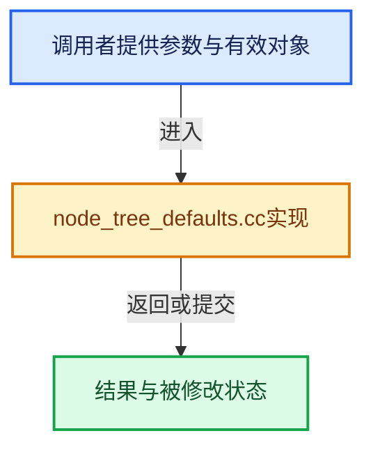

# 实现依赖专题：source/blender/nodes/intern/node_tree_defaults.cc

[实现依赖导航](../../README.md) · [符号索引](../../../00-课程指南/02-源码与提交索引/符号依赖与实现索引.md)

本专题从正文实际调用进入，集中保存共享实现。函数有稳定锚点，可从调用处直接跳到对应完整函数；递归与互相调用通过回链组织。

## 本文件的实现关系





## 完整成员与函数实现

<a id="f-d8712912f3ff2dec"></a>

### `blender::nodes::node_tree_shader_default`

实现位置：[source/blender/nodes/intern/node_tree_defaults.cc](../../../../../../../source/blender/nodes/intern/node_tree_defaults.cc) · L35—L113。

接口参数：

- `const bContext *C`
- `Main *bmain`
- `ID *id`

**教学注释版**

<!-- annotated:8aba12ed607cf6 -->

```cpp
void node_tree_shader_default(const bContext *C, Main *bmain, ID *id)
{
  if (GS(id->name) == ID_MA) {
    /* Materials */
    Object *ob = (C) ? CTX_data_active_object(C) : nullptr;
    Material *ma = reinterpret_cast<Material *>(id);
    Material *ma_default;

    if (ob && ob->type == OB_VOLUME) {
      ma_default = BKE_material_default_volume();
    }
    else if (ob && ob->type == OB_POINTCLOUD && ob->data &&
             id_cast<const PointCloud *>(ob->data)->type == PointCloudType::GSplat)
    {
      ma_default = BKE_material_default_gsplat();
    }
    else {
      ma_default = BKE_material_default_surface();
    }

    if (ma->nodetree) {
      bke::node_tree_free_embedded_tree(ma->nodetree);
      MEM_delete(ma->nodetree);
      ma->nodetree = nullptr;
    }
    ma->nodetree = bke::node_tree_copy_tree(bmain, *ma_default->nodetree);
    ma->nodetree->owner_id = &ma->id;
    for (bNode *node_iter : ma->nodetree->all_nodes()) {
      STRNCPY_UTF8(node_iter->name, DATA_(node_iter->name));
      bke::node_unique_name(*ma->nodetree, *node_iter);
    }

    BKE_ntree_update_after_single_tree_change(*bmain, *ma->nodetree);
  }
  else if (ELEM(GS(id->name), ID_WO, ID_LA)) {
    /* Emission */
    bNode *shader, *output;
    bNodeTree *ntree = nullptr;

    if (GS(id->name) == ID_WO) {
      World *world = reinterpret_cast<World *>(id);
      ntree = world->nodetree;

      shader = bke::node_add_static_node(nullptr, *ntree, SH_NODE_BACKGROUND);
      output = bke::node_add_static_node(nullptr, *ntree, SH_NODE_OUTPUT_WORLD);
      bke::node_add_link(*ntree,
                         *shader,
                         *bke::node_find_socket(*shader, SOCK_OUT, "Background"_ustr),
                         *output,
                         *bke::node_find_socket(*output, SOCK_IN, "Surface"_ustr));

      bNodeSocket *color_sock = bke::node_find_socket(*shader, SOCK_IN, "Color"_ustr);
      copy_v3_v3((reinterpret_cast<bNodeSocketValueRGBA *>(color_sock->default_value))->value,
                 &world->horr);
    }
    else {
      ntree = bke::node_tree_add_tree_embedded(
          nullptr, id, "Shader Nodetree", ntreeType_Shader->idname.ref());
      shader = bke::node_add_static_node(nullptr, *ntree, SH_NODE_EMISSION);
      output = bke::node_add_static_node(nullptr, *ntree, SH_NODE_OUTPUT_LIGHT);
      bke::node_add_link(*ntree,
                         *shader,
                         *bke::node_find_socket(*shader, SOCK_OUT, "Emission"_ustr),
                         *output,
                         *bke::node_find_socket(*output, SOCK_IN, "Surface"_ustr));
    }

    shader->location[0] = -200.0f;
    shader->location[1] = 100.0f;
    output->location[0] = 200.0f;
    output->location[1] = 100.0f;
    bke::node_set_active(*ntree, *output);
    BKE_ntree_update_after_single_tree_change(*bmain, *ntree);
  }
  else {
    printf("node_tree_shader_default() called on wrong ID type.\n");
    return;
  }
}
```

<details>
<summary>核对原始源码：source/blender/nodes/intern/node_tree_defaults.cc · L35—L113</summary>

<!-- original:8aba12ed607cf6:source/blender/nodes/intern/node_tree_defaults.cc:35:113 -->

```cpp
void node_tree_shader_default(const bContext *C, Main *bmain, ID *id)
{
  if (GS(id->name) == ID_MA) {
    /* Materials */
    Object *ob = (C) ? CTX_data_active_object(C) : nullptr;
    Material *ma = reinterpret_cast<Material *>(id);
    Material *ma_default;

    if (ob && ob->type == OB_VOLUME) {
      ma_default = BKE_material_default_volume();
    }
    else if (ob && ob->type == OB_POINTCLOUD && ob->data &&
             id_cast<const PointCloud *>(ob->data)->type == PointCloudType::GSplat)
    {
      ma_default = BKE_material_default_gsplat();
    }
    else {
      ma_default = BKE_material_default_surface();
    }

    if (ma->nodetree) {
      bke::node_tree_free_embedded_tree(ma->nodetree);
      MEM_delete(ma->nodetree);
      ma->nodetree = nullptr;
    }
    ma->nodetree = bke::node_tree_copy_tree(bmain, *ma_default->nodetree);
    ma->nodetree->owner_id = &ma->id;
    for (bNode *node_iter : ma->nodetree->all_nodes()) {
      STRNCPY_UTF8(node_iter->name, DATA_(node_iter->name));
      bke::node_unique_name(*ma->nodetree, *node_iter);
    }

    BKE_ntree_update_after_single_tree_change(*bmain, *ma->nodetree);
  }
  else if (ELEM(GS(id->name), ID_WO, ID_LA)) {
    /* Emission */
    bNode *shader, *output;
    bNodeTree *ntree = nullptr;

    if (GS(id->name) == ID_WO) {
      World *world = reinterpret_cast<World *>(id);
      ntree = world->nodetree;

      shader = bke::node_add_static_node(nullptr, *ntree, SH_NODE_BACKGROUND);
      output = bke::node_add_static_node(nullptr, *ntree, SH_NODE_OUTPUT_WORLD);
      bke::node_add_link(*ntree,
                         *shader,
                         *bke::node_find_socket(*shader, SOCK_OUT, "Background"_ustr),
                         *output,
                         *bke::node_find_socket(*output, SOCK_IN, "Surface"_ustr));

      bNodeSocket *color_sock = bke::node_find_socket(*shader, SOCK_IN, "Color"_ustr);
      copy_v3_v3((reinterpret_cast<bNodeSocketValueRGBA *>(color_sock->default_value))->value,
                 &world->horr);
    }
    else {
      ntree = bke::node_tree_add_tree_embedded(
          nullptr, id, "Shader Nodetree", ntreeType_Shader->idname.ref());
      shader = bke::node_add_static_node(nullptr, *ntree, SH_NODE_EMISSION);
      output = bke::node_add_static_node(nullptr, *ntree, SH_NODE_OUTPUT_LIGHT);
      bke::node_add_link(*ntree,
                         *shader,
                         *bke::node_find_socket(*shader, SOCK_OUT, "Emission"_ustr),
                         *output,
                         *bke::node_find_socket(*output, SOCK_IN, "Surface"_ustr));
    }

    shader->location[0] = -200.0f;
    shader->location[1] = 100.0f;
    output->location[0] = 200.0f;
    output->location[1] = 100.0f;
    bke::node_set_active(*ntree, *output);
    BKE_ntree_update_after_single_tree_change(*bmain, *ntree);
  }
  else {
    printf("node_tree_shader_default() called on wrong ID type.\n");
    return;
  }
}
```

</details>

**沿实际写入检查状态**

- `ma_default = BKE_material_default_volume();`
- `ma_default = BKE_material_default_gsplat();`
- `ma_default = BKE_material_default_surface();`
- `ma->nodetree = nullptr;`
- `ma->nodetree = bke::node_tree_copy_tree(bmain, *ma_default->nodetree);`
- `ma->nodetree->owner_id = &ma->id;`
- `ntree = world->nodetree;`
- `shader = bke::node_add_static_node(nullptr, *ntree, SH_NODE_BACKGROUND);`
- `output = bke::node_add_static_node(nullptr, *ntree, SH_NODE_OUTPUT_WORLD);`
- `ntree = bke::node_tree_add_tree_embedded(`
- `shader = bke::node_add_static_node(nullptr, *ntree, SH_NODE_EMISSION);`
- `output = bke::node_add_static_node(nullptr, *ntree, SH_NODE_OUTPUT_LIGHT);`
- `shader->location[0] = -200.0f;`
- `shader->location[1] = 100.0f;`
- `output->location[0] = 200.0f;`
- `output->location[1] = 100.0f;`

**继续追踪实现**

- `GS` → [blender::GS · L410](../../08-其他Blender模块/makesdna/DNA_ID.h.md#f-c3ff509f79f21b05)。
- `CTX_data_active_object` → [blender::CTX_data_active_object · L1636](../../02-BKE几何与数据/intern/context.cc.md#f-a20e763460765d4b)。
- `BKE_material_default_volume` → [blender::BKE_material_default_volume · L2314](../../02-BKE几何与数据/intern/material.cc.md#f-fe2f74d347314fd9)。
- `id_cast<const PointCloud *>` → [blender::id_cast · L1417](../../08-其他Blender模块/makesdna/DNA_ID.h.md#f-6c8ac6412850ac5a)。
- `BKE_material_default_gsplat` → [blender::BKE_material_default_gsplat · L2324](../../02-BKE几何与数据/intern/material.cc.md#f-bb5aaa4e8e1e88bb)。
- `BKE_material_default_surface` → [blender::BKE_material_default_surface · L2309](../../02-BKE几何与数据/intern/material.cc.md#f-122e52a857e870c2)。
- `bke::node_tree_free_embedded_tree` → [blender::bke::node_tree_free_embedded_tree · L5231](../../02-BKE几何与数据/intern/node.cc.md#f-e6364f4755cadf8b)。
- `MEM_delete` → [MEM_delete · L400](../../07-Intern运行时与平台/guardedalloc/MEM_guardedalloc.h.md#f-9049ffdd1682887c)。
- `bke::node_tree_copy_tree` → [blender::bke::node_tree_copy_tree · L5021](../../02-BKE几何与数据/intern/node.cc.md#f-aee0c08c96ccd443)。
- `ma->nodetree->all_nodes` → [调用协议](../../../00-课程指南/01-路线与规范/模板宏与动态分派协议.md)：接收对象类型依赖auto、返回值或模板实例；不按同名猜测目标。调用位置L62。
- `STRNCPY_UTF8` → [STRNCPY_UTF8 · L335](../../01-BLI基础库/BLI_string_utf8.hh.md#m-222967f0ab6a)。宏定义由构建条件选择。
- `DATA_` → [DATA_ · L52](../../08-其他Blender模块/blentranslation/BLT_translation.hh.md#m-178736083f83)。宏定义由构建条件选择。
- `bke::node_unique_name` → [blender::bke::node_unique_name · L4238](../../02-BKE几何与数据/intern/node.cc.md#f-fb3ea2e8319c3590)。
- `BKE_ntree_update_after_single_tree_change` → [blender::BKE_ntree_update_after_single_tree_change · L2421](../../02-BKE几何与数据/intern/node_tree_update.cc.md#f-60cd3f41995f06e2)。
- `ELEM` → [ELEM · L88](../../07-Intern运行时与平台/ghost/intern/GHOST_utildefines.hh.md#m-d28724a15928)；[ELEM · L135](../../01-BLI基础库/BLI_utildefines.hh.md#m-d6572de7cae0)。宏定义由构建条件选择。
- `bke::node_add_static_node` → [blender::bke::node_add_static_node · L4283](../../02-BKE几何与数据/intern/node.cc.md#f-aaa71011c0fa550b)。
- `bke::node_add_link` → [blender::bke::node_add_link · L4638](../../02-BKE几何与数据/intern/node.cc.md#f-e4b0f883348f0d24)。
- `bke::node_find_socket` → [blender::bke::node_find_socket · L3036](../../02-BKE几何与数据/intern/node.cc.md#f-cbf9dec71aff5b59)；[blender::bke::node_find_socket · L3047](../../02-BKE几何与数据/intern/node.cc.md#f-4a7a677634b7fbd1)。同名重载需按实参类型选择。
- `copy_v3_v3` → [调用协议](../../../00-课程指南/01-路线与规范/模板宏与动态分派协议.md)：函数指针、局部可调用对象或未展开的宏；必须结合调用者环境。调用位置L87。
- `bke::node_tree_add_tree_embedded` → [blender::bke::node_tree_add_tree_embedded · L5005](../../02-BKE几何与数据/intern/node.cc.md#f-8357c25dd4ab30ef)。
- `ntreeType_Shader->idname.ref` → [调用协议](../../../00-课程指南/01-路线与规范/模板宏与动态分派协议.md)：接收对象类型依赖auto、返回值或模板实例；不按同名猜测目标。调用位置L92。
- `bke::node_set_active` → [blender::bke::node_set_active · L5484](../../02-BKE几何与数据/intern/node.cc.md#f-7b2e1b01e127aa57)。
- `printf` → [外部契约](https://eel.is/c++draft/)：这个边界按实际表达式及所属类型核对参数、返回值、寿命与失败行为。这里提供接口入口，不声称已解释该第三方版本的内部实现。
