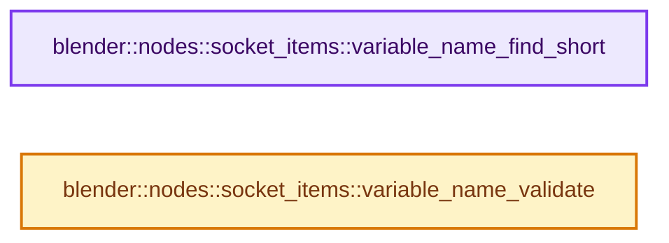
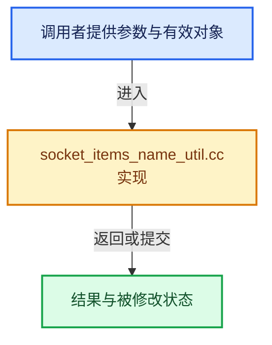

# 实现依赖专题：source/blender/nodes/intern/socket_items_name_util.cc

[实现依赖导航](../../README.md) · [符号索引](../../../00-课程指南/02-源码与提交索引/符号依赖与实现索引.md)

本专题从正文实际调用进入，集中保存共享实现。函数有稳定锚点，可从调用处直接跳到对应完整函数；递归与互相调用通过回链组织。

## 本文件的实现关系






## 完整成员与函数实现

<a id="f-8955b0b79436ea99"></a>

### `blender::nodes::socket_items::variable_name_find_short`

实现位置：[source/blender/nodes/intern/socket_items_name_util.cc](../../../../../../../source/blender/nodes/intern/socket_items_name_util.cc) · L13—L40。

接口参数：

- `StringRef src_name`
- `FunctionRef<bool(StringRef)> exists_fn`
- `StringRef`

**教学注释版**

<!-- annotated:8ed68c6fddc503 -->

```cpp
std::string variable_name_find_short(StringRef src_name, FunctionRef<bool(StringRef)> exists_fn)
{
  /* The goal is to find a single-letter name that is not used already. Ideally, it starts with the
   * same letter as the given name. */

  char initial = 'a';
  if (!src_name.is_empty()) {
    const char first_c = src_name[0];
    if (first_c >= 'a' && first_c <= 'z') {
      initial = first_c;
    }
    else if (first_c >= 'A' && first_c <= 'Z') {
      initial = first_c - 'A' + 'a';
    }
  }
  for (const int i : IndexRange('z' - 'a' + 1)) {
    char c = initial + i;
    if (c > 'z') {
      /* Start at 'a' again. */
      c = c - 'z' + 'a' - 1;
    }
    const std::string potential_name = std::string(1, c);
    if (!exists_fn(potential_name)) {
      return potential_name;
    }
  }
  return src_name;
}
```

<details>
<summary>核对原始源码：source/blender/nodes/intern/socket_items_name_util.cc · L13—L40</summary>

<!-- original:8ed68c6fddc503:source/blender/nodes/intern/socket_items_name_util.cc:13:40 -->

```cpp
std::string variable_name_find_short(StringRef src_name, FunctionRef<bool(StringRef)> exists_fn)
{
  /* The goal is to find a single-letter name that is not used already. Ideally, it starts with the
   * same letter as the given name. */

  char initial = 'a';
  if (!src_name.is_empty()) {
    const char first_c = src_name[0];
    if (first_c >= 'a' && first_c <= 'z') {
      initial = first_c;
    }
    else if (first_c >= 'A' && first_c <= 'Z') {
      initial = first_c - 'A' + 'a';
    }
  }
  for (const int i : IndexRange('z' - 'a' + 1)) {
    char c = initial + i;
    if (c > 'z') {
      /* Start at 'a' again. */
      c = c - 'z' + 'a' - 1;
    }
    const std::string potential_name = std::string(1, c);
    if (!exists_fn(potential_name)) {
      return potential_name;
    }
  }
  return src_name;
}
```

</details>

**沿实际写入检查状态**

- `initial = first_c;`
- `initial = first_c - 'A' + 'a';`
- `c = c - 'z' + 'a' - 1;`

**结果出口**

- `return potential_name;`
- `return src_name;`

**继续追踪实现**

- `src_name.is_empty` → [调用协议](../../../00-课程指南/01-路线与规范/模板宏与动态分派协议.md)：由接收对象具体类型或运行时策略提供实现。调用位置L19。
- `IndexRange` → [blender::IndexRange](../../01-BLI基础库/BLI_index_range.hh.md#t-caa3466d6776)；[blender::gpu::shader::parser::IndexRange](../../08-其他Blender模块/gpu/shader_tool/utils.hh.md#t-82d2bd4ea71c)；[blender::IndexRange](../../08-其他Blender模块/makesdna/DNA_node_types.h.md#t-0448cc889d39)。
- `std::string` → [外部契约](https://eel.is/c++draft/)：这个边界按实际表达式及所属类型核对参数、返回值、寿命与失败行为。这里提供接口入口，不声称已解释该第三方版本的内部实现。
- `exists_fn` → [调用协议](../../../00-课程指南/01-路线与规范/模板宏与动态分派协议.md)：局部可调用对象，须结合其初始化与捕获环境。调用位置L35。

<a id="f-7b6ad9c2876d2848"></a>

### `blender::nodes::socket_items::variable_name_validate`

实现位置：[source/blender/nodes/intern/socket_items_name_util.cc](../../../../../../../source/blender/nodes/intern/socket_items_name_util.cc) · L42—L64。

接口参数：

- `StringRef name`

**教学注释版**

<!-- annotated:93892844a5f1cb -->

```cpp
std::string variable_name_validate(StringRef name)
{
  /* The name has to start with a letter or underscore. The remaining letters may additionally be
   * digits. */
  std::string result;
  if (name.is_empty()) {
    return result;
  }
  const char first_char = name[0];
  if (!std::isalpha(first_char) && first_char != '_') {
    result += '_';
  }
  for (const char c : name) {
    if (std::isalnum(c) || c == '_') {
      result += c;
    }
    if (ELEM(c, '-', '.', ' ', '\t')) {
      result += '_';
    }
  }

  return result;
}
```

<details>
<summary>核对原始源码：source/blender/nodes/intern/socket_items_name_util.cc · L42—L64</summary>

<!-- original:93892844a5f1cb:source/blender/nodes/intern/socket_items_name_util.cc:42:64 -->

```cpp
std::string variable_name_validate(StringRef name)
{
  /* The name has to start with a letter or underscore. The remaining letters may additionally be
   * digits. */
  std::string result;
  if (name.is_empty()) {
    return result;
  }
  const char first_char = name[0];
  if (!std::isalpha(first_char) && first_char != '_') {
    result += '_';
  }
  for (const char c : name) {
    if (std::isalnum(c) || c == '_') {
      result += c;
    }
    if (ELEM(c, '-', '.', ' ', '\t')) {
      result += '_';
    }
  }

  return result;
}
```

</details>

**沿实际写入检查状态**

- `result += '_';`
- `result += c;`

**结果出口**

- `return result;`

**继续追踪实现**

- `name.is_empty` → [调用协议](../../../00-课程指南/01-路线与规范/模板宏与动态分派协议.md)：由接收对象具体类型或运行时策略提供实现。调用位置L47。
- `std::isalpha` → [外部契约](https://eel.is/c++draft/)：这个边界按实际表达式及所属类型核对参数、返回值、寿命与失败行为。这里提供接口入口，不声称已解释该第三方版本的内部实现。
- `std::isalnum` → [外部契约](https://eel.is/c++draft/)：这个边界按实际表达式及所属类型核对参数、返回值、寿命与失败行为。这里提供接口入口，不声称已解释该第三方版本的内部实现。
- `ELEM` → [ELEM · L88](../../07-Intern运行时与平台/ghost/intern/GHOST_utildefines.hh.md#m-d28724a15928)；[ELEM · L135](../../01-BLI基础库/BLI_utildefines.hh.md#m-d6572de7cae0)。宏定义由构建条件选择。
