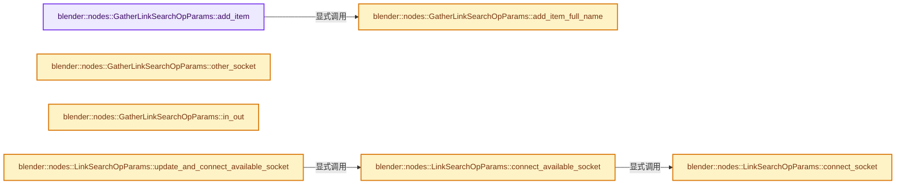

# 实现依赖专题：source/blender/nodes/intern/socket_search_link.cc

[实现依赖导航](../../README.md) · [符号索引](../../../00-课程指南/02-源码与提交索引/符号依赖与实现索引.md)

本专题从正文实际调用进入，集中保存共享实现。函数有稳定锚点，可从调用处直接跳到对应完整函数；递归与互相调用通过回链组织。

## 本文件的实现关系




## 完整成员与函数实现

<a id="f-2ac8ec254ff2c58f"></a>

### `blender::nodes::GatherLinkSearchOpParams::add_item`

实现位置：[source/blender/nodes/intern/socket_search_link.cc](../../../../../../../source/blender/nodes/intern/socket_search_link.cc) · L27—L36。

接口参数：

- `std::string socket_name`
- `SocketLinkOperation::LinkSocketFn fn`
- `const int weight`

**教学注释版**

<!-- annotated:b22fe70537c0f8 -->

```cpp
void GatherLinkSearchOpParams::add_item(std::string socket_name,
                                        SocketLinkOperation::LinkSocketFn fn,
                                        const int weight)
{
  std::string name = fmt::format("{}{} " UI_MENU_ARROW_SEP " {}",
                                 IFACE_(node_type_.ui_name),
                                 node_type_.deprecation_notice ? IFACE_(" (Deprecated)") : "",
                                 socket_name);
  // [讲解] std::move：把表达式转换成可供移动重载选择的值类别；不保证真的移动，不结束源对象寿命，对const值可能选择复制。
  this->add_item_full_name(std::move(name), std::move(fn), weight);
}
```

<details>
<summary>核对原始源码：source/blender/nodes/intern/socket_search_link.cc · L27—L36</summary>

<!-- original:b22fe70537c0f8:source/blender/nodes/intern/socket_search_link.cc:27:36 -->

```cpp
void GatherLinkSearchOpParams::add_item(std::string socket_name,
                                        SocketLinkOperation::LinkSocketFn fn,
                                        const int weight)
{
  std::string name = fmt::format("{}{} " UI_MENU_ARROW_SEP " {}",
                                 IFACE_(node_type_.ui_name),
                                 node_type_.deprecation_notice ? IFACE_(" (Deprecated)") : "",
                                 socket_name);
  this->add_item_full_name(std::move(name), std::move(fn), weight);
}
```

</details>

**继续追踪实现**

- `fmt::format` → [外部契约](https://fmt.dev/latest/api/)：按fmt接口的格式字符串与参数类型契约使用，格式化不改变被格式化对象的拥有关系。
- `IFACE_` → [IFACE_ · L49](../../08-其他Blender模块/blentranslation/BLT_translation.hh.md#m-378ed115fdc8)。宏定义由构建条件选择。
- `this->add_item_full_name` → [blender::nodes::GatherLinkSearchOpParams::add_item_full_name · L38](socket_search_link.cc.md#f-8ae4193d37a46365)。
- `std::move` → [外部契约](https://eel.is/c++draft/utility.forward)：把表达式转换成可供移动重载选择的值类别；不保证真的移动，不结束源对象寿命，对const值可能选择复制。

<a id="f-8ae4193d37a46365"></a>

### `blender::nodes::GatherLinkSearchOpParams::add_item_full_name`

实现位置：[source/blender/nodes/intern/socket_search_link.cc](../../../../../../../source/blender/nodes/intern/socket_search_link.cc) · L38—L43。

接口参数：

- `std::string name`
- `SocketLinkOperation::LinkSocketFn fn`
- `int weight`

**教学注释版**

<!-- annotated:d84f58f4ca2797 -->

```cpp
void GatherLinkSearchOpParams::add_item_full_name(std::string name,
                                                  SocketLinkOperation::LinkSocketFn fn,
                                                  int weight)
{
  // [讲解] std::move：把表达式转换成可供移动重载选择的值类别；不保证真的移动，不结束源对象寿命，对const值可能选择复制。
  items_.append({std::move(name), std::move(fn), weight});
}
```

<details>
<summary>核对原始源码：source/blender/nodes/intern/socket_search_link.cc · L38—L43</summary>

<!-- original:d84f58f4ca2797:source/blender/nodes/intern/socket_search_link.cc:38:43 -->

```cpp
void GatherLinkSearchOpParams::add_item_full_name(std::string name,
                                                  SocketLinkOperation::LinkSocketFn fn,
                                                  int weight)
{
  items_.append({std::move(name), std::move(fn), weight});
}
```

</details>

**继续追踪实现**

- `items_.append` → [调用协议](../../../00-课程指南/01-路线与规范/模板宏与动态分派协议.md)：接收对象类型依赖auto、返回值或模板实例；不按同名猜测目标。调用位置L42。
- `std::move` → [外部契约](https://eel.is/c++draft/utility.forward)：把表达式转换成可供移动重载选择的值类别；不保证真的移动，不结束源对象寿命，对const值可能选择复制。

<a id="f-7cba06c73785c130"></a>

### `blender::nodes::GatherLinkSearchOpParams::other_socket`

实现位置：[source/blender/nodes/intern/socket_search_link.cc](../../../../../../../source/blender/nodes/intern/socket_search_link.cc) · L45—L48。

**教学注释版**

<!-- annotated:8457f1ffc47618 -->

```cpp
const bNodeSocket &GatherLinkSearchOpParams::other_socket() const
{
  return other_socket_;
}
```

<details>
<summary>核对原始源码：source/blender/nodes/intern/socket_search_link.cc · L45—L48</summary>

<!-- original:8457f1ffc47618:source/blender/nodes/intern/socket_search_link.cc:45:48 -->

```cpp
const bNodeSocket &GatherLinkSearchOpParams::other_socket() const
{
  return other_socket_;
}
```

</details>

**结果出口**

- `return other_socket_;`

**继续追踪实现**

本实现没有需要继续展开的显式调用；检查返回表达式、对象转换和调用者前置条件。

<a id="f-ce52d3e93d6549ea"></a>

### `blender::nodes::GatherLinkSearchOpParams::in_out`

实现位置：[source/blender/nodes/intern/socket_search_link.cc](../../../../../../../source/blender/nodes/intern/socket_search_link.cc) · L65—L68。

**教学注释版**

<!-- annotated:b75e1c2d115e74 -->

```cpp
eNodeSocketInOut GatherLinkSearchOpParams::in_out() const
{
  return other_socket_.in_out == SOCK_IN ? SOCK_OUT : SOCK_IN;
}
```

<details>
<summary>核对原始源码：source/blender/nodes/intern/socket_search_link.cc · L65—L68</summary>

<!-- original:b75e1c2d115e74:source/blender/nodes/intern/socket_search_link.cc:65:68 -->

```cpp
eNodeSocketInOut GatherLinkSearchOpParams::in_out() const
{
  return other_socket_.in_out == SOCK_IN ? SOCK_OUT : SOCK_IN;
}
```

</details>

**结果出口**

- `return other_socket_.in_out == SOCK_IN ? SOCK_OUT : SOCK_IN;`

**继续追踪实现**

本实现没有需要继续展开的显式调用；检查返回表达式、对象转换和调用者前置条件。

<a id="f-01090aeed479efd5"></a>

### `blender::nodes::LinkSearchOpParams::connect_available_socket`

实现位置：[source/blender/nodes/intern/socket_search_link.cc](../../../../../../../source/blender/nodes/intern/socket_search_link.cc) · L70—L82。

接口参数：

- `bNode &new_node`
- `UString socket_name`

**教学注释版**

<!-- annotated:6d0f965051eac4 -->

```cpp
void LinkSearchOpParams::connect_available_socket(bNode &new_node, UString socket_name)
{
  const eNodeSocketInOut in_out = socket.in_out == SOCK_IN ? SOCK_OUT : SOCK_IN;
  bNodeSocket *new_node_socket = bke::node_find_enabled_socket(
      new_node, in_out, socket_name.ref());
  if (new_node_socket == nullptr) {
    /* If the socket isn't found, some node's search gather functions probably aren't configured
     * properly. It's likely enough that it's worth avoiding a crash in a release build though. */
    BLI_assert_unreachable();
    return;
  }
  this->connect_socket(new_node, *new_node_socket);
}
```

<details>
<summary>核对原始源码：source/blender/nodes/intern/socket_search_link.cc · L70—L82</summary>

<!-- original:6d0f965051eac4:source/blender/nodes/intern/socket_search_link.cc:70:82 -->

```cpp
void LinkSearchOpParams::connect_available_socket(bNode &new_node, UString socket_name)
{
  const eNodeSocketInOut in_out = socket.in_out == SOCK_IN ? SOCK_OUT : SOCK_IN;
  bNodeSocket *new_node_socket = bke::node_find_enabled_socket(
      new_node, in_out, socket_name.ref());
  if (new_node_socket == nullptr) {
    /* If the socket isn't found, some node's search gather functions probably aren't configured
     * properly. It's likely enough that it's worth avoiding a crash in a release build though. */
    BLI_assert_unreachable();
    return;
  }
  this->connect_socket(new_node, *new_node_socket);
}
```

</details>

**继续追踪实现**

- `bke::node_find_enabled_socket` → [blender::bke::node_find_enabled_socket · L3055](../../02-BKE几何与数据/intern/node.cc.md#f-f22ffd1904e85c7e)。
- `socket_name.ref` → [blender::UString::ref · L78](../../01-BLI基础库/BLI_ustring.hh.md#f-737f25fd4ae3f840)。
- `BLI_assert_unreachable` → [BLI_assert_unreachable · L77](../../01-BLI基础库/BLI_assert.hh.md#m-7a2d91a67d8e)。宏定义由构建条件选择。
- `this->connect_socket` → [blender::nodes::LinkSearchOpParams::connect_socket · L93](socket_search_link.cc.md#f-149aaa9b5ea9d728)。

<a id="f-149aaa9b5ea9d728"></a>

### `blender::nodes::LinkSearchOpParams::connect_socket`

实现位置：[source/blender/nodes/intern/socket_search_link.cc](../../../../../../../source/blender/nodes/intern/socket_search_link.cc) · L93—L102。

接口参数：

- `bNode &new_node`
- `bNodeSocket &new_socket`

**教学注释版**

<!-- annotated:23e638f39bd528 -->

```cpp
void LinkSearchOpParams::connect_socket(bNode &new_node, bNodeSocket &new_socket)
{
  bke::node_add_link(this->node_tree, new_node, new_socket, this->node, this->socket);
  if (new_socket.in_out == SOCK_OUT) {
    /* If the old socket already contained a value, then transfer it to a new one, from
     * which this value will get there. */
    bke::node_socket_move_default_value(
        *CTX_data_main(&C), this->node_tree, this->socket, new_socket);
  }
}
```

<details>
<summary>核对原始源码：source/blender/nodes/intern/socket_search_link.cc · L93—L102</summary>

<!-- original:23e638f39bd528:source/blender/nodes/intern/socket_search_link.cc:93:102 -->

```cpp
void LinkSearchOpParams::connect_socket(bNode &new_node, bNodeSocket &new_socket)
{
  bke::node_add_link(this->node_tree, new_node, new_socket, this->node, this->socket);
  if (new_socket.in_out == SOCK_OUT) {
    /* If the old socket already contained a value, then transfer it to a new one, from
     * which this value will get there. */
    bke::node_socket_move_default_value(
        *CTX_data_main(&C), this->node_tree, this->socket, new_socket);
  }
}
```

</details>

**继续追踪实现**

- `bke::node_add_link` → [blender::bke::node_add_link · L4638](../../02-BKE几何与数据/intern/node.cc.md#f-e4b0f883348f0d24)。
- `bke::node_socket_move_default_value` → [blender::bke::node_socket_move_default_value · L4534](../../02-BKE几何与数据/intern/node.cc.md#f-0dc22ab734182c47)。
- `CTX_data_main` → [blender::CTX_data_main · L1313](../../02-BKE几何与数据/intern/context.cc.md#f-6d4ba24a62a80b94)。

<a id="f-433b9de74cae0a4a"></a>

### `blender::nodes::LinkSearchOpParams::update_and_connect_available_socket`

实现位置：[source/blender/nodes/intern/socket_search_link.cc](../../../../../../../source/blender/nodes/intern/socket_search_link.cc) · L127—L134。

接口参数：

- `bNode &new_node`
- `UString socket_name`

**教学注释版**

<!-- annotated:c8efed9b105e55 -->

```cpp
void LinkSearchOpParams::update_and_connect_available_socket(bNode &new_node, UString socket_name)
{
  update_node_declaration_and_sockets(this->node_tree, new_node);
  if (new_node.typeinfo->updatefunc) {
    new_node.typeinfo->updatefunc(&node_tree, &new_node);
  }
  this->connect_available_socket(new_node, socket_name);
}
```

<details>
<summary>核对原始源码：source/blender/nodes/intern/socket_search_link.cc · L127—L134</summary>

<!-- original:c8efed9b105e55:source/blender/nodes/intern/socket_search_link.cc:127:134 -->

```cpp
void LinkSearchOpParams::update_and_connect_available_socket(bNode &new_node, UString socket_name)
{
  update_node_declaration_and_sockets(this->node_tree, new_node);
  if (new_node.typeinfo->updatefunc) {
    new_node.typeinfo->updatefunc(&node_tree, &new_node);
  }
  this->connect_available_socket(new_node, socket_name);
}
```

</details>

**继续追踪实现**

- `update_node_declaration_and_sockets` → [blender::nodes::update_node_declaration_and_sockets · L650](node_socket.cc.md#f-dba42bb7e7048b99)。
- `new_node.typeinfo->updatefunc` → [调用协议](../../../00-课程指南/01-路线与规范/模板宏与动态分派协议.md)：接收对象类型依赖auto、返回值或模板实例；不按同名猜测目标。调用位置L131。
- `this->connect_available_socket` → [blender::nodes::LinkSearchOpParams::connect_available_socket · L70](socket_search_link.cc.md#f-01090aeed479efd5)。
