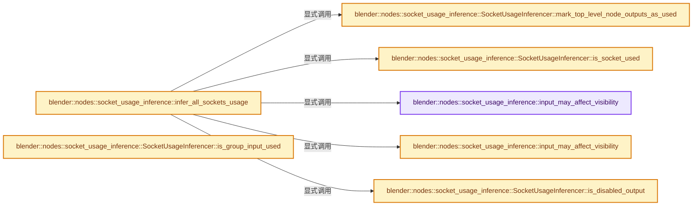
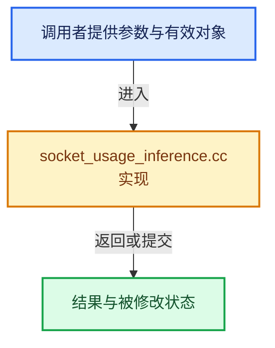

# 实现依赖专题：source/blender/nodes/intern/socket_usage_inference.cc

[实现依赖导航](../../README.md) · [符号索引](../../../00-课程指南/02-源码与提交索引/符号依赖与实现索引.md)

本专题从正文实际调用进入，集中保存共享实现。函数有稳定锚点，可从调用处直接跳到对应完整函数；递归与互相调用通过回链组织。

## 本文件的实现关系






## 完整成员与函数实现

<a id="f-caa4090b749474bf"></a>

### `blender::nodes::socket_usage_inference::input_may_affect_visibility`

实现位置：[source/blender/nodes/intern/socket_usage_inference.cc](../../../../../../../source/blender/nodes/intern/socket_usage_inference.cc) · L888—L891。

接口参数：

- `const bNodeTreeInterfaceSocket &socket`

**教学注释版**

<!-- annotated:8db2eb83ab0900 -->

```cpp
static bool input_may_affect_visibility(const bNodeTreeInterfaceSocket &socket)
{
  return socket.socket_type == StringRef("NodeSocketMenu");
}
```

<details>
<summary>核对原始源码：source/blender/nodes/intern/socket_usage_inference.cc · L888—L891</summary>

<!-- original:8db2eb83ab0900:source/blender/nodes/intern/socket_usage_inference.cc:888:891 -->

```cpp
static bool input_may_affect_visibility(const bNodeTreeInterfaceSocket &socket)
{
  return socket.socket_type == StringRef("NodeSocketMenu");
}
```

</details>

**结果出口**

- `return socket.socket_type == StringRef("NodeSocketMenu");`

**继续追踪实现**

- `StringRef` → [blender::StringRef::StringRef · L555](../../../01-基础容器与现代CPP/15-StringRef字符串视图.md#f-f6aca324a36faa7e)；[blender::StringRef::StringRef · L560](../../../01-基础容器与现代CPP/15-StringRef字符串视图.md#f-ab9714781ca51bac)；[blender::StringRef::StringRef · L565](../../../01-基础容器与现代CPP/15-StringRef字符串视图.md#f-95f0b483bbdd7739)；[blender::StringRef::StringRef · L570](../../../01-基础容器与现代CPP/15-StringRef字符串视图.md#f-808d05699cb33334)；[blender::StringRef::StringRef · L631](../../../01-基础容器与现代CPP/15-StringRef字符串视图.md#f-37788e5f3fa3b736)；[blender::StringRef::StringRef · L641](../../../01-基础容器与现代CPP/15-StringRef字符串视图.md#f-11abd0510fb6b926)；[blender::StringRef::StringRef · L646](../../../01-基础容器与现代CPP/15-StringRef字符串视图.md#f-8437dbd8a582eefd)；[blender::StringRef::StringRef · L651](../../../01-基础容器与现代CPP/15-StringRef字符串视图.md#f-70bcb338de0db978)。同名重载需按实参类型选择。

<a id="f-e9dd4afcb043ddf6"></a>

### `blender::nodes::socket_usage_inference::input_may_affect_visibility`

实现位置：[source/blender/nodes/intern/socket_usage_inference.cc](../../../../../../../source/blender/nodes/intern/socket_usage_inference.cc) · L893—L896。

接口参数：

- `const bNodeSocket &socket`

**教学注释版**

<!-- annotated:00cba4e6e0d088 -->

```cpp
static bool input_may_affect_visibility(const bNodeSocket &socket)
{
  return socket.type == SOCK_MENU;
}
```

<details>
<summary>核对原始源码：source/blender/nodes/intern/socket_usage_inference.cc · L893—L896</summary>

<!-- original:00cba4e6e0d088:source/blender/nodes/intern/socket_usage_inference.cc:893:896 -->

```cpp
static bool input_may_affect_visibility(const bNodeSocket &socket)
{
  return socket.type == SOCK_MENU;
}
```

</details>

**结果出口**

- `return socket.type == SOCK_MENU;`

**继续追踪实现**

本实现没有需要继续展开的显式调用；检查返回表达式、对象转换和调用者前置条件。

<a id="f-36411f84fed72ee4"></a>

### `blender::nodes::socket_usage_inference::infer_all_sockets_usage`

实现位置：[source/blender/nodes/intern/socket_usage_inference.cc](../../../../../../../source/blender/nodes/intern/socket_usage_inference.cc) · L898—L983。

接口参数：

- `const bNodeTree &tree`

**教学注释版**

<!-- annotated:c219d6a28f6292 -->

```cpp
Array<SocketUsage> infer_all_sockets_usage(const bNodeTree &tree)
{
  tree.ensure_topology_cache();
  const Span<const bNodeSocket *> all_input_sockets = tree.all_input_sockets();
  const Span<const bNodeSocket *> all_output_sockets = tree.all_output_sockets();
  Array<SocketUsage> all_usages(tree.all_sockets().size());

  if (tree.has_available_link_cycle()) {
    return all_usages;
  }

  ResourceScope scope;
  bke::ComputeContextCache compute_context_cache;

  const bool ignore_top_level_node_muting = true;

  {
    /* Find actual socket usages. */
    SocketValueInferencer value_inferencer{tree, scope, compute_context_cache};
    SocketUsageInferencer usage_inferencer{
        tree, scope, value_inferencer, compute_context_cache, ignore_top_level_node_muting};
    usage_inferencer.mark_top_level_node_outputs_as_used();
    for (const bNodeSocket *socket : all_input_sockets) {
      all_usages[socket->index_in_tree()].is_used = usage_inferencer.is_socket_used(
          {nullptr, socket});
    }
  }

  /* Find input sockets that should be hidden. */
  // [讲解] all_input_sockets.size：查询视图长度或生成对应有效索引区间。
  Array<bool> only_controllers_used(all_input_sockets.size(), NoInitialization{});
  Array<bool> all_ignored_inputs(all_input_sockets.size(), true);
  // [讲解] all_input_sockets.index_range：查询视图长度或生成对应有效索引区间。
  threading::parallel_for(all_input_sockets.index_range(), 1024, [&](const IndexRange range) {
    for (const int i : range) {
      const bNodeSocket &socket = *all_input_sockets[i];
      only_controllers_used[i] = !input_may_affect_visibility(socket);
    }
  });
  SocketValueInferencer value_inferencer_all_unknown{
      tree, scope, compute_context_cache, nullptr, all_ignored_inputs};
  SocketUsageInferencer usage_inferencer_all_unknown{tree,
                                                     scope,
                                                     value_inferencer_all_unknown,
                                                     compute_context_cache,
                                                     ignore_top_level_node_muting};
  SocketValueInferencer value_inferencer_only_controllers{
      tree, scope, compute_context_cache, nullptr, only_controllers_used};
  SocketUsageInferencer usage_inferencer_only_controllers{tree,
                                                          scope,
                                                          value_inferencer_only_controllers,
                                                          compute_context_cache,
                                                          ignore_top_level_node_muting};
  usage_inferencer_all_unknown.mark_top_level_node_outputs_as_used();
  usage_inferencer_only_controllers.mark_top_level_node_outputs_as_used();
  for (const bNodeSocket *socket : all_input_sockets) {
    SocketUsage &usage = all_usages[socket->index_in_tree()];
    if (usage.is_used) {
      /* Used inputs are always visible. */
      continue;
    }
    const SocketInContext socket_ctx{nullptr, socket};
    if (usage_inferencer_only_controllers.is_socket_used(socket_ctx)) {
      /* The input should be visible if it's used if only visibility-controlling inputs are
       * considered. */
      continue;
    }
    if (!usage_inferencer_all_unknown.is_socket_used(socket_ctx)) {
      /* The input should be visible if it's never used, regardless of any inputs. Its usage does
       * not depend on any visibility-controlling input. */
      continue;
    }
    usage.is_visible = false;
  }
  for (const bNodeSocket *socket : all_output_sockets) {
    const bNode &node = socket->owner_node();
    if (node.is_group_input()) {
      continue;
    }
    const SocketInContext socket_ctx{nullptr, socket};
    if (usage_inferencer_only_controllers.is_disabled_output(socket_ctx)) {
      SocketUsage &usage = all_usages[socket->index_in_tree()];
      usage.is_visible = false;
    }
  }

  return all_usages;
}
```

<details>
<summary>核对原始源码：source/blender/nodes/intern/socket_usage_inference.cc · L898—L983</summary>

<!-- original:c219d6a28f6292:source/blender/nodes/intern/socket_usage_inference.cc:898:983 -->

```cpp
Array<SocketUsage> infer_all_sockets_usage(const bNodeTree &tree)
{
  tree.ensure_topology_cache();
  const Span<const bNodeSocket *> all_input_sockets = tree.all_input_sockets();
  const Span<const bNodeSocket *> all_output_sockets = tree.all_output_sockets();
  Array<SocketUsage> all_usages(tree.all_sockets().size());

  if (tree.has_available_link_cycle()) {
    return all_usages;
  }

  ResourceScope scope;
  bke::ComputeContextCache compute_context_cache;

  const bool ignore_top_level_node_muting = true;

  {
    /* Find actual socket usages. */
    SocketValueInferencer value_inferencer{tree, scope, compute_context_cache};
    SocketUsageInferencer usage_inferencer{
        tree, scope, value_inferencer, compute_context_cache, ignore_top_level_node_muting};
    usage_inferencer.mark_top_level_node_outputs_as_used();
    for (const bNodeSocket *socket : all_input_sockets) {
      all_usages[socket->index_in_tree()].is_used = usage_inferencer.is_socket_used(
          {nullptr, socket});
    }
  }

  /* Find input sockets that should be hidden. */
  Array<bool> only_controllers_used(all_input_sockets.size(), NoInitialization{});
  Array<bool> all_ignored_inputs(all_input_sockets.size(), true);
  threading::parallel_for(all_input_sockets.index_range(), 1024, [&](const IndexRange range) {
    for (const int i : range) {
      const bNodeSocket &socket = *all_input_sockets[i];
      only_controllers_used[i] = !input_may_affect_visibility(socket);
    }
  });
  SocketValueInferencer value_inferencer_all_unknown{
      tree, scope, compute_context_cache, nullptr, all_ignored_inputs};
  SocketUsageInferencer usage_inferencer_all_unknown{tree,
                                                     scope,
                                                     value_inferencer_all_unknown,
                                                     compute_context_cache,
                                                     ignore_top_level_node_muting};
  SocketValueInferencer value_inferencer_only_controllers{
      tree, scope, compute_context_cache, nullptr, only_controllers_used};
  SocketUsageInferencer usage_inferencer_only_controllers{tree,
                                                          scope,
                                                          value_inferencer_only_controllers,
                                                          compute_context_cache,
                                                          ignore_top_level_node_muting};
  usage_inferencer_all_unknown.mark_top_level_node_outputs_as_used();
  usage_inferencer_only_controllers.mark_top_level_node_outputs_as_used();
  for (const bNodeSocket *socket : all_input_sockets) {
    SocketUsage &usage = all_usages[socket->index_in_tree()];
    if (usage.is_used) {
      /* Used inputs are always visible. */
      continue;
    }
    const SocketInContext socket_ctx{nullptr, socket};
    if (usage_inferencer_only_controllers.is_socket_used(socket_ctx)) {
      /* The input should be visible if it's used if only visibility-controlling inputs are
       * considered. */
      continue;
    }
    if (!usage_inferencer_all_unknown.is_socket_used(socket_ctx)) {
      /* The input should be visible if it's never used, regardless of any inputs. Its usage does
       * not depend on any visibility-controlling input. */
      continue;
    }
    usage.is_visible = false;
  }
  for (const bNodeSocket *socket : all_output_sockets) {
    const bNode &node = socket->owner_node();
    if (node.is_group_input()) {
      continue;
    }
    const SocketInContext socket_ctx{nullptr, socket};
    if (usage_inferencer_only_controllers.is_disabled_output(socket_ctx)) {
      SocketUsage &usage = all_usages[socket->index_in_tree()];
      usage.is_visible = false;
    }
  }

  return all_usages;
}
```

</details>

**沿实际写入检查状态**

- `only_controllers_used[i] = !input_may_affect_visibility(socket);`
- `usage.is_visible = false;`

**结果出口**

- `return all_usages;`

**继续追踪实现**

- `tree.ensure_topology_cache` → [blender::bNodeTree::ensure_topology_cache · L621](../../02-BKE几何与数据/intern/node_runtime.cc.md#f-566e97bdf0367424)。
- `tree.all_input_sockets` → [blender::bNodeTree::all_input_sockets · L606](../../02-BKE几何与数据/BKE_node_runtime.hh.md#f-7195abfb90a880ce)；[blender::bNodeTree::all_input_sockets · L612](../../02-BKE几何与数据/BKE_node_runtime.hh.md#f-6de8196ec964f24b)。同名重载需按实参类型选择。
- `tree.all_output_sockets` → [blender::bNodeTree::all_output_sockets · L618](../../02-BKE几何与数据/BKE_node_runtime.hh.md#f-4652483fcd8f9ebd)；[blender::bNodeTree::all_output_sockets · L624](../../02-BKE几何与数据/BKE_node_runtime.hh.md#f-c45501aaaebff6cf)。同名重载需按实参类型选择。
- `tree.all_sockets().size` → [调用协议](../../../00-课程指南/01-路线与规范/模板宏与动态分派协议.md)：接收对象类型依赖auto、返回值或模板实例；不按同名猜测目标。调用位置L903。
- `tree.all_sockets` → [blender::bNodeTree::all_sockets · L630](../../02-BKE几何与数据/BKE_node_runtime.hh.md#f-ba7946d064c035f9)；[blender::bNodeTree::all_sockets · L636](../../02-BKE几何与数据/BKE_node_runtime.hh.md#f-e6c5064300cb4f69)。同名重载需按实参类型选择。
- `tree.has_available_link_cycle` → [blender::bNodeTree::has_available_link_cycle · L572](../../02-BKE几何与数据/BKE_node_runtime.hh.md#f-7bdcb85482e6bf35)。
- `usage_inferencer.mark_top_level_node_outputs_as_used` → [blender::nodes::socket_usage_inference::SocketUsageInferencer::mark_top_level_node_outputs_as_used · L1169](socket_usage_inference.cc.md#f-6a289b44b3b25328)。
- `socket->index_in_tree` → [blender::bNodeSocket::index_in_tree · L1002](../../02-BKE几何与数据/BKE_node_runtime.hh.md#f-84ec49d8e3ae0cdb)。
- `usage_inferencer.is_socket_used` → [blender::nodes::socket_usage_inference::SocketUsageInferencer::is_socket_used · L1179](socket_usage_inference.cc.md#f-aacddd93fd1072da)。
- `all_input_sockets.size` → [blender::Span::size · L256](../../../01-基础容器与现代CPP/05-Span只读连续视图.md#f-5f80fa006089c998)。
- `threading::parallel_for` → [blender::threading::parallel_for · L68](../../../11-Depsgraph与并行任务系统/07-任务池与TBB接入.md#f-838294754c24426c)。
- `all_input_sockets.index_range` → [blender::Span::index_range · L405](../../../01-基础容器与现代CPP/05-Span只读连续视图.md#f-caaa9b06e13e53e0)。
- `input_may_affect_visibility` → [blender::nodes::socket_usage_inference::input_may_affect_visibility · L888](socket_usage_inference.cc.md#f-caa4090b749474bf)；[blender::nodes::socket_usage_inference::input_may_affect_visibility · L893](socket_usage_inference.cc.md#f-e9dd4afcb043ddf6)。同名重载需按实参类型选择。
- `usage_inferencer_all_unknown.mark_top_level_node_outputs_as_used` → [blender::nodes::socket_usage_inference::SocketUsageInferencer::mark_top_level_node_outputs_as_used · L1169](socket_usage_inference.cc.md#f-6a289b44b3b25328)。
- `usage_inferencer_only_controllers.mark_top_level_node_outputs_as_used` → [blender::nodes::socket_usage_inference::SocketUsageInferencer::mark_top_level_node_outputs_as_used · L1169](socket_usage_inference.cc.md#f-6a289b44b3b25328)。
- `usage_inferencer_only_controllers.is_socket_used` → [blender::nodes::socket_usage_inference::SocketUsageInferencer::is_socket_used · L1179](socket_usage_inference.cc.md#f-aacddd93fd1072da)。
- `usage_inferencer_all_unknown.is_socket_used` → [blender::nodes::socket_usage_inference::SocketUsageInferencer::is_socket_used · L1179](socket_usage_inference.cc.md#f-aacddd93fd1072da)。
- `socket->owner_node` → [blender::bNodeSocket::owner_node · L1069](../../02-BKE几何与数据/BKE_node_runtime.hh.md#f-e92f9934c26a08ec)；[blender::bNodeSocket::owner_node · L1159](../../02-BKE几何与数据/BKE_node_runtime.hh.md#f-88477f32cb5dce90)。同名重载需按实参类型选择。
- `node.is_group_input` → [blender::bNode::is_group_input · L916](../../02-BKE几何与数据/BKE_node_runtime.hh.md#f-eb0154c1b06d331c)。
- `usage_inferencer_only_controllers.is_disabled_output` → [blender::nodes::socket_usage_inference::SocketUsageInferencer::is_disabled_output · L1189](socket_usage_inference.cc.md#f-187917d5b3129b34)。

<a id="f-6a289b44b3b25328"></a>

### `blender::nodes::socket_usage_inference::SocketUsageInferencer::mark_top_level_node_outputs_as_used`

实现位置：[source/blender/nodes/intern/socket_usage_inference.cc](../../../../../../../source/blender/nodes/intern/socket_usage_inference.cc) · L1169—L1172。

**教学注释版**

<!-- annotated:7902584e5d8399 -->

```cpp
void SocketUsageInferencer::mark_top_level_node_outputs_as_used()
{
  impl_.mark_top_level_node_outputs_as_used();
}
```

<details>
<summary>核对原始源码：source/blender/nodes/intern/socket_usage_inference.cc · L1169—L1172</summary>

<!-- original:7902584e5d8399:source/blender/nodes/intern/socket_usage_inference.cc:1169:1172 -->

```cpp
void SocketUsageInferencer::mark_top_level_node_outputs_as_used()
{
  impl_.mark_top_level_node_outputs_as_used();
}
```

</details>

**继续追踪实现**

- `impl_.mark_top_level_node_outputs_as_used` → [调用协议](../../../00-课程指南/01-路线与规范/模板宏与动态分派协议.md)：接收对象类型依赖auto、返回值或模板实例；不按同名猜测目标。调用位置L1171。

<a id="f-6503ee86f2f2093c"></a>

### `blender::nodes::socket_usage_inference::SocketUsageInferencer::is_group_input_used`

实现位置：[source/blender/nodes/intern/socket_usage_inference.cc](../../../../../../../source/blender/nodes/intern/socket_usage_inference.cc) · L1174—L1177。

接口参数：

- `const int input_i`

**教学注释版**

<!-- annotated:dd745d29448a20 -->

```cpp
bool SocketUsageInferencer::is_group_input_used(const int input_i)
{
  return impl_.is_group_input_used(input_i);
}
```

<details>
<summary>核对原始源码：source/blender/nodes/intern/socket_usage_inference.cc · L1174—L1177</summary>

<!-- original:dd745d29448a20:source/blender/nodes/intern/socket_usage_inference.cc:1174:1177 -->

```cpp
bool SocketUsageInferencer::is_group_input_used(const int input_i)
{
  return impl_.is_group_input_used(input_i);
}
```

</details>

**结果出口**

- `return impl_.is_group_input_used(input_i);`

**继续追踪实现**

- `impl_.is_group_input_used` → [调用协议](../../../00-课程指南/01-路线与规范/模板宏与动态分派协议.md)：接收对象类型依赖auto、返回值或模板实例；不按同名猜测目标。调用位置L1176。

<a id="f-aacddd93fd1072da"></a>

### `blender::nodes::socket_usage_inference::SocketUsageInferencer::is_socket_used`

实现位置：[source/blender/nodes/intern/socket_usage_inference.cc](../../../../../../../source/blender/nodes/intern/socket_usage_inference.cc) · L1179—L1182。

接口参数：

- `const SocketInContext &socket`

**教学注释版**

<!-- annotated:f5070054ec4c9c -->

```cpp
bool SocketUsageInferencer::is_socket_used(const SocketInContext &socket)
{
  return impl_.is_socket_used(socket);
}
```

<details>
<summary>核对原始源码：source/blender/nodes/intern/socket_usage_inference.cc · L1179—L1182</summary>

<!-- original:f5070054ec4c9c:source/blender/nodes/intern/socket_usage_inference.cc:1179:1182 -->

```cpp
bool SocketUsageInferencer::is_socket_used(const SocketInContext &socket)
{
  return impl_.is_socket_used(socket);
}
```

</details>

**结果出口**

- `return impl_.is_socket_used(socket);`

**继续追踪实现**

- `impl_.is_socket_used` → [调用协议](../../../00-课程指南/01-路线与规范/模板宏与动态分派协议.md)：接收对象类型依赖auto、返回值或模板实例；不按同名猜测目标。调用位置L1181。

<a id="f-187917d5b3129b34"></a>

### `blender::nodes::socket_usage_inference::SocketUsageInferencer::is_disabled_output`

实现位置：[source/blender/nodes/intern/socket_usage_inference.cc](../../../../../../../source/blender/nodes/intern/socket_usage_inference.cc) · L1189—L1192。

接口参数：

- `const SocketInContext &socket`

**教学注释版**

<!-- annotated:82fa87f04bd34d -->

```cpp
bool SocketUsageInferencer::is_disabled_output(const SocketInContext &socket)
{
  return impl_.is_disabled_output(socket);
}
```

<details>
<summary>核对原始源码：source/blender/nodes/intern/socket_usage_inference.cc · L1189—L1192</summary>

<!-- original:82fa87f04bd34d:source/blender/nodes/intern/socket_usage_inference.cc:1189:1192 -->

```cpp
bool SocketUsageInferencer::is_disabled_output(const SocketInContext &socket)
{
  return impl_.is_disabled_output(socket);
}
```

</details>

**结果出口**

- `return impl_.is_disabled_output(socket);`

**继续追踪实现**

- `impl_.is_disabled_output` → [调用协议](../../../00-课程指南/01-路线与规范/模板宏与动态分派协议.md)：接收对象类型依赖auto、返回值或模板实例；不按同名猜测目标。调用位置L1191。
