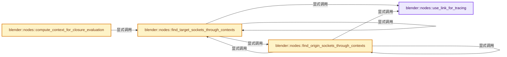
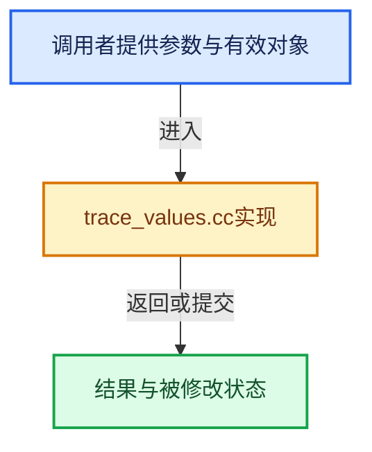

# 实现依赖专题：source/blender/nodes/intern/trace_values.cc

[实现依赖导航](../../README.md) · [符号索引](../../../00-课程指南/02-源码与提交索引/符号依赖与实现索引.md)

本专题从正文实际调用进入，集中保存共享实现。函数有稳定锚点，可从调用处直接跳到对应完整函数；递归与互相调用通过回链组织。

## 本文件的实现关系






## 完整成员与函数实现

<a id="f-f396f34df81d7bc7"></a>

### `blender::nodes::use_link_for_tracing`

实现位置：[source/blender/nodes/intern/trace_values.cc](../../../../../../../source/blender/nodes/intern/trace_values.cc) · L46—L58。

接口参数：

- `const bNodeLink &link`

**教学注释版**

<!-- annotated:41a733f9119a1d -->

```cpp
static bool use_link_for_tracing(const bNodeLink &link)
{
  if (!link.is_used()) {
    return false;
  }
  const bNodeTree &tree = link.fromnode->owner_tree();
  if (tree.typeinfo->validate_link &&
      !tree.typeinfo->validate_link(link.fromsock->type, link.tosock->type))
  {
    return false;
  }
  return true;
}
```

<details>
<summary>核对原始源码：source/blender/nodes/intern/trace_values.cc · L46—L58</summary>

<!-- original:41a733f9119a1d:source/blender/nodes/intern/trace_values.cc:46:58 -->

```cpp
static bool use_link_for_tracing(const bNodeLink &link)
{
  if (!link.is_used()) {
    return false;
  }
  const bNodeTree &tree = link.fromnode->owner_tree();
  if (tree.typeinfo->validate_link &&
      !tree.typeinfo->validate_link(link.fromsock->type, link.tosock->type))
  {
    return false;
  }
  return true;
}
```

</details>

**结果出口**

- `return false;`
- `return true;`

**继续追踪实现**

- `link.is_used` → [blender::bNodeLink::is_used · L985](../../02-BKE几何与数据/BKE_node_runtime.hh.md#f-42aba29c790d7e12)。
- `link.fromnode->owner_tree` → [调用协议](../../../00-课程指南/01-路线与规范/模板宏与动态分派协议.md)：接收对象类型依赖auto、返回值或模板实例；不按同名猜测目标。调用位置L51。
- `tree.typeinfo->validate_link` → [调用协议](../../../00-课程指南/01-路线与规范/模板宏与动态分派协议.md)：接收对象类型依赖auto、返回值或模板实例；不按同名猜测目标。调用位置L53。

<a id="f-27ddbe51df34d1f8"></a>

### `blender::nodes::find_target_sockets_through_contexts`

实现位置：[source/blender/nodes/intern/trace_values.cc](../../../../../../../source/blender/nodes/intern/trace_values.cc) · L66—L315。

接口参数：

- `const SocketInContext start_socket`
- `bke::ComputeContextCache &compute_context_cache`
- `const FunctionRef<bool(const SocketInContext &)> handle_possible_target_socket_fn`
- `const SocketInContext &`
- `const bool find_all`

**教学注释版**

<!-- annotated:00a9fd74b52723 -->

```cpp
static Vector<SocketInContext> find_target_sockets_through_contexts(
    const SocketInContext start_socket,
    bke::ComputeContextCache &compute_context_cache,
    const FunctionRef<bool(const SocketInContext &)> handle_possible_target_socket_fn,
    const bool find_all)
{
  using BundlePath = Vector<std::string, 0>;

  struct SocketToCheck {
    SocketInContext socket;
    BundlePath bundle_path;
  };

  Stack<SocketToCheck> sockets_to_check;
  Set<SocketInContext> added_sockets;

  auto add_if_new = [&](const SocketInContext &socket, BundlePath bundle_path) {
    // [讲解] added_sockets.add：按哈希与相等关系加入键或键值。
    if (added_sockets.add(socket)) {
      // [讲解] std::move：把表达式转换成可供移动重载选择的值类别；不保证真的移动，不结束源对象寿命，对const值可能选择复制。
      sockets_to_check.push({socket, std::move(bundle_path)});
    }
  };

  add_if_new(start_socket, {});

  VectorSet<SocketInContext> found_targets;

  while (!sockets_to_check.is_empty()) {
    const SocketToCheck socket_to_check = sockets_to_check.pop();
    const SocketInContext socket = socket_to_check.socket;
    const BundlePath &bundle_path = socket_to_check.bundle_path;
    const NodeInContext &node = socket.owner_node();
    if (socket->is_input()) {
      if (node->is_muted()) {
        for (const bNodeInternalLink &link : node->internal_links()) {
          if (link.in == socket.socket) {
            add_if_new({socket.context, link.out}, bundle_path);
          }
        }
        continue;
      }
      if (bundle_path.is_empty() && handle_possible_target_socket_fn(socket)) {
        found_targets.add(socket);
        if (!find_all) {
          break;
        }
        continue;
      }
      if (node->is_reroute()) {
        add_if_new(node.output_socket(0), bundle_path);
        continue;
      }
      if (node->is_group()) {
        if (const bNodeTree *group = reinterpret_cast<const bNodeTree *>(node->id)) {
          group->ensure_topology_cache();
          const ComputeContext &group_compute_context = compute_context_cache.for_group_node(
              socket.context, node->identifier, &node->owner_tree());
          for (const bNode *input_node : group->group_input_nodes()) {
            if (const bNodeSocket *group_input_socket = input_node->output_by_identifier(
                    socket->identifier_ustr()))
            {
              if (group_input_socket->is_directly_linked()) {
                add_if_new({&group_compute_context, group_input_socket}, bundle_path);
              }
            }
          }
        }
        continue;
      }
      if (node->is_group_output()) {
        if (const auto *group_context = dynamic_cast<const bke::GroupNodeComputeContext *>(
                socket.context))
        {
          const bNodeTree *caller_group = group_context->tree();
          const bNode *caller_group_node = group_context->node();
          if (caller_group && caller_group_node) {
            caller_group->ensure_topology_cache();
            if (const bNodeSocket *output_socket = caller_group_node->output_by_identifier(
                    socket->identifier_ustr()))
            {
              add_if_new({group_context->parent(), output_socket}, bundle_path);
            }
          }
        }
        continue;
      }
      if (node->is_type("NodeCombineBundle"_ustr)) {
        const auto &storage = *static_cast<const NodeCombineBundle *>(node->storage);
        BundlePath new_bundle_path = bundle_path;
        new_bundle_path.append(storage.items[socket->index()].name);
        add_if_new(node.output_socket(0), std::move(new_bundle_path));
        continue;
      }
      if (node->is_type("NodeSeparateBundle"_ustr)) {
        if (bundle_path.is_empty()) {
          continue;
        }
        const StringRef last_key = bundle_path.last();
        const auto &storage = *static_cast<const NodeSeparateBundle *>(node->storage);
        for (const int output_i : IndexRange(storage.items_num)) {
          if (last_key == storage.items[output_i].name) {
            add_if_new(node.output_socket(output_i), bundle_path.as_span().drop_back(1));
          }
        }
        continue;
      }
      if (node->is_type("NodeClosureOutput"_ustr)) {
        const auto &closure_storage = *static_cast<const NodeClosureOutput *>(node->storage);
        const StringRef key = closure_storage.output_items.items[socket->index()].name;
        const Vector<SocketInContext> target_sockets = find_target_sockets_through_contexts(
            node.output_socket(0), compute_context_cache, target_socket_evaluates_closure, true);
        for (const auto &target_socket : target_sockets) {
          const NodeInContext evaluate_node = target_socket.owner_node();
          if (!evaluate_node->is_type("NodeEvaluateClosure"_ustr)) {
            continue;
          }
          const auto &evaluate_storage = *static_cast<const NodeEvaluateClosure *>(
              evaluate_node->storage);
          for (const int i : IndexRange(evaluate_storage.output_items.items_num)) {
            const NodeEvaluateClosureOutputItem &item = evaluate_storage.output_items.items[i];
            if (key == item.name) {
              add_if_new(evaluate_node.output_socket(i), bundle_path);
            }
          }
        }
        continue;
      }
      if (node->is_type("NodeEvaluateClosure"_ustr)) {
        if (socket->index() == 0) {
          continue;
        }
        const auto &evaluate_storage = *static_cast<const NodeEvaluateClosure *>(node->storage);
        const StringRef key = evaluate_storage.input_items.items[socket->index() - 1].name;
        const Vector<SocketInContext> origin_sockets = find_origin_sockets_through_contexts(
            node.input_socket(0), compute_context_cache, is_closure_zone_output_socket, true);
        for (const SocketInContext origin_socket : origin_sockets) {
          const bNodeTree &closure_tree = origin_socket->owner_tree();
          const bke::bNodeTreeZones *closure_tree_zones = closure_tree.zones();
          if (!closure_tree_zones) {
            continue;
          }
          const auto &closure_output_node = origin_socket.owner_node();
          const bke::bNodeTreeZone *closure_zone = closure_tree_zones->get_zone_by_node(
              closure_output_node->identifier);
          if (!closure_zone) {
            continue;
          }
          const bNode *closure_input_node = closure_zone->input_node();
          if (!closure_input_node) {
            continue;
          }
          const bke::EvaluateClosureComputeContext &closure_context =
              compute_context_cache.for_evaluate_closure(
                  node.context,
                  node->identifier,
                  &node->owner_tree(),
                  ClosureSourceLocation{&closure_tree,
                                        closure_output_node->identifier,
                                        origin_socket.context_hash(),
                                        origin_socket.context});
          if (closure_context.is_recursive()) {
            continue;
          }
          const auto &closure_output_storage = *static_cast<const NodeClosureOutput *>(
              closure_output_node->storage);
          for (const int i : IndexRange(closure_output_storage.input_items.items_num)) {
            const NodeClosureInputItem &item = closure_output_storage.input_items.items[i];
            if (key == item.name) {
              add_if_new({&closure_context, &closure_input_node->output_socket(i)}, bundle_path);
            }
          }
        }
        continue;
      }
      if (node->is_type("GeometryNodeSimulationInput"_ustr)) {
        const ComputeContext &simulation_compute_context =
            compute_context_cache.for_simulation_zone(socket.context, *node);
        add_if_new({&simulation_compute_context, &node->output_socket(socket->index() + 1)},
                   bundle_path);
        continue;
      }
      if (node->is_type("GeometryNodeSimulationOutput"_ustr)) {
        const int output_index = socket->index();
        if (output_index >= 1) {
          BLI_assert(dynamic_cast<const bke::SimulationZoneComputeContext *>(socket.context));
          add_if_new({socket.context->parent(), &node->output_socket(output_index - 1)},
                     bundle_path);
        }
        continue;
      }
      if (node->is_type("GeometryNodeRepeatInput"_ustr)) {
        const int index = socket->index();
        if (index >= 1) {
          const ComputeContext &repeat_compute_context = compute_context_cache.for_repeat_zone(
              socket.context, *node, 0);
          add_if_new({&repeat_compute_context, &node->output_socket(index)}, bundle_path);
          const auto &storage = *static_cast<NodeGeometryRepeatInput *>(node->storage);
          if (const bNode *repeat_output_node = node->owner_tree().node_by_id(
                  storage.output_node_id))
          {
            add_if_new({socket.context, &repeat_output_node->output_socket(index - 1)},
                       bundle_path);
          }
        }
        continue;
      }
      if (node->is_type("GeometryNodeRepeatOutput"_ustr)) {
        BLI_assert(dynamic_cast<const bke::RepeatZoneComputeContext *>(socket.context));
        add_if_new({socket.context->parent(), &node->output_socket(socket->index())}, bundle_path);
        continue;
      }
      for (const bNodeSocket *output_socket : node->output_sockets()) {
        const SocketDeclaration *output_decl = output_socket->runtime->declaration;
        if (!output_decl) {
          continue;
        }
        if (const decl::Bundle *bundle_decl = dynamic_cast<const decl::Bundle *>(output_decl)) {
          if (bundle_decl->pass_through_input_index == socket->index()) {
            add_if_new({socket.context, output_socket}, bundle_path);
          }
        }
      }
    }
    else {
      const bke::bNodeTreeZones *zones = node->owner_tree().zones();
      if (!zones) {
        continue;
      }
      const bke::bNodeTreeZone *from_zone = zones->get_zone_by_socket(*socket.socket);
      for (const bNodeLink *link : socket->directly_linked_links()) {
        if (!use_link_for_tracing(*link)) {
          continue;
        }
        bNodeSocket *to_socket = link->tosock;
        const bke::bNodeTreeZone *to_zone = zones->get_zone_by_socket(*to_socket);
        if (!zones->link_between_zones_is_allowed(from_zone, to_zone)) {
          continue;
        }
        const Vector<const bke::bNodeTreeZone *> zones_to_enter = zones->get_zones_to_enter(
            from_zone, to_zone);
        const ComputeContext *compute_context = ed::space_node::compute_context_for_zones(
            zones_to_enter, compute_context_cache, socket.context);
        if (!compute_context) {
          continue;
        }
        add_if_new({compute_context, to_socket}, bundle_path);
      }
    }
  }
  return found_targets.extract_vector();
}
```

<details>
<summary>核对原始源码：source/blender/nodes/intern/trace_values.cc · L66—L315</summary>

<!-- original:00a9fd74b52723:source/blender/nodes/intern/trace_values.cc:66:315 -->

```cpp
static Vector<SocketInContext> find_target_sockets_through_contexts(
    const SocketInContext start_socket,
    bke::ComputeContextCache &compute_context_cache,
    const FunctionRef<bool(const SocketInContext &)> handle_possible_target_socket_fn,
    const bool find_all)
{
  using BundlePath = Vector<std::string, 0>;

  struct SocketToCheck {
    SocketInContext socket;
    BundlePath bundle_path;
  };

  Stack<SocketToCheck> sockets_to_check;
  Set<SocketInContext> added_sockets;

  auto add_if_new = [&](const SocketInContext &socket, BundlePath bundle_path) {
    if (added_sockets.add(socket)) {
      sockets_to_check.push({socket, std::move(bundle_path)});
    }
  };

  add_if_new(start_socket, {});

  VectorSet<SocketInContext> found_targets;

  while (!sockets_to_check.is_empty()) {
    const SocketToCheck socket_to_check = sockets_to_check.pop();
    const SocketInContext socket = socket_to_check.socket;
    const BundlePath &bundle_path = socket_to_check.bundle_path;
    const NodeInContext &node = socket.owner_node();
    if (socket->is_input()) {
      if (node->is_muted()) {
        for (const bNodeInternalLink &link : node->internal_links()) {
          if (link.in == socket.socket) {
            add_if_new({socket.context, link.out}, bundle_path);
          }
        }
        continue;
      }
      if (bundle_path.is_empty() && handle_possible_target_socket_fn(socket)) {
        found_targets.add(socket);
        if (!find_all) {
          break;
        }
        continue;
      }
      if (node->is_reroute()) {
        add_if_new(node.output_socket(0), bundle_path);
        continue;
      }
      if (node->is_group()) {
        if (const bNodeTree *group = reinterpret_cast<const bNodeTree *>(node->id)) {
          group->ensure_topology_cache();
          const ComputeContext &group_compute_context = compute_context_cache.for_group_node(
              socket.context, node->identifier, &node->owner_tree());
          for (const bNode *input_node : group->group_input_nodes()) {
            if (const bNodeSocket *group_input_socket = input_node->output_by_identifier(
                    socket->identifier_ustr()))
            {
              if (group_input_socket->is_directly_linked()) {
                add_if_new({&group_compute_context, group_input_socket}, bundle_path);
              }
            }
          }
        }
        continue;
      }
      if (node->is_group_output()) {
        if (const auto *group_context = dynamic_cast<const bke::GroupNodeComputeContext *>(
                socket.context))
        {
          const bNodeTree *caller_group = group_context->tree();
          const bNode *caller_group_node = group_context->node();
          if (caller_group && caller_group_node) {
            caller_group->ensure_topology_cache();
            if (const bNodeSocket *output_socket = caller_group_node->output_by_identifier(
                    socket->identifier_ustr()))
            {
              add_if_new({group_context->parent(), output_socket}, bundle_path);
            }
          }
        }
        continue;
      }
      if (node->is_type("NodeCombineBundle"_ustr)) {
        const auto &storage = *static_cast<const NodeCombineBundle *>(node->storage);
        BundlePath new_bundle_path = bundle_path;
        new_bundle_path.append(storage.items[socket->index()].name);
        add_if_new(node.output_socket(0), std::move(new_bundle_path));
        continue;
      }
      if (node->is_type("NodeSeparateBundle"_ustr)) {
        if (bundle_path.is_empty()) {
          continue;
        }
        const StringRef last_key = bundle_path.last();
        const auto &storage = *static_cast<const NodeSeparateBundle *>(node->storage);
        for (const int output_i : IndexRange(storage.items_num)) {
          if (last_key == storage.items[output_i].name) {
            add_if_new(node.output_socket(output_i), bundle_path.as_span().drop_back(1));
          }
        }
        continue;
      }
      if (node->is_type("NodeClosureOutput"_ustr)) {
        const auto &closure_storage = *static_cast<const NodeClosureOutput *>(node->storage);
        const StringRef key = closure_storage.output_items.items[socket->index()].name;
        const Vector<SocketInContext> target_sockets = find_target_sockets_through_contexts(
            node.output_socket(0), compute_context_cache, target_socket_evaluates_closure, true);
        for (const auto &target_socket : target_sockets) {
          const NodeInContext evaluate_node = target_socket.owner_node();
          if (!evaluate_node->is_type("NodeEvaluateClosure"_ustr)) {
            continue;
          }
          const auto &evaluate_storage = *static_cast<const NodeEvaluateClosure *>(
              evaluate_node->storage);
          for (const int i : IndexRange(evaluate_storage.output_items.items_num)) {
            const NodeEvaluateClosureOutputItem &item = evaluate_storage.output_items.items[i];
            if (key == item.name) {
              add_if_new(evaluate_node.output_socket(i), bundle_path);
            }
          }
        }
        continue;
      }
      if (node->is_type("NodeEvaluateClosure"_ustr)) {
        if (socket->index() == 0) {
          continue;
        }
        const auto &evaluate_storage = *static_cast<const NodeEvaluateClosure *>(node->storage);
        const StringRef key = evaluate_storage.input_items.items[socket->index() - 1].name;
        const Vector<SocketInContext> origin_sockets = find_origin_sockets_through_contexts(
            node.input_socket(0), compute_context_cache, is_closure_zone_output_socket, true);
        for (const SocketInContext origin_socket : origin_sockets) {
          const bNodeTree &closure_tree = origin_socket->owner_tree();
          const bke::bNodeTreeZones *closure_tree_zones = closure_tree.zones();
          if (!closure_tree_zones) {
            continue;
          }
          const auto &closure_output_node = origin_socket.owner_node();
          const bke::bNodeTreeZone *closure_zone = closure_tree_zones->get_zone_by_node(
              closure_output_node->identifier);
          if (!closure_zone) {
            continue;
          }
          const bNode *closure_input_node = closure_zone->input_node();
          if (!closure_input_node) {
            continue;
          }
          const bke::EvaluateClosureComputeContext &closure_context =
              compute_context_cache.for_evaluate_closure(
                  node.context,
                  node->identifier,
                  &node->owner_tree(),
                  ClosureSourceLocation{&closure_tree,
                                        closure_output_node->identifier,
                                        origin_socket.context_hash(),
                                        origin_socket.context});
          if (closure_context.is_recursive()) {
            continue;
          }
          const auto &closure_output_storage = *static_cast<const NodeClosureOutput *>(
              closure_output_node->storage);
          for (const int i : IndexRange(closure_output_storage.input_items.items_num)) {
            const NodeClosureInputItem &item = closure_output_storage.input_items.items[i];
            if (key == item.name) {
              add_if_new({&closure_context, &closure_input_node->output_socket(i)}, bundle_path);
            }
          }
        }
        continue;
      }
      if (node->is_type("GeometryNodeSimulationInput"_ustr)) {
        const ComputeContext &simulation_compute_context =
            compute_context_cache.for_simulation_zone(socket.context, *node);
        add_if_new({&simulation_compute_context, &node->output_socket(socket->index() + 1)},
                   bundle_path);
        continue;
      }
      if (node->is_type("GeometryNodeSimulationOutput"_ustr)) {
        const int output_index = socket->index();
        if (output_index >= 1) {
          BLI_assert(dynamic_cast<const bke::SimulationZoneComputeContext *>(socket.context));
          add_if_new({socket.context->parent(), &node->output_socket(output_index - 1)},
                     bundle_path);
        }
        continue;
      }
      if (node->is_type("GeometryNodeRepeatInput"_ustr)) {
        const int index = socket->index();
        if (index >= 1) {
          const ComputeContext &repeat_compute_context = compute_context_cache.for_repeat_zone(
              socket.context, *node, 0);
          add_if_new({&repeat_compute_context, &node->output_socket(index)}, bundle_path);
          const auto &storage = *static_cast<NodeGeometryRepeatInput *>(node->storage);
          if (const bNode *repeat_output_node = node->owner_tree().node_by_id(
                  storage.output_node_id))
          {
            add_if_new({socket.context, &repeat_output_node->output_socket(index - 1)},
                       bundle_path);
          }
        }
        continue;
      }
      if (node->is_type("GeometryNodeRepeatOutput"_ustr)) {
        BLI_assert(dynamic_cast<const bke::RepeatZoneComputeContext *>(socket.context));
        add_if_new({socket.context->parent(), &node->output_socket(socket->index())}, bundle_path);
        continue;
      }
      for (const bNodeSocket *output_socket : node->output_sockets()) {
        const SocketDeclaration *output_decl = output_socket->runtime->declaration;
        if (!output_decl) {
          continue;
        }
        if (const decl::Bundle *bundle_decl = dynamic_cast<const decl::Bundle *>(output_decl)) {
          if (bundle_decl->pass_through_input_index == socket->index()) {
            add_if_new({socket.context, output_socket}, bundle_path);
          }
        }
      }
    }
    else {
      const bke::bNodeTreeZones *zones = node->owner_tree().zones();
      if (!zones) {
        continue;
      }
      const bke::bNodeTreeZone *from_zone = zones->get_zone_by_socket(*socket.socket);
      for (const bNodeLink *link : socket->directly_linked_links()) {
        if (!use_link_for_tracing(*link)) {
          continue;
        }
        bNodeSocket *to_socket = link->tosock;
        const bke::bNodeTreeZone *to_zone = zones->get_zone_by_socket(*to_socket);
        if (!zones->link_between_zones_is_allowed(from_zone, to_zone)) {
          continue;
        }
        const Vector<const bke::bNodeTreeZone *> zones_to_enter = zones->get_zones_to_enter(
            from_zone, to_zone);
        const ComputeContext *compute_context = ed::space_node::compute_context_for_zones(
            zones_to_enter, compute_context_cache, socket.context);
        if (!compute_context) {
          continue;
        }
        add_if_new({compute_context, to_socket}, bundle_path);
      }
    }
  }
  return found_targets.extract_vector();
}
```

</details>

**结果出口**

- `return found_targets.extract_vector();`

**继续追踪实现**

- `added_sockets.add` → [blender::Set::add · L248](../../../02-哈希表与关联数据结构/08-Set与集合语义.md#f-c7498809c2327fba)；[blender::Set::add · L252](../../../02-哈希表与关联数据结构/08-Set与集合语义.md#f-e3ac8d1c52c03c2b)。同名重载需按实参类型选择。
- `sockets_to_check.push` → [blender::Stack::push · L215](../../../01-基础容器与现代CPP/13-Stack与栈接口.md#f-4e2f52822df4658e)；[blender::Stack::push · L219](../../../01-基础容器与现代CPP/13-Stack与栈接口.md#f-6eb0d6a78e38b4e8)。同名重载需按实参类型选择。
- `std::move` → [外部契约](https://eel.is/c++draft/utility.forward)：把表达式转换成可供移动重载选择的值类别；不保证真的移动，不结束源对象寿命，对const值可能选择复制。
- `add_if_new` → [调用协议](../../../00-课程指南/01-路线与规范/模板宏与动态分派协议.md)：局部可调用对象，须结合其初始化与捕获环境。调用位置L88。
- `sockets_to_check.is_empty` → [blender::Stack::is_empty · L310](../../../01-基础容器与现代CPP/13-Stack与栈接口.md#f-0dbc636232316093)。
- `sockets_to_check.pop` → [blender::Stack::pop · L244](../../../01-基础容器与现代CPP/13-Stack与栈接口.md#f-6ef6c36a2a0aa986)。
- `socket.owner_node` → [blender::nodes::SocketInContext::owner_node · L163](../NOD_node_in_compute_context.hh.md#f-221b42710e24bd0a)。
- `socket->is_input` → [blender::nodes::BaseSocketDeclarationBuilder::is_input · L813](../NOD_node_declaration.hh.md#f-d008fee109e8b63e)。
- `node->is_muted` → [调用协议](../../../00-课程指南/01-路线与规范/模板宏与动态分派协议.md)：由接收对象具体类型或运行时策略提供实现。调用位置L98。
- `node->internal_links` → [blender::bNode::internal_links · L936](../../02-BKE几何与数据/BKE_node_runtime.hh.md#f-333e5379d38629d0)。
- `bundle_path.is_empty` → [blender::nodes::Bundle::is_empty · L483](../NOD_geometry_nodes_bundle.hh.md#f-a112ec28493ab618)。
- `handle_possible_target_socket_fn` → [调用协议](../../../00-课程指南/01-路线与规范/模板宏与动态分派协议.md)：局部可调用对象，须结合其初始化与捕获环境。调用位置L106。
- `found_targets.add` → [blender::VectorSet::add · L351](../../../01-基础容器与现代CPP/14-VectorSet稳定索引与去重.md#f-96bfe2bf376d6298)；[blender::VectorSet::add · L355](../../../01-基础容器与现代CPP/14-VectorSet稳定索引与去重.md#f-c0474f6a0568033b)。同名重载需按实参类型选择。
- `node->is_reroute` → [blender::bNode::is_reroute · L896](../../02-BKE几何与数据/BKE_node_runtime.hh.md#f-d97a49597e48e8ea)。
- `node.output_socket` → [blender::nodes::NodeInContext::output_socket · L127](../NOD_node_in_compute_context.hh.md#f-06522827bef7f52f)。
- `node->is_group` → [调用协议](../../../00-课程指南/01-路线与规范/模板宏与动态分派协议.md)：由接收对象具体类型或运行时策略提供实现。调用位置L117。
- `group->ensure_topology_cache` → [blender::bNodeTree::ensure_topology_cache · L621](../../02-BKE几何与数据/intern/node_runtime.cc.md#f-566e97bdf0367424)。
- `compute_context_cache.for_group_node` → [blender::bke::ComputeContextCache::for_group_node · L360](../../02-BKE几何与数据/intern/compute_contexts.cc.md#f-e682e12ad78f58a0)。
- `node->owner_tree` → [调用协议](../../../00-课程指南/01-路线与规范/模板宏与动态分派协议.md)：由接收对象具体类型或运行时策略提供实现。调用位置L121。
- `group->group_input_nodes` → [blender::bNodeTree::group_input_nodes · L596](../../02-BKE几何与数据/BKE_node_runtime.hh.md#f-f4d5daa939963761)；[blender::bNodeTree::group_input_nodes · L601](../../02-BKE几何与数据/BKE_node_runtime.hh.md#f-b54e41a48ba6ce7a)。同名重载需按实参类型选择。
- `input_node->output_by_identifier` → [调用协议](../../../00-课程指南/01-路线与规范/模板宏与动态分派协议.md)：接收对象类型依赖auto、返回值或模板实例；不按同名猜测目标。调用位置L123。
- `socket->identifier_ustr` → [blender::bNodeSocket::identifier_ustr · L1022](../../02-BKE几何与数据/BKE_node_runtime.hh.md#f-7b1ea1d03e4b14c9)。
- `group_input_socket->is_directly_linked` → [blender::bNodeSocket::is_directly_linked · L1117](../../02-BKE几何与数据/BKE_node_runtime.hh.md#f-3cb481d43d55e865)。
- `node->is_group_output` → [blender::bNode::is_group_output · L921](../../02-BKE几何与数据/BKE_node_runtime.hh.md#f-5e0dcfe5880af674)。
- `group_context->tree` → [调用协议](../../../00-课程指南/01-路线与规范/模板宏与动态分派协议.md)：接收对象类型依赖auto、返回值或模板实例；不按同名猜测目标。调用位置L138。
- `group_context->node` → [调用协议](../../../00-课程指南/01-路线与规范/模板宏与动态分派协议.md)：接收对象类型依赖auto、返回值或模板实例；不按同名猜测目标。调用位置L139。
- `caller_group->ensure_topology_cache` → [blender::bNodeTree::ensure_topology_cache · L621](../../02-BKE几何与数据/intern/node_runtime.cc.md#f-566e97bdf0367424)。
- `caller_group_node->output_by_identifier` → [blender::bNode::output_by_identifier · L848](../../02-BKE几何与数据/BKE_node_runtime.hh.md#f-effd81b896f56b04)；[blender::bNode::output_by_identifier · L860](../../02-BKE几何与数据/BKE_node_runtime.hh.md#f-e943cf0627c88da6)。同名重载需按实参类型选择。
- `group_context->parent` → [调用协议](../../../00-课程指南/01-路线与规范/模板宏与动态分派协议.md)：接收对象类型依赖auto、返回值或模板实例；不按同名猜测目标。调用位置L145。
- `node->is_type` → [调用协议](../../../00-课程指南/01-路线与规范/模板宏与动态分派协议.md)：由接收对象具体类型或运行时策略提供实现。调用位置L151。
- `new_bundle_path.append` → [调用协议](../../../00-课程指南/01-路线与规范/模板宏与动态分派协议.md)：由接收对象具体类型或运行时策略提供实现。调用位置L154。
- `socket->index` → [blender::nodes::BaseSocketDeclarationBuilder::index · L808](../NOD_node_declaration.hh.md#f-9efd4ec811162a6d)。
- `bundle_path.last` → [调用协议](../../../00-课程指南/01-路线与规范/模板宏与动态分派协议.md)：由接收对象具体类型或运行时策略提供实现。调用位置L162。
- `IndexRange` → [blender::IndexRange](../../01-BLI基础库/BLI_index_range.hh.md#t-caa3466d6776)；[blender::gpu::shader::parser::IndexRange](../../08-其他Blender模块/gpu/shader_tool/utils.hh.md#t-82d2bd4ea71c)；[blender::IndexRange](../../08-其他Blender模块/makesdna/DNA_node_types.h.md#t-0448cc889d39)。
- `bundle_path.as_span().drop_back` → [调用协议](../../../00-课程指南/01-路线与规范/模板宏与动态分派协议.md)：接收对象类型依赖auto、返回值或模板实例；不按同名猜测目标。调用位置L166。
- `bundle_path.as_span` → [调用协议](../../../00-课程指南/01-路线与规范/模板宏与动态分派协议.md)：由接收对象具体类型或运行时策略提供实现。调用位置L166。
- `find_target_sockets_through_contexts` → [blender::nodes::find_target_sockets_through_contexts · L66](trace_values.cc.md#f-27ddbe51df34d1f8)。
- `target_socket.owner_node` → [调用协议](../../../00-课程指南/01-路线与规范/模板宏与动态分派协议.md)：接收对象类型依赖auto、返回值或模板实例；不按同名猜测目标。调用位置L177。
- `evaluate_node->is_type` → [调用协议](../../../00-课程指南/01-路线与规范/模板宏与动态分派协议.md)：由接收对象具体类型或运行时策略提供实现。调用位置L178。
- `evaluate_node.output_socket` → [blender::nodes::NodeInContext::output_socket · L127](../NOD_node_in_compute_context.hh.md#f-06522827bef7f52f)。
- `find_origin_sockets_through_contexts` → [blender::nodes::find_origin_sockets_through_contexts · L342](trace_values.cc.md#f-971a76ed4c1a7544)。
- `node.input_socket` → [blender::nodes::NodeInContext::input_socket · L122](../NOD_node_in_compute_context.hh.md#f-38126e4776369690)。
- `origin_socket->owner_tree` → [调用协议](../../../00-课程指南/01-路线与规范/模板宏与动态分派协议.md)：接收对象类型依赖auto、返回值或模板实例；不按同名猜测目标。调用位置L201。
- `closure_tree.zones` → [blender::bNodeTree::zones · L117](../../02-BKE几何与数据/BKE_node_tree_zones.hh.md#f-892779c41416b689)。
- `origin_socket.owner_node` → [调用协议](../../../00-课程指南/01-路线与规范/模板宏与动态分派协议.md)：接收对象类型依赖auto、返回值或模板实例；不按同名猜测目标。调用位置L206。
- `closure_tree_zones->get_zone_by_node` → [blender::bke::bNodeTreeZones::get_zone_by_node · L437](../../02-BKE几何与数据/intern/node_tree_zones.cc.md#f-dcc4746d65b4807a)。
- `closure_zone->input_node` → [blender::bke::bNodeTreeZone::input_node · L585](../../02-BKE几何与数据/intern/node_tree_zones.cc.md#f-bbefd398fe5fd5b4)。
- `compute_context_cache.for_evaluate_closure` → [blender::bke::ComputeContextCache::for_evaluate_closure · L432](../../02-BKE几何与数据/intern/compute_contexts.cc.md#f-afbd4184debda39b)。
- `origin_socket.context_hash` → [调用协议](../../../00-课程指南/01-路线与规范/模板宏与动态分派协议.md)：接收对象类型依赖auto、返回值或模板实例；不按同名猜测目标。调用位置L223。
- `closure_context.is_recursive` → [blender::bke::EvaluateClosureComputeContext::is_recursive · L209](../../02-BKE几何与数据/intern/compute_contexts.cc.md#f-77f40e09972aab06)。
- `closure_input_node->output_socket` → [blender::bNode::output_socket · L824](../../02-BKE几何与数据/BKE_node_runtime.hh.md#f-9e46f3a437215eb5)；[blender::bNode::output_socket · L836](../../02-BKE几何与数据/BKE_node_runtime.hh.md#f-39021ff32ee7c409)。同名重载需按实参类型选择。
- `compute_context_cache.for_simulation_zone` → [blender::bke::ComputeContextCache::for_simulation_zone · L369](../../02-BKE几何与数据/intern/compute_contexts.cc.md#f-0923b6080a4968ba)；[blender::bke::ComputeContextCache::for_simulation_zone · L378](../../02-BKE几何与数据/intern/compute_contexts.cc.md#f-011b757f77eed842)。同名重载需按实参类型选择。
- `node->output_socket` → [blender::nodes::NodeInContext::output_socket · L127](../NOD_node_in_compute_context.hh.md#f-06522827bef7f52f)。
- `BLI_assert` → [BLI_assert · L48](../../01-BLI基础库/BLI_assert.hh.md#m-57a88495704d)；[BLI_assert · L63](../../01-BLI基础库/BLI_assert.hh.md#m-d07050020cb5)。宏定义由构建条件选择。
- `socket.context->parent` → [调用协议](../../../00-课程指南/01-路线与规范/模板宏与动态分派协议.md)：接收对象类型依赖auto、返回值或模板实例；不按同名猜测目标。调用位置L250。
- `compute_context_cache.for_repeat_zone` → [blender::bke::ComputeContextCache::for_repeat_zone · L387](../../02-BKE几何与数据/intern/compute_contexts.cc.md#f-8ff2c2bf4820c044)；[blender::bke::ComputeContextCache::for_repeat_zone · L398](../../02-BKE几何与数据/intern/compute_contexts.cc.md#f-603cb5361feedd9b)。同名重载需按实参类型选择。
- `node->owner_tree().node_by_id` → [调用协议](../../../00-课程指南/01-路线与规范/模板宏与动态分派协议.md)：接收对象类型依赖auto、返回值或模板实例；不按同名猜测目标。调用位置L262。
- `repeat_output_node->output_socket` → [blender::bNode::output_socket · L824](../../02-BKE几何与数据/BKE_node_runtime.hh.md#f-9e46f3a437215eb5)；[blender::bNode::output_socket · L836](../../02-BKE几何与数据/BKE_node_runtime.hh.md#f-39021ff32ee7c409)。同名重载需按实参类型选择。
- `node->output_sockets` → [blender::bNode::output_sockets · L760](../../02-BKE几何与数据/BKE_node_runtime.hh.md#f-40ec6d6aed2ab6fb)；[blender::bNode::output_sockets · L772](../../02-BKE几何与数据/BKE_node_runtime.hh.md#f-ddbd8f42409bdcd1)。同名重载需按实参类型选择。
- `node->owner_tree().zones` → [调用协议](../../../00-课程指南/01-路线与规范/模板宏与动态分派协议.md)：接收对象类型依赖auto、返回值或模板实例；不按同名猜测目标。调用位置L289。
- `zones->get_zone_by_socket` → [blender::bke::bNodeTreeZones::get_zone_by_socket · L417](../../02-BKE几何与数据/intern/node_tree_zones.cc.md#f-e2e1838196101381)。
- `socket->directly_linked_links` → [blender::bNodeSocket::directly_linked_links · L1093](../../02-BKE几何与数据/BKE_node_runtime.hh.md#f-d4c09496836a84b5)；[blender::bNodeSocket::directly_linked_links · L1099](../../02-BKE几何与数据/BKE_node_runtime.hh.md#f-d56c6693569c33fe)。同名重载需按实参类型选择。
- `use_link_for_tracing` → [blender::nodes::use_link_for_tracing · L46](trace_values.cc.md#f-f396f34df81d7bc7)。
- `zones->link_between_zones_is_allowed` → [blender::bke::bNodeTreeZones::link_between_zones_is_allowed · L446](../../02-BKE几何与数据/intern/node_tree_zones.cc.md#f-f8f1a0c53a5f1acf)。
- `zones->get_zones_to_enter` → [blender::bke::bNodeTreeZones::get_zones_to_enter · L474](../../02-BKE几何与数据/intern/node_tree_zones.cc.md#f-b6ce06ad015298e1)。
- `ed::space_node::compute_context_for_zones` → [blender::ed::space_node::compute_context_for_zones · L517](../../08-其他Blender模块/editors/space_node/space_node.cc.md#f-884b82fd50a8f9ee)。
- `found_targets.extract_vector` → [blender::VectorSet::extract_vector · L715](../../../01-基础容器与现代CPP/14-VectorSet稳定索引与去重.md#f-26ac9184814b0784)。

<a id="f-057bea59cda17891"></a>

### `blender::nodes::compute_context_for_closure_evaluation`

实现位置：[source/blender/nodes/intern/trace_values.cc](../../../../../../../source/blender/nodes/intern/trace_values.cc) · L317—L340。

接口参数：

- `const ComputeContext *closure_socket_context`
- `const bNodeSocket &closure_socket`
- `bke::ComputeContextCache &compute_context_cache`
- `const std::optional<ClosureSourceLocation> &source_location`

**教学注释版**

<!-- annotated:cd91ea5ff60447 -->

```cpp
[[nodiscard]] const ComputeContext *compute_context_for_closure_evaluation(
    const ComputeContext *closure_socket_context,
    const bNodeSocket &closure_socket,
    bke::ComputeContextCache &compute_context_cache,
    const std::optional<ClosureSourceLocation> &source_location)
{
  const Vector<SocketInContext> target_sockets = find_target_sockets_through_contexts(
      {closure_socket_context, &closure_socket},
      compute_context_cache,
      target_socket_evaluates_closure,
      false);
  if (target_sockets.is_empty()) {
    return nullptr;
  }
  const SocketInContext target_socket = target_sockets[0];
  const NodeInContext target_node = target_socket.owner_node();
  if (!target_node->is_type("NodeEvaluateClosure"_ustr)) {
    return nullptr;
  }
  return &compute_context_cache.for_evaluate_closure(target_socket.context,
                                                     target_node->identifier,
                                                     &target_socket->owner_tree(),
                                                     source_location);
}
```

<details>
<summary>核对原始源码：source/blender/nodes/intern/trace_values.cc · L317—L340</summary>

<!-- original:cd91ea5ff60447:source/blender/nodes/intern/trace_values.cc:317:340 -->

```cpp
[[nodiscard]] const ComputeContext *compute_context_for_closure_evaluation(
    const ComputeContext *closure_socket_context,
    const bNodeSocket &closure_socket,
    bke::ComputeContextCache &compute_context_cache,
    const std::optional<ClosureSourceLocation> &source_location)
{
  const Vector<SocketInContext> target_sockets = find_target_sockets_through_contexts(
      {closure_socket_context, &closure_socket},
      compute_context_cache,
      target_socket_evaluates_closure,
      false);
  if (target_sockets.is_empty()) {
    return nullptr;
  }
  const SocketInContext target_socket = target_sockets[0];
  const NodeInContext target_node = target_socket.owner_node();
  if (!target_node->is_type("NodeEvaluateClosure"_ustr)) {
    return nullptr;
  }
  return &compute_context_cache.for_evaluate_closure(target_socket.context,
                                                     target_node->identifier,
                                                     &target_socket->owner_tree(),
                                                     source_location);
}
```

</details>

**结果出口**

- `return nullptr;`
- `return &compute_context_cache.for_evaluate_closure(target_socket.context,`

**继续追踪实现**

- `find_target_sockets_through_contexts` → [blender::nodes::find_target_sockets_through_contexts · L66](trace_values.cc.md#f-27ddbe51df34d1f8)。
- `target_sockets.is_empty` → [blender::Vector::is_empty · L792](../../../01-基础容器与现代CPP/11-Vector插入删除与重排.md#f-937bbd9cb80bdcc8)。
- `target_socket.owner_node` → [blender::nodes::SocketInContext::owner_node · L163](../NOD_node_in_compute_context.hh.md#f-221b42710e24bd0a)。
- `target_node->is_type` → [调用协议](../../../00-课程指南/01-路线与规范/模板宏与动态分派协议.md)：由接收对象具体类型或运行时策略提供实现。调用位置L333。
- `compute_context_cache.for_evaluate_closure` → [blender::bke::ComputeContextCache::for_evaluate_closure · L432](../../02-BKE几何与数据/intern/compute_contexts.cc.md#f-afbd4184debda39b)。
- `target_socket->owner_tree` → [调用协议](../../../00-课程指南/01-路线与规范/模板宏与动态分派协议.md)：由接收对象具体类型或运行时策略提供实现。调用位置L338。

<a id="f-971a76ed4c1a7544"></a>

### `blender::nodes::find_origin_sockets_through_contexts`

实现位置：[source/blender/nodes/intern/trace_values.cc](../../../../../../../source/blender/nodes/intern/trace_values.cc) · L342—L604。

接口参数：

- `const SocketInContext start_socket`
- `bke::ComputeContextCache &compute_context_cache`
- `const FunctionRef<bool(const SocketInContext &)> handle_possible_origin_socket_fn`
- `const SocketInContext &`
- `const bool find_all`

**教学注释版**

<!-- annotated:c902e416e5118b -->

```cpp
static Vector<SocketInContext> find_origin_sockets_through_contexts(
    const SocketInContext start_socket,
    bke::ComputeContextCache &compute_context_cache,
    const FunctionRef<bool(const SocketInContext &)> handle_possible_origin_socket_fn,
    const bool find_all)
{
  using BundlePath = Vector<std::string, 0>;

  struct SocketToCheck {
    SocketInContext socket;
    BundlePath bundle_path;
  };

  Stack<SocketToCheck> sockets_to_check;
  Set<SocketInContext> added_sockets;

  auto add_if_new = [&](const SocketInContext &socket, BundlePath bundle_path) {
    // [讲解] added_sockets.add：按哈希与相等关系加入键或键值。
    if (added_sockets.add(socket)) {
      // [讲解] std::move：把表达式转换成可供移动重载选择的值类别；不保证真的移动，不结束源对象寿命，对const值可能选择复制。
      sockets_to_check.push({socket, std::move(bundle_path)});
    }
  };

  add_if_new(start_socket, {});

  VectorSet<SocketInContext> found_origins;

  while (!sockets_to_check.is_empty()) {
    const SocketToCheck socket_to_check = sockets_to_check.pop();
    const SocketInContext socket = socket_to_check.socket;
    const BundlePath &bundle_path = socket_to_check.bundle_path;
    const NodeInContext &node = socket.owner_node();
    const SocketDeclaration *socket_decl = socket->runtime->declaration;
    if (socket->is_input()) {
      if (bundle_path.is_empty() && handle_possible_origin_socket_fn(socket)) {
        found_origins.add(socket);
        if (!find_all) {
          break;
        }
        continue;
      }
      const bke::bNodeTreeZones *zones = node->owner_tree().zones();
      if (!zones) {
        continue;
      }
      const bke::bNodeTreeZone *to_zone = zones->get_zone_by_socket(*socket.socket);
      for (const bNodeLink *link : socket->directly_linked_links()) {
        if (!use_link_for_tracing(*link)) {
          continue;
        }
        const bNodeSocket *from_socket = link->fromsock;
        const bke::bNodeTreeZone *from_zone = zones->get_zone_by_socket(*from_socket);
        if (!zones->link_between_zones_is_allowed(from_zone, to_zone)) {
          continue;
        }
        const ComputeContext *compute_context = socket.context;
        for (const bke::bNodeTreeZone *zone = to_zone; zone != from_zone; zone = zone->parent_zone)
        {
          if (const auto *evaluate_closure_context =
                  dynamic_cast<const bke::EvaluateClosureComputeContext *>(compute_context))
          {
            const std::optional<nodes::ClosureSourceLocation> &source_location =
                evaluate_closure_context->closure_source_location();
            /* This is expected to be available during value tracing. */
            BLI_assert(source_location);
            BLI_assert(source_location->compute_context);
            compute_context = source_location->compute_context;
          }
          else {
            compute_context = compute_context->parent();
          }
        }
        add_if_new({compute_context, from_socket}, bundle_path);
      }
    }
    else {
      if (node->is_muted()) {
        for (const bNodeInternalLink &link : node->internal_links()) {
          if (link.out == socket.socket) {
            add_if_new({socket.context, link.in}, bundle_path);
          }
        }
        continue;
      }
      if (bundle_path.is_empty() && handle_possible_origin_socket_fn(socket)) {
        found_origins.add(socket);
        if (!find_all) {
          break;
        }
        continue;
      }
      if (node->is_reroute()) {
        add_if_new(node.input_socket(0), bundle_path);
        continue;
      }
      if (node->is_group()) {
        if (const bNodeTree *group = reinterpret_cast<const bNodeTree *>(node->id)) {
          group->ensure_topology_cache();
          if (const bNode *group_output_node = group->group_output_node()) {
            const ComputeContext &group_compute_context = compute_context_cache.for_group_node(
                socket.context, node->identifier, &node->owner_tree());
            if (const bNodeSocket *group_output_socket = group_output_node->input_by_identifier(
                    socket->identifier_ustr()))
            {
              add_if_new({&group_compute_context, group_output_socket}, bundle_path);
            }
          }
        }
        continue;
      }
      if (node->is_group_input()) {
        if (const auto *group_context = dynamic_cast<const bke::GroupNodeComputeContext *>(
                socket.context))
        {
          const bNodeTree *caller_group = group_context->tree();
          const bNode *caller_group_node = group_context->node();
          if (caller_group && caller_group_node) {
            caller_group->ensure_topology_cache();
            if (const bNodeSocket *input_socket = caller_group_node->input_by_identifier(
                    socket->identifier_ustr()))
            {
              add_if_new({group_context->parent(), input_socket}, bundle_path);
            }
          }
        }
        continue;
      }
      if (node->is_type("NodeJoinBundle"_ustr)) {
        add_if_new(node.input_socket(0), bundle_path);
        continue;
      }
      if (node->is_type("NodeEvaluateClosure"_ustr)) {
        const auto &evaluate_storage = *static_cast<const NodeEvaluateClosure *>(node->storage);
        const StringRef key = evaluate_storage.output_items.items[socket->index()].name;
        const Vector<SocketInContext> origin_sockets = find_origin_sockets_through_contexts(
            node.input_socket(0), compute_context_cache, is_closure_zone_output_socket, true);
        for (const SocketInContext origin_socket : origin_sockets) {
          const bNodeTree &closure_tree = origin_socket->owner_tree();
          const NodeInContext closure_output_node = origin_socket.owner_node();
          const auto &closure_storage = *static_cast<const NodeClosureOutput *>(
              closure_output_node->storage);
          const bke::EvaluateClosureComputeContext &closure_context =
              compute_context_cache.for_evaluate_closure(
                  node.context,
                  node->identifier,
                  &node->owner_tree(),
                  ClosureSourceLocation{&closure_tree,
                                        closure_output_node->identifier,
                                        origin_socket.context_hash(),
                                        origin_socket.context});
          if (closure_context.is_recursive()) {
            continue;
          }
          for (const int i : IndexRange(closure_storage.output_items.items_num)) {
            const NodeClosureOutputItem &item = closure_storage.output_items.items[i];
            if (key == item.name) {
              add_if_new({&closure_context, &closure_output_node->input_socket(i)}, bundle_path);
            }
          }
        }
        continue;
      }
      if (node->is_type("NodeClosureInput"_ustr)) {
        const auto &input_storage = *static_cast<const NodeClosureInput *>(node->storage);
        const bNode *closure_output_node = node->owner_tree().node_by_id(
            input_storage.output_node_id);
        if (!closure_output_node) {
          continue;
        }
        const auto &output_storage = *static_cast<const NodeClosureOutput *>(
            closure_output_node->storage);
        const StringRef key = output_storage.input_items.items[socket->index()].name;
        const bNodeSocket &closure_output_socket = closure_output_node->output_socket(0);
        const Vector<SocketInContext> target_sockets = find_target_sockets_through_contexts(
            {socket.context, &closure_output_socket},
            compute_context_cache,
            target_socket_evaluates_closure,
            true);
        for (const SocketInContext &target_socket : target_sockets) {
          const NodeInContext target_node = target_socket.owner_node();
          if (!target_node->is_type("NodeEvaluateClosure"_ustr)) {
            continue;
          }
          const auto &evaluate_storage = *static_cast<const NodeEvaluateClosure *>(
              target_node.node->storage);
          for (const int i : IndexRange(evaluate_storage.input_items.items_num)) {
            const NodeEvaluateClosureInputItem &item = evaluate_storage.input_items.items[i];
            if (key == item.name) {
              add_if_new(target_node.input_socket(i + 1), bundle_path);
            }
          }
        }
        continue;
      }
      if (node->is_type("NodeCombineBundle"_ustr)) {
        if (bundle_path.is_empty()) {
          continue;
        }
        const StringRef last_key = bundle_path.last();
        const auto &storage = *static_cast<const NodeCombineBundle *>(node->storage);
        for (const int input_i : IndexRange(storage.items_num)) {
          if (last_key == storage.items[input_i].name) {
            add_if_new(node.input_socket(input_i), bundle_path.as_span().drop_back(1));
          }
        }
        continue;
      }
      if (node->is_type("NodeSeparateBundle"_ustr)) {
        const auto &storage = *static_cast<const NodeSeparateBundle *>(node->storage);
        BundlePath new_bundle_path = bundle_path;
        new_bundle_path.append(storage.items[socket->index()].name);
        add_if_new(node.input_socket(0), std::move(new_bundle_path));
        continue;
      }
      if (node->is_type("GeometryNodeSimulationInput"_ustr)) {
        const int output_index = socket->index();
        if (output_index >= 1) {
          BLI_assert(dynamic_cast<const bke::SimulationZoneComputeContext *>(socket.context));
          add_if_new({socket.context->parent(), &node->input_socket(output_index - 1)},
                     bundle_path);
        }
        continue;
      }
      if (node->is_type("GeometryNodeSimulationOutput"_ustr)) {
        const ComputeContext &simulation_compute_context =
            compute_context_cache.for_simulation_zone(socket.context, *node);
        add_if_new({&simulation_compute_context, &node->input_socket(socket->index() + 1)},
                   bundle_path);
        continue;
      }
      if (node->is_type("GeometryNodeRepeatInput"_ustr)) {
        const int index = socket->index();
        if (index >= 1) {
          BLI_assert(dynamic_cast<const bke::RepeatZoneComputeContext *>(socket.context));
          add_if_new({socket.context->parent(), &node->input_socket(index)}, bundle_path);
        }
        continue;
      }
      if (node->is_type("GeometryNodeRepeatOutput"_ustr)) {
        const int index = socket->index();
        const ComputeContext &repeat_compute_context = compute_context_cache.for_repeat_zone(
            socket.context, *node, 0);
        add_if_new({&repeat_compute_context, &node->input_socket(index)}, bundle_path);
        const bke::bNodeZoneType &zone_type = *bke::zone_type_by_node_type(node->type_legacy);
        if (const bNode *repeat_input_node = zone_type.get_corresponding_input(node->owner_tree(),
                                                                               *node))
        {
          add_if_new({socket.context, &repeat_input_node->input_socket(index + 1)}, bundle_path);
        }
        continue;
      }
      if (socket_decl) {
        if (const decl::Bundle *bundle_decl = dynamic_cast<const decl::Bundle *>(socket_decl)) {
          if (bundle_decl->pass_through_input_index) {
            const int input_index = *bundle_decl->pass_through_input_index;
            add_if_new(node.input_socket(input_index), bundle_path);
          }
        }
      }
    }
  }

  return found_origins.extract_vector();
}
```

<details>
<summary>核对原始源码：source/blender/nodes/intern/trace_values.cc · L342—L604</summary>

<!-- original:c902e416e5118b:source/blender/nodes/intern/trace_values.cc:342:604 -->

```cpp
static Vector<SocketInContext> find_origin_sockets_through_contexts(
    const SocketInContext start_socket,
    bke::ComputeContextCache &compute_context_cache,
    const FunctionRef<bool(const SocketInContext &)> handle_possible_origin_socket_fn,
    const bool find_all)
{
  using BundlePath = Vector<std::string, 0>;

  struct SocketToCheck {
    SocketInContext socket;
    BundlePath bundle_path;
  };

  Stack<SocketToCheck> sockets_to_check;
  Set<SocketInContext> added_sockets;

  auto add_if_new = [&](const SocketInContext &socket, BundlePath bundle_path) {
    if (added_sockets.add(socket)) {
      sockets_to_check.push({socket, std::move(bundle_path)});
    }
  };

  add_if_new(start_socket, {});

  VectorSet<SocketInContext> found_origins;

  while (!sockets_to_check.is_empty()) {
    const SocketToCheck socket_to_check = sockets_to_check.pop();
    const SocketInContext socket = socket_to_check.socket;
    const BundlePath &bundle_path = socket_to_check.bundle_path;
    const NodeInContext &node = socket.owner_node();
    const SocketDeclaration *socket_decl = socket->runtime->declaration;
    if (socket->is_input()) {
      if (bundle_path.is_empty() && handle_possible_origin_socket_fn(socket)) {
        found_origins.add(socket);
        if (!find_all) {
          break;
        }
        continue;
      }
      const bke::bNodeTreeZones *zones = node->owner_tree().zones();
      if (!zones) {
        continue;
      }
      const bke::bNodeTreeZone *to_zone = zones->get_zone_by_socket(*socket.socket);
      for (const bNodeLink *link : socket->directly_linked_links()) {
        if (!use_link_for_tracing(*link)) {
          continue;
        }
        const bNodeSocket *from_socket = link->fromsock;
        const bke::bNodeTreeZone *from_zone = zones->get_zone_by_socket(*from_socket);
        if (!zones->link_between_zones_is_allowed(from_zone, to_zone)) {
          continue;
        }
        const ComputeContext *compute_context = socket.context;
        for (const bke::bNodeTreeZone *zone = to_zone; zone != from_zone; zone = zone->parent_zone)
        {
          if (const auto *evaluate_closure_context =
                  dynamic_cast<const bke::EvaluateClosureComputeContext *>(compute_context))
          {
            const std::optional<nodes::ClosureSourceLocation> &source_location =
                evaluate_closure_context->closure_source_location();
            /* This is expected to be available during value tracing. */
            BLI_assert(source_location);
            BLI_assert(source_location->compute_context);
            compute_context = source_location->compute_context;
          }
          else {
            compute_context = compute_context->parent();
          }
        }
        add_if_new({compute_context, from_socket}, bundle_path);
      }
    }
    else {
      if (node->is_muted()) {
        for (const bNodeInternalLink &link : node->internal_links()) {
          if (link.out == socket.socket) {
            add_if_new({socket.context, link.in}, bundle_path);
          }
        }
        continue;
      }
      if (bundle_path.is_empty() && handle_possible_origin_socket_fn(socket)) {
        found_origins.add(socket);
        if (!find_all) {
          break;
        }
        continue;
      }
      if (node->is_reroute()) {
        add_if_new(node.input_socket(0), bundle_path);
        continue;
      }
      if (node->is_group()) {
        if (const bNodeTree *group = reinterpret_cast<const bNodeTree *>(node->id)) {
          group->ensure_topology_cache();
          if (const bNode *group_output_node = group->group_output_node()) {
            const ComputeContext &group_compute_context = compute_context_cache.for_group_node(
                socket.context, node->identifier, &node->owner_tree());
            if (const bNodeSocket *group_output_socket = group_output_node->input_by_identifier(
                    socket->identifier_ustr()))
            {
              add_if_new({&group_compute_context, group_output_socket}, bundle_path);
            }
          }
        }
        continue;
      }
      if (node->is_group_input()) {
        if (const auto *group_context = dynamic_cast<const bke::GroupNodeComputeContext *>(
                socket.context))
        {
          const bNodeTree *caller_group = group_context->tree();
          const bNode *caller_group_node = group_context->node();
          if (caller_group && caller_group_node) {
            caller_group->ensure_topology_cache();
            if (const bNodeSocket *input_socket = caller_group_node->input_by_identifier(
                    socket->identifier_ustr()))
            {
              add_if_new({group_context->parent(), input_socket}, bundle_path);
            }
          }
        }
        continue;
      }
      if (node->is_type("NodeJoinBundle"_ustr)) {
        add_if_new(node.input_socket(0), bundle_path);
        continue;
      }
      if (node->is_type("NodeEvaluateClosure"_ustr)) {
        const auto &evaluate_storage = *static_cast<const NodeEvaluateClosure *>(node->storage);
        const StringRef key = evaluate_storage.output_items.items[socket->index()].name;
        const Vector<SocketInContext> origin_sockets = find_origin_sockets_through_contexts(
            node.input_socket(0), compute_context_cache, is_closure_zone_output_socket, true);
        for (const SocketInContext origin_socket : origin_sockets) {
          const bNodeTree &closure_tree = origin_socket->owner_tree();
          const NodeInContext closure_output_node = origin_socket.owner_node();
          const auto &closure_storage = *static_cast<const NodeClosureOutput *>(
              closure_output_node->storage);
          const bke::EvaluateClosureComputeContext &closure_context =
              compute_context_cache.for_evaluate_closure(
                  node.context,
                  node->identifier,
                  &node->owner_tree(),
                  ClosureSourceLocation{&closure_tree,
                                        closure_output_node->identifier,
                                        origin_socket.context_hash(),
                                        origin_socket.context});
          if (closure_context.is_recursive()) {
            continue;
          }
          for (const int i : IndexRange(closure_storage.output_items.items_num)) {
            const NodeClosureOutputItem &item = closure_storage.output_items.items[i];
            if (key == item.name) {
              add_if_new({&closure_context, &closure_output_node->input_socket(i)}, bundle_path);
            }
          }
        }
        continue;
      }
      if (node->is_type("NodeClosureInput"_ustr)) {
        const auto &input_storage = *static_cast<const NodeClosureInput *>(node->storage);
        const bNode *closure_output_node = node->owner_tree().node_by_id(
            input_storage.output_node_id);
        if (!closure_output_node) {
          continue;
        }
        const auto &output_storage = *static_cast<const NodeClosureOutput *>(
            closure_output_node->storage);
        const StringRef key = output_storage.input_items.items[socket->index()].name;
        const bNodeSocket &closure_output_socket = closure_output_node->output_socket(0);
        const Vector<SocketInContext> target_sockets = find_target_sockets_through_contexts(
            {socket.context, &closure_output_socket},
            compute_context_cache,
            target_socket_evaluates_closure,
            true);
        for (const SocketInContext &target_socket : target_sockets) {
          const NodeInContext target_node = target_socket.owner_node();
          if (!target_node->is_type("NodeEvaluateClosure"_ustr)) {
            continue;
          }
          const auto &evaluate_storage = *static_cast<const NodeEvaluateClosure *>(
              target_node.node->storage);
          for (const int i : IndexRange(evaluate_storage.input_items.items_num)) {
            const NodeEvaluateClosureInputItem &item = evaluate_storage.input_items.items[i];
            if (key == item.name) {
              add_if_new(target_node.input_socket(i + 1), bundle_path);
            }
          }
        }
        continue;
      }
      if (node->is_type("NodeCombineBundle"_ustr)) {
        if (bundle_path.is_empty()) {
          continue;
        }
        const StringRef last_key = bundle_path.last();
        const auto &storage = *static_cast<const NodeCombineBundle *>(node->storage);
        for (const int input_i : IndexRange(storage.items_num)) {
          if (last_key == storage.items[input_i].name) {
            add_if_new(node.input_socket(input_i), bundle_path.as_span().drop_back(1));
          }
        }
        continue;
      }
      if (node->is_type("NodeSeparateBundle"_ustr)) {
        const auto &storage = *static_cast<const NodeSeparateBundle *>(node->storage);
        BundlePath new_bundle_path = bundle_path;
        new_bundle_path.append(storage.items[socket->index()].name);
        add_if_new(node.input_socket(0), std::move(new_bundle_path));
        continue;
      }
      if (node->is_type("GeometryNodeSimulationInput"_ustr)) {
        const int output_index = socket->index();
        if (output_index >= 1) {
          BLI_assert(dynamic_cast<const bke::SimulationZoneComputeContext *>(socket.context));
          add_if_new({socket.context->parent(), &node->input_socket(output_index - 1)},
                     bundle_path);
        }
        continue;
      }
      if (node->is_type("GeometryNodeSimulationOutput"_ustr)) {
        const ComputeContext &simulation_compute_context =
            compute_context_cache.for_simulation_zone(socket.context, *node);
        add_if_new({&simulation_compute_context, &node->input_socket(socket->index() + 1)},
                   bundle_path);
        continue;
      }
      if (node->is_type("GeometryNodeRepeatInput"_ustr)) {
        const int index = socket->index();
        if (index >= 1) {
          BLI_assert(dynamic_cast<const bke::RepeatZoneComputeContext *>(socket.context));
          add_if_new({socket.context->parent(), &node->input_socket(index)}, bundle_path);
        }
        continue;
      }
      if (node->is_type("GeometryNodeRepeatOutput"_ustr)) {
        const int index = socket->index();
        const ComputeContext &repeat_compute_context = compute_context_cache.for_repeat_zone(
            socket.context, *node, 0);
        add_if_new({&repeat_compute_context, &node->input_socket(index)}, bundle_path);
        const bke::bNodeZoneType &zone_type = *bke::zone_type_by_node_type(node->type_legacy);
        if (const bNode *repeat_input_node = zone_type.get_corresponding_input(node->owner_tree(),
                                                                               *node))
        {
          add_if_new({socket.context, &repeat_input_node->input_socket(index + 1)}, bundle_path);
        }
        continue;
      }
      if (socket_decl) {
        if (const decl::Bundle *bundle_decl = dynamic_cast<const decl::Bundle *>(socket_decl)) {
          if (bundle_decl->pass_through_input_index) {
            const int input_index = *bundle_decl->pass_through_input_index;
            add_if_new(node.input_socket(input_index), bundle_path);
          }
        }
      }
    }
  }

  return found_origins.extract_vector();
}
```

</details>

**沿实际写入检查状态**

- `compute_context = source_location->compute_context;`
- `compute_context = compute_context->parent();`

**结果出口**

- `return found_origins.extract_vector();`

**继续追踪实现**

- `added_sockets.add` → [blender::Set::add · L248](../../../02-哈希表与关联数据结构/08-Set与集合语义.md#f-c7498809c2327fba)；[blender::Set::add · L252](../../../02-哈希表与关联数据结构/08-Set与集合语义.md#f-e3ac8d1c52c03c2b)。同名重载需按实参类型选择。
- `sockets_to_check.push` → [blender::Stack::push · L215](../../../01-基础容器与现代CPP/13-Stack与栈接口.md#f-4e2f52822df4658e)；[blender::Stack::push · L219](../../../01-基础容器与现代CPP/13-Stack与栈接口.md#f-6eb0d6a78e38b4e8)。同名重载需按实参类型选择。
- `std::move` → [外部契约](https://eel.is/c++draft/utility.forward)：把表达式转换成可供移动重载选择的值类别；不保证真的移动，不结束源对象寿命，对const值可能选择复制。
- `add_if_new` → [调用协议](../../../00-课程指南/01-路线与规范/模板宏与动态分派协议.md)：局部可调用对象，须结合其初始化与捕获环境。调用位置L364。
- `sockets_to_check.is_empty` → [blender::Stack::is_empty · L310](../../../01-基础容器与现代CPP/13-Stack与栈接口.md#f-0dbc636232316093)。
- `sockets_to_check.pop` → [blender::Stack::pop · L244](../../../01-基础容器与现代CPP/13-Stack与栈接口.md#f-6ef6c36a2a0aa986)。
- `socket.owner_node` → [blender::nodes::SocketInContext::owner_node · L163](../NOD_node_in_compute_context.hh.md#f-221b42710e24bd0a)。
- `socket->is_input` → [blender::nodes::BaseSocketDeclarationBuilder::is_input · L813](../NOD_node_declaration.hh.md#f-d008fee109e8b63e)。
- `bundle_path.is_empty` → [blender::nodes::Bundle::is_empty · L483](../NOD_geometry_nodes_bundle.hh.md#f-a112ec28493ab618)。
- `handle_possible_origin_socket_fn` → [调用协议](../../../00-课程指南/01-路线与规范/模板宏与动态分派协议.md)：局部可调用对象，须结合其初始化与捕获环境。调用位置L375。
- `found_origins.add` → [blender::VectorSet::add · L351](../../../01-基础容器与现代CPP/14-VectorSet稳定索引与去重.md#f-96bfe2bf376d6298)；[blender::VectorSet::add · L355](../../../01-基础容器与现代CPP/14-VectorSet稳定索引与去重.md#f-c0474f6a0568033b)。同名重载需按实参类型选择。
- `node->owner_tree().zones` → [调用协议](../../../00-课程指南/01-路线与规范/模板宏与动态分派协议.md)：接收对象类型依赖auto、返回值或模板实例；不按同名猜测目标。调用位置L382。
- `node->owner_tree` → [调用协议](../../../00-课程指南/01-路线与规范/模板宏与动态分派协议.md)：由接收对象具体类型或运行时策略提供实现。调用位置L382。
- `zones->get_zone_by_socket` → [blender::bke::bNodeTreeZones::get_zone_by_socket · L417](../../02-BKE几何与数据/intern/node_tree_zones.cc.md#f-e2e1838196101381)。
- `socket->directly_linked_links` → [blender::bNodeSocket::directly_linked_links · L1093](../../02-BKE几何与数据/BKE_node_runtime.hh.md#f-d4c09496836a84b5)；[blender::bNodeSocket::directly_linked_links · L1099](../../02-BKE几何与数据/BKE_node_runtime.hh.md#f-d56c6693569c33fe)。同名重载需按实参类型选择。
- `use_link_for_tracing` → [blender::nodes::use_link_for_tracing · L46](trace_values.cc.md#f-f396f34df81d7bc7)。
- `zones->link_between_zones_is_allowed` → [blender::bke::bNodeTreeZones::link_between_zones_is_allowed · L446](../../02-BKE几何与数据/intern/node_tree_zones.cc.md#f-f8f1a0c53a5f1acf)。
- `evaluate_closure_context->closure_source_location` → [调用协议](../../../00-课程指南/01-路线与规范/模板宏与动态分派协议.md)：接收对象类型依赖auto、返回值或模板实例；不按同名猜测目标。调用位置L403。
- `BLI_assert` → [BLI_assert · L48](../../01-BLI基础库/BLI_assert.hh.md#m-57a88495704d)；[BLI_assert · L63](../../01-BLI基础库/BLI_assert.hh.md#m-d07050020cb5)。宏定义由构建条件选择。
- `compute_context->parent` → [blender::ComputeContext::parent · L117](../../01-BLI基础库/BLI_compute_context.hh.md#f-6c97ea64470f3be0)。
- `node->is_muted` → [调用协议](../../../00-课程指南/01-路线与规范/模板宏与动态分派协议.md)：由接收对象具体类型或运行时策略提供实现。调用位置L417。
- `node->internal_links` → [blender::bNode::internal_links · L936](../../02-BKE几何与数据/BKE_node_runtime.hh.md#f-333e5379d38629d0)。
- `node->is_reroute` → [blender::bNode::is_reroute · L896](../../02-BKE几何与数据/BKE_node_runtime.hh.md#f-d97a49597e48e8ea)。
- `node.input_socket` → [blender::nodes::NodeInContext::input_socket · L122](../NOD_node_in_compute_context.hh.md#f-38126e4776369690)。
- `node->is_group` → [调用协议](../../../00-课程指南/01-路线与规范/模板宏与动态分派协议.md)：由接收对象具体类型或运行时策略提供实现。调用位置L436。
- `group->ensure_topology_cache` → [blender::bNodeTree::ensure_topology_cache · L621](../../02-BKE几何与数据/intern/node_runtime.cc.md#f-566e97bdf0367424)。
- `group->group_output_node` → [blender::bNodeTree::group_output_node · L584](../../02-BKE几何与数据/BKE_node_runtime.hh.md#f-a01078b19d92ff02)；[blender::bNodeTree::group_output_node · L590](../../02-BKE几何与数据/BKE_node_runtime.hh.md#f-453bfee152775d3a)。同名重载需按实参类型选择。
- `compute_context_cache.for_group_node` → [blender::bke::ComputeContextCache::for_group_node · L360](../../02-BKE几何与数据/intern/compute_contexts.cc.md#f-e682e12ad78f58a0)。
- `group_output_node->input_by_identifier` → [blender::bNode::input_by_identifier · L842](../../02-BKE几何与数据/BKE_node_runtime.hh.md#f-d7bd2e97ab2dd5f4)；[blender::bNode::input_by_identifier · L854](../../02-BKE几何与数据/BKE_node_runtime.hh.md#f-37095a407a90a740)。同名重载需按实参类型选择。
- `socket->identifier_ustr` → [blender::bNodeSocket::identifier_ustr · L1022](../../02-BKE几何与数据/BKE_node_runtime.hh.md#f-7b1ea1d03e4b14c9)。
- `node->is_group_input` → [blender::bNode::is_group_input · L916](../../02-BKE几何与数据/BKE_node_runtime.hh.md#f-eb0154c1b06d331c)。
- `group_context->tree` → [调用协议](../../../00-课程指南/01-路线与规范/模板宏与动态分派协议.md)：接收对象类型依赖auto、返回值或模板实例；不按同名猜测目标。调用位置L455。
- `group_context->node` → [调用协议](../../../00-课程指南/01-路线与规范/模板宏与动态分派协议.md)：接收对象类型依赖auto、返回值或模板实例；不按同名猜测目标。调用位置L456。
- `caller_group->ensure_topology_cache` → [blender::bNodeTree::ensure_topology_cache · L621](../../02-BKE几何与数据/intern/node_runtime.cc.md#f-566e97bdf0367424)。
- `caller_group_node->input_by_identifier` → [blender::bNode::input_by_identifier · L842](../../02-BKE几何与数据/BKE_node_runtime.hh.md#f-d7bd2e97ab2dd5f4)；[blender::bNode::input_by_identifier · L854](../../02-BKE几何与数据/BKE_node_runtime.hh.md#f-37095a407a90a740)。同名重载需按实参类型选择。
- `group_context->parent` → [调用协议](../../../00-课程指南/01-路线与规范/模板宏与动态分派协议.md)：接收对象类型依赖auto、返回值或模板实例；不按同名猜测目标。调用位置L462。
- `node->is_type` → [调用协议](../../../00-课程指南/01-路线与规范/模板宏与动态分派协议.md)：由接收对象具体类型或运行时策略提供实现。调用位置L468。
- `socket->index` → [blender::nodes::BaseSocketDeclarationBuilder::index · L808](../NOD_node_declaration.hh.md#f-9efd4ec811162a6d)。
- `find_origin_sockets_through_contexts` → [blender::nodes::find_origin_sockets_through_contexts · L342](trace_values.cc.md#f-971a76ed4c1a7544)。
- `origin_socket->owner_tree` → [调用协议](../../../00-课程指南/01-路线与规范/模板宏与动态分派协议.md)：接收对象类型依赖auto、返回值或模板实例；不按同名猜测目标。调用位置L478。
- `origin_socket.owner_node` → [调用协议](../../../00-课程指南/01-路线与规范/模板宏与动态分派协议.md)：接收对象类型依赖auto、返回值或模板实例；不按同名猜测目标。调用位置L479。
- `compute_context_cache.for_evaluate_closure` → [blender::bke::ComputeContextCache::for_evaluate_closure · L432](../../02-BKE几何与数据/intern/compute_contexts.cc.md#f-afbd4184debda39b)。
- `origin_socket.context_hash` → [调用协议](../../../00-课程指南/01-路线与规范/模板宏与动态分派协议.md)：接收对象类型依赖auto、返回值或模板实例；不按同名猜测目标。调用位置L489。
- `closure_context.is_recursive` → [blender::bke::EvaluateClosureComputeContext::is_recursive · L209](../../02-BKE几何与数据/intern/compute_contexts.cc.md#f-77f40e09972aab06)。
- `IndexRange` → [blender::IndexRange](../../01-BLI基础库/BLI_index_range.hh.md#t-caa3466d6776)；[blender::gpu::shader::parser::IndexRange](../../08-其他Blender模块/gpu/shader_tool/utils.hh.md#t-82d2bd4ea71c)；[blender::IndexRange](../../08-其他Blender模块/makesdna/DNA_node_types.h.md#t-0448cc889d39)。
- `closure_output_node->input_socket` → [blender::bNode::input_socket · L818](../../02-BKE几何与数据/BKE_node_runtime.hh.md#f-00274c021929d3dc)；[blender::bNode::input_socket · L830](../../02-BKE几何与数据/BKE_node_runtime.hh.md#f-e9c8cccac4999eb8)。同名重载需按实参类型选择。
- `node->owner_tree().node_by_id` → [调用协议](../../../00-课程指南/01-路线与规范/模板宏与动态分派协议.md)：接收对象类型依赖auto、返回值或模板实例；不按同名猜测目标。调用位置L505。
- `closure_output_node->output_socket` → [blender::bNode::output_socket · L824](../../02-BKE几何与数据/BKE_node_runtime.hh.md#f-9e46f3a437215eb5)；[blender::bNode::output_socket · L836](../../02-BKE几何与数据/BKE_node_runtime.hh.md#f-39021ff32ee7c409)。同名重载需按实参类型选择。
- `find_target_sockets_through_contexts` → [blender::nodes::find_target_sockets_through_contexts · L66](trace_values.cc.md#f-27ddbe51df34d1f8)。
- `target_socket.owner_node` → [调用协议](../../../00-课程指南/01-路线与规范/模板宏与动态分派协议.md)：接收对象类型依赖auto、返回值或模板实例；不按同名猜测目标。调用位置L520。
- `target_node->is_type` → [调用协议](../../../00-课程指南/01-路线与规范/模板宏与动态分派协议.md)：由接收对象具体类型或运行时策略提供实现。调用位置L521。
- `target_node.input_socket` → [blender::nodes::NodeInContext::input_socket · L122](../NOD_node_in_compute_context.hh.md#f-38126e4776369690)。
- `bundle_path.last` → [调用协议](../../../00-课程指南/01-路线与规范/模板宏与动态分派协议.md)：由接收对象具体类型或运行时策略提供实现。调用位置L539。
- `bundle_path.as_span().drop_back` → [调用协议](../../../00-课程指南/01-路线与规范/模板宏与动态分派协议.md)：接收对象类型依赖auto、返回值或模板实例；不按同名猜测目标。调用位置L543。
- `bundle_path.as_span` → [调用协议](../../../00-课程指南/01-路线与规范/模板宏与动态分派协议.md)：由接收对象具体类型或运行时策略提供实现。调用位置L543。
- `new_bundle_path.append` → [调用协议](../../../00-课程指南/01-路线与规范/模板宏与动态分派协议.md)：由接收对象具体类型或运行时策略提供实现。调用位置L551。
- `socket.context->parent` → [调用协议](../../../00-课程指南/01-路线与规范/模板宏与动态分派协议.md)：接收对象类型依赖auto、返回值或模板实例；不按同名猜测目标。调用位置L559。
- `node->input_socket` → [blender::nodes::NodeInContext::input_socket · L122](../NOD_node_in_compute_context.hh.md#f-38126e4776369690)。
- `compute_context_cache.for_simulation_zone` → [blender::bke::ComputeContextCache::for_simulation_zone · L369](../../02-BKE几何与数据/intern/compute_contexts.cc.md#f-0923b6080a4968ba)；[blender::bke::ComputeContextCache::for_simulation_zone · L378](../../02-BKE几何与数据/intern/compute_contexts.cc.md#f-011b757f77eed842)。同名重载需按实参类型选择。
- `compute_context_cache.for_repeat_zone` → [blender::bke::ComputeContextCache::for_repeat_zone · L387](../../02-BKE几何与数据/intern/compute_contexts.cc.md#f-8ff2c2bf4820c044)；[blender::bke::ComputeContextCache::for_repeat_zone · L398](../../02-BKE几何与数据/intern/compute_contexts.cc.md#f-603cb5361feedd9b)。同名重载需按实参类型选择。
- `bke::zone_type_by_node_type` → [blender::bke::zone_type_by_node_type · L575](../../02-BKE几何与数据/intern/node_tree_zones.cc.md#f-e15b3588965609cf)。
- `zone_type.get_corresponding_input` → [blender::bke::bNodeZoneType::get_corresponding_input · L492](../../02-BKE几何与数据/intern/node_tree_zones.cc.md#f-d7ac9d8e56bbc9bb)；[blender::bke::bNodeZoneType::get_corresponding_input · L510](../../02-BKE几何与数据/intern/node_tree_zones.cc.md#f-b4b9326f710ef601)。同名重载需按实参类型选择。
- `repeat_input_node->input_socket` → [blender::bNode::input_socket · L818](../../02-BKE几何与数据/BKE_node_runtime.hh.md#f-00274c021929d3dc)；[blender::bNode::input_socket · L830](../../02-BKE几何与数据/BKE_node_runtime.hh.md#f-e9c8cccac4999eb8)。同名重载需按实参类型选择。
- `found_origins.extract_vector` → [blender::VectorSet::extract_vector · L715](../../../01-基础容器与现代CPP/14-VectorSet稳定索引与去重.md#f-26ac9184814b0784)。
