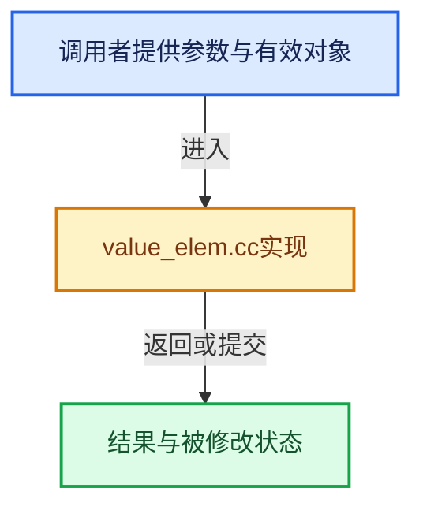

# 实现依赖专题：source/blender/nodes/intern/value_elem.cc

[实现依赖导航](../../README.md) · [符号索引](../../../00-课程指南/02-源码与提交索引/符号依赖与实现索引.md)

本专题从正文实际调用进入，集中保存共享实现。函数有稳定锚点，可从调用处直接跳到对应完整函数；递归与互相调用通过回链组织。

## 本文件的实现关系

```mermaid
flowchart LR
  F0["blender::nodes::value_elem::get_elem_variant_for_socket_type"]:::abstraction
  F1["blender::nodes::value_elem::convert_socket_elem"]:::compute
  F1 -->|"显式调用"| F0
  classDef input fill:#DBEAFE,stroke:#2563EB,color:#172554,stroke-width:2px;
  classDef data fill:#CFFAFE,stroke:#0891B2,color:#164E63,stroke-width:2px;
  classDef abstraction fill:#EDE9FE,stroke:#7C3AED,color:#3B0764,stroke-width:2px;
  classDef compute fill:#FEF3C7,stroke:#D97706,color:#78350F,stroke-width:2px;
  classDef result fill:#DCFCE7,stroke:#16A34A,color:#14532D,stroke-width:2px;
  classDef error fill:#FEE2E2,stroke:#DC2626,color:#7F1D1D,stroke-width:2px;
```






## 完整成员与函数实现

<a id="f-2e1a93c9efead9c0"></a>

### `blender::nodes::value_elem::get_elem_variant_for_socket_type`

实现位置：[source/blender/nodes/intern/value_elem.cc](../../../../../../../source/blender/nodes/intern/value_elem.cc) · L13—L31。

接口参数：

- `const eNodeSocketDatatype type`

**教学注释版**

<!-- annotated:b625ca5335ede7 -->

```cpp
std::optional<ElemVariant> get_elem_variant_for_socket_type(const eNodeSocketDatatype type)
{
  switch (type) {
    case SOCK_FLOAT:
      return {{FloatElem()}};
    case SOCK_INT:
      return {{IntElem()}};
    case SOCK_BOOLEAN:
      return {{BoolElem()}};
    case SOCK_VECTOR:
      return {{VectorElem()}};
    case SOCK_ROTATION:
      return {{RotationElem()}};
    case SOCK_MATRIX:
      return {{MatrixElem()}};
    default:
      return std::nullopt;
  }
}
```

<details>
<summary>核对原始源码：source/blender/nodes/intern/value_elem.cc · L13—L31</summary>

<!-- original:b625ca5335ede7:source/blender/nodes/intern/value_elem.cc:13:31 -->

```cpp
std::optional<ElemVariant> get_elem_variant_for_socket_type(const eNodeSocketDatatype type)
{
  switch (type) {
    case SOCK_FLOAT:
      return {{FloatElem()}};
    case SOCK_INT:
      return {{IntElem()}};
    case SOCK_BOOLEAN:
      return {{BoolElem()}};
    case SOCK_VECTOR:
      return {{VectorElem()}};
    case SOCK_ROTATION:
      return {{RotationElem()}};
    case SOCK_MATRIX:
      return {{MatrixElem()}};
    default:
      return std::nullopt;
  }
}
```

</details>

**结果出口**

- `return {{FloatElem()}};`
- `return {{IntElem()}};`
- `return {{BoolElem()}};`
- `return {{VectorElem()}};`
- `return {{RotationElem()}};`
- `return {{MatrixElem()}};`
- `return std::nullopt;`

**继续追踪实现**

- `FloatElem` → [blender::nodes::value_elem::FloatElem](../NOD_value_elem.hh.md#t-7ef85108de88)。
- `IntElem` → [blender::nodes::value_elem::IntElem](../NOD_value_elem.hh.md#t-a07a994b80d8)。
- `BoolElem` → [blender::nodes::value_elem::BoolElem](../NOD_value_elem.hh.md#t-dfc63819a270)。
- `VectorElem` → [blender::nodes::value_elem::VectorElem](../NOD_value_elem.hh.md#t-eac1ea383810)。
- `RotationElem` → [blender::nodes::value_elem::RotationElem](../NOD_value_elem.hh.md#t-848681f80f64)。
- `MatrixElem` → [blender::nodes::value_elem::MatrixElem](../NOD_value_elem.hh.md#t-0faeda7ad4a2)。

<a id="f-1398f6d895df2961"></a>

### `blender::nodes::value_elem::convert_socket_elem`

实现位置：[source/blender/nodes/intern/value_elem.cc](../../../../../../../source/blender/nodes/intern/value_elem.cc) · L33—L87。

接口参数：

- `const bNodeSocket &old_socket`
- `const bNodeSocket &new_socket`
- `const ElemVariant &old_elem`

**教学注释版**

<!-- annotated:608c1a6cd86ae3 -->

```cpp
std::optional<ElemVariant> convert_socket_elem(const bNodeSocket &old_socket,
                                               const bNodeSocket &new_socket,
                                               const ElemVariant &old_elem)
{
  const eNodeSocketDatatype old_type = old_socket.type;
  const eNodeSocketDatatype new_type = new_socket.type;
  if (old_type == new_type) {
    return old_elem;
  }
  if (ELEM(old_type, SOCK_INT, SOCK_FLOAT, SOCK_BOOLEAN) &&
      ELEM(new_type, SOCK_INT, SOCK_FLOAT, SOCK_BOOLEAN))
  {
    std::optional<ElemVariant> new_elem = get_elem_variant_for_socket_type(new_type);
    if (old_elem) {
      new_elem->set_all();
    }
    return new_elem;
  }
  switch (old_type) {
    case SOCK_MATRIX: {
      const MatrixElem &transform_elem = std::get<MatrixElem>(old_elem.elem);
      if (new_type == SOCK_ROTATION) {
        return ElemVariant{transform_elem.rotation};
      }
      break;
    }
    case SOCK_ROTATION: {
      const RotationElem &rotation_elem = std::get<RotationElem>(old_elem.elem);
      if (new_type == SOCK_MATRIX) {
        MatrixElem matrix_elem;
        matrix_elem.rotation = rotation_elem;
        return ElemVariant{matrix_elem};
      }
      if (new_type == SOCK_VECTOR) {
        return ElemVariant{rotation_elem.euler};
      }
      break;
    }
    case SOCK_VECTOR: {
      const VectorElem &vector_elem = std::get<VectorElem>(old_elem.elem);
      if (new_type == SOCK_ROTATION) {
        RotationElem rotation_elem;
        rotation_elem.euler = vector_elem;
        if (rotation_elem) {
          rotation_elem.angle = FloatElem::all();
          rotation_elem.axis = VectorElem::all();
        }
        return ElemVariant{rotation_elem};
      }
    }
    default:
      break;
  }
  return std::nullopt;
}
```

<details>
<summary>核对原始源码：source/blender/nodes/intern/value_elem.cc · L33—L87</summary>

<!-- original:608c1a6cd86ae3:source/blender/nodes/intern/value_elem.cc:33:87 -->

```cpp
std::optional<ElemVariant> convert_socket_elem(const bNodeSocket &old_socket,
                                               const bNodeSocket &new_socket,
                                               const ElemVariant &old_elem)
{
  const eNodeSocketDatatype old_type = old_socket.type;
  const eNodeSocketDatatype new_type = new_socket.type;
  if (old_type == new_type) {
    return old_elem;
  }
  if (ELEM(old_type, SOCK_INT, SOCK_FLOAT, SOCK_BOOLEAN) &&
      ELEM(new_type, SOCK_INT, SOCK_FLOAT, SOCK_BOOLEAN))
  {
    std::optional<ElemVariant> new_elem = get_elem_variant_for_socket_type(new_type);
    if (old_elem) {
      new_elem->set_all();
    }
    return new_elem;
  }
  switch (old_type) {
    case SOCK_MATRIX: {
      const MatrixElem &transform_elem = std::get<MatrixElem>(old_elem.elem);
      if (new_type == SOCK_ROTATION) {
        return ElemVariant{transform_elem.rotation};
      }
      break;
    }
    case SOCK_ROTATION: {
      const RotationElem &rotation_elem = std::get<RotationElem>(old_elem.elem);
      if (new_type == SOCK_MATRIX) {
        MatrixElem matrix_elem;
        matrix_elem.rotation = rotation_elem;
        return ElemVariant{matrix_elem};
      }
      if (new_type == SOCK_VECTOR) {
        return ElemVariant{rotation_elem.euler};
      }
      break;
    }
    case SOCK_VECTOR: {
      const VectorElem &vector_elem = std::get<VectorElem>(old_elem.elem);
      if (new_type == SOCK_ROTATION) {
        RotationElem rotation_elem;
        rotation_elem.euler = vector_elem;
        if (rotation_elem) {
          rotation_elem.angle = FloatElem::all();
          rotation_elem.axis = VectorElem::all();
        }
        return ElemVariant{rotation_elem};
      }
    }
    default:
      break;
  }
  return std::nullopt;
}
```

</details>

**沿实际写入检查状态**

- `matrix_elem.rotation = rotation_elem;`
- `rotation_elem.euler = vector_elem;`
- `rotation_elem.angle = FloatElem::all();`
- `rotation_elem.axis = VectorElem::all();`

**结果出口**

- `return old_elem;`
- `return new_elem;`
- `return ElemVariant{transform_elem.rotation};`
- `return ElemVariant{matrix_elem};`
- `return ElemVariant{rotation_elem.euler};`
- `return ElemVariant{rotation_elem};`
- `return std::nullopt;`

**继续追踪实现**

- `ELEM` → [ELEM · L88](../../07-Intern运行时与平台/ghost/intern/GHOST_utildefines.hh.md#m-d28724a15928)；[ELEM · L135](../../01-BLI基础库/BLI_utildefines.hh.md#m-d6572de7cae0)。宏定义由构建条件选择。
- `get_elem_variant_for_socket_type` → [blender::nodes::value_elem::get_elem_variant_for_socket_type · L13](value_elem.cc.md#f-2e1a93c9efead9c0)。
- `new_elem->set_all` → [外部契约](https://eel.is/c++draft/)：这个边界按实际表达式及所属类型核对参数、返回值、寿命与失败行为。这里提供接口入口，不声称已解释该第三方版本的内部实现。
- `std::get<MatrixElem>` → [外部契约](https://eel.is/c++draft/)：这个边界按实际表达式及所属类型核对参数、返回值、寿命与失败行为。这里提供接口入口，不声称已解释该第三方版本的内部实现。
- `std::get<RotationElem>` → [外部契约](https://eel.is/c++draft/)：这个边界按实际表达式及所属类型核对参数、返回值、寿命与失败行为。这里提供接口入口，不声称已解释该第三方版本的内部实现。
- `std::get<VectorElem>` → [外部契约](https://eel.is/c++draft/)：这个边界按实际表达式及所属类型核对参数、返回值、寿命与失败行为。这里提供接口入口，不声称已解释该第三方版本的内部实现。
- `FloatElem::all` → [blender::nodes::value_elem::FloatElem::all · L69](../NOD_value_elem.hh.md#f-f17de3ae3c883c3f)。
- `VectorElem::all` → [blender::nodes::value_elem::VectorElem::all · L114](../NOD_value_elem.hh.md#f-0b2d2ea0ba378db2)。
