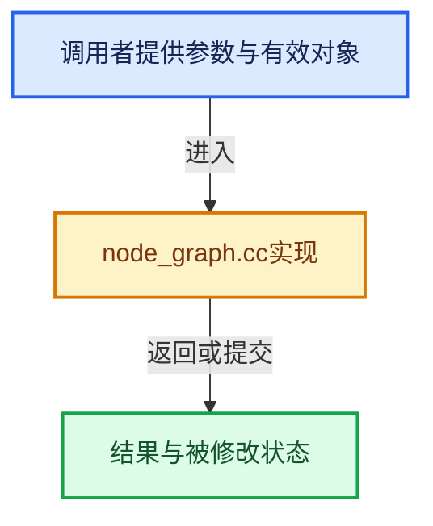

# 实现依赖专题：source/blender/nodes/shader/materialx/node_graph.cc

[实现依赖导航](../../../README.md) · [符号索引](../../../../00-课程指南/02-源码与提交索引/符号依赖与实现索引.md)

本专题从正文实际调用进入，集中保存共享实现。函数有稳定锚点，可从调用处直接跳到对应完整函数；递归与互相调用通过回链组织。

## 本文件的实现关系





## 完整成员与函数实现

<a id="f-55d4e384bdc5c875"></a>

### `blender::nodes::materialx::NodeGraph::unique_anonymous_node_name`

实现位置：[source/blender/nodes/shader/materialx/node_graph.cc](../../../../../../../../source/blender/nodes/shader/materialx/node_graph.cc) · L168—L176。

接口参数：

- `MaterialX::GraphElement *graph_element`

**教学注释版**

<!-- annotated:d9e54f249d709d -->

```cpp
std::string NodeGraph::unique_anonymous_node_name(MaterialX::GraphElement *graph_element)
{
  return BLI_uniquename_cb(
      [graph_element](const StringRef check_name) {
        return graph_element->getNode(check_name) != nullptr;
      },
      '_',
      ANONYMOUS_NODE_NAME_PREFIX);
}
```

<details>
<summary>核对原始源码：source/blender/nodes/shader/materialx/node_graph.cc · L168—L176</summary>

<!-- original:d9e54f249d709d:source/blender/nodes/shader/materialx/node_graph.cc:168:176 -->

```cpp
std::string NodeGraph::unique_anonymous_node_name(MaterialX::GraphElement *graph_element)
{
  return BLI_uniquename_cb(
      [graph_element](const StringRef check_name) {
        return graph_element->getNode(check_name) != nullptr;
      },
      '_',
      ANONYMOUS_NODE_NAME_PREFIX);
}
```

</details>

**结果出口**

- `return BLI_uniquename_cb(`
- `return graph_element->getNode(check_name) != nullptr;`

**继续追踪实现**

- `BLI_uniquename_cb` → [blender::BLI_uniquename_cb · L421](../../../01-BLI基础库/intern/string_utils.cc.md#f-651b82b9010ddef4)；[blender::BLI_uniquename_cb · L459](../../../01-BLI基础库/intern/string_utils.cc.md#f-0e0b6725b5b90a92)。同名重载需按实参类型选择。
- `graph_element->getNode` → [调用协议](../../../../00-课程指南/01-路线与规范/模板宏与动态分派协议.md)：由接收对象具体类型或运行时策略提供实现。调用位置L172。
