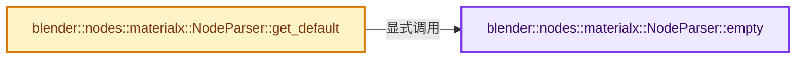
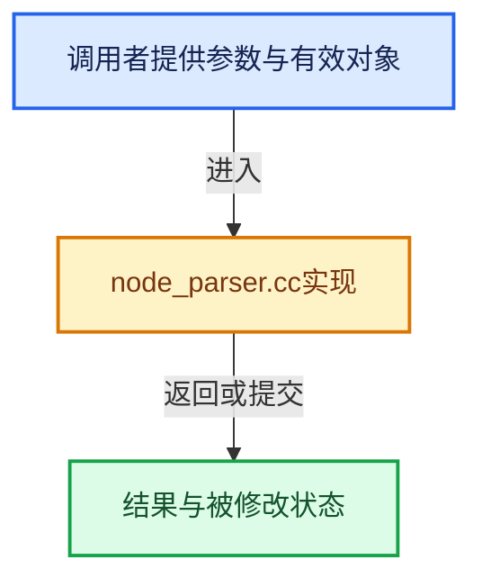

# 实现依赖专题：source/blender/nodes/shader/materialx/node_parser.cc

[实现依赖导航](../../../README.md) · [符号索引](../../../../00-课程指南/02-源码与提交索引/符号依赖与实现索引.md)

本专题从正文实际调用进入，集中保存共享实现。函数有稳定锚点，可从调用处直接跳到对应完整函数；递归与互相调用通过回链组织。

## 本文件的实现关系






## 完整成员与函数实现

<a id="f-692df74172601b58"></a>

### `blender::nodes::materialx::NodeParser::empty`

实现位置：[source/blender/nodes/shader/materialx/node_parser.cc](../../../../../../../../source/blender/nodes/shader/materialx/node_parser.cc) · L130—L133。

**教学注释版**

<!-- annotated:9b36590c0a314e -->

```cpp
NodeItem NodeParser::empty() const
{
  return graph_.empty_node();
}
```

<details>
<summary>核对原始源码：source/blender/nodes/shader/materialx/node_parser.cc · L130—L133</summary>

<!-- original:9b36590c0a314e:source/blender/nodes/shader/materialx/node_parser.cc:130:133 -->

```cpp
NodeItem NodeParser::empty() const
{
  return graph_.empty_node();
}
```

</details>

**结果出口**

- `return graph_.empty_node();`

**继续追踪实现**

- `graph_.empty_node` → [调用协议](../../../../00-课程指南/01-路线与规范/模板宏与动态分派协议.md)：接收对象类型依赖auto、返回值或模板实例；不按同名猜测目标。调用位置L132。

<a id="f-0cd986e46043855f"></a>

### `blender::nodes::materialx::NodeParser::get_default`

实现位置：[source/blender/nodes/shader/materialx/node_parser.cc](../../../../../../../../source/blender/nodes/shader/materialx/node_parser.cc) · L162—L205。

接口参数：

- `const bNodeSocket &socket`
- `NodeItem::Type to_type`

**教学注释版**

<!-- annotated:988a75948e2d64 -->

```cpp
NodeItem NodeParser::get_default(const bNodeSocket &socket, NodeItem::Type to_type)
{
  NodeItem res = empty();
  if (!NodeItem::is_arithmetic(to_type) && to_type != NodeItem::Type::Any) {
    return res;
  }

  switch (socket.type) {
    case SOCK_CUSTOM:
      /* Return empty */
      break;
    case SOCK_BOOLEAN: {
      bool v = socket.default_value_typed<bNodeSocketValueBoolean>()->value;
      res.value = MaterialX::Value::createValue<bool>(v);
      break;
    }
    case SOCK_INT: {
      int v = socket.default_value_typed<bNodeSocketValueInt>()->value;
      res.value = MaterialX::Value::createValue<int>(v);
      break;
    }
    case SOCK_FLOAT: {
      float v = socket.default_value_typed<bNodeSocketValueFloat>()->value;
      res.value = MaterialX::Value::createValue<float>(v);
      break;
    }
    case SOCK_VECTOR: {
      const float *v = socket.default_value_typed<bNodeSocketValueVector>()->value;
      res.value = MaterialX::Value::createValue<MaterialX::Vector3>(
          MaterialX::Vector3(v[0], v[1], v[2]));
      break;
    }
    case SOCK_RGBA: {
      const float *v = socket.default_value_typed<bNodeSocketValueRGBA>()->value;
      res.value = MaterialX::Value::createValue<MaterialX::Color4>(
          MaterialX::Color4(v[0], v[1], v[2], v[3]));
      break;
    }
    default: {
      CLOG_WARN(LOG_IO_MATERIALX, "Unsupported socket type: %d", socket.type);
    }
  }
  return res.convert(to_type);
}
```

<details>
<summary>核对原始源码：source/blender/nodes/shader/materialx/node_parser.cc · L162—L205</summary>

<!-- original:988a75948e2d64:source/blender/nodes/shader/materialx/node_parser.cc:162:205 -->

```cpp
NodeItem NodeParser::get_default(const bNodeSocket &socket, NodeItem::Type to_type)
{
  NodeItem res = empty();
  if (!NodeItem::is_arithmetic(to_type) && to_type != NodeItem::Type::Any) {
    return res;
  }

  switch (socket.type) {
    case SOCK_CUSTOM:
      /* Return empty */
      break;
    case SOCK_BOOLEAN: {
      bool v = socket.default_value_typed<bNodeSocketValueBoolean>()->value;
      res.value = MaterialX::Value::createValue<bool>(v);
      break;
    }
    case SOCK_INT: {
      int v = socket.default_value_typed<bNodeSocketValueInt>()->value;
      res.value = MaterialX::Value::createValue<int>(v);
      break;
    }
    case SOCK_FLOAT: {
      float v = socket.default_value_typed<bNodeSocketValueFloat>()->value;
      res.value = MaterialX::Value::createValue<float>(v);
      break;
    }
    case SOCK_VECTOR: {
      const float *v = socket.default_value_typed<bNodeSocketValueVector>()->value;
      res.value = MaterialX::Value::createValue<MaterialX::Vector3>(
          MaterialX::Vector3(v[0], v[1], v[2]));
      break;
    }
    case SOCK_RGBA: {
      const float *v = socket.default_value_typed<bNodeSocketValueRGBA>()->value;
      res.value = MaterialX::Value::createValue<MaterialX::Color4>(
          MaterialX::Color4(v[0], v[1], v[2], v[3]));
      break;
    }
    default: {
      CLOG_WARN(LOG_IO_MATERIALX, "Unsupported socket type: %d", socket.type);
    }
  }
  return res.convert(to_type);
}
```

</details>

**沿实际写入检查状态**

- `res.value = MaterialX::Value::createValue<bool>(v);`
- `res.value = MaterialX::Value::createValue<int>(v);`
- `res.value = MaterialX::Value::createValue<float>(v);`
- `res.value = MaterialX::Value::createValue<MaterialX::Vector3>(`
- `res.value = MaterialX::Value::createValue<MaterialX::Color4>(`

**结果出口**

- `return res;`
- `return res.convert(to_type);`

**继续追踪实现**

- `empty` → [blender::nodes::materialx::NodeParser::empty · L130](node_parser.cc.md#f-692df74172601b58)。
- `NodeItem::is_arithmetic` → [blender::nodes::materialx::NodeItem::is_arithmetic · L116](node_item.cc.md#f-33f2d7899dee6673)；[blender::nodes::materialx::NodeItem::is_arithmetic · L1016](node_item.cc.md#f-4fb5959316451fe4)。同名重载需按实参类型选择。
- `socket.default_value_typed<bNodeSocketValueBoolean>` → [blender::bNodeSocket::default_value_typed · L1134](../../../02-BKE几何与数据/BKE_node_runtime.hh.md#f-ce490d0e5a28d98d)；[blender::bNodeSocket::default_value_typed · L1139](../../../02-BKE几何与数据/BKE_node_runtime.hh.md#f-392726ff93a0389d)。同名重载需按实参类型选择。
- `MaterialX::Value::createValue<bool>` → [调用协议](../../../../00-课程指南/01-路线与规范/模板宏与动态分派协议.md)：函数指针、局部可调用对象或未展开的宏；必须结合调用者环境。调用位置L175。
- `socket.default_value_typed<bNodeSocketValueInt>` → [blender::bNodeSocket::default_value_typed · L1134](../../../02-BKE几何与数据/BKE_node_runtime.hh.md#f-ce490d0e5a28d98d)；[blender::bNodeSocket::default_value_typed · L1139](../../../02-BKE几何与数据/BKE_node_runtime.hh.md#f-392726ff93a0389d)。同名重载需按实参类型选择。
- `MaterialX::Value::createValue<int>` → [调用协议](../../../../00-课程指南/01-路线与规范/模板宏与动态分派协议.md)：函数指针、局部可调用对象或未展开的宏；必须结合调用者环境。调用位置L180。
- `socket.default_value_typed<bNodeSocketValueFloat>` → [blender::bNodeSocket::default_value_typed · L1134](../../../02-BKE几何与数据/BKE_node_runtime.hh.md#f-ce490d0e5a28d98d)；[blender::bNodeSocket::default_value_typed · L1139](../../../02-BKE几何与数据/BKE_node_runtime.hh.md#f-392726ff93a0389d)。同名重载需按实参类型选择。
- `MaterialX::Value::createValue<float>` → [调用协议](../../../../00-课程指南/01-路线与规范/模板宏与动态分派协议.md)：函数指针、局部可调用对象或未展开的宏；必须结合调用者环境。调用位置L185。
- `socket.default_value_typed<bNodeSocketValueVector>` → [blender::bNodeSocket::default_value_typed · L1134](../../../02-BKE几何与数据/BKE_node_runtime.hh.md#f-ce490d0e5a28d98d)；[blender::bNodeSocket::default_value_typed · L1139](../../../02-BKE几何与数据/BKE_node_runtime.hh.md#f-392726ff93a0389d)。同名重载需按实参类型选择。
- `MaterialX::Value::createValue<MaterialX::Vector3>` → [调用协议](../../../../00-课程指南/01-路线与规范/模板宏与动态分派协议.md)：函数指针、局部可调用对象或未展开的宏；必须结合调用者环境。调用位置L190。
- `MaterialX::Vector3` → [blender::Vector3::Vector3 · L37](../../../08-其他Blender模块/simulation/intern/eigen_utils.h.md#f-4d4bb037b5d86620)；[blender::Vector3::Vector3 · L39](../../../08-其他Blender模块/simulation/intern/eigen_utils.h.md#f-cf25cbc16ddcddae)。同名重载需按实参类型选择。
- `socket.default_value_typed<bNodeSocketValueRGBA>` → [blender::bNodeSocket::default_value_typed · L1134](../../../02-BKE几何与数据/BKE_node_runtime.hh.md#f-ce490d0e5a28d98d)；[blender::bNodeSocket::default_value_typed · L1139](../../../02-BKE几何与数据/BKE_node_runtime.hh.md#f-392726ff93a0389d)。同名重载需按实参类型选择。
- `MaterialX::Value::createValue<MaterialX::Color4>` → [调用协议](../../../../00-课程指南/01-路线与规范/模板宏与动态分派协议.md)：函数指针、局部可调用对象或未展开的宏；必须结合调用者环境。调用位置L196。
- `MaterialX::Color4` → [调用协议](../../../../00-课程指南/01-路线与规范/模板宏与动态分派协议.md)：函数指针、局部可调用对象或未展开的宏；必须结合调用者环境。调用位置L197。
- `CLOG_WARN` → [CLOG_WARN · L189](../../../07-Intern运行时与平台/clog/CLG_log.h.md#m-9da21a06cdbe)。宏定义由构建条件选择。
- `res.convert` → [blender::nodes::materialx::NodeItem::convert · L523](node_item.cc.md#f-9ce0268f1331262f)。
