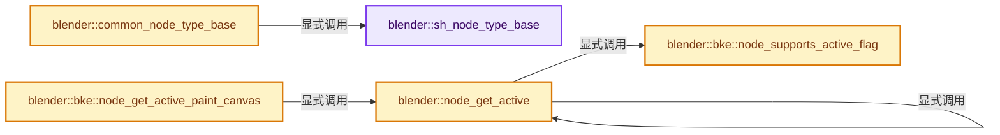

# 实现依赖专题：source/blender/nodes/shader/node_shader_util.cc

[实现依赖导航](../../README.md) · [符号索引](../../../00-课程指南/02-源码与提交索引/符号依赖与实现索引.md)

本专题从正文实际调用进入，集中保存共享实现。函数有稳定锚点，可从调用处直接跳到对应完整函数；递归与互相调用通过回链组织。

## 本文件的实现关系




## 完整成员与函数实现

<a id="f-de1ee334387090b5"></a>

### `blender::sh_node_type_base`

实现位置：[source/blender/nodes/shader/node_shader_util.cc](../../../../../../../source/blender/nodes/shader/node_shader_util.cc) · L66—L75。

接口参数：

- `bke::bNodeType *ntype`
- `UString idname`
- `const std::optional<int16_t> legacy_type`

**教学注释版**

<!-- annotated:eecb52a7192511 -->

```cpp
void sh_node_type_base(bke::bNodeType *ntype,
                       UString idname,
                       const std::optional<int16_t> legacy_type)
{
  bke::node_type_base(*ntype, idname, legacy_type);

  ntype->poll = sh_node_poll_default;
  ntype->insert_link = node_insert_link_default;
  ntype->gather_link_search_ops = nodes::search_link_ops_for_basic_node;
}
```

<details>
<summary>核对原始源码：source/blender/nodes/shader/node_shader_util.cc · L66—L75</summary>

<!-- original:eecb52a7192511:source/blender/nodes/shader/node_shader_util.cc:66:75 -->

```cpp
void sh_node_type_base(bke::bNodeType *ntype,
                       UString idname,
                       const std::optional<int16_t> legacy_type)
{
  bke::node_type_base(*ntype, idname, legacy_type);

  ntype->poll = sh_node_poll_default;
  ntype->insert_link = node_insert_link_default;
  ntype->gather_link_search_ops = nodes::search_link_ops_for_basic_node;
}
```

</details>

**沿实际写入检查状态**

- `ntype->poll = sh_node_poll_default;`
- `ntype->insert_link = node_insert_link_default;`
- `ntype->gather_link_search_ops = nodes::search_link_ops_for_basic_node;`

**继续追踪实现**

- `bke::node_type_base` → [blender::bke::node_type_base · L5866](../../02-BKE几何与数据/intern/node.cc.md#f-154a118e5c03c1b5)。

<a id="f-c9702359b888361c"></a>

### `blender::common_node_type_base`

实现位置：[source/blender/nodes/shader/node_shader_util.cc](../../../../../../../source/blender/nodes/shader/node_shader_util.cc) · L88—L95。

接口参数：

- `bke::bNodeType *ntype`
- `UString idname`
- `const std::optional<int16_t> legacy_type`

**教学注释版**

<!-- annotated:3e5761ba9ba709 -->

```cpp
void common_node_type_base(bke::bNodeType *ntype,
                           UString idname,
                           const std::optional<int16_t> legacy_type)
{
  sh_node_type_base(ntype, idname, legacy_type);
  ntype->poll = common_poll_default;
  ntype->gather_link_search_ops = nodes::search_link_ops_for_basic_node;
}
```

<details>
<summary>核对原始源码：source/blender/nodes/shader/node_shader_util.cc · L88—L95</summary>

<!-- original:3e5761ba9ba709:source/blender/nodes/shader/node_shader_util.cc:88:95 -->

```cpp
void common_node_type_base(bke::bNodeType *ntype,
                           UString idname,
                           const std::optional<int16_t> legacy_type)
{
  sh_node_type_base(ntype, idname, legacy_type);
  ntype->poll = common_poll_default;
  ntype->gather_link_search_ops = nodes::search_link_ops_for_basic_node;
}
```

</details>

**沿实际写入检查状态**

- `ntype->poll = common_poll_default;`
- `ntype->gather_link_search_ops = nodes::search_link_ops_for_basic_node;`

**继续追踪实现**

- `sh_node_type_base` → [blender::sh_node_type_base · L66](node_shader_util.cc.md#f-de1ee334387090b5)。

<a id="f-75be12d523b94a10"></a>

### `blender::bke::node_supports_active_flag`

实现位置：[source/blender/nodes/shader/node_shader_util.cc](../../../../../../../source/blender/nodes/shader/node_shader_util.cc) · L425—L435。

接口参数：

- `const bNode &node`
- `int sub_activity`

**教学注释版**

<!-- annotated:448bb43ee55c8e -->

```cpp
bool bke::node_supports_active_flag(const bNode &node, int sub_activity)
{
  BLI_assert(ELEM(sub_activity, NODE_ACTIVE_TEXTURE, NODE_ACTIVE_PAINT_CANVAS));
  switch (sub_activity) {
    case NODE_ACTIVE_TEXTURE:
      return node.typeinfo->nclass == NODE_CLASS_TEXTURE;
    case NODE_ACTIVE_PAINT_CANVAS:
      return ELEM(node.type_legacy, SH_NODE_TEX_IMAGE, SH_NODE_ATTRIBUTE);
  }
  return false;
}
```

<details>
<summary>核对原始源码：source/blender/nodes/shader/node_shader_util.cc · L425—L435</summary>

<!-- original:448bb43ee55c8e:source/blender/nodes/shader/node_shader_util.cc:425:435 -->

```cpp
bool bke::node_supports_active_flag(const bNode &node, int sub_activity)
{
  BLI_assert(ELEM(sub_activity, NODE_ACTIVE_TEXTURE, NODE_ACTIVE_PAINT_CANVAS));
  switch (sub_activity) {
    case NODE_ACTIVE_TEXTURE:
      return node.typeinfo->nclass == NODE_CLASS_TEXTURE;
    case NODE_ACTIVE_PAINT_CANVAS:
      return ELEM(node.type_legacy, SH_NODE_TEX_IMAGE, SH_NODE_ATTRIBUTE);
  }
  return false;
}
```

</details>

**结果出口**

- `return node.typeinfo->nclass == NODE_CLASS_TEXTURE;`
- `return ELEM(node.type_legacy, SH_NODE_TEX_IMAGE, SH_NODE_ATTRIBUTE);`
- `return false;`

**继续追踪实现**

- `BLI_assert` → [BLI_assert · L48](../../01-BLI基础库/BLI_assert.hh.md#m-57a88495704d)；[BLI_assert · L63](../../01-BLI基础库/BLI_assert.hh.md#m-d07050020cb5)。宏定义由构建条件选择。
- `ELEM` → [ELEM · L88](../../07-Intern运行时与平台/ghost/intern/GHOST_utildefines.hh.md#m-d28724a15928)；[ELEM · L135](../../01-BLI基础库/BLI_utildefines.hh.md#m-d6572de7cae0)。宏定义由构建条件选择。

<a id="f-0482a42811708aee"></a>

### `blender::node_get_active`

实现位置：[source/blender/nodes/shader/node_shader_util.cc](../../../../../../../source/blender/nodes/shader/node_shader_util.cc) · L437—L495。

接口参数：

- `bNodeTree *ntree`
- `int sub_activity`

**教学注释版**

<!-- annotated:57c2aaa95743a7 -->

```cpp
static bNode *node_get_active(bNodeTree *ntree, int sub_activity)
{
  BLI_assert(ELEM(sub_activity, NODE_ACTIVE_TEXTURE, NODE_ACTIVE_PAINT_CANVAS));
  /* this is the node we texture paint and draw in textured draw */
  bNode *inactivenode = nullptr, *activetexnode = nullptr, *activegroup = nullptr;
  bool hasgroup = false;

  if (!ntree) {
    return nullptr;
  }

  for (bNode *node : ntree->all_nodes()) {
    if (node->flag & sub_activity) {
      activetexnode = node;
      /* if active we can return immediately */
      if (node->flag & NODE_ACTIVE) {
        return node;
      }
    }
    else if (!inactivenode && bke::node_supports_active_flag(*node, sub_activity)) {
      inactivenode = node;
    }
    else if (node->type_legacy == NODE_GROUP) {
      if (node->flag & NODE_ACTIVE) {
        activegroup = node;
      }
      else {
        hasgroup = true;
      }
    }
  }

  /* first, check active group for textures */
  if (activegroup) {
    bNode *tnode = node_get_active(id_cast<bNodeTree *>(activegroup->id), sub_activity);
    /* active node takes priority, so ignore any other possible nodes here */
    if (tnode) {
      return tnode;
    }
  }

  if (activetexnode) {
    return activetexnode;
  }

  if (hasgroup) {
    /* node active texture node in this tree, look inside groups */
    for (bNode *node : ntree->all_nodes()) {
      if (node->type_legacy == NODE_GROUP) {
        bNode *tnode = node_get_active(id_cast<bNodeTree *>(node->id), sub_activity);
        if (tnode && ((tnode->flag & sub_activity) || !inactivenode)) {
          return tnode;
        }
      }
    }
  }

  return inactivenode;
}
```

<details>
<summary>核对原始源码：source/blender/nodes/shader/node_shader_util.cc · L437—L495</summary>

<!-- original:57c2aaa95743a7:source/blender/nodes/shader/node_shader_util.cc:437:495 -->

```cpp
static bNode *node_get_active(bNodeTree *ntree, int sub_activity)
{
  BLI_assert(ELEM(sub_activity, NODE_ACTIVE_TEXTURE, NODE_ACTIVE_PAINT_CANVAS));
  /* this is the node we texture paint and draw in textured draw */
  bNode *inactivenode = nullptr, *activetexnode = nullptr, *activegroup = nullptr;
  bool hasgroup = false;

  if (!ntree) {
    return nullptr;
  }

  for (bNode *node : ntree->all_nodes()) {
    if (node->flag & sub_activity) {
      activetexnode = node;
      /* if active we can return immediately */
      if (node->flag & NODE_ACTIVE) {
        return node;
      }
    }
    else if (!inactivenode && bke::node_supports_active_flag(*node, sub_activity)) {
      inactivenode = node;
    }
    else if (node->type_legacy == NODE_GROUP) {
      if (node->flag & NODE_ACTIVE) {
        activegroup = node;
      }
      else {
        hasgroup = true;
      }
    }
  }

  /* first, check active group for textures */
  if (activegroup) {
    bNode *tnode = node_get_active(id_cast<bNodeTree *>(activegroup->id), sub_activity);
    /* active node takes priority, so ignore any other possible nodes here */
    if (tnode) {
      return tnode;
    }
  }

  if (activetexnode) {
    return activetexnode;
  }

  if (hasgroup) {
    /* node active texture node in this tree, look inside groups */
    for (bNode *node : ntree->all_nodes()) {
      if (node->type_legacy == NODE_GROUP) {
        bNode *tnode = node_get_active(id_cast<bNodeTree *>(node->id), sub_activity);
        if (tnode && ((tnode->flag & sub_activity) || !inactivenode)) {
          return tnode;
        }
      }
    }
  }

  return inactivenode;
}
```

</details>

**沿实际写入检查状态**

- `activetexnode = node;`
- `inactivenode = node;`
- `activegroup = node;`
- `hasgroup = true;`

**结果出口**

- `return nullptr;`
- `return node;`
- `return tnode;`
- `return activetexnode;`
- `return inactivenode;`

**继续追踪实现**

- `BLI_assert` → [BLI_assert · L48](../../01-BLI基础库/BLI_assert.hh.md#m-57a88495704d)；[BLI_assert · L63](../../01-BLI基础库/BLI_assert.hh.md#m-d07050020cb5)。宏定义由构建条件选择。
- `ELEM` → [ELEM · L88](../../07-Intern运行时与平台/ghost/intern/GHOST_utildefines.hh.md#m-d28724a15928)；[ELEM · L135](../../01-BLI基础库/BLI_utildefines.hh.md#m-d6572de7cae0)。宏定义由构建条件选择。
- `ntree->all_nodes` → [blender::bNodeTree::all_nodes · L500](../../02-BKE几何与数据/BKE_node_runtime.hh.md#f-cda455cbcc6c7f36)；[blender::bNodeTree::all_nodes · L505](../../02-BKE几何与数据/BKE_node_runtime.hh.md#f-358b65e5678f8a32)。同名重载需按实参类型选择。
- `bke::node_supports_active_flag` → [blender::bke::node_supports_active_flag · L425](node_shader_util.cc.md#f-75be12d523b94a10)。
- `node_get_active` → [blender::node_get_active · L437](node_shader_util.cc.md#f-0482a42811708aee)。
- `id_cast<bNodeTree *>` → [blender::id_cast · L1417](../../08-其他Blender模块/makesdna/DNA_ID.h.md#f-6c8ac6412850ac5a)。

<a id="f-6218682732acfb85"></a>

### `blender::bke::node_get_active_paint_canvas`

实现位置：[source/blender/nodes/shader/node_shader_util.cc](../../../../../../../source/blender/nodes/shader/node_shader_util.cc) · L504—L507。

接口参数：

- `bNodeTree &ntree`

**教学注释版**

<!-- annotated:ba334341f9ceb8 -->

```cpp
bNode *node_get_active_paint_canvas(bNodeTree &ntree)
{
  return node_get_active(&ntree, NODE_ACTIVE_PAINT_CANVAS);
}
```

<details>
<summary>核对原始源码：source/blender/nodes/shader/node_shader_util.cc · L504—L507</summary>

<!-- original:ba334341f9ceb8:source/blender/nodes/shader/node_shader_util.cc:504:507 -->

```cpp
bNode *node_get_active_paint_canvas(bNodeTree &ntree)
{
  return node_get_active(&ntree, NODE_ACTIVE_PAINT_CANVAS);
}
```

</details>

**结果出口**

- `return node_get_active(&ntree, NODE_ACTIVE_PAINT_CANVAS);`

**继续追踪实现**

- `node_get_active` → [blender::node_get_active · L437](node_shader_util.cc.md#f-0482a42811708aee)。
