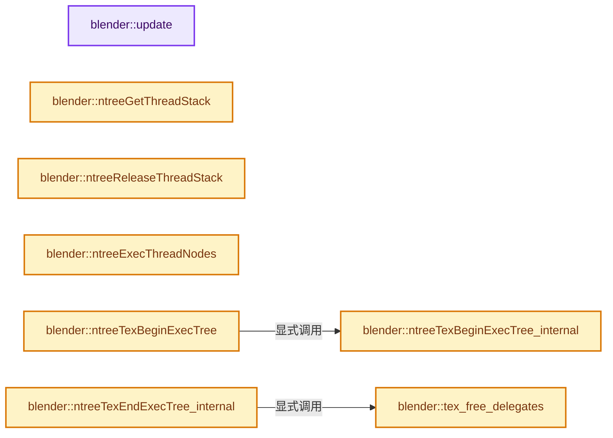

# 实现依赖专题：source/blender/nodes/texture/node_texture_tree.cc

[实现依赖导航](../../README.md) · [符号索引](../../../00-课程指南/02-源码与提交索引/符号依赖与实现索引.md)

本专题从正文实际调用进入，集中保存共享实现。函数有稳定锚点，可从调用处直接跳到对应完整函数；递归与互相调用通过回链组织。

## 本文件的实现关系




## 完整成员与函数实现

<a id="f-7591916c55b3dfe3"></a>

### `blender::update`

实现位置：[source/blender/nodes/texture/node_texture_tree.cc](../../../../../../../source/blender/nodes/texture/node_texture_tree.cc) · L121—L124。

接口参数：

- `bNodeTree *ntree`

**教学注释版**

<!-- annotated:88238be78e8c3a -->

```cpp
static void update(bNodeTree *ntree)
{
  ntree_update_reroute_nodes(ntree);
}
```

<details>
<summary>核对原始源码：source/blender/nodes/texture/node_texture_tree.cc · L121—L124</summary>

<!-- original:88238be78e8c3a:source/blender/nodes/texture/node_texture_tree.cc:121:124 -->

```cpp
static void update(bNodeTree *ntree)
{
  ntree_update_reroute_nodes(ntree);
}
```

</details>

**继续追踪实现**

- `ntree_update_reroute_nodes` → [blender::ntree_update_reroute_nodes · L685](../intern/node_common.cc.md#f-ba6be3d156feb4a5)。

<a id="f-90b24db4ecc9342a"></a>

### `blender::ntreeGetThreadStack`

实现位置：[source/blender/nodes/texture/node_texture_tree.cc](../../../../../../../source/blender/nodes/texture/node_texture_tree.cc) · L162—L182。

接口参数：

- `bNodeTreeExec *exec`
- `int thread`

**教学注释版**

<!-- annotated:87d489458d62e1 -->

```cpp
bNodeThreadStack *ntreeGetThreadStack(bNodeTreeExec *exec, int thread)
{
  ListBaseT<bNodeThreadStack> *lb = &exec->threadstack[thread];
  bNodeThreadStack *nts;

  for (nts = lb->first(); nts; nts = nts->next) {
    if (!nts->used) {
      nts->used = true;
      break;
    }
  }

  if (!nts) {
    nts = MEM_new_zeroed<bNodeThreadStack>("bNodeThreadStack");
    nts->stack = MEM_dupalloc(exec->stack);
    nts->used = true;
    BLI_addtail(lb, nts);
  }

  return nts;
}
```

<details>
<summary>核对原始源码：source/blender/nodes/texture/node_texture_tree.cc · L162—L182</summary>

<!-- original:87d489458d62e1:source/blender/nodes/texture/node_texture_tree.cc:162:182 -->

```cpp
bNodeThreadStack *ntreeGetThreadStack(bNodeTreeExec *exec, int thread)
{
  ListBaseT<bNodeThreadStack> *lb = &exec->threadstack[thread];
  bNodeThreadStack *nts;

  for (nts = lb->first(); nts; nts = nts->next) {
    if (!nts->used) {
      nts->used = true;
      break;
    }
  }

  if (!nts) {
    nts = MEM_new_zeroed<bNodeThreadStack>("bNodeThreadStack");
    nts->stack = MEM_dupalloc(exec->stack);
    nts->used = true;
    BLI_addtail(lb, nts);
  }

  return nts;
}
```

</details>

**沿实际写入检查状态**

- `nts->used = true;`
- `nts = MEM_new_zeroed<bNodeThreadStack>("bNodeThreadStack");`
- `nts->stack = MEM_dupalloc(exec->stack);`

**结果出口**

- `return nts;`

**继续追踪实现**

- `lb->first` → [blender::ListBaseT::first · L102](../../08-其他Blender模块/makesdna/DNA_listBase.h.md#f-3d12ff35da057c9e)；[blender::ListBaseT::first · L106](../../08-其他Blender模块/makesdna/DNA_listBase.h.md#f-0df87c3480e059f9)。同名重载需按实参类型选择。
- `MEM_new_zeroed<bNodeThreadStack>` → [MEM_new_zeroed · L550](../../07-Intern运行时与平台/guardedalloc/MEM_guardedalloc.h.md#f-eeb1e2a7f57dd231)；[MEM_new_zeroed · L114](../../07-Intern运行时与平台/guardedalloc/intern/mallocn.cc.md#f-e04cf01c64c8b180)。同名重载需按实参类型选择。
- `MEM_dupalloc` → [MEM_dupalloc · L627](../../07-Intern运行时与平台/guardedalloc/MEM_guardedalloc.h.md#f-78a72b71e3c57010)。
- `BLI_addtail` → [blender::BLI_addtail · L118](../../01-BLI基础库/intern/listbase.cc.md#f-4fb027713fa3115b)。

<a id="f-b5fdbe5d2b8f30ca"></a>

### `blender::ntreeReleaseThreadStack`

实现位置：[source/blender/nodes/texture/node_texture_tree.cc](../../../../../../../source/blender/nodes/texture/node_texture_tree.cc) · L184—L187。

接口参数：

- `bNodeThreadStack *nts`

**教学注释版**

<!-- annotated:d0551d03d9a240 -->

```cpp
void ntreeReleaseThreadStack(bNodeThreadStack *nts)
{
  nts->used = false;
}
```

<details>
<summary>核对原始源码：source/blender/nodes/texture/node_texture_tree.cc · L184—L187</summary>

<!-- original:d0551d03d9a240:source/blender/nodes/texture/node_texture_tree.cc:184:187 -->

```cpp
void ntreeReleaseThreadStack(bNodeThreadStack *nts)
{
  nts->used = false;
}
```

</details>

**沿实际写入检查状态**

- `nts->used = false;`

**继续追踪实现**

本实现没有需要继续展开的显式调用；检查返回表达式、对象转换和调用者前置条件。

<a id="f-80843ce7dcaeb9e1"></a>

### `blender::ntreeExecThreadNodes`

实现位置：[source/blender/nodes/texture/node_texture_tree.cc](../../../../../../../source/blender/nodes/texture/node_texture_tree.cc) · L189—L215。

接口参数：

- `bNodeTreeExec *exec`
- `bNodeThreadStack *nts`
- `void *callerdata`
- `int thread`

**教学注释版**

<!-- annotated:3d01faf9755e99 -->

```cpp
bool ntreeExecThreadNodes(bNodeTreeExec *exec, bNodeThreadStack *nts, void *callerdata, int thread)
{
  bNodeStack *nsin[MAX_SOCKET] = {nullptr};  /* arbitrary... watch this */
  bNodeStack *nsout[MAX_SOCKET] = {nullptr}; /* arbitrary... watch this */
  bNodeExec *nodeexec;
  bNode *node;
  int n;

  /* nodes are presorted, so exec is in order of list */

  for (n = 0, nodeexec = exec->nodeexec; n < exec->totnodes; n++, nodeexec++) {
    node = nodeexec->node;
    if (node->runtime->need_exec) {
      node_get_stack(node, nts->stack, nsin, nsout);
      /* Handle muted nodes...
       * If the mute func is not set, assume the node should never be muted,
       * and hence execute it!
       */
      if (node->typeinfo->exec_fn && !node->is_muted()) {
        node->typeinfo->exec_fn(callerdata, thread, node, &nodeexec->data, nsin, nsout);
      }
    }
  }

  /* signal to that all went OK, for render */
  return true;
}
```

<details>
<summary>核对原始源码：source/blender/nodes/texture/node_texture_tree.cc · L189—L215</summary>

<!-- original:3d01faf9755e99:source/blender/nodes/texture/node_texture_tree.cc:189:215 -->

```cpp
bool ntreeExecThreadNodes(bNodeTreeExec *exec, bNodeThreadStack *nts, void *callerdata, int thread)
{
  bNodeStack *nsin[MAX_SOCKET] = {nullptr};  /* arbitrary... watch this */
  bNodeStack *nsout[MAX_SOCKET] = {nullptr}; /* arbitrary... watch this */
  bNodeExec *nodeexec;
  bNode *node;
  int n;

  /* nodes are presorted, so exec is in order of list */

  for (n = 0, nodeexec = exec->nodeexec; n < exec->totnodes; n++, nodeexec++) {
    node = nodeexec->node;
    if (node->runtime->need_exec) {
      node_get_stack(node, nts->stack, nsin, nsout);
      /* Handle muted nodes...
       * If the mute func is not set, assume the node should never be muted,
       * and hence execute it!
       */
      if (node->typeinfo->exec_fn && !node->is_muted()) {
        node->typeinfo->exec_fn(callerdata, thread, node, &nodeexec->data, nsin, nsout);
      }
    }
  }

  /* signal to that all went OK, for render */
  return true;
}
```

</details>

**沿实际写入检查状态**

- `node = nodeexec->node;`

**结果出口**

- `return true;`

**继续追踪实现**

- `node_get_stack` → [blender::node_get_stack · L47](../intern/node_exec.cc.md#f-3ef1b159d1b42140)。
- `node->is_muted` → [blender::bNode::is_muted · L886](../../02-BKE几何与数据/BKE_node_runtime.hh.md#f-4d91efc4cc87d00d)。
- `node->typeinfo->exec_fn` → [调用协议](../../../00-课程指南/01-路线与规范/模板宏与动态分派协议.md)：接收对象类型依赖auto、返回值或模板实例；不按同名猜测目标。调用位置L208。

<a id="f-94585f09d6c3c9c0"></a>

### `blender::ntreeTexBeginExecTree_internal`

实现位置：[source/blender/nodes/texture/node_texture_tree.cc](../../../../../../../source/blender/nodes/texture/node_texture_tree.cc) · L217—L235。

接口参数：

- `bNodeExecContext *context`
- `bNodeTree *ntree`
- `bNodeInstanceKey parent_key`

**教学注释版**

<!-- annotated:fe8c017c96c8d1 -->

```cpp
bNodeTreeExec *ntreeTexBeginExecTree_internal(bNodeExecContext *context,
                                              bNodeTree *ntree,
                                              bNodeInstanceKey parent_key)
{
  bNodeTreeExec *exec;

  /* common base initialization */
  exec = ntree_exec_begin(context, ntree, parent_key);

  /* allocate the thread stack listbase array */
  exec->threadstack = MEM_new_array_zeroed<ListBaseT<bNodeThreadStack>>(BLENDER_MAX_THREADS,
                                                                        "thread stack array");

  for (bNode &node : exec->nodetree->nodes) {
    node.runtime->need_exec = 1;
  }

  return exec;
}
```

<details>
<summary>核对原始源码：source/blender/nodes/texture/node_texture_tree.cc · L217—L235</summary>

<!-- original:fe8c017c96c8d1:source/blender/nodes/texture/node_texture_tree.cc:217:235 -->

```cpp
bNodeTreeExec *ntreeTexBeginExecTree_internal(bNodeExecContext *context,
                                              bNodeTree *ntree,
                                              bNodeInstanceKey parent_key)
{
  bNodeTreeExec *exec;

  /* common base initialization */
  exec = ntree_exec_begin(context, ntree, parent_key);

  /* allocate the thread stack listbase array */
  exec->threadstack = MEM_new_array_zeroed<ListBaseT<bNodeThreadStack>>(BLENDER_MAX_THREADS,
                                                                        "thread stack array");

  for (bNode &node : exec->nodetree->nodes) {
    node.runtime->need_exec = 1;
  }

  return exec;
}
```

</details>

**沿实际写入检查状态**

- `exec = ntree_exec_begin(context, ntree, parent_key);`
- `exec->threadstack = MEM_new_array_zeroed<ListBaseT<bNodeThreadStack>>(BLENDER_MAX_THREADS,`
- `node.runtime->need_exec = 1;`

**结果出口**

- `return exec;`

**继续追踪实现**

- `ntree_exec_begin` → [blender::ntree_exec_begin · L191](../intern/node_exec.cc.md#f-e6591118615c9d6d)。
- `MEM_new_array_zeroed<ListBaseT<bNodeThreadStack>>` → [MEM_new_array_zeroed · L566](../../07-Intern运行时与平台/guardedalloc/MEM_guardedalloc.h.md#f-3a0cf63fb5216500)；[MEM_new_array_zeroed · L119](../../07-Intern运行时与平台/guardedalloc/intern/mallocn.cc.md#f-6825557da566fdbe)。同名重载需按实参类型选择。

<a id="f-505288820591f59b"></a>

### `blender::ntreeTexBeginExecTree`

实现位置：[source/blender/nodes/texture/node_texture_tree.cc](../../../../../../../source/blender/nodes/texture/node_texture_tree.cc) · L237—L257。

接口参数：

- `bNodeTree *ntree`

**教学注释版**

<!-- annotated:a16a0056a9ed4c -->

```cpp
bNodeTreeExec *ntreeTexBeginExecTree(bNodeTree *ntree)
{
  bNodeExecContext context;
  bNodeTreeExec *exec;

  /* XXX hack: prevent exec data from being generated twice.
   * this should be handled by the renderer!
   */
  if (ntree->runtime->execdata) {
    return ntree->runtime->execdata;
  }

  exec = ntreeTexBeginExecTree_internal(&context, ntree, bke::NODE_INSTANCE_KEY_BASE);

  /* XXX this should not be necessary, but is still used for compositor/shading/texture nodes,
   * which only store the ntree pointer. Should be fixed at some point!
   */
  ntree->runtime->execdata = exec;

  return exec;
}
```

<details>
<summary>核对原始源码：source/blender/nodes/texture/node_texture_tree.cc · L237—L257</summary>

<!-- original:a16a0056a9ed4c:source/blender/nodes/texture/node_texture_tree.cc:237:257 -->

```cpp
bNodeTreeExec *ntreeTexBeginExecTree(bNodeTree *ntree)
{
  bNodeExecContext context;
  bNodeTreeExec *exec;

  /* XXX hack: prevent exec data from being generated twice.
   * this should be handled by the renderer!
   */
  if (ntree->runtime->execdata) {
    return ntree->runtime->execdata;
  }

  exec = ntreeTexBeginExecTree_internal(&context, ntree, bke::NODE_INSTANCE_KEY_BASE);

  /* XXX this should not be necessary, but is still used for compositor/shading/texture nodes,
   * which only store the ntree pointer. Should be fixed at some point!
   */
  ntree->runtime->execdata = exec;

  return exec;
}
```

</details>

**沿实际写入检查状态**

- `exec = ntreeTexBeginExecTree_internal(&context, ntree, bke::NODE_INSTANCE_KEY_BASE);`
- `ntree->runtime->execdata = exec;`

**结果出口**

- `return ntree->runtime->execdata;`
- `return exec;`

**继续追踪实现**

- `ntreeTexBeginExecTree_internal` → [blender::ntreeTexBeginExecTree_internal · L217](node_texture_tree.cc.md#f-94585f09d6c3c9c0)。

<a id="f-aa451491b7cc018b"></a>

### `blender::tex_free_delegates`

实现位置：[source/blender/nodes/texture/node_texture_tree.cc](../../../../../../../source/blender/nodes/texture/node_texture_tree.cc) · L260—L274。

接口参数：

- `bNodeTreeExec *exec`

**教学注释版**

<!-- annotated:9ea2e7b930727f -->

```cpp
static void tex_free_delegates(bNodeTreeExec *exec)
{
  bNodeStack *ns;
  int th, a;

  for (th = 0; th < BLENDER_MAX_THREADS; th++) {
    for (bNodeThreadStack &nts : exec->threadstack[th]) {
      for (ns = nts.stack, a = 0; a < exec->stacksize; a++, ns++) {
        if (ns->data && !ns->is_copy) {
          MEM_delete(static_cast<TexDelegate *>(ns->data));
        }
      }
    }
  }
}
```

<details>
<summary>核对原始源码：source/blender/nodes/texture/node_texture_tree.cc · L260—L274</summary>

<!-- original:9ea2e7b930727f:source/blender/nodes/texture/node_texture_tree.cc:260:274 -->

```cpp
static void tex_free_delegates(bNodeTreeExec *exec)
{
  bNodeStack *ns;
  int th, a;

  for (th = 0; th < BLENDER_MAX_THREADS; th++) {
    for (bNodeThreadStack &nts : exec->threadstack[th]) {
      for (ns = nts.stack, a = 0; a < exec->stacksize; a++, ns++) {
        if (ns->data && !ns->is_copy) {
          MEM_delete(static_cast<TexDelegate *>(ns->data));
        }
      }
    }
  }
}
```

</details>

**继续追踪实现**

- `MEM_delete` → [MEM_delete · L400](../../07-Intern运行时与平台/guardedalloc/MEM_guardedalloc.h.md#f-9049ffdd1682887c)。

<a id="f-d417a54ff181d010"></a>

### `blender::ntreeTexEndExecTree_internal`

实现位置：[source/blender/nodes/texture/node_texture_tree.cc](../../../../../../../source/blender/nodes/texture/node_texture_tree.cc) · L276—L297。

接口参数：

- `bNodeTreeExec *exec`

**教学注释版**

<!-- annotated:fc0eca8e6da4e2 -->

```cpp
void ntreeTexEndExecTree_internal(bNodeTreeExec *exec)
{
  int a;

  if (exec->threadstack) {
    tex_free_delegates(exec);

    for (a = 0; a < BLENDER_MAX_THREADS; a++) {
      for (bNodeThreadStack &nts : exec->threadstack[a]) {
        if (nts.stack) {
          MEM_delete(nts.stack);
        }
      }
      BLI_freelistN(&exec->threadstack[a]);
    }

    MEM_delete(exec->threadstack);
    exec->threadstack = nullptr;
  }

  ntree_exec_end(exec);
}
```

<details>
<summary>核对原始源码：source/blender/nodes/texture/node_texture_tree.cc · L276—L297</summary>

<!-- original:fc0eca8e6da4e2:source/blender/nodes/texture/node_texture_tree.cc:276:297 -->

```cpp
void ntreeTexEndExecTree_internal(bNodeTreeExec *exec)
{
  int a;

  if (exec->threadstack) {
    tex_free_delegates(exec);

    for (a = 0; a < BLENDER_MAX_THREADS; a++) {
      for (bNodeThreadStack &nts : exec->threadstack[a]) {
        if (nts.stack) {
          MEM_delete(nts.stack);
        }
      }
      BLI_freelistN(&exec->threadstack[a]);
    }

    MEM_delete(exec->threadstack);
    exec->threadstack = nullptr;
  }

  ntree_exec_end(exec);
}
```

</details>

**沿实际写入检查状态**

- `exec->threadstack = nullptr;`

**继续追踪实现**

- `tex_free_delegates` → [blender::tex_free_delegates · L260](node_texture_tree.cc.md#f-aa451491b7cc018b)。
- `MEM_delete` → [MEM_delete · L400](../../07-Intern运行时与平台/guardedalloc/MEM_guardedalloc.h.md#f-9049ffdd1682887c)。
- `BLI_freelistN` → [blender::BLI_freelistN · L504](../../01-BLI基础库/intern/listbase.cc.md#f-c250f5cf55fbcbe4)。
- `ntree_exec_end` → [blender::ntree_exec_end · L284](../intern/node_exec.cc.md#f-2d3e765beff71d62)。

<a id="f-02f69805ed4ab523"></a>

### `blender::ntreeTexEndExecTree`

实现位置：[source/blender/nodes/texture/node_texture_tree.cc](../../../../../../../source/blender/nodes/texture/node_texture_tree.cc) · L299—L310。

接口参数：

- `bNodeTreeExec *exec`

**教学注释版**

<!-- annotated:b3aaf1b72d5242 -->

```cpp
void ntreeTexEndExecTree(bNodeTreeExec *exec)
{
  if (exec) {
    /* exec may get freed, so assign ntree */
    bNodeTree *ntree = exec->nodetree;
    ntreeTexEndExecTree_internal(exec);

    /* XXX: clear node-tree back-pointer to exec data,
     * same problem as noted in #ntreeBeginExecTree. */
    ntree->runtime->execdata = nullptr;
  }
}
```

<details>
<summary>核对原始源码：source/blender/nodes/texture/node_texture_tree.cc · L299—L310</summary>

<!-- original:b3aaf1b72d5242:source/blender/nodes/texture/node_texture_tree.cc:299:310 -->

```cpp
void ntreeTexEndExecTree(bNodeTreeExec *exec)
{
  if (exec) {
    /* exec may get freed, so assign ntree */
    bNodeTree *ntree = exec->nodetree;
    ntreeTexEndExecTree_internal(exec);

    /* XXX: clear node-tree back-pointer to exec data,
     * same problem as noted in #ntreeBeginExecTree. */
    ntree->runtime->execdata = nullptr;
  }
}
```

</details>

**沿实际写入检查状态**

- `ntree->runtime->execdata = nullptr;`

**继续追踪实现**

- `ntreeTexEndExecTree_internal` → [blender::ntreeTexEndExecTree_internal · L276](node_texture_tree.cc.md#f-d417a54ff181d010)。

<a id="f-0efe8001beed3abe"></a>

### `blender::ntreeTexExecTree`

实现位置：[source/blender/nodes/texture/node_texture_tree.cc](../../../../../../../source/blender/nodes/texture/node_texture_tree.cc) · L312—L354。

接口参数：

- `bNodeTree *ntree`
- `TexResult *target`
- `const float co[3]`
- `const short thread`
- `const Tex *`
- `short which_output`
- `int cfra`
- `int preview`
- `MTex *mtex`

**教学注释版**

<!-- annotated:f6fbc2f1c94c2a -->

```cpp
int ntreeTexExecTree(bNodeTree *ntree,
                     TexResult *target,
                     const float co[3],
                     const short thread,
                     const Tex * /*tex*/,
                     short which_output,
                     int cfra,
                     int preview,
                     MTex *mtex)
{
  TexCallData data;
  int retval = TEX_INT;
  bNodeThreadStack *nts = nullptr;
  bNodeTreeExec *exec = ntree->runtime->execdata;

  data.co = co;
  data.target = target;
  data.do_preview = preview;
  data.do_manage = true;
  data.thread = thread;
  data.which_output = which_output;
  data.cfra = cfra;
  data.mtex = mtex;

  /* ensure execdata is only initialized once */
  if (!exec) {
    BLI_thread_lock(LOCK_NODES);
    if (!ntree->runtime->execdata) {
      ntreeTexBeginExecTree(ntree);
    }
    BLI_thread_unlock(LOCK_NODES);

    exec = ntree->runtime->execdata;
  }

  nts = ntreeGetThreadStack(exec, thread);
  ntreeExecThreadNodes(exec, nts, &data, thread);
  ntreeReleaseThreadStack(nts);

  retval |= TEX_RGB;

  return retval;
}
```

<details>
<summary>核对原始源码：source/blender/nodes/texture/node_texture_tree.cc · L312—L354</summary>

<!-- original:f6fbc2f1c94c2a:source/blender/nodes/texture/node_texture_tree.cc:312:354 -->

```cpp
int ntreeTexExecTree(bNodeTree *ntree,
                     TexResult *target,
                     const float co[3],
                     const short thread,
                     const Tex * /*tex*/,
                     short which_output,
                     int cfra,
                     int preview,
                     MTex *mtex)
{
  TexCallData data;
  int retval = TEX_INT;
  bNodeThreadStack *nts = nullptr;
  bNodeTreeExec *exec = ntree->runtime->execdata;

  data.co = co;
  data.target = target;
  data.do_preview = preview;
  data.do_manage = true;
  data.thread = thread;
  data.which_output = which_output;
  data.cfra = cfra;
  data.mtex = mtex;

  /* ensure execdata is only initialized once */
  if (!exec) {
    BLI_thread_lock(LOCK_NODES);
    if (!ntree->runtime->execdata) {
      ntreeTexBeginExecTree(ntree);
    }
    BLI_thread_unlock(LOCK_NODES);

    exec = ntree->runtime->execdata;
  }

  nts = ntreeGetThreadStack(exec, thread);
  ntreeExecThreadNodes(exec, nts, &data, thread);
  ntreeReleaseThreadStack(nts);

  retval |= TEX_RGB;

  return retval;
}
```

</details>

**沿实际写入检查状态**

- `data.co = co;`
- `data.target = target;`
- `data.do_preview = preview;`
- `data.do_manage = true;`
- `data.thread = thread;`
- `data.which_output = which_output;`
- `data.cfra = cfra;`
- `data.mtex = mtex;`
- `exec = ntree->runtime->execdata;`
- `nts = ntreeGetThreadStack(exec, thread);`
- `retval |= TEX_RGB;`

**结果出口**

- `return retval;`

**继续追踪实现**

- `BLI_thread_lock` → [BLI_thread_lock · L331](../../01-BLI基础库/intern/threads.cc.md#f-a612114dd9e0cb82)。
- `ntreeTexBeginExecTree` → [blender::ntreeTexBeginExecTree · L237](node_texture_tree.cc.md#f-505288820591f59b)。
- `BLI_thread_unlock` → [BLI_thread_unlock · L336](../../01-BLI基础库/intern/threads.cc.md#f-d747c2de72664b3f)。
- `ntreeGetThreadStack` → [blender::ntreeGetThreadStack · L162](node_texture_tree.cc.md#f-90b24db4ecc9342a)。
- `ntreeExecThreadNodes` → [blender::ntreeExecThreadNodes · L189](node_texture_tree.cc.md#f-80843ce7dcaeb9e1)。
- `ntreeReleaseThreadStack` → [blender::ntreeReleaseThreadStack · L184](node_texture_tree.cc.md#f-b5fdbe5d2b8f30ca)。
