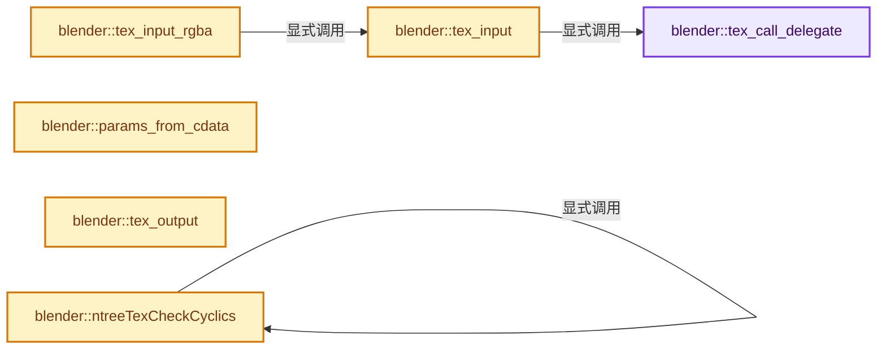

# 实现依赖专题：source/blender/nodes/texture/node_texture_util.cc

[实现依赖导航](../../README.md) · [符号索引](../../../00-课程指南/02-源码与提交索引/符号依赖与实现索引.md)

本专题从正文实际调用进入，集中保存共享实现。函数有稳定锚点，可从调用处直接跳到对应完整函数；递归与互相调用通过回链组织。

## 本文件的实现关系




## 完整成员与函数实现

<a id="f-e2d62969c04f63f1"></a>

### `blender::tex_call_delegate`

实现位置：[source/blender/nodes/texture/node_texture_util.cc](../../../../../../../source/blender/nodes/texture/node_texture_util.cc) · L58—L63。

接口参数：

- `TexDelegate *dg`
- `float *out`
- `TexParams *params`
- `short thread`

**教学注释版**

<!-- annotated:5a3bbf9c546579 -->

```cpp
static void tex_call_delegate(TexDelegate *dg, float *out, TexParams *params, short thread)
{
  if (dg->node->runtime->need_exec) {
    dg->fn(out, params, dg->node, dg->in, thread);
  }
}
```

<details>
<summary>核对原始源码：source/blender/nodes/texture/node_texture_util.cc · L58—L63</summary>

<!-- original:5a3bbf9c546579:source/blender/nodes/texture/node_texture_util.cc:58:63 -->

```cpp
static void tex_call_delegate(TexDelegate *dg, float *out, TexParams *params, short thread)
{
  if (dg->node->runtime->need_exec) {
    dg->fn(out, params, dg->node, dg->in, thread);
  }
}
```

</details>

**继续追踪实现**

- `dg->fn` → [blender::fn::multi_function::CallInstruction::fn · L390](../../../07-MultiFunction与批量执行/07-Procedure指令与控制流.md#f-572ebb7362882f77)。

<a id="f-e66b4b8bc84e7766"></a>

### `blender::tex_input`

实现位置：[source/blender/nodes/texture/node_texture_util.cc](../../../../../../../source/blender/nodes/texture/node_texture_util.cc) · L65—L76。

接口参数：

- `float *out`
- `int num`
- `bNodeStack *in`
- `TexParams *params`
- `short thread`

**教学注释版**

<!-- annotated:1bf2253c8efa62 -->

```cpp
static void tex_input(float *out, int num, bNodeStack *in, TexParams *params, short thread)
{
  TexDelegate *dg = static_cast<TexDelegate *>(in->data);
  if (dg) {
    tex_call_delegate(dg, in->vec, params, thread);

    if (in->hasoutput && in->sockettype == SOCK_FLOAT) {
      in->vec[1] = in->vec[2] = in->vec[0];
    }
  }
  // [讲解] memcpy：复制字节，源与目标不应重叠。类型生命周期、对齐和可复制表示须由调用者证明，不是任意对象的复制构造。
  memcpy(out, in->vec, num * sizeof(float));
}
```

<details>
<summary>核对原始源码：source/blender/nodes/texture/node_texture_util.cc · L65—L76</summary>

<!-- original:1bf2253c8efa62:source/blender/nodes/texture/node_texture_util.cc:65:76 -->

```cpp
static void tex_input(float *out, int num, bNodeStack *in, TexParams *params, short thread)
{
  TexDelegate *dg = static_cast<TexDelegate *>(in->data);
  if (dg) {
    tex_call_delegate(dg, in->vec, params, thread);

    if (in->hasoutput && in->sockettype == SOCK_FLOAT) {
      in->vec[1] = in->vec[2] = in->vec[0];
    }
  }
  memcpy(out, in->vec, num * sizeof(float));
}
```

</details>

**沿实际写入检查状态**

- `in->vec[1] = in->vec[2] = in->vec[0];`

**继续追踪实现**

- `tex_call_delegate` → [blender::tex_call_delegate · L58](node_texture_util.cc.md#f-e2d62969c04f63f1)。
- `memcpy` → [外部契约](https://eel.is/c++draft/cstring.syn)：复制字节，源与目标不应重叠。类型生命周期、对齐和可复制表示须由调用者证明，不是任意对象的复制构造。

<a id="f-eb06e809e2a307a4"></a>

### `blender::tex_input_rgba`

实现位置：[source/blender/nodes/texture/node_texture_util.cc](../../../../../../../source/blender/nodes/texture/node_texture_util.cc) · L83—L98。

接口参数：

- `float *out`
- `bNodeStack *in`
- `TexParams *params`
- `short thread`

**教学注释版**

<!-- annotated:bdea26395646fd -->

```cpp
void tex_input_rgba(float *out, bNodeStack *in, TexParams *params, short thread)
{
  tex_input(out, 4, in, params, thread);

  if (in->hasoutput && in->sockettype == SOCK_FLOAT) {
    out[1] = out[2] = out[0];
    out[3] = 1;
  }

  if (in->hasoutput && in->sockettype == SOCK_VECTOR) {
    out[0] = out[0] * 0.5f + 0.5f;
    out[1] = out[1] * 0.5f + 0.5f;
    out[2] = out[2] * 0.5f + 0.5f;
    out[3] = 1;
  }
}
```

<details>
<summary>核对原始源码：source/blender/nodes/texture/node_texture_util.cc · L83—L98</summary>

<!-- original:bdea26395646fd:source/blender/nodes/texture/node_texture_util.cc:83:98 -->

```cpp
void tex_input_rgba(float *out, bNodeStack *in, TexParams *params, short thread)
{
  tex_input(out, 4, in, params, thread);

  if (in->hasoutput && in->sockettype == SOCK_FLOAT) {
    out[1] = out[2] = out[0];
    out[3] = 1;
  }

  if (in->hasoutput && in->sockettype == SOCK_VECTOR) {
    out[0] = out[0] * 0.5f + 0.5f;
    out[1] = out[1] * 0.5f + 0.5f;
    out[2] = out[2] * 0.5f + 0.5f;
    out[3] = 1;
  }
}
```

</details>

**沿实际写入检查状态**

- `out[1] = out[2] = out[0];`
- `out[3] = 1;`
- `out[0] = out[0] * 0.5f + 0.5f;`
- `out[1] = out[1] * 0.5f + 0.5f;`
- `out[2] = out[2] * 0.5f + 0.5f;`

**继续追踪实现**

- `tex_input` → [blender::tex_input · L65](node_texture_util.cc.md#f-e66b4b8bc84e7766)。

<a id="f-a3f2bcab6a2c00cd"></a>

### `blender::params_from_cdata`

实现位置：[source/blender/nodes/texture/node_texture_util.cc](../../../../../../../source/blender/nodes/texture/node_texture_util.cc) · L107—L113。

接口参数：

- `TexParams *out`
- `TexCallData *in`

**教学注释版**

<!-- annotated:6604522e896dbe -->

```cpp
void params_from_cdata(TexParams *out, TexCallData *in)
{
  out->co = in->co;
  out->previewco = in->co;
  out->cfra = in->cfra;
  out->mtex = in->mtex;
}
```

<details>
<summary>核对原始源码：source/blender/nodes/texture/node_texture_util.cc · L107—L113</summary>

<!-- original:6604522e896dbe:source/blender/nodes/texture/node_texture_util.cc:107:113 -->

```cpp
void params_from_cdata(TexParams *out, TexCallData *in)
{
  out->co = in->co;
  out->previewco = in->co;
  out->cfra = in->cfra;
  out->mtex = in->mtex;
}
```

</details>

**沿实际写入检查状态**

- `out->co = in->co;`
- `out->previewco = in->co;`
- `out->cfra = in->cfra;`
- `out->mtex = in->mtex;`

**继续追踪实现**

本实现没有需要继续展开的显式调用；检查返回表达式、对象转换和调用者前置条件。

<a id="f-0b6a7176dbf05859"></a>

### `blender::tex_output`

实现位置：[source/blender/nodes/texture/node_texture_util.cc](../../../../../../../source/blender/nodes/texture/node_texture_util.cc) · L115—L143。

接口参数：

- `bNode *node`
- `bNodeExecData *`
- `bNodeStack **in`
- `bNodeStack *out`
- `TexFn texfn`
- `TexCallData *cdata`

**教学注释版**

<!-- annotated:e968f008468504 -->

```cpp
void tex_output(bNode *node,
                bNodeExecData * /*execdata*/,
                bNodeStack **in,
                bNodeStack *out,
                TexFn texfn,
                TexCallData *cdata)
{
  TexDelegate *dg;

  if (node->is_muted()) {
    /* do not add a delegate if the node is muted */
    return;
  }

  if (!out->data) {
    /* Freed in tex_end_exec (node.cc) */
    dg = MEM_new_zeroed<TexDelegate>("tex delegate");
    out->data = dg;
  }
  else {
    dg = static_cast<TexDelegate *>(out->data);
  }

  dg->cdata = cdata;
  dg->fn = texfn;
  dg->node = node;
  // [讲解] memcpy：复制字节，源与目标不应重叠。类型生命周期、对齐和可复制表示须由调用者证明，不是任意对象的复制构造。
  memcpy(dg->in, in, MAX_SOCKET * sizeof(bNodeStack *));
  dg->type = out->sockettype;
}
```

<details>
<summary>核对原始源码：source/blender/nodes/texture/node_texture_util.cc · L115—L143</summary>

<!-- original:e968f008468504:source/blender/nodes/texture/node_texture_util.cc:115:143 -->

```cpp
void tex_output(bNode *node,
                bNodeExecData * /*execdata*/,
                bNodeStack **in,
                bNodeStack *out,
                TexFn texfn,
                TexCallData *cdata)
{
  TexDelegate *dg;

  if (node->is_muted()) {
    /* do not add a delegate if the node is muted */
    return;
  }

  if (!out->data) {
    /* Freed in tex_end_exec (node.cc) */
    dg = MEM_new_zeroed<TexDelegate>("tex delegate");
    out->data = dg;
  }
  else {
    dg = static_cast<TexDelegate *>(out->data);
  }

  dg->cdata = cdata;
  dg->fn = texfn;
  dg->node = node;
  memcpy(dg->in, in, MAX_SOCKET * sizeof(bNodeStack *));
  dg->type = out->sockettype;
}
```

</details>

**沿实际写入检查状态**

- `dg = MEM_new_zeroed<TexDelegate>("tex delegate");`
- `out->data = dg;`
- `dg = static_cast<TexDelegate *>(out->data);`
- `dg->cdata = cdata;`
- `dg->fn = texfn;`
- `dg->node = node;`
- `dg->type = out->sockettype;`

**继续追踪实现**

- `node->is_muted` → [blender::bNode::is_muted · L886](../../02-BKE几何与数据/BKE_node_runtime.hh.md#f-4d91efc4cc87d00d)。
- `MEM_new_zeroed<TexDelegate>` → [MEM_new_zeroed · L550](../../07-Intern运行时与平台/guardedalloc/MEM_guardedalloc.h.md#f-eeb1e2a7f57dd231)；[MEM_new_zeroed · L114](../../07-Intern运行时与平台/guardedalloc/intern/mallocn.cc.md#f-e04cf01c64c8b180)。同名重载需按实参类型选择。
- `memcpy` → [外部契约](https://eel.is/c++draft/cstring.syn)：复制字节，源与目标不应重叠。类型生命周期、对齐和可复制表示须由调用者证明，不是任意对象的复制构造。

<a id="f-5aa70f1aeeb5c482"></a>

### `blender::ntreeTexCheckCyclics`

实现位置：[source/blender/nodes/texture/node_texture_util.cc](../../../../../../../source/blender/nodes/texture/node_texture_util.cc) · L145—L168。

接口参数：

- `bNodeTree *ntree`

**教学注释版**

<!-- annotated:adf7713ecab39b -->

```cpp
void ntreeTexCheckCyclics(bNodeTree *ntree)
{
  for (bNode &node : ntree->nodes) {

    if (node.type_legacy == TEX_NODE_TEXTURE && node.id) {
      /* custom2 stops the node from rendering */
      if (node.custom1) {
        node.custom2 = 1;
        node.custom1 = 0;
      }
      else {
        Tex *tex = id_cast<Tex *>(node.id);

        node.custom2 = 0;

        node.custom1 = 1;
        if (tex->use_nodes && tex->nodetree) {
          ntreeTexCheckCyclics(tex->nodetree);
        }
        node.custom1 = 0;
      }
    }
  }
}
```

<details>
<summary>核对原始源码：source/blender/nodes/texture/node_texture_util.cc · L145—L168</summary>

<!-- original:adf7713ecab39b:source/blender/nodes/texture/node_texture_util.cc:145:168 -->

```cpp
void ntreeTexCheckCyclics(bNodeTree *ntree)
{
  for (bNode &node : ntree->nodes) {

    if (node.type_legacy == TEX_NODE_TEXTURE && node.id) {
      /* custom2 stops the node from rendering */
      if (node.custom1) {
        node.custom2 = 1;
        node.custom1 = 0;
      }
      else {
        Tex *tex = id_cast<Tex *>(node.id);

        node.custom2 = 0;

        node.custom1 = 1;
        if (tex->use_nodes && tex->nodetree) {
          ntreeTexCheckCyclics(tex->nodetree);
        }
        node.custom1 = 0;
      }
    }
  }
}
```

</details>

**沿实际写入检查状态**

- `node.custom2 = 1;`
- `node.custom1 = 0;`
- `node.custom2 = 0;`
- `node.custom1 = 1;`

**继续追踪实现**

- `id_cast<Tex *>` → [blender::id_cast · L1417](../../08-其他Blender模块/makesdna/DNA_ID.h.md#f-6c8ac6412850ac5a)。
- `ntreeTexCheckCyclics` → [blender::ntreeTexCheckCyclics · L145](node_texture_util.cc.md#f-5aa70f1aeeb5c482)。
