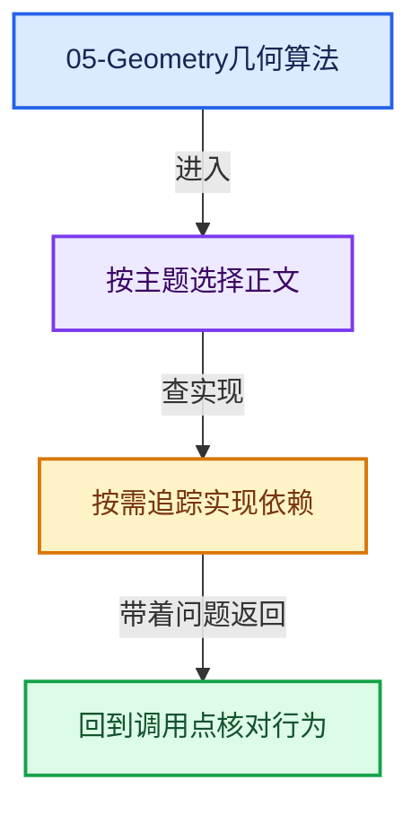
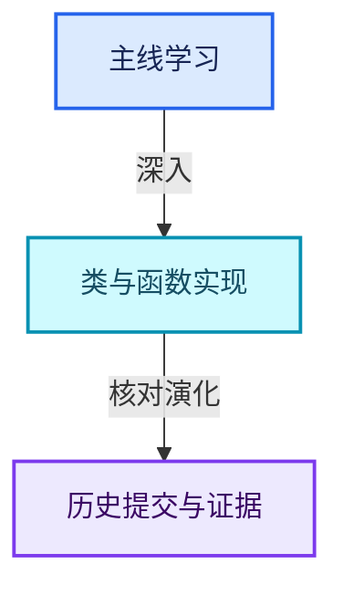

# 05-Geometry几何算法

[实现依赖总导航](../README.md)

## 模块公共接口

- [GEO_mesh_copy_selection.hh](GEO_mesh_copy_selection.hh.md)
- [GEO_realize_instances.hh](GEO_realize_instances.hh.md)

## intern

- [extend_curves.cc](intern/extend_curves.cc.md)
- [foreach_geometry.cc](intern/foreach_geometry.cc.md)
- [join_geometries.cc](intern/join_geometries.cc.md)
- [mesh_boolean.cc](intern/mesh_boolean.cc.md)
- [mesh_boolean_manifold.cc](intern/mesh_boolean_manifold.cc.md)
- [mesh_merge_verts.cc](intern/mesh_merge_verts.cc.md)
- [mesh_to_volume.cc](intern/mesh_to_volume.cc.md)
- [randomize.cc](intern/randomize.cc.md)
- [realize_instances.cc](intern/realize_instances.cc.md)
- [reorder.cc](intern/reorder.cc.md)
- [resample_curves.cc](intern/resample_curves.cc.md)
- [simplify_curves.cc](intern/simplify_curves.cc.md)
- [smooth_curves.cc](intern/smooth_curves.cc.md)
- [subdivide_curves.cc](intern/subdivide_curves.cc.md)
- [trim_curves.cc](intern/trim_curves.cc.md)

