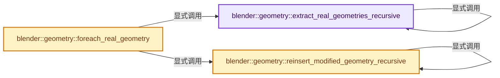

# 实现依赖专题：source/blender/geometry/intern/foreach_geometry.cc

[实现依赖导航](../../README.md) · [符号索引](../../../00-课程指南/02-源码与提交索引/符号依赖与实现索引.md)

本专题从正文实际调用进入，集中保存共享实现。函数有稳定锚点，可从调用处直接跳到对应完整函数；递归与互相调用通过回链组织。

## 本文件的实现关系




## 完整成员与函数实现

<a id="f-0f57d94ed8123782"></a>

### `blender::geometry::extract_real_geometries_recursive`

实现位置：[source/blender/geometry/intern/foreach_geometry.cc](../../../../../../../source/blender/geometry/intern/foreach_geometry.cc) · L17—L43。

接口参数：

- `bke::GeometrySet &geometry`
- `Vector<int> &path`
- `Map<bke::GeometrySet, Vector<Vector<int>>> &r_real_geometries`

**教学注释版**

<!-- annotated:500fc3344ec297 -->

```cpp
static void extract_real_geometries_recursive(
    bke::GeometrySet &geometry,
    Vector<int> &path,
    Map<bke::GeometrySet, Vector<Vector<int>>> &r_real_geometries)
{
  bke::GeometrySet real_geometry = geometry;
  real_geometry.remove(bke::GeometryComponent::Type::Instance);
  geometry.keep_only({bke::GeometryComponent::Type::Instance});

  // [讲解] std::move：把表达式转换成可供移动重载选择的值类别；不保证真的移动，不结束源对象寿命，对const值可能选择复制。
  r_real_geometries.lookup_or_add_default(std::move(real_geometry)).append(path);

  bke::Instances *instances = geometry.get_instances_for_write();
  if (!instances) {
    return;
  }
  instances->ensure_geometry_instances();
  MutableSpan<bke::InstanceReference> references = instances->references_for_write();
  // [讲解] references.index_range：查询视图长度或生成对应有效索引区间。
  for (const int i : references.index_range()) {
    bke::InstanceReference &reference = references[i];
    if (reference.type() == bke::InstanceReference::Type::GeometrySet) {
      bke::GeometrySet &sub_geometry = reference.geometry_set();
      // [讲解] path.append：在尾部建立新元素，必要时先扩大存储。
      path.append(i);
      extract_real_geometries_recursive(sub_geometry, path, r_real_geometries);
      // [讲解] path.pop_last：取走最后一个值并移除末元素。
      path.pop_last();
    }
  }
}
```

<details>
<summary>核对原始源码：source/blender/geometry/intern/foreach_geometry.cc · L17—L43</summary>

<!-- original:500fc3344ec297:source/blender/geometry/intern/foreach_geometry.cc:17:43 -->

```cpp
static void extract_real_geometries_recursive(
    bke::GeometrySet &geometry,
    Vector<int> &path,
    Map<bke::GeometrySet, Vector<Vector<int>>> &r_real_geometries)
{
  bke::GeometrySet real_geometry = geometry;
  real_geometry.remove(bke::GeometryComponent::Type::Instance);
  geometry.keep_only({bke::GeometryComponent::Type::Instance});

  r_real_geometries.lookup_or_add_default(std::move(real_geometry)).append(path);

  bke::Instances *instances = geometry.get_instances_for_write();
  if (!instances) {
    return;
  }
  instances->ensure_geometry_instances();
  MutableSpan<bke::InstanceReference> references = instances->references_for_write();
  for (const int i : references.index_range()) {
    bke::InstanceReference &reference = references[i];
    if (reference.type() == bke::InstanceReference::Type::GeometrySet) {
      bke::GeometrySet &sub_geometry = reference.geometry_set();
      path.append(i);
      extract_real_geometries_recursive(sub_geometry, path, r_real_geometries);
      path.pop_last();
    }
  }
}
```

</details>

**继续追踪实现**

- `real_geometry.remove` → [blender::bke::GeometrySet::remove · L148](../../../06-隐式共享与缓存系统/05-GeometrySet读写与复制.md#f-32c960ae92da98ca)；[blender::bke::GeometrySet::remove · L215](../../../06-隐式共享与缓存系统/04-GeometryComponent共享.md#f-b4ab5f7e230fc44c)。同名重载需按实参类型选择。
- `geometry.keep_only` → [blender::bke::GeometrySet::keep_only · L153](../../../06-隐式共享与缓存系统/05-GeometrySet读写与复制.md#f-3342295c6e1df386)。
- `r_real_geometries.lookup_or_add_default(std::move(real_geometry)).append` → [调用协议](../../../00-课程指南/01-路线与规范/模板宏与动态分派协议.md)：接收对象类型依赖auto、返回值或模板实例；不按同名猜测目标。调用位置L26。
- `r_real_geometries.lookup_or_add_default` → [blender::Map::lookup_or_add_default · L639](../../../02-哈希表与关联数据结构/05-Map插入与回调.md#f-e8d33f0bfe1f3153)；[blender::Map::lookup_or_add_default · L643](../../../02-哈希表与关联数据结构/05-Map插入与回调.md#f-d67ab6e12fd0a267)。同名重载需按实参类型选择。
- `std::move` → [外部契约](https://eel.is/c++draft/utility.forward)：把表达式转换成可供移动重载选择的值类别；不保证真的移动，不结束源对象寿命，对const值可能选择复制。
- `geometry.get_instances_for_write` → [blender::bke::GeometrySet::get_instances_for_write · L586](../../../06-隐式共享与缓存系统/05-GeometrySet读写与复制.md#f-e2fefbfed77f753f)。
- `instances->ensure_geometry_instances` → [blender::bke::Instances::ensure_geometry_instances · L111](../../02-BKE几何与数据/intern/geometry_set_instances.cc.md#f-c6c307192970c4f3)。
- `instances->references_for_write` → [blender::bke::Instances::references_for_write · L295](../../02-BKE几何与数据/intern/instances.cc.md#f-91b59acce441c731)。
- `references.index_range` → [blender::MutableSpan::index_range · L676](../../../01-基础容器与现代CPP/06-MutableSpan可写视图.md#f-f9a9d59a69ca64b5)。
- `reference.type` → [blender::bke::InstanceReference::type · L278](../../02-BKE几何与数据/BKE_instances.hh.md#f-8a88b8335a3ad388)。
- `reference.geometry_set` → [blender::bke::InstanceReference::geometry_set · L295](../../02-BKE几何与数据/BKE_instances.hh.md#f-39e1851c90d6f6f3)；[blender::bke::InstanceReference::geometry_set · L301](../../02-BKE几何与数据/BKE_instances.hh.md#f-3bba5053fead4038)。同名重载需按实参类型选择。
- `path.append` → [blender::Vector::append · L498](../../../01-基础容器与现代CPP/11-Vector插入删除与重排.md#f-5bde268a69e443ec)；[blender::Vector::append · L502](../../../01-基础容器与现代CPP/11-Vector插入删除与重排.md#f-591e0b15e6308532)。同名重载需按实参类型选择。
- `extract_real_geometries_recursive` → [blender::geometry::extract_real_geometries_recursive · L17](foreach_geometry.cc.md#f-0f57d94ed8123782)。
- `path.pop_last` → [blender::Vector::pop_last · L815](../../../01-基础容器与现代CPP/11-Vector插入删除与重排.md#f-e001e773e04130ce)。

<a id="f-708fe124188e6cdd"></a>

### `blender::geometry::reinsert_modified_geometry_recursive`

实现位置：[source/blender/geometry/intern/foreach_geometry.cc](../../../../../../../source/blender/geometry/intern/foreach_geometry.cc) · L45—L67。

接口参数：

- `bke::GeometrySet &geometry`
- `const bke::GeometrySet &geometry_to_insert`
- `const Span<int> path`

**教学注释版**

<!-- annotated:59aac6b82c6309 -->

```cpp
static void reinsert_modified_geometry_recursive(bke::GeometrySet &geometry,
                                                 const bke::GeometrySet &geometry_to_insert,
                                                 const Span<int> path)
{
  // [讲解] path.is_empty：查询视图长度或生成对应有效索引区间。
  if (path.is_empty()) {
    /* Instance references must not be merged here as that could invalidate the paths. */
    const bool allow_merging_instance_references = false;
    /* Important to pass the old geometry first, so that the instance reference paths stay
     * valid. */
    geometry = join_geometries(
        {geometry, geometry_to_insert}, {}, {}, allow_merging_instance_references);
    return;
  }
  bke::Instances *instances = geometry.get_instances_for_write();
  BLI_assert(instances);
  // [讲解] path.first：按视图边界访问元素。
  const int reference_i = path.first();
  const MutableSpan<bke::InstanceReference> references = instances->references_for_write();
  // [讲解] references.size：查询视图长度或生成对应有效索引区间。
  BLI_assert(reference_i < references.size());
  bke::InstanceReference &reference = references[reference_i];
  BLI_assert(reference.type() == bke::InstanceReference::Type::GeometrySet);
  bke::GeometrySet &sub_geometry = reference.geometry_set();
  // [讲解] path.drop_front：从两端裁去或选取一定数量元素形成新视图。
  reinsert_modified_geometry_recursive(sub_geometry, geometry_to_insert, path.drop_front(1));
}
```

<details>
<summary>核对原始源码：source/blender/geometry/intern/foreach_geometry.cc · L45—L67</summary>

<!-- original:59aac6b82c6309:source/blender/geometry/intern/foreach_geometry.cc:45:67 -->

```cpp
static void reinsert_modified_geometry_recursive(bke::GeometrySet &geometry,
                                                 const bke::GeometrySet &geometry_to_insert,
                                                 const Span<int> path)
{
  if (path.is_empty()) {
    /* Instance references must not be merged here as that could invalidate the paths. */
    const bool allow_merging_instance_references = false;
    /* Important to pass the old geometry first, so that the instance reference paths stay
     * valid. */
    geometry = join_geometries(
        {geometry, geometry_to_insert}, {}, {}, allow_merging_instance_references);
    return;
  }
  bke::Instances *instances = geometry.get_instances_for_write();
  BLI_assert(instances);
  const int reference_i = path.first();
  const MutableSpan<bke::InstanceReference> references = instances->references_for_write();
  BLI_assert(reference_i < references.size());
  bke::InstanceReference &reference = references[reference_i];
  BLI_assert(reference.type() == bke::InstanceReference::Type::GeometrySet);
  bke::GeometrySet &sub_geometry = reference.geometry_set();
  reinsert_modified_geometry_recursive(sub_geometry, geometry_to_insert, path.drop_front(1));
}
```

</details>

**沿实际写入检查状态**

- `geometry = join_geometries(`

**继续追踪实现**

- `path.is_empty` → [blender::Span::is_empty · L264](../../../01-基础容器与现代CPP/05-Span只读连续视图.md#f-8cc1d7ba8feb50e6)。
- `join_geometries` → [blender::geometry::join_geometries · L249](join_geometries.cc.md#f-438d80bb03a93ea4)。
- `geometry.get_instances_for_write` → [blender::bke::GeometrySet::get_instances_for_write · L586](../../../06-隐式共享与缓存系统/05-GeometrySet读写与复制.md#f-e2fefbfed77f753f)。
- `BLI_assert` → [BLI_assert · L48](../../01-BLI基础库/BLI_assert.hh.md#m-57a88495704d)；[BLI_assert · L63](../../01-BLI基础库/BLI_assert.hh.md#m-d07050020cb5)。宏定义由构建条件选择。
- `path.first` → [blender::Span::first · L319](../../../01-基础容器与现代CPP/05-Span只读连续视图.md#f-d8c9bcc3e9757248)。
- `instances->references_for_write` → [blender::bke::Instances::references_for_write · L295](../../02-BKE几何与数据/intern/instances.cc.md#f-91b59acce441c731)。
- `references.size` → [blender::MutableSpan::size · L499](../../../01-基础容器与现代CPP/06-MutableSpan可写视图.md#f-1de6a66839c304a8)；[blender::gpu::shader::parser::MutableSpan::size · L87](../../08-其他Blender模块/gpu/shader_tool/utils.hh.md#f-5e684af6ee7990e9)。同名重载需按实参类型选择。
- `reference.type` → [blender::bke::InstanceReference::type · L278](../../02-BKE几何与数据/BKE_instances.hh.md#f-8a88b8335a3ad388)。
- `reference.geometry_set` → [blender::bke::InstanceReference::geometry_set · L295](../../02-BKE几何与数据/BKE_instances.hh.md#f-39e1851c90d6f6f3)；[blender::bke::InstanceReference::geometry_set · L301](../../02-BKE几何与数据/BKE_instances.hh.md#f-3bba5053fead4038)。同名重载需按实参类型选择。
- `reinsert_modified_geometry_recursive` → [blender::geometry::reinsert_modified_geometry_recursive · L45](foreach_geometry.cc.md#f-708fe124188e6cdd)。
- `path.drop_front` → [blender::Span::drop_front · L175](../../../01-基础容器与现代CPP/05-Span只读连续视图.md#f-932897accbde3413)。

<a id="f-eb93f253185d269c"></a>

### `blender::geometry::foreach_real_geometry`

实现位置：[source/blender/geometry/intern/foreach_geometry.cc](../../../../../../../source/blender/geometry/intern/foreach_geometry.cc) · L74—L107。

接口参数：

- `bke::GeometrySet &geometry`
- `FunctionRef<void(bke::GeometrySet &geometry_set)> fn`
- `bke::GeometrySet &geometry_set`

**教学注释版**

<!-- annotated:d2a9f7b784efab -->

```cpp
void foreach_real_geometry(bke::GeometrySet &geometry,
                           FunctionRef<void(bke::GeometrySet &geometry_set)> fn)
{
  /* Afterwards the geometry does not have realized geometry anymore. It has been extracted and
   * will be reinserted afterwards. */
  Map<bke::GeometrySet, Vector<Vector<int>>> real_geometries;
  {
    Vector<int> path;
    extract_real_geometries_recursive(geometry, path, real_geometries);
  }
  /* Take the geometries out of the map so that they can be edited in-place. As keys in the #Map
   * the geometries are const and thus can't be modified. */
  Vector<GeometryWithPaths> geometries_with_paths;
  for (auto &&item : real_geometries.items()) {
    // [讲解] geometries_with_paths.append：在尾部建立新元素，必要时先扩大存储。
    geometries_with_paths.append({item.key, std::move(item.value)});
  }
  /* Clear to avoid extra references to the geometries which prohibit editing them in-place. */
  // [讲解] real_geometries.clear：移除全部活项，并按接口决定是否归还存储。
  real_geometries.clear();

  /* Actually modify the geometries in parallel. */
  threading::parallel_for(geometries_with_paths.index_range(), 1, [&](const IndexRange range) {
    for (const int i : range) {
      bke::GeometrySet &geometry_to_modify = geometries_with_paths[i].geometry;
      fn(geometry_to_modify);
    }
  });

  /* Reinsert modified geometries. */
  for (GeometryWithPaths &geometry_with_paths : geometries_with_paths) {
    for (const Span<int> path : geometry_with_paths.paths) {
      reinsert_modified_geometry_recursive(geometry, geometry_with_paths.geometry, path);
    }
  }
}
```

<details>
<summary>核对原始源码：source/blender/geometry/intern/foreach_geometry.cc · L74—L107</summary>

<!-- original:d2a9f7b784efab:source/blender/geometry/intern/foreach_geometry.cc:74:107 -->

```cpp
void foreach_real_geometry(bke::GeometrySet &geometry,
                           FunctionRef<void(bke::GeometrySet &geometry_set)> fn)
{
  /* Afterwards the geometry does not have realized geometry anymore. It has been extracted and
   * will be reinserted afterwards. */
  Map<bke::GeometrySet, Vector<Vector<int>>> real_geometries;
  {
    Vector<int> path;
    extract_real_geometries_recursive(geometry, path, real_geometries);
  }
  /* Take the geometries out of the map so that they can be edited in-place. As keys in the #Map
   * the geometries are const and thus can't be modified. */
  Vector<GeometryWithPaths> geometries_with_paths;
  for (auto &&item : real_geometries.items()) {
    geometries_with_paths.append({item.key, std::move(item.value)});
  }
  /* Clear to avoid extra references to the geometries which prohibit editing them in-place. */
  real_geometries.clear();

  /* Actually modify the geometries in parallel. */
  threading::parallel_for(geometries_with_paths.index_range(), 1, [&](const IndexRange range) {
    for (const int i : range) {
      bke::GeometrySet &geometry_to_modify = geometries_with_paths[i].geometry;
      fn(geometry_to_modify);
    }
  });

  /* Reinsert modified geometries. */
  for (GeometryWithPaths &geometry_with_paths : geometries_with_paths) {
    for (const Span<int> path : geometry_with_paths.paths) {
      reinsert_modified_geometry_recursive(geometry, geometry_with_paths.geometry, path);
    }
  }
}
```

</details>

**继续追踪实现**

- `extract_real_geometries_recursive` → [blender::geometry::extract_real_geometries_recursive · L17](foreach_geometry.cc.md#f-0f57d94ed8123782)。
- `real_geometries.items` → [blender::Map::items · L902](../../../02-哈希表与关联数据结构/06-删除墓碑与值销毁.md#f-9ef4f6f70cba8f81)；[blender::Map::items · L913](../../../02-哈希表与关联数据结构/06-删除墓碑与值销毁.md#f-0a69f4e73db8973e)；[blender::Map::items · L926](../../../02-哈希表与关联数据结构/06-删除墓碑与值销毁.md#f-092add737130dcfb)；[blender::Map::items · L927](../../../02-哈希表与关联数据结构/06-删除墓碑与值销毁.md#f-4bfc999f60cdede4)。同名重载需按实参类型选择。
- `geometries_with_paths.append` → [blender::Vector::append · L498](../../../01-基础容器与现代CPP/11-Vector插入删除与重排.md#f-5bde268a69e443ec)；[blender::Vector::append · L502](../../../01-基础容器与现代CPP/11-Vector插入删除与重排.md#f-591e0b15e6308532)。同名重载需按实参类型选择。
- `std::move` → [外部契约](https://eel.is/c++draft/utility.forward)：把表达式转换成可供移动重载选择的值类别；不保证真的移动，不结束源对象寿命，对const值可能选择复制。
- `real_geometries.clear` → [blender::Map::clear · L1038](../../../02-哈希表与关联数据结构/06-删除墓碑与值销毁.md#f-c58ca43ed9dafe4a)。
- `threading::parallel_for` → [blender::threading::parallel_for · L68](../../../11-Depsgraph与并行任务系统/07-任务池与TBB接入.md#f-838294754c24426c)。
- `geometries_with_paths.index_range` → [blender::Vector::index_range · L1026](../../../01-基础容器与现代CPP/12-Vector异常安全与边界.md#f-ac29cf36ef185ab9)。
- `fn` → [调用协议](../../../00-课程指南/01-路线与规范/模板宏与动态分派协议.md)：局部可调用对象，须结合其初始化与捕获环境。调用位置L97。
- `reinsert_modified_geometry_recursive` → [blender::geometry::reinsert_modified_geometry_recursive · L45](foreach_geometry.cc.md#f-708fe124188e6cdd)。
