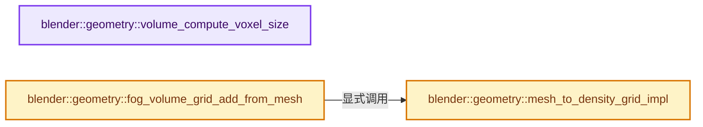
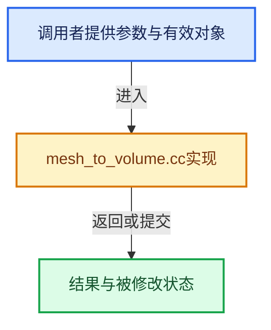

# 实现依赖专题：source/blender/geometry/intern/mesh_to_volume.cc

[实现依赖导航](../../README.md) · [符号索引](../../../00-课程指南/02-源码与提交索引/符号依赖与实现索引.md)

本专题从正文实际调用进入，集中保存共享实现。函数有稳定锚点，可从调用处直接跳到对应完整函数；递归与互相调用通过回链组织。

## 本文件的实现关系






## 完整成员与函数实现

<a id="f-d3c021e4614da208"></a>

### `blender::geometry::volume_compute_voxel_size`

实现位置：[source/blender/geometry/intern/mesh_to_volume.cc](../../../../../../../source/blender/geometry/intern/mesh_to_volume.cc) · L83—L115。

接口参数：

- `const Depsgraph *depsgraph`
- `const FunctionRef<Bounds<float3>()> bounds_fn`
- `const MeshToVolumeResolution res`
- `const float exterior_band_width`
- `const float4x4 &transform`

**教学注释版**

<!-- annotated:c422b7eb09e031 -->

```cpp
float volume_compute_voxel_size(const Depsgraph *depsgraph,
                                const FunctionRef<Bounds<float3>()> bounds_fn,
                                const MeshToVolumeResolution res,
                                const float exterior_band_width,
                                const float4x4 &transform)
{
  const float volume_simplify = BKE_volume_simplify_factor(depsgraph);
  if (volume_simplify == 0.0f) {
    return 0.0f;
  }

  if (res.mode == MESH_TO_VOLUME_RESOLUTION_MODE_VOXEL_SIZE) {
    return res.settings.voxel_size / volume_simplify;
  }
  if (res.settings.voxel_amount <= 0) {
    return 0;
  }

  const Bounds<float3> bounds = bounds_fn();

  /* Compute the diagonal of the bounding box. This is used because
   * it will always be bigger than the widest side of the mesh. */
  const float diagonal = math::distance(math::transform_point(transform, bounds.min),
                                        math::transform_point(transform, bounds.max));

  /* To get the approximate size per voxel, first subtract the exterior band from the requested
   * voxel amount, then divide the diagonal with this value if it's bigger than 1. */
  const float voxel_size =
      // [讲解] std::max：按比较关系选取较大值。本讲解中的增长公式同时满足最低请求和几何增长；若保存返回引用，还需注意实参寿命。
      (diagonal / std::max(1.0f, float(res.settings.voxel_amount) - 2.0f * exterior_band_width));

  /* Return the simplified voxel size. */
  return voxel_size / volume_simplify;
}
```

<details>
<summary>核对原始源码：source/blender/geometry/intern/mesh_to_volume.cc · L83—L115</summary>

<!-- original:c422b7eb09e031:source/blender/geometry/intern/mesh_to_volume.cc:83:115 -->

```cpp
float volume_compute_voxel_size(const Depsgraph *depsgraph,
                                const FunctionRef<Bounds<float3>()> bounds_fn,
                                const MeshToVolumeResolution res,
                                const float exterior_band_width,
                                const float4x4 &transform)
{
  const float volume_simplify = BKE_volume_simplify_factor(depsgraph);
  if (volume_simplify == 0.0f) {
    return 0.0f;
  }

  if (res.mode == MESH_TO_VOLUME_RESOLUTION_MODE_VOXEL_SIZE) {
    return res.settings.voxel_size / volume_simplify;
  }
  if (res.settings.voxel_amount <= 0) {
    return 0;
  }

  const Bounds<float3> bounds = bounds_fn();

  /* Compute the diagonal of the bounding box. This is used because
   * it will always be bigger than the widest side of the mesh. */
  const float diagonal = math::distance(math::transform_point(transform, bounds.min),
                                        math::transform_point(transform, bounds.max));

  /* To get the approximate size per voxel, first subtract the exterior band from the requested
   * voxel amount, then divide the diagonal with this value if it's bigger than 1. */
  const float voxel_size =
      (diagonal / std::max(1.0f, float(res.settings.voxel_amount) - 2.0f * exterior_band_width));

  /* Return the simplified voxel size. */
  return voxel_size / volume_simplify;
}
```

</details>

**结果出口**

- `return 0.0f;`
- `return res.settings.voxel_size / volume_simplify;`
- `return 0;`
- `return voxel_size / volume_simplify;`

**继续追踪实现**

- `BKE_volume_simplify_factor` → [blender::BKE_volume_simplify_factor · L1074](../../02-BKE几何与数据/intern/volume.cc.md#f-ec77f5d89525e448)。
- `bounds_fn` → [调用协议](../../../00-课程指南/01-路线与规范/模板宏与动态分派协议.md)：局部可调用对象，须结合其初始化与捕获环境。调用位置L101。
- `math::distance` → [blender::math::distance · L485](../../01-BLI基础库/BLI_math_vector.hh.md#f-0a0df9b41ececd7b)；[blender::math::distance · L143](../../01-BLI基础库/BLI_math_base.hh.md#f-45db793191057701)。同名重载需按实参类型选择。
- `math::transform_point` → [blender::math::transform_point · L318](../../01-BLI基础库/BLI_math_quaternion.hh.md#f-e52a2e8c12e32657)；[blender::math::transform_point · L491](../../01-BLI基础库/BLI_math_quaternion.hh.md#f-6c9f8362c60efe6c)；[blender::math::transform_point · L445](../../01-BLI基础库/BLI_math_basis_types.hh.md#f-a151fd44ae743502)。同名重载需按实参类型选择。
- `std::max` → [外部契约](https://eel.is/c++draft/alg.min.max)：按比较关系选取较大值。本讲解中的增长公式同时满足最低请求和几何增长；若保存返回引用，还需注意实参寿命。

<a id="f-f520cd566b7348d8"></a>

### `blender::geometry::mesh_to_density_grid_impl`

实现位置：[source/blender/geometry/intern/mesh_to_volume.cc](../../../../../../../source/blender/geometry/intern/mesh_to_volume.cc) · L117—L151。

接口参数：

- `const Span<float3> positions`
- `const Span<int> corner_verts`
- `const Span<int3> corner_tris`
- `const float4x4 &mesh_to_volume_space_transform`
- `const float voxel_size`
- `const float interior_band_width`
- `const float density`

**教学注释版**

<!-- annotated:0f34570792ce64 -->

```cpp
static openvdb::FloatGrid::Ptr mesh_to_density_grid_impl(
    const Span<float3> positions,
    const Span<int> corner_verts,
    const Span<int3> corner_tris,
    const float4x4 &mesh_to_volume_space_transform,
    const float voxel_size,
    const float interior_band_width,
    const float density)
{
  if (!BKE_volume_voxel_size_valid(float3(voxel_size))) {
    return nullptr;
  }

  float4x4 mesh_to_index_space_transform = math::from_scale<float4x4>(float3(1.0f / voxel_size));
  mesh_to_index_space_transform *= mesh_to_volume_space_transform;

  OpenVDBMeshAdapter mesh_adapter{
      positions, corner_verts, corner_tris, mesh_to_index_space_transform};
  // [讲解] std::max：按比较关系选取较大值。本讲解中的增长公式同时满足最低请求和几何增长；若保存返回引用，还需注意实参寿命。
  const float interior = std::max(1.0f, interior_band_width / voxel_size);

  openvdb::math::Transform::Ptr transform = openvdb::math::Transform::createLinearTransform(
      voxel_size);
  openvdb::FloatGrid::Ptr new_grid = openvdb::tools::meshToVolume<openvdb::FloatGrid>(
      mesh_adapter, *transform, 1.0f, interior);

  openvdb::tools::sdfToFogVolume(*new_grid);

  if (density != 1.0f) {
    openvdb::tools::foreach(new_grid->beginValueOn(),
                            [&](const openvdb::FloatGrid::ValueOnIter &iter) {
                              iter.modifyValue([&](float &value) { value *= density; });
                            });
  }
  return new_grid;
}
```

<details>
<summary>核对原始源码：source/blender/geometry/intern/mesh_to_volume.cc · L117—L151</summary>

<!-- original:0f34570792ce64:source/blender/geometry/intern/mesh_to_volume.cc:117:151 -->

```cpp
static openvdb::FloatGrid::Ptr mesh_to_density_grid_impl(
    const Span<float3> positions,
    const Span<int> corner_verts,
    const Span<int3> corner_tris,
    const float4x4 &mesh_to_volume_space_transform,
    const float voxel_size,
    const float interior_band_width,
    const float density)
{
  if (!BKE_volume_voxel_size_valid(float3(voxel_size))) {
    return nullptr;
  }

  float4x4 mesh_to_index_space_transform = math::from_scale<float4x4>(float3(1.0f / voxel_size));
  mesh_to_index_space_transform *= mesh_to_volume_space_transform;

  OpenVDBMeshAdapter mesh_adapter{
      positions, corner_verts, corner_tris, mesh_to_index_space_transform};
  const float interior = std::max(1.0f, interior_band_width / voxel_size);

  openvdb::math::Transform::Ptr transform = openvdb::math::Transform::createLinearTransform(
      voxel_size);
  openvdb::FloatGrid::Ptr new_grid = openvdb::tools::meshToVolume<openvdb::FloatGrid>(
      mesh_adapter, *transform, 1.0f, interior);

  openvdb::tools::sdfToFogVolume(*new_grid);

  if (density != 1.0f) {
    openvdb::tools::foreach(new_grid->beginValueOn(),
                            [&](const openvdb::FloatGrid::ValueOnIter &iter) {
                              iter.modifyValue([&](float &value) { value *= density; });
                            });
  }
  return new_grid;
}
```

</details>

**沿实际写入检查状态**

- `mesh_to_index_space_transform *= mesh_to_volume_space_transform;`

**结果出口**

- `return nullptr;`
- `return new_grid;`

**继续追踪实现**

- `BKE_volume_voxel_size_valid` → [blender::BKE_volume_voxel_size_valid · L1048](../../02-BKE几何与数据/intern/volume.cc.md#f-33e4a1c47a3ec098)。
- `float3` → [float3 · L641](../../08-其他Blender模块/compositor/algorithms/intern/smaa.cc.md#m-0ea8254cfdb4)。宏定义由构建条件选择。
- `math::from_scale<float4x4>` → [调用协议](../../../00-课程指南/01-路线与规范/模板宏与动态分派协议.md)：函数指针、局部可调用对象或未展开的宏；必须结合调用者环境。调用位置L130。
- `std::max` → [外部契约](https://eel.is/c++draft/alg.min.max)：按比较关系选取较大值。本讲解中的增长公式同时满足最低请求和几何增长；若保存返回引用，还需注意实参寿命。
- `openvdb::math::Transform::createLinearTransform` → [外部契约](https://eel.is/c++draft/)：这个边界按实际表达式及所属类型核对参数、返回值、寿命与失败行为。这里提供接口入口，不声称已解释该第三方版本的内部实现。
- `openvdb::tools::meshToVolume<openvdb::FloatGrid>` → [外部契约](https://eel.is/c++draft/)：这个边界按实际表达式及所属类型核对参数、返回值、寿命与失败行为。这里提供接口入口，不声称已解释该第三方版本的内部实现。
- `openvdb::tools::sdfToFogVolume` → [外部契约](https://eel.is/c++draft/)：这个边界按实际表达式及所属类型核对参数、返回值、寿命与失败行为。这里提供接口入口，不声称已解释该第三方版本的内部实现。
- `openvdb::tools::foreach` → [外部契约](https://eel.is/c++draft/)：这个边界按实际表达式及所属类型核对参数、返回值、寿命与失败行为。这里提供接口入口，不声称已解释该第三方版本的内部实现。
- `new_grid->beginValueOn` → [调用协议](../../../00-课程指南/01-路线与规范/模板宏与动态分派协议.md)：由接收对象具体类型或运行时策略提供实现。调用位置L145。
- `iter.modifyValue` → [调用协议](../../../00-课程指南/01-路线与规范/模板宏与动态分派协议.md)：由接收对象具体类型或运行时策略提供实现。调用位置L147。

<a id="f-7cbc8945793f2718"></a>

### `blender::geometry::fog_volume_grid_add_from_mesh`

实现位置：[source/blender/geometry/intern/mesh_to_volume.cc](../../../../../../../source/blender/geometry/intern/mesh_to_volume.cc) · L209—L227。

接口参数：

- `Volume *volume`
- `const StringRefNull name`
- `const Span<float3> positions`
- `const Span<int> corner_verts`
- `const Span<int3> corner_tris`
- `const float4x4 &mesh_to_volume_space_transform`
- `const float voxel_size`
- `const float interior_band_width`
- `const float density`

**教学注释版**

<!-- annotated:22cc40cfa32f92 -->

```cpp
bke::VolumeGridData *fog_volume_grid_add_from_mesh(Volume *volume,
                                                   const StringRefNull name,
                                                   const Span<float3> positions,
                                                   const Span<int> corner_verts,
                                                   const Span<int3> corner_tris,
                                                   const float4x4 &mesh_to_volume_space_transform,
                                                   const float voxel_size,
                                                   const float interior_band_width,
                                                   const float density)
{
  openvdb::FloatGrid::Ptr mesh_grid = mesh_to_density_grid_impl(positions,
                                                                corner_verts,
                                                                corner_tris,
                                                                mesh_to_volume_space_transform,
                                                                voxel_size,
                                                                interior_band_width,
                                                                density);
  // [讲解] std::move：把表达式转换成可供移动重载选择的值类别；不保证真的移动，不结束源对象寿命，对const值可能选择复制。
  return mesh_grid ? BKE_volume_grid_add_vdb(*volume, name, std::move(mesh_grid)) : nullptr;
}
```

<details>
<summary>核对原始源码：source/blender/geometry/intern/mesh_to_volume.cc · L209—L227</summary>

<!-- original:22cc40cfa32f92:source/blender/geometry/intern/mesh_to_volume.cc:209:227 -->

```cpp
bke::VolumeGridData *fog_volume_grid_add_from_mesh(Volume *volume,
                                                   const StringRefNull name,
                                                   const Span<float3> positions,
                                                   const Span<int> corner_verts,
                                                   const Span<int3> corner_tris,
                                                   const float4x4 &mesh_to_volume_space_transform,
                                                   const float voxel_size,
                                                   const float interior_band_width,
                                                   const float density)
{
  openvdb::FloatGrid::Ptr mesh_grid = mesh_to_density_grid_impl(positions,
                                                                corner_verts,
                                                                corner_tris,
                                                                mesh_to_volume_space_transform,
                                                                voxel_size,
                                                                interior_band_width,
                                                                density);
  return mesh_grid ? BKE_volume_grid_add_vdb(*volume, name, std::move(mesh_grid)) : nullptr;
}
```

</details>

**结果出口**

- `return mesh_grid ? BKE_volume_grid_add_vdb(*volume, name, std::move(mesh_grid)) : nullptr;`

**继续追踪实现**

- `mesh_to_density_grid_impl` → [blender::geometry::mesh_to_density_grid_impl · L117](mesh_to_volume.cc.md#f-f520cd566b7348d8)。
- `BKE_volume_grid_add_vdb` → [blender::BKE_volume_grid_add_vdb · L993](../../02-BKE几何与数据/intern/volume.cc.md#f-52c3561e345d38db)。
- `std::move` → [外部契约](https://eel.is/c++draft/utility.forward)：把表达式转换成可供移动重载选择的值类别；不保证真的移动，不结束源对象寿命，对const值可能选择复制。
