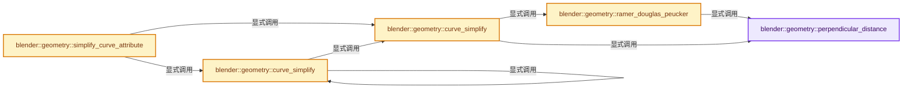

# 实现依赖专题：source/blender/geometry/intern/simplify_curves.cc

[实现依赖导航](../../README.md) · [符号索引](../../../00-课程指南/02-源码与提交索引/符号依赖与实现索引.md)

本专题从正文实际调用进入，集中保存共享实现。函数有稳定锚点，可从调用处直接跳到对应完整函数；递归与互相调用通过回链组织。

## 本文件的实现关系




## 完整成员与函数实现

<a id="f-6e19bf495a1c1b92"></a>

### `blender::geometry::perpendicular_distance`

实现位置：[source/blender/geometry/intern/simplify_curves.cc](../../../../../../../source/blender/geometry/intern/simplify_curves.cc) · L30—L48。

接口参数：

- `const Span<float3> positions`
- `const Span<T> attribute_data`
- `const int64_t first_index`
- `const int64_t last_index`
- `const int64_t index`

**教学注释版**

<!-- annotated:5e1ac9c3d7ca55 -->

```cpp
template<typename T>
float perpendicular_distance(const Span<float3> positions,
                             const Span<T> attribute_data,
                             const int64_t first_index,
                             const int64_t last_index,
                             const int64_t index)
{
  const float3 ray_dir = positions[last_index] - positions[first_index];
  float lambda = 0.0f;
  if (!math::is_zero(ray_dir)) {
    lambda = math::dot(ray_dir, positions[index] - positions[first_index]) /
             math::dot(ray_dir, ray_dir);
  }
  const T &from = attribute_data[first_index];
  const T &to = attribute_data[last_index];
  const T &value = attribute_data[index];
  const T &interpolated = math::interpolate(from, to, lambda);
  return math::distance(value, interpolated);
}
```

<details>
<summary>核对原始源码：source/blender/geometry/intern/simplify_curves.cc · L30—L48</summary>

<!-- original:5e1ac9c3d7ca55:source/blender/geometry/intern/simplify_curves.cc:30:48 -->

```cpp
template<typename T>
float perpendicular_distance(const Span<float3> positions,
                             const Span<T> attribute_data,
                             const int64_t first_index,
                             const int64_t last_index,
                             const int64_t index)
{
  const float3 ray_dir = positions[last_index] - positions[first_index];
  float lambda = 0.0f;
  if (!math::is_zero(ray_dir)) {
    lambda = math::dot(ray_dir, positions[index] - positions[first_index]) /
             math::dot(ray_dir, ray_dir);
  }
  const T &from = attribute_data[first_index];
  const T &to = attribute_data[last_index];
  const T &value = attribute_data[index];
  const T &interpolated = math::interpolate(from, to, lambda);
  return math::distance(value, interpolated);
}
```

</details>

**沿实际写入检查状态**

- `lambda = math::dot(ray_dir, positions[index] - positions[first_index]) /`

**结果出口**

- `return math::distance(value, interpolated);`

**继续追踪实现**

- `math::is_zero` → [blender::math::is_zero · L784](../../01-BLI基础库/BLI_math_vector.hh.md#f-b05b3db842a9f17e)；[blender::math::is_zero · L108](../../01-BLI基础库/BLI_math_quaternion.hh.md#f-b97bee3fbc328c0d)；[blender::math::is_zero · L593](../../01-BLI基础库/BLI_math_matrix.hh.md#f-b879ac524126b464)；[blender::math::is_zero · L23](../../01-BLI基础库/BLI_math_base.hh.md#f-6fdcc74ca7338838)。同名重载需按实参类型选择。
- `math::dot` → [blender::math::dot · L430](../../01-BLI基础库/BLI_math_vector.hh.md#f-6f0c6a081b107428)；[blender::math::dot · L198](../../01-BLI基础库/BLI_math_quaternion.hh.md#f-5b1ef457981dbc76)。同名重载需按实参类型选择。
- `math::interpolate` → [blender::math::interpolate · L335](../../01-BLI基础库/intern/math_matrix.cc.md#f-91e7f517ebd72fb5)；[blender::math::interpolate · L379](../../01-BLI基础库/intern/math_matrix.cc.md#f-a1be14e86ce595c2)；[blender::math::interpolate · L636](../../01-BLI基础库/BLI_math_vector.hh.md#f-d612b6d6ab1b6e7c)；[blender::math::interpolate · L303](../../01-BLI基础库/BLI_math_quaternion.hh.md#f-48b9ace2a9c6185c)；[blender::math::interpolate · L17](../../01-BLI基础库/BLI_math_color.hh.md#f-eb5ef92b0f8c0926)；[blender::math::interpolate · L28](../../01-BLI基础库/BLI_math_color.hh.md#f-2a9e33ec55979ab6)；[blender::math::interpolate · L278](../../01-BLI基础库/BLI_math_base.hh.md#f-2629b871528f6528)。同名重载需按实参类型选择。
- `math::distance` → [blender::math::distance · L485](../../01-BLI基础库/BLI_math_vector.hh.md#f-0a0df9b41ececd7b)；[blender::math::distance · L143](../../01-BLI基础库/BLI_math_base.hh.md#f-45db793191057701)。同名重载需按实参类型选择。

<a id="f-9422c27c7db35145"></a>

### `blender::geometry::ramer_douglas_peucker`

实现位置：[source/blender/geometry/intern/simplify_curves.cc](../../../../../../../source/blender/geometry/intern/simplify_curves.cc) · L53—L95。

接口参数：

- `const IndexRange range`
- `const Span<float3> positions`
- `const float epsilon`
- `const Span<T> attribute_data`
- `MutableSpan<bool> points_to_delete`

**教学注释版**

<!-- annotated:653c2dff419812 -->

```cpp
template<typename T>
static void ramer_douglas_peucker(const IndexRange range,
                                  const Span<float3> positions,
                                  const float epsilon,
                                  const Span<T> attribute_data,
                                  MutableSpan<bool> points_to_delete)
{
  /* Mark all points to be kept. */
  // [讲解] points_to_delete.slice：建立原连续范围的子视图。
  points_to_delete.slice(range).fill(false);

  Stack<IndexRange, 32> stack;
  stack.push(range);
  while (!stack.is_empty()) {
    const IndexRange sub_range = stack.pop();
    /* Skip ranges with less than 3 points. All points are kept. */
    // [讲解] sub_range.size：读取连续区间或分组的边界信息。
    if (sub_range.size() < 3) {
      continue;
    }
    const IndexRange inside_range = sub_range.drop_front(1).drop_back(1);
    /* Compute the maximum distance and the corresponding index. */
    float max_dist = -1.0f;
    int max_index = -1;
    for (const int64_t index : inside_range) {
      const float dist = perpendicular_distance(
          // [讲解] sub_range.first：读取范围两端的有效索引或值。
          positions, attribute_data, sub_range.first(), sub_range.last(), index);
      if (dist > max_dist) {
        max_dist = dist;
        max_index = index - sub_range.first();
      }
    }

    if (max_dist > epsilon) {
      /* Found point outside the epsilon-sized strip. The point at `max_index` will be kept, repeat
       * the search on the left & right side. */
      stack.push(sub_range.slice(0, max_index + 1));
      stack.push(sub_range.slice(max_index, sub_range.size() - max_index));
    }
    else {
      /* Points in `sub_range` are inside the epsilon-sized strip. Mark them to be deleted. */
      points_to_delete.slice(inside_range).fill(true);
    }
  }
}
```

<details>
<summary>核对原始源码：source/blender/geometry/intern/simplify_curves.cc · L53—L95</summary>

<!-- original:653c2dff419812:source/blender/geometry/intern/simplify_curves.cc:53:95 -->

```cpp
template<typename T>
static void ramer_douglas_peucker(const IndexRange range,
                                  const Span<float3> positions,
                                  const float epsilon,
                                  const Span<T> attribute_data,
                                  MutableSpan<bool> points_to_delete)
{
  /* Mark all points to be kept. */
  points_to_delete.slice(range).fill(false);

  Stack<IndexRange, 32> stack;
  stack.push(range);
  while (!stack.is_empty()) {
    const IndexRange sub_range = stack.pop();
    /* Skip ranges with less than 3 points. All points are kept. */
    if (sub_range.size() < 3) {
      continue;
    }
    const IndexRange inside_range = sub_range.drop_front(1).drop_back(1);
    /* Compute the maximum distance and the corresponding index. */
    float max_dist = -1.0f;
    int max_index = -1;
    for (const int64_t index : inside_range) {
      const float dist = perpendicular_distance(
          positions, attribute_data, sub_range.first(), sub_range.last(), index);
      if (dist > max_dist) {
        max_dist = dist;
        max_index = index - sub_range.first();
      }
    }

    if (max_dist > epsilon) {
      /* Found point outside the epsilon-sized strip. The point at `max_index` will be kept, repeat
       * the search on the left & right side. */
      stack.push(sub_range.slice(0, max_index + 1));
      stack.push(sub_range.slice(max_index, sub_range.size() - max_index));
    }
    else {
      /* Points in `sub_range` are inside the epsilon-sized strip. Mark them to be deleted. */
      points_to_delete.slice(inside_range).fill(true);
    }
  }
}
```

</details>

**沿实际写入检查状态**

- `max_dist = dist;`
- `max_index = index - sub_range.first();`

**继续追踪实现**

- `points_to_delete.slice(range).fill` → [调用协议](../../../00-课程指南/01-路线与规范/模板宏与动态分派协议.md)：接收对象类型依赖auto、返回值或模板实例；不按同名猜测目标。调用位置L61。
- `points_to_delete.slice` → [blender::MutableSpan::slice · L579](../../../01-基础容器与现代CPP/06-MutableSpan可写视图.md#f-6808b4aefbf58808)；[blender::MutableSpan::slice · L587](../../../01-基础容器与现代CPP/06-MutableSpan可写视图.md#f-c05b010821861e4f)。同名重载需按实参类型选择。
- `stack.push` → [blender::Stack::push · L215](../../../01-基础容器与现代CPP/13-Stack与栈接口.md#f-4e2f52822df4658e)；[blender::Stack::push · L219](../../../01-基础容器与现代CPP/13-Stack与栈接口.md#f-6eb0d6a78e38b4e8)。同名重载需按实参类型选择。
- `stack.is_empty` → [blender::Stack::is_empty · L310](../../../01-基础容器与现代CPP/13-Stack与栈接口.md#f-0dbc636232316093)。
- `stack.pop` → [blender::Stack::pop · L244](../../../01-基础容器与现代CPP/13-Stack与栈接口.md#f-6ef6c36a2a0aa986)。
- `sub_range.size` → [blender::IndexRange::size · L156](../../../01-基础容器与现代CPP/04-IndexRange连续整数区间.md#f-05f66c3ebb2fdfec)。
- `sub_range.drop_front(1).drop_back` → [调用协议](../../../00-课程指南/01-路线与规范/模板宏与动态分派协议.md)：接收对象类型依赖auto、返回值或模板实例；不按同名猜测目标。调用位置L71。
- `sub_range.drop_front` → [blender::IndexRange::drop_front · L306](../../../01-基础容器与现代CPP/04-IndexRange连续整数区间.md#f-ef3101407d982c90)。
- `perpendicular_distance` → [blender::geometry::perpendicular_distance · L30](simplify_curves.cc.md#f-6e19bf495a1c1b92)。
- `sub_range.first` → [blender::IndexRange::first · L204](../../../01-基础容器与现代CPP/04-IndexRange连续整数区间.md#f-ab443c94e531befa)。
- `sub_range.last` → [blender::IndexRange::last · L214](../../../01-基础容器与现代CPP/04-IndexRange连续整数区间.md#f-66896c6351a40de1)；[blender::gpu::shader::parser::IndexRange::last · L62](../../08-其他Blender模块/gpu/shader_tool/utils.hh.md#f-373501206569c3b3)。同名重载需按实参类型选择。
- `sub_range.slice` → [blender::IndexRange::slice · L276](../../../01-基础容器与现代CPP/04-IndexRange连续整数区间.md#f-6249bf624e38d609)；[blender::IndexRange::slice · L284](../../../01-基础容器与现代CPP/04-IndexRange连续整数区间.md#f-eb80885fefc31b6f)。同名重载需按实参类型选择。
- `points_to_delete.slice(inside_range).fill` → [调用协议](../../../00-课程指南/01-路线与规范/模板宏与动态分派协议.md)：接收对象类型依赖auto、返回值或模板实例；不按同名猜测目标。调用位置L92。

<a id="f-45540f0b85bc89d5"></a>

### `blender::geometry::curve_simplify`

实现位置：[source/blender/geometry/intern/simplify_curves.cc](../../../../../../../source/blender/geometry/intern/simplify_curves.cc) · L97—L122。

接口参数：

- `const Span<float3> positions`
- `const bool cyclic`
- `const float epsilon`
- `const Span<T> attribute_data`
- `MutableSpan<bool> points_to_delete`

**教学注释版**

<!-- annotated:4948c817dc0001 -->

```cpp
template<typename T>
static void curve_simplify(const Span<float3> positions,
                           const bool cyclic,
                           const float epsilon,
                           const Span<T> attribute_data,
                           MutableSpan<bool> points_to_delete)
{
  const Vector<IndexRange> selection_ranges = array_utils::find_all_ranges(
      points_to_delete.as_span(), true);
  threading::parallel_for(
      selection_ranges.index_range(), 512, [&](const IndexRange range_of_ranges) {
        // [讲解] selection_ranges.as_span：构造对当前有效元素区间的借用视图。
        for (const IndexRange range : selection_ranges.as_span().slice(range_of_ranges)) {
          ramer_douglas_peucker(range, positions, epsilon, attribute_data, points_to_delete);
        }
      });

  /* For cyclic curves, handle the last segment separately. */
  // [讲解] positions.size：查询视图长度或生成对应有效索引区间。
  const int points_num = positions.size();
  if (cyclic && points_num > 2) {
    const float dist = perpendicular_distance(
        positions, attribute_data, points_num - 2, 0, points_num - 1);
    if (dist <= epsilon) {
      points_to_delete[points_num - 1] = true;
    }
  }
}
```

<details>
<summary>核对原始源码：source/blender/geometry/intern/simplify_curves.cc · L97—L122</summary>

<!-- original:4948c817dc0001:source/blender/geometry/intern/simplify_curves.cc:97:122 -->

```cpp
template<typename T>
static void curve_simplify(const Span<float3> positions,
                           const bool cyclic,
                           const float epsilon,
                           const Span<T> attribute_data,
                           MutableSpan<bool> points_to_delete)
{
  const Vector<IndexRange> selection_ranges = array_utils::find_all_ranges(
      points_to_delete.as_span(), true);
  threading::parallel_for(
      selection_ranges.index_range(), 512, [&](const IndexRange range_of_ranges) {
        for (const IndexRange range : selection_ranges.as_span().slice(range_of_ranges)) {
          ramer_douglas_peucker(range, positions, epsilon, attribute_data, points_to_delete);
        }
      });

  /* For cyclic curves, handle the last segment separately. */
  const int points_num = positions.size();
  if (cyclic && points_num > 2) {
    const float dist = perpendicular_distance(
        positions, attribute_data, points_num - 2, 0, points_num - 1);
    if (dist <= epsilon) {
      points_to_delete[points_num - 1] = true;
    }
  }
}
```

</details>

**继续追踪实现**

- `array_utils::find_all_ranges` → [blender::array_utils::find_all_ranges · L408](../../../05-几何存储与拓扑映射/07-分组访问与反向索引.md#f-c2d9cbb49d70df09)。
- `points_to_delete.as_span` → [blender::MutableSpan::as_span · L667](../../../01-基础容器与现代CPP/06-MutableSpan可写视图.md#f-d0c35de0cfb9761e)。
- `threading::parallel_for` → [blender::threading::parallel_for · L68](../../../11-Depsgraph与并行任务系统/07-任务池与TBB接入.md#f-838294754c24426c)。
- `selection_ranges.index_range` → [blender::Vector::index_range · L1026](../../../01-基础容器与现代CPP/12-Vector异常安全与边界.md#f-ac29cf36ef185ab9)。
- `selection_ranges.as_span().slice` → [调用协议](../../../00-课程指南/01-路线与规范/模板宏与动态分派协议.md)：接收对象类型依赖auto、返回值或模板实例；不按同名猜测目标。调用位置L108。
- `selection_ranges.as_span` → [blender::Vector::as_span · L390](../../../01-基础容器与现代CPP/10-Vector扩容与增长.md#f-e2eed03cefcdd2ff)。
- `ramer_douglas_peucker` → [blender::geometry::ramer_douglas_peucker · L53](simplify_curves.cc.md#f-9422c27c7db35145)。
- `positions.size` → [blender::Span::size · L256](../../../01-基础容器与现代CPP/05-Span只读连续视图.md#f-5f80fa006089c998)。
- `perpendicular_distance` → [blender::geometry::perpendicular_distance · L30](simplify_curves.cc.md#f-6e19bf495a1c1b92)。

<a id="f-86839dc7a9f9b200"></a>

### `blender::geometry::curve_simplify`

实现位置：[source/blender/geometry/intern/simplify_curves.cc](../../../../../../../source/blender/geometry/intern/simplify_curves.cc) · L124—L134。

接口参数：

- `const Span<float3> positions`
- `const bool cyclic`
- `const float epsilon`
- `const GSpan attribute_data`
- `MutableSpan<bool> points_to_delete`

**教学注释版**

<!-- annotated:4aab65bb58a9a6 -->

```cpp
void curve_simplify(const Span<float3> positions,
                    const bool cyclic,
                    const float epsilon,
                    const GSpan attribute_data,
                    MutableSpan<bool> points_to_delete)

{
  attribute_data.type().to_static_type<float, float2, float3>([&]<typename T>() {
    curve_simplify(positions, cyclic, epsilon, attribute_data.typed<T>(), points_to_delete);
  });
}
```

<details>
<summary>核对原始源码：source/blender/geometry/intern/simplify_curves.cc · L124—L134</summary>

<!-- original:4aab65bb58a9a6:source/blender/geometry/intern/simplify_curves.cc:124:134 -->

```cpp
void curve_simplify(const Span<float3> positions,
                    const bool cyclic,
                    const float epsilon,
                    const GSpan attribute_data,
                    MutableSpan<bool> points_to_delete)

{
  attribute_data.type().to_static_type<float, float2, float3>([&]<typename T>() {
    curve_simplify(positions, cyclic, epsilon, attribute_data.typed<T>(), points_to_delete);
  });
}
```

</details>

**继续追踪实现**

- `attribute_data.type().to_static_type<float, float2, float3>` → [调用协议](../../../00-课程指南/01-路线与规范/模板宏与动态分派协议.md)：接收对象类型依赖auto、返回值或模板实例；不按同名猜测目标。调用位置L131。
- `attribute_data.type` → [blender::GSpan::type · L55](../../../03-内存分配与运行时类型/11-GSpan与GArray.md#f-4c44cc0364dcf191)。
- `curve_simplify` → [blender::geometry::curve_simplify · L97](simplify_curves.cc.md#f-45540f0b85bc89d5)；[blender::geometry::curve_simplify · L124](simplify_curves.cc.md#f-86839dc7a9f9b200)。同名重载需按实参类型选择。
- `attribute_data.typed<T>` → [blender::GSpan::typed · L92](../../../03-内存分配与运行时类型/11-GSpan与GArray.md#f-aa54cf0d7a8dae2b)。

<a id="f-278e2959cce2ce42"></a>

### `blender::geometry::simplify_curve_attribute`

实现位置：[source/blender/geometry/intern/simplify_curves.cc](../../../../../../../source/blender/geometry/intern/simplify_curves.cc) · L136—L163。

接口参数：

- `const Span<float3> positions`
- `const IndexMask &curves_selection`
- `const OffsetIndices<int> points_by_curve`
- `const VArray<bool> &cyclic`
- `const float epsilon`
- `const GSpan attribute_data`
- `IndexMaskMemory &memory`

**教学注释版**

<!-- annotated:72e1fa99762b3f -->

```cpp
IndexMask simplify_curve_attribute(const Span<float3> positions,
                                   const IndexMask &curves_selection,
                                   const OffsetIndices<int> points_by_curve,
                                   const VArray<bool> &cyclic,
                                   const float epsilon,
                                   const GSpan attribute_data,
                                   IndexMaskMemory &memory)
{
  // [讲解] positions.size：查询视图长度或生成对应有效索引区间。
  Array<bool> points_to_delete(positions.size(), false);
  if (epsilon <= 0.0f) {
    return IndexMask::from_bools(points_to_delete, memory);
  }
  bke::curves::fill_points(
      // [讲解] points_to_delete.as_mutable_span：提供数组的借用访问入口。
      points_by_curve, curves_selection, true, points_to_delete.as_mutable_span());
  curves_selection.foreach_index(
      [&](const int64_t curve_i) {
        const IndexRange points = points_by_curve[curve_i];
        attribute_data.type().to_static_type<float, float2, float3>([&]<typename T>() {
          // [讲解] positions.slice：建立原连续范围的子视图。
          curve_simplify(positions.slice(points),
                         cyclic[curve_i],
                         epsilon,
                         attribute_data.typed<T>().slice(points),
                         points_to_delete.as_mutable_span().slice(points));
        });
      },
      exec_mode::grain_size(512));
  return IndexMask::from_bools(points_to_delete, memory);
}
```

<details>
<summary>核对原始源码：source/blender/geometry/intern/simplify_curves.cc · L136—L163</summary>

<!-- original:72e1fa99762b3f:source/blender/geometry/intern/simplify_curves.cc:136:163 -->

```cpp
IndexMask simplify_curve_attribute(const Span<float3> positions,
                                   const IndexMask &curves_selection,
                                   const OffsetIndices<int> points_by_curve,
                                   const VArray<bool> &cyclic,
                                   const float epsilon,
                                   const GSpan attribute_data,
                                   IndexMaskMemory &memory)
{
  Array<bool> points_to_delete(positions.size(), false);
  if (epsilon <= 0.0f) {
    return IndexMask::from_bools(points_to_delete, memory);
  }
  bke::curves::fill_points(
      points_by_curve, curves_selection, true, points_to_delete.as_mutable_span());
  curves_selection.foreach_index(
      [&](const int64_t curve_i) {
        const IndexRange points = points_by_curve[curve_i];
        attribute_data.type().to_static_type<float, float2, float3>([&]<typename T>() {
          curve_simplify(positions.slice(points),
                         cyclic[curve_i],
                         epsilon,
                         attribute_data.typed<T>().slice(points),
                         points_to_delete.as_mutable_span().slice(points));
        });
      },
      exec_mode::grain_size(512));
  return IndexMask::from_bools(points_to_delete, memory);
}
```

</details>

**结果出口**

- `return IndexMask::from_bools(points_to_delete, memory);`

**继续追踪实现**

- `positions.size` → [blender::Span::size · L256](../../../01-基础容器与现代CPP/05-Span只读连续视图.md#f-5f80fa006089c998)。
- `IndexMask::from_bools` → [blender::index_mask::IndexMask::from_bools · L593](../../../04-虚拟数组与索引选择/10-IndexMask构建与并行.md#f-1eccbfd39b11c6bc)；[blender::index_mask::IndexMask::from_bools · L598](../../../04-虚拟数组与索引选择/10-IndexMask构建与并行.md#f-3962fd5fd5aee616)；[blender::index_mask::IndexMask::from_bools · L613](../../../04-虚拟数组与索引选择/10-IndexMask构建与并行.md#f-5f32581e6bbdca9e)；[blender::index_mask::IndexMask::from_bools · L649](../../../04-虚拟数组与索引选择/10-IndexMask构建与并行.md#f-89ee3d007144c267)。同名重载需按实参类型选择。
- `bke::curves::fill_points` → [blender::bke::curves::fill_points · L56](../../02-BKE几何与数据/intern/curves_utils.cc.md#f-79990671c7163cd7)；[blender::bke::curves::fill_points · L488](../../02-BKE几何与数据/BKE_curves_utils.hh.md#f-f1e0a39a2185c4f1)。同名重载需按实参类型选择。
- `points_to_delete.as_mutable_span` → [blender::Array::as_mutable_span · L259](../../../01-基础容器与现代CPP/08-Array复制移动与销毁.md#f-4e91de9f1337c144)。
- `curves_selection.foreach_index` → [blender::index_mask::IndexMask::foreach_index · L855](../../../04-虚拟数组与索引选择/09-分段存储与遍历.md#f-cd6cd317e2e2812c)。
- `attribute_data.type().to_static_type<float, float2, float3>` → [调用协议](../../../00-课程指南/01-路线与规范/模板宏与动态分派协议.md)：接收对象类型依赖auto、返回值或模板实例；不按同名猜测目标。调用位置L153。
- `attribute_data.type` → [blender::GSpan::type · L55](../../../03-内存分配与运行时类型/11-GSpan与GArray.md#f-4c44cc0364dcf191)。
- `curve_simplify` → [blender::geometry::curve_simplify · L97](simplify_curves.cc.md#f-45540f0b85bc89d5)；[blender::geometry::curve_simplify · L124](simplify_curves.cc.md#f-86839dc7a9f9b200)。同名重载需按实参类型选择。
- `positions.slice` → [blender::Span::slice · L141](../../../01-基础容器与现代CPP/05-Span只读连续视图.md#f-380a0e8fdcbd53cc)；[blender::Span::slice · L149](../../../01-基础容器与现代CPP/05-Span只读连续视图.md#f-9b9c15e78dd54eec)。同名重载需按实参类型选择。
- `attribute_data.typed<T>().slice` → [调用协议](../../../00-课程指南/01-路线与规范/模板宏与动态分派协议.md)：接收对象类型依赖auto、返回值或模板实例；不按同名猜测目标。调用位置L157。
- `attribute_data.typed<T>` → [blender::GSpan::typed · L92](../../../03-内存分配与运行时类型/11-GSpan与GArray.md#f-aa54cf0d7a8dae2b)。
- `points_to_delete.as_mutable_span().slice` → [调用协议](../../../00-课程指南/01-路线与规范/模板宏与动态分派协议.md)：接收对象类型依赖auto、返回值或模板实例；不按同名猜测目标。调用位置L158。
- `exec_mode::grain_size` → [blender::exec_mode::grain_size · L79](../../01-BLI基础库/BLI_execution_mode.hh.md#f-0b4fc2f9fa6e66e7)。
