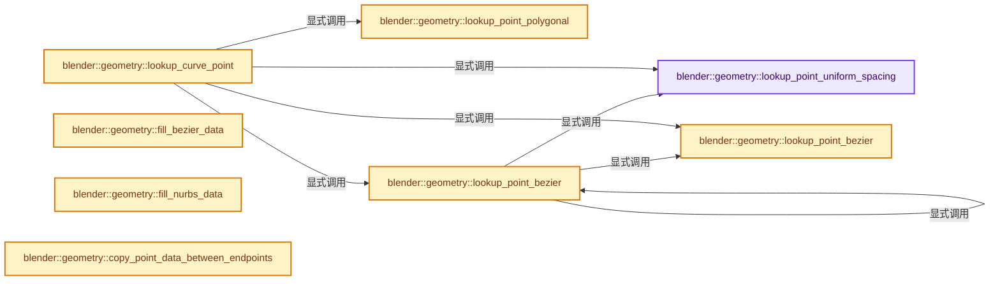
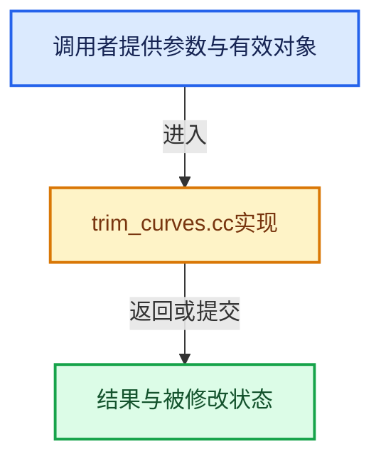

# 实现依赖专题：source/blender/geometry/intern/trim_curves.cc

[实现依赖导航](../../README.md) · [符号索引](../../../00-课程指南/02-源码与提交索引/符号依赖与实现索引.md)

本专题从正文实际调用进入，集中保存共享实现。函数有稳定锚点，可从调用处直接跳到对应完整函数；递归与互相调用通过回链组织。

## 本文件的实现关系






## 完整成员与函数实现

<a id="f-31a88154d663f3dd"></a>

### `blender::geometry::lookup_point_uniform_spacing`

实现位置：[source/blender/geometry/intern/trim_curves.cc](../../../../../../../source/blender/geometry/intern/trim_curves.cc) · L36—L60。

接口参数：

- `const Span<float> lengths`
- `const float sample_length`
- `const bool cyclic`
- `const int resolution`
- `const int num_curve_points`

**教学注释版**

<!-- annotated:b0e776179364fb -->

```cpp
static bke::curves::CurvePoint lookup_point_uniform_spacing(const Span<float> lengths,
                                                            const float sample_length,
                                                            const bool cyclic,
                                                            const int resolution,
                                                            const int num_curve_points)
{
  // [讲解] lengths.size：查询视图长度或生成对应有效索引区间。
  BLI_assert(!cyclic || lengths.size() / resolution >= 2);
  const int last_index = num_curve_points - 1;
  if (sample_length <= 0.0f) {
    return {{0, 1}, 0.0f};
  }
  // [讲解] lengths.last：按视图边界访问元素。
  if (sample_length >= lengths.last()) {
    return cyclic ? bke::curves::CurvePoint{{last_index, 0}, 1.0} :
                    bke::curves::CurvePoint{{last_index - 1, last_index}, 1.0};
  }
  int eval_index;
  float eval_factor;
  length_parameterize::sample_at_length(lengths, sample_length, eval_index, eval_factor);

  const int index = eval_index / resolution;
  const int next_index = (index == last_index) ? 0 : index + 1;
  const float parameter = (eval_factor + eval_index) / resolution - index;

  return bke::curves::CurvePoint{{index, next_index}, parameter};
}
```

<details>
<summary>核对原始源码：source/blender/geometry/intern/trim_curves.cc · L36—L60</summary>

<!-- original:b0e776179364fb:source/blender/geometry/intern/trim_curves.cc:36:60 -->

```cpp
static bke::curves::CurvePoint lookup_point_uniform_spacing(const Span<float> lengths,
                                                            const float sample_length,
                                                            const bool cyclic,
                                                            const int resolution,
                                                            const int num_curve_points)
{
  BLI_assert(!cyclic || lengths.size() / resolution >= 2);
  const int last_index = num_curve_points - 1;
  if (sample_length <= 0.0f) {
    return {{0, 1}, 0.0f};
  }
  if (sample_length >= lengths.last()) {
    return cyclic ? bke::curves::CurvePoint{{last_index, 0}, 1.0} :
                    bke::curves::CurvePoint{{last_index - 1, last_index}, 1.0};
  }
  int eval_index;
  float eval_factor;
  length_parameterize::sample_at_length(lengths, sample_length, eval_index, eval_factor);

  const int index = eval_index / resolution;
  const int next_index = (index == last_index) ? 0 : index + 1;
  const float parameter = (eval_factor + eval_index) / resolution - index;

  return bke::curves::CurvePoint{{index, next_index}, parameter};
}
```

</details>

**结果出口**

- `return {{0, 1}, 0.0f};`
- `return cyclic ? bke::curves::CurvePoint{{last_index, 0}, 1.0} :`
- `return bke::curves::CurvePoint{{index, next_index}, parameter};`

**继续追踪实现**

- `BLI_assert` → [BLI_assert · L48](../../01-BLI基础库/BLI_assert.hh.md#m-57a88495704d)；[BLI_assert · L63](../../01-BLI基础库/BLI_assert.hh.md#m-d07050020cb5)。宏定义由构建条件选择。
- `lengths.size` → [blender::Span::size · L256](../../../01-基础容器与现代CPP/05-Span只读连续视图.md#f-5f80fa006089c998)。
- `lengths.last` → [blender::Span::last · L329](../../../01-基础容器与现代CPP/05-Span只读连续视图.md#f-a92146c285596891)。
- `length_parameterize::sample_at_length` → [blender::length_parameterize::sample_at_length · L97](../../01-BLI基础库/BLI_length_parameterize.hh.md#f-4f136286e9947282)。

<a id="f-31fb4b92f1f8a320"></a>

### `blender::geometry::lookup_point_polygonal`

实现位置：[source/blender/geometry/intern/trim_curves.cc](../../../../../../../source/blender/geometry/intern/trim_curves.cc) · L65—L85。

接口参数：

- `const Span<float> lengths`
- `const float sample_length`
- `const bool cyclic`
- `const int evaluated_size`

**教学注释版**

<!-- annotated:17db029a98cdf2 -->

```cpp
static bke::curves::CurvePoint lookup_point_polygonal(const Span<float> lengths,
                                                      const float sample_length,
                                                      const bool cyclic,
                                                      const int evaluated_size)
{
  const int last_index = evaluated_size - 1;
  if (sample_length <= 0.0f) {
    return {{0, 1}, 0.0f};
  }
  // [讲解] lengths.last：按视图边界访问元素。
  if (sample_length >= lengths.last()) {
    return cyclic ? bke::curves::CurvePoint{{last_index, 0}, 1.0} :
                    bke::curves::CurvePoint{{last_index - 1, last_index}, 1.0};
  }

  int eval_index;
  float eval_factor;
  length_parameterize::sample_at_length(lengths, sample_length, eval_index, eval_factor);

  const int next_eval_index = (eval_index == last_index) ? 0 : eval_index + 1;
  return bke::curves::CurvePoint{{eval_index, next_eval_index}, eval_factor};
}
```

<details>
<summary>核对原始源码：source/blender/geometry/intern/trim_curves.cc · L65—L85</summary>

<!-- original:17db029a98cdf2:source/blender/geometry/intern/trim_curves.cc:65:85 -->

```cpp
static bke::curves::CurvePoint lookup_point_polygonal(const Span<float> lengths,
                                                      const float sample_length,
                                                      const bool cyclic,
                                                      const int evaluated_size)
{
  const int last_index = evaluated_size - 1;
  if (sample_length <= 0.0f) {
    return {{0, 1}, 0.0f};
  }
  if (sample_length >= lengths.last()) {
    return cyclic ? bke::curves::CurvePoint{{last_index, 0}, 1.0} :
                    bke::curves::CurvePoint{{last_index - 1, last_index}, 1.0};
  }

  int eval_index;
  float eval_factor;
  length_parameterize::sample_at_length(lengths, sample_length, eval_index, eval_factor);

  const int next_eval_index = (eval_index == last_index) ? 0 : eval_index + 1;
  return bke::curves::CurvePoint{{eval_index, next_eval_index}, eval_factor};
}
```

</details>

**结果出口**

- `return {{0, 1}, 0.0f};`
- `return cyclic ? bke::curves::CurvePoint{{last_index, 0}, 1.0} :`
- `return bke::curves::CurvePoint{{eval_index, next_eval_index}, eval_factor};`

**继续追踪实现**

- `lengths.last` → [blender::Span::last · L329](../../../01-基础容器与现代CPP/05-Span只读连续视图.md#f-a92146c285596891)。
- `length_parameterize::sample_at_length` → [blender::length_parameterize::sample_at_length · L97](../../01-BLI基础库/BLI_length_parameterize.hh.md#f-4f136286e9947282)。

<a id="f-f8797424c1c7d5d3"></a>

### `blender::geometry::lookup_point_bezier`

实现位置：[source/blender/geometry/intern/trim_curves.cc](../../../../../../../source/blender/geometry/intern/trim_curves.cc) · L90—L119。

接口参数：

- `const Span<int> bezier_offsets`
- `const Span<float> lengths`
- `const float sample_length`
- `const bool cyclic`
- `const int num_curve_points`

**教学注释版**

<!-- annotated:398c5f0ab53ff3 -->

```cpp
static bke::curves::CurvePoint lookup_point_bezier(const Span<int> bezier_offsets,
                                                   const Span<float> lengths,
                                                   const float sample_length,
                                                   const bool cyclic,
                                                   const int num_curve_points)
{
  const int last_index = num_curve_points - 1;
  if (sample_length <= 0.0f) {
    return {{0, 1}, 0.0f};
  }
  // [讲解] lengths.last：按视图边界访问元素。
  if (sample_length >= lengths.last()) {
    return cyclic ? bke::curves::CurvePoint{{last_index, 0}, 1.0} :
                    bke::curves::CurvePoint{{last_index - 1, last_index}, 1.0};
  }
  int eval_index;
  float eval_factor;
  length_parameterize::sample_at_length(lengths, sample_length, eval_index, eval_factor);

  /* Find the segment index from the offset mapping. */
  // [讲解] bezier_offsets.begin：返回借用范围的地址。
  const int *offset = std::upper_bound(bezier_offsets.begin(), bezier_offsets.end(), eval_index);
  const int left = offset - bezier_offsets.begin() - 1;
  const int right = left == last_index ? 0 : left + 1;

  const int prev_offset = bezier_offsets[left];
  const float offset_in_segment = eval_factor + (eval_index - prev_offset);
  const int segment_resolution = bezier_offsets[left + 1] - prev_offset;
  const float parameter = std::clamp(offset_in_segment / segment_resolution, 0.0f, 1.0f);

  return {{left, right}, parameter};
}
```

<details>
<summary>核对原始源码：source/blender/geometry/intern/trim_curves.cc · L90—L119</summary>

<!-- original:398c5f0ab53ff3:source/blender/geometry/intern/trim_curves.cc:90:119 -->

```cpp
static bke::curves::CurvePoint lookup_point_bezier(const Span<int> bezier_offsets,
                                                   const Span<float> lengths,
                                                   const float sample_length,
                                                   const bool cyclic,
                                                   const int num_curve_points)
{
  const int last_index = num_curve_points - 1;
  if (sample_length <= 0.0f) {
    return {{0, 1}, 0.0f};
  }
  if (sample_length >= lengths.last()) {
    return cyclic ? bke::curves::CurvePoint{{last_index, 0}, 1.0} :
                    bke::curves::CurvePoint{{last_index - 1, last_index}, 1.0};
  }
  int eval_index;
  float eval_factor;
  length_parameterize::sample_at_length(lengths, sample_length, eval_index, eval_factor);

  /* Find the segment index from the offset mapping. */
  const int *offset = std::upper_bound(bezier_offsets.begin(), bezier_offsets.end(), eval_index);
  const int left = offset - bezier_offsets.begin() - 1;
  const int right = left == last_index ? 0 : left + 1;

  const int prev_offset = bezier_offsets[left];
  const float offset_in_segment = eval_factor + (eval_index - prev_offset);
  const int segment_resolution = bezier_offsets[left + 1] - prev_offset;
  const float parameter = std::clamp(offset_in_segment / segment_resolution, 0.0f, 1.0f);

  return {{left, right}, parameter};
}
```

</details>

**结果出口**

- `return {{0, 1}, 0.0f};`
- `return cyclic ? bke::curves::CurvePoint{{last_index, 0}, 1.0} :`
- `return {{left, right}, parameter};`

**继续追踪实现**

- `lengths.last` → [blender::Span::last · L329](../../../01-基础容器与现代CPP/05-Span只读连续视图.md#f-a92146c285596891)。
- `length_parameterize::sample_at_length` → [blender::length_parameterize::sample_at_length · L97](../../01-BLI基础库/BLI_length_parameterize.hh.md#f-4f136286e9947282)。
- `std::upper_bound` → [外部契约](https://eel.is/c++draft/)：这个边界按实际表达式及所属类型核对参数、返回值、寿命与失败行为。这里提供接口入口，不声称已解释该第三方版本的内部实现。
- `bezier_offsets.begin` → [blender::Span::begin · L224](../../../01-基础容器与现代CPP/05-Span只读连续视图.md#f-415883b512284f46)。
- `bezier_offsets.end` → [blender::Span::end · L228](../../../01-基础容器与现代CPP/05-Span只读连续视图.md#f-a7d8b9e494c291a7)。
- `std::clamp` → [外部契约](https://eel.is/c++draft/)：这个边界按实际表达式及所属类型核对参数、返回值、寿命与失败行为。这里提供接口入口，不声称已解释该第三方版本的内部实现。

<a id="f-a71b63af8ac54877"></a>

### `blender::geometry::lookup_point_bezier`

实现位置：[source/blender/geometry/intern/trim_curves.cc](../../../../../../../source/blender/geometry/intern/trim_curves.cc) · L121—L140。

接口参数：

- `const bke::CurvesGeometry &src_curves`
- `const OffsetIndices<int> evaluated_points_by_curve`
- `const int64_t curve_index`
- `const Span<float> accumulated_lengths`
- `const float sample_length`
- `const bool cyclic`
- `const int resolution`
- `const int num_curve_points`

**教学注释版**

<!-- annotated:d6b145f51ec644 -->

```cpp
static bke::curves::CurvePoint lookup_point_bezier(
    const bke::CurvesGeometry &src_curves,
    const OffsetIndices<int> evaluated_points_by_curve,
    const int64_t curve_index,
    const Span<float> accumulated_lengths,
    const float sample_length,
    const bool cyclic,
    const int resolution,
    const int num_curve_points)
{
  if (bke::curves::bezier::has_vector_handles(
          num_curve_points, evaluated_points_by_curve[curve_index].size(), cyclic, resolution))
  {
    const Span<int> bezier_offsets = src_curves.bezier_evaluated_offsets_for_curve(curve_index);
    return lookup_point_bezier(
        bezier_offsets, accumulated_lengths, sample_length, cyclic, num_curve_points);
  }
  return lookup_point_uniform_spacing(
      accumulated_lengths, sample_length, cyclic, resolution, num_curve_points);
}
```

<details>
<summary>核对原始源码：source/blender/geometry/intern/trim_curves.cc · L121—L140</summary>

<!-- original:d6b145f51ec644:source/blender/geometry/intern/trim_curves.cc:121:140 -->

```cpp
static bke::curves::CurvePoint lookup_point_bezier(
    const bke::CurvesGeometry &src_curves,
    const OffsetIndices<int> evaluated_points_by_curve,
    const int64_t curve_index,
    const Span<float> accumulated_lengths,
    const float sample_length,
    const bool cyclic,
    const int resolution,
    const int num_curve_points)
{
  if (bke::curves::bezier::has_vector_handles(
          num_curve_points, evaluated_points_by_curve[curve_index].size(), cyclic, resolution))
  {
    const Span<int> bezier_offsets = src_curves.bezier_evaluated_offsets_for_curve(curve_index);
    return lookup_point_bezier(
        bezier_offsets, accumulated_lengths, sample_length, cyclic, num_curve_points);
  }
  return lookup_point_uniform_spacing(
      accumulated_lengths, sample_length, cyclic, resolution, num_curve_points);
}
```

</details>

**结果出口**

- `return lookup_point_bezier(`
- `return lookup_point_uniform_spacing(`

**继续追踪实现**

- `bke::curves::bezier::has_vector_handles` → [blender::bke::curves::bezier::has_vector_handles · L1133](../../../05-几何存储与拓扑映射/04-CurvesGeometry存储.md#f-4d6f162b8574189c)。
- `evaluated_points_by_curve[curve_index].size` → [调用协议](../../../00-课程指南/01-路线与规范/模板宏与动态分派协议.md)：接收对象类型依赖auto、返回值或模板实例；不按同名猜测目标。调用位置L132。
- `src_curves.bezier_evaluated_offsets_for_curve` → [blender::bke::CurvesGeometry::bezier_evaluated_offsets_for_curve · L1070](../../../05-几何存储与拓扑映射/04-CurvesGeometry存储.md#f-b23f3527d5025ce2)。
- `lookup_point_bezier` → [blender::geometry::lookup_point_bezier · L90](trim_curves.cc.md#f-f8797424c1c7d5d3)；[blender::geometry::lookup_point_bezier · L121](trim_curves.cc.md#f-a71b63af8ac54877)。同名重载需按实参类型选择。
- `lookup_point_uniform_spacing` → [blender::geometry::lookup_point_uniform_spacing · L36](trim_curves.cc.md#f-31a88154d663f3dd)。

<a id="f-a1380bc87f88d2ad"></a>

### `blender::geometry::lookup_curve_point`

实现位置：[source/blender/geometry/intern/trim_curves.cc](../../../../../../../source/blender/geometry/intern/trim_curves.cc) · L142—L178。

接口参数：

- `const bke::CurvesGeometry &src_curves`
- `const OffsetIndices<int> evaluated_points_by_curve`
- `const CurveType curve_type`
- `const int64_t curve_index`
- `const Span<float> accumulated_lengths`
- `const float sample_length`
- `const bool cyclic`
- `const int resolution`
- `const int num_curve_points`

**教学注释版**

<!-- annotated:74dbcf58e35d87 -->

```cpp
static bke::curves::CurvePoint lookup_curve_point(
    const bke::CurvesGeometry &src_curves,
    const OffsetIndices<int> evaluated_points_by_curve,
    const CurveType curve_type,
    const int64_t curve_index,
    const Span<float> accumulated_lengths,
    const float sample_length,
    const bool cyclic,
    const int resolution,
    const int num_curve_points)
{
  if (num_curve_points == 1) {
    return {{0, 0}, 0.0f};
  }

  if (curve_type == CURVE_TYPE_CATMULL_ROM) {
    return lookup_point_uniform_spacing(
        accumulated_lengths, sample_length, cyclic, resolution, num_curve_points);
  }
  if (curve_type == CURVE_TYPE_BEZIER) {
    return lookup_point_bezier(src_curves,
                               evaluated_points_by_curve,
                               curve_index,
                               accumulated_lengths,
                               sample_length,
                               cyclic,
                               resolution,
                               num_curve_points);
  }
  if (curve_type == CURVE_TYPE_POLY) {
    return lookup_point_polygonal(accumulated_lengths, sample_length, cyclic, num_curve_points);
  }
  /* Handle evaluated curve. */
  BLI_assert(resolution > 0);
  return lookup_point_polygonal(
      accumulated_lengths, sample_length, cyclic, evaluated_points_by_curve[curve_index].size());
}
```

<details>
<summary>核对原始源码：source/blender/geometry/intern/trim_curves.cc · L142—L178</summary>

<!-- original:74dbcf58e35d87:source/blender/geometry/intern/trim_curves.cc:142:178 -->

```cpp
static bke::curves::CurvePoint lookup_curve_point(
    const bke::CurvesGeometry &src_curves,
    const OffsetIndices<int> evaluated_points_by_curve,
    const CurveType curve_type,
    const int64_t curve_index,
    const Span<float> accumulated_lengths,
    const float sample_length,
    const bool cyclic,
    const int resolution,
    const int num_curve_points)
{
  if (num_curve_points == 1) {
    return {{0, 0}, 0.0f};
  }

  if (curve_type == CURVE_TYPE_CATMULL_ROM) {
    return lookup_point_uniform_spacing(
        accumulated_lengths, sample_length, cyclic, resolution, num_curve_points);
  }
  if (curve_type == CURVE_TYPE_BEZIER) {
    return lookup_point_bezier(src_curves,
                               evaluated_points_by_curve,
                               curve_index,
                               accumulated_lengths,
                               sample_length,
                               cyclic,
                               resolution,
                               num_curve_points);
  }
  if (curve_type == CURVE_TYPE_POLY) {
    return lookup_point_polygonal(accumulated_lengths, sample_length, cyclic, num_curve_points);
  }
  /* Handle evaluated curve. */
  BLI_assert(resolution > 0);
  return lookup_point_polygonal(
      accumulated_lengths, sample_length, cyclic, evaluated_points_by_curve[curve_index].size());
}
```

</details>

**结果出口**

- `return {{0, 0}, 0.0f};`
- `return lookup_point_uniform_spacing(`
- `return lookup_point_bezier(src_curves,`
- `return lookup_point_polygonal(accumulated_lengths, sample_length, cyclic, num_curve_points);`
- `return lookup_point_polygonal(`

**继续追踪实现**

- `lookup_point_uniform_spacing` → [blender::geometry::lookup_point_uniform_spacing · L36](trim_curves.cc.md#f-31a88154d663f3dd)。
- `lookup_point_bezier` → [blender::geometry::lookup_point_bezier · L90](trim_curves.cc.md#f-f8797424c1c7d5d3)；[blender::geometry::lookup_point_bezier · L121](trim_curves.cc.md#f-a71b63af8ac54877)。同名重载需按实参类型选择。
- `lookup_point_polygonal` → [blender::geometry::lookup_point_polygonal · L65](trim_curves.cc.md#f-31fb4b92f1f8a320)。
- `BLI_assert` → [BLI_assert · L48](../../01-BLI基础库/BLI_assert.hh.md#m-57a88495704d)；[BLI_assert · L63](../../01-BLI基础库/BLI_assert.hh.md#m-d07050020cb5)。宏定义由构建条件选择。
- `evaluated_points_by_curve[curve_index].size` → [调用协议](../../../00-课程指南/01-路线与规范/模板宏与动态分派协议.md)：接收对象类型依赖auto、返回值或模板实例；不按同名猜测目标。调用位置L177。

<a id="f-f0c81e2eb2efc557"></a>

### `blender::geometry::fill_bezier_data`

实现位置：[source/blender/geometry/intern/trim_curves.cc](../../../../../../../source/blender/geometry/intern/trim_curves.cc) · L186—L206。

接口参数：

- `bke::CurvesGeometry &dst_curves`
- `const IndexMask &selection`

**教学注释版**

<!-- annotated:d657d6e0318b8e -->

```cpp
static void fill_bezier_data(bke::CurvesGeometry &dst_curves, const IndexMask &selection)
{
  if (!dst_curves.has_curve_with_type(CURVE_TYPE_BEZIER)) {
    return;
  }
  const OffsetIndices dst_points_by_curve = dst_curves.points_by_curve();
  MutableSpan<float3> handle_positions_left = dst_curves.handle_positions_left_for_write();
  MutableSpan<float3> handle_positions_right = dst_curves.handle_positions_right_for_write();
  MutableSpan<int8_t> handle_types_left = dst_curves.handle_types_left_for_write();
  MutableSpan<int8_t> handle_types_right = dst_curves.handle_types_right_for_write();

  selection.foreach_index(
      [&](const int curve_i) {
        const IndexRange points = dst_points_by_curve[curve_i];
        // [讲解] handle_types_right.slice：建立原连续范围的子视图。
        handle_types_right.slice(points).fill(int8_t(BEZIER_HANDLE_FREE));
        handle_types_left.slice(points).fill(int8_t(BEZIER_HANDLE_FREE));
        handle_positions_left.slice(points).fill({0.0f, 0.0f, 0.0f});
        handle_positions_right.slice(points).fill({0.0f, 0.0f, 0.0f});
      },
      exec_mode::grain_size(4096));
}
```

<details>
<summary>核对原始源码：source/blender/geometry/intern/trim_curves.cc · L186—L206</summary>

<!-- original:d657d6e0318b8e:source/blender/geometry/intern/trim_curves.cc:186:206 -->

```cpp
static void fill_bezier_data(bke::CurvesGeometry &dst_curves, const IndexMask &selection)
{
  if (!dst_curves.has_curve_with_type(CURVE_TYPE_BEZIER)) {
    return;
  }
  const OffsetIndices dst_points_by_curve = dst_curves.points_by_curve();
  MutableSpan<float3> handle_positions_left = dst_curves.handle_positions_left_for_write();
  MutableSpan<float3> handle_positions_right = dst_curves.handle_positions_right_for_write();
  MutableSpan<int8_t> handle_types_left = dst_curves.handle_types_left_for_write();
  MutableSpan<int8_t> handle_types_right = dst_curves.handle_types_right_for_write();

  selection.foreach_index(
      [&](const int curve_i) {
        const IndexRange points = dst_points_by_curve[curve_i];
        handle_types_right.slice(points).fill(int8_t(BEZIER_HANDLE_FREE));
        handle_types_left.slice(points).fill(int8_t(BEZIER_HANDLE_FREE));
        handle_positions_left.slice(points).fill({0.0f, 0.0f, 0.0f});
        handle_positions_right.slice(points).fill({0.0f, 0.0f, 0.0f});
      },
      exec_mode::grain_size(4096));
}
```

</details>

**继续追踪实现**

- `dst_curves.has_curve_with_type` → [blender::bke::CurvesGeometry::has_curve_with_type · L1033](../../../05-几何存储与拓扑映射/04-CurvesGeometry存储.md#f-ad6af25919eba48f)；[blender::bke::CurvesGeometry::has_curve_with_type · L1038](../../../05-几何存储与拓扑映射/04-CurvesGeometry存储.md#f-63c87ca1983c206e)。同名重载需按实参类型选择。
- `dst_curves.points_by_curve` → [blender::bke::CurvesGeometry::points_by_curve · L1058](../../../05-几何存储与拓扑映射/04-CurvesGeometry存储.md#f-a0416697e10ec205)。
- `dst_curves.handle_positions_left_for_write` → [blender::bke::CurvesGeometry::handle_positions_left_for_write · L447](../../02-BKE几何与数据/intern/curves_geometry.cc.md#f-4d7ff017617d8d81)。
- `dst_curves.handle_positions_right_for_write` → [blender::bke::CurvesGeometry::handle_positions_right_for_write · L462](../../02-BKE几何与数据/intern/curves_geometry.cc.md#f-4e6c5f5a56ef86ec)。
- `dst_curves.handle_types_left_for_write` → [blender::bke::CurvesGeometry::handle_types_left_for_write · L414](../../02-BKE几何与数据/intern/curves_geometry.cc.md#f-5e3c653e29ab9122)。
- `dst_curves.handle_types_right_for_write` → [blender::bke::CurvesGeometry::handle_types_right_for_write · L431](../../02-BKE几何与数据/intern/curves_geometry.cc.md#f-c587ab7b7778d52c)。
- `selection.foreach_index` → [blender::index_mask::IndexMask::foreach_index · L855](../../../04-虚拟数组与索引选择/09-分段存储与遍历.md#f-cd6cd317e2e2812c)。
- `handle_types_right.slice(points).fill` → [调用协议](../../../00-课程指南/01-路线与规范/模板宏与动态分派协议.md)：接收对象类型依赖auto、返回值或模板实例；不按同名猜测目标。调用位置L200。
- `handle_types_right.slice` → [blender::MutableSpan::slice · L579](../../../01-基础容器与现代CPP/06-MutableSpan可写视图.md#f-6808b4aefbf58808)；[blender::MutableSpan::slice · L587](../../../01-基础容器与现代CPP/06-MutableSpan可写视图.md#f-c05b010821861e4f)。同名重载需按实参类型选择。
- `handle_types_left.slice(points).fill` → [调用协议](../../../00-课程指南/01-路线与规范/模板宏与动态分派协议.md)：接收对象类型依赖auto、返回值或模板实例；不按同名猜测目标。调用位置L201。
- `handle_types_left.slice` → [blender::MutableSpan::slice · L579](../../../01-基础容器与现代CPP/06-MutableSpan可写视图.md#f-6808b4aefbf58808)；[blender::MutableSpan::slice · L587](../../../01-基础容器与现代CPP/06-MutableSpan可写视图.md#f-c05b010821861e4f)。同名重载需按实参类型选择。
- `handle_positions_left.slice(points).fill` → [调用协议](../../../00-课程指南/01-路线与规范/模板宏与动态分派协议.md)：接收对象类型依赖auto、返回值或模板实例；不按同名猜测目标。调用位置L202。
- `handle_positions_left.slice` → [blender::MutableSpan::slice · L579](../../../01-基础容器与现代CPP/06-MutableSpan可写视图.md#f-6808b4aefbf58808)；[blender::MutableSpan::slice · L587](../../../01-基础容器与现代CPP/06-MutableSpan可写视图.md#f-c05b010821861e4f)。同名重载需按实参类型选择。
- `handle_positions_right.slice(points).fill` → [调用协议](../../../00-课程指南/01-路线与规范/模板宏与动态分派协议.md)：接收对象类型依赖auto、返回值或模板实例；不按同名猜测目标。调用位置L203。
- `handle_positions_right.slice` → [blender::MutableSpan::slice · L579](../../../01-基础容器与现代CPP/06-MutableSpan可写视图.md#f-6808b4aefbf58808)；[blender::MutableSpan::slice · L587](../../../01-基础容器与现代CPP/06-MutableSpan可写视图.md#f-c05b010821861e4f)。同名重载需按实参类型选择。
- `exec_mode::grain_size` → [blender::exec_mode::grain_size · L79](../../01-BLI基础库/BLI_execution_mode.hh.md#f-0b4fc2f9fa6e66e7)。

<a id="f-da063e74ba070ad2"></a>

### `blender::geometry::fill_nurbs_data`

实现位置：[source/blender/geometry/intern/trim_curves.cc](../../../../../../../source/blender/geometry/intern/trim_curves.cc) · L207—L214。

接口参数：

- `bke::CurvesGeometry &dst_curves`
- `const IndexMask &selection`

**教学注释版**

<!-- annotated:b42ca3c781d2cb -->

```cpp
static void fill_nurbs_data(bke::CurvesGeometry &dst_curves, const IndexMask &selection)
{
  if (!dst_curves.has_curve_with_type(CURVE_TYPE_NURBS)) {
    return;
  }
  bke::curves::fill_points(
      dst_curves.points_by_curve(), selection, 0.0f, dst_curves.nurbs_weights_for_write());
}
```

<details>
<summary>核对原始源码：source/blender/geometry/intern/trim_curves.cc · L207—L214</summary>

<!-- original:b42ca3c781d2cb:source/blender/geometry/intern/trim_curves.cc:207:214 -->

```cpp
static void fill_nurbs_data(bke::CurvesGeometry &dst_curves, const IndexMask &selection)
{
  if (!dst_curves.has_curve_with_type(CURVE_TYPE_NURBS)) {
    return;
  }
  bke::curves::fill_points(
      dst_curves.points_by_curve(), selection, 0.0f, dst_curves.nurbs_weights_for_write());
}
```

</details>

**继续追踪实现**

- `dst_curves.has_curve_with_type` → [blender::bke::CurvesGeometry::has_curve_with_type · L1033](../../../05-几何存储与拓扑映射/04-CurvesGeometry存储.md#f-ad6af25919eba48f)；[blender::bke::CurvesGeometry::has_curve_with_type · L1038](../../../05-几何存储与拓扑映射/04-CurvesGeometry存储.md#f-63c87ca1983c206e)。同名重载需按实参类型选择。
- `bke::curves::fill_points` → [blender::bke::curves::fill_points · L56](../../02-BKE几何与数据/intern/curves_utils.cc.md#f-79990671c7163cd7)；[blender::bke::curves::fill_points · L488](../../02-BKE几何与数据/BKE_curves_utils.hh.md#f-f1e0a39a2185c4f1)。同名重载需按实参类型选择。
- `dst_curves.points_by_curve` → [blender::bke::CurvesGeometry::points_by_curve · L1058](../../../05-几何存储与拓扑映射/04-CurvesGeometry存储.md#f-a0416697e10ec205)。
- `dst_curves.nurbs_weights_for_write` → [blender::bke::CurvesGeometry::nurbs_weights_for_write · L486](../../02-BKE几何与数据/intern/curves_geometry.cc.md#f-934c2d7d0d990c3a)。

<a id="f-d624c3690320a3e1"></a>

### `blender::geometry::copy_point_data_between_endpoints`

实现位置：[source/blender/geometry/intern/trim_curves.cc](../../../../../../../source/blender/geometry/intern/trim_curves.cc) · L216—L239。

接口参数：

- `const Span<T> src_data`
- `MutableSpan<T> dst_data`
- `const bke::curves::IndexRangeCyclic src_range`
- `int64_t dst_index`

**教学注释版**

<!-- annotated:0565c715251be3 -->

```cpp
template<typename T>
static int64_t copy_point_data_between_endpoints(const Span<T> src_data,
                                                 MutableSpan<T> dst_data,
                                                 const bke::curves::IndexRangeCyclic src_range,
                                                 int64_t dst_index)
{
  int64_t increment;
  if (src_range.cycles()) {
    increment = src_range.size_before_loop();
    // [讲解] dst_data.slice：建立原连续范围的子视图。
    dst_data.slice(dst_index, increment).copy_from(src_data.slice(src_range.first(), increment));
    dst_index += increment;

    increment = src_range.size_after_loop();
    dst_data.slice(dst_index, increment)
        .copy_from(src_data.slice(src_range.curve_range().first(), increment));
    dst_index += increment;
  }
  else {
    increment = src_range.one_after_last() - int64_t(src_range.first());
    dst_data.slice(dst_index, increment).copy_from(src_data.slice(src_range.first(), increment));
    dst_index += increment;
  }
  return dst_index;
}
```

<details>
<summary>核对原始源码：source/blender/geometry/intern/trim_curves.cc · L216—L239</summary>

<!-- original:0565c715251be3:source/blender/geometry/intern/trim_curves.cc:216:239 -->

```cpp
template<typename T>
static int64_t copy_point_data_between_endpoints(const Span<T> src_data,
                                                 MutableSpan<T> dst_data,
                                                 const bke::curves::IndexRangeCyclic src_range,
                                                 int64_t dst_index)
{
  int64_t increment;
  if (src_range.cycles()) {
    increment = src_range.size_before_loop();
    dst_data.slice(dst_index, increment).copy_from(src_data.slice(src_range.first(), increment));
    dst_index += increment;

    increment = src_range.size_after_loop();
    dst_data.slice(dst_index, increment)
        .copy_from(src_data.slice(src_range.curve_range().first(), increment));
    dst_index += increment;
  }
  else {
    increment = src_range.one_after_last() - int64_t(src_range.first());
    dst_data.slice(dst_index, increment).copy_from(src_data.slice(src_range.first(), increment));
    dst_index += increment;
  }
  return dst_index;
}
```

</details>

**沿实际写入检查状态**

- `increment = src_range.size_before_loop();`
- `dst_index += increment;`
- `increment = src_range.size_after_loop();`
- `increment = src_range.one_after_last() - int64_t(src_range.first());`

**结果出口**

- `return dst_index;`

**继续追踪实现**

- `src_range.cycles` → [blender::bke::curves::IndexRangeCyclic::cycles · L364](../../02-BKE几何与数据/BKE_curves_utils.hh.md#f-c6ea5bc08b7854cc)。
- `src_range.size_before_loop` → [blender::bke::curves::IndexRangeCyclic::size_before_loop · L336](../../02-BKE几何与数据/BKE_curves_utils.hh.md#f-6409fdd1c01a00c0)。
- `dst_data.slice(dst_index, increment).copy_from` → [调用协议](../../../00-课程指南/01-路线与规范/模板宏与动态分派协议.md)：接收对象类型依赖auto、返回值或模板实例；不按同名猜测目标。调用位置L225。
- `dst_data.slice` → [blender::MutableSpan::slice · L579](../../../01-基础容器与现代CPP/06-MutableSpan可写视图.md#f-6808b4aefbf58808)；[blender::MutableSpan::slice · L587](../../../01-基础容器与现代CPP/06-MutableSpan可写视图.md#f-c05b010821861e4f)。同名重载需按实参类型选择。
- `src_data.slice` → [blender::Span::slice · L141](../../../01-基础容器与现代CPP/05-Span只读连续视图.md#f-380a0e8fdcbd53cc)；[blender::Span::slice · L149](../../../01-基础容器与现代CPP/05-Span只读连续视图.md#f-9b9c15e78dd54eec)。同名重载需按实参类型选择。
- `src_range.first` → [blender::bke::curves::IndexRangeCyclic::first · L369](../../02-BKE几何与数据/BKE_curves_utils.hh.md#f-cfd4431e623a97b5)。
- `src_range.size_after_loop` → [blender::bke::curves::IndexRangeCyclic::size_after_loop · L345](../../02-BKE几何与数据/BKE_curves_utils.hh.md#f-ac36d14580c74f4c)。
- `dst_data.slice(dst_index, increment) .copy_from` → [调用协议](../../../00-课程指南/01-路线与规范/模板宏与动态分派协议.md)：接收对象类型依赖auto、返回值或模板实例；不按同名猜测目标。调用位置L229。
- `src_range.curve_range().first` → [调用协议](../../../00-课程指南/01-路线与规范/模板宏与动态分派协议.md)：接收对象类型依赖auto、返回值或模板实例；不按同名猜测目标。调用位置L230。
- `src_range.curve_range` → [blender::bke::curves::IndexRangeCyclic::curve_range · L304](../../02-BKE几何与数据/BKE_curves_utils.hh.md#f-9456cf87311ff334)。
- `src_range.one_after_last` → [blender::bke::curves::IndexRangeCyclic::one_after_last · L380](../../02-BKE几何与数据/BKE_curves_utils.hh.md#f-9add3ba9c469d085)。

<a id="f-c3286fe153d407e0"></a>

### `blender::geometry::interpolate_catmull_rom`

实现位置：[source/blender/geometry/intern/trim_curves.cc](../../../../../../../source/blender/geometry/intern/trim_curves.cc) · L247—L269。

接口参数：

- `const Span<T> src_data`
- `const bke::curves::CurvePoint insertion_point`
- `const bool src_cyclic`

**教学注释版**

<!-- annotated:a7f7e611dfc4cf -->

```cpp
template<typename T>
static T interpolate_catmull_rom(const Span<T> src_data,
                                 const bke::curves::CurvePoint insertion_point,
                                 const bool src_cyclic)
{
  // [讲解] src_data.size：查询视图长度或生成对应有效索引区间。
  BLI_assert(insertion_point.index >= 0 && insertion_point.next_index < src_data.size());
  int i0;
  if (insertion_point.index == 0) {
    i0 = src_cyclic ? src_data.size() - 1 : insertion_point.index;
  }
  else {
    i0 = insertion_point.index - 1;
  }
  int i3 = insertion_point.next_index + 1;
  if (i3 == src_data.size()) {
    i3 = src_cyclic ? 0 : insertion_point.next_index;
  }
  return bke::curves::catmull_rom::interpolate<T>(src_data[i0],
                                                  src_data[insertion_point.index],
                                                  src_data[insertion_point.next_index],
                                                  src_data[i3],
                                                  insertion_point.parameter);
}
```

<details>
<summary>核对原始源码：source/blender/geometry/intern/trim_curves.cc · L247—L269</summary>

<!-- original:a7f7e611dfc4cf:source/blender/geometry/intern/trim_curves.cc:247:269 -->

```cpp
template<typename T>
static T interpolate_catmull_rom(const Span<T> src_data,
                                 const bke::curves::CurvePoint insertion_point,
                                 const bool src_cyclic)
{
  BLI_assert(insertion_point.index >= 0 && insertion_point.next_index < src_data.size());
  int i0;
  if (insertion_point.index == 0) {
    i0 = src_cyclic ? src_data.size() - 1 : insertion_point.index;
  }
  else {
    i0 = insertion_point.index - 1;
  }
  int i3 = insertion_point.next_index + 1;
  if (i3 == src_data.size()) {
    i3 = src_cyclic ? 0 : insertion_point.next_index;
  }
  return bke::curves::catmull_rom::interpolate<T>(src_data[i0],
                                                  src_data[insertion_point.index],
                                                  src_data[insertion_point.next_index],
                                                  src_data[i3],
                                                  insertion_point.parameter);
}
```

</details>

**沿实际写入检查状态**

- `i0 = src_cyclic ? src_data.size() - 1 : insertion_point.index;`
- `i0 = insertion_point.index - 1;`
- `i3 = src_cyclic ? 0 : insertion_point.next_index;`

**结果出口**

- `return bke::curves::catmull_rom::interpolate<T>(src_data[i0],`

**继续追踪实现**

- `BLI_assert` → [BLI_assert · L48](../../01-BLI基础库/BLI_assert.hh.md#m-57a88495704d)；[BLI_assert · L63](../../01-BLI基础库/BLI_assert.hh.md#m-d07050020cb5)。宏定义由构建条件选择。
- `src_data.size` → [blender::Span::size · L256](../../../01-基础容器与现代CPP/05-Span只读连续视图.md#f-5f80fa006089c998)。
- `bke::curves::catmull_rom::interpolate<T>` → [blender::bke::curves::catmull_rom::interpolate · L841](../../../05-几何存储与拓扑映射/04-CurvesGeometry存储.md#f-fb6d6db316a5388b)。

<a id="f-fe2b3046c7619d76"></a>

### `blender::geometry::knot_insert_bezier`

实现位置：[source/blender/geometry/intern/trim_curves.cc](../../../../../../../source/blender/geometry/intern/trim_curves.cc) · L271—L285。

接口参数：

- `const Span<float3> positions`
- `const Span<float3> handles_left`
- `const Span<float3> handles_right`
- `const bke::curves::CurvePoint insertion_point`

**教学注释版**

<!-- annotated:b325e161e316bb -->

```cpp
static bke::curves::bezier::Insertion knot_insert_bezier(
    const Span<float3> positions,
    const Span<float3> handles_left,
    const Span<float3> handles_right,
    const bke::curves::CurvePoint insertion_point)
{
  BLI_assert(
      insertion_point.index + 1 == insertion_point.next_index ||
      (insertion_point.next_index >= 0 && insertion_point.next_index < insertion_point.index));
  return bke::curves::bezier::insert(positions[insertion_point.index],
                                     handles_right[insertion_point.index],
                                     handles_left[insertion_point.next_index],
                                     positions[insertion_point.next_index],
                                     insertion_point.parameter);
}
```

<details>
<summary>核对原始源码：source/blender/geometry/intern/trim_curves.cc · L271—L285</summary>

<!-- original:b325e161e316bb:source/blender/geometry/intern/trim_curves.cc:271:285 -->

```cpp
static bke::curves::bezier::Insertion knot_insert_bezier(
    const Span<float3> positions,
    const Span<float3> handles_left,
    const Span<float3> handles_right,
    const bke::curves::CurvePoint insertion_point)
{
  BLI_assert(
      insertion_point.index + 1 == insertion_point.next_index ||
      (insertion_point.next_index >= 0 && insertion_point.next_index < insertion_point.index));
  return bke::curves::bezier::insert(positions[insertion_point.index],
                                     handles_right[insertion_point.index],
                                     handles_left[insertion_point.next_index],
                                     positions[insertion_point.next_index],
                                     insertion_point.parameter);
}
```

</details>

**结果出口**

- `return bke::curves::bezier::insert(positions[insertion_point.index],`

**继续追踪实现**

- `BLI_assert` → [BLI_assert · L48](../../01-BLI基础库/BLI_assert.hh.md#m-57a88495704d)；[BLI_assert · L63](../../01-BLI基础库/BLI_assert.hh.md#m-d07050020cb5)。宏定义由构建条件选择。
- `bke::curves::bezier::insert` → [blender::bke::curves::bezier::insert · L69](../../02-BKE几何与数据/intern/curve_bezier.cc.md#f-115829690704cbb5)。

<a id="f-23b60a2767d06911"></a>

### `blender::geometry::sample_interval_linear`

实现位置：[source/blender/geometry/intern/trim_curves.cc](../../../../../../../source/blender/geometry/intern/trim_curves.cc) · L306—L351。

接口参数：

- `const Span<T> src_data`
- `MutableSpan<T> dst_data`
- `bke::curves::IndexRangeCyclic src_range`
- `const IndexRange dst_range`
- `const bke::curves::CurvePoint start_point`
- `const bke::curves::CurvePoint end_point`

**教学注释版**

<!-- annotated:3e15f3ca27ff2d -->

```cpp
template<typename T, bool include_start_point = true>
static void sample_interval_linear(const Span<T> src_data,
                                   MutableSpan<T> dst_data,
                                   bke::curves::IndexRangeCyclic src_range,
                                   const IndexRange dst_range,
                                   const bke::curves::CurvePoint start_point,
                                   const bke::curves::CurvePoint end_point)
{
  // [讲解] dst_range.first：读取范围两端的有效索引或值。
  int64_t dst_index = dst_range.first();

  if (start_point.is_controlpoint()) {
    /* 'start_point' is included in the copy iteration. */
    if constexpr (!include_start_point) {
      /* Skip first. */
      src_range = src_range.drop_front();
    }
  }
  else if constexpr (!include_start_point) {
    /* Do nothing (excluded). */
  }
  else {
    /* General case, sample 'start_point' */
    dst_data[dst_index] = bke::attribute_math::mix2(
        start_point.parameter, src_data[start_point.index], src_data[start_point.next_index]);
    ++dst_index;
  }

  dst_index = copy_point_data_between_endpoints(src_data, dst_data, src_range, dst_index);
  // [讲解] dst_range.size：读取连续区间或分组的边界信息。
  if (dst_range.size() == 1) {
    // [讲解] dst_range.one_after_last：读取连续区间或分组的边界信息。
    BLI_assert(dst_index == dst_range.one_after_last());
    return;
  }

  /* Handle last case */
  if (end_point.is_controlpoint()) {
    /* 'end_point' is included in the copy iteration. */
  }
  else {
    dst_data[dst_index] = bke::attribute_math::mix2(
        end_point.parameter, src_data[end_point.index], src_data[end_point.next_index]);
#ifndef NDEBUG
    ++dst_index;
#endif
  }
  BLI_assert(dst_index == dst_range.one_after_last());
}
```

<details>
<summary>核对原始源码：source/blender/geometry/intern/trim_curves.cc · L306—L351</summary>

<!-- original:3e15f3ca27ff2d:source/blender/geometry/intern/trim_curves.cc:306:351 -->

```cpp
template<typename T, bool include_start_point = true>
static void sample_interval_linear(const Span<T> src_data,
                                   MutableSpan<T> dst_data,
                                   bke::curves::IndexRangeCyclic src_range,
                                   const IndexRange dst_range,
                                   const bke::curves::CurvePoint start_point,
                                   const bke::curves::CurvePoint end_point)
{
  int64_t dst_index = dst_range.first();

  if (start_point.is_controlpoint()) {
    /* 'start_point' is included in the copy iteration. */
    if constexpr (!include_start_point) {
      /* Skip first. */
      src_range = src_range.drop_front();
    }
  }
  else if constexpr (!include_start_point) {
    /* Do nothing (excluded). */
  }
  else {
    /* General case, sample 'start_point' */
    dst_data[dst_index] = bke::attribute_math::mix2(
        start_point.parameter, src_data[start_point.index], src_data[start_point.next_index]);
    ++dst_index;
  }

  dst_index = copy_point_data_between_endpoints(src_data, dst_data, src_range, dst_index);
  if (dst_range.size() == 1) {
    BLI_assert(dst_index == dst_range.one_after_last());
    return;
  }

  /* Handle last case */
  if (end_point.is_controlpoint()) {
    /* 'end_point' is included in the copy iteration. */
  }
  else {
    dst_data[dst_index] = bke::attribute_math::mix2(
        end_point.parameter, src_data[end_point.index], src_data[end_point.next_index]);
#ifndef NDEBUG
    ++dst_index;
#endif
  }
  BLI_assert(dst_index == dst_range.one_after_last());
}
```

</details>

**沿实际写入检查状态**

- `src_range = src_range.drop_front();`
- `dst_data[dst_index] = bke::attribute_math::mix2(`
- `dst_index = copy_point_data_between_endpoints(src_data, dst_data, src_range, dst_index);`

**继续追踪实现**

- `dst_range.first` → [blender::IndexRange::first · L204](../../../01-基础容器与现代CPP/04-IndexRange连续整数区间.md#f-ab443c94e531befa)。
- `start_point.is_controlpoint` → [blender::bke::curves::CurvePoint::is_controlpoint · L617](../../02-BKE几何与数据/BKE_curves_utils.hh.md#f-17251c017f1d7160)。
- `src_range.drop_front` → [blender::bke::curves::IndexRangeCyclic::drop_front · L262](../../02-BKE几何与数据/BKE_curves_utils.hh.md#f-781ecfa4904f46c2)。
- `bke::attribute_math::mix2` → [blender::bke::attribute_math::mix2 · L22](../../02-BKE几何与数据/intern/attribute_math.cc.md#f-c2b7b4b88dd0f972)；[blender::bke::attribute_math::mix2 · L49](../../02-BKE几何与数据/intern/attribute_math.cc.md#f-14302ad73c537ec9)；[blender::bke::attribute_math::mix2 · L66](../../02-BKE几何与数据/BKE_attribute_math.hh.md#f-8b99af960eb48e28)；[blender::bke::attribute_math::mix2 · L71](../../02-BKE几何与数据/BKE_attribute_math.hh.md#f-9ef790651fef779c)；[blender::bke::attribute_math::mix2 · L76](../../02-BKE几何与数据/BKE_attribute_math.hh.md#f-cff51a3353ed28a9)；[blender::bke::attribute_math::mix2 · L81](../../02-BKE几何与数据/BKE_attribute_math.hh.md#f-222deb3f0b06c022)；[blender::bke::attribute_math::mix2 · L86](../../02-BKE几何与数据/BKE_attribute_math.hh.md#f-842669f14eaf15e9)；[blender::bke::attribute_math::mix2 · L91](../../02-BKE几何与数据/BKE_attribute_math.hh.md#f-f0253aed0458d320)；[blender::bke::attribute_math::mix2 · L96](../../02-BKE几何与数据/BKE_attribute_math.hh.md#f-fd2eb7495a3d5ca0)；[blender::bke::attribute_math::mix2 · L101](../../02-BKE几何与数据/BKE_attribute_math.hh.md#f-c9dbb4763cfd2cf9)；[blender::bke::attribute_math::mix2 · L106](../../02-BKE几何与数据/BKE_attribute_math.hh.md#f-455bd7e9fa141103)；[blender::bke::attribute_math::mix2 · L111](../../02-BKE几何与数据/BKE_attribute_math.hh.md#f-7246e4b5a45d9f1b)；[blender::bke::attribute_math::mix2 · L117](../../02-BKE几何与数据/BKE_attribute_math.hh.md#f-1088551b894e068a)。同名重载需按实参类型选择。
- `copy_point_data_between_endpoints` → [blender::geometry::copy_point_data_between_endpoints · L216](trim_curves.cc.md#f-d624c3690320a3e1)。
- `dst_range.size` → [blender::IndexRange::size · L156](../../../01-基础容器与现代CPP/04-IndexRange连续整数区间.md#f-05f66c3ebb2fdfec)。
- `BLI_assert` → [BLI_assert · L48](../../01-BLI基础库/BLI_assert.hh.md#m-57a88495704d)；[BLI_assert · L63](../../01-BLI基础库/BLI_assert.hh.md#m-d07050020cb5)。宏定义由构建条件选择。
- `dst_range.one_after_last` → [blender::IndexRange::one_after_last · L235](../../../01-基础容器与现代CPP/04-IndexRange连续整数区间.md#f-ed04bec9c731fc86)。
- `end_point.is_controlpoint` → [blender::bke::curves::CurvePoint::is_controlpoint · L617](../../02-BKE几何与数据/BKE_curves_utils.hh.md#f-17251c017f1d7160)。

<a id="f-c1cfea4b0da20a9b"></a>

### `blender::geometry::sample_interval_catmull_rom`

实现位置：[source/blender/geometry/intern/trim_curves.cc](../../../../../../../source/blender/geometry/intern/trim_curves.cc) · L353—L389。

接口参数：

- `const Span<T> src_data`
- `MutableSpan<T> dst_data`
- `bke::curves::IndexRangeCyclic src_range`
- `const IndexRange dst_range`
- `const bke::curves::CurvePoint start_point`
- `const bke::curves::CurvePoint end_point`
- `const bool src_cyclic`

**教学注释版**

<!-- annotated:0ae7b80f2c3596 -->

```cpp
template<typename T>
static void sample_interval_catmull_rom(const Span<T> src_data,
                                        MutableSpan<T> dst_data,
                                        bke::curves::IndexRangeCyclic src_range,
                                        const IndexRange dst_range,
                                        const bke::curves::CurvePoint start_point,
                                        const bke::curves::CurvePoint end_point,
                                        const bool src_cyclic)
{
  // [讲解] dst_range.first：读取范围两端的有效索引或值。
  int64_t dst_index = dst_range.first();

  if (start_point.is_controlpoint()) {
  }
  else {
    /* General case, sample 'start_point' */
    dst_data[dst_index] = interpolate_catmull_rom(src_data, start_point, src_cyclic);
    ++dst_index;
  }

  dst_index = copy_point_data_between_endpoints(src_data, dst_data, src_range, dst_index);
  // [讲解] dst_range.size：读取连续区间或分组的边界信息。
  if (dst_range.size() == 1) {
    // [讲解] dst_range.one_after_last：读取连续区间或分组的边界信息。
    BLI_assert(dst_index == dst_range.one_after_last());
    return;
  }

  /* Handle last case */
  if (end_point.is_controlpoint()) {
    /* 'end_point' is included in the copy iteration. */
  }
  else {
    dst_data[dst_index] = interpolate_catmull_rom(src_data, end_point, src_cyclic);
#ifndef NDEBUG
    ++dst_index;
#endif
  }
  BLI_assert(dst_index == dst_range.one_after_last());
}
```

<details>
<summary>核对原始源码：source/blender/geometry/intern/trim_curves.cc · L353—L389</summary>

<!-- original:0ae7b80f2c3596:source/blender/geometry/intern/trim_curves.cc:353:389 -->

```cpp
template<typename T>
static void sample_interval_catmull_rom(const Span<T> src_data,
                                        MutableSpan<T> dst_data,
                                        bke::curves::IndexRangeCyclic src_range,
                                        const IndexRange dst_range,
                                        const bke::curves::CurvePoint start_point,
                                        const bke::curves::CurvePoint end_point,
                                        const bool src_cyclic)
{
  int64_t dst_index = dst_range.first();

  if (start_point.is_controlpoint()) {
  }
  else {
    /* General case, sample 'start_point' */
    dst_data[dst_index] = interpolate_catmull_rom(src_data, start_point, src_cyclic);
    ++dst_index;
  }

  dst_index = copy_point_data_between_endpoints(src_data, dst_data, src_range, dst_index);
  if (dst_range.size() == 1) {
    BLI_assert(dst_index == dst_range.one_after_last());
    return;
  }

  /* Handle last case */
  if (end_point.is_controlpoint()) {
    /* 'end_point' is included in the copy iteration. */
  }
  else {
    dst_data[dst_index] = interpolate_catmull_rom(src_data, end_point, src_cyclic);
#ifndef NDEBUG
    ++dst_index;
#endif
  }
  BLI_assert(dst_index == dst_range.one_after_last());
}
```

</details>

**沿实际写入检查状态**

- `dst_data[dst_index] = interpolate_catmull_rom(src_data, start_point, src_cyclic);`
- `dst_index = copy_point_data_between_endpoints(src_data, dst_data, src_range, dst_index);`
- `dst_data[dst_index] = interpolate_catmull_rom(src_data, end_point, src_cyclic);`

**继续追踪实现**

- `dst_range.first` → [blender::IndexRange::first · L204](../../../01-基础容器与现代CPP/04-IndexRange连续整数区间.md#f-ab443c94e531befa)。
- `start_point.is_controlpoint` → [blender::bke::curves::CurvePoint::is_controlpoint · L617](../../02-BKE几何与数据/BKE_curves_utils.hh.md#f-17251c017f1d7160)。
- `interpolate_catmull_rom` → [blender::geometry::interpolate_catmull_rom · L247](trim_curves.cc.md#f-c3286fe153d407e0)。
- `copy_point_data_between_endpoints` → [blender::geometry::copy_point_data_between_endpoints · L216](trim_curves.cc.md#f-d624c3690320a3e1)。
- `dst_range.size` → [blender::IndexRange::size · L156](../../../01-基础容器与现代CPP/04-IndexRange连续整数区间.md#f-05f66c3ebb2fdfec)。
- `BLI_assert` → [BLI_assert · L48](../../01-BLI基础库/BLI_assert.hh.md#m-57a88495704d)；[BLI_assert · L63](../../01-BLI基础库/BLI_assert.hh.md#m-d07050020cb5)。宏定义由构建条件选择。
- `dst_range.one_after_last` → [blender::IndexRange::one_after_last · L235](../../../01-基础容器与现代CPP/04-IndexRange连续整数区间.md#f-ed04bec9c731fc86)。
- `end_point.is_controlpoint` → [blender::bke::curves::CurvePoint::is_controlpoint · L617](../../02-BKE几何与数据/BKE_curves_utils.hh.md#f-17251c017f1d7160)。

<a id="f-8e0484df70787195"></a>

### `blender::geometry::sample_interval_bezier`

实现位置：[source/blender/geometry/intern/trim_curves.cc](../../../../../../../source/blender/geometry/intern/trim_curves.cc) · L391—L574。

接口参数：

- `const Span<float3> src_positions`
- `const Span<float3> src_handles_l`
- `const Span<float3> src_handles_r`
- `const Span<int8_t> src_types_l`
- `const Span<int8_t> src_types_r`
- `MutableSpan<float3> dst_positions`
- `MutableSpan<float3> dst_handles_l`
- `MutableSpan<float3> dst_handles_r`
- `MutableSpan<int8_t> dst_types_l`
- `MutableSpan<int8_t> dst_types_r`
- `bke::curves::IndexRangeCyclic src_range`
- `const IndexRange dst_range`
- `const bke::curves::CurvePoint start_point`
- `const bke::curves::CurvePoint end_point`

**教学注释版**

<!-- annotated:454f655337163a -->

```cpp
template<bool include_start_point = true>
static void sample_interval_bezier(const Span<float3> src_positions,
                                   const Span<float3> src_handles_l,
                                   const Span<float3> src_handles_r,
                                   const Span<int8_t> src_types_l,
                                   const Span<int8_t> src_types_r,
                                   MutableSpan<float3> dst_positions,
                                   MutableSpan<float3> dst_handles_l,
                                   MutableSpan<float3> dst_handles_r,
                                   MutableSpan<int8_t> dst_types_l,
                                   MutableSpan<int8_t> dst_types_r,
                                   bke::curves::IndexRangeCyclic src_range,
                                   const IndexRange dst_range,
                                   const bke::curves::CurvePoint start_point,
                                   const bke::curves::CurvePoint end_point)
{
  bke::curves::bezier::Insertion start_point_insert;
  // [讲解] dst_range.first：读取范围两端的有效索引或值。
  int64_t dst_index = dst_range.first();

  bool start_point_trimmed = false;
  if (start_point.is_controlpoint()) {
    /* The 'start_point' control point is included in the copy iteration. */
    if constexpr (!include_start_point) {
      src_range = src_range.drop_front();
    }
  }
  else if constexpr (!include_start_point) {
    /* Do nothing, 'start_point' is excluded. */
  }
  else {
    /* General case, sample 'start_point'. */
    start_point_insert = knot_insert_bezier(
        src_positions, src_handles_l, src_handles_r, start_point);
    dst_positions[dst_range.first()] = start_point_insert.position;
    dst_handles_l[dst_range.first()] = start_point_insert.left_handle;
    dst_handles_r[dst_range.first()] = start_point_insert.right_handle;
    dst_types_l[dst_range.first()] = src_types_l[start_point.index];
    dst_types_r[dst_range.first()] = src_types_r[start_point.index];

    start_point_trimmed = true;
    ++dst_index;
  }

  /* Copy point data between the 'start_point' and 'end_point'. */
  int64_t increment = src_range.cycles() ? src_range.size_before_loop() :
                                           src_range.one_after_last() - src_range.first();

  const IndexRange dst_range_to_end(dst_index, increment);
  const IndexRange src_range_to_end(src_range.first(), increment);
  // [讲解] dst_positions.slice：建立原连续范围的子视图。
  dst_positions.slice(dst_range_to_end).copy_from(src_positions.slice(src_range_to_end));
  dst_handles_l.slice(dst_range_to_end).copy_from(src_handles_l.slice(src_range_to_end));
  dst_handles_r.slice(dst_range_to_end).copy_from(src_handles_r.slice(src_range_to_end));
  dst_types_l.slice(dst_range_to_end).copy_from(src_types_l.slice(src_range_to_end));
  dst_types_r.slice(dst_range_to_end).copy_from(src_types_r.slice(src_range_to_end));
  dst_index += increment;

  // [讲解] dst_range.size：读取连续区间或分组的边界信息。
  if (dst_range.size() == 1) {
    // [讲解] dst_range.one_after_last：读取连续区间或分组的边界信息。
    BLI_assert(dst_index == dst_range.one_after_last());
    return;
  }

  increment = src_range.size_after_loop();
  if (src_range.cycles() && increment > 0) {
    const IndexRange dst_range_looped(dst_index, increment);
    const IndexRange src_range_looped(src_range.curve_range().first(), increment);
    dst_positions.slice(dst_range_looped).copy_from(src_positions.slice(src_range_looped));
    dst_handles_l.slice(dst_range_looped).copy_from(src_handles_l.slice(src_range_looped));
    dst_handles_r.slice(dst_range_looped).copy_from(src_handles_r.slice(src_range_looped));
    dst_types_l.slice(dst_range_looped).copy_from(src_types_l.slice(src_range_looped));
    dst_types_r.slice(dst_range_looped).copy_from(src_types_r.slice(src_range_looped));
    dst_index += increment;
  }

  if (start_point_trimmed) {
    dst_handles_l[dst_range.first() + 1] = start_point_insert.handle_next;
    /* No need to change handle type (remains the same). */
  }

  /* Handle 'end_point' */
  bke::curves::bezier::Insertion end_point_insert;
  if (end_point.parameter == 0.0f) {
    if (end_point.index == start_point.index) {
      /* Start point is same point or in the same segment. */
      if (start_point.parameter == 0.0f) {
        /* Same point. */
        BLI_assert(dst_range.size() == 1LL + src_range.size_range());
        dst_handles_l[dst_range.first()] = dst_positions[dst_range.first()];
        // [讲解] dst_range.last：读取范围两端的有效索引或值。
        dst_handles_r[dst_range.last()] = dst_positions[dst_range.first()];
      }
      else if (start_point.parameter == 1.0f) {
        /* Start is next controlpoint, do nothing. */
      }
      else {
        /* Within the segment. */
        BLI_assert(dst_range.size() == 1LL + src_range.size_range() || dst_range.size() == 2);
        dst_handles_r[dst_range.last()] = start_point_insert.handle_prev;
      }
    }
    /* Start point is considered 'before' the endpoint and ignored. */
  }
  else if (end_point.parameter == 1.0f) {
    if (end_point.next_index == start_point.index) {
      /* Start point is same or in 'next' segment. */
      if (start_point.parameter == 0.0f) {
        /* Same point */
        BLI_assert(dst_range.size() == 1LL + src_range.size_range());
        dst_handles_l[dst_range.first()] = dst_positions[dst_range.first()];
        dst_handles_r[dst_range.last()] = dst_positions[dst_range.first()];
      }
      else if (start_point.parameter == 1.0f) {
        /* Start is next controlpoint, do nothing. */
      }
      else {
        /* In next segment. */
        BLI_assert(dst_range.size() == 1LL + src_range.size_range() || dst_range.size() == 2);
        dst_handles_r[dst_range.last()] = start_point_insert.handle_prev;
      }
    }
  }
  else {
    /* Trimmed in both ends within the same (and only) segment! Ensure both end points is not a
     * loop. */
    if (start_point.index == end_point.index && start_point.parameter < 1.0f) {
      BLI_assert(dst_range.size() == 2 || dst_range.size() == 2ll + src_range.size_range() ||
                 dst_range.size() == 1LL + src_range.size_range());

      if (start_point.parameter > end_point.parameter && start_point.parameter < 1.0f) {
        /* Start point comes after the endpoint within the segment. */
        BLI_assert(end_point.parameter >= 0.0f);

        const float parameter = end_point.parameter / start_point.parameter;
        end_point_insert = bke::curves::bezier::insert(dst_positions[dst_index - 1],
                                                       start_point_insert.handle_prev,
                                                       start_point_insert.left_handle,
                                                       start_point_insert.position,
                                                       parameter);

        /* Update start-point handle. */
        dst_handles_l[dst_range.first()] = end_point_insert.handle_next;
      }
      else {
        /* Start point lies before the endpoint within the segment. */

        const float parameter = (end_point.parameter - start_point.parameter) /
                                (1.0f - start_point.parameter);
        /* Unused only when parameter == 0.0f! */
        const float3 handle_next = start_point.parameter == 0.0f ?
                                       src_handles_l[end_point.next_index] :
                                       start_point_insert.handle_next;
        end_point_insert = bke::curves::bezier::insert(dst_positions[dst_index - 1],
                                                       dst_handles_r[dst_index - 1],
                                                       handle_next,
                                                       src_positions[end_point.next_index],
                                                       parameter);
      }
    }
    else {
      /* General case, compute the insertion point. */
      end_point_insert = knot_insert_bezier(
          src_positions, src_handles_l, src_handles_r, end_point);

      if ((start_point.parameter >= end_point.parameter && end_point.index == start_point.index) ||
          (start_point.parameter == 0.0f && end_point.next_index == start_point.index))
      {
        /* Start point is next controlpoint. */
        dst_handles_l[dst_range.first()] = end_point_insert.handle_next;
        /* No need to change handle type (remains the same). */
      }
    }

    dst_handles_r[dst_index - 1] = end_point_insert.handle_prev;
    dst_types_r[dst_index - 1] = src_types_l[end_point.index];

    dst_handles_l[dst_index] = end_point_insert.left_handle;
    dst_handles_r[dst_index] = end_point_insert.right_handle;
    dst_positions[dst_index] = end_point_insert.position;
    dst_types_l[dst_index] = src_types_l[end_point.next_index];
    dst_types_r[dst_index] = src_types_r[end_point.next_index];
#ifndef NDEBUG
    ++dst_index;
#endif
  }
  BLI_assert(dst_index == dst_range.one_after_last());
}
```

<details>
<summary>核对原始源码：source/blender/geometry/intern/trim_curves.cc · L391—L574</summary>

<!-- original:454f655337163a:source/blender/geometry/intern/trim_curves.cc:391:574 -->

```cpp
template<bool include_start_point = true>
static void sample_interval_bezier(const Span<float3> src_positions,
                                   const Span<float3> src_handles_l,
                                   const Span<float3> src_handles_r,
                                   const Span<int8_t> src_types_l,
                                   const Span<int8_t> src_types_r,
                                   MutableSpan<float3> dst_positions,
                                   MutableSpan<float3> dst_handles_l,
                                   MutableSpan<float3> dst_handles_r,
                                   MutableSpan<int8_t> dst_types_l,
                                   MutableSpan<int8_t> dst_types_r,
                                   bke::curves::IndexRangeCyclic src_range,
                                   const IndexRange dst_range,
                                   const bke::curves::CurvePoint start_point,
                                   const bke::curves::CurvePoint end_point)
{
  bke::curves::bezier::Insertion start_point_insert;
  int64_t dst_index = dst_range.first();

  bool start_point_trimmed = false;
  if (start_point.is_controlpoint()) {
    /* The 'start_point' control point is included in the copy iteration. */
    if constexpr (!include_start_point) {
      src_range = src_range.drop_front();
    }
  }
  else if constexpr (!include_start_point) {
    /* Do nothing, 'start_point' is excluded. */
  }
  else {
    /* General case, sample 'start_point'. */
    start_point_insert = knot_insert_bezier(
        src_positions, src_handles_l, src_handles_r, start_point);
    dst_positions[dst_range.first()] = start_point_insert.position;
    dst_handles_l[dst_range.first()] = start_point_insert.left_handle;
    dst_handles_r[dst_range.first()] = start_point_insert.right_handle;
    dst_types_l[dst_range.first()] = src_types_l[start_point.index];
    dst_types_r[dst_range.first()] = src_types_r[start_point.index];

    start_point_trimmed = true;
    ++dst_index;
  }

  /* Copy point data between the 'start_point' and 'end_point'. */
  int64_t increment = src_range.cycles() ? src_range.size_before_loop() :
                                           src_range.one_after_last() - src_range.first();

  const IndexRange dst_range_to_end(dst_index, increment);
  const IndexRange src_range_to_end(src_range.first(), increment);
  dst_positions.slice(dst_range_to_end).copy_from(src_positions.slice(src_range_to_end));
  dst_handles_l.slice(dst_range_to_end).copy_from(src_handles_l.slice(src_range_to_end));
  dst_handles_r.slice(dst_range_to_end).copy_from(src_handles_r.slice(src_range_to_end));
  dst_types_l.slice(dst_range_to_end).copy_from(src_types_l.slice(src_range_to_end));
  dst_types_r.slice(dst_range_to_end).copy_from(src_types_r.slice(src_range_to_end));
  dst_index += increment;

  if (dst_range.size() == 1) {
    BLI_assert(dst_index == dst_range.one_after_last());
    return;
  }

  increment = src_range.size_after_loop();
  if (src_range.cycles() && increment > 0) {
    const IndexRange dst_range_looped(dst_index, increment);
    const IndexRange src_range_looped(src_range.curve_range().first(), increment);
    dst_positions.slice(dst_range_looped).copy_from(src_positions.slice(src_range_looped));
    dst_handles_l.slice(dst_range_looped).copy_from(src_handles_l.slice(src_range_looped));
    dst_handles_r.slice(dst_range_looped).copy_from(src_handles_r.slice(src_range_looped));
    dst_types_l.slice(dst_range_looped).copy_from(src_types_l.slice(src_range_looped));
    dst_types_r.slice(dst_range_looped).copy_from(src_types_r.slice(src_range_looped));
    dst_index += increment;
  }

  if (start_point_trimmed) {
    dst_handles_l[dst_range.first() + 1] = start_point_insert.handle_next;
    /* No need to change handle type (remains the same). */
  }

  /* Handle 'end_point' */
  bke::curves::bezier::Insertion end_point_insert;
  if (end_point.parameter == 0.0f) {
    if (end_point.index == start_point.index) {
      /* Start point is same point or in the same segment. */
      if (start_point.parameter == 0.0f) {
        /* Same point. */
        BLI_assert(dst_range.size() == 1LL + src_range.size_range());
        dst_handles_l[dst_range.first()] = dst_positions[dst_range.first()];
        dst_handles_r[dst_range.last()] = dst_positions[dst_range.first()];
      }
      else if (start_point.parameter == 1.0f) {
        /* Start is next controlpoint, do nothing. */
      }
      else {
        /* Within the segment. */
        BLI_assert(dst_range.size() == 1LL + src_range.size_range() || dst_range.size() == 2);
        dst_handles_r[dst_range.last()] = start_point_insert.handle_prev;
      }
    }
    /* Start point is considered 'before' the endpoint and ignored. */
  }
  else if (end_point.parameter == 1.0f) {
    if (end_point.next_index == start_point.index) {
      /* Start point is same or in 'next' segment. */
      if (start_point.parameter == 0.0f) {
        /* Same point */
        BLI_assert(dst_range.size() == 1LL + src_range.size_range());
        dst_handles_l[dst_range.first()] = dst_positions[dst_range.first()];
        dst_handles_r[dst_range.last()] = dst_positions[dst_range.first()];
      }
      else if (start_point.parameter == 1.0f) {
        /* Start is next controlpoint, do nothing. */
      }
      else {
        /* In next segment. */
        BLI_assert(dst_range.size() == 1LL + src_range.size_range() || dst_range.size() == 2);
        dst_handles_r[dst_range.last()] = start_point_insert.handle_prev;
      }
    }
  }
  else {
    /* Trimmed in both ends within the same (and only) segment! Ensure both end points is not a
     * loop. */
    if (start_point.index == end_point.index && start_point.parameter < 1.0f) {
      BLI_assert(dst_range.size() == 2 || dst_range.size() == 2ll + src_range.size_range() ||
                 dst_range.size() == 1LL + src_range.size_range());

      if (start_point.parameter > end_point.parameter && start_point.parameter < 1.0f) {
        /* Start point comes after the endpoint within the segment. */
        BLI_assert(end_point.parameter >= 0.0f);

        const float parameter = end_point.parameter / start_point.parameter;
        end_point_insert = bke::curves::bezier::insert(dst_positions[dst_index - 1],
                                                       start_point_insert.handle_prev,
                                                       start_point_insert.left_handle,
                                                       start_point_insert.position,
                                                       parameter);

        /* Update start-point handle. */
        dst_handles_l[dst_range.first()] = end_point_insert.handle_next;
      }
      else {
        /* Start point lies before the endpoint within the segment. */

        const float parameter = (end_point.parameter - start_point.parameter) /
                                (1.0f - start_point.parameter);
        /* Unused only when parameter == 0.0f! */
        const float3 handle_next = start_point.parameter == 0.0f ?
                                       src_handles_l[end_point.next_index] :
                                       start_point_insert.handle_next;
        end_point_insert = bke::curves::bezier::insert(dst_positions[dst_index - 1],
                                                       dst_handles_r[dst_index - 1],
                                                       handle_next,
                                                       src_positions[end_point.next_index],
                                                       parameter);
      }
    }
    else {
      /* General case, compute the insertion point. */
      end_point_insert = knot_insert_bezier(
          src_positions, src_handles_l, src_handles_r, end_point);

      if ((start_point.parameter >= end_point.parameter && end_point.index == start_point.index) ||
          (start_point.parameter == 0.0f && end_point.next_index == start_point.index))
      {
        /* Start point is next controlpoint. */
        dst_handles_l[dst_range.first()] = end_point_insert.handle_next;
        /* No need to change handle type (remains the same). */
      }
    }

    dst_handles_r[dst_index - 1] = end_point_insert.handle_prev;
    dst_types_r[dst_index - 1] = src_types_l[end_point.index];

    dst_handles_l[dst_index] = end_point_insert.left_handle;
    dst_handles_r[dst_index] = end_point_insert.right_handle;
    dst_positions[dst_index] = end_point_insert.position;
    dst_types_l[dst_index] = src_types_l[end_point.next_index];
    dst_types_r[dst_index] = src_types_r[end_point.next_index];
#ifndef NDEBUG
    ++dst_index;
#endif
  }
  BLI_assert(dst_index == dst_range.one_after_last());
}
```

</details>

**沿实际写入检查状态**

- `src_range = src_range.drop_front();`
- `start_point_insert = knot_insert_bezier(`
- `start_point_trimmed = true;`
- `dst_index += increment;`
- `increment = src_range.size_after_loop();`
- `end_point_insert = bke::curves::bezier::insert(dst_positions[dst_index - 1],`
- `end_point_insert = knot_insert_bezier(`
- `dst_handles_l[dst_index] = end_point_insert.left_handle;`
- `dst_handles_r[dst_index] = end_point_insert.right_handle;`
- `dst_positions[dst_index] = end_point_insert.position;`
- `dst_types_l[dst_index] = src_types_l[end_point.next_index];`
- `dst_types_r[dst_index] = src_types_r[end_point.next_index];`

**继续追踪实现**

- `dst_range.first` → [blender::IndexRange::first · L204](../../../01-基础容器与现代CPP/04-IndexRange连续整数区间.md#f-ab443c94e531befa)。
- `start_point.is_controlpoint` → [blender::bke::curves::CurvePoint::is_controlpoint · L617](../../02-BKE几何与数据/BKE_curves_utils.hh.md#f-17251c017f1d7160)。
- `src_range.drop_front` → [blender::bke::curves::IndexRangeCyclic::drop_front · L262](../../02-BKE几何与数据/BKE_curves_utils.hh.md#f-781ecfa4904f46c2)。
- `knot_insert_bezier` → [blender::geometry::knot_insert_bezier · L271](trim_curves.cc.md#f-fe2b3046c7619d76)。
- `src_range.cycles` → [blender::bke::curves::IndexRangeCyclic::cycles · L364](../../02-BKE几何与数据/BKE_curves_utils.hh.md#f-c6ea5bc08b7854cc)。
- `src_range.size_before_loop` → [blender::bke::curves::IndexRangeCyclic::size_before_loop · L336](../../02-BKE几何与数据/BKE_curves_utils.hh.md#f-6409fdd1c01a00c0)。
- `src_range.one_after_last` → [blender::bke::curves::IndexRangeCyclic::one_after_last · L380](../../02-BKE几何与数据/BKE_curves_utils.hh.md#f-9add3ba9c469d085)。
- `src_range.first` → [blender::bke::curves::IndexRangeCyclic::first · L369](../../02-BKE几何与数据/BKE_curves_utils.hh.md#f-cfd4431e623a97b5)。
- `dst_positions.slice(dst_range_to_end).copy_from` → [调用协议](../../../00-课程指南/01-路线与规范/模板宏与动态分派协议.md)：接收对象类型依赖auto、返回值或模板实例；不按同名猜测目标。调用位置L440。
- `dst_positions.slice` → [blender::MutableSpan::slice · L579](../../../01-基础容器与现代CPP/06-MutableSpan可写视图.md#f-6808b4aefbf58808)；[blender::MutableSpan::slice · L587](../../../01-基础容器与现代CPP/06-MutableSpan可写视图.md#f-c05b010821861e4f)。同名重载需按实参类型选择。
- `src_positions.slice` → [blender::Span::slice · L141](../../../01-基础容器与现代CPP/05-Span只读连续视图.md#f-380a0e8fdcbd53cc)；[blender::Span::slice · L149](../../../01-基础容器与现代CPP/05-Span只读连续视图.md#f-9b9c15e78dd54eec)。同名重载需按实参类型选择。
- `dst_handles_l.slice(dst_range_to_end).copy_from` → [调用协议](../../../00-课程指南/01-路线与规范/模板宏与动态分派协议.md)：接收对象类型依赖auto、返回值或模板实例；不按同名猜测目标。调用位置L441。
- `dst_handles_l.slice` → [blender::MutableSpan::slice · L579](../../../01-基础容器与现代CPP/06-MutableSpan可写视图.md#f-6808b4aefbf58808)；[blender::MutableSpan::slice · L587](../../../01-基础容器与现代CPP/06-MutableSpan可写视图.md#f-c05b010821861e4f)。同名重载需按实参类型选择。
- `src_handles_l.slice` → [blender::Span::slice · L141](../../../01-基础容器与现代CPP/05-Span只读连续视图.md#f-380a0e8fdcbd53cc)；[blender::Span::slice · L149](../../../01-基础容器与现代CPP/05-Span只读连续视图.md#f-9b9c15e78dd54eec)。同名重载需按实参类型选择。
- `dst_handles_r.slice(dst_range_to_end).copy_from` → [调用协议](../../../00-课程指南/01-路线与规范/模板宏与动态分派协议.md)：接收对象类型依赖auto、返回值或模板实例；不按同名猜测目标。调用位置L442。
- `dst_handles_r.slice` → [blender::MutableSpan::slice · L579](../../../01-基础容器与现代CPP/06-MutableSpan可写视图.md#f-6808b4aefbf58808)；[blender::MutableSpan::slice · L587](../../../01-基础容器与现代CPP/06-MutableSpan可写视图.md#f-c05b010821861e4f)。同名重载需按实参类型选择。
- `src_handles_r.slice` → [blender::Span::slice · L141](../../../01-基础容器与现代CPP/05-Span只读连续视图.md#f-380a0e8fdcbd53cc)；[blender::Span::slice · L149](../../../01-基础容器与现代CPP/05-Span只读连续视图.md#f-9b9c15e78dd54eec)。同名重载需按实参类型选择。
- `dst_types_l.slice(dst_range_to_end).copy_from` → [调用协议](../../../00-课程指南/01-路线与规范/模板宏与动态分派协议.md)：接收对象类型依赖auto、返回值或模板实例；不按同名猜测目标。调用位置L443。
- `dst_types_l.slice` → [blender::MutableSpan::slice · L579](../../../01-基础容器与现代CPP/06-MutableSpan可写视图.md#f-6808b4aefbf58808)；[blender::MutableSpan::slice · L587](../../../01-基础容器与现代CPP/06-MutableSpan可写视图.md#f-c05b010821861e4f)。同名重载需按实参类型选择。
- `src_types_l.slice` → [blender::Span::slice · L141](../../../01-基础容器与现代CPP/05-Span只读连续视图.md#f-380a0e8fdcbd53cc)；[blender::Span::slice · L149](../../../01-基础容器与现代CPP/05-Span只读连续视图.md#f-9b9c15e78dd54eec)。同名重载需按实参类型选择。
- `dst_types_r.slice(dst_range_to_end).copy_from` → [调用协议](../../../00-课程指南/01-路线与规范/模板宏与动态分派协议.md)：接收对象类型依赖auto、返回值或模板实例；不按同名猜测目标。调用位置L444。
- `dst_types_r.slice` → [blender::MutableSpan::slice · L579](../../../01-基础容器与现代CPP/06-MutableSpan可写视图.md#f-6808b4aefbf58808)；[blender::MutableSpan::slice · L587](../../../01-基础容器与现代CPP/06-MutableSpan可写视图.md#f-c05b010821861e4f)。同名重载需按实参类型选择。
- `src_types_r.slice` → [blender::Span::slice · L141](../../../01-基础容器与现代CPP/05-Span只读连续视图.md#f-380a0e8fdcbd53cc)；[blender::Span::slice · L149](../../../01-基础容器与现代CPP/05-Span只读连续视图.md#f-9b9c15e78dd54eec)。同名重载需按实参类型选择。
- `dst_range.size` → [blender::IndexRange::size · L156](../../../01-基础容器与现代CPP/04-IndexRange连续整数区间.md#f-05f66c3ebb2fdfec)。
- `BLI_assert` → [BLI_assert · L48](../../01-BLI基础库/BLI_assert.hh.md#m-57a88495704d)；[BLI_assert · L63](../../01-BLI基础库/BLI_assert.hh.md#m-d07050020cb5)。宏定义由构建条件选择。
- `dst_range.one_after_last` → [blender::IndexRange::one_after_last · L235](../../../01-基础容器与现代CPP/04-IndexRange连续整数区间.md#f-ed04bec9c731fc86)。
- `src_range.size_after_loop` → [blender::bke::curves::IndexRangeCyclic::size_after_loop · L345](../../02-BKE几何与数据/BKE_curves_utils.hh.md#f-ac36d14580c74f4c)。
- `src_range.curve_range().first` → [调用协议](../../../00-课程指南/01-路线与规范/模板宏与动态分派协议.md)：接收对象类型依赖auto、返回值或模板实例；不按同名猜测目标。调用位置L455。
- `src_range.curve_range` → [blender::bke::curves::IndexRangeCyclic::curve_range · L304](../../02-BKE几何与数据/BKE_curves_utils.hh.md#f-9456cf87311ff334)。
- `dst_positions.slice(dst_range_looped).copy_from` → [调用协议](../../../00-课程指南/01-路线与规范/模板宏与动态分派协议.md)：接收对象类型依赖auto、返回值或模板实例；不按同名猜测目标。调用位置L456。
- `dst_handles_l.slice(dst_range_looped).copy_from` → [调用协议](../../../00-课程指南/01-路线与规范/模板宏与动态分派协议.md)：接收对象类型依赖auto、返回值或模板实例；不按同名猜测目标。调用位置L457。
- `dst_handles_r.slice(dst_range_looped).copy_from` → [调用协议](../../../00-课程指南/01-路线与规范/模板宏与动态分派协议.md)：接收对象类型依赖auto、返回值或模板实例；不按同名猜测目标。调用位置L458。
- `dst_types_l.slice(dst_range_looped).copy_from` → [调用协议](../../../00-课程指南/01-路线与规范/模板宏与动态分派协议.md)：接收对象类型依赖auto、返回值或模板实例；不按同名猜测目标。调用位置L459。
- `dst_types_r.slice(dst_range_looped).copy_from` → [调用协议](../../../00-课程指南/01-路线与规范/模板宏与动态分派协议.md)：接收对象类型依赖auto、返回值或模板实例；不按同名猜测目标。调用位置L460。
- `src_range.size_range` → [blender::bke::curves::IndexRangeCyclic::size_range · L328](../../02-BKE几何与数据/BKE_curves_utils.hh.md#f-247c792817dac82c)。
- `dst_range.last` → [blender::IndexRange::last · L214](../../../01-基础容器与现代CPP/04-IndexRange连续整数区间.md#f-66896c6351a40de1)；[blender::gpu::shader::parser::IndexRange::last · L62](../../08-其他Blender模块/gpu/shader_tool/utils.hh.md#f-373501206569c3b3)。同名重载需按实参类型选择。
- `bke::curves::bezier::insert` → [blender::bke::curves::bezier::insert · L69](../../02-BKE几何与数据/intern/curve_bezier.cc.md#f-115829690704cbb5)。

<a id="f-69b43601cf6a702b"></a>

### `blender::geometry::trim_attribute_linear`

实现位置：[source/blender/geometry/intern/trim_curves.cc](../../../../../../../source/blender/geometry/intern/trim_curves.cc) · L582—L609。

接口参数：

- `const bke::CurvesGeometry &src_curves`
- `bke::CurvesGeometry &dst_curves`
- `const IndexMask &selection`
- `const Span<bke::curves::CurvePoint> start_points`
- `const Span<bke::curves::CurvePoint> end_points`
- `const Span<bke::curves::IndexRangeCyclic> src_ranges`
- `MutableSpan<bke::AttributeTransferData> transfer_attributes`

**教学注释版**

<!-- annotated:4002080c005925 -->

```cpp
static void trim_attribute_linear(const bke::CurvesGeometry &src_curves,
                                  bke::CurvesGeometry &dst_curves,
                                  const IndexMask &selection,
                                  const Span<bke::curves::CurvePoint> start_points,
                                  const Span<bke::curves::CurvePoint> end_points,
                                  const Span<bke::curves::IndexRangeCyclic> src_ranges,
                                  MutableSpan<bke::AttributeTransferData> transfer_attributes)
{
  const OffsetIndices src_points_by_curve = src_curves.points_by_curve();
  const OffsetIndices dst_points_by_curve = dst_curves.points_by_curve();
  for (bke::AttributeTransferData &attribute : transfer_attributes) {
    bke::attribute_math::to_static_type(attribute.meta_data.data_type, [&]<typename T>() {
      if constexpr (!std::is_same_v<T, std::string>) {
        selection.foreach_index(
            [&](const int curve_i) {
              const IndexRange src_points = src_points_by_curve[curve_i];
              sample_interval_linear<T>(attribute.src.template typed<T>().slice(src_points),
                                        attribute.dst.span.typed<T>(),
                                        src_ranges[curve_i],
                                        dst_points_by_curve[curve_i],
                                        start_points[curve_i],
                                        end_points[curve_i]);
            },
            exec_mode::grain_size(512));
      }
    });
  }
}
```

<details>
<summary>核对原始源码：source/blender/geometry/intern/trim_curves.cc · L582—L609</summary>

<!-- original:4002080c005925:source/blender/geometry/intern/trim_curves.cc:582:609 -->

```cpp
static void trim_attribute_linear(const bke::CurvesGeometry &src_curves,
                                  bke::CurvesGeometry &dst_curves,
                                  const IndexMask &selection,
                                  const Span<bke::curves::CurvePoint> start_points,
                                  const Span<bke::curves::CurvePoint> end_points,
                                  const Span<bke::curves::IndexRangeCyclic> src_ranges,
                                  MutableSpan<bke::AttributeTransferData> transfer_attributes)
{
  const OffsetIndices src_points_by_curve = src_curves.points_by_curve();
  const OffsetIndices dst_points_by_curve = dst_curves.points_by_curve();
  for (bke::AttributeTransferData &attribute : transfer_attributes) {
    bke::attribute_math::to_static_type(attribute.meta_data.data_type, [&]<typename T>() {
      if constexpr (!std::is_same_v<T, std::string>) {
        selection.foreach_index(
            [&](const int curve_i) {
              const IndexRange src_points = src_points_by_curve[curve_i];
              sample_interval_linear<T>(attribute.src.template typed<T>().slice(src_points),
                                        attribute.dst.span.typed<T>(),
                                        src_ranges[curve_i],
                                        dst_points_by_curve[curve_i],
                                        start_points[curve_i],
                                        end_points[curve_i]);
            },
            exec_mode::grain_size(512));
      }
    });
  }
}
```

</details>

**继续追踪实现**

- `src_curves.points_by_curve` → [blender::bke::CurvesGeometry::points_by_curve · L1058](../../../05-几何存储与拓扑映射/04-CurvesGeometry存储.md#f-a0416697e10ec205)。
- `dst_curves.points_by_curve` → [blender::bke::CurvesGeometry::points_by_curve · L1058](../../../05-几何存储与拓扑映射/04-CurvesGeometry存储.md#f-a0416697e10ec205)。
- `bke::attribute_math::to_static_type` → [blender::bke::attribute_math::to_static_type · L35](../../02-BKE几何与数据/BKE_attribute_math.hh.md#f-fdfaf0b86a24f278)；[blender::bke::attribute_math::to_static_type · L52](../../02-BKE几何与数据/BKE_attribute_math.hh.md#f-5346ade4e816ebd6)。同名重载需按实参类型选择。
- `selection.foreach_index` → [blender::index_mask::IndexMask::foreach_index · L855](../../../04-虚拟数组与索引选择/09-分段存储与遍历.md#f-cd6cd317e2e2812c)。
- `sample_interval_linear<T>` → [blender::geometry::sample_interval_linear · L306](trim_curves.cc.md#f-23b60a2767d06911)。
- `attribute.src.template typed<T>().slice` → [调用协议](../../../00-课程指南/01-路线与规范/模板宏与动态分派协议.md)：接收对象类型依赖auto、返回值或模板实例；不按同名猜测目标。调用位置L598。
- `attribute.src.template typed<T>` → [调用协议](../../../00-课程指南/01-路线与规范/模板宏与动态分派协议.md)：接收对象类型依赖auto、返回值或模板实例；不按同名猜测目标。调用位置L598。
- `attribute.dst.span.typed<T>` → [调用协议](../../../00-课程指南/01-路线与规范/模板宏与动态分派协议.md)：接收对象类型依赖auto、返回值或模板实例；不按同名猜测目标。调用位置L599。
- `exec_mode::grain_size` → [blender::exec_mode::grain_size · L79](../../01-BLI基础库/BLI_execution_mode.hh.md#f-0b4fc2f9fa6e66e7)。

<a id="f-1047753a26443590"></a>

### `blender::geometry::trim_polygonal_curves`

实现位置：[source/blender/geometry/intern/trim_curves.cc](../../../../../../../source/blender/geometry/intern/trim_curves.cc) · L611—L646。

接口参数：

- `const bke::CurvesGeometry &src_curves`
- `bke::CurvesGeometry &dst_curves`
- `const IndexMask &selection`
- `const Span<bke::curves::CurvePoint> start_points`
- `const Span<bke::curves::CurvePoint> end_points`
- `const Span<bke::curves::IndexRangeCyclic> src_ranges`
- `MutableSpan<bke::AttributeTransferData> transfer_attributes`

**教学注释版**

<!-- annotated:9f20d3b157d023 -->

```cpp
static void trim_polygonal_curves(const bke::CurvesGeometry &src_curves,
                                  bke::CurvesGeometry &dst_curves,
                                  const IndexMask &selection,
                                  const Span<bke::curves::CurvePoint> start_points,
                                  const Span<bke::curves::CurvePoint> end_points,
                                  const Span<bke::curves::IndexRangeCyclic> src_ranges,
                                  MutableSpan<bke::AttributeTransferData> transfer_attributes)
{
  const OffsetIndices src_points_by_curve = src_curves.points_by_curve();
  const OffsetIndices dst_points_by_curve = dst_curves.points_by_curve();
  const Span<float3> src_positions = src_curves.positions();
  MutableSpan<float3> dst_positions = dst_curves.positions_for_write();

  selection.foreach_index(
      [&](const int curve_i) {
        const IndexRange src_points = src_points_by_curve[curve_i];
        const IndexRange dst_points = dst_points_by_curve[curve_i];

        // [讲解] src_positions.slice：建立原连续范围的子视图。
        sample_interval_linear<float3>(src_positions.slice(src_points),
                                       dst_positions,
                                       src_ranges[curve_i],
                                       dst_points,
                                       start_points[curve_i],
                                       end_points[curve_i]);
      },
      exec_mode::grain_size(512));
  fill_bezier_data(dst_curves, selection);
  fill_nurbs_data(dst_curves, selection);
  trim_attribute_linear(src_curves,
                        dst_curves,
                        selection,
                        start_points,
                        end_points,
                        src_ranges,
                        transfer_attributes);
}
```

<details>
<summary>核对原始源码：source/blender/geometry/intern/trim_curves.cc · L611—L646</summary>

<!-- original:9f20d3b157d023:source/blender/geometry/intern/trim_curves.cc:611:646 -->

```cpp
static void trim_polygonal_curves(const bke::CurvesGeometry &src_curves,
                                  bke::CurvesGeometry &dst_curves,
                                  const IndexMask &selection,
                                  const Span<bke::curves::CurvePoint> start_points,
                                  const Span<bke::curves::CurvePoint> end_points,
                                  const Span<bke::curves::IndexRangeCyclic> src_ranges,
                                  MutableSpan<bke::AttributeTransferData> transfer_attributes)
{
  const OffsetIndices src_points_by_curve = src_curves.points_by_curve();
  const OffsetIndices dst_points_by_curve = dst_curves.points_by_curve();
  const Span<float3> src_positions = src_curves.positions();
  MutableSpan<float3> dst_positions = dst_curves.positions_for_write();

  selection.foreach_index(
      [&](const int curve_i) {
        const IndexRange src_points = src_points_by_curve[curve_i];
        const IndexRange dst_points = dst_points_by_curve[curve_i];

        sample_interval_linear<float3>(src_positions.slice(src_points),
                                       dst_positions,
                                       src_ranges[curve_i],
                                       dst_points,
                                       start_points[curve_i],
                                       end_points[curve_i]);
      },
      exec_mode::grain_size(512));
  fill_bezier_data(dst_curves, selection);
  fill_nurbs_data(dst_curves, selection);
  trim_attribute_linear(src_curves,
                        dst_curves,
                        selection,
                        start_points,
                        end_points,
                        src_ranges,
                        transfer_attributes);
}
```

</details>

**继续追踪实现**

- `src_curves.points_by_curve` → [blender::bke::CurvesGeometry::points_by_curve · L1058](../../../05-几何存储与拓扑映射/04-CurvesGeometry存储.md#f-a0416697e10ec205)。
- `dst_curves.points_by_curve` → [blender::bke::CurvesGeometry::points_by_curve · L1058](../../../05-几何存储与拓扑映射/04-CurvesGeometry存储.md#f-a0416697e10ec205)。
- `src_curves.positions` → [blender::bke::CurvesGeometry::positions · L323](../../02-BKE几何与数据/intern/curves_geometry.cc.md#f-42ba586557e8ff18)。
- `dst_curves.positions_for_write` → [blender::bke::CurvesGeometry::positions_for_write · L328](../../02-BKE几何与数据/intern/curves_geometry.cc.md#f-30e013e651e830c3)。
- `selection.foreach_index` → [blender::index_mask::IndexMask::foreach_index · L855](../../../04-虚拟数组与索引选择/09-分段存储与遍历.md#f-cd6cd317e2e2812c)。
- `sample_interval_linear<float3>` → [blender::geometry::sample_interval_linear · L306](trim_curves.cc.md#f-23b60a2767d06911)。
- `src_positions.slice` → [blender::Span::slice · L141](../../../01-基础容器与现代CPP/05-Span只读连续视图.md#f-380a0e8fdcbd53cc)；[blender::Span::slice · L149](../../../01-基础容器与现代CPP/05-Span只读连续视图.md#f-9b9c15e78dd54eec)。同名重载需按实参类型选择。
- `exec_mode::grain_size` → [blender::exec_mode::grain_size · L79](../../01-BLI基础库/BLI_execution_mode.hh.md#f-0b4fc2f9fa6e66e7)。
- `fill_bezier_data` → [blender::geometry::fill_bezier_data · L186](trim_curves.cc.md#f-f0c81e2eb2efc557)。
- `fill_nurbs_data` → [blender::geometry::fill_nurbs_data · L207](trim_curves.cc.md#f-da063e74ba070ad2)。
- `trim_attribute_linear` → [blender::geometry::trim_attribute_linear · L582](trim_curves.cc.md#f-69b43601cf6a702b)。

<a id="f-acf5e278c7efdb83"></a>

### `blender::geometry::trim_catmull_rom_curves`

实现位置：[source/blender/geometry/intern/trim_curves.cc](../../../../../../../source/blender/geometry/intern/trim_curves.cc) · L648—L699。

接口参数：

- `const bke::CurvesGeometry &src_curves`
- `bke::CurvesGeometry &dst_curves`
- `const IndexMask &selection`
- `const Span<bke::curves::CurvePoint> start_points`
- `const Span<bke::curves::CurvePoint> end_points`
- `const Span<bke::curves::IndexRangeCyclic> src_ranges`
- `MutableSpan<bke::AttributeTransferData> transfer_attributes`

**教学注释版**

<!-- annotated:e62d499ca5b87a -->

```cpp
static void trim_catmull_rom_curves(const bke::CurvesGeometry &src_curves,
                                    bke::CurvesGeometry &dst_curves,
                                    const IndexMask &selection,
                                    const Span<bke::curves::CurvePoint> start_points,
                                    const Span<bke::curves::CurvePoint> end_points,
                                    const Span<bke::curves::IndexRangeCyclic> src_ranges,
                                    MutableSpan<bke::AttributeTransferData> transfer_attributes)
{
  const OffsetIndices src_points_by_curve = src_curves.points_by_curve();
  const OffsetIndices dst_points_by_curve = dst_curves.points_by_curve();
  const Span<float3> src_positions = src_curves.positions();
  const VArray<bool> src_cyclic = src_curves.cyclic();
  MutableSpan<float3> dst_positions = dst_curves.positions_for_write();

  selection.foreach_index(
      [&](const int curve_i) {
        const IndexRange src_points = src_points_by_curve[curve_i];
        const IndexRange dst_points = dst_points_by_curve[curve_i];

        // [讲解] src_positions.slice：建立原连续范围的子视图。
        sample_interval_catmull_rom<float3>(src_positions.slice(src_points),
                                            dst_positions,
                                            src_ranges[curve_i],
                                            dst_points,
                                            start_points[curve_i],
                                            end_points[curve_i],
                                            src_cyclic[curve_i]);
      },
      exec_mode::grain_size(512));
  fill_bezier_data(dst_curves, selection);
  fill_nurbs_data(dst_curves, selection);

  for (bke::AttributeTransferData &attribute : transfer_attributes) {
    bke::attribute_math::to_static_type(attribute.meta_data.data_type, [&]<typename T>() {
      if constexpr (!std::is_same_v<T, std::string>) {
        selection.foreach_index(
            [&](const int curve_i) {
              const IndexRange src_points = src_points_by_curve[curve_i];
              const IndexRange dst_points = dst_points_by_curve[curve_i];

              sample_interval_catmull_rom<T>(attribute.src.template typed<T>().slice(src_points),
                                             attribute.dst.span.typed<T>(),
                                             src_ranges[curve_i],
                                             dst_points,
                                             start_points[curve_i],
                                             end_points[curve_i],
                                             src_cyclic[curve_i]);
            },
            exec_mode::grain_size(512));
      }
    });
  }
}
```

<details>
<summary>核对原始源码：source/blender/geometry/intern/trim_curves.cc · L648—L699</summary>

<!-- original:e62d499ca5b87a:source/blender/geometry/intern/trim_curves.cc:648:699 -->

```cpp
static void trim_catmull_rom_curves(const bke::CurvesGeometry &src_curves,
                                    bke::CurvesGeometry &dst_curves,
                                    const IndexMask &selection,
                                    const Span<bke::curves::CurvePoint> start_points,
                                    const Span<bke::curves::CurvePoint> end_points,
                                    const Span<bke::curves::IndexRangeCyclic> src_ranges,
                                    MutableSpan<bke::AttributeTransferData> transfer_attributes)
{
  const OffsetIndices src_points_by_curve = src_curves.points_by_curve();
  const OffsetIndices dst_points_by_curve = dst_curves.points_by_curve();
  const Span<float3> src_positions = src_curves.positions();
  const VArray<bool> src_cyclic = src_curves.cyclic();
  MutableSpan<float3> dst_positions = dst_curves.positions_for_write();

  selection.foreach_index(
      [&](const int curve_i) {
        const IndexRange src_points = src_points_by_curve[curve_i];
        const IndexRange dst_points = dst_points_by_curve[curve_i];

        sample_interval_catmull_rom<float3>(src_positions.slice(src_points),
                                            dst_positions,
                                            src_ranges[curve_i],
                                            dst_points,
                                            start_points[curve_i],
                                            end_points[curve_i],
                                            src_cyclic[curve_i]);
      },
      exec_mode::grain_size(512));
  fill_bezier_data(dst_curves, selection);
  fill_nurbs_data(dst_curves, selection);

  for (bke::AttributeTransferData &attribute : transfer_attributes) {
    bke::attribute_math::to_static_type(attribute.meta_data.data_type, [&]<typename T>() {
      if constexpr (!std::is_same_v<T, std::string>) {
        selection.foreach_index(
            [&](const int curve_i) {
              const IndexRange src_points = src_points_by_curve[curve_i];
              const IndexRange dst_points = dst_points_by_curve[curve_i];

              sample_interval_catmull_rom<T>(attribute.src.template typed<T>().slice(src_points),
                                             attribute.dst.span.typed<T>(),
                                             src_ranges[curve_i],
                                             dst_points,
                                             start_points[curve_i],
                                             end_points[curve_i],
                                             src_cyclic[curve_i]);
            },
            exec_mode::grain_size(512));
      }
    });
  }
}
```

</details>

**继续追踪实现**

- `src_curves.points_by_curve` → [blender::bke::CurvesGeometry::points_by_curve · L1058](../../../05-几何存储与拓扑映射/04-CurvesGeometry存储.md#f-a0416697e10ec205)。
- `dst_curves.points_by_curve` → [blender::bke::CurvesGeometry::points_by_curve · L1058](../../../05-几何存储与拓扑映射/04-CurvesGeometry存储.md#f-a0416697e10ec205)。
- `src_curves.positions` → [blender::bke::CurvesGeometry::positions · L323](../../02-BKE几何与数据/intern/curves_geometry.cc.md#f-42ba586557e8ff18)。
- `src_curves.cyclic` → [blender::bke::CurvesGeometry::cyclic · L362](../../02-BKE几何与数据/intern/curves_geometry.cc.md#f-ec08c2a1d6f3bfea)。
- `dst_curves.positions_for_write` → [blender::bke::CurvesGeometry::positions_for_write · L328](../../02-BKE几何与数据/intern/curves_geometry.cc.md#f-30e013e651e830c3)。
- `selection.foreach_index` → [blender::index_mask::IndexMask::foreach_index · L855](../../../04-虚拟数组与索引选择/09-分段存储与遍历.md#f-cd6cd317e2e2812c)。
- `sample_interval_catmull_rom<float3>` → [blender::geometry::sample_interval_catmull_rom · L353](trim_curves.cc.md#f-c1cfea4b0da20a9b)。
- `src_positions.slice` → [blender::Span::slice · L141](../../../01-基础容器与现代CPP/05-Span只读连续视图.md#f-380a0e8fdcbd53cc)；[blender::Span::slice · L149](../../../01-基础容器与现代CPP/05-Span只读连续视图.md#f-9b9c15e78dd54eec)。同名重载需按实参类型选择。
- `exec_mode::grain_size` → [blender::exec_mode::grain_size · L79](../../01-BLI基础库/BLI_execution_mode.hh.md#f-0b4fc2f9fa6e66e7)。
- `fill_bezier_data` → [blender::geometry::fill_bezier_data · L186](trim_curves.cc.md#f-f0c81e2eb2efc557)。
- `fill_nurbs_data` → [blender::geometry::fill_nurbs_data · L207](trim_curves.cc.md#f-da063e74ba070ad2)。
- `bke::attribute_math::to_static_type` → [blender::bke::attribute_math::to_static_type · L35](../../02-BKE几何与数据/BKE_attribute_math.hh.md#f-fdfaf0b86a24f278)；[blender::bke::attribute_math::to_static_type · L52](../../02-BKE几何与数据/BKE_attribute_math.hh.md#f-5346ade4e816ebd6)。同名重载需按实参类型选择。
- `sample_interval_catmull_rom<T>` → [blender::geometry::sample_interval_catmull_rom · L353](trim_curves.cc.md#f-c1cfea4b0da20a9b)。
- `attribute.src.template typed<T>().slice` → [调用协议](../../../00-课程指南/01-路线与规范/模板宏与动态分派协议.md)：接收对象类型依赖auto、返回值或模板实例；不按同名猜测目标。调用位置L687。
- `attribute.src.template typed<T>` → [调用协议](../../../00-课程指南/01-路线与规范/模板宏与动态分派协议.md)：接收对象类型依赖auto、返回值或模板实例；不按同名猜测目标。调用位置L687。
- `attribute.dst.span.typed<T>` → [调用协议](../../../00-课程指南/01-路线与规范/模板宏与动态分派协议.md)：接收对象类型依赖auto、返回值或模板实例；不按同名猜测目标。调用位置L688。

<a id="f-b0b3dec9ab52fc5b"></a>

### `blender::geometry::trim_bezier_curves`

实现位置：[source/blender/geometry/intern/trim_curves.cc](../../../../../../../source/blender/geometry/intern/trim_curves.cc) · L701—L752。

接口参数：

- `const bke::CurvesGeometry &src_curves`
- `bke::CurvesGeometry &dst_curves`
- `const IndexMask &selection`
- `const Span<bke::curves::CurvePoint> start_points`
- `const Span<bke::curves::CurvePoint> end_points`
- `const Span<bke::curves::IndexRangeCyclic> src_ranges`
- `MutableSpan<bke::AttributeTransferData> transfer_attributes`

**教学注释版**

<!-- annotated:e3821833e9807a -->

```cpp
static void trim_bezier_curves(const bke::CurvesGeometry &src_curves,
                               bke::CurvesGeometry &dst_curves,
                               const IndexMask &selection,
                               const Span<bke::curves::CurvePoint> start_points,
                               const Span<bke::curves::CurvePoint> end_points,
                               const Span<bke::curves::IndexRangeCyclic> src_ranges,
                               MutableSpan<bke::AttributeTransferData> transfer_attributes)
{
  const OffsetIndices src_points_by_curve = src_curves.points_by_curve();
  const Span<float3> src_positions = src_curves.positions();
  const VArraySpan<int8_t> src_types_l{src_curves.handle_types_left()};
  const VArraySpan<int8_t> src_types_r{src_curves.handle_types_right()};
  const Span<float3> src_handles_l = *src_curves.handle_positions_left();
  const Span<float3> src_handles_r = *src_curves.handle_positions_right();

  const OffsetIndices dst_points_by_curve = dst_curves.points_by_curve();
  MutableSpan<float3> dst_positions = dst_curves.positions_for_write();
  MutableSpan<int8_t> dst_types_l = dst_curves.handle_types_left_for_write();
  MutableSpan<int8_t> dst_types_r = dst_curves.handle_types_right_for_write();
  MutableSpan<float3> dst_handles_l = dst_curves.handle_positions_left_for_write();
  MutableSpan<float3> dst_handles_r = dst_curves.handle_positions_right_for_write();

  selection.foreach_index(
      [&](const int curve_i) {
        const IndexRange src_points = src_points_by_curve[curve_i];
        const IndexRange dst_points = dst_points_by_curve[curve_i];

        // [讲解] src_positions.slice：建立原连续范围的子视图。
        sample_interval_bezier(src_positions.slice(src_points),
                               src_handles_l.slice(src_points),
                               src_handles_r.slice(src_points),
                               src_types_l.slice(src_points),
                               src_types_r.slice(src_points),
                               dst_positions,
                               dst_handles_l,
                               dst_handles_r,
                               dst_types_l,
                               dst_types_r,
                               src_ranges[curve_i],
                               dst_points,
                               start_points[curve_i],
                               end_points[curve_i]);
      },
      exec_mode::grain_size(512));
  fill_nurbs_data(dst_curves, selection);
  trim_attribute_linear(src_curves,
                        dst_curves,
                        selection,
                        start_points,
                        end_points,
                        src_ranges,
                        transfer_attributes);
}
```

<details>
<summary>核对原始源码：source/blender/geometry/intern/trim_curves.cc · L701—L752</summary>

<!-- original:e3821833e9807a:source/blender/geometry/intern/trim_curves.cc:701:752 -->

```cpp
static void trim_bezier_curves(const bke::CurvesGeometry &src_curves,
                               bke::CurvesGeometry &dst_curves,
                               const IndexMask &selection,
                               const Span<bke::curves::CurvePoint> start_points,
                               const Span<bke::curves::CurvePoint> end_points,
                               const Span<bke::curves::IndexRangeCyclic> src_ranges,
                               MutableSpan<bke::AttributeTransferData> transfer_attributes)
{
  const OffsetIndices src_points_by_curve = src_curves.points_by_curve();
  const Span<float3> src_positions = src_curves.positions();
  const VArraySpan<int8_t> src_types_l{src_curves.handle_types_left()};
  const VArraySpan<int8_t> src_types_r{src_curves.handle_types_right()};
  const Span<float3> src_handles_l = *src_curves.handle_positions_left();
  const Span<float3> src_handles_r = *src_curves.handle_positions_right();

  const OffsetIndices dst_points_by_curve = dst_curves.points_by_curve();
  MutableSpan<float3> dst_positions = dst_curves.positions_for_write();
  MutableSpan<int8_t> dst_types_l = dst_curves.handle_types_left_for_write();
  MutableSpan<int8_t> dst_types_r = dst_curves.handle_types_right_for_write();
  MutableSpan<float3> dst_handles_l = dst_curves.handle_positions_left_for_write();
  MutableSpan<float3> dst_handles_r = dst_curves.handle_positions_right_for_write();

  selection.foreach_index(
      [&](const int curve_i) {
        const IndexRange src_points = src_points_by_curve[curve_i];
        const IndexRange dst_points = dst_points_by_curve[curve_i];

        sample_interval_bezier(src_positions.slice(src_points),
                               src_handles_l.slice(src_points),
                               src_handles_r.slice(src_points),
                               src_types_l.slice(src_points),
                               src_types_r.slice(src_points),
                               dst_positions,
                               dst_handles_l,
                               dst_handles_r,
                               dst_types_l,
                               dst_types_r,
                               src_ranges[curve_i],
                               dst_points,
                               start_points[curve_i],
                               end_points[curve_i]);
      },
      exec_mode::grain_size(512));
  fill_nurbs_data(dst_curves, selection);
  trim_attribute_linear(src_curves,
                        dst_curves,
                        selection,
                        start_points,
                        end_points,
                        src_ranges,
                        transfer_attributes);
}
```

</details>

**继续追踪实现**

- `src_curves.points_by_curve` → [blender::bke::CurvesGeometry::points_by_curve · L1058](../../../05-几何存储与拓扑映射/04-CurvesGeometry存储.md#f-a0416697e10ec205)。
- `src_curves.positions` → [blender::bke::CurvesGeometry::positions · L323](../../02-BKE几何与数据/intern/curves_geometry.cc.md#f-42ba586557e8ff18)。
- `src_curves.handle_types_left` → [blender::bke::CurvesGeometry::handle_types_left · L406](../../02-BKE几何与数据/intern/curves_geometry.cc.md#f-5fdabc807d199185)。
- `src_curves.handle_types_right` → [blender::bke::CurvesGeometry::handle_types_right · L423](../../02-BKE几何与数据/intern/curves_geometry.cc.md#f-b61401c7d920d8b5)。
- `src_curves.handle_positions_left` → [blender::bke::CurvesGeometry::handle_positions_left · L440](../../02-BKE几何与数据/intern/curves_geometry.cc.md#f-a510a652d2fffb85)。
- `src_curves.handle_positions_right` → [blender::bke::CurvesGeometry::handle_positions_right · L455](../../02-BKE几何与数据/intern/curves_geometry.cc.md#f-31f9c100753c9a94)。
- `dst_curves.points_by_curve` → [blender::bke::CurvesGeometry::points_by_curve · L1058](../../../05-几何存储与拓扑映射/04-CurvesGeometry存储.md#f-a0416697e10ec205)。
- `dst_curves.positions_for_write` → [blender::bke::CurvesGeometry::positions_for_write · L328](../../02-BKE几何与数据/intern/curves_geometry.cc.md#f-30e013e651e830c3)。
- `dst_curves.handle_types_left_for_write` → [blender::bke::CurvesGeometry::handle_types_left_for_write · L414](../../02-BKE几何与数据/intern/curves_geometry.cc.md#f-5e3c653e29ab9122)。
- `dst_curves.handle_types_right_for_write` → [blender::bke::CurvesGeometry::handle_types_right_for_write · L431](../../02-BKE几何与数据/intern/curves_geometry.cc.md#f-c587ab7b7778d52c)。
- `dst_curves.handle_positions_left_for_write` → [blender::bke::CurvesGeometry::handle_positions_left_for_write · L447](../../02-BKE几何与数据/intern/curves_geometry.cc.md#f-4d7ff017617d8d81)。
- `dst_curves.handle_positions_right_for_write` → [blender::bke::CurvesGeometry::handle_positions_right_for_write · L462](../../02-BKE几何与数据/intern/curves_geometry.cc.md#f-4e6c5f5a56ef86ec)。
- `selection.foreach_index` → [blender::index_mask::IndexMask::foreach_index · L855](../../../04-虚拟数组与索引选择/09-分段存储与遍历.md#f-cd6cd317e2e2812c)。
- `sample_interval_bezier` → [blender::geometry::sample_interval_bezier · L391](trim_curves.cc.md#f-8e0484df70787195)。
- `src_positions.slice` → [blender::Span::slice · L141](../../../01-基础容器与现代CPP/05-Span只读连续视图.md#f-380a0e8fdcbd53cc)；[blender::Span::slice · L149](../../../01-基础容器与现代CPP/05-Span只读连续视图.md#f-9b9c15e78dd54eec)。同名重载需按实参类型选择。
- `src_handles_l.slice` → [blender::Span::slice · L141](../../../01-基础容器与现代CPP/05-Span只读连续视图.md#f-380a0e8fdcbd53cc)；[blender::Span::slice · L149](../../../01-基础容器与现代CPP/05-Span只读连续视图.md#f-9b9c15e78dd54eec)。同名重载需按实参类型选择。
- `src_handles_r.slice` → [blender::Span::slice · L141](../../../01-基础容器与现代CPP/05-Span只读连续视图.md#f-380a0e8fdcbd53cc)；[blender::Span::slice · L149](../../../01-基础容器与现代CPP/05-Span只读连续视图.md#f-9b9c15e78dd54eec)。同名重载需按实参类型选择。
- `src_types_l.slice` → [调用协议](../../../00-课程指南/01-路线与规范/模板宏与动态分派协议.md)：由接收对象具体类型或运行时策略提供实现。调用位置L731。
- `src_types_r.slice` → [调用协议](../../../00-课程指南/01-路线与规范/模板宏与动态分派协议.md)：由接收对象具体类型或运行时策略提供实现。调用位置L732。
- `exec_mode::grain_size` → [blender::exec_mode::grain_size · L79](../../01-BLI基础库/BLI_execution_mode.hh.md#f-0b4fc2f9fa6e66e7)。
- `fill_nurbs_data` → [blender::geometry::fill_nurbs_data · L207](trim_curves.cc.md#f-da063e74ba070ad2)。
- `trim_attribute_linear` → [blender::geometry::trim_attribute_linear · L582](trim_curves.cc.md#f-69b43601cf6a702b)。

<a id="f-9577d7b519a663af"></a>

### `blender::geometry::trim_evaluated_curves`

实现位置：[source/blender/geometry/intern/trim_curves.cc](../../../../../../../source/blender/geometry/intern/trim_curves.cc) · L754—L810。

接口参数：

- `const bke::CurvesGeometry &src_curves`
- `bke::CurvesGeometry &dst_curves`
- `const IndexMask &selection`
- `const Span<bke::curves::CurvePoint> start_points`
- `const Span<bke::curves::CurvePoint> end_points`
- `const Span<bke::curves::IndexRangeCyclic> src_ranges`
- `MutableSpan<bke::AttributeTransferData> transfer_attributes`

**教学注释版**

<!-- annotated:4db09cb46ac23e -->

```cpp
static void trim_evaluated_curves(const bke::CurvesGeometry &src_curves,
                                  bke::CurvesGeometry &dst_curves,
                                  const IndexMask &selection,
                                  const Span<bke::curves::CurvePoint> start_points,
                                  const Span<bke::curves::CurvePoint> end_points,
                                  const Span<bke::curves::IndexRangeCyclic> src_ranges,
                                  MutableSpan<bke::AttributeTransferData> transfer_attributes)
{
  const OffsetIndices src_points_by_curve = src_curves.points_by_curve();
  const OffsetIndices src_evaluated_points_by_curve = src_curves.evaluated_points_by_curve();
  const OffsetIndices dst_points_by_curve = dst_curves.points_by_curve();
  const Span<float3> src_eval_positions = src_curves.evaluated_positions();
  MutableSpan<float3> dst_positions = dst_curves.positions_for_write();

  selection.foreach_index(
      [&](const int curve_i) {
        const IndexRange src_evaluated_points = src_evaluated_points_by_curve[curve_i];
        const IndexRange dst_points = dst_points_by_curve[curve_i];
        // [讲解] src_eval_positions.slice：建立原连续范围的子视图。
        sample_interval_linear<float3>(src_eval_positions.slice(src_evaluated_points),
                                       dst_positions,
                                       src_ranges[curve_i],
                                       dst_points,
                                       start_points[curve_i],
                                       end_points[curve_i]);
      },
      exec_mode::grain_size(512));
  fill_bezier_data(dst_curves, selection);
  fill_nurbs_data(dst_curves, selection);

  for (bke::AttributeTransferData &attribute : transfer_attributes) {
    bke::attribute_math::to_static_type(attribute.meta_data.data_type, [&]<typename T>() {
      if constexpr (!std::is_same_v<T, std::string>) {
        selection.foreach_segment(
            [&](const IndexMaskSegment segment) {
              Vector<std::byte> evaluated_buffer;
              for (const int64_t curve_i : segment) {
                const IndexRange src_points = src_points_by_curve[curve_i];

                /* Interpolate onto the evaluated point domain and sample the evaluated domain. */
                // [讲解] evaluated_buffer.reinitialize：先销毁全部旧元素，再按新长度重新构造；旧元素不参与扩容迁移。
                evaluated_buffer.reinitialize(sizeof(T) *
                                              src_evaluated_points_by_curve[curve_i].size());
                // [讲解] evaluated_buffer.as_mutable_span：构造对当前有效元素区间的借用视图。
                MutableSpan<T> evaluated = evaluated_buffer.as_mutable_span().cast<T>();
                src_curves.interpolate_to_evaluated(
                    curve_i, attribute.src.slice(src_points), evaluated);
                sample_interval_linear<T>(evaluated,
                                          attribute.dst.span.typed<T>(),
                                          src_ranges[curve_i],
                                          dst_points_by_curve[curve_i],
                                          start_points[curve_i],
                                          end_points[curve_i]);
              }
            },
            exec_mode::grain_size(512));
      }
    });
  }
}
```

<details>
<summary>核对原始源码：source/blender/geometry/intern/trim_curves.cc · L754—L810</summary>

<!-- original:4db09cb46ac23e:source/blender/geometry/intern/trim_curves.cc:754:810 -->

```cpp
static void trim_evaluated_curves(const bke::CurvesGeometry &src_curves,
                                  bke::CurvesGeometry &dst_curves,
                                  const IndexMask &selection,
                                  const Span<bke::curves::CurvePoint> start_points,
                                  const Span<bke::curves::CurvePoint> end_points,
                                  const Span<bke::curves::IndexRangeCyclic> src_ranges,
                                  MutableSpan<bke::AttributeTransferData> transfer_attributes)
{
  const OffsetIndices src_points_by_curve = src_curves.points_by_curve();
  const OffsetIndices src_evaluated_points_by_curve = src_curves.evaluated_points_by_curve();
  const OffsetIndices dst_points_by_curve = dst_curves.points_by_curve();
  const Span<float3> src_eval_positions = src_curves.evaluated_positions();
  MutableSpan<float3> dst_positions = dst_curves.positions_for_write();

  selection.foreach_index(
      [&](const int curve_i) {
        const IndexRange src_evaluated_points = src_evaluated_points_by_curve[curve_i];
        const IndexRange dst_points = dst_points_by_curve[curve_i];
        sample_interval_linear<float3>(src_eval_positions.slice(src_evaluated_points),
                                       dst_positions,
                                       src_ranges[curve_i],
                                       dst_points,
                                       start_points[curve_i],
                                       end_points[curve_i]);
      },
      exec_mode::grain_size(512));
  fill_bezier_data(dst_curves, selection);
  fill_nurbs_data(dst_curves, selection);

  for (bke::AttributeTransferData &attribute : transfer_attributes) {
    bke::attribute_math::to_static_type(attribute.meta_data.data_type, [&]<typename T>() {
      if constexpr (!std::is_same_v<T, std::string>) {
        selection.foreach_segment(
            [&](const IndexMaskSegment segment) {
              Vector<std::byte> evaluated_buffer;
              for (const int64_t curve_i : segment) {
                const IndexRange src_points = src_points_by_curve[curve_i];

                /* Interpolate onto the evaluated point domain and sample the evaluated domain. */
                evaluated_buffer.reinitialize(sizeof(T) *
                                              src_evaluated_points_by_curve[curve_i].size());
                MutableSpan<T> evaluated = evaluated_buffer.as_mutable_span().cast<T>();
                src_curves.interpolate_to_evaluated(
                    curve_i, attribute.src.slice(src_points), evaluated);
                sample_interval_linear<T>(evaluated,
                                          attribute.dst.span.typed<T>(),
                                          src_ranges[curve_i],
                                          dst_points_by_curve[curve_i],
                                          start_points[curve_i],
                                          end_points[curve_i]);
              }
            },
            exec_mode::grain_size(512));
      }
    });
  }
}
```

</details>

**继续追踪实现**

- `src_curves.points_by_curve` → [blender::bke::CurvesGeometry::points_by_curve · L1058](../../../05-几何存储与拓扑映射/04-CurvesGeometry存储.md#f-a0416697e10ec205)。
- `src_curves.evaluated_points_by_curve` → [blender::bke::CurvesGeometry::evaluated_points_by_curve · L706](../../02-BKE几何与数据/intern/curves_geometry.cc.md#f-50a98b54f67dd20c)。
- `dst_curves.points_by_curve` → [blender::bke::CurvesGeometry::points_by_curve · L1058](../../../05-几何存储与拓扑映射/04-CurvesGeometry存储.md#f-a0416697e10ec205)。
- `src_curves.evaluated_positions` → [blender::bke::CurvesGeometry::evaluated_positions · L829](../../02-BKE几何与数据/intern/curves_geometry.cc.md#f-57258eef953d0ea5)。
- `dst_curves.positions_for_write` → [blender::bke::CurvesGeometry::positions_for_write · L328](../../02-BKE几何与数据/intern/curves_geometry.cc.md#f-30e013e651e830c3)。
- `selection.foreach_index` → [blender::index_mask::IndexMask::foreach_index · L855](../../../04-虚拟数组与索引选择/09-分段存储与遍历.md#f-cd6cd317e2e2812c)。
- `sample_interval_linear<float3>` → [blender::geometry::sample_interval_linear · L306](trim_curves.cc.md#f-23b60a2767d06911)。
- `src_eval_positions.slice` → [blender::Span::slice · L141](../../../01-基础容器与现代CPP/05-Span只读连续视图.md#f-380a0e8fdcbd53cc)；[blender::Span::slice · L149](../../../01-基础容器与现代CPP/05-Span只读连续视图.md#f-9b9c15e78dd54eec)。同名重载需按实参类型选择。
- `exec_mode::grain_size` → [blender::exec_mode::grain_size · L79](../../01-BLI基础库/BLI_execution_mode.hh.md#f-0b4fc2f9fa6e66e7)。
- `fill_bezier_data` → [blender::geometry::fill_bezier_data · L186](trim_curves.cc.md#f-f0c81e2eb2efc557)。
- `fill_nurbs_data` → [blender::geometry::fill_nurbs_data · L207](trim_curves.cc.md#f-da063e74ba070ad2)。
- `bke::attribute_math::to_static_type` → [blender::bke::attribute_math::to_static_type · L35](../../02-BKE几何与数据/BKE_attribute_math.hh.md#f-fdfaf0b86a24f278)；[blender::bke::attribute_math::to_static_type · L52](../../02-BKE几何与数据/BKE_attribute_math.hh.md#f-5346ade4e816ebd6)。同名重载需按实参类型选择。
- `selection.foreach_segment` → [blender::index_mask::IndexMask::foreach_segment · L1012](../../../04-虚拟数组与索引选择/12-重构历史与基准练习.md#f-ae3b9242dccf9a21)。
- `evaluated_buffer.reinitialize` → [blender::Vector::reinitialize · L458](../../../01-基础容器与现代CPP/10-Vector扩容与增长.md#f-9249cd61747c1405)。
- `src_evaluated_points_by_curve[curve_i].size` → [调用协议](../../../00-课程指南/01-路线与规范/模板宏与动态分派协议.md)：接收对象类型依赖auto、返回值或模板实例；不按同名猜测目标。调用位置L794。
- `evaluated_buffer.as_mutable_span().cast<T>` → [调用协议](../../../00-课程指南/01-路线与规范/模板宏与动态分派协议.md)：接收对象类型依赖auto、返回值或模板实例；不按同名猜测目标。调用位置L795。
- `evaluated_buffer.as_mutable_span` → [blender::Vector::as_mutable_span · L395](../../../01-基础容器与现代CPP/10-Vector扩容与增长.md#f-98b7994c0b2e3bae)。
- `src_curves.interpolate_to_evaluated` → [blender::bke::CurvesGeometry::interpolate_to_evaluated · L1136](../../02-BKE几何与数据/intern/curves_geometry.cc.md#f-29af6547247c8f6a)；[blender::bke::CurvesGeometry::interpolate_to_evaluated · L1156](../../02-BKE几何与数据/intern/curves_geometry.cc.md#f-9bd697a878eb479d)。同名重载需按实参类型选择。
- `attribute.src.slice` → [调用协议](../../../00-课程指南/01-路线与规范/模板宏与动态分派协议.md)：接收对象类型依赖auto、返回值或模板实例；不按同名猜测目标。调用位置L797。
- `sample_interval_linear<T>` → [blender::geometry::sample_interval_linear · L306](trim_curves.cc.md#f-23b60a2767d06911)。
- `attribute.dst.span.typed<T>` → [调用协议](../../../00-课程指南/01-路线与规范/模板宏与动态分派协议.md)：接收对象类型依赖auto、返回值或模板实例；不按同名猜测目标。调用位置L799。

<a id="f-341cfa59bb9e3159"></a>

### `blender::geometry::trim_sample_length`

实现位置：[source/blender/geometry/intern/trim_curves.cc](../../../../../../../source/blender/geometry/intern/trim_curves.cc) · L818—L826。

接口参数：

- `const Span<float> accumulated_lengths`
- `const float sample_length`
- `const GeometryNodeCurveSampleMode mode`

**教学注释版**

<!-- annotated:01c28f0e1a6a0c -->

```cpp
static float trim_sample_length(const Span<float> accumulated_lengths,
                                const float sample_length,
                                const GeometryNodeCurveSampleMode mode)
{
  float length = mode == GEO_NODE_CURVE_SAMPLE_FACTOR ?
                     // [讲解] accumulated_lengths.last：按视图边界访问元素。
                     sample_length * accumulated_lengths.last() :
                     sample_length;
  return std::clamp(length, 0.0f, accumulated_lengths.last());
}
```

<details>
<summary>核对原始源码：source/blender/geometry/intern/trim_curves.cc · L818—L826</summary>

<!-- original:01c28f0e1a6a0c:source/blender/geometry/intern/trim_curves.cc:818:826 -->

```cpp
static float trim_sample_length(const Span<float> accumulated_lengths,
                                const float sample_length,
                                const GeometryNodeCurveSampleMode mode)
{
  float length = mode == GEO_NODE_CURVE_SAMPLE_FACTOR ?
                     sample_length * accumulated_lengths.last() :
                     sample_length;
  return std::clamp(length, 0.0f, accumulated_lengths.last());
}
```

</details>

**结果出口**

- `return std::clamp(length, 0.0f, accumulated_lengths.last());`

**继续追踪实现**

- `accumulated_lengths.last` → [blender::Span::last · L329](../../../01-基础容器与现代CPP/05-Span只读连续视图.md#f-a92146c285596891)。
- `std::clamp` → [外部契约](https://eel.is/c++draft/)：这个边界按实际表达式及所属类型核对参数、返回值、寿命与失败行为。这里提供接口入口，不声称已解释该第三方版本的内部实现。

<a id="f-7f6a316381358270"></a>

### `blender::geometry::compute_curve_trim_parameters`

实现位置：[source/blender/geometry/intern/trim_curves.cc](../../../../../../../source/blender/geometry/intern/trim_curves.cc) · L831—L947。

接口参数：

- `const bke::CurvesGeometry &curves`
- `const IndexMask &selection`
- `const VArray<float> &starts`
- `const VArray<float> &ends`
- `const GeometryNodeCurveSampleMode mode`
- `MutableSpan<int> dst_curve_size`
- `MutableSpan<bke::curves::CurvePoint> start_points`
- `MutableSpan<bke::curves::CurvePoint> end_points`
- `MutableSpan<bke::curves::IndexRangeCyclic> src_ranges`

**教学注释版**

<!-- annotated:ed07d11a288d69 -->

```cpp
static void compute_curve_trim_parameters(const bke::CurvesGeometry &curves,
                                          const IndexMask &selection,
                                          const VArray<float> &starts,
                                          const VArray<float> &ends,
                                          const GeometryNodeCurveSampleMode mode,
                                          MutableSpan<int> dst_curve_size,
                                          MutableSpan<bke::curves::CurvePoint> start_points,
                                          MutableSpan<bke::curves::CurvePoint> end_points,
                                          MutableSpan<bke::curves::IndexRangeCyclic> src_ranges)
{
  PRF_scope(ProfileCategory::Default);
  const OffsetIndices points_by_curve = curves.points_by_curve();
  const OffsetIndices evaluated_points_by_curve = curves.evaluated_points_by_curve();
  const VArray<bool> src_cyclic = curves.cyclic();
  const VArray<int> resolution = curves.resolution();
  const VArray<int8_t> curve_types = curves.curve_types();
  curves.ensure_can_interpolate_to_evaluated();

  selection.foreach_index(
      [&](const int curve_i) {
        CurveType curve_type = CurveType(curve_types[curve_i]);

        int point_count;
        if (curve_type == CURVE_TYPE_NURBS) {
          /* The result curve is a poly curve. */
          point_count = evaluated_points_by_curve[curve_i].size();
        }
        else {
          point_count = points_by_curve[curve_i].size();
        }
        if (point_count == 1) {
          /* Single point. */
          dst_curve_size[curve_i] = 1;
          src_ranges[curve_i] = bke::curves::IndexRangeCyclic(0, 0, 1, 1);
          start_points[curve_i] = {{0, 0}, 0.0f};
          end_points[curve_i] = {{0, 0}, 0.0f};
          return;
        }

        const bool cyclic = src_cyclic[curve_i];
        const Span<float> lengths = curves.evaluated_lengths_for_curve(curve_i, cyclic);
        // [讲解] lengths.size：查询视图长度或生成对应有效索引区间。
        BLI_assert(lengths.size() > 0);

        const float start_length = trim_sample_length(lengths, starts[curve_i], mode);
        float end_length;

        bool equal_sample_point;
        if (cyclic) {
          end_length = trim_sample_length(lengths, ends[curve_i], mode);
          // [讲解] lengths.last：按视图边界访问元素。
          const float cyclic_start = start_length == lengths.last() ? 0.0f : start_length;
          const float cyclic_end = end_length == lengths.last() ? 0.0f : end_length;
          equal_sample_point = cyclic_start == cyclic_end;
        }
        else {
          end_length = ends[curve_i] <= starts[curve_i] ?
                           start_length :
                           trim_sample_length(lengths, ends[curve_i], mode);
          equal_sample_point = start_length == end_length;
        }

        start_points[curve_i] = lookup_curve_point(curves,
                                                   evaluated_points_by_curve,
                                                   curve_type,
                                                   curve_i,
                                                   lengths,
                                                   start_length,
                                                   cyclic,
                                                   resolution[curve_i],
                                                   point_count);
        if (equal_sample_point) {
          end_points[curve_i] = start_points[curve_i];
          if (end_length <= start_length) {
            /* Single point. */
            dst_curve_size[curve_i] = 1;
            if (start_points[curve_i].is_controlpoint()) {
              /* Only iterate if control point. */
              const int single_point_index = start_points[curve_i].parameter == 1.0f ?
                                                 start_points[curve_i].next_index :
                                                 start_points[curve_i].index;
              src_ranges[curve_i] = bke::curves::IndexRangeCyclic::get_range_from_size(
                  single_point_index, 1, point_count);
            }
            /* else: leave empty range */
          }
          else {
            /* Split. */
            src_ranges[curve_i] = bke::curves::IndexRangeCyclic::get_range_between_endpoints(
                                      start_points[curve_i], end_points[curve_i], point_count)
                                      .push_loop();
            const int count = 1 + !start_points[curve_i].is_controlpoint() + point_count;
            BLI_assert(count > 1);
            dst_curve_size[curve_i] = count;
          }
        }
        else {
          /* General case. */
          end_points[curve_i] = lookup_curve_point(curves,
                                                   evaluated_points_by_curve,
                                                   curve_type,
                                                   curve_i,
                                                   lengths,
                                                   end_length,
                                                   cyclic,
                                                   resolution[curve_i],
                                                   point_count);

          src_ranges[curve_i] = bke::curves::IndexRangeCyclic::get_range_between_endpoints(
              start_points[curve_i], end_points[curve_i], point_count);
          const int count = src_ranges[curve_i].size() + !start_points[curve_i].is_controlpoint() +
                            !end_points[curve_i].is_controlpoint();
          BLI_assert(count > 1);
          dst_curve_size[curve_i] = count;
        }
        BLI_assert(dst_curve_size[curve_i] > 0);
      },
      exec_mode::grain_size(128));
}
```

<details>
<summary>核对原始源码：source/blender/geometry/intern/trim_curves.cc · L831—L947</summary>

<!-- original:ed07d11a288d69:source/blender/geometry/intern/trim_curves.cc:831:947 -->

```cpp
static void compute_curve_trim_parameters(const bke::CurvesGeometry &curves,
                                          const IndexMask &selection,
                                          const VArray<float> &starts,
                                          const VArray<float> &ends,
                                          const GeometryNodeCurveSampleMode mode,
                                          MutableSpan<int> dst_curve_size,
                                          MutableSpan<bke::curves::CurvePoint> start_points,
                                          MutableSpan<bke::curves::CurvePoint> end_points,
                                          MutableSpan<bke::curves::IndexRangeCyclic> src_ranges)
{
  PRF_scope(ProfileCategory::Default);
  const OffsetIndices points_by_curve = curves.points_by_curve();
  const OffsetIndices evaluated_points_by_curve = curves.evaluated_points_by_curve();
  const VArray<bool> src_cyclic = curves.cyclic();
  const VArray<int> resolution = curves.resolution();
  const VArray<int8_t> curve_types = curves.curve_types();
  curves.ensure_can_interpolate_to_evaluated();

  selection.foreach_index(
      [&](const int curve_i) {
        CurveType curve_type = CurveType(curve_types[curve_i]);

        int point_count;
        if (curve_type == CURVE_TYPE_NURBS) {
          /* The result curve is a poly curve. */
          point_count = evaluated_points_by_curve[curve_i].size();
        }
        else {
          point_count = points_by_curve[curve_i].size();
        }
        if (point_count == 1) {
          /* Single point. */
          dst_curve_size[curve_i] = 1;
          src_ranges[curve_i] = bke::curves::IndexRangeCyclic(0, 0, 1, 1);
          start_points[curve_i] = {{0, 0}, 0.0f};
          end_points[curve_i] = {{0, 0}, 0.0f};
          return;
        }

        const bool cyclic = src_cyclic[curve_i];
        const Span<float> lengths = curves.evaluated_lengths_for_curve(curve_i, cyclic);
        BLI_assert(lengths.size() > 0);

        const float start_length = trim_sample_length(lengths, starts[curve_i], mode);
        float end_length;

        bool equal_sample_point;
        if (cyclic) {
          end_length = trim_sample_length(lengths, ends[curve_i], mode);
          const float cyclic_start = start_length == lengths.last() ? 0.0f : start_length;
          const float cyclic_end = end_length == lengths.last() ? 0.0f : end_length;
          equal_sample_point = cyclic_start == cyclic_end;
        }
        else {
          end_length = ends[curve_i] <= starts[curve_i] ?
                           start_length :
                           trim_sample_length(lengths, ends[curve_i], mode);
          equal_sample_point = start_length == end_length;
        }

        start_points[curve_i] = lookup_curve_point(curves,
                                                   evaluated_points_by_curve,
                                                   curve_type,
                                                   curve_i,
                                                   lengths,
                                                   start_length,
                                                   cyclic,
                                                   resolution[curve_i],
                                                   point_count);
        if (equal_sample_point) {
          end_points[curve_i] = start_points[curve_i];
          if (end_length <= start_length) {
            /* Single point. */
            dst_curve_size[curve_i] = 1;
            if (start_points[curve_i].is_controlpoint()) {
              /* Only iterate if control point. */
              const int single_point_index = start_points[curve_i].parameter == 1.0f ?
                                                 start_points[curve_i].next_index :
                                                 start_points[curve_i].index;
              src_ranges[curve_i] = bke::curves::IndexRangeCyclic::get_range_from_size(
                  single_point_index, 1, point_count);
            }
            /* else: leave empty range */
          }
          else {
            /* Split. */
            src_ranges[curve_i] = bke::curves::IndexRangeCyclic::get_range_between_endpoints(
                                      start_points[curve_i], end_points[curve_i], point_count)
                                      .push_loop();
            const int count = 1 + !start_points[curve_i].is_controlpoint() + point_count;
            BLI_assert(count > 1);
            dst_curve_size[curve_i] = count;
          }
        }
        else {
          /* General case. */
          end_points[curve_i] = lookup_curve_point(curves,
                                                   evaluated_points_by_curve,
                                                   curve_type,
                                                   curve_i,
                                                   lengths,
                                                   end_length,
                                                   cyclic,
                                                   resolution[curve_i],
                                                   point_count);

          src_ranges[curve_i] = bke::curves::IndexRangeCyclic::get_range_between_endpoints(
              start_points[curve_i], end_points[curve_i], point_count);
          const int count = src_ranges[curve_i].size() + !start_points[curve_i].is_controlpoint() +
                            !end_points[curve_i].is_controlpoint();
          BLI_assert(count > 1);
          dst_curve_size[curve_i] = count;
        }
        BLI_assert(dst_curve_size[curve_i] > 0);
      },
      exec_mode::grain_size(128));
}
```

</details>

**沿实际写入检查状态**

- `point_count = evaluated_points_by_curve[curve_i].size();`
- `point_count = points_by_curve[curve_i].size();`
- `dst_curve_size[curve_i] = 1;`
- `src_ranges[curve_i] = bke::curves::IndexRangeCyclic(0, 0, 1, 1);`
- `start_points[curve_i] = {{0, 0}, 0.0f};`
- `end_points[curve_i] = {{0, 0}, 0.0f};`
- `end_length = trim_sample_length(lengths, ends[curve_i], mode);`
- `equal_sample_point = cyclic_start == cyclic_end;`
- `end_length = ends[curve_i] <= starts[curve_i] ?`
- `equal_sample_point = start_length == end_length;`
- `start_points[curve_i] = lookup_curve_point(curves,`
- `end_points[curve_i] = start_points[curve_i];`
- `src_ranges[curve_i] = bke::curves::IndexRangeCyclic::get_range_from_size(`
- `src_ranges[curve_i] = bke::curves::IndexRangeCyclic::get_range_between_endpoints(`
- `dst_curve_size[curve_i] = count;`
- `end_points[curve_i] = lookup_curve_point(curves,`

**继续追踪实现**

- `PRF_scope` → [PRF_scope · L51](../../07-Intern运行时与平台/profile/PRF_profile.hh.md#m-9f5e4ea0487b)；[PRF_scope · L90](../../07-Intern运行时与平台/profile/PRF_profile.hh.md#m-8fc74ae4419e)。宏定义由构建条件选择。
- `curves.points_by_curve` → [blender::bke::CurvesGeometry::points_by_curve · L1058](../../../05-几何存储与拓扑映射/04-CurvesGeometry存储.md#f-a0416697e10ec205)。
- `curves.evaluated_points_by_curve` → [blender::bke::CurvesGeometry::evaluated_points_by_curve · L706](../../02-BKE几何与数据/intern/curves_geometry.cc.md#f-50a98b54f67dd20c)。
- `curves.cyclic` → [blender::bke::CurvesGeometry::cyclic · L362](../../02-BKE几何与数据/intern/curves_geometry.cc.md#f-ec08c2a1d6f3bfea)。
- `curves.resolution` → [blender::bke::CurvesGeometry::resolution · L373](../../02-BKE几何与数据/intern/curves_geometry.cc.md#f-1eb9ff703d58e3fb)。
- `curves.curve_types` → [blender::bke::CurvesGeometry::curve_types · L229](../../02-BKE几何与数据/intern/curves_geometry.cc.md#f-e3847cb390c85e93)。
- `curves.ensure_can_interpolate_to_evaluated` → [blender::bke::CurvesGeometry::ensure_can_interpolate_to_evaluated · L1211](../../02-BKE几何与数据/intern/curves_geometry.cc.md#f-30313267c1e11391)。
- `selection.foreach_index` → [blender::index_mask::IndexMask::foreach_index · L855](../../../04-虚拟数组与索引选择/09-分段存储与遍历.md#f-cd6cd317e2e2812c)。
- `CurveType` → [blender::CurveType](../../08-其他Blender模块/makesdna/DNA_curves_types.h.md#t-a0ae3b1d3ae4)。
- `evaluated_points_by_curve[curve_i].size` → [调用协议](../../../00-课程指南/01-路线与规范/模板宏与动态分派协议.md)：接收对象类型依赖auto、返回值或模板实例；不按同名猜测目标。调用位置L856。
- `points_by_curve[curve_i].size` → [调用协议](../../../00-课程指南/01-路线与规范/模板宏与动态分派协议.md)：接收对象类型依赖auto、返回值或模板实例；不按同名猜测目标。调用位置L859。
- `bke::curves::IndexRangeCyclic` → [blender::bke::curves::IndexRangeCyclic::IndexRangeCyclic · L96](../../02-BKE几何与数据/BKE_curves_utils.hh.md#f-9b8110a050546767)；[blender::bke::curves::IndexRangeCyclic::IndexRangeCyclic · L99](../../02-BKE几何与数据/BKE_curves_utils.hh.md#f-fe8d13744d8e5913)；[blender::bke::curves::IndexRangeCyclic::IndexRangeCyclic · L110](../../02-BKE几何与数据/BKE_curves_utils.hh.md#f-26e5d04a1261fe73)。同名重载需按实参类型选择。
- `curves.evaluated_lengths_for_curve` → [blender::bke::CurvesGeometry::evaluated_lengths_for_curve · L1088](../../../05-几何存储与拓扑映射/04-CurvesGeometry存储.md#f-d88b56fe4968987d)。
- `BLI_assert` → [BLI_assert · L48](../../01-BLI基础库/BLI_assert.hh.md#m-57a88495704d)；[BLI_assert · L63](../../01-BLI基础库/BLI_assert.hh.md#m-d07050020cb5)。宏定义由构建条件选择。
- `lengths.size` → [blender::Span::size · L256](../../../01-基础容器与现代CPP/05-Span只读连续视图.md#f-5f80fa006089c998)。
- `trim_sample_length` → [blender::geometry::trim_sample_length · L818](trim_curves.cc.md#f-341cfa59bb9e3159)。
- `lengths.last` → [blender::Span::last · L329](../../../01-基础容器与现代CPP/05-Span只读连续视图.md#f-a92146c285596891)。
- `lookup_curve_point` → [blender::geometry::lookup_curve_point · L142](trim_curves.cc.md#f-a1380bc87f88d2ad)。
- `start_points[curve_i].is_controlpoint` → [调用协议](../../../00-课程指南/01-路线与规范/模板宏与动态分派协议.md)：接收对象类型依赖auto、返回值或模板实例；不按同名猜测目标。调用位置L905。
- `bke::curves::IndexRangeCyclic::get_range_from_size` → [blender::bke::curves::IndexRangeCyclic::get_range_from_size · L125](../../02-BKE几何与数据/BKE_curves_utils.hh.md#f-18c0fe79d070a664)。
- `bke::curves::IndexRangeCyclic::get_range_between_endpoints( start_points[curve_i], end_points[curve_i], point_count) .push_loop` → [调用协议](../../../00-课程指南/01-路线与规范/模板宏与动态分派协议.md)：接收对象类型依赖auto、返回值或模板实例；不按同名猜测目标。调用位置L917。
- `bke::curves::IndexRangeCyclic::get_range_between_endpoints` → [blender::bke::curves::IndexRangeCyclic::get_range_between_endpoints · L154](../../02-BKE几何与数据/BKE_curves_utils.hh.md#f-ac6b46300d22aaee)。
- `src_ranges[curve_i].size` → [调用协议](../../../00-课程指南/01-路线与规范/模板宏与动态分派协议.md)：接收对象类型依赖auto、返回值或模板实例；不按同名猜测目标。调用位置L939。
- `end_points[curve_i].is_controlpoint` → [调用协议](../../../00-课程指南/01-路线与规范/模板宏与动态分派协议.md)：接收对象类型依赖auto、返回值或模板实例；不按同名猜测目标。调用位置L940。
- `exec_mode::grain_size` → [blender::exec_mode::grain_size · L79](../../01-BLI基础库/BLI_execution_mode.hh.md#f-0b4fc2f9fa6e66e7)。

<a id="f-d17df0d732065a9f"></a>

### `blender::geometry::trim_curves`

实现位置：[source/blender/geometry/intern/trim_curves.cc](../../../../../../../source/blender/geometry/intern/trim_curves.cc) · L955—L1106。

接口参数：

- `const bke::CurvesGeometry &src_curves`
- `const IndexMask &selection`
- `const VArray<float> &starts`
- `const VArray<float> &ends`
- `const GeometryNodeCurveSampleMode mode`
- `const bke::AttributeFilter &attribute_filter`

**教学注释版**

<!-- annotated:17112a5133b61f -->

```cpp
bke::CurvesGeometry trim_curves(const bke::CurvesGeometry &src_curves,
                                const IndexMask &selection,
                                const VArray<float> &starts,
                                const VArray<float> &ends,
                                const GeometryNodeCurveSampleMode mode,
                                const bke::AttributeFilter &attribute_filter)
{
  PRF_scope(ProfileCategory::Default);
  const OffsetIndices src_points_by_curve = src_curves.points_by_curve();
  IndexMaskMemory memory;
  const IndexMask unselected = selection.complement(src_curves.curves_range(), memory);

  BLI_assert(selection.size() > 0);
  BLI_assert(selection.last() <= src_curves.curves_num());
  BLI_assert(starts.size() == src_curves.curves_num());
  BLI_assert(starts.size() == ends.size());
  src_curves.ensure_evaluated_lengths();

  bke::CurvesGeometry dst_curves = bke::curves::copy_only_curve_domain(src_curves);
  MutableSpan<int> dst_curve_offsets = dst_curves.offsets_for_write();
  Array<bke::curves::CurvePoint, 16> start_points(src_curves.curves_num());
  Array<bke::curves::CurvePoint, 16> end_points(src_curves.curves_num());
  Array<bke::curves::IndexRangeCyclic, 16> src_ranges(src_curves.curves_num());
  compute_curve_trim_parameters(src_curves,
                                selection,
                                starts,
                                ends,
                                mode,
                                dst_curve_offsets,
                                start_points,
                                end_points,
                                src_ranges);
  offset_indices::copy_group_sizes(src_points_by_curve, unselected, dst_curve_offsets);
  const OffsetIndices dst_points_by_curve = offset_indices::accumulate_counts_to_offsets(
      dst_curve_offsets);
  dst_curves.resize(dst_curves.offsets().last(), dst_curves.curves_num());

  /* Populate curve domain. */
  const bke::AttributeAccessor src_attributes = src_curves.attributes();
  bke::MutableAttributeAccessor dst_attributes = dst_curves.attributes_for_write();
  Set<std::string> transfer_curve_skip = {"cyclic", "curve_type", "nurbs_order", "knots_mode"};
  if (dst_curves.has_curve_with_type(CURVE_TYPE_NURBS)) {
    /* If a NURBS curve is copied keep */
    // [讲解] transfer_curve_skip.remove：移除占用项并维护探测状态。
    transfer_curve_skip.remove("nurbs_order");
    transfer_curve_skip.remove("knots_mode");
  }

  /* Fetch custom point domain attributes for transfer (copy). */
  Vector<bke::AttributeTransferData> transfer_attributes = bke::retrieve_attributes_for_transfer(
      src_attributes,
      dst_attributes,
      {bke::AttrDomain::Point},
      bke::attribute_filter_with_skip_ref(attribute_filter,
                                          {"position",
                                           "handle_left",
                                           "handle_right",
                                           "handle_type_left",
                                           "handle_type_right",
                                           "nurbs_weight"}));

  auto trim_catmull = [&](const IndexMask &selection) {
    trim_catmull_rom_curves(src_curves,
                            dst_curves,
                            selection,
                            start_points,
                            end_points,
                            src_ranges,
                            transfer_attributes);
  };
  auto trim_poly = [&](const IndexMask &selection) {
    trim_polygonal_curves(src_curves,
                          dst_curves,
                          selection,
                          start_points,
                          end_points,
                          src_ranges,
                          transfer_attributes);
  };
  auto trim_bezier = [&](const IndexMask &selection) {
    trim_bezier_curves(src_curves,
                       dst_curves,
                       selection,
                       start_points,
                       end_points,
                       src_ranges,
                       transfer_attributes);
  };
  auto trim_evaluated = [&](const IndexMask &selection) {
    dst_curves.fill_curve_types(selection, CURVE_TYPE_POLY);
    /* Ensure evaluated positions are available. */
    src_curves.evaluated_positions();
    trim_evaluated_curves(src_curves,
                          dst_curves,
                          selection,
                          start_points,
                          end_points,
                          src_ranges,
                          transfer_attributes);
  };

  /* Populate point domain. */
  bke::curves::foreach_curve_by_type(src_curves.curve_types(),
                                     src_curves.curve_type_counts(),
                                     selection,
                                     trim_catmull,
                                     trim_poly,
                                     trim_bezier,
                                     trim_evaluated);

  /* Cleanup/close context */
  for (bke::AttributeTransferData &attribute : transfer_attributes) {
    attribute.dst.finish();
  }

  /* Copy unselected */
  if (unselected.is_empty()) {
    /* Since all curves were trimmed, none of them are cyclic and the attribute can be removed. */
    dst_curves.attributes_for_write().remove("cyclic");
  }
  else {
    /* Only trimmed curves are no longer cyclic. */
    if (bke::SpanAttributeWriter cyclic = dst_attributes.lookup_for_write_span<bool>("cyclic")) {
      index_mask::masked_fill(cyclic.span, false, selection);
      cyclic.finish();
    }

    Set<std::string> copy_point_skip;
    if (!dst_curves.has_curve_with_type(CURVE_TYPE_NURBS) &&
        src_curves.has_curve_with_type(CURVE_TYPE_NURBS))
    {
      // [讲解] copy_point_skip.add：按哈希与相等关系加入键或键值。
      copy_point_skip.add("nurbs_weight");
    }

    bke::copy_attributes_group_to_group(
        src_attributes,
        bke::AttrDomain::Point,
        bke::AttrDomain::Point,
        bke::attribute_filter_with_skip_ref(attribute_filter, copy_point_skip),
        src_points_by_curve,
        dst_points_by_curve,
        unselected,
        dst_attributes);
  }

  dst_curves.remove_attributes_based_on_types();
  dst_curves.tag_topology_changed();
  if (src_curves.nurbs_has_custom_knots()) {
    bke::curves::nurbs::update_custom_knot_modes(
        dst_curves.curves_range(), NURBS_KNOT_MODE_NORMAL, NURBS_KNOT_MODE_NORMAL, dst_curves);
  }
  return dst_curves;
}
```

<details>
<summary>核对原始源码：source/blender/geometry/intern/trim_curves.cc · L955—L1106</summary>

<!-- original:17112a5133b61f:source/blender/geometry/intern/trim_curves.cc:955:1106 -->

```cpp
bke::CurvesGeometry trim_curves(const bke::CurvesGeometry &src_curves,
                                const IndexMask &selection,
                                const VArray<float> &starts,
                                const VArray<float> &ends,
                                const GeometryNodeCurveSampleMode mode,
                                const bke::AttributeFilter &attribute_filter)
{
  PRF_scope(ProfileCategory::Default);
  const OffsetIndices src_points_by_curve = src_curves.points_by_curve();
  IndexMaskMemory memory;
  const IndexMask unselected = selection.complement(src_curves.curves_range(), memory);

  BLI_assert(selection.size() > 0);
  BLI_assert(selection.last() <= src_curves.curves_num());
  BLI_assert(starts.size() == src_curves.curves_num());
  BLI_assert(starts.size() == ends.size());
  src_curves.ensure_evaluated_lengths();

  bke::CurvesGeometry dst_curves = bke::curves::copy_only_curve_domain(src_curves);
  MutableSpan<int> dst_curve_offsets = dst_curves.offsets_for_write();
  Array<bke::curves::CurvePoint, 16> start_points(src_curves.curves_num());
  Array<bke::curves::CurvePoint, 16> end_points(src_curves.curves_num());
  Array<bke::curves::IndexRangeCyclic, 16> src_ranges(src_curves.curves_num());
  compute_curve_trim_parameters(src_curves,
                                selection,
                                starts,
                                ends,
                                mode,
                                dst_curve_offsets,
                                start_points,
                                end_points,
                                src_ranges);
  offset_indices::copy_group_sizes(src_points_by_curve, unselected, dst_curve_offsets);
  const OffsetIndices dst_points_by_curve = offset_indices::accumulate_counts_to_offsets(
      dst_curve_offsets);
  dst_curves.resize(dst_curves.offsets().last(), dst_curves.curves_num());

  /* Populate curve domain. */
  const bke::AttributeAccessor src_attributes = src_curves.attributes();
  bke::MutableAttributeAccessor dst_attributes = dst_curves.attributes_for_write();
  Set<std::string> transfer_curve_skip = {"cyclic", "curve_type", "nurbs_order", "knots_mode"};
  if (dst_curves.has_curve_with_type(CURVE_TYPE_NURBS)) {
    /* If a NURBS curve is copied keep */
    transfer_curve_skip.remove("nurbs_order");
    transfer_curve_skip.remove("knots_mode");
  }

  /* Fetch custom point domain attributes for transfer (copy). */
  Vector<bke::AttributeTransferData> transfer_attributes = bke::retrieve_attributes_for_transfer(
      src_attributes,
      dst_attributes,
      {bke::AttrDomain::Point},
      bke::attribute_filter_with_skip_ref(attribute_filter,
                                          {"position",
                                           "handle_left",
                                           "handle_right",
                                           "handle_type_left",
                                           "handle_type_right",
                                           "nurbs_weight"}));

  auto trim_catmull = [&](const IndexMask &selection) {
    trim_catmull_rom_curves(src_curves,
                            dst_curves,
                            selection,
                            start_points,
                            end_points,
                            src_ranges,
                            transfer_attributes);
  };
  auto trim_poly = [&](const IndexMask &selection) {
    trim_polygonal_curves(src_curves,
                          dst_curves,
                          selection,
                          start_points,
                          end_points,
                          src_ranges,
                          transfer_attributes);
  };
  auto trim_bezier = [&](const IndexMask &selection) {
    trim_bezier_curves(src_curves,
                       dst_curves,
                       selection,
                       start_points,
                       end_points,
                       src_ranges,
                       transfer_attributes);
  };
  auto trim_evaluated = [&](const IndexMask &selection) {
    dst_curves.fill_curve_types(selection, CURVE_TYPE_POLY);
    /* Ensure evaluated positions are available. */
    src_curves.evaluated_positions();
    trim_evaluated_curves(src_curves,
                          dst_curves,
                          selection,
                          start_points,
                          end_points,
                          src_ranges,
                          transfer_attributes);
  };

  /* Populate point domain. */
  bke::curves::foreach_curve_by_type(src_curves.curve_types(),
                                     src_curves.curve_type_counts(),
                                     selection,
                                     trim_catmull,
                                     trim_poly,
                                     trim_bezier,
                                     trim_evaluated);

  /* Cleanup/close context */
  for (bke::AttributeTransferData &attribute : transfer_attributes) {
    attribute.dst.finish();
  }

  /* Copy unselected */
  if (unselected.is_empty()) {
    /* Since all curves were trimmed, none of them are cyclic and the attribute can be removed. */
    dst_curves.attributes_for_write().remove("cyclic");
  }
  else {
    /* Only trimmed curves are no longer cyclic. */
    if (bke::SpanAttributeWriter cyclic = dst_attributes.lookup_for_write_span<bool>("cyclic")) {
      index_mask::masked_fill(cyclic.span, false, selection);
      cyclic.finish();
    }

    Set<std::string> copy_point_skip;
    if (!dst_curves.has_curve_with_type(CURVE_TYPE_NURBS) &&
        src_curves.has_curve_with_type(CURVE_TYPE_NURBS))
    {
      copy_point_skip.add("nurbs_weight");
    }

    bke::copy_attributes_group_to_group(
        src_attributes,
        bke::AttrDomain::Point,
        bke::AttrDomain::Point,
        bke::attribute_filter_with_skip_ref(attribute_filter, copy_point_skip),
        src_points_by_curve,
        dst_points_by_curve,
        unselected,
        dst_attributes);
  }

  dst_curves.remove_attributes_based_on_types();
  dst_curves.tag_topology_changed();
  if (src_curves.nurbs_has_custom_knots()) {
    bke::curves::nurbs::update_custom_knot_modes(
        dst_curves.curves_range(), NURBS_KNOT_MODE_NORMAL, NURBS_KNOT_MODE_NORMAL, dst_curves);
  }
  return dst_curves;
}
```

</details>

**结果出口**

- `return dst_curves;`

**继续追踪实现**

- `PRF_scope` → [PRF_scope · L51](../../07-Intern运行时与平台/profile/PRF_profile.hh.md#m-9f5e4ea0487b)；[PRF_scope · L90](../../07-Intern运行时与平台/profile/PRF_profile.hh.md#m-8fc74ae4419e)。宏定义由构建条件选择。
- `src_curves.points_by_curve` → [blender::bke::CurvesGeometry::points_by_curve · L1058](../../../05-几何存储与拓扑映射/04-CurvesGeometry存储.md#f-a0416697e10ec205)。
- `selection.complement` → [blender::index_mask::IndexMask::complement · L407](../../../04-虚拟数组与索引选择/10-IndexMask构建与并行.md#f-1e9932d5baa6f719)。
- `src_curves.curves_range` → [blender::bke::CurvesGeometry::curves_range · L1023](../../../05-几何存储与拓扑映射/04-CurvesGeometry存储.md#f-9aedfb1afc5ebcfb)。
- `BLI_assert` → [BLI_assert · L48](../../01-BLI基础库/BLI_assert.hh.md#m-57a88495704d)；[BLI_assert · L63](../../01-BLI基础库/BLI_assert.hh.md#m-d07050020cb5)。宏定义由构建条件选择。
- `selection.size` → [blender::index_mask::IndexMask::size · L743](../../../04-虚拟数组与索引选择/09-分段存储与遍历.md#f-0163b32abc9a0d9c)。
- `selection.last` → [blender::index_mask::IndexMask::last · L774](../../../04-虚拟数组与索引选择/09-分段存储与遍历.md#f-b0ceb4e14d4fa2ce)。
- `src_curves.curves_num` → [blender::bke::CurvesGeometry::curves_num · L1005](../../../05-几何存储与拓扑映射/04-CurvesGeometry存储.md#f-eabb3f0e5d3c57be)。
- `starts.size` → [调用协议](../../../00-课程指南/01-路线与规范/模板宏与动态分派协议.md)：由接收对象具体类型或运行时策略提供实现。调用位置L969。
- `ends.size` → [调用协议](../../../00-课程指南/01-路线与规范/模板宏与动态分派协议.md)：由接收对象具体类型或运行时策略提供实现。调用位置L970。
- `src_curves.ensure_evaluated_lengths` → [blender::bke::CurvesGeometry::ensure_evaluated_lengths · L1183](../../02-BKE几何与数据/intern/curves_geometry.cc.md#f-2e6e98abd3c59b14)。
- `bke::curves::copy_only_curve_domain` → [blender::bke::curves::copy_only_curve_domain · L71](../../02-BKE几何与数据/intern/curves_utils.cc.md#f-84cdd2c91f50ea76)。
- `dst_curves.offsets_for_write` → [blender::bke::CurvesGeometry::offsets_for_write · L352](../../02-BKE几何与数据/intern/curves_geometry.cc.md#f-9ea1e4f36b216dd0)。
- `compute_curve_trim_parameters` → [blender::geometry::compute_curve_trim_parameters · L831](trim_curves.cc.md#f-7f6a316381358270)。
- `offset_indices::copy_group_sizes` → [blender::offset_indices::copy_group_sizes · L79](../../../05-几何存储与拓扑映射/05-邻接关系与前缀和.md#f-5727ee5259519dfa)。
- `offset_indices::accumulate_counts_to_offsets` → [blender::offset_indices::accumulate_counts_to_offsets · L24](../../../05-几何存储与拓扑映射/05-邻接关系与前缀和.md#f-cfa9fbd186afcdd5)。
- `dst_curves.resize` → [blender::bke::CurvesGeometry::resize · L1223](../../02-BKE几何与数据/intern/curves_geometry.cc.md#f-3075a8d29a1332c0)。
- `dst_curves.offsets().last` → [调用协议](../../../00-课程指南/01-路线与规范/模板宏与动态分派协议.md)：接收对象类型依赖auto、返回值或模板实例；不按同名猜测目标。调用位置L990。
- `dst_curves.offsets` → [blender::bke::CurvesGeometry::offsets · L345](../../02-BKE几何与数据/intern/curves_geometry.cc.md#f-933ebcc46965545e)。
- `dst_curves.curves_num` → [blender::bke::CurvesGeometry::curves_num · L1005](../../../05-几何存储与拓扑映射/04-CurvesGeometry存储.md#f-eabb3f0e5d3c57be)。
- `src_curves.attributes` → [blender::bke::CurvesGeometry::attributes · L1908](../../02-BKE几何与数据/intern/curves_geometry.cc.md#f-8e24fbf758862a22)。
- `dst_curves.attributes_for_write` → [blender::bke::CurvesGeometry::attributes_for_write · L1913](../../02-BKE几何与数据/intern/curves_geometry.cc.md#f-4930091b34fa9663)。
- `dst_curves.has_curve_with_type` → [blender::bke::CurvesGeometry::has_curve_with_type · L1033](../../../05-几何存储与拓扑映射/04-CurvesGeometry存储.md#f-ad6af25919eba48f)；[blender::bke::CurvesGeometry::has_curve_with_type · L1038](../../../05-几何存储与拓扑映射/04-CurvesGeometry存储.md#f-63c87ca1983c206e)。同名重载需按实参类型选择。
- `transfer_curve_skip.remove` → [blender::Set::remove · L404](../../../02-哈希表与关联数据结构/08-Set与集合语义.md#f-15d39dbe8a968718)；[blender::Set::remove · L519](../../../02-哈希表与关联数据结构/08-Set与集合语义.md#f-c9547a19dae5001b)。同名重载需按实参类型选择。
- `bke::retrieve_attributes_for_transfer` → [blender::bke::retrieve_attributes_for_transfer · L656](../../02-BKE几何与数据/intern/attribute_access.cc.md#f-99c3e31e42bdc4e7)。
- `bke::attribute_filter_with_skip_ref` → [blender::bke::attribute_filter_with_skip_ref · L39](../../../10-引用生命周期与Closure/04-引用传播与过滤.md#f-fb7ec97de265665e)；[blender::bke::attribute_filter_with_skip_ref · L51](../../../10-引用生命周期与Closure/04-引用传播与过滤.md#f-344bdf1375999376)。同名重载需按实参类型选择。
- `trim_catmull_rom_curves` → [blender::geometry::trim_catmull_rom_curves · L648](trim_curves.cc.md#f-acf5e278c7efdb83)。
- `trim_polygonal_curves` → [blender::geometry::trim_polygonal_curves · L611](trim_curves.cc.md#f-1047753a26443590)。
- `trim_bezier_curves` → [blender::geometry::trim_bezier_curves · L701](trim_curves.cc.md#f-b0b3dec9ab52fc5b)。
- `dst_curves.fill_curve_types` → [blender::bke::CurvesGeometry::fill_curve_types · L244](../../02-BKE几何与数据/intern/curves_geometry.cc.md#f-30f4cd01705c67bb)；[blender::bke::CurvesGeometry::fill_curve_types · L267](../../02-BKE几何与数据/intern/curves_geometry.cc.md#f-1683aedab3fa0c10)。同名重载需按实参类型选择。
- `src_curves.evaluated_positions` → [blender::bke::CurvesGeometry::evaluated_positions · L829](../../02-BKE几何与数据/intern/curves_geometry.cc.md#f-57258eef953d0ea5)。
- `trim_evaluated_curves` → [blender::geometry::trim_evaluated_curves · L754](trim_curves.cc.md#f-9577d7b519a663af)。
- `bke::curves::foreach_curve_by_type` → [blender::bke::curves::foreach_curve_by_type · L100](../../02-BKE几何与数据/intern/curves_utils.cc.md#f-8ac12f9090c8c231)。
- `src_curves.curve_types` → [blender::bke::CurvesGeometry::curve_types · L229](../../02-BKE几何与数据/intern/curves_geometry.cc.md#f-e3847cb390c85e93)。
- `src_curves.curve_type_counts` → [blender::bke::CurvesGeometry::curve_type_counts · L1044](../../../05-几何存储与拓扑映射/04-CurvesGeometry存储.md#f-c350479811891ffd)。
- `attribute.dst.finish` → [调用协议](../../../00-课程指南/01-路线与规范/模板宏与动态分派协议.md)：接收对象类型依赖auto、返回值或模板实例；不按同名猜测目标。调用位置L1066。
- `unselected.is_empty` → [blender::index_mask::IndexMask::is_empty · L748](../../../04-虚拟数组与索引选择/09-分段存储与遍历.md#f-190ac996386064f4)。
- `dst_curves.attributes_for_write().remove` → [调用协议](../../../00-课程指南/01-路线与规范/模板宏与动态分派协议.md)：接收对象类型依赖auto、返回值或模板实例；不按同名猜测目标。调用位置L1072。
- `dst_attributes.lookup_for_write_span<bool>` → [blender::bke::MutableAttributeAccessor::lookup_for_write_span · L505](../../02-BKE几何与数据/intern/attribute_access.cc.md#f-eac5b5d8814ff900)；[blender::bke::MutableAttributeAccessor::lookup_for_write_span · L744](../../../05-几何存储与拓扑映射/08-AttributeAccessor接口.md#f-4ace458d74222bb4)。同名重载需按实参类型选择。
- `index_mask::masked_fill` → [blender::index_mask::masked_fill · L1261](../../../04-虚拟数组与索引选择/12-重构历史与基准练习.md#f-00f1f611c7000f05)。
- `cyclic.finish` → [blender::bke::SpanAttributeWriter::finish · L279](../../../05-几何存储与拓扑映射/08-AttributeAccessor接口.md#f-585970a3b1bd4da4)。
- `src_curves.has_curve_with_type` → [blender::bke::CurvesGeometry::has_curve_with_type · L1033](../../../05-几何存储与拓扑映射/04-CurvesGeometry存储.md#f-ad6af25919eba48f)；[blender::bke::CurvesGeometry::has_curve_with_type · L1038](../../../05-几何存储与拓扑映射/04-CurvesGeometry存储.md#f-63c87ca1983c206e)。同名重载需按实参类型选择。
- `copy_point_skip.add` → [blender::Set::add · L248](../../../02-哈希表与关联数据结构/08-Set与集合语义.md#f-c7498809c2327fba)；[blender::Set::add · L252](../../../02-哈希表与关联数据结构/08-Set与集合语义.md#f-e3ac8d1c52c03c2b)。同名重载需按实参类型选择。
- `bke::copy_attributes_group_to_group` → [blender::bke::copy_attributes_group_to_group · L896](../../02-BKE几何与数据/intern/attribute_access.cc.md#f-bfb60cea78b76b2e)。
- `dst_curves.remove_attributes_based_on_types` → [blender::bke::CurvesGeometry::remove_attributes_based_on_types · L1764](../../02-BKE几何与数据/intern/curves_geometry.cc.md#f-28a2c63292670a00)。
- `dst_curves.tag_topology_changed` → [blender::bke::CurvesGeometry::tag_topology_changed · L1256](../../02-BKE几何与数据/intern/curves_geometry.cc.md#f-5e9e12c0e1d70e27)。
- `src_curves.nurbs_has_custom_knots` → [blender::bke::CurvesGeometry::nurbs_has_custom_knots · L1009](../../../05-几何存储与拓扑映射/04-CurvesGeometry存储.md#f-462177a6bae60d14)。
- `bke::curves::nurbs::update_custom_knot_modes` → [blender::bke::curves::nurbs::update_custom_knot_modes · L279](../../02-BKE几何与数据/intern/curves_utils.cc.md#f-7285bc772668517a)。
- `dst_curves.curves_range` → [blender::bke::CurvesGeometry::curves_range · L1023](../../../05-几何存储与拓扑映射/04-CurvesGeometry存储.md#f-9aedfb1afc5ebcfb)。
