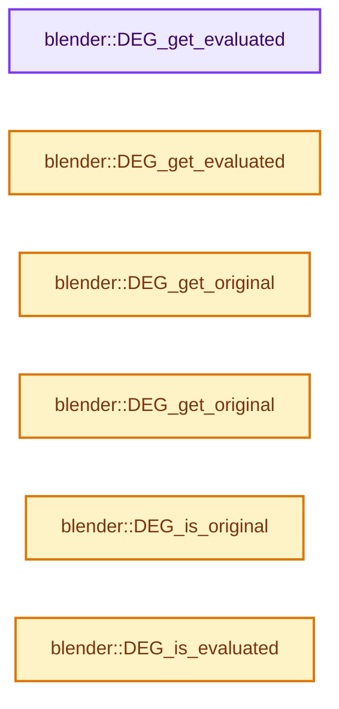
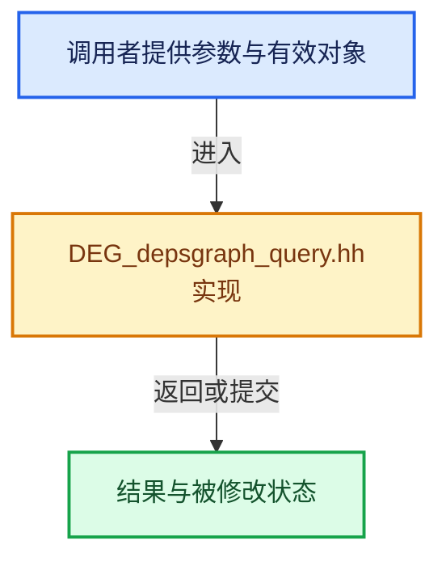

# 实现依赖专题：source/blender/depsgraph/DEG_depsgraph_query.hh

[实现依赖导航](../README.md) · [符号索引](../../00-课程指南/02-源码与提交索引/符号依赖与实现索引.md)

本专题从正文实际调用进入，集中保存共享实现。函数有稳定锚点，可从调用处直接跳到对应完整函数；递归与互相调用通过回链组织。

## 本文件的实现关系






<a id="m-b026ee27aef3"></a>

## 宏 `DEG_OBJECT_ITER_BEGIN`

<!-- annotated:ae9070bb639d66 -->

```cpp
#define DEG_OBJECT_ITER_BEGIN(settings_, instance_) \
  { \
    DEGObjectIterData data_ = { \
        (settings_), \
        (settings_)->depsgraph, \
        int((settings_)->flags), \
    }; \
\
    ITER_BEGIN (DEG_iterator_objects_begin, \
                DEG_iterator_objects_next, \
                DEG_iterator_objects_end, \
                &data_, \
                Object *, \
                instance_)

```

<details>
<summary>核对原始源码：source/blender/depsgraph/DEG_depsgraph_query.hh · L301—L315</summary>

<!-- original:ae9070bb639d66:source/blender/depsgraph/DEG_depsgraph_query.hh:301:315 -->

```cpp
#define DEG_OBJECT_ITER_BEGIN(settings_, instance_) \
  { \
    DEGObjectIterData data_ = { \
        (settings_), \
        (settings_)->depsgraph, \
        int((settings_)->flags), \
    }; \
\
    ITER_BEGIN (DEG_iterator_objects_begin, \
                DEG_iterator_objects_next, \
                DEG_iterator_objects_end, \
                &data_, \
                Object *, \
                instance_)

```

</details>

宏在预处理阶段展开，参数替换、重复求值和条件编译应直接从该定义检查。与普通函数不同，宏不会自动提供参数类型检查；构建配置选择哪个定义需结合外围条件。

## 完整成员与函数实现

<a id="f-e70143fa875363bf"></a>

### `blender::DEG_get_evaluated`

实现位置：[source/blender/depsgraph/DEG_depsgraph_query.hh](../../../../../../source/blender/depsgraph/DEG_depsgraph_query.hh) · L106—L110。

接口参数：

- `const Depsgraph *depsgraph`
- `T *id`

**教学注释版**

<!-- annotated:607ea66bc28179 -->

```cpp
template<typename T> T *DEG_get_evaluated(const Depsgraph *depsgraph, T *id)
{
  static_assert(dna::is_ID_v<T>);
  return reinterpret_cast<T *>(DEG_get_evaluated_id(depsgraph, reinterpret_cast<ID *>(id)));
}
```

<details>
<summary>核对原始源码：source/blender/depsgraph/DEG_depsgraph_query.hh · L106—L110</summary>

<!-- original:607ea66bc28179:source/blender/depsgraph/DEG_depsgraph_query.hh:106:110 -->

```cpp
template<typename T> T *DEG_get_evaluated(const Depsgraph *depsgraph, T *id)
{
  static_assert(dna::is_ID_v<T>);
  return reinterpret_cast<T *>(DEG_get_evaluated_id(depsgraph, reinterpret_cast<ID *>(id)));
}
```

</details>

**结果出口**

- `return reinterpret_cast<T *>(DEG_get_evaluated_id(depsgraph, reinterpret_cast<ID *>(id)));`

**继续追踪实现**

- `DEG_get_evaluated_id` → [blender::DEG_get_evaluated_id · L238](intern/depsgraph_query.cc.md#f-914145e79742c345)；[blender::DEG_get_evaluated_id · L243](intern/depsgraph_query.cc.md#f-73d3a2c567b88a8b)。同名重载需按实参类型选择。

<a id="f-129df72cfb5a1bad"></a>

### `blender::DEG_get_evaluated`

实现位置：[source/blender/depsgraph/DEG_depsgraph_query.hh](../../../../../../source/blender/depsgraph/DEG_depsgraph_query.hh) · L112—L117。

接口参数：

- `const Depsgraph *depsgraph`
- `const T *id`

**教学注释版**

<!-- annotated:c3ff5a3a16718f -->

```cpp
template<typename T> const T *DEG_get_evaluated(const Depsgraph *depsgraph, const T *id)
{
  static_assert(dna::is_ID_v<T>);
  return reinterpret_cast<const T *>(
      DEG_get_evaluated_id(depsgraph, reinterpret_cast<const ID *>(id)));
}
```

<details>
<summary>核对原始源码：source/blender/depsgraph/DEG_depsgraph_query.hh · L112—L117</summary>

<!-- original:c3ff5a3a16718f:source/blender/depsgraph/DEG_depsgraph_query.hh:112:117 -->

```cpp
template<typename T> const T *DEG_get_evaluated(const Depsgraph *depsgraph, const T *id)
{
  static_assert(dna::is_ID_v<T>);
  return reinterpret_cast<const T *>(
      DEG_get_evaluated_id(depsgraph, reinterpret_cast<const ID *>(id)));
}
```

</details>

**结果出口**

- `return reinterpret_cast<const T *>(`

**继续追踪实现**

- `DEG_get_evaluated_id` → [blender::DEG_get_evaluated_id · L238](intern/depsgraph_query.cc.md#f-914145e79742c345)；[blender::DEG_get_evaluated_id · L243](intern/depsgraph_query.cc.md#f-73d3a2c567b88a8b)。同名重载需按实参类型选择。

<a id="f-79782eab82a92d86"></a>

### `blender::DEG_get_original`

实现位置：[source/blender/depsgraph/DEG_depsgraph_query.hh](../../../../../../source/blender/depsgraph/DEG_depsgraph_query.hh) · L128—L132。

接口参数：

- `T *id`

**教学注释版**

<!-- annotated:ae08c2e0baba54 -->

```cpp
template<typename T> T *DEG_get_original(T *id)
{
  static_assert(dna::is_ID_v<T>);
  return reinterpret_cast<T *>(DEG_get_original_id(reinterpret_cast<ID *>(id)));
}
```

<details>
<summary>核对原始源码：source/blender/depsgraph/DEG_depsgraph_query.hh · L128—L132</summary>

<!-- original:ae08c2e0baba54:source/blender/depsgraph/DEG_depsgraph_query.hh:128:132 -->

```cpp
template<typename T> T *DEG_get_original(T *id)
{
  static_assert(dna::is_ID_v<T>);
  return reinterpret_cast<T *>(DEG_get_original_id(reinterpret_cast<ID *>(id)));
}
```

</details>

**结果出口**

- `return reinterpret_cast<T *>(DEG_get_original_id(reinterpret_cast<ID *>(id)));`

**继续追踪实现**

- `DEG_get_original_id` → [blender::DEG_get_original_id · L303](intern/depsgraph_query.cc.md#f-1f63a05d72701296)；[blender::DEG_get_original_id · L308](intern/depsgraph_query.cc.md#f-0317557ec3e823ac)。同名重载需按实参类型选择。

<a id="f-c032f06e9ef8f0cb"></a>

### `blender::DEG_get_original`

实现位置：[source/blender/depsgraph/DEG_depsgraph_query.hh](../../../../../../source/blender/depsgraph/DEG_depsgraph_query.hh) · L134—L138。

接口参数：

- `const T *id`

**教学注释版**

<!-- annotated:fe512955819475 -->

```cpp
template<typename T> const T *DEG_get_original(const T *id)
{
  static_assert(dna::is_ID_v<T>);
  return reinterpret_cast<const T *>(DEG_get_original_id(reinterpret_cast<const ID *>(id)));
}
```

<details>
<summary>核对原始源码：source/blender/depsgraph/DEG_depsgraph_query.hh · L134—L138</summary>

<!-- original:fe512955819475:source/blender/depsgraph/DEG_depsgraph_query.hh:134:138 -->

```cpp
template<typename T> const T *DEG_get_original(const T *id)
{
  static_assert(dna::is_ID_v<T>);
  return reinterpret_cast<const T *>(DEG_get_original_id(reinterpret_cast<const ID *>(id)));
}
```

</details>

**结果出口**

- `return reinterpret_cast<const T *>(DEG_get_original_id(reinterpret_cast<const ID *>(id)));`

**继续追踪实现**

- `DEG_get_original_id` → [blender::DEG_get_original_id · L303](intern/depsgraph_query.cc.md#f-1f63a05d72701296)；[blender::DEG_get_original_id · L308](intern/depsgraph_query.cc.md#f-0317557ec3e823ac)。同名重载需按实参类型选择。

<a id="f-729ea058ec76a2a8"></a>

### `blender::DEG_is_original`

实现位置：[source/blender/depsgraph/DEG_depsgraph_query.hh](../../../../../../source/blender/depsgraph/DEG_depsgraph_query.hh) · L158—L162。

接口参数：

- `const T *id`

**教学注释版**

<!-- annotated:e4c918a421cb86 -->

```cpp
template<typename T> bool DEG_is_original(const T *id)
{
  static_assert(dna::is_ID_v<T>);
  return DEG_is_original_id(reinterpret_cast<const ID *>(id));
}
```

<details>
<summary>核对原始源码：source/blender/depsgraph/DEG_depsgraph_query.hh · L158—L162</summary>

<!-- original:e4c918a421cb86:source/blender/depsgraph/DEG_depsgraph_query.hh:158:162 -->

```cpp
template<typename T> bool DEG_is_original(const T *id)
{
  static_assert(dna::is_ID_v<T>);
  return DEG_is_original_id(reinterpret_cast<const ID *>(id));
}
```

</details>

**结果出口**

- `return DEG_is_original_id(reinterpret_cast<const ID *>(id));`

**继续追踪实现**

- `DEG_is_original_id` → [blender::DEG_is_original_id · L318](intern/depsgraph_query.cc.md#f-799edc9c1a83f913)。

<a id="f-23a1423b8d446719"></a>

### `blender::DEG_is_evaluated`

实现位置：[source/blender/depsgraph/DEG_depsgraph_query.hh](../../../../../../source/blender/depsgraph/DEG_depsgraph_query.hh) · L170—L174。

接口参数：

- `const T *id`

**教学注释版**

<!-- annotated:665946a8fa223e -->

```cpp
template<typename T> bool DEG_is_evaluated(const T *id)
{
  static_assert(dna::is_ID_v<T>);
  return DEG_is_evaluated_id(reinterpret_cast<const ID *>(id));
}
```

<details>
<summary>核对原始源码：source/blender/depsgraph/DEG_depsgraph_query.hh · L170—L174</summary>

<!-- original:665946a8fa223e:source/blender/depsgraph/DEG_depsgraph_query.hh:170:174 -->

```cpp
template<typename T> bool DEG_is_evaluated(const T *id)
{
  static_assert(dna::is_ID_v<T>);
  return DEG_is_evaluated_id(reinterpret_cast<const ID *>(id));
}
```

</details>

**结果出口**

- `return DEG_is_evaluated_id(reinterpret_cast<const ID *>(id));`

**继续追踪实现**

- `DEG_is_evaluated_id` → [blender::DEG_is_evaluated_id · L338](intern/depsgraph_query.cc.md#f-96310685368dcb56)。
