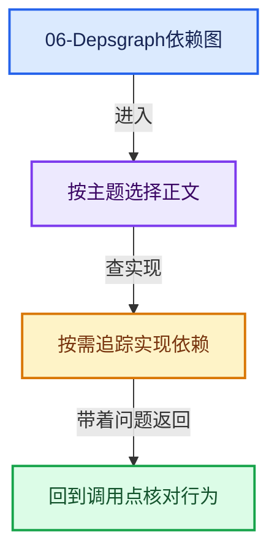
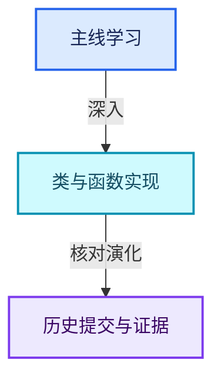

# 06-Depsgraph依赖图

[实现依赖总导航](../README.md)

## 模块公共接口

- [DEG_depsgraph.hh](DEG_depsgraph.hh.md)
- [DEG_depsgraph_query.hh](DEG_depsgraph_query.hh.md)

## intern

- [depsgraph.cc](intern/depsgraph.cc.md)
- [depsgraph_build.cc](intern/depsgraph_build.cc.md)
- [depsgraph_debug.cc](intern/depsgraph_debug.cc.md)
- [depsgraph_eval.cc](intern/depsgraph_eval.cc.md)
- [depsgraph_light_linking.cc](intern/depsgraph_light_linking.cc.md)
- [depsgraph_physics.cc](intern/depsgraph_physics.cc.md)
- [depsgraph_query.cc](intern/depsgraph_query.cc.md)
- [depsgraph_query_foreach.cc](intern/depsgraph_query_foreach.cc.md)
- [depsgraph_query_iter.cc](intern/depsgraph_query_iter.cc.md)
- [depsgraph_registry.cc](intern/depsgraph_registry.cc.md)
- [depsgraph_relation.cc](intern/depsgraph_relation.cc.md)
- [depsgraph_tag.cc](intern/depsgraph_tag.cc.md)
- [depsgraph_type.cc](intern/depsgraph_type.cc.md)
- [depsgraph_type.hh](intern/depsgraph_type.hh.md)
- [depsgraph_update.cc](intern/depsgraph_update.cc.md)
- [depsgraph_writeback_sync.cc](intern/depsgraph_writeback_sync.cc.md)

## intern/builder

- [deg_builder.cc](intern/builder/deg_builder.cc.md)
- [deg_builder_cache.cc](intern/builder/deg_builder_cache.cc.md)
- [deg_builder_key.cc](intern/builder/deg_builder_key.cc.md)
- [deg_builder_key.h](intern/builder/deg_builder_key.h.md)
- [deg_builder_nodes.h](intern/builder/deg_builder_nodes.h.md)
- [deg_builder_nodes_rig.cc](intern/builder/deg_builder_nodes_rig.cc.md)
- [deg_builder_nodes_scene.cc](intern/builder/deg_builder_nodes_scene.cc.md)
- [deg_builder_pchanmap.cc](intern/builder/deg_builder_pchanmap.cc.md)
- [deg_builder_relations.h](intern/builder/deg_builder_relations.h.md)
- [deg_builder_relations_drivers.cc](intern/builder/deg_builder_relations_drivers.cc.md)
- [deg_builder_relations_impl.h](intern/builder/deg_builder_relations_impl.h.md)
- [deg_builder_relations_rig.cc](intern/builder/deg_builder_relations_rig.cc.md)
- [deg_builder_relations_scene.cc](intern/builder/deg_builder_relations_scene.cc.md)
- [deg_builder_rna.cc](intern/builder/deg_builder_rna.cc.md)

## intern/debug

- [deg_debug.cc](intern/debug/deg_debug.cc.md)
- [deg_debug.h](intern/debug/deg_debug.h.md)

## intern/eval

- [deg_eval_copy_on_write.cc](intern/eval/deg_eval_copy_on_write.cc.md)
- [deg_eval_copy_on_write.h](intern/eval/deg_eval_copy_on_write.h.md)
- [deg_eval_runtime_backup.cc](intern/eval/deg_eval_runtime_backup.cc.md)
- [deg_eval_stats.cc](intern/eval/deg_eval_stats.cc.md)

## intern/node

- [deg_node.cc](intern/node/deg_node.cc.md)
- [deg_node.hh](intern/node/deg_node.hh.md)
- [deg_node_component.cc](intern/node/deg_node_component.cc.md)
- [deg_node_factory.cc](intern/node/deg_node_factory.cc.md)
- [deg_node_factory_impl.hh](intern/node/deg_node_factory_impl.hh.md)
- [deg_node_id.cc](intern/node/deg_node_id.cc.md)
- [deg_node_operation.cc](intern/node/deg_node_operation.cc.md)

