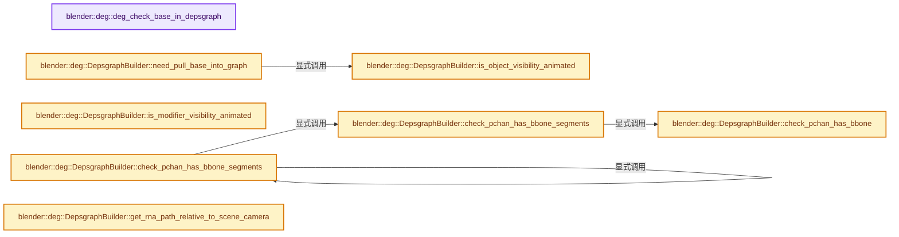
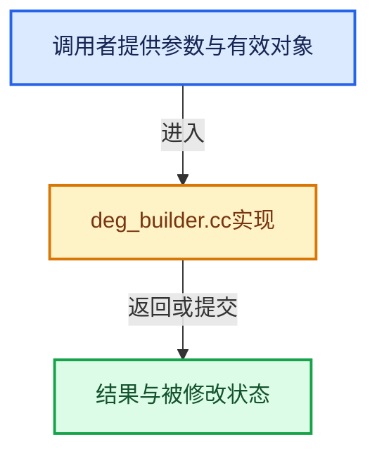

# 实现依赖专题：source/blender/depsgraph/intern/builder/deg_builder.cc

[实现依赖导航](../../../README.md) · [符号索引](../../../../00-课程指南/02-源码与提交索引/符号依赖与实现索引.md)

本专题从正文实际调用进入，集中保存共享实现。函数有稳定锚点，可从调用处直接跳到对应完整函数；递归与互相调用通过回链组织。

## 本文件的实现关系






## 完整成员与函数实现

<a id="f-42443915b354a207"></a>

### `blender::deg::deg_check_base_in_depsgraph`

实现位置：[source/blender/depsgraph/intern/builder/deg_builder.cc](../../../../../../../../source/blender/depsgraph/intern/builder/deg_builder.cc) · L48—L56。

接口参数：

- `const Depsgraph *graph`
- `Base *base`

**教学注释版**

<!-- annotated:ed59927cf6763d -->

```cpp
bool deg_check_base_in_depsgraph(const Depsgraph *graph, Base *base)
{
  Object *object_orig = base->base_orig->object;
  IDNode *id_node = graph->find_id_node(&object_orig->id);
  if (id_node == nullptr) {
    return false;
  }
  return id_node->has_base;
}
```

<details>
<summary>核对原始源码：source/blender/depsgraph/intern/builder/deg_builder.cc · L48—L56</summary>

<!-- original:ed59927cf6763d:source/blender/depsgraph/intern/builder/deg_builder.cc:48:56 -->

```cpp
bool deg_check_base_in_depsgraph(const Depsgraph *graph, Base *base)
{
  Object *object_orig = base->base_orig->object;
  IDNode *id_node = graph->find_id_node(&object_orig->id);
  if (id_node == nullptr) {
    return false;
  }
  return id_node->has_base;
}
```

</details>

**结果出口**

- `return false;`
- `return id_node->has_base;`

**继续追踪实现**

- `graph->find_id_node` → [blender::deg::Depsgraph::find_id_node · L102](../depsgraph.cc.md#f-09bf92ea2c269980)。

<a id="f-977d34fae963f813"></a>

### `blender::deg::DepsgraphBuilder::need_pull_base_into_graph`

实现位置：[source/blender/depsgraph/intern/builder/deg_builder.cc](../../../../../../../../source/blender/depsgraph/intern/builder/deg_builder.cc) · L67—L81。

接口参数：

- `const Base *base`

**教学注释版**

<!-- annotated:694ea351b11274 -->

```cpp
bool DepsgraphBuilder::need_pull_base_into_graph(const Base *base)
{
  /* Simple check: enabled bases are always part of dependency graph. */
  const int base_flag = (graph_->mode == DAG_EVAL_VIEWPORT) ? BASE_ENABLED_VIEWPORT :
                                                              BASE_ENABLED_RENDER;

  if (!graph_->use_visibility_optimization || (base->flag & base_flag)) {
    return true;
  }

  /* More involved check: since we don't support dynamic changes in dependency graph topology and
   * all visible objects are to be part of dependency graph, we pull all objects which has animated
   * visibility. */
  return is_object_visibility_animated(base->object);
}
```

<details>
<summary>核对原始源码：source/blender/depsgraph/intern/builder/deg_builder.cc · L67—L81</summary>

<!-- original:694ea351b11274:source/blender/depsgraph/intern/builder/deg_builder.cc:67:81 -->

```cpp
bool DepsgraphBuilder::need_pull_base_into_graph(const Base *base)
{
  /* Simple check: enabled bases are always part of dependency graph. */
  const int base_flag = (graph_->mode == DAG_EVAL_VIEWPORT) ? BASE_ENABLED_VIEWPORT :
                                                              BASE_ENABLED_RENDER;

  if (!graph_->use_visibility_optimization || (base->flag & base_flag)) {
    return true;
  }

  /* More involved check: since we don't support dynamic changes in dependency graph topology and
   * all visible objects are to be part of dependency graph, we pull all objects which has animated
   * visibility. */
  return is_object_visibility_animated(base->object);
}
```

</details>

**结果出口**

- `return true;`
- `return is_object_visibility_animated(base->object);`

**继续追踪实现**

- `is_object_visibility_animated` → [blender::deg::DepsgraphBuilder::is_object_visibility_animated · L83](deg_builder.cc.md#f-f1e474d1516fec66)。

<a id="f-f1e474d1516fec66"></a>

### `blender::deg::DepsgraphBuilder::is_object_visibility_animated`

实现位置：[source/blender/depsgraph/intern/builder/deg_builder.cc](../../../../../../../../source/blender/depsgraph/intern/builder/deg_builder.cc) · L83—L97。

接口参数：

- `const Object *object`

**教学注释版**

<!-- annotated:dbde2aace9e641 -->

```cpp
bool DepsgraphBuilder::is_object_visibility_animated(const Object *object)
{
  AnimatedPropertyID property_id;
  if (graph_->mode == DAG_EVAL_VIEWPORT) {
    property_id = AnimatedPropertyID(&object->id, RNA_Object, "hide_viewport");
  }
  else if (graph_->mode == DAG_EVAL_RENDER) {
    property_id = AnimatedPropertyID(&object->id, RNA_Object, "hide_render");
  }
  else {
    BLI_assert_msg(0, "Unknown evaluation mode.");
    return false;
  }
  return cache_->isPropertyAnimated(&object->id, property_id);
}
```

<details>
<summary>核对原始源码：source/blender/depsgraph/intern/builder/deg_builder.cc · L83—L97</summary>

<!-- original:dbde2aace9e641:source/blender/depsgraph/intern/builder/deg_builder.cc:83:97 -->

```cpp
bool DepsgraphBuilder::is_object_visibility_animated(const Object *object)
{
  AnimatedPropertyID property_id;
  if (graph_->mode == DAG_EVAL_VIEWPORT) {
    property_id = AnimatedPropertyID(&object->id, RNA_Object, "hide_viewport");
  }
  else if (graph_->mode == DAG_EVAL_RENDER) {
    property_id = AnimatedPropertyID(&object->id, RNA_Object, "hide_render");
  }
  else {
    BLI_assert_msg(0, "Unknown evaluation mode.");
    return false;
  }
  return cache_->isPropertyAnimated(&object->id, property_id);
}
```

</details>

**沿实际写入检查状态**

- `property_id = AnimatedPropertyID(&object->id, RNA_Object, "hide_viewport");`
- `property_id = AnimatedPropertyID(&object->id, RNA_Object, "hide_render");`

**结果出口**

- `return false;`
- `return cache_->isPropertyAnimated(&object->id, property_id);`

**继续追踪实现**

- `AnimatedPropertyID` → [blender::deg::AnimatedPropertyID::AnimatedPropertyID · L22](deg_builder_cache.cc.md#f-e8882539107a374f)；[blender::deg::AnimatedPropertyID::AnimatedPropertyID · L24](deg_builder_cache.cc.md#f-0ef519fbfd0a2bab)；[blender::deg::AnimatedPropertyID::AnimatedPropertyID · L30](deg_builder_cache.cc.md#f-7a805f20f9e6cff9)；[blender::deg::AnimatedPropertyID::AnimatedPropertyID · L36](deg_builder_cache.cc.md#f-a0c69d5ca6511cfe)；[blender::deg::AnimatedPropertyID::AnimatedPropertyID · L42](deg_builder_cache.cc.md#f-8a30319ed5be01d5)。同名重载需按实参类型选择。
- `BLI_assert_msg` → [BLI_assert_msg · L55](../../../01-BLI基础库/BLI_assert.hh.md#m-695eed20dceb)；[BLI_assert_msg · L64](../../../01-BLI基础库/BLI_assert.hh.md#m-7de5563de4db)。宏定义由构建条件选择。
- `cache_->isPropertyAnimated` → [调用协议](../../../../00-课程指南/01-路线与规范/模板宏与动态分派协议.md)：接收对象类型依赖auto、返回值或模板实例；不按同名猜测目标。调用位置L96。

<a id="f-9c33f9c739b8053c"></a>

### `blender::deg::DepsgraphBuilder::is_modifier_visibility_animated`

实现位置：[source/blender/depsgraph/intern/builder/deg_builder.cc](../../../../../../../../source/blender/depsgraph/intern/builder/deg_builder.cc) · L99—L114。

接口参数：

- `const Object *object`
- `const ModifierData *modifier`

**教学注释版**

<!-- annotated:497c19239c7a14 -->

```cpp
bool DepsgraphBuilder::is_modifier_visibility_animated(const Object *object,
                                                       const ModifierData *modifier)
{
  AnimatedPropertyID property_id;
  if (graph_->mode == DAG_EVAL_VIEWPORT) {
    property_id = AnimatedPropertyID(&object->id, RNA_Modifier, (void *)modifier, "show_viewport");
  }
  else if (graph_->mode == DAG_EVAL_RENDER) {
    property_id = AnimatedPropertyID(&object->id, RNA_Modifier, (void *)modifier, "show_render");
  }
  else {
    BLI_assert_msg(0, "Unknown evaluation mode.");
    return false;
  }
  return cache_->isPropertyAnimated(&object->id, property_id);
}
```

<details>
<summary>核对原始源码：source/blender/depsgraph/intern/builder/deg_builder.cc · L99—L114</summary>

<!-- original:497c19239c7a14:source/blender/depsgraph/intern/builder/deg_builder.cc:99:114 -->

```cpp
bool DepsgraphBuilder::is_modifier_visibility_animated(const Object *object,
                                                       const ModifierData *modifier)
{
  AnimatedPropertyID property_id;
  if (graph_->mode == DAG_EVAL_VIEWPORT) {
    property_id = AnimatedPropertyID(&object->id, RNA_Modifier, (void *)modifier, "show_viewport");
  }
  else if (graph_->mode == DAG_EVAL_RENDER) {
    property_id = AnimatedPropertyID(&object->id, RNA_Modifier, (void *)modifier, "show_render");
  }
  else {
    BLI_assert_msg(0, "Unknown evaluation mode.");
    return false;
  }
  return cache_->isPropertyAnimated(&object->id, property_id);
}
```

</details>

**沿实际写入检查状态**

- `property_id = AnimatedPropertyID(&object->id, RNA_Modifier, (void *)modifier, "show_viewport");`
- `property_id = AnimatedPropertyID(&object->id, RNA_Modifier, (void *)modifier, "show_render");`

**结果出口**

- `return false;`
- `return cache_->isPropertyAnimated(&object->id, property_id);`

**继续追踪实现**

- `AnimatedPropertyID` → [blender::deg::AnimatedPropertyID::AnimatedPropertyID · L22](deg_builder_cache.cc.md#f-e8882539107a374f)；[blender::deg::AnimatedPropertyID::AnimatedPropertyID · L24](deg_builder_cache.cc.md#f-0ef519fbfd0a2bab)；[blender::deg::AnimatedPropertyID::AnimatedPropertyID · L30](deg_builder_cache.cc.md#f-7a805f20f9e6cff9)；[blender::deg::AnimatedPropertyID::AnimatedPropertyID · L36](deg_builder_cache.cc.md#f-a0c69d5ca6511cfe)；[blender::deg::AnimatedPropertyID::AnimatedPropertyID · L42](deg_builder_cache.cc.md#f-8a30319ed5be01d5)。同名重载需按实参类型选择。
- `BLI_assert_msg` → [BLI_assert_msg · L55](../../../01-BLI基础库/BLI_assert.hh.md#m-695eed20dceb)；[BLI_assert_msg · L64](../../../01-BLI基础库/BLI_assert.hh.md#m-7de5563de4db)。宏定义由构建条件选择。
- `cache_->isPropertyAnimated` → [调用协议](../../../../00-课程指南/01-路线与规范/模板宏与动态分派协议.md)：接收对象类型依赖auto、返回值或模板实例；不按同名猜测目标。调用位置L113。

<a id="f-82db2501b96f01e4"></a>

### `blender::deg::DepsgraphBuilder::check_pchan_has_bbone`

实现位置：[source/blender/depsgraph/intern/builder/deg_builder.cc](../../../../../../../../source/blender/depsgraph/intern/builder/deg_builder.cc) · L116—L139。

接口参数：

- `const Object *object`
- `const bPoseChannel *pchan`

**教学注释版**

<!-- annotated:0960c973ceffcc -->

```cpp
bool DepsgraphBuilder::check_pchan_has_bbone(const Object *object, const bPoseChannel *pchan)
{
  BLI_assert(object->type == OB_ARMATURE);
  bArmature *armature = id_cast<bArmature *>(object->data);
  if (pchan == nullptr) {
    return false;
  }
  const Bone *bone = pchan->bone_get(*armature);
  if (bone == nullptr) {
    return false;
  }
  /* We don't really care whether segments are higher than 1 due to static user input (as in,
   * rigger entered value like 3 manually), or due to animation. In either way we need to create
   * special evaluation. */
  if (bone->segments > 1) {
    return true;
  }
  AnimatedPropertyID property_id(
      &armature->id, RNA_Bone, const_cast<Bone *>(bone), "bbone_segments");
  /* Check both Object and Armature animation data, because drivers modifying Armature
   * state could easily be created in the Object AnimData. */
  return cache_->isPropertyAnimated(&object->id, property_id) ||
         cache_->isPropertyAnimated(&armature->id, property_id);
}
```

<details>
<summary>核对原始源码：source/blender/depsgraph/intern/builder/deg_builder.cc · L116—L139</summary>

<!-- original:0960c973ceffcc:source/blender/depsgraph/intern/builder/deg_builder.cc:116:139 -->

```cpp
bool DepsgraphBuilder::check_pchan_has_bbone(const Object *object, const bPoseChannel *pchan)
{
  BLI_assert(object->type == OB_ARMATURE);
  bArmature *armature = id_cast<bArmature *>(object->data);
  if (pchan == nullptr) {
    return false;
  }
  const Bone *bone = pchan->bone_get(*armature);
  if (bone == nullptr) {
    return false;
  }
  /* We don't really care whether segments are higher than 1 due to static user input (as in,
   * rigger entered value like 3 manually), or due to animation. In either way we need to create
   * special evaluation. */
  if (bone->segments > 1) {
    return true;
  }
  AnimatedPropertyID property_id(
      &armature->id, RNA_Bone, const_cast<Bone *>(bone), "bbone_segments");
  /* Check both Object and Armature animation data, because drivers modifying Armature
   * state could easily be created in the Object AnimData. */
  return cache_->isPropertyAnimated(&object->id, property_id) ||
         cache_->isPropertyAnimated(&armature->id, property_id);
}
```

</details>

**结果出口**

- `return false;`
- `return true;`
- `return cache_->isPropertyAnimated(&object->id, property_id) ||`

**继续追踪实现**

- `BLI_assert` → [BLI_assert · L48](../../../01-BLI基础库/BLI_assert.hh.md#m-57a88495704d)；[BLI_assert · L63](../../../01-BLI基础库/BLI_assert.hh.md#m-d07050020cb5)。宏定义由构建条件选择。
- `id_cast<bArmature *>` → [blender::id_cast · L1417](../../../08-其他Blender模块/makesdna/DNA_ID.h.md#f-6c8ac6412850ac5a)。
- `pchan->bone_get` → [blender::bPoseChannel::bone_get · L847](../../../02-BKE几何与数据/intern/action.cc.md#f-0eb8bfcf060715cf)；[blender::bPoseChannel::bone_get · L862](../../../02-BKE几何与数据/intern/action.cc.md#f-ccec81f60dc65040)；[blender::bPoseChannel::bone_get · L875](../../../02-BKE几何与数据/intern/action.cc.md#f-b7d34ff46210a1f3)；[blender::bPoseChannel::bone_get · L881](../../../02-BKE几何与数据/intern/action.cc.md#f-0bf83e1e4d68c624)。同名重载需按实参类型选择。
- `cache_->isPropertyAnimated` → [调用协议](../../../../00-课程指南/01-路线与规范/模板宏与动态分派协议.md)：接收对象类型依赖auto、返回值或模板实例；不按同名猜测目标。调用位置L137。

<a id="f-d544610faa56d2c9"></a>

### `blender::deg::DepsgraphBuilder::check_pchan_has_bbone_segments`

实现位置：[source/blender/depsgraph/intern/builder/deg_builder.cc](../../../../../../../../source/blender/depsgraph/intern/builder/deg_builder.cc) · L141—L145。

接口参数：

- `const Object *object`
- `const bPoseChannel *pchan`

**教学注释版**

<!-- annotated:83eb6d768a8e63 -->

```cpp
bool DepsgraphBuilder::check_pchan_has_bbone_segments(const Object *object,
                                                      const bPoseChannel *pchan)
{
  return check_pchan_has_bbone(object, pchan);
}
```

<details>
<summary>核对原始源码：source/blender/depsgraph/intern/builder/deg_builder.cc · L141—L145</summary>

<!-- original:83eb6d768a8e63:source/blender/depsgraph/intern/builder/deg_builder.cc:141:145 -->

```cpp
bool DepsgraphBuilder::check_pchan_has_bbone_segments(const Object *object,
                                                      const bPoseChannel *pchan)
{
  return check_pchan_has_bbone(object, pchan);
}
```

</details>

**结果出口**

- `return check_pchan_has_bbone(object, pchan);`

**继续追踪实现**

- `check_pchan_has_bbone` → [blender::deg::DepsgraphBuilder::check_pchan_has_bbone · L116](deg_builder.cc.md#f-82db2501b96f01e4)。

<a id="f-9bbc17caf0c5ee2d"></a>

### `blender::deg::DepsgraphBuilder::check_pchan_has_bbone_segments`

实现位置：[source/blender/depsgraph/intern/builder/deg_builder.cc](../../../../../../../../source/blender/depsgraph/intern/builder/deg_builder.cc) · L147—L151。

接口参数：

- `const Object *object`
- `const char *bone_name`

**教学注释版**

<!-- annotated:076ba3c8274f62 -->

```cpp
bool DepsgraphBuilder::check_pchan_has_bbone_segments(const Object *object, const char *bone_name)
{
  const bPoseChannel *pchan = BKE_pose_channel_find_name(object->pose, bone_name);
  return check_pchan_has_bbone_segments(object, pchan);
}
```

<details>
<summary>核对原始源码：source/blender/depsgraph/intern/builder/deg_builder.cc · L147—L151</summary>

<!-- original:076ba3c8274f62:source/blender/depsgraph/intern/builder/deg_builder.cc:147:151 -->

```cpp
bool DepsgraphBuilder::check_pchan_has_bbone_segments(const Object *object, const char *bone_name)
{
  const bPoseChannel *pchan = BKE_pose_channel_find_name(object->pose, bone_name);
  return check_pchan_has_bbone_segments(object, pchan);
}
```

</details>

**结果出口**

- `return check_pchan_has_bbone_segments(object, pchan);`

**继续追踪实现**

- `BKE_pose_channel_find_name` → [blender::BKE_pose_channel_find_name · L895](../../../02-BKE几何与数据/intern/action.cc.md#f-5997206551bfc9f9)。
- `check_pchan_has_bbone_segments` → [blender::deg::DepsgraphBuilder::check_pchan_has_bbone_segments · L141](deg_builder.cc.md#f-d544610faa56d2c9)；[blender::deg::DepsgraphBuilder::check_pchan_has_bbone_segments · L147](deg_builder.cc.md#f-9bbc17caf0c5ee2d)。同名重载需按实参类型选择。

<a id="f-0f440d462571d6b9"></a>

### `blender::deg::DepsgraphBuilder::get_rna_path_relative_to_scene_camera`

实现位置：[source/blender/depsgraph/intern/builder/deg_builder.cc](../../../../../../../../source/blender/depsgraph/intern/builder/deg_builder.cc) · L153—L172。

接口参数：

- `const Scene *scene`
- `const PointerRNA &target_prop`
- `const char *rna_path`

**教学注释版**

<!-- annotated:6c8f03228cda5d -->

```cpp
const char *DepsgraphBuilder::get_rna_path_relative_to_scene_camera(const Scene *scene,
                                                                    const PointerRNA &target_prop,
                                                                    const char *rna_path)
{
  if (rna_path == nullptr || target_prop.data != scene || target_prop.type != RNA_Scene ||
      !BLI_str_startswith(rna_path, "camera"))
  {
    return nullptr;
  }

  /* Return the part of the path relative to the camera. */
  switch (rna_path[6]) {
    case '.':
      return rna_path + 7;
    case '[':
      return rna_path + 6;
    default:
      return nullptr;
  }
}
```

<details>
<summary>核对原始源码：source/blender/depsgraph/intern/builder/deg_builder.cc · L153—L172</summary>

<!-- original:6c8f03228cda5d:source/blender/depsgraph/intern/builder/deg_builder.cc:153:172 -->

```cpp
const char *DepsgraphBuilder::get_rna_path_relative_to_scene_camera(const Scene *scene,
                                                                    const PointerRNA &target_prop,
                                                                    const char *rna_path)
{
  if (rna_path == nullptr || target_prop.data != scene || target_prop.type != RNA_Scene ||
      !BLI_str_startswith(rna_path, "camera"))
  {
    return nullptr;
  }

  /* Return the part of the path relative to the camera. */
  switch (rna_path[6]) {
    case '.':
      return rna_path + 7;
    case '[':
      return rna_path + 6;
    default:
      return nullptr;
  }
}
```

</details>

**结果出口**

- `return nullptr;`
- `return rna_path + 7;`
- `return rna_path + 6;`

**继续追踪实现**

- `BLI_str_startswith` → [blender::BLI_str_startswith · L880](../../../01-BLI基础库/intern/string.cc.md#f-445c516c6655a756)。
