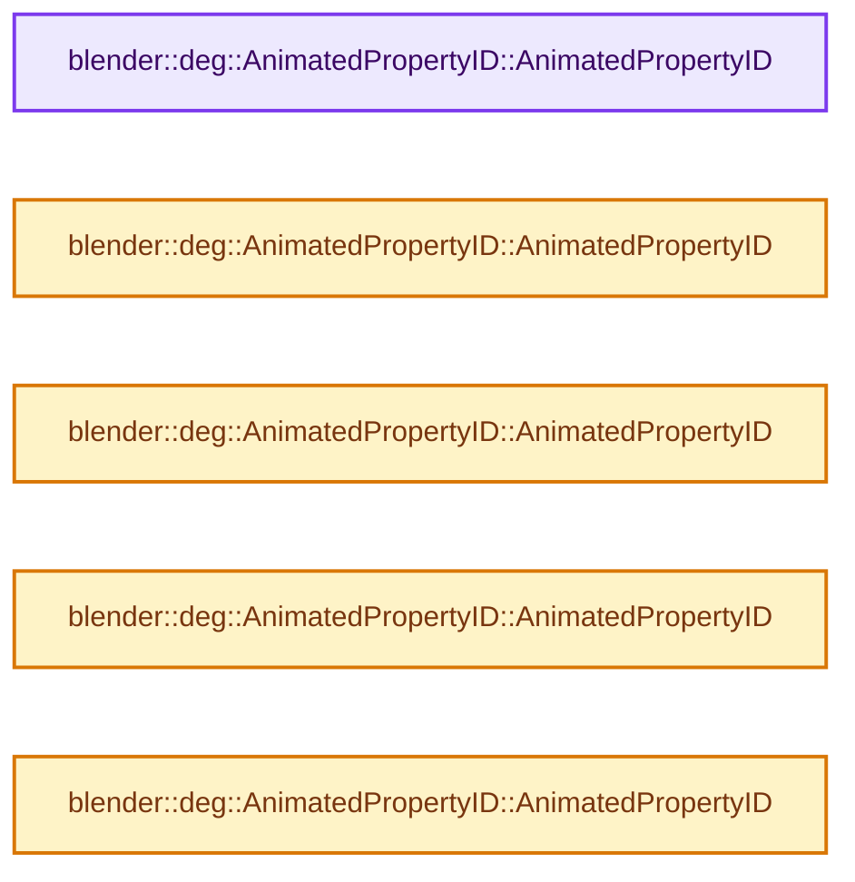

# 实现依赖专题：source/blender/depsgraph/intern/builder/deg_builder_cache.cc

[实现依赖导航](../../../README.md) · [符号索引](../../../../00-课程指南/02-源码与提交索引/符号依赖与实现索引.md)

本专题从正文实际调用进入，集中保存共享实现。函数有稳定锚点，可从调用处直接跳到对应完整函数；递归与互相调用通过回链组织。

## 本文件的实现关系




## 完整成员与函数实现

<a id="f-e8882539107a374f"></a>

### `blender::deg::AnimatedPropertyID::AnimatedPropertyID`

实现位置：[source/blender/depsgraph/intern/builder/deg_builder_cache.cc](../../../../../../../../source/blender/depsgraph/intern/builder/deg_builder_cache.cc) · L22—L22。

**教学注释版**

<!-- annotated:d031f9344b0b7b -->

```cpp
AnimatedPropertyID::AnimatedPropertyID() : data(nullptr), property_rna(nullptr) {}
```

<details>
<summary>核对原始源码：source/blender/depsgraph/intern/builder/deg_builder_cache.cc · L22—L22</summary>

<!-- original:d031f9344b0b7b:source/blender/depsgraph/intern/builder/deg_builder_cache.cc:22:22 -->

```cpp
AnimatedPropertyID::AnimatedPropertyID() : data(nullptr), property_rna(nullptr) {}
```

</details>

**继续追踪实现**

本实现没有需要继续展开的显式调用；检查返回表达式、对象转换和调用者前置条件。

<a id="f-0ef519fbfd0a2bab"></a>

### `blender::deg::AnimatedPropertyID::AnimatedPropertyID`

实现位置：[source/blender/depsgraph/intern/builder/deg_builder_cache.cc](../../../../../../../../source/blender/depsgraph/intern/builder/deg_builder_cache.cc) · L24—L28。

接口参数：

- `const PointerRNA *pointer_rna`
- `const PropertyRNA *property_rna`

**教学注释版**

<!-- annotated:84b984c5009d32 -->

```cpp
AnimatedPropertyID::AnimatedPropertyID(const PointerRNA *pointer_rna,
                                       const PropertyRNA *property_rna)
    : AnimatedPropertyID(*pointer_rna, property_rna)
{
}
```

<details>
<summary>核对原始源码：source/blender/depsgraph/intern/builder/deg_builder_cache.cc · L24—L28</summary>

<!-- original:84b984c5009d32:source/blender/depsgraph/intern/builder/deg_builder_cache.cc:24:28 -->

```cpp
AnimatedPropertyID::AnimatedPropertyID(const PointerRNA *pointer_rna,
                                       const PropertyRNA *property_rna)
    : AnimatedPropertyID(*pointer_rna, property_rna)
{
}
```

</details>

**继续追踪实现**

本实现没有需要继续展开的显式调用；检查返回表达式、对象转换和调用者前置条件。

<a id="f-7a805f20f9e6cff9"></a>

### `blender::deg::AnimatedPropertyID::AnimatedPropertyID`

实现位置：[source/blender/depsgraph/intern/builder/deg_builder_cache.cc](../../../../../../../../source/blender/depsgraph/intern/builder/deg_builder_cache.cc) · L30—L34。

接口参数：

- `const PointerRNA &pointer_rna`
- `const PropertyRNA *property_rna`

**教学注释版**

<!-- annotated:9230d4bf0b0c31 -->

```cpp
AnimatedPropertyID::AnimatedPropertyID(const PointerRNA &pointer_rna,
                                       const PropertyRNA *property_rna)
    : data(pointer_rna.data), property_rna(property_rna)
{
}
```

<details>
<summary>核对原始源码：source/blender/depsgraph/intern/builder/deg_builder_cache.cc · L30—L34</summary>

<!-- original:9230d4bf0b0c31:source/blender/depsgraph/intern/builder/deg_builder_cache.cc:30:34 -->

```cpp
AnimatedPropertyID::AnimatedPropertyID(const PointerRNA &pointer_rna,
                                       const PropertyRNA *property_rna)
    : data(pointer_rna.data), property_rna(property_rna)
{
}
```

</details>

**继续追踪实现**

本实现没有需要继续展开的显式调用；检查返回表达式、对象转换和调用者前置条件。

<a id="f-a0c69d5ca6511cfe"></a>

### `blender::deg::AnimatedPropertyID::AnimatedPropertyID`

实现位置：[source/blender/depsgraph/intern/builder/deg_builder_cache.cc](../../../../../../../../source/blender/depsgraph/intern/builder/deg_builder_cache.cc) · L36—L40。

接口参数：

- `const ID *id`
- `StructRNA *type`
- `const char *property_name`

**教学注释版**

<!-- annotated:935905cd083b81 -->

```cpp
AnimatedPropertyID::AnimatedPropertyID(const ID *id, StructRNA *type, const char *property_name)
    : data(id)
{
  property_rna = RNA_struct_type_find_property(type, property_name);
}
```

<details>
<summary>核对原始源码：source/blender/depsgraph/intern/builder/deg_builder_cache.cc · L36—L40</summary>

<!-- original:935905cd083b81:source/blender/depsgraph/intern/builder/deg_builder_cache.cc:36:40 -->

```cpp
AnimatedPropertyID::AnimatedPropertyID(const ID *id, StructRNA *type, const char *property_name)
    : data(id)
{
  property_rna = RNA_struct_type_find_property(type, property_name);
}
```

</details>

**沿实际写入检查状态**

- `property_rna = RNA_struct_type_find_property(type, property_name);`

**继续追踪实现**

- `RNA_struct_type_find_property` → [blender::RNA_struct_type_find_property · L1061](../../../08-其他Blender模块/makesrna/intern/rna_access.cc.md#f-ca7d4a9ceba67784)。

<a id="f-8a30319ed5be01d5"></a>

### `blender::deg::AnimatedPropertyID::AnimatedPropertyID`

实现位置：[source/blender/depsgraph/intern/builder/deg_builder_cache.cc](../../../../../../../../source/blender/depsgraph/intern/builder/deg_builder_cache.cc) · L42—L49。

接口参数：

- `const ID *`
- `StructRNA *type`
- `void *data`
- `const char *property_name`

**教学注释版**

<!-- annotated:5fb54de5527f35 -->

```cpp
AnimatedPropertyID::AnimatedPropertyID(const ID * /*id*/,
                                       StructRNA *type,
                                       void *data,
                                       const char *property_name)
    : data(data)
{
  property_rna = RNA_struct_type_find_property(type, property_name);
}
```

<details>
<summary>核对原始源码：source/blender/depsgraph/intern/builder/deg_builder_cache.cc · L42—L49</summary>

<!-- original:5fb54de5527f35:source/blender/depsgraph/intern/builder/deg_builder_cache.cc:42:49 -->

```cpp
AnimatedPropertyID::AnimatedPropertyID(const ID * /*id*/,
                                       StructRNA *type,
                                       void *data,
                                       const char *property_name)
    : data(data)
{
  property_rna = RNA_struct_type_find_property(type, property_name);
}
```

</details>

**沿实际写入检查状态**

- `property_rna = RNA_struct_type_find_property(type, property_name);`

**继续追踪实现**

- `RNA_struct_type_find_property` → [blender::RNA_struct_type_find_property · L1061](../../../08-其他Blender模块/makesrna/intern/rna_access.cc.md#f-ca7d4a9ceba67784)。
