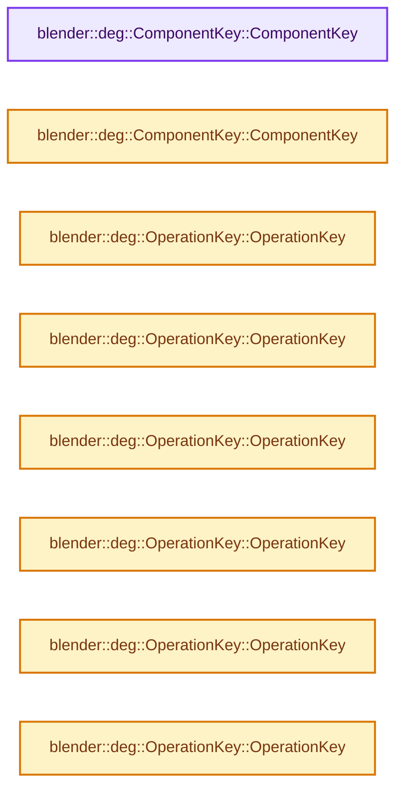

# 实现依赖专题：source/blender/depsgraph/intern/builder/deg_builder_key.h

[实现依赖导航](../../../README.md) · [符号索引](../../../../00-课程指南/02-源码与提交索引/符号依赖与实现索引.md)

本专题从正文实际调用进入，集中保存共享实现。函数有稳定锚点，可从调用处直接跳到对应完整函数；递归与互相调用通过回链组织。

## 本文件的实现关系




## 完整成员与函数实现

<a id="f-da71b2acaf83ada7"></a>

### `blender::deg::ComponentKey::ComponentKey`

实现位置：[source/blender/depsgraph/intern/builder/deg_builder_key.h](../../../../../../../../source/blender/depsgraph/intern/builder/deg_builder_key.h) · L34—L34。

**教学注释版**

<!-- annotated:13c85b529cd552 -->

```cpp
  ComponentKey() = default;
```

<details>
<summary>核对原始源码：source/blender/depsgraph/intern/builder/deg_builder_key.h · L34—L34</summary>

<!-- original:13c85b529cd552:source/blender/depsgraph/intern/builder/deg_builder_key.h:34:34 -->

```cpp
  ComponentKey() = default;
```

</details>

**继续追踪实现**

本实现没有需要继续展开的显式调用；检查返回表达式、对象转换和调用者前置条件。

<a id="f-305521a961ee776a"></a>

### `blender::deg::ComponentKey::ComponentKey`

实现位置：[source/blender/depsgraph/intern/builder/deg_builder_key.h](../../../../../../../../source/blender/depsgraph/intern/builder/deg_builder_key.h) · L36—L38。

接口参数：

- `const ID *id`
- `NodeType type`
- `const char *name = ""`

**教学注释版**

<!-- annotated:66c6c1f68ce085 -->

```cpp
  ComponentKey(const ID *id, NodeType type, const char *name = "") : id(id), type(type), name(name)
  {
  }
```

<details>
<summary>核对原始源码：source/blender/depsgraph/intern/builder/deg_builder_key.h · L36—L38</summary>

<!-- original:66c6c1f68ce085:source/blender/depsgraph/intern/builder/deg_builder_key.h:36:38 -->

```cpp
  ComponentKey(const ID *id, NodeType type, const char *name = "") : id(id), type(type), name(name)
  {
  }
```

</details>

**继续追踪实现**

本实现没有需要继续展开的显式调用；检查返回表达式、对象转换和调用者前置条件。

<a id="f-d8bb07cb3cfed5ab"></a>

### `blender::deg::OperationKey::OperationKey`

实现位置：[source/blender/depsgraph/intern/builder/deg_builder_key.h](../../../../../../../../source/blender/depsgraph/intern/builder/deg_builder_key.h) · L48—L48。

**教学注释版**

<!-- annotated:64c4d81aaef390 -->

```cpp
  OperationKey() = default;
```

<details>
<summary>核对原始源码：source/blender/depsgraph/intern/builder/deg_builder_key.h · L48—L48</summary>

<!-- original:64c4d81aaef390:source/blender/depsgraph/intern/builder/deg_builder_key.h:48:48 -->

```cpp
  OperationKey() = default;
```

</details>

**继续追踪实现**

本实现没有需要继续展开的显式调用；检查返回表达式、对象转换和调用者前置条件。

<a id="f-f611119dc9d01313"></a>

### `blender::deg::OperationKey::OperationKey`

实现位置：[source/blender/depsgraph/intern/builder/deg_builder_key.h](../../../../../../../../source/blender/depsgraph/intern/builder/deg_builder_key.h) · L50—L53。

接口参数：

- `const ID *id`
- `NodeType component_type`
- `const char *name`
- `int name_tag = -1`

**教学注释版**

<!-- annotated:a257022a4f7bd9 -->

```cpp
  OperationKey(const ID *id, NodeType component_type, const char *name, int name_tag = -1)
      : id(id), component_type(component_type), name(name), name_tag(name_tag)
  {
  }
```

<details>
<summary>核对原始源码：source/blender/depsgraph/intern/builder/deg_builder_key.h · L50—L53</summary>

<!-- original:a257022a4f7bd9:source/blender/depsgraph/intern/builder/deg_builder_key.h:50:53 -->

```cpp
  OperationKey(const ID *id, NodeType component_type, const char *name, int name_tag = -1)
      : id(id), component_type(component_type), name(name), name_tag(name_tag)
  {
  }
```

</details>

**继续追踪实现**

本实现没有需要继续展开的显式调用；检查返回表达式、对象转换和调用者前置条件。

<a id="f-33ebfe0833037fb4"></a>

### `blender::deg::OperationKey::OperationKey`

实现位置：[source/blender/depsgraph/intern/builder/deg_builder_key.h](../../../../../../../../source/blender/depsgraph/intern/builder/deg_builder_key.h) · L55—L66。

接口参数：

- `const ID *id`
- `NodeType component_type`
- `const char *component_name`
- `const char *name`
- `int name_tag`

**教学注释版**

<!-- annotated:2a375260499010 -->

```cpp
  OperationKey(const ID *id,
               NodeType component_type,
               const char *component_name,
               const char *name,
               int name_tag)
      : id(id),
        component_type(component_type),
        component_name(component_name),
        name(name),
        name_tag(name_tag)
  {
  }
```

<details>
<summary>核对原始源码：source/blender/depsgraph/intern/builder/deg_builder_key.h · L55—L66</summary>

<!-- original:2a375260499010:source/blender/depsgraph/intern/builder/deg_builder_key.h:55:66 -->

```cpp
  OperationKey(const ID *id,
               NodeType component_type,
               const char *component_name,
               const char *name,
               int name_tag)
      : id(id),
        component_type(component_type),
        component_name(component_name),
        name(name),
        name_tag(name_tag)
  {
  }
```

</details>

**继续追踪实现**

本实现没有需要继续展开的显式调用；检查返回表达式、对象转换和调用者前置条件。

<a id="f-b564888d888f20c2"></a>

### `blender::deg::OperationKey::OperationKey`

实现位置：[source/blender/depsgraph/intern/builder/deg_builder_key.h](../../../../../../../../source/blender/depsgraph/intern/builder/deg_builder_key.h) · L68—L71。

接口参数：

- `const ID *id`
- `NodeType component_type`
- `OperationCode opcode`

**教学注释版**

<!-- annotated:3eed74768e2cef -->

```cpp
  OperationKey(const ID *id, NodeType component_type, OperationCode opcode)
      : id(id), component_type(component_type), opcode(opcode)
  {
  }
```

<details>
<summary>核对原始源码：source/blender/depsgraph/intern/builder/deg_builder_key.h · L68—L71</summary>

<!-- original:3eed74768e2cef:source/blender/depsgraph/intern/builder/deg_builder_key.h:68:71 -->

```cpp
  OperationKey(const ID *id, NodeType component_type, OperationCode opcode)
      : id(id), component_type(component_type), opcode(opcode)
  {
  }
```

</details>

**继续追踪实现**

本实现没有需要继续展开的显式调用；检查返回表达式、对象转换和调用者前置条件。

<a id="f-2d4db06305a0e8b1"></a>

### `blender::deg::OperationKey::OperationKey`

实现位置：[source/blender/depsgraph/intern/builder/deg_builder_key.h](../../../../../../../../source/blender/depsgraph/intern/builder/deg_builder_key.h) · L73—L79。

接口参数：

- `const ID *id`
- `NodeType component_type`
- `const char *component_name`
- `OperationCode opcode`

**教学注释版**

<!-- annotated:f5dffdc7d73973 -->

```cpp
  OperationKey(const ID *id,
               NodeType component_type,
               const char *component_name,
               OperationCode opcode)
      : id(id), component_type(component_type), component_name(component_name), opcode(opcode)
  {
  }
```

<details>
<summary>核对原始源码：source/blender/depsgraph/intern/builder/deg_builder_key.h · L73—L79</summary>

<!-- original:f5dffdc7d73973:source/blender/depsgraph/intern/builder/deg_builder_key.h:73:79 -->

```cpp
  OperationKey(const ID *id,
               NodeType component_type,
               const char *component_name,
               OperationCode opcode)
      : id(id), component_type(component_type), component_name(component_name), opcode(opcode)
  {
  }
```

</details>

**继续追踪实现**

本实现没有需要继续展开的显式调用；检查返回表达式、对象转换和调用者前置条件。

<a id="f-c71d51a108287e88"></a>

### `blender::deg::OperationKey::OperationKey`

实现位置：[source/blender/depsgraph/intern/builder/deg_builder_key.h](../../../../../../../../source/blender/depsgraph/intern/builder/deg_builder_key.h) · L81—L88。

接口参数：

- `const ID *id`
- `NodeType component_type`
- `OperationCode opcode`
- `const char *name`
- `int name_tag = -1`

**教学注释版**

<!-- annotated:1b73d4e23138c8 -->

```cpp
  OperationKey(const ID *id,
               NodeType component_type,
               OperationCode opcode,
               const char *name,
               int name_tag = -1)
      : id(id), component_type(component_type), opcode(opcode), name(name), name_tag(name_tag)
  {
  }
```

<details>
<summary>核对原始源码：source/blender/depsgraph/intern/builder/deg_builder_key.h · L81—L88</summary>

<!-- original:1b73d4e23138c8:source/blender/depsgraph/intern/builder/deg_builder_key.h:81:88 -->

```cpp
  OperationKey(const ID *id,
               NodeType component_type,
               OperationCode opcode,
               const char *name,
               int name_tag = -1)
      : id(id), component_type(component_type), opcode(opcode), name(name), name_tag(name_tag)
  {
  }
```

</details>

**继续追踪实现**

本实现没有需要继续展开的显式调用；检查返回表达式、对象转换和调用者前置条件。

<a id="f-dcb9df30cafe00ed"></a>

### `blender::deg::OperationKey::OperationKey`

实现位置：[source/blender/depsgraph/intern/builder/deg_builder_key.h](../../../../../../../../source/blender/depsgraph/intern/builder/deg_builder_key.h) · L89—L102。

接口参数：

- `const ID *id`
- `NodeType component_type`
- `const char *component_name`
- `OperationCode opcode`
- `const char *name`
- `int name_tag = -1`

**教学注释版**

<!-- annotated:a645ffa2857c59 -->

```cpp
  OperationKey(const ID *id,
               NodeType component_type,
               const char *component_name,
               OperationCode opcode,
               const char *name,
               int name_tag = -1)
      : id(id),
        component_type(component_type),
        component_name(component_name),
        opcode(opcode),
        name(name),
        name_tag(name_tag)
  {
  }
```

<details>
<summary>核对原始源码：source/blender/depsgraph/intern/builder/deg_builder_key.h · L89—L102</summary>

<!-- original:a645ffa2857c59:source/blender/depsgraph/intern/builder/deg_builder_key.h:89:102 -->

```cpp
  OperationKey(const ID *id,
               NodeType component_type,
               const char *component_name,
               OperationCode opcode,
               const char *name,
               int name_tag = -1)
      : id(id),
        component_type(component_type),
        component_name(component_name),
        opcode(opcode),
        name(name),
        name_tag(name_tag)
  {
  }
```

</details>

**继续追踪实现**

本实现没有需要继续展开的显式调用；检查返回表达式、对象转换和调用者前置条件。

<a id="f-fd644c902add589a"></a>

### `blender::deg::OperationKey::OperationKey`

实现位置：[source/blender/depsgraph/intern/builder/deg_builder_key.h](../../../../../../../../source/blender/depsgraph/intern/builder/deg_builder_key.h) · L104—L104。

接口参数：

- `OperationKey &&other`

**教学注释版**

<!-- annotated:6d3967855db15b -->

```cpp
  OperationKey(OperationKey &&other) noexcept = default;
```

<details>
<summary>核对原始源码：source/blender/depsgraph/intern/builder/deg_builder_key.h · L104—L104</summary>

<!-- original:6d3967855db15b:source/blender/depsgraph/intern/builder/deg_builder_key.h:104:104 -->

```cpp
  OperationKey(OperationKey &&other) noexcept = default;
```

</details>

**继续追踪实现**

本实现没有需要继续展开的显式调用；检查返回表达式、对象转换和调用者前置条件。

<a id="f-111f3c179bc45e54"></a>

### `blender::deg::OperationKey::OperationKey`

实现位置：[source/blender/depsgraph/intern/builder/deg_builder_key.h](../../../../../../../../source/blender/depsgraph/intern/builder/deg_builder_key.h) · L107—L107。

接口参数：

- `const OperationKey &other`

**教学注释版**

<!-- annotated:d9de3dc526fba3 -->

```cpp
  OperationKey(const OperationKey &other) = default;
```

<details>
<summary>核对原始源码：source/blender/depsgraph/intern/builder/deg_builder_key.h · L107—L107</summary>

<!-- original:d9de3dc526fba3:source/blender/depsgraph/intern/builder/deg_builder_key.h:107:107 -->

```cpp
  OperationKey(const OperationKey &other) = default;
```

</details>

**继续追踪实现**

本实现没有需要继续展开的显式调用；检查返回表达式、对象转换和调用者前置条件。
