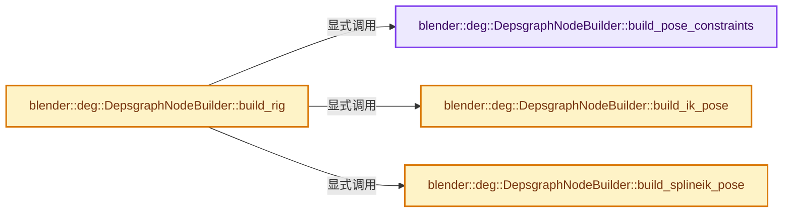
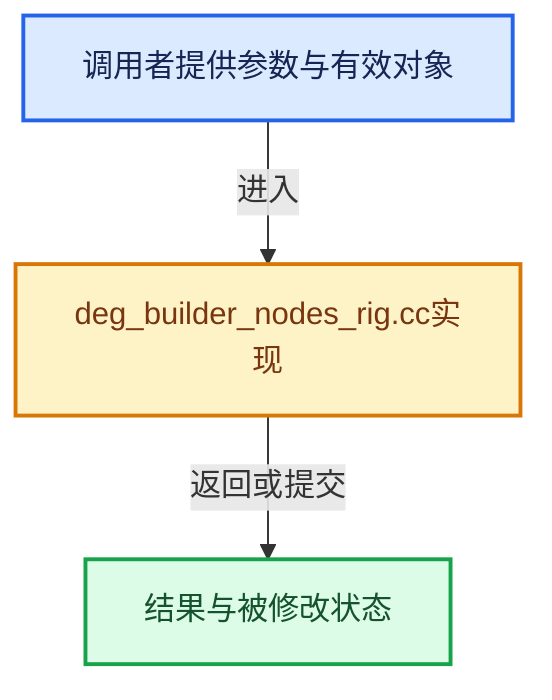

# 实现依赖专题：source/blender/depsgraph/intern/builder/deg_builder_nodes_rig.cc

[实现依赖导航](../../../README.md) · [符号索引](../../../../00-课程指南/02-源码与提交索引/符号依赖与实现索引.md)

本专题从正文实际调用进入，集中保存共享实现。函数有稳定锚点，可从调用处直接跳到对应完整函数；递归与互相调用通过回链组织。

## 本文件的实现关系






## 完整成员与函数实现

<a id="f-bc4e5b51d99f60af"></a>

### `blender::deg::DepsgraphNodeBuilder::build_pose_constraints`

实现位置：[source/blender/depsgraph/intern/builder/deg_builder_nodes_rig.cc](../../../../../../../../source/blender/depsgraph/intern/builder/deg_builder_nodes_rig.cc) · L37—L57。

接口参数：

- `Object *object`
- `bPoseChannel *pchan`
- `int pchan_index`

**教学注释版**

<!-- annotated:ad8dbba6cb5b29 -->

```cpp
void DepsgraphNodeBuilder::build_pose_constraints(Object *object,
                                                  bPoseChannel *pchan,
                                                  int pchan_index)
{
  /* Pull indirect dependencies via constraints. */
  BuilderWalkUserData data;
  data.builder = this;
  BKE_constraints_id_loop(&pchan->constraints, constraint_walk, IDWALK_NOP, &data);

  /* Create node for constraint stack. */
  Scene *scene_cow = get_cow_datablock(scene_);
  Object *object_cow = get_cow_datablock(object);
  add_operation_node(&object->id,
                     NodeType::BONE,
                     pchan->name,
                     OperationCode::BONE_CONSTRAINTS,
                     [scene_cow, object_cow, pchan_index](blender::Depsgraph *depsgraph) {
                       BKE_pose_constraints_evaluate(
                           depsgraph, scene_cow, object_cow, pchan_index);
                     });
}
```

<details>
<summary>核对原始源码：source/blender/depsgraph/intern/builder/deg_builder_nodes_rig.cc · L37—L57</summary>

<!-- original:ad8dbba6cb5b29:source/blender/depsgraph/intern/builder/deg_builder_nodes_rig.cc:37:57 -->

```cpp
void DepsgraphNodeBuilder::build_pose_constraints(Object *object,
                                                  bPoseChannel *pchan,
                                                  int pchan_index)
{
  /* Pull indirect dependencies via constraints. */
  BuilderWalkUserData data;
  data.builder = this;
  BKE_constraints_id_loop(&pchan->constraints, constraint_walk, IDWALK_NOP, &data);

  /* Create node for constraint stack. */
  Scene *scene_cow = get_cow_datablock(scene_);
  Object *object_cow = get_cow_datablock(object);
  add_operation_node(&object->id,
                     NodeType::BONE,
                     pchan->name,
                     OperationCode::BONE_CONSTRAINTS,
                     [scene_cow, object_cow, pchan_index](blender::Depsgraph *depsgraph) {
                       BKE_pose_constraints_evaluate(
                           depsgraph, scene_cow, object_cow, pchan_index);
                     });
}
```

</details>

**沿实际写入检查状态**

- `data.builder = this;`

**继续追踪实现**

- `BKE_constraints_id_loop` → [blender::BKE_constraints_id_loop · L6267](../../../02-BKE几何与数据/intern/constraint.cc.md#f-77ed04bc15846e57)。
- `get_cow_datablock` → [blender::deg::DepsgraphNodeBuilder::get_cow_datablock · L86](../../../../11-Depsgraph与并行任务系统/03-节点构建器.md#f-fdbde2485091dd6b)。
- `add_operation_node` → [blender::deg::DepsgraphNodeBuilder::add_operation_node · L239](../../../../11-Depsgraph与并行任务系统/03-节点构建器.md#f-af4bc9beff6a8947)；[blender::deg::DepsgraphNodeBuilder::add_operation_node · L261](../../../../11-Depsgraph与并行任务系统/03-节点构建器.md#f-83c337cd1005cd03)；[blender::deg::DepsgraphNodeBuilder::add_operation_node · L273](../../../../11-Depsgraph与并行任务系统/03-节点构建器.md#f-acdc3fdc26d9ecc3)。同名重载需按实参类型选择。
- `BKE_pose_constraints_evaluate` → [blender::BKE_pose_constraints_evaluate · L900](../../../02-BKE几何与数据/intern/armature_update.cc.md#f-b6be0e3b2ce69fa7)。

<a id="f-0cc500bb067ca502"></a>

### `blender::deg::DepsgraphNodeBuilder::build_ik_pose`

实现位置：[source/blender/depsgraph/intern/builder/deg_builder_nodes_rig.cc](../../../../../../../../source/blender/depsgraph/intern/builder/deg_builder_nodes_rig.cc) · L59—L88。

接口参数：

- `Object *object`
- `bPoseChannel *pchan`
- `bConstraint *con`

**教学注释版**

<!-- annotated:abe6e32babc0d1 -->

```cpp
void DepsgraphNodeBuilder::build_ik_pose(Object *object, bPoseChannel *pchan, bConstraint *con)
{
  bKinematicConstraint *data = static_cast<bKinematicConstraint *>(con->data);

  /* Find the chain's root. */
  bPoseChannel *rootchan = BKE_armature_ik_solver_find_root(pchan, data);
  if (rootchan == nullptr) {
    return;
  }

  if (has_operation_node(
          &object->id, NodeType::EVAL_POSE, rootchan->name, OperationCode::POSE_IK_SOLVER))
  {
    return;
  }

  int rootchan_index = BLI_findindex(&object->pose->chanbase, rootchan);
  BLI_assert(rootchan_index != -1);

  /* Operation node for evaluating/running IK Solver. */
  Scene *scene_cow = get_cow_datablock(scene_);
  Object *object_cow = get_cow_datablock(object);
  add_operation_node(&object->id,
                     NodeType::EVAL_POSE,
                     rootchan->name,
                     OperationCode::POSE_IK_SOLVER,
                     [scene_cow, object_cow, rootchan_index](blender::Depsgraph *depsgraph) {
                       BKE_pose_iktree_evaluate(depsgraph, scene_cow, object_cow, rootchan_index);
                     });
}
```

<details>
<summary>核对原始源码：source/blender/depsgraph/intern/builder/deg_builder_nodes_rig.cc · L59—L88</summary>

<!-- original:abe6e32babc0d1:source/blender/depsgraph/intern/builder/deg_builder_nodes_rig.cc:59:88 -->

```cpp
void DepsgraphNodeBuilder::build_ik_pose(Object *object, bPoseChannel *pchan, bConstraint *con)
{
  bKinematicConstraint *data = static_cast<bKinematicConstraint *>(con->data);

  /* Find the chain's root. */
  bPoseChannel *rootchan = BKE_armature_ik_solver_find_root(pchan, data);
  if (rootchan == nullptr) {
    return;
  }

  if (has_operation_node(
          &object->id, NodeType::EVAL_POSE, rootchan->name, OperationCode::POSE_IK_SOLVER))
  {
    return;
  }

  int rootchan_index = BLI_findindex(&object->pose->chanbase, rootchan);
  BLI_assert(rootchan_index != -1);

  /* Operation node for evaluating/running IK Solver. */
  Scene *scene_cow = get_cow_datablock(scene_);
  Object *object_cow = get_cow_datablock(object);
  add_operation_node(&object->id,
                     NodeType::EVAL_POSE,
                     rootchan->name,
                     OperationCode::POSE_IK_SOLVER,
                     [scene_cow, object_cow, rootchan_index](blender::Depsgraph *depsgraph) {
                       BKE_pose_iktree_evaluate(depsgraph, scene_cow, object_cow, rootchan_index);
                     });
}
```

</details>

**继续追踪实现**

- `BKE_armature_ik_solver_find_root` → [blender::BKE_armature_ik_solver_find_root · L3423](../../../02-BKE几何与数据/intern/armature.cc.md#f-c3a2d7da0a6ce805)。
- `has_operation_node` → [blender::deg::DepsgraphNodeBuilder::has_operation_node · L312](../../../../11-Depsgraph与并行任务系统/03-节点构建器.md#f-eee9c9f65d2fdde9)；[blender::deg::DepsgraphNodeBuilder::has_operation_node · L322](../../../../11-Depsgraph与并行任务系统/03-节点构建器.md#f-52b6e2cb3adb3ff5)。同名重载需按实参类型选择。
- `BLI_findindex` → [blender::BLI_findindex · L593](../../../01-BLI基础库/intern/listbase.cc.md#f-cb9036f12bd486b7)。
- `BLI_assert` → [BLI_assert · L48](../../../01-BLI基础库/BLI_assert.hh.md#m-57a88495704d)；[BLI_assert · L63](../../../01-BLI基础库/BLI_assert.hh.md#m-d07050020cb5)。宏定义由构建条件选择。
- `get_cow_datablock` → [blender::deg::DepsgraphNodeBuilder::get_cow_datablock · L86](../../../../11-Depsgraph与并行任务系统/03-节点构建器.md#f-fdbde2485091dd6b)。
- `add_operation_node` → [blender::deg::DepsgraphNodeBuilder::add_operation_node · L239](../../../../11-Depsgraph与并行任务系统/03-节点构建器.md#f-af4bc9beff6a8947)；[blender::deg::DepsgraphNodeBuilder::add_operation_node · L261](../../../../11-Depsgraph与并行任务系统/03-节点构建器.md#f-83c337cd1005cd03)；[blender::deg::DepsgraphNodeBuilder::add_operation_node · L273](../../../../11-Depsgraph与并行任务系统/03-节点构建器.md#f-acdc3fdc26d9ecc3)。同名重载需按实参类型选择。
- `BKE_pose_iktree_evaluate` → [blender::BKE_pose_iktree_evaluate · L995](../../../02-BKE几何与数据/intern/armature_update.cc.md#f-ba6690804b74434e)。

<a id="f-fe825713be96b3da"></a>

### `blender::deg::DepsgraphNodeBuilder::build_splineik_pose`

实现位置：[source/blender/depsgraph/intern/builder/deg_builder_nodes_rig.cc](../../../../../../../../source/blender/depsgraph/intern/builder/deg_builder_nodes_rig.cc) · L90—L121。

接口参数：

- `Object *object`
- `bPoseChannel *pchan`
- `bConstraint *con`

**教学注释版**

<!-- annotated:705d8f077c6f22 -->

```cpp
void DepsgraphNodeBuilder::build_splineik_pose(Object *object,
                                               bPoseChannel *pchan,
                                               bConstraint *con)
{
  bSplineIKConstraint *data = static_cast<bSplineIKConstraint *>(con->data);

  /* Find the chain's root. */
  bPoseChannel *rootchan = BKE_armature_splineik_solver_find_root(pchan, data);

  if (has_operation_node(
          &object->id, NodeType::EVAL_POSE, rootchan->name, OperationCode::POSE_SPLINE_IK_SOLVER))
  {
    return;
  }

  /* Operation node for evaluating/running Spline IK Solver.
   * Store the "root bone" of this chain in the solver, so it knows where to
   * start. */
  int rootchan_index = BLI_findindex(&object->pose->chanbase, rootchan);
  BLI_assert(rootchan_index != -1);

  Scene *scene_cow = get_cow_datablock(scene_);
  Object *object_cow = get_cow_datablock(object);
  add_operation_node(&object->id,
                     NodeType::EVAL_POSE,
                     rootchan->name,
                     OperationCode::POSE_SPLINE_IK_SOLVER,
                     [scene_cow, object_cow, rootchan_index](blender::Depsgraph *depsgraph) {
                       BKE_pose_splineik_evaluate(
                           depsgraph, scene_cow, object_cow, rootchan_index);
                     });
}
```

<details>
<summary>核对原始源码：source/blender/depsgraph/intern/builder/deg_builder_nodes_rig.cc · L90—L121</summary>

<!-- original:705d8f077c6f22:source/blender/depsgraph/intern/builder/deg_builder_nodes_rig.cc:90:121 -->

```cpp
void DepsgraphNodeBuilder::build_splineik_pose(Object *object,
                                               bPoseChannel *pchan,
                                               bConstraint *con)
{
  bSplineIKConstraint *data = static_cast<bSplineIKConstraint *>(con->data);

  /* Find the chain's root. */
  bPoseChannel *rootchan = BKE_armature_splineik_solver_find_root(pchan, data);

  if (has_operation_node(
          &object->id, NodeType::EVAL_POSE, rootchan->name, OperationCode::POSE_SPLINE_IK_SOLVER))
  {
    return;
  }

  /* Operation node for evaluating/running Spline IK Solver.
   * Store the "root bone" of this chain in the solver, so it knows where to
   * start. */
  int rootchan_index = BLI_findindex(&object->pose->chanbase, rootchan);
  BLI_assert(rootchan_index != -1);

  Scene *scene_cow = get_cow_datablock(scene_);
  Object *object_cow = get_cow_datablock(object);
  add_operation_node(&object->id,
                     NodeType::EVAL_POSE,
                     rootchan->name,
                     OperationCode::POSE_SPLINE_IK_SOLVER,
                     [scene_cow, object_cow, rootchan_index](blender::Depsgraph *depsgraph) {
                       BKE_pose_splineik_evaluate(
                           depsgraph, scene_cow, object_cow, rootchan_index);
                     });
}
```

</details>

**继续追踪实现**

- `BKE_armature_splineik_solver_find_root` → [blender::BKE_armature_splineik_solver_find_root · L3444](../../../02-BKE几何与数据/intern/armature.cc.md#f-bd3fa009b5204320)。
- `has_operation_node` → [blender::deg::DepsgraphNodeBuilder::has_operation_node · L312](../../../../11-Depsgraph与并行任务系统/03-节点构建器.md#f-eee9c9f65d2fdde9)；[blender::deg::DepsgraphNodeBuilder::has_operation_node · L322](../../../../11-Depsgraph与并行任务系统/03-节点构建器.md#f-52b6e2cb3adb3ff5)。同名重载需按实参类型选择。
- `BLI_findindex` → [blender::BLI_findindex · L593](../../../01-BLI基础库/intern/listbase.cc.md#f-cb9036f12bd486b7)。
- `BLI_assert` → [BLI_assert · L48](../../../01-BLI基础库/BLI_assert.hh.md#m-57a88495704d)；[BLI_assert · L63](../../../01-BLI基础库/BLI_assert.hh.md#m-d07050020cb5)。宏定义由构建条件选择。
- `get_cow_datablock` → [blender::deg::DepsgraphNodeBuilder::get_cow_datablock · L86](../../../../11-Depsgraph与并行任务系统/03-节点构建器.md#f-fdbde2485091dd6b)。
- `add_operation_node` → [blender::deg::DepsgraphNodeBuilder::add_operation_node · L239](../../../../11-Depsgraph与并行任务系统/03-节点构建器.md#f-af4bc9beff6a8947)；[blender::deg::DepsgraphNodeBuilder::add_operation_node · L261](../../../../11-Depsgraph与并行任务系统/03-节点构建器.md#f-83c337cd1005cd03)；[blender::deg::DepsgraphNodeBuilder::add_operation_node · L273](../../../../11-Depsgraph与并行任务系统/03-节点构建器.md#f-acdc3fdc26d9ecc3)。同名重载需按实参类型选择。
- `BKE_pose_splineik_evaluate` → [blender::BKE_pose_splineik_evaluate · L1015](../../../02-BKE几何与数据/intern/armature_update.cc.md#f-a51e90ca1997f8a3)。

<a id="f-69b3e49c07d44bfe"></a>

### `blender::deg::DepsgraphNodeBuilder::build_rig`

实现位置：[source/blender/depsgraph/intern/builder/deg_builder_nodes_rig.cc](../../../../../../../../source/blender/depsgraph/intern/builder/deg_builder_nodes_rig.cc) · L124—L300。

接口参数：

- `Object *object`

**教学注释版**

<!-- annotated:769bbae2f27baa -->

```cpp
void DepsgraphNodeBuilder::build_rig(Object *object)
{
  bArmature *armature = id_cast<bArmature *>(object->data);
  Scene *scene_cow = get_cow_datablock(scene_);
  Object *object_cow = get_cow_datablock(object);
  OperationNode *op_node;
  /* Animation and/or drivers linking pose-bones to base-armature used to define them.
   *
   * NOTE: AnimData here is really used to control animated deform properties,
   *       which ideally should be able to be unique across different
   *       instances. Eventually, we need some type of proxy/isolation
   *       mechanism in-between here to ensure that we can use same rig
   *       multiple times in same scene. */
  /* Armature. */
  build_armature(armature);
  /* Rebuild pose if not up to date. */
  if (object->pose == nullptr || (object->pose->flag & POSE_RECALC)) {
    /* By definition, no need to tag depsgraph as dirty from here, so we can pass nullptr bmain. */
    BKE_pose_rebuild(nullptr, object, armature, true);
  }
  else {
    /* Ensure the pose bone indices are up to date, so that the rest of the depsgraph building code
     * can use `pchan->bone_get(armature)`, which is faster than passing the object. */
    BKE_pose_ensure_bone_indices(*object);
  }

  /* Speed optimization for animation lookups. */
  if (object->pose != nullptr) {
    BKE_pose_channels_hash_ensure(object->pose);
    if (object->pose->flag & POSE_CONSTRAINTS_NEED_UPDATE_FLAGS) {
      BKE_pose_update_constraint_flags(*object);
    }
  }
  /* Pose Rig Graph
   * ==============
   *
   * Pose Component:
   * - Mainly used for referencing Bone components.
   * - This is where the evaluation operations for init/exec/cleanup
   *   (ik) solvers live, and are later hooked up (so that they can be
   *   interleaved during runtime) with bone-operations they depend on/affect.
   * - init_pose_eval() and cleanup_pose_eval() are absolute first and last
   *   steps of pose eval process. ALL bone operations must be performed
   *   between these two...
   *
   * Bone Component:
   * - Used for representing each bone within the rig
   * - Acts to encapsulate the evaluation operations (base matrix + parenting,
   *   and constraint stack) so that they can be easily found.
   * - Everything else which depends on bone-results hook up to the component
   *   only so that we can redirect those to point at either the
   *   post-IK/post-constraint/post-matrix steps, as needed. */
  /* Pose eval context. */
  op_node = add_operation_node(&object->id,
                               NodeType::EVAL_POSE,
                               OperationCode::POSE_INIT,
                               [scene_cow, object_cow](blender::Depsgraph *depsgraph) {
                                 BKE_pose_eval_init(depsgraph, scene_cow, object_cow);
                               });
  op_node->set_as_entry();

  op_node = add_operation_node(&object->id,
                               NodeType::EVAL_POSE,
                               OperationCode::POSE_INIT_IK,
                               [scene_cow, object_cow](blender::Depsgraph *depsgraph) {
                                 BKE_pose_eval_init_ik(depsgraph, scene_cow, object_cow);
                               });

  add_operation_node(&object->id,
                     NodeType::EVAL_POSE,
                     OperationCode::POSE_CLEANUP,
                     [scene_cow, object_cow](blender::Depsgraph *depsgraph) {
                       BKE_pose_eval_cleanup(depsgraph, scene_cow, object_cow);
                     });

  op_node = add_operation_node(
      &object->id,
      NodeType::EVAL_POSE,
      OperationCode::POSE_DONE,
      [object_cow](blender::Depsgraph *depsgraph) { BKE_pose_eval_done(depsgraph, object_cow); });
  op_node->set_as_exit();
  /* Bones. */
  int pchan_index = 0;
  for (bPoseChannel &pchan : object->pose->chanbase) {
    /* Node for bone evaluation. */
    op_node = add_operation_node(
        &object->id, NodeType::BONE, pchan.name, OperationCode::BONE_LOCAL);
    op_node->set_as_entry();

    /* Add a separate node for bone visibility. Getting the visibility doesn't need the pose of the
     * bone to be evaluated, so drivers that target the bone's "hide" RNA property can depend on
     * this operation, rather than the BONE_LOCAL node. See #152121. */
    add_operation_node(&object->id, NodeType::BONE, pchan.name, OperationCode::BONE_VISIBILITY);

    add_operation_node(&object->id,
                       NodeType::BONE,
                       pchan.name,
                       OperationCode::BONE_POSE_PARENT,
                       [scene_cow, object_cow, pchan_index](blender::Depsgraph *depsgraph) {
                         BKE_pose_eval_bone(depsgraph, scene_cow, object_cow, pchan_index);
                       });

    /* NOTE: Dedicated noop for easier relationship construction. */
    add_operation_node(&object->id, NodeType::BONE, pchan.name, OperationCode::BONE_READY);

    op_node = add_operation_node(&object->id,
                                 NodeType::BONE,
                                 pchan.name,
                                 OperationCode::BONE_DONE,
                                 [object_cow, pchan_index](blender::Depsgraph *depsgraph) {
                                   BKE_pose_bone_done(depsgraph, object_cow, pchan_index);
                                 });

    /* B-Bone shape computation - the real last step if present. */
    if (check_pchan_has_bbone(object, &pchan)) {
      op_node = add_operation_node(&object->id,
                                   NodeType::BONE,
                                   pchan.name,
                                   OperationCode::BONE_SEGMENTS,
                                   [object_cow, pchan_index](blender::Depsgraph *depsgraph) {
                                     BKE_pose_eval_bbone_segments(
                                         depsgraph, object_cow, pchan_index);
                                   });
    }

    op_node->set_as_exit();

    /* Custom properties. */
    bool add_idprops_operation = false;
    if (pchan.prop != nullptr) {
      build_idproperties(pchan.prop);
      add_idprops_operation = true;
    }
    if (pchan.system_properties != nullptr) {
      build_idproperties(pchan.system_properties);
      add_idprops_operation = true;
    }
    if (add_idprops_operation) {
      add_operation_node(
          &object->id, NodeType::PARAMETERS, OperationCode::PARAMETERS_EVAL, nullptr, pchan.name);
    }
    /* Build constraints. */
    if (pchan.constraints.first() != nullptr) {
      build_pose_constraints(object, &pchan, pchan_index);
    }
    /* IK Solvers.
     *
     * - These require separate processing steps are pose-level
     *   to be executed between chains of bones (i.e. once the
     *   base transforms of a bunch of bones is done)
     *
     * Unsolved Issues:
     * - Care is needed to ensure that multi-headed trees work out the same
     *   as in ik-tree building
     * - Animated chain-lengths are a problem. */
    for (bConstraint &con : pchan.constraints) {
      switch (con.type) {
        case CONSTRAINT_TYPE_KINEMATIC:
          build_ik_pose(object, &pchan, &con);
          break;

        case CONSTRAINT_TYPE_SPLINEIK:
          build_splineik_pose(object, &pchan, &con);
          break;

        default:
          break;
      }
    }
    /* Custom shape. */
    if (pchan.custom != nullptr) {
      /* NOTE: The relation builder will ensure visibility of the custom shape object. */
      build_object(-1, pchan.custom, DEG_ID_LINKED_INDIRECTLY, false);
    }
    pchan_index++;
  }
}
```

<details>
<summary>核对原始源码：source/blender/depsgraph/intern/builder/deg_builder_nodes_rig.cc · L124—L300</summary>

<!-- original:769bbae2f27baa:source/blender/depsgraph/intern/builder/deg_builder_nodes_rig.cc:124:300 -->

```cpp
void DepsgraphNodeBuilder::build_rig(Object *object)
{
  bArmature *armature = id_cast<bArmature *>(object->data);
  Scene *scene_cow = get_cow_datablock(scene_);
  Object *object_cow = get_cow_datablock(object);
  OperationNode *op_node;
  /* Animation and/or drivers linking pose-bones to base-armature used to define them.
   *
   * NOTE: AnimData here is really used to control animated deform properties,
   *       which ideally should be able to be unique across different
   *       instances. Eventually, we need some type of proxy/isolation
   *       mechanism in-between here to ensure that we can use same rig
   *       multiple times in same scene. */
  /* Armature. */
  build_armature(armature);
  /* Rebuild pose if not up to date. */
  if (object->pose == nullptr || (object->pose->flag & POSE_RECALC)) {
    /* By definition, no need to tag depsgraph as dirty from here, so we can pass nullptr bmain. */
    BKE_pose_rebuild(nullptr, object, armature, true);
  }
  else {
    /* Ensure the pose bone indices are up to date, so that the rest of the depsgraph building code
     * can use `pchan->bone_get(armature)`, which is faster than passing the object. */
    BKE_pose_ensure_bone_indices(*object);
  }

  /* Speed optimization for animation lookups. */
  if (object->pose != nullptr) {
    BKE_pose_channels_hash_ensure(object->pose);
    if (object->pose->flag & POSE_CONSTRAINTS_NEED_UPDATE_FLAGS) {
      BKE_pose_update_constraint_flags(*object);
    }
  }
  /* Pose Rig Graph
   * ==============
   *
   * Pose Component:
   * - Mainly used for referencing Bone components.
   * - This is where the evaluation operations for init/exec/cleanup
   *   (ik) solvers live, and are later hooked up (so that they can be
   *   interleaved during runtime) with bone-operations they depend on/affect.
   * - init_pose_eval() and cleanup_pose_eval() are absolute first and last
   *   steps of pose eval process. ALL bone operations must be performed
   *   between these two...
   *
   * Bone Component:
   * - Used for representing each bone within the rig
   * - Acts to encapsulate the evaluation operations (base matrix + parenting,
   *   and constraint stack) so that they can be easily found.
   * - Everything else which depends on bone-results hook up to the component
   *   only so that we can redirect those to point at either the
   *   post-IK/post-constraint/post-matrix steps, as needed. */
  /* Pose eval context. */
  op_node = add_operation_node(&object->id,
                               NodeType::EVAL_POSE,
                               OperationCode::POSE_INIT,
                               [scene_cow, object_cow](blender::Depsgraph *depsgraph) {
                                 BKE_pose_eval_init(depsgraph, scene_cow, object_cow);
                               });
  op_node->set_as_entry();

  op_node = add_operation_node(&object->id,
                               NodeType::EVAL_POSE,
                               OperationCode::POSE_INIT_IK,
                               [scene_cow, object_cow](blender::Depsgraph *depsgraph) {
                                 BKE_pose_eval_init_ik(depsgraph, scene_cow, object_cow);
                               });

  add_operation_node(&object->id,
                     NodeType::EVAL_POSE,
                     OperationCode::POSE_CLEANUP,
                     [scene_cow, object_cow](blender::Depsgraph *depsgraph) {
                       BKE_pose_eval_cleanup(depsgraph, scene_cow, object_cow);
                     });

  op_node = add_operation_node(
      &object->id,
      NodeType::EVAL_POSE,
      OperationCode::POSE_DONE,
      [object_cow](blender::Depsgraph *depsgraph) { BKE_pose_eval_done(depsgraph, object_cow); });
  op_node->set_as_exit();
  /* Bones. */
  int pchan_index = 0;
  for (bPoseChannel &pchan : object->pose->chanbase) {
    /* Node for bone evaluation. */
    op_node = add_operation_node(
        &object->id, NodeType::BONE, pchan.name, OperationCode::BONE_LOCAL);
    op_node->set_as_entry();

    /* Add a separate node for bone visibility. Getting the visibility doesn't need the pose of the
     * bone to be evaluated, so drivers that target the bone's "hide" RNA property can depend on
     * this operation, rather than the BONE_LOCAL node. See #152121. */
    add_operation_node(&object->id, NodeType::BONE, pchan.name, OperationCode::BONE_VISIBILITY);

    add_operation_node(&object->id,
                       NodeType::BONE,
                       pchan.name,
                       OperationCode::BONE_POSE_PARENT,
                       [scene_cow, object_cow, pchan_index](blender::Depsgraph *depsgraph) {
                         BKE_pose_eval_bone(depsgraph, scene_cow, object_cow, pchan_index);
                       });

    /* NOTE: Dedicated noop for easier relationship construction. */
    add_operation_node(&object->id, NodeType::BONE, pchan.name, OperationCode::BONE_READY);

    op_node = add_operation_node(&object->id,
                                 NodeType::BONE,
                                 pchan.name,
                                 OperationCode::BONE_DONE,
                                 [object_cow, pchan_index](blender::Depsgraph *depsgraph) {
                                   BKE_pose_bone_done(depsgraph, object_cow, pchan_index);
                                 });

    /* B-Bone shape computation - the real last step if present. */
    if (check_pchan_has_bbone(object, &pchan)) {
      op_node = add_operation_node(&object->id,
                                   NodeType::BONE,
                                   pchan.name,
                                   OperationCode::BONE_SEGMENTS,
                                   [object_cow, pchan_index](blender::Depsgraph *depsgraph) {
                                     BKE_pose_eval_bbone_segments(
                                         depsgraph, object_cow, pchan_index);
                                   });
    }

    op_node->set_as_exit();

    /* Custom properties. */
    bool add_idprops_operation = false;
    if (pchan.prop != nullptr) {
      build_idproperties(pchan.prop);
      add_idprops_operation = true;
    }
    if (pchan.system_properties != nullptr) {
      build_idproperties(pchan.system_properties);
      add_idprops_operation = true;
    }
    if (add_idprops_operation) {
      add_operation_node(
          &object->id, NodeType::PARAMETERS, OperationCode::PARAMETERS_EVAL, nullptr, pchan.name);
    }
    /* Build constraints. */
    if (pchan.constraints.first() != nullptr) {
      build_pose_constraints(object, &pchan, pchan_index);
    }
    /* IK Solvers.
     *
     * - These require separate processing steps are pose-level
     *   to be executed between chains of bones (i.e. once the
     *   base transforms of a bunch of bones is done)
     *
     * Unsolved Issues:
     * - Care is needed to ensure that multi-headed trees work out the same
     *   as in ik-tree building
     * - Animated chain-lengths are a problem. */
    for (bConstraint &con : pchan.constraints) {
      switch (con.type) {
        case CONSTRAINT_TYPE_KINEMATIC:
          build_ik_pose(object, &pchan, &con);
          break;

        case CONSTRAINT_TYPE_SPLINEIK:
          build_splineik_pose(object, &pchan, &con);
          break;

        default:
          break;
      }
    }
    /* Custom shape. */
    if (pchan.custom != nullptr) {
      /* NOTE: The relation builder will ensure visibility of the custom shape object. */
      build_object(-1, pchan.custom, DEG_ID_LINKED_INDIRECTLY, false);
    }
    pchan_index++;
  }
}
```

</details>

**沿实际写入检查状态**

- `op_node = add_operation_node(&object->id,`
- `op_node = add_operation_node(`
- `add_idprops_operation = true;`

**继续追踪实现**

- `id_cast<bArmature *>` → [blender::id_cast · L1417](../../../08-其他Blender模块/makesdna/DNA_ID.h.md#f-6c8ac6412850ac5a)。
- `get_cow_datablock` → [blender::deg::DepsgraphNodeBuilder::get_cow_datablock · L86](../../../../11-Depsgraph与并行任务系统/03-节点构建器.md#f-fdbde2485091dd6b)。
- `build_armature` → [blender::deg::DepsgraphRelationBuilder::build_armature · L2915](../../../../11-Depsgraph与并行任务系统/04-关系构建器.md#f-96a6ff7467e2302e)；[blender::deg::DepsgraphNodeBuilder::build_armature · L1928](../../../../11-Depsgraph与并行任务系统/03-节点构建器.md#f-e5e2dac6c811db8a)。同名重载需按实参类型选择。
- `BKE_pose_rebuild` → [blender::BKE_pose_rebuild · L3011](../../../02-BKE几何与数据/intern/armature.cc.md#f-7ff4f18d4e1279e4)。
- `BKE_pose_ensure_bone_indices` → [blender::BKE_pose_ensure_bone_indices · L3103](../../../02-BKE几何与数据/intern/armature.cc.md#f-642aaede7e1310c6)。
- `BKE_pose_channels_hash_ensure` → [blender::BKE_pose_channels_hash_ensure · L1248](../../../02-BKE几何与数据/intern/action.cc.md#f-130a100a8cddedd0)。
- `BKE_pose_update_constraint_flags` → [blender::BKE_pose_update_constraint_flags · L1527](../../../02-BKE几何与数据/intern/action.cc.md#f-9badb2235a873e05)。
- `add_operation_node` → [blender::deg::DepsgraphNodeBuilder::add_operation_node · L239](../../../../11-Depsgraph与并行任务系统/03-节点构建器.md#f-af4bc9beff6a8947)；[blender::deg::DepsgraphNodeBuilder::add_operation_node · L261](../../../../11-Depsgraph与并行任务系统/03-节点构建器.md#f-83c337cd1005cd03)；[blender::deg::DepsgraphNodeBuilder::add_operation_node · L273](../../../../11-Depsgraph与并行任务系统/03-节点构建器.md#f-acdc3fdc26d9ecc3)。同名重载需按实参类型选择。
- `BKE_pose_eval_init` → [blender::BKE_pose_eval_init · L817](../../../02-BKE几何与数据/intern/armature_update.cc.md#f-6788e4e85cc80ace)。
- `op_node->set_as_entry` → [blender::deg::OperationNode::set_as_entry · L266](../node/deg_node_operation.cc.md#f-409e4d2b4b6601dd)。
- `BKE_pose_eval_init_ik` → [blender::BKE_pose_eval_init_ik · L847](../../../02-BKE几何与数据/intern/armature_update.cc.md#f-90dd2bd9e4d3c3fe)。
- `BKE_pose_eval_cleanup` → [blender::BKE_pose_eval_cleanup · L1053](../../../02-BKE几何与数据/intern/armature_update.cc.md#f-7e8e147cc1715dcf)。
- `BKE_pose_eval_done` → [blender::BKE_pose_eval_done · L1044](../../../02-BKE几何与数据/intern/armature_update.cc.md#f-b68268c2d2da860f)。
- `op_node->set_as_exit` → [blender::deg::OperationNode::set_as_exit · L272](../node/deg_node_operation.cc.md#f-81d218c564f287d5)。
- `BKE_pose_eval_bone` → [blender::BKE_pose_eval_bone · L864](../../../02-BKE几何与数据/intern/armature_update.cc.md#f-6c71bb8e9318bb40)。
- `BKE_pose_bone_done` → [blender::BKE_pose_bone_done · L947](../../../02-BKE几何与数据/intern/armature_update.cc.md#f-458ab275385232fe)。
- `check_pchan_has_bbone` → [blender::deg::DepsgraphBuilder::check_pchan_has_bbone · L116](deg_builder.cc.md#f-82db2501b96f01e4)。
- `BKE_pose_eval_bbone_segments` → [blender::BKE_pose_eval_bbone_segments · L977](../../../02-BKE几何与数据/intern/armature_update.cc.md#f-3f2aa9c62a2829c0)。
- `build_idproperties` → [blender::deg::DepsgraphRelationBuilder::build_idproperties · L635](../../../../11-Depsgraph与并行任务系统/04-关系构建器.md#f-098c28c24f9a599e)；[blender::deg::DepsgraphNodeBuilder::build_idproperties · L685](../../../../11-Depsgraph与并行任务系统/03-节点构建器.md#f-cff75bdb39624564)。同名重载需按实参类型选择。
- `pchan.constraints.first` → [调用协议](../../../../00-课程指南/01-路线与规范/模板宏与动态分派协议.md)：接收对象类型依赖auto、返回值或模板实例；不按同名猜测目标。调用位置L266。
- `build_pose_constraints` → [blender::deg::DepsgraphNodeBuilder::build_pose_constraints · L37](deg_builder_nodes_rig.cc.md#f-bc4e5b51d99f60af)。
- `build_ik_pose` → [blender::deg::DepsgraphNodeBuilder::build_ik_pose · L59](deg_builder_nodes_rig.cc.md#f-0cc500bb067ca502)。
- `build_splineik_pose` → [blender::deg::DepsgraphNodeBuilder::build_splineik_pose · L90](deg_builder_nodes_rig.cc.md#f-fe825713be96b3da)。
- `build_object` → [blender::deg::DepsgraphRelationBuilder::build_object · L738](../../../../11-Depsgraph与并行任务系统/04-关系构建器.md#f-0ddc4dbd91400df3)；[blender::deg::DepsgraphNodeBuilder::build_object · L751](../../../../11-Depsgraph与并行任务系统/03-节点构建器.md#f-61a6bd9952a2c7da)。同名重载需按实参类型选择。
